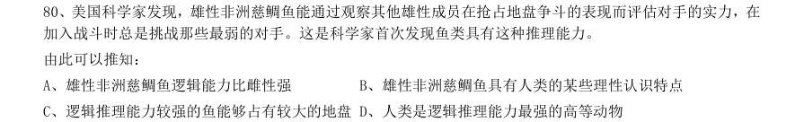
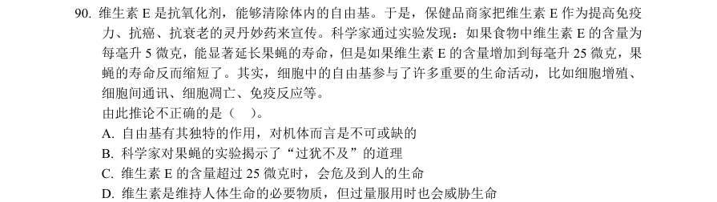
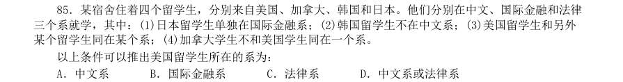

# 判断推理 · 科学推理 · 2000 年代真题

> 所属考点：[PD-KX](../PD-KX-科学推理.md)　｜　本片 3 题

> 本片子考点：物理 2　科学推理（综合） 1

### 2009 湖北·统一卷　第 80 题　（物理）

美国科学家发现,雄性非洲慈鲷鱼能通过观察其他雄性成员在抢占地盘争斗的表现而评估对手的实力,在 加入战斗时总是挑战那些最弱的对手。这是科学家首次发现鱼类具有这种推理能力。 由此可以推知:

- **A.** 雄性非洲慈鲷鱼逻辑能力比雌性强
- **B.** 雄性非洲慈鲷鱼具有人类的某些理性认识特点
- **C.** 逻辑推理能力较强的鱼能够占有较大的地盘D、人类是逻辑推理能力最强的高等动物

**答案：B**

### 2006 国考·统一卷　第 90 题　（物理）

维生素E 是抗氧化剂,能够清除体内的自由基。于是,保健品商家把维生素E 作为提高免疫 力、抗癌、抗衰老的灵丹妙药来宣传。科学家通过实验发现:如果食物中维生素E 的含量为 每毫升5 微克,能显著延长果蝇的寿命,但是如果维生素E 的含量增加到每毫升25 微克,果 蝇的寿命反而缩短了。其实,细胞中的自由基参与了许多重要的生命活动,比如细胞增殖、 细胞间通讯、细胞凋亡、免疫反应等。 由此推论不正确的是( )。

- **A.** 自由基有其独特的作用,对机体而言是不可或缺的
- **B.** 科学家对果蝇的实验揭示了“过犹不及”的道理
- **C.** 维生素E 的含量超过25 微克时,会危及到人的生命
- **D.** 维生素是维持人体生命的必要物质,但过量服用时也会威胁生命

**答案：C**

### 2004 广东·统一卷　第 85 题　（科学推理（综合））

有M、N、O、P 四个朋友,他们分别是音乐家、科学家、天文学家和逻辑学家。在少年时代, 他们曾经在一起对未来做过?,当时,M?说:N 无论如何也成不了科学家。N?说:O 将来要做逻辑学家。 O?说:P 不会成为音乐家。P?说:N 成不了天文学家。事实上,只有逻辑学家一个人?对了。那么,这 四位朋友都是什么“家”呢?

- **A.** M 是逻辑学家,N 是天文学家,O 是科学家,P 是音乐家
- **B.** N 是逻辑学家,P 是天文学家, M 是科学家,O 是音乐家
- **C.** O 是逻辑学家,M 是天文学家,P 是科学家,N 是音乐家
- **D.** P 是逻辑学家,O 是天文学家,N 是科学家,M 是音乐家

**答案：暂缺**
