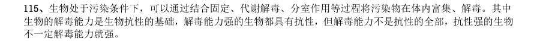

# 判断推理 · 科学推理 · 2010 年代真题

> 所属考点：[PD-KX](../PD-KX-科学推理.md)　｜　本片 1 题

### 2013 国考·统一卷　第 115 题　（物理）

生物处于污染条件下,可以通过结合固定、代谢解毒、分室作用等过程将污染物在体内富集、解毒。其中 生物的解毒能力是生物抗性的基础,解毒能力强的生物都具有抗性,但解毒能力不是抗性的全部,抗性强的生物 不一定解毒能力就强。 由此可以推知:

- **A.** 解毒能力不强的生物不具有抗性
- **B.** 具有抗性的生物一定具有较强的解毒能力
- **C.** 生物可将污染物富集、解毒,所以生物能在污染环境下生存
- **D.** 不具有抗性的生物解毒能力一定不强

**答案：D**
