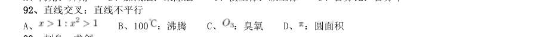
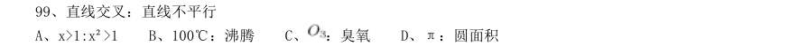
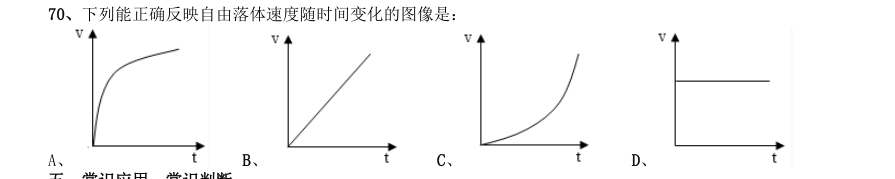
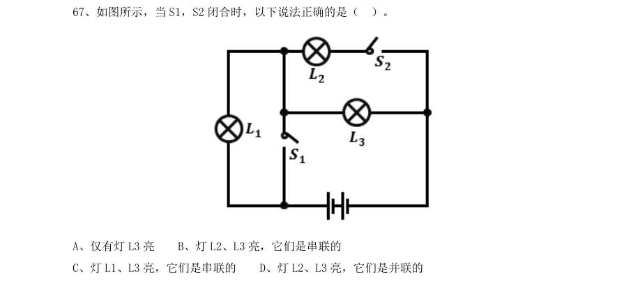
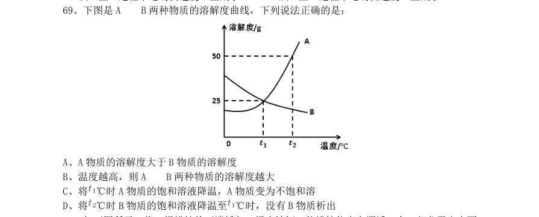

# 判断推理 · 类比推理 · 2010 年代真题

> 所属考点：[PD-LB](../PD-LB-类比推理.md)　｜　本片 388 题

> 本片子考点：类比推理（综合） 181　逻辑关系 78　对应关系 72　语义关系 54　程度与词性 3

### 【2019 湖北省考·第 84 题】HB-2019-ty-X084　类比推理｜语义关系

拥挤:水泄不通

- **A.** 清晰:洞见肺腑
- **B.** 严重:触目惊心
- **C.** 费力:举重若轻
- **D.** 伤心:肝肠寸断

**答案：D**

### 【2019 湖北省考·第 85 题】HB-2019-ty-X085　类比推理｜语义关系

成长:衰亡

- **A.** 坚定:彷徨
- **B.** 美好:苦难
- **C.** 深刻:纯真
- **D.** 复杂:单纯

**答案：B**

### 【2019 湖北省考·第 86 题】HB-2019-ty-X086　类比推理｜对应关系

孤本:书籍

- **A.** 正方形:长方形
- **B.** 蔬菜:土地
- **C.** 显微镜:实验室
- **D.** 礼物:商品

**答案：A**

### 【2019 湖北省考·第 87 题】HB-2019-ty-X087　类比推理｜类比推理（综合）

玻璃幕墙:光污染

- **A.** 汽车尾气:酸雨
- **B.** 海上风暴:海啸
- **C.** 火山喷发:地震
- **D.** 空气消毒:臭氧

**答案：A**

### 【2019 湖北省考·第 88 题】HB-2019-ty-X088　类比推理｜类比推理（综合）

老字号:新品牌:传承

- **A.** 老传统:新花样:质疑
- **B.** 老配方:新工艺:创新
- **C.** 老问题:新思考:评价
- **D.** 老物件:新东西:区分

**答案：B**

### 【2019 湖北省考·第 89 题】HB-2019-ty-X089　类比推理｜对应关系

人烟辐辏:鸡犬相闻:繁盛

- **A.** 人迹罕至:门可罗雀:荒凉
- **B.** 筑巢引凤:腾笼换鸟:友善
- **C.** 战马长矛:坚船利炮:强大
- **D.** 大国工匠:小国寡民:专注

**答案：A**

### 【2019 湖北省考·第 90 题】HB-2019-ty-X090　类比推理｜对应关系

鞋匠:缝纫机:大头皮鞋

- **A.** 厨师:炒菜锅:青椒炒肉
- **B.** 矿工:十字镐:钙铁榴石
- **C.** 记者:录音笔:高端访谈
- **D.** 园丁:洒水壶:鹿角海棠

**答案：A**

### 【2019 湖北省考·第 92 题】HB-2019-ty-X092　类比推理｜语义关系

瓮牖绳枢:粗茶淡饭:清寒

- **A.** 叠床架屋:衣锦食肉:奢华
- **B.** 箪食瓢饮:曲肱饮水:简朴
- **C.** 轻车熟路:霜行草宿:轻松
- **D.** 金盆洗手:金屋藏娇:阔绰

**答案：B**

### 【2019 湖北省考·第 93 题】HB-2019-ty-X093　类比推理｜语义关系

巾帼 之于 () 相当于 () 之于 监狱

- **A.** 须眉;囚犯
- **B.** 英雄;犯罪
- **C.** 女子;铁窗
- **D.** 头饰;惩罚

**答案：C**

### 【2019 湖北省考·第 94 题】HB-2019-ty-X094　类比推理｜语义关系

( ) 对于 幸灾乐祸 相当于 怨天尤人 对于 ( )

- **A.** 得意忘形;呼天号地
- **B.** 乐极生悲;饮恨吞声
- **C.** 兔死狐悲;乐天知命
- **D.** 睚眦必报;破涕为笑

**答案：C**

### 【2019 湖北省考（选调）·第 104 题】HB-2019-xd-X104　类比推理｜逻辑关系

卫星∶月亮∶皎洁

- **A.** 行星∶太阳∶温暖
- **B.** 柿子∶水果∶香甜
- **C.** 家具∶书桌∶学习
- **D.** 动物∶乌龟∶缓慢

**答案：D**

### 【2019 湖北省考（选调）·第 105 题】HB-2019-xd-X105　类比推理｜逻辑关系

青蛙∶水蛇∶变温动物

- **A.** 鳄鱼∶蜥蜴∶爬行动物
- **B.** 海豚∶企鹅∶海洋动物
- **C.** 海龟∶鲸鱼∶两栖动物
- **D.** 羚羊∶狮子∶草原动物

**答案：A**

### 【2019 湖北省考（选调）·第 107 题】HB-2019-xd-X107　类比推理｜对应关系

下单∶付款∶送货

- **A.** 寄件∶收件∶派件
- **B.** 撰稿∶改稿∶投稿
- **C.** 耕地∶施肥∶播种
- **D.** 复习∶考试∶阅卷

**答案：D**

### 【2019 湖北省考（选调）·第 108 题】HB-2019-xd-X108　类比推理｜逻辑关系

青年∶村官∶基层锻炼

- **A.** 党史∶国史∶史海耕耘
- **B.** 工人∶农民∶财富创造
- **C.** 学者∶儒商∶市场打拼
- **D.** 巾帼∶须眉∶同台竞技

**答案：C**

### 【2019 湖北省考（选调）·第 109 题】HB-2019-xd-X109　类比推理｜逻辑关系

望到青山∶看见碧水∶记住乡愁

- **A.** 产业兴旺∶生态宜居∶生活富裕
- **B.** 改善乡风∶治理环境∶建设乡村
- **C.** 风土人情∶方言俚语∶田园牧歌
- **D.** 良好家风∶淳朴民风∶文明习俗

**答案：B**

### 【2019 广东省考（乡镇）·第 36 题】GD-2019-xz-X036　类比推理｜类比推理（综合）

民风:淳朴( )

- **A.** 阳光:灿烂
- **B.** 书本:文化
- **C.** 树木:开花
- **D.** 喜悦:笑容

**答案：暂缺**

### 【2019 广东省考（乡镇）·第 37 题】GD-2019-xz-X037　类比推理｜类比推理（综合）

纺织:布匹( )

- **A.** 矿石:金属
- **B.** 努力:收获
- **C.** 工作:奉献
- **D.** 耕种:粮食

**答案：暂缺**

### 【2019 广东省考（乡镇）·第 38 题】GD-2019-xz-X038　类比推理｜类比推理（综合）

水稻:植物( )

- **A.** 木耳:银耳
- **B.** 香蕉:水果
- **C.** 动物:田鼠
- **D.** 米饭:面条

**答案：暂缺**

### 【2019 广东省考（乡镇）·第 39 题】GD-2019-xz-X039　类比推理｜类比推理（综合）

丰富:贫乏( )

- **A.** 体贴:粗犷
- **B.** 精致:丑恶
- **C.** 拘束:随意
- **D.** 振奋:高兴

**答案：暂缺**

### 【2019 广东省考（乡镇）·第 40 题】GD-2019-xz-X040　类比推理｜类比推理（综合）

贫困:扶贫:脱贫( )

- **A.** 垃圾:清扫:整洁
- **B.** 拥堵:交警:畅通
- **C.** 噪音:抑制:平静
- **D.** 羸弱:锻炼:健壮

**答案：暂缺**

### 【2019 广东省考（县级）·第 41 题】GD-2019-xj-X041　类比推理｜类比推理（综合）

电脑:主板( )

- **A.** 台历:挂历
- **B.** 水果:苹果
- **C.** 胶片:相机
- **D.** 房屋:地基

**答案：暂缺**

### 【2019 广东省考（县级）·第 42 题】GD-2019-xj-X042　类比推理｜类比推理（综合）

打扫:整洁( )

- **A.** 复习:考试
- **B.** 降价:实惠
- **C.** 绿化:环保
- **D.** 实践:真理

**答案：暂缺**

### 【2019 广东省考（县级）·第 43 题】GD-2019-xj-X043　类比推理｜类比推理（综合）

丰富:贫乏( )

- **A.** 体贴:粗犷
- **B.** 精美:丑恶
- **C.** 拘束:随意
- **D.** 振奋:冷静

**答案：暂缺**

### 【2019 广东省考（县级）·第 44 题】GD-2019-xj-X044　类比推理｜类比推理（综合）

投递:收件( )

- **A.** 逛街:娱乐
- **B.** 购买:赠送
- **C.** 借阅:整理
- **D.** 授课:学习

**答案：暂缺**

### 【2019 广东省考（县级）·第 45 题】GD-2019-xj-X045　类比推理｜类比推理（综合）

画作:风景( )

- **A.** 著作:英雄
- **B.** 歌剧:电影
- **C.** 抒发:情感
- **D.** 蓝图:设计

**答案：暂缺**

### 【2019 国考（地市级）·第 91 题】GK-2019-ds-X091　类比推理｜逻辑关系

分母:除数

- **A.** 内角:外角
- **B.** 加减法:乘除法
- **C.** 横坐标:纵坐标
- **D.** 百分比:百分率

**答案：D**

### 【2019 国考（地市级）·第 92 题】GK-2019-ds-X092　类比推理｜逻辑关系

直线交叉:直线不平行

- **A.** 
- **B.** 100:沸腾
- **C.** :臭氧
- **D.** 

**答案：A**

### 【2019 国考（地市级）·第 93 题】GK-2019-ds-X093　类比推理｜语义关系

刻舟:求剑

- **A.** 里应:外合
- **B.** 掩耳:盗铃
- **C.** 打草:惊蛇
- **D.** 指桑:骂槐

**答案：B**

### 【2019 国考（地市级）·第 94 题】GK-2019-ds-X094　类比推理｜类比推理（综合）

马蹄莲:蟹爪兰

- **A.** 牵牛花:美人蕉
- **B.** 卷心菜:夜来香
- **C.** 灯笼椒:金针菇
- **D.** 佛手柑:含羞草

**答案：C**

### 【2019 国考（地市级）·第 95 题】GK-2019-ds-X095　类比推理｜对应关系

金库:现钞:保管

- **A.** 网球场:球迷:观看
- **B.** 电缆车:景区:观光
- **C.** 录音棚:专辑:播放
- **D.** 美术馆:字画:陈列

**答案：D**

### 【2019 国考（地市级）·第 96 题】GK-2019-ds-X096　类比推理｜逻辑关系

山洪:村民:士兵

- **A.** 狂风:雷电:灯塔
- **B.** 事故:伤员:医生
- **C.** 海啸:船舶:渔民
- **D.** 婚礼:新人:主持

**答案：B**

### 【2019 国考（地市级）·第 97 题】GK-2019-ds-X097　类比推理｜对应关系

病毒:传染病:流行性

- **A.** 毒驾:车祸:危害性
- **B.** 市场:交易:自发性
- **C.** 噪声:听力损伤:普遍性
- **D.** 甜食:肥胖症:突发性

**答案：A**

### 【2019 国考（地市级）·第 98 题】GK-2019-ds-X098　类比推理｜逻辑关系

微量元素:稀有金属:铜

- **A.** 木本植物:草本植物:松树
- **B.** 海洋动物:哺乳动物:北极熊
- **C.** 内陆湖:淡水湖:青海湖
- **D.** 节肢动物:两栖动物:鳄鱼

**答案：C**

### 【2019 国考（地市级）·第 99 题】GK-2019-ds-X099　类比推理｜逻辑关系

莲蓬对于( )相当于( )对于葛根

- **A.** 荷叶;葛藤
- **B.** 荷花;葛粉
- **C.** 喜爱;纠缠
- **D.** 荷塘;山岗

**答案：A**

### 【2019 国考（地市级）·第 100 题】GK-2019-ds-X100　类比推理｜对应关系

立案 对于( )相当于( )对于判决

- **A.** 起诉;服刑
- **B.** 审理;质证
- **C.** 犯罪;调解
- **D.** 罚款;执行

**答案：A**

### 【2019 国考（地市级）·第 106 题】GK-2019-ds-X106　类比推理｜对应关系
> 材料：某次历史、地理知识竞赛规定,每个参赛队必须由3 名选手组成。参赛队每场回答7 道题,其中3 道地理题、4 道历史题。同类题目均不连续出现,并依次编号。比赛时按顺序答题,每道题只能由一名选手当场作答。 “镇美”队在某场比赛中派出了陈佳、赵义、王冰三名选手参赛。赛前约定: (1)赵义只回答历史题; (2)王冰只回答其中1 题; (3)赵义、陈佳答题总数均不少于2 题; (4)每个选手连续回答不能超过2 题。…

“镇美”队每个选手完成自己最少的答题任务之后,剩下的题目依次是:

- **A.** 地理题、历史题
- **B.** 历史题、地理题
- **C.** 地理题、历史题、地理题
- **D.** 历史题、地理题、历史题

**答案：A**

### 【2019 国考（地市级）·第 108 题】GK-2019-ds-X108　类比推理｜类比推理（综合）

如果有两名选手答题总数相同,则可以得出:

- **A.** 赵义回答了所有历史题
- **B.** 陈佳回答的都是地理题
- **C.** 陈佳和王冰每人各答了一道历史题
- **D.** 陈佳、王冰中的一人回答了一道历史题

**答案：D**

### 【2019 国考（地市级）·第 110 题】GK-2019-ds-X110　类比推理｜类比推理（综合）

补充以下哪项,可以确定该场比赛中3 名选手各自的答题编号?

- **A.** 赵义回答的是第1、第7 题
- **B.** 陈佳答了4 道题
- **C.** 赵义回答的是第3、第5 题
- **D.** 陈佳回答的是第2、第4 和第6 题

**答案：A**

### 【2019 国考（省级）·第 96 题】GK-2019-sj-X096　类比推理｜逻辑关系

分母:除数

- **A.** 内角:外角
- **B.** 加减法:乘除法
- **C.** 横坐标:纵坐标
- **D.** 百分比:百分率

**答案：D**

### 【2019 国考（省级）·第 97 题】GK-2019-sj-X097　类比推理｜类比推理（综合）

马蹄莲:蟹爪兰

- **A.** 牵牛花:美人蕉
- **B.** 卷心菜:夜来香
- **C.** 灯笼椒:金针菇
- **D.** 佛手柑:含羞草

**答案：C**

### 【2019 国考（省级）·第 98 题】GK-2019-sj-X098　类比推理｜语义关系

刻舟:求剑

- **A.** 里应:外合
- **B.** 掩耳:盗铃
- **C.** 打草:惊蛇
- **D.** 指桑:骂槐

**答案：B**

### 【2019 国考（省级）·第 99 题】GK-2019-sj-X099　类比推理｜逻辑关系

直线交叉:直线不平行

- **A.** x>1:x2>1
- **B.** 100°C:沸腾
- **C.** :臭氧
- **D.** π:圆面积

**答案：A**

### 【2019 国考（省级）·第 100 题】GK-2019-sj-X100　类比推理｜对应关系

金库:现钞:保管

- **A.** 网球场:球迷:观看
- **B.** 电缆车:景区:观光
- **C.** 录音棚:专辑:播放
- **D.** 美术馆:字画:陈列

**答案：D**

### 【2019 国考（省级）·第 101 题】GK-2019-sj-X101　类比推理｜逻辑关系

山洪:村民:士兵

- **A.** 狂风:雷电:灯塔
- **B.** 事故:伤员:医生
- **C.** 海啸:船舶:渔民
- **D.** 婚礼:新人:主持

**答案：B**

### 【2019 国考（省级）·第 102 题】GK-2019-sj-X102　类比推理｜对应关系

病毒:传染病:流行性

- **A.** 毒驾:车祸:危害性
- **B.** 市场:交易:自发性
- **C.** 噪声:听力损伤:普遍性
- **D.** 甜食:肥胖症:突发性

**答案：A**

### 【2019 国考（省级）·第 103 题】GK-2019-sj-X103　类比推理｜逻辑关系

微量元素:稀有金属:铜

- **A.** 木本植物:草本植物:松树
- **B.** 海洋动物:哺乳动物:北极熊
- **C.** 内陆湖:淡水湖:青海湖
- **D.** 节肢动物:两栖动物:鳄鱼

**答案：C**

### 【2019 国考（省级）·第 104 题】GK-2019-sj-X104　类比推理｜逻辑关系

莲蓬对于( )相当于( )对于葛根

- **A.** 荷叶;葛藤
- **B.** 荷花;葛粉
- **C.** 喜爱;纠缠
- **D.** 荷塘;山岗

**答案：A**

### 【2019 国考（省级）·第 105 题】GK-2019-sj-X105　类比推理｜对应关系

立案 对于( )相当于( )对于判决

- **A.** 起诉;服刑
- **B.** 审理;质证
- **C.** 犯罪;调解
- **D.** 罚款;执行

**答案：A**

### 【2018 湖北省考·第 86 题】HB-2018-ty-X086　类比推理｜逻辑关系

西子湖:曹娥江

- **A.** 美人蕉:老婆饼
- **B.** 东坡肉:五柳鱼
- **C.** 女儿红:祖母绿
- **D.** 狮子头:凤凰胆

**答案：B**

### 【2018 湖北省考·第 87 题】HB-2018-ty-X087　类比推理｜语义关系

仪态万方:美丽多姿

- **A.** 风度翩翩:富富有余
- **B.** 腰缠万贯:富甲一方
- **C.** 其貌不扬:荣华富贵
- **D.** 仪表堂堂:身无长物

**答案：B**

### 【2018 湖北省考·第 88 题】HB-2018-ty-X088　类比推理｜语义关系

青衿:读书人

- **A.** 南冠:囚犯
- **B.** 浮屠:寺庙
- **C.** 春蚕:奉献
- **D.** 袍泽:官员

**答案：A**

### 【2018 湖北省考·第 89 题】HB-2018-ty-X089　类比推理｜逻辑关系

骡子:耕畜:犁地

- **A.** 基因:生命:遗传
- **B.** 衙役:衙门:当差
- **C.** 鸬鹚:水鸟:捕鱼
- **D.** 恒星:宇宙:发光

**答案：C**

### 【2018 湖北省考·第 90 题】HB-2018-ty-X090　类比推理｜逻辑关系

火药:鞭炮:二踢脚

- **A.** 乌铁:刀具:三棱刀
- **B.** 红砖:建筑:四合院
- **C.** 清水:白酒:五粮液
- **D.** 杉木:乐器:六弦琴

**答案：C**

### 【2018 湖北省考·第 91 题】HB-2018-ty-X091　类比推理｜对应关系

演员:公园:演出

- **A.** 谣言:微信:查处
- **B.** 股民:股市:投资
- **C.** 士兵:战争:升迁
- **D.** 信息:卫星:定位

**答案：B**

### 【2018 湖北省考·第 92 题】HB-2018-ty-X092　类比推理｜语义关系

春秋:寒暑:一年

- **A.** 妇孺:老幼:生命
- **B.** 荏苒:蹉跎:岁月
- **C.** 东西:南北:方向
- **D.** 冷热:干湿:温度

**答案：C**

### 【2018 湖北省考·第 93 题】HB-2018-ty-X093　类比推理｜逻辑关系

( )之于风油精相当于碳酸之于( )

- **A.** 薄荷脑;可乐
- **B.** 清凉;陈醋
- **C.** 叶绿素;花露水
- **D.** 液体;二氧化碳

**答案：A**

### 【2018 湖北省考·第 94 题】HB-2018-ty-X094　类比推理｜逻辑关系

纺车之于( )相当于( )之于联合收割机

- **A.** 手摇;蒸汽机
- **B.** 织布;传动带
- **C.** 3D 织布机;曲辕犁
- **D.** 自动打线车;发动机

**答案：C**

### 【2018 湖北省考·第 95 题】HB-2018-ty-X095　类比推理｜逻辑关系

钟表之于( )相当于( )之于排字工

- **A.** 时间;印刷工
- **B.** 刻度;线装书
- **C.** 更夫;打印机
- **D.** 油纸;修理工

**答案：C**

### 【2018 广东省考·第 41 题】GD-2018-ty-X041　类比推理｜类比推理（综合）

畅通:拥堵

- **A.** 结实:松散
- **B.** 详尽:简略
- **C.** 踏实:忧虑
- **D.** 男性:女性

**答案：暂缺**

### 【2018 广东省考·第 42 题】GD-2018-ty-X042　类比推理｜类比推理（综合）

法律:遵守

- **A.** 政策:推动
- **B.** 资源:利用
- **C.** 经济:发达
- **D.** 环境:整洁

**答案：暂缺**

### 【2018 广东省考·第 43 题】GD-2018-ty-X043　类比推理｜类比推理（综合）

创新:发展

- **A.** 批评:进步
- **B.** 辞旧:迎新
- **C.** 竞赛:夺冠
- **D.** 学习:提高

**答案：暂缺**

### 【2018 广东省考·第 44 题】GD-2018-ty-X044　类比推理｜类比推理（综合）

钢笔:墨水

- **A.** 牙刷:牙膏
- **B.** 手机:电脑
- **C.** 词典:报纸
- **D.** 壁画:台灯

**答案：暂缺**

### 【2018 广东省考·第 45 题】GD-2018-ty-X045　类比推理｜类比推理（综合）

降价:促销

- **A.** 编程:语言
- **B.** 复习:考试
- **C.** 实验:研究
- **D.** 实践:真理

**答案：暂缺**

### 【2018 广东省考·第 46 题】GD-2018-ty-X046　类比推理｜类比推理（综合）

节能:环保

- **A.** 贪污:腐败
- **B.** 文明:文化
- **C.** 秋天:节气
- **D.** 运动:休闲

**答案：暂缺**

### 【2018 广东省考·第 47 题】GD-2018-ty-X047　类比推理｜类比推理（综合）

摄影:绘画

- **A.** 复印:扫描
- **B.** 书法:刺绣
- **C.** 雕刻:打磨
- **D.** 歌唱:弹奏

**答案：暂缺**

### 【2018 广东省考·第 48 题】GD-2018-ty-X048　类比推理｜类比推理（综合）

木头:家具

- **A.** 纤维:水管
- **B.** 纸张:报纸
- **C.** 棉花:衣服
- **D.** 金属:电缆

**答案：暂缺**

### 【2018 广东省考·第 49 题】GD-2018-ty-X049　类比推理｜类比推理（综合）

机器:出厂:检测

- **A.** 商品:出口:试用
- **B.** 技工:经验:实践
- **C.** 白炽灯:照明:通电
- **D.** 大学生:毕业:实

**答案：暂缺**

### 【2018 广东省考·第 50 题】GD-2018-ty-X050　类比推理｜类比推理（综合）

索然无味:味同嚼蜡

- **A.** 走投无路:山穷水尽
- **B.** 抛砖引玉:抛头露面
- **C.** 目光如炬:鼠目寸光
- **D.** 一无所得:一箭双雕

**答案：暂缺**

### 【2018 国考（副省级）·第 96 题】GK-2018-fs-X096　类比推理｜对应关系

法律:法盲

- **A.** 文字:文盲
- **B.** 雪地:雪盲
- **C.** 地图:路盲
- **D.** 黑暗:夜盲

**答案：A**

### 【2018 国考（副省级）·第 97 题】GK-2018-fs-X097　类比推理｜语义关系

羔羊跪乳:乌鸦反哺

- **A.** 昙花一现:惊鸿一瞥
- **B.** 魂不附体:失魂落魄
- **C.** 锋芒毕露:锐不可当
- **D.** 朽木难雕:孺子可教

**答案：B**

### 【2018 国考（副省级）·第 98 题】GK-2018-fs-X098　类比推理｜对应关系

花椒:麻

- **A.** 月亮:圆
- **B.** 水泥:硬
- **C.** 饮料:冷
- **D.** 火焰:热

**答案：D**

### 【2018 国考（副省级）·第 99 题】GK-2018-fs-X099　类比推理｜语义关系

众人拾柴:火焰高

- **A.** 多行不义:必自毙
- **B.** 打破沙锅:问到底
- **C.** 敬酒不吃:吃罚酒
- **D.** 四海之内:皆兄弟

**答案：A**

### 【2018 国考（副省级）·第 100 题】GK-2018-fs-X100　类比推理｜逻辑关系

闪电战:战术:突袭

- **A.** 润滑油:机械:减震
- **B.** 戈壁滩:地形:干旱
- **C.** 防空洞:轰炸:隐蔽
- **D.** 斑马线:标记:通过

**答案：D**

### 【2018 国考（副省级）·第 101 题】GK-2018-fs-X101　类比推理｜逻辑关系

飞禽走兽:大雁:海鸥

- **A.** 珍馐美馔:山珍:海味
- **B.** 花鸟鱼虫:鹦鹉:画眉
- **C.** 锦衣玉食:蟒袍:霞帔
- **D.** 卧虎藏龙:猛虎:蛟龙

**答案：C**

### 【2018 国考（副省级）·第 102 题】GK-2018-fs-X102　类比推理｜逻辑关系

蛋:卤蛋:松花蛋

- **A.** 豆:红豆:四季豆
- **B.** 油:牛油:植物油
- **C.** 瓜:丝瓜:白兰瓜
- **D.** 茶:白茶:乌龙茶

**答案：D**

### 【2018 国考（副省级）·第 103 题】GK-2018-fs-X103　类比推理｜逻辑关系

净水器 对于( )相当于( )对于 汽缸

- **A.** 滤芯;蒸汽机
- **B.** 设备;元件
- **C.** 家庭;发动机
- **D.** 自来水;活塞

**答案：A**

### 【2018 国考（副省级）·第 104 题】GK-2018-fs-X104　类比推理｜对应关系

日记 对于( )相当于( )对于 数据

- **A.** 纪念;查证
- **B.** 经历;内存
- **C.** 年鉴;计算机
- **D.** 日期;图片

**答案：B**

### 【2018 国考（副省级）·第 105 题】GK-2018-fs-X105　类比推理｜对应关系

原始部落 对于( )相当于( ) 对于 先进科技

- **A.** 热带丛林;文明古国
- **B.** 边远小镇;创业园区
- **C.** 茹毛饮血;现代都市
- **D.** 钻木取火;宇宙航行

**答案：C**

### 【2018 国考（地市级）·第 91 题】GK-2018-ds-X091　类比推理｜对应关系

法律:法盲

- **A.** 文字:文盲
- **B.** 雪地:雪盲
- **C.** 地图:路盲
- **D.** 黑暗:夜盲

**答案：A**

### 【2018 国考（地市级）·第 92 题】GK-2018-ds-X092　类比推理｜语义关系

众人拾柴:火焰高

- **A.** 多行不义:必自毙
- **B.** 打破沙锅:问到底
- **C.** 敬酒不吃:吃罚酒
- **D.** 四海之内:皆兄弟

**答案：A**

### 【2018 国考（地市级）·第 93 题】GK-2018-ds-X093　类比推理｜语义关系

羔羊跪乳:乌鸦反哺

- **A.** 昙花一现:惊鸿一瞥
- **B.** 魂不附体:失魂落魄
- **C.** 锋芒毕露:锐不可当
- **D.** 朽木难雕:孺子可教

**答案：B**

### 【2018 国考（地市级）·第 94 题】GK-2018-ds-X094　类比推理｜对应关系

花椒:麻

- **A.** 月亮:圆
- **B.** 水泥:硬
- **C.** 饮料:冷
- **D.** 火焰:热

**答案：D**

### 【2018 国考（地市级）·第 95 题】GK-2018-ds-X095　类比推理｜逻辑关系

蛋:卤蛋:松花蛋

- **A.** 豆:红豆:四季豆
- **B.** 油:牛油:植物油
- **C.** 瓜:丝瓜:白兰瓜
- **D.** 茶:白茶:乌龙茶

**答案：D**

### 【2018 国考（地市级）·第 96 题】GK-2018-ds-X096　类比推理｜逻辑关系

闪电战:战术:突袭

- **A.** 润滑油:机械:减震
- **B.** 戈壁滩:地形:干旱
- **C.** 防空洞:轰炸:隐蔽
- **D.** 斑马线:标记:通过

**答案：D**

### 【2018 国考（地市级）·第 97 题】GK-2018-ds-X097　类比推理｜逻辑关系

飞禽走兽:大雁:海鸥

- **A.** 珍馐美馔:山珍:海味
- **B.** 花鸟鱼虫:鹦鹉:画眉
- **C.** 锦衣玉食:蟒袍:霞帔
- **D.** 卧虎藏龙:猛虎:蛟龙

**答案：C**

### 【2018 国考（地市级）·第 98 题】GK-2018-ds-X098　类比推理｜逻辑关系

净水器 对于( )相当于( )对于 汽缸

- **A.** 滤芯;蒸汽机
- **B.** 设备;元件
- **C.** 家庭;发动机
- **D.** 自来水;活塞

**答案：A**

### 【2018 国考（地市级）·第 99 题】GK-2018-ds-X099　类比推理｜对应关系

日记 对于( )相当于( )对于 数据

- **A.** 纪念;查证
- **B.** 经历;内存
- **C.** 年鉴;计算机
- **D.** 日期;图片

**答案：B**

### 【2018 国考（地市级）·第 100 题】GK-2018-ds-X100　类比推理｜对应关系

原始部落 对于( )相当于( ) 对于 先进科技

- **A.** 热带丛林;文明古国
- **B.** 边远小镇;创业园区
- **C.** 茹毛饮血;现代都市
- **D.** 钻木取火;宇宙航行

**答案：C**

### 【2018 国考（地市级）·第 106 题】GK-2018-ds-X106　类比推理｜逻辑关系
> 材料：某学院在开学之初,利用4 天时间开设了哲学、逻辑、数学、统计、宗教、历史和艺术7 门课程让学生试听。每 天上午、下午各一门。除一门课程可以开设两次之外,其他课程均不重复。这4 天的课程设置还须满足以下条件: (1)艺术课程至少有一次安排在第3 天; (2)数学课程只能安排在逻辑课程的次日; (3)第1 天或第2 天中至少有一天安排统计课程; (4)哲学课程与数学课程或艺术课程安排在同一天; (5)开设两次的课程不能安排在同一天,也不能安排在第3 天,其中一次要安排在第4 天。…

以下哪门课程不能安排在第4 天?

- **A.** 历史
- **B.** 哲学
- **C.** 艺术
- **D.** 宗教

**答案：C**

### 【2018 国考（地市级）·第 108 题】GK-2018-ds-X108　类比推理｜类比推理（综合）

以下哪门课程不能开设两次?

- **A.** 哲学
- **B.** 逻辑
- **C.** 统计
- **D.** 历史

**答案：C**

### 【2018 国考（地市级）·第 109 题】GK-2018-ds-X109　类比推理｜逻辑关系

逻辑课程不能排在第几天?

- **A.** 第1 天
- **B.** 第2 天
- **C.** 第3 天
- **D.** 第4 天

**答案：B**

### 【2017 湖北省考·第 86 题】HB-2017-ty-X086　类比推理｜逻辑关系

茶树:茉莉花茶

- **A.** 梅树:梅花糕
- **B.** 小麦:肉夹馍
- **C.** 螃蟹:蟹黄包
- **D.** 冬瓜:冬瓜糖

**答案：C**

### 【2017 湖北省考·第 87 题】HB-2017-ty-X087　类比推理｜逻辑关系

进士:状元

- **A.** 河水:海水
- **B.** 银河:天文
- **C.** 学位:博士
- **D.** 宪法:民法

**答案：C**

### 【2017 湖北省考·第 88 题】HB-2017-ty-X088　类比推理｜语义关系

救援:围魏救赵

- **A.** 进攻:风声鹤唳
- **B.** 防守:草木皆兵
- **C.** 追击:穷寇勿追
- **D.** 转移:斗折蛇行

**答案：C**

### 【2017 湖北省考·第 89 题】HB-2017-ty-X089　类比推理｜逻辑关系

虚数:复数

- **A.** 法律:刑法
- **B.** 麦子:水稻
- **C.** 祥林嫂:《祝福》
- **D.** 人工智能:计算机科学

**答案：D**

### 【2017 湖北省考·第 90 题】HB-2017-ty-X090　类比推理｜语义关系

鸿雁:笺札:书信

- **A.** 月老:红娘:媒人
- **B.** 乾坤:天地:宇宙
- **C.** 红豆:相思:恋人
- **D.** 东宫:王子:储君

**答案：A**

### 【2017 湖北省考·第 91 题】HB-2017-ty-X091　类比推理｜对应关系

讨论:会议:方案

- **A.** 合作:课题:计划
- **B.** 研究:手机:销量
- **C.** 分析:汽车:技术
- **D.** 调研:基层:实情

**答案：D**

### 【2017 湖北省考·第 92 题】HB-2017-ty-X092　类比推理｜对应关系

中子:辐射:军事

- **A.** 货车:交通:运输
- **B.** 电解质:物理:化学
- **C.** 薄膜:隔热:大棚
- **D.** 干冰:吸热:消防

**答案：D**

### 【2017 湖北省考·第 93 题】HB-2017-ty-X093　类比推理｜对应关系

农家乐:农家:乐

- **A.** 一日游:一日:游
- **B.** 广场舞:广场:舞
- **C.** 袋鼠跳:袋鼠:跳
- **D.** 颅内伤:颅内:伤

**答案：B**

### 【2017 湖北省考·第 94 题】HB-2017-ty-X094　类比推理｜语义关系

盲动:一败涂地:重起炉灶

- **A.** 超速:风驰电掣:按部就班
- **B.** 跟风:鹦鹉学舌:真知灼见
- **C.** 熬夜:萎靡不振:养精蓄锐
- **D.** 传神:生动逼真:洛阳纸贵

**答案：C**

### 【2017 湖北省考·第 95 题】HB-2017-ty-X095　类比推理｜逻辑关系

番茄之于( )相当于( )之于蹴鞠

- **A.** 美洲;中国
- **B.** 炒饭;健身
- **C.** 植物;人类
- **D.** 白菜;篮球

**答案：D**

### 【2017 广东省考·第 41 题】GD-2017-ty-X041　类比推理｜类比推理（综合）

U 盘:光盘

- **A.** 楼梯:电梯
- **B.** 插头:插座
- **C.** 国画:毛笔
- **D.** 水杯:杯盖

**答案：暂缺**

### 【2017 广东省考·第 42 题】GD-2017-ty-X042　类比推理｜类比推理（综合）

春暖:花开

- **A.** 和风:细雨
- **B.** 雨后:天晴
- **C.** 天寒:地冻
- **D.** 云开:雾散

**答案：暂缺**

### 【2017 广东省考·第 43 题】GD-2017-ty-X043　类比推理｜类比推理（综合）

投票:抽签

- **A.** 联系:沟通
- **B.** 管理:服务
- **C.** 劝说:争辩
- **D.** 推荐:号召

**答案：暂缺**

### 【2017 广东省考·第 44 题】GD-2017-ty-X044　类比推理｜类比推理（综合）

调研:座谈

- **A.** 转型:创新
- **B.** 垄断:专营
- **C.** 发明:试验
- **D.** 秩序:通畅

**答案：暂缺**

### 【2017 广东省考·第 45 题】GD-2017-ty-X045　类比推理｜类比推理（综合）

言论:自由

- **A.** 版权:保护
- **B.** 危机:调控
- **C.** 生产:安全
- **D.** 设计:创新

**答案：暂缺**

### 【2017 广东省考·第 46 题】GD-2017-ty-X046　类比推理｜类比推理（综合）

水:火

- **A.** 美:丑
- **B.** 有:无
- **C.** 左:右
- **D.** 红:绿

**答案：暂缺**

### 【2017 广东省考·第 47 题】GD-2017-ty-X047　类比推理｜类比推理（综合）

净水:过滤

- **A.** 名次:竞赛
- **B.** 房屋:装修
- **C.** 苗条:节食
- **D.** 环境:绿化

**答案：暂缺**

### 【2017 广东省考·第 48 题】GD-2017-ty-X048　类比推理｜类比推理（综合）

雾霾:污染:治理

- **A.** 风扇:电器:使用
- **B.** 粳米:粮食:调查
- **C.** 信息:报纸:阅读
- **D.** 报告:文件:审批

**答案：暂缺**

### 【2017 广东省考·第 49 题】GD-2017-ty-X049　类比推理｜类比推理（综合）

好感:喜欢:热爱

- **A.** 伤心:悲伤:悲哀
- **B.** 不安:紧张:焦躁
- **C.** 不悦:反感:厌恶
- **D.** 高兴:愉快:喜悦

**答案：暂缺**

### 【2017 广东省考·第 50 题】GD-2017-ty-X050　类比推理｜类比推理（综合）

自行车:出行:环保

- **A.** 蔬菜:食品:健康
- **B.** 台灯:灯泡:节能
- **C.** 手表:时间:指针
- **D.** 货车:运输:载体

**答案：暂缺**

### 【2017 广东省考·第 70 题】GD-2017-ty-X070　类比推理｜对应关系

下列能正确反映自由落体速度随时间变化的图像是:

- **A.** 
- **B.** 
- **C.** 
- **D.** 

**答案：暂缺**

### 【2017 国考（副省级）·第 96 题】GK-2017-fs-X096　类比推理｜对应关系

白醋:消毒

- **A.** 热水器:加热
- **B.** 汽油:去渍
- **C.** 白糖:调味
- **D.** 人参:滋补

**答案：B**

### 【2017 国考（副省级）·第 97 题】GK-2017-fs-X097　类比推理｜逻辑关系

成百:上千

- **A.** 三教:九流
- **B.** 三头:六臂
- **C.** 千变:万化
- **D.** 千方:百计

**答案：C**

### 【2017 国考（副省级）·第 98 题】GK-2017-fs-X098　类比推理｜语义关系

生死:存亡

- **A.** 轻重:缓急
- **B.** 亲疏:长幼
- **C.** 真伪:对错
- **D.** 好坏:优劣

**答案：D**

### 【2017 国考（副省级）·第 99 题】GK-2017-fs-X099　类比推理｜语义关系

踢皮球:互相推诿

- **A.** 燕归巢:时过境迁
- **B.** 破天荒:闻所未闻
- **C.** 睁眼瞎:目不识丁
- **D.** 纸老虎:不堪一击

**答案：C**

### 【2017 国考（副省级）·第 100 题】GK-2017-fs-X100　类比推理｜逻辑关系

战术:战争:胜负

- **A.** 血型:人种:胖瘦
- **B.** 诉状:案件:输赢
- **C.** 策略:竞选:成败
- **D.** 经验:能力:高低

**答案：C**

### 【2017 国考（副省级）·第 101 题】GK-2017-fs-X101　类比推理｜对应关系

观众:电视:新闻

- **A.** 士兵:靶场:命令
- **B.** 渔夫:渔船:渔汛
- **C.** 教师:课堂:知识
- **D.** 消费者:消费指南:优惠信息

**答案：D**

### 【2017 国考（副省级）·第 102 题】GK-2017-fs-X102　类比推理｜语义关系

寒:寒冷:寒舍

- **A.** 甘:甘甜:甘愿
- **B.** 恨:仇恨:怨恨
- **C.** 肤:皮肤:肌肤
- **D.** 讽:讽刺:讥讽

**答案：A**

### 【2017 国考（副省级）·第 103 题】GK-2017-fs-X103　类比推理｜类比推理（综合）

设计:发放:问卷

- **A.** 播放:快进:磁带
- **B.** 制定:执行:政策
- **C.** 复制:修改:文字
- **D.** 预习:复习:考试

**答案：B**

### 【2017 国考（副省级）·第 104 题】GK-2017-fs-X104　类比推理｜语义关系

教案对于( )相当于( )对于分类

- **A.** 课件;信息
- **B.** 教学;归类
- **C.** 提纲;商品
- **D.** 授课;标准

**答案：D**

### 【2017 国考（副省级）·第 105 题】GK-2017-fs-X105　类比推理｜对应关系

故人西辞黄鹤楼对于( )相当于( )对于怀古

- **A.** 出游;越王勾践破吴归
- **B.** 场所;千古兴亡多少事
- **C.** 送别;折戟沉沙铁未销
- **D.** 离别;西出阳关无故人

**答案：C**

### 【2017 国考（地市级）·第 91 题】GK-2017-ds-X091　类比推理｜对应关系

白醋:消毒

- **A.** 热水器:加热
- **B.** 汽油:去渍
- **C.** 白糖:调味
- **D.** 人参:滋补

**答案：B**

### 【2017 国考（地市级）·第 92 题】GK-2017-ds-X092　类比推理｜语义关系

生死:存亡

- **A.** 轻重:缓急
- **B.** 亲疏:长幼
- **C.** 真伪:对错
- **D.** 好坏:优劣

**答案：D**

### 【2017 国考（地市级）·第 93 题】GK-2017-ds-X093　类比推理｜逻辑关系

成百:上千

- **A.** 三教:九流
- **B.** 三头:六臂
- **C.** 千变:万化
- **D.** 千方:百计

**答案：C**

### 【2017 国考（地市级）·第 94 题】GK-2017-ds-X094　类比推理｜语义关系

踢皮球:互相推诿

- **A.** 燕归巢:时过境迁
- **B.** 破天荒:闻所未闻
- **C.** 睁眼瞎:目不识丁
- **D.** 纸老虎:不堪一击

**答案：C**

### 【2017 国考（地市级）·第 95 题】GK-2017-ds-X095　类比推理｜对应关系

观众:电视:新闻

- **A.** 士兵:靶场:命令
- **B.** 渔夫:渔船:渔汛
- **C.** 教师:课堂:知识
- **D.** 消费者:消费指南:优惠信息

**答案：D**

### 【2017 国考（地市级）·第 96 题】GK-2017-ds-X096　类比推理｜逻辑关系

战术:战争:胜负

- **A.** 血型:人种:胖瘦
- **B.** 诉状:案件:输赢
- **C.** 策略:竞选:成败
- **D.** 经验:能力:高低

**答案：C**

### 【2017 国考（地市级）·第 97 题】GK-2017-ds-X097　类比推理｜语义关系

寒:寒冷:寒舍

- **A.** 甘:甘甜:甘愿
- **B.** 恨:仇恨:怨恨
- **C.** 肤:皮肤:肌肤
- **D.** 讽:讽刺:讥讽

**答案：A**

### 【2017 国考（地市级）·第 98 题】GK-2017-ds-X098　类比推理｜类比推理（综合）

设计:发放:问卷

- **A.** 播放:快进:磁带
- **B.** 制定:执行:政策
- **C.** 复制:修改:文字
- **D.** 预习:复习:考试

**答案：B**

### 【2017 国考（地市级）·第 99 题】GK-2017-ds-X099　类比推理｜语义关系

教案对于( )相当于( )对于分类

- **A.** 课件;信息
- **B.** 教学;归类
- **C.** 提纲;商品
- **D.** 授课;标准

**答案：D**

### 【2017 国考（地市级）·第 100 题】GK-2017-ds-X100　类比推理｜对应关系

故人西辞黄鹤楼对于( )相当于( )对于怀古

- **A.** 出游;越王勾践破吴归
- **B.** 场所;千古兴亡多少事
- **C.** 送别;折戟沉沙铁未销
- **D.** 离别;西出阳关无故人

**答案：C**

### 【2016 湖北省考·第 86 题】HB-2016-ty-X086　类比推理｜类比推理（综合）

黄连:苦涩

- **A.** 班级:团结
- **B.** 钻石:坚硬
- **C.** 花朵:鲜红
- **D.** 城市:繁华

**答案：B**

### 【2016 湖北省考·第 87 题】HB-2016-ty-X087　类比推理｜语义关系

( ) 对于 熟练 相当于 敏捷 对于 ( )

- **A.** 娴熟灵敏
- **B.** 操作迅捷
- **C.** 熟悉迅速
- **D.** 谙熟

**答案：A**

### 【2016 湖北省考·第 88 题】HB-2016-ty-X088　类比推理｜逻辑关系

麻雀:动物:生物链

- **A.** 豆浆:早餐:豆制品
- **B.** 开水:纸杯:便利品
- **C.** 发卡:首饰:妆扮品
- **D.** 钢笔:电脑:办公品

**答案：C**

### 【2016 湖北省考·第 89 题】HB-2016-ty-X089　类比推理｜对应关系

鱼饵:鱼竿

- **A.** 笔:书籍
- **B.** 写诗:笔
- **C.** 锅铲:炒锅
- **D.** 电脑:无线路由器

**答案：C**

### 【2016 湖北省考·第 90 题】HB-2016-ty-X090　类比推理｜类比推理（综合）

沟通:手机:金属

- **A.** 招聘:面试:简介
- **B.** 卫星:科技:科学家
- **C.** 物流:运输:公路
- **D.** 露营:帐篷:帆布

**答案：D**

### 【2016 湖北省考·第 91 题】HB-2016-ty-X091　类比推理｜类比推理（综合）

( )对于美丽相当于春风满面对于( )

- **A.** 笑靥如花兴奋
- **B.** 楚楚动人愉快
- **C.** 心地善良滋润
- **D.** 眉开眼笑高兴

**答案：B**

### 【2016 湖北省考·第 92 题】HB-2016-ty-X092　类比推理｜对应关系

报刊:新闻

- **A.** 土地:玉米
- **B.** 法院:法律
- **C.** 出版社:书籍
- **D.** 唱片:歌曲

**答案：D**

### 【2016 湖北省考·第 93 题】HB-2016-ty-X093　类比推理｜对应关系

出行:雾霾;口罩

- **A.** 休息:沙发:电视
- **B.** 超车:公路:路标
- **C.** 勘探:野外:地图
- **D.** 娱乐:海滨:游泳

**答案：C**

### 【2016 湖北省考·第 94 题】HB-2016-ty-X094　类比推理｜逻辑关系

水:森林:煤炭

- **A.** 氮:蛋白质:智力
- **B.** 闪电:雨:打伞
- **C.** 雪:丰年:喜悦
- **D.** 表扬:自信:乐观

**答案：A**

### 【2016 湖北省考·第 95 题】HB-2016-ty-X095　类比推理｜对应关系

( ) 对于 疾病 相当于 新闻 对于 ( )

- **A.** 细菌∶报道
- **B.** 病毒∶关注
- **C.** 药品∶直播
- **D.** 病房∶感动

**答案：B**

### 【2016 广东省考（乡镇）·第 41 题】GD-2016-xz-X041　类比推理｜类比推理（综合）

天空:蔚蓝 ( )

- **A.** 气氛:融洽
- **B.** 土地:耕种
- **C.** 茶叶:保健
- **D.** 河流:灌溉

**答案：暂缺**

### 【2016 广东省考（乡镇）·第 42 题】GD-2016-xz-X042　类比推理｜类比推理（综合）

蜡烛:电灯 ( )

- **A.** 椅子:写字台
- **B.** 茶杯:饮水机
- **C.** 拖把:吸尘器
- **D.** 电视:计算机

**答案：暂缺**

### 【2016 广东省考（乡镇）·第 43 题】GD-2016-xz-X043　类比推理｜类比推理（综合）

富裕:扶贫()

- **A.** 干燥:抽湿
- **B.** 蒙昧:教育
- **C.** 落后:推进
- **D.** 健康:保卫

**答案：暂缺**

### 【2016 广东省考（乡镇）·第 44 题】GD-2016-xz-X044　类比推理｜类比推理（综合）

干旱:沙漠()

- **A.** 笔直:树干
- **B.** 坚硬:水泥
- **C.** 寒冷:南极
- **D.** 多雨:赤道

**答案：暂缺**

### 【2016 广东省考（乡镇）·第 45 题】GD-2016-xz-X045　类比推理｜类比推理（综合）

菜刀:食物()

- **A.** 子弹:枪支
- **B.** 毛巾:身体
- **C.** 铅笔:书籍
- **D.** 窗帘:窗户

**答案：暂缺**

### 【2016 广东省考（乡镇）·第 46 题】GD-2016-xz-X046　类比推理｜类比推理（综合）

玉石:雕琢:玉器()

- **A.** 蚕丝:织造:丝绸
- **B.** 粮食:酿造:美酒
- **C.** 生铁:冶炼:钢材
- **D.** 蚊香:点燃:烟雾

**答案：暂缺**

### 【2016 广东省考（乡镇）·第 47 题】GD-2016-xz-X047　类比推理｜类比推理（综合）

站台:码头:停机坪()

- **A.** 现金:支票:银行卡
- **B.** 软件:硬件:互联网
- **C.** 外套:婚纱:羽绒服
- **D.** 演员:群众:主持人

**答案：暂缺**

### 【2016 广东省考（乡镇）·第 48 题】GD-2016-xz-X048　类比推理｜类比推理（综合）

沙龙:志趣相投()

- **A.** 论坛:千言万语
- **B.** 擂台:针锋相对
- **C.** 网站:集思广益
- **D.** 枢纽:承上启下

**答案：暂缺**

### 【2016 广东省考（乡镇）·第 49 题】GD-2016-xz-X049　类比推理｜类比推理（综合）

陈词滥调:老生常谈 ( )

- **A.** 按部就班:循序渐进
- **B.** 博闻强识:见多识广
- **C.** 见义勇为:助人为乐
- **D.** 八面玲珑:面面俱到

**答案：暂缺**

### 【2016 广东省考（乡镇）·第 50 题】GD-2016-xz-X050　类比推理｜类比推理（综合）

吹毛求疵:鸡蛋里面挑骨头 ( )

- **A.** 赶鸭子上架:牛不喝水强按头
- **B.** 敬酒不吃吃罚酒:不识抬举
- **C.** 舍本逐末:捡了芝麻丢了西瓜
- **D.** 福无双至:屋漏偏逢连夜雨

**答案：暂缺**

### 【2016 广东省考（乡镇）·第 67 题】GD-2016-xz-X067　类比推理｜类比推理（综合）

如图所示,当S1,S2 闭合时,以下说法正确的是( )。

- **A.** 仅有灯L3 亮
- **B.** 灯L2、L3 亮,它们是串联的
- **C.** 灯L1、L3 亮,它们是串联的
- **D.** 灯L2、L3 亮,它们是并联的

**答案：暂缺**

### 【2016 广东省考（县级）·第 61 题】GD-2016-xj-X061　类比推理｜类比推理（综合）

天空:蔚蓝 ( )

- **A.** 气氛:融洽
- **B.** 土地:耕种
- **C.** 茶叶:保健
- **D.** 河流:灌溉

**答案：暂缺**

### 【2016 广东省考（县级）·第 62 题】GD-2016-xj-X062　类比推理｜类比推理（综合）

蜡烛:电灯 ( )

- **A.** 椅子:写字台
- **B.** 茶杯:饮水机
- **C.** 拖把:吸尘器
- **D.** 电视:计算机

**答案：暂缺**

### 【2016 广东省考（县级）·第 63 题】GD-2016-xj-X063　类比推理｜类比推理（综合）

富裕:扶贫()

- **A.** 干燥:抽湿
- **B.** 蒙昧:教育
- **C.** 落后:推进
- **D.** 健康:保卫

**答案：暂缺**

### 【2016 广东省考（县级）·第 64 题】GD-2016-xj-X064　类比推理｜类比推理（综合）

干旱:沙漠()

- **A.** 笔直:树干
- **B.** 坚硬:水泥
- **C.** 寒冷:南极
- **D.** 多雨:赤道

**答案：暂缺**

### 【2016 广东省考（县级）·第 65 题】GD-2016-xj-X065　类比推理｜类比推理（综合）

菜刀:食物()

- **A.** 子弹:枪支
- **B.** 毛巾:身体
- **C.** 铅笔:书籍
- **D.** 窗帘:窗户

**答案：暂缺**

### 【2016 广东省考（县级）·第 66 题】GD-2016-xj-X066　类比推理｜类比推理（综合）

玉石:雕琢:玉器()

- **A.** 蚕丝:织造:丝绸
- **B.** 粮食:酿造:美酒C、生铁:冶炼:钢材
- **D.** 蚊香:点燃:烟雾

**答案：暂缺**

### 【2016 广东省考（县级）·第 67 题】GD-2016-xj-X067　类比推理｜类比推理（综合）

站台:码头:停机坪()

- **A.** 现金:支票:银行卡
- **B.** 软件:硬件:互联网C、外套:婚纱:羽绒服
- **D.** 演员:群众:主持人

**答案：暂缺**

### 【2016 广东省考（县级）·第 68 题】GD-2016-xj-X068　类比推理｜类比推理（综合）

沙龙:志趣相投()

- **A.** 论坛:千言万语
- **B.** 擂台:针锋相对C、网站:集思广益
- **D.** 枢纽:承上启下

**答案：暂缺**

### 【2016 广东省考（县级）·第 69 题】GD-2016-xj-X069　类比推理｜类比推理（综合）

陈词滥调:老生常谈 ( )

- **A.** 按部就班:循序渐进
- **B.** 博闻强识:见多识广C、见义勇为:助人为乐
- **D.** 八面玲珑:面面俱到

**答案：暂缺**

### 【2016 广东省考（县级）·第 70 题】GD-2016-xj-X070　类比推理｜类比推理（综合）

吹毛求疵:鸡蛋里面挑骨头 ( )

- **A.** 赶鸭子上架:牛不喝水强按头
- **B.** 敬酒不吃吃罚酒:不识抬举
- **C.** 舍本逐末:捡了芝麻丢了西瓜
- **D.** 福无双至:屋漏偏逢连夜雨

**答案：暂缺**

### 【2016 国考（副省级）·第 96 题】GK-2016-fs-X096　类比推理｜对应关系

佩刀:刀鞘

- **A.** 墨:墨盒
- **B.** 火箭:发射架
- **C.** 毛笔:笔帽
- **D.** 旅游鞋:旅行包

**答案：C**

### 【2016 国考（副省级）·第 97 题】GK-2016-fs-X097　类比推理｜逻辑关系

琴棋书画:经史子集

- **A.** 兵强马壮:闭关自守
- **B.** 悲欢离合:漂泊流浪
- **C.** 衣帽鞋袜:冰清玉洁
- **D.** 鸟兽虫鱼:江河湖海

**答案：D**

### 【2016 国考（副省级）·第 98 题】GK-2016-fs-X098　类比推理｜程度与词性

森林:郁郁葱葱

- **A.** 法庭:庄严肃穆
- **B.** 校园:勤奋好学
- **C.** 餐桌:饕餮大餐
- **D.** 公园:嬉戏玩闹

**答案：A**

### 【2016 国考（副省级）·第 99 题】GK-2016-fs-X099　类比推理｜对应关系

白驹过隙:秒表

- **A.** 恩重如山:天平
- **B.** 一线希望:皮尺
- **C.** 一言九鼎:弹簧秤
- **D.** 风驰电掣:测速仪

**答案：暂缺**

### 【2016 国考（副省级）·第 100 题】GK-2016-fs-X100　类比推理｜逻辑关系

素描:单色:绘画

- **A.** 色素:食品:添加剂
- **B.** 书签:阅读:工具
- **C.** 变脸:表演:艺术
- **D.** 新闻:纪实:文体

**答案：D**

### 【2016 国考（副省级）·第 101 题】GK-2016-fs-X101　类比推理｜语义关系

前瞻:预见:回溯

- **A.** 深谋远虑:未雨绸缪:鼠目寸光
- **B.** 标新立异:特立独行:循规蹈矩
- **C.** 犬牙交错:参差不齐:顺理成章
- **D.** 墨守成规:井然有序:纷乱如麻

**答案：B**

### 【2016 国考（副省级）·第 102 题】GK-2016-fs-X102　类比推理｜语义关系

教:学:教学

- **A.** 买:卖:买卖
- **B.** 好:坏:好坏
- **C.** 正:大:正大
- **D.** 阴:暗:阴暗

**答案：A**

### 【2016 国考（副省级）·第 103 题】GK-2016-fs-X103　类比推理｜逻辑关系

自然科学:化学:化学元素

- **A.** 人文科学:历史学:历史人物
- **B.** 物理学:生物物理学:光合作用
- **C.** 语言学:汉语言:文学
- **D.** 社会学:社会科学:社区

**答案：A**

### 【2016 国考（副省级）·第 104 题】GK-2016-fs-X104　类比推理｜语义关系

历练 对于 ( ) 相当于 磨砺 对于 ( )

- **A.** 栉风沐雨;千锤百炼
- **B.** 波澜不惊;一鸣惊人
- **C.** 处心积虑;百折不回
- **D.** 千辛万苦;九死一生

**答案：A**

### 【2016 国考（地市级）·第 91 题】GK-2016-ds-X091　类比推理｜对应关系

白驹过隙:秒表

- **A.** 恩重如山:天平
- **B.** 一线希望:皮尺
- **C.** 一言九鼎:弹簧秤
- **D.** 风驰电掣:测速仪

**答案：暂缺**

### 【2016 国考（地市级）·第 92 题】GK-2016-ds-X092　类比推理｜程度与词性

森林:郁郁葱葱

- **A.** 法庭:庄严肃穆
- **B.** 校园:勤奋好学
- **C.** 餐桌:饕餮大餐
- **D.** 公园:嬉戏玩闹

**答案：A**

### 【2016 国考（地市级）·第 93 题】GK-2016-ds-X093　类比推理｜对应关系

佩刀:刀鞘

- **A.** 墨:墨盒
- **B.** 火箭:发射架
- **C.** 毛笔:笔帽
- **D.** 旅游鞋:旅行包

**答案：C**

### 【2016 国考（地市级）·第 94 题】GK-2016-ds-X094　类比推理｜逻辑关系

琴棋书画:经史子集

- **A.** 兵强马壮:闭关自守
- **B.** 悲欢离合:漂泊流浪
- **C.** 衣帽鞋袜:冰清玉洁
- **D.** 鸟兽虫鱼:江河湖海

**答案：D**

### 【2016 国考（地市级）·第 95 题】GK-2016-ds-X095　类比推理｜语义关系

教:学:教学

- **A.** 买:卖:买卖
- **B.** 好:坏:好坏
- **C.** 正:大:正大
- **D.** 阴:暗:阴暗

**答案：A**

### 【2016 国考（地市级）·第 96 题】GK-2016-ds-X096　类比推理｜语义关系

前瞻:预见:回溯

- **A.** 深谋远虑:未雨绸缪:鼠目寸光
- **B.** 标新立异:特立独行:循规蹈矩
- **C.** 犬牙交错:参差不齐:顺理成章
- **D.** 墨守成规:井然有序:纷乱如麻

**答案：B**

### 【2016 国考（地市级）·第 97 题】GK-2016-ds-X097　类比推理｜逻辑关系

素描:单色:绘画

- **A.** 色素:食品:添加剂
- **B.** 书签:阅读:工具
- **C.** 变脸:表演:艺术
- **D.** 新闻:纪实:文体

**答案：D**

### 【2016 国考（地市级）·第 98 题】GK-2016-ds-X098　类比推理｜逻辑关系

自然科学:化学:化学元素

- **A.** 人文科学:历史学:历史人物
- **B.** 物理学:生物物理学:光合作用
- **C.** 语言学:汉语言:文学
- **D.** 社会学:社会科学:社区

**答案：A**

### 【2016 国考（地市级）·第 100 题】GK-2016-ds-X100　类比推理｜语义关系

历练 对于 ( ) 相当于 磨砺 对于 ( )

- **A.** 栉风沐雨;千锤百炼
- **B.** 波澜不惊;一鸣惊人
- **C.** 处心积虑;百折不回
- **D.** 千辛万苦;九死一生

**答案：A**

### 【2015 湖北省考·第 87 题】HB-2015-ty-X087　类比推理｜对应关系

港湾:停泊

- **A.** 基因:遗传
- **B.** 法庭:诉讼
- **C.** 电缆:发电
- **D.** 公路:运输

**答案：D**

### 【2015 湖北省考·第 88 题】HB-2015-ty-X088　类比推理｜逻辑关系

爆胎:事故:保险

- **A.** 旱灾:减产:补贴
- **B.** 前卫:时尚:流行
- **C.** 能源:电力:生产
- **D.** 论坛:交流:学术

**答案：A**

### 【2015 湖北省考·第 89 题】HB-2015-ty-X089　类比推理｜对应关系

海关:检查:关税

- **A.** 光缆:通讯:网速
- **B.** 过滤:净化:饮用
- **C.** 树林:氧气:健康
- **D.** 沙漠:骆驼:运输

**答案：A**

### 【2015 湖北省考·第 90 题】HB-2015-ty-X090　类比推理｜逻辑关系

树根:根雕:工艺品

- **A.** 纸张:风筝:春天
- **B.** 粘土:唐三彩:古董
- **C.** 消费:借贷:信用
- **D.** 泥沙:混凝土:建筑

**答案：B**

### 【2015 湖北省考·第 91 题】HB-2015-ty-X091　类比推理｜对应关系

谎言:欺骗

- **A.** 谣言:抱怨
- **B.** 谗言:无知
- **C.** 佯言:委婉
- **D.** 诤言:劝诫

**答案：D**

### 【2015 湖北省考·第 92 题】HB-2015-ty-X092　类比推理｜对应关系

竞争:淘汰

- **A.** 惊吓:失色
- **B.** 疏忽:失算
- **C.** 亏损:失信
- **D.** 判断:失误

**答案：D**

### 【2015 湖北省考·第 93 题】HB-2015-ty-X093　类比推理｜语义关系

沧桑:白发

- **A.** 博学:眼镜
- **B.** 稚嫩:乳牙
- **C.** 鲁莽:健壮
- **D.** 清纯:酒窝

**答案：B**

### 【2015 湖北省考·第 94 题】HB-2015-ty-X094　类比推理｜逻辑关系

家属:亲属:家族

- **A.** 而立:不惑:古稀
- **B.** 助教:讲师:教授
- **C.** 蓝领:粉领:白领
- **D.** 事故:事变:事情

**答案：D**

### 【2015 湖北省考·第 95 题】HB-2015-ty-X095　类比推理｜对应关系

赛事 对于( )相当于( )对于 编辑

- **A.** 裁判:书稿
- **B.** 运动:校对
- **C.** 哨子:文字
- **D.** 进取:精确

**答案：A**

### 【2015 湖北省考·第 96 题】HB-2015-ty-X096　类比推理｜类比推理（综合）

三顾茅庐∶刘备

- **A.** 负荆请罪∶蔺相如
- **B.** 请君入瓮∶周兴
- **C.** 雪中送炭∶宋太宗
- **D.** 程门立雪:程颐

**答案：C**

### 【2015 广东省考（乡镇）·第 46 题】GD-2015-xz-X046　类比推理｜类比推理（综合）

商场:小卖部

- **A.** 县城:农村
- **B.** 拖拉机:农用车
- **C.** 水稻:莲藕
- **D.** 工厂:作坊

**答案：暂缺**

### 【2015 广东省考（乡镇）·第 47 题】GD-2015-xz-X047　类比推理｜类比推理（综合）

高大:渺小

- **A.** 无穷:无尽
- **B.** 春种:秋收
- **C.** 赞誉:诋毁
- **D.** 牛奶:面包

**答案：暂缺**

### 【2015 广东省考（乡镇）·第 48 题】GD-2015-xz-X048　类比推理｜类比推理（综合）

烟花:火药

- **A.** 草坪:草地
- **B.** 铁路:高铁
- **C.** 电视:机顶盒
- **D.** 茶包:茶叶

**答案：暂缺**

### 【2015 广东省考（乡镇）·第 49 题】GD-2015-xz-X049　类比推理｜类比推理（综合）

计算:电脑

- **A.** 可乐:饮料
- **B.** 热水:茶壶
- **C.** 载货:货车
- **D.** 火焰:灶台

**答案：暂缺**

### 【2015 广东省考（乡镇）·第 50 题】GD-2015-xz-X050　类比推理｜类比推理（综合）

近视:远视

- **A.** 雨水:冰雹
- **B.** 瘦弱:肥胖
- **C.** 前进:后退
- **D.** 收缩:松弛

**答案：暂缺**

### 【2015 广东省考（乡镇）·第 51 题】GD-2015-xz-X051　类比推理｜类比推理（综合）

天真:幼稚

- **A.** 小偷:强盗
- **B.** 懵懂:糊涂
- **C.** 公正:公平
- **D.** 懦弱:忍让

**答案：暂缺**

### 【2015 广东省考（乡镇）·第 52 题】GD-2015-xz-X052　类比推理｜类比推理（综合）

花木:盆景

- **A.** 布料:窗帘
- **B.** 轮胎:汽车
- **C.** 墨水:书画
- **D.** 石头:假山

**答案：暂缺**

### 【2015 广东省考（乡镇）·第 53 题】GD-2015-xz-X053　类比推理｜类比推理（综合）

和平:战争

- **A.** 小生:老生
- **B.** 油画:素描
- **C.** 遗传:变异
- **D.** 整齐:凌乱

**答案：暂缺**

### 【2015 广东省考（乡镇）·第 54 题】GD-2015-xz-X054　类比推理｜类比推理（综合）

空气:空调:冷气

- **A.** 信号:电视:图像
- **B.** 食材:烹饪:美食
- **C.** 面粉:烤箱:面包
- **D.** 石油:提炼:汽油

**答案：暂缺**

### 【2015 广东省考（乡镇）·第 55 题】GD-2015-xz-X055　类比推理｜类比推理（综合）

种子:农民:果实

- **A.** 木材:木匠:家具
- **B.** 墨水:钢笔:文字
- **C.** 孩子:教师:人才
- **D.** 铁矿:工人:钢铁

**答案：暂缺**

### 【2015 广东省考（乡镇）·第 69 题】GD-2015-xz-X069　类比推理｜类比推理（综合）

下图是A B 两种物质的溶解度曲线,下列说法正确的是:

- **A.** A 物质的溶解度大于B 物质的溶解度
- **B.** 温度越高,则A
- **C.** 将°C时A 物质的饱和溶液降温,A 物质变为不饱和溶
- **D.** 将

**答案：暂缺**

### 【2015 广东省考（县级）·第 46 题】GD-2015-xj-X046　类比推理｜类比推理（综合）

商场:小卖部

- **A.** 县城:农村
- **B.** 拖拉机:农用车
- **C.** 水稻:莲藕
- **D.** 工厂:作坊

**答案：暂缺**

### 【2015 广东省考（县级）·第 47 题】GD-2015-xj-X047　类比推理｜类比推理（综合）

天真:幼稚

- **A.** 小偷:强盗
- **B.** 懵懂:糊涂
- **C.** 公正:公平
- **D.** 懦弱:忍让

**答案：暂缺**

### 【2015 广东省考（县级）·第 48 题】GD-2015-xj-X048　类比推理｜类比推理（综合）

高大:渺小

- **A.** 无穷:无尽
- **B.** 春种:秋收
- **C.** 赞誉:诋毁
- **D.** 牛奶:面包

**答案：暂缺**

### 【2015 广东省考（县级）·第 49 题】GD-2015-xj-X049　类比推理｜类比推理（综合）

计算:电脑

- **A.** 可乐:饮料
- **B.** 热水:茶壶
- **C.** 载货:货车
- **D.** 火焰:灶台

**答案：暂缺**

### 【2015 广东省考（县级）·第 50 题】GD-2015-xj-X050　类比推理｜类比推理（综合）

和平:战争

- **A.** 小生:老生
- **B.** 油画:素描
- **C.** 遗传:变异
- **D.** 整齐:凌乱

**答案：暂缺**

### 【2015 广东省考（县级）·第 51 题】GD-2015-xj-X051　类比推理｜类比推理（综合）

艳羡:嫉妒

- **A.** 崇拜:迷信
- **B.** 增长:衰退
- **C.** 淡漠:热心
- **D.** 排放:污染

**答案：暂缺**

### 【2015 广东省考（县级）·第 52 题】GD-2015-xj-X052　类比推理｜类比推理（综合）

花木:盆景

- **A.** 布料:窗帘
- **B.** 轮胎:汽车
- **C.** 墨水:书画
- **D.** 石头:假山

**答案：暂缺**

### 【2015 广东省考（县级）·第 53 题】GD-2015-xj-X053　类比推理｜类比推理（综合）

近视:远视

- **A.** 雨水:冰雹
- **B.** 瘦弱:肥胖
- **C.** 前进:后退
- **D.** 收缩:松弛

**答案：暂缺**

### 【2015 广东省考（县级）·第 54 题】GD-2015-xj-X054　类比推理｜类比推理（综合）

散步:走路:赶路

- **A.** 战斗:战役:战争
- **B.** 想象:理想:幻想C、休闲:无聊:空虚
- **D.** 好感:喜欢:热爱

**答案：暂缺**

### 【2015 广东省考（县级）·第 55 题】GD-2015-xj-X055　类比推理｜类比推理（综合）

空气:空调:冷气

- **A.** 信号:电视:图像
- **B.** 食材:烹饪:美食C、面粉:烤箱:面包
- **D.** 石油:提炼:汽油

**答案：暂缺**

### 【2015 广东省考（县级）·第 70 题】GD-2015-xj-X070　类比推理｜类比推理（综合）

下图是A B 两种物质的溶解度曲线,下列说法正确的是:

- **A.** A 物质的溶解度大于B 物质的溶解度
- **B.** 温度越高,则A
- **C.** 将°C时A 物质的饱和溶液降温,A 物质变为不饱和溶
- **D.** 将

**答案：暂缺**

### 【2015 国考（副省级）·第 96 题】GK-2015-fs-X096　类比推理｜逻辑关系

小麦:馒头

- **A.** 麋鹿:麝香
- **B.** 叶绿体:细胞
- **C.** 乌贼:墨汁
- **D.** 棉花:布鞋

**答案：D**

### 【2015 国考（副省级）·第 97 题】GK-2015-fs-X097　类比推理｜逻辑关系

八卦:乾坤

- **A.** 九族:师生
- **B.** 七情:情志
- **C.** 五音:宫商
- **D.** 四书:五经

**答案：C**

### 【2015 国考（副省级）·第 98 题】GK-2015-fs-X098　类比推理｜对应关系

春夏秋冬:四季

- **A.** 喜怒哀乐:情绪
- **B.** 赤橙黄绿:颜色
- **C.** 早中晚:一天
- **D.** 东南西北:四方

**答案：D**

### 【2015 国考（副省级）·第 99 题】GK-2015-fs-X099　类比推理｜类比推理（综合）

音符:乐谱:五线谱

- **A.** 笔画:汉字:金文
- **B.** 树木:森林:自然
- **C.** 稻穗:稻谷:香米
- **D.** 卫星:星云:宇宙

**答案：A**

### 【2015 国考（副省级）·第 100 题】GK-2015-fs-X100　类比推理｜语义关系

深入:浅尝辄止

- **A.** 疏远:形影不离
- **B.** 细致:事无巨细
- **C.** 安定:水深火热
- **D.** 独立:自食其力

**答案：A**

### 【2015 国考（副省级）·第 101 题】GK-2015-fs-X101　类比推理｜类比推理（综合）

经济赤字:收入:开支

- **A.** 债务纠纷:还钱:借钱
- **B.** 优胜劣汰:适应:淘汰
- **C.** 销售利润:进价:售价
- **D.** 背信弃义:诺言:谎言

**答案：C**

### 【2015 国考（副省级）·第 102 题】GK-2015-fs-X102　类比推理｜语义关系

鸳鸯:凤凰:雄雌

- **A.** 翡翠:珊瑚:红绿
- **B.** 经纬:阡陌:纵横
- **C.** 满月:弦月:盈缺
- **D.** 锱铢:分毫:长短

**答案：B**

### 【2015 国考（副省级）·第 103 题】GK-2015-fs-X103　类比推理｜类比推理（综合）

铁匠:火炉:镰刀

- **A.** 医学家:试管:药剂
- **B.** 记者:摄像机:新闻稿
- **C.** 科学家:科技文献:新产品
- **D.** 网民:互联网:营销

**答案：A**

### 【2015 国考（副省级）·第 104 题】GK-2015-fs-X104　类比推理｜类比推理（综合）

存折对于( ) 相当于栅栏对于( )

- **A.** 储户牛羊
- **B.** 存款绿地
- **C.** 虚拟实物
- **D.** 银行卡围墙

**答案：D**

### 【2015 国考（副省级）·第 105 题】GK-2015-fs-X105　类比推理｜语义关系

七寸对于( ) 相当于( ) 对于头绪

- **A.** 尺度线索
- **B.** 要害眉目
- **C.** 七步头脑
- **D.** 关键脉络

**答案：B**

### 【2015 国考（地市级）·第 91 题】GK-2015-ds-X091　类比推理｜逻辑关系

小麦:馒头

- **A.** 麋鹿:麝香
- **B.** 叶绿体:细胞
- **C.** 乌贼:墨汁
- **D.** 棉花:布鞋

**答案：D**

### 【2015 国考（地市级）·第 92 题】GK-2015-ds-X092　类比推理｜逻辑关系

八卦:乾坤

- **A.** 九族:师生
- **B.** 七情:情志
- **C.** 五音:宫商
- **D.** 四书:五经

**答案：C**

### 【2015 国考（地市级）·第 93 题】GK-2015-ds-X093　类比推理｜对应关系

春夏秋冬:四季

- **A.** 喜怒哀乐:情绪
- **B.** 赤橙黄绿:颜色
- **C.** 早中晚:一天
- **D.** 东南西北:四方

**答案：D**

### 【2015 国考（地市级）·第 94 题】GK-2015-ds-X094　类比推理｜语义关系

深入:浅尝辄止

- **A.** 疏远:形影不离
- **B.** 细致:事无巨细
- **C.** 安定:水深火热
- **D.** 独立:自食其力

**答案：A**

### 【2015 国考（地市级）·第 95 题】GK-2015-ds-X095　类比推理｜类比推理（综合）

音符:乐谱:五线谱

- **A.** 笔画:汉字:金文
- **B.** 树木:森林:自然
- **C.** 稻穗:稻谷:香米
- **D.** 卫星:星云:宇宙

**答案：A**

### 【2015 国考（地市级）·第 96 题】GK-2015-ds-X096　类比推理｜类比推理（综合）

经济赤字:收入:开支

- **A.** 债务纠纷:还钱:借钱
- **B.** 优胜劣汰:适应:淘汰
- **C.** 销售利润:进价:售价
- **D.** 背信弃义:诺言:谎言

**答案：C**

### 【2015 国考（地市级）·第 97 题】GK-2015-ds-X097　类比推理｜语义关系

鸳鸯:凤凰:雄雌

- **A.** 翡翠:珊瑚:红绿
- **B.** 经纬:阡陌:纵横
- **C.** 满月:弦月:盈缺
- **D.** 锱铢:分毫:长短

**答案：B**

### 【2015 国考（地市级）·第 98 题】GK-2015-ds-X098　类比推理｜类比推理（综合）

铁匠:火炉:镰刀

- **A.** 医学家:试管:药剂
- **B.** 记者:摄像机:新闻稿
- **C.** 科学家:科技文献:新产品
- **D.** 网民:互联网:营销

**答案：A**

### 【2015 国考（地市级）·第 99 题】GK-2015-ds-X099　类比推理｜类比推理（综合）

存折对于( ) 相当于栅栏对于( )

- **A.** 储户牛羊
- **B.** 存款绿地
- **C.** 虚拟实物
- **D.** 银行卡围墙

**答案：D**

### 【2015 国考（地市级）·第 100 题】GK-2015-ds-X100　类比推理｜语义关系

七寸对于( ) 相当于( ) 对于头绪

- **A.** 尺度线索
- **B.** 要害眉目
- **C.** 七步头脑
- **D.** 关键脉络

**答案：B**

### 【2014 湖北省考·第 86 题】HB-2014-ty-X086　类比推理｜逻辑关系

( )对于汽车,相当于开关对于( )

- **A.** 轮胎:电门
- **B.** 汽油:电灯
- **C.** 钥匙:电视
- **D.** 飞机:电池

**答案：C**

### 【2014 湖北省考·第 87 题】HB-2014-ty-X087　类比推理｜逻辑关系

分水岭对于( )相当于( )对于 水稻

- **A.** 山岭:大米
- **B.** 地质:节气
- **C.** 界线:作物
- **D.** 回归线:青稞

**答案：D**

### 【2014 湖北省考·第 88 题】HB-2014-ty-X088　类比推理｜逻辑关系

银元:白银:货币

- **A.** 竹筏:竹子:木舟
- **B.** 瓦片:泥土:屋顶
- **C.** 琵琶:木材:弦乐
- **D.** 齿轮:金属:机械

**答案：D**

### 【2014 湖北省考·第 89 题】HB-2014-ty-X089　类比推理｜类比推理（综合）

戒烟:疾病

- **A.** 酒驾:事故
- **B.** 核对:差错
- **C.** 过失:反思
- **D.** 斟酌:顾虑

**答案：B**

### 【2014 湖北省考·第 90 题】HB-2014-ty-X090　类比推理｜逻辑关系

照片:留念

- **A.** 文件:机密
- **B.** 古董:珍藏
- **C.** 日记:记载
- **D.** 书籍:查阅

**答案：C**

### 【2014 湖北省考·第 91 题】HB-2014-ty-X091　类比推理｜逻辑关系

药物:胶囊

- **A.** 桌椅:桌面
- **B.** 电脑:屏幕
- **C.** 书本:封面
- **D.** 物品:木箱

**答案：D**

### 【2014 湖北省考·第 92 题】HB-2014-ty-X092　类比推理｜逻辑关系

计算之于( )相当于实验之于( )

- **A.** 推理:逻辑
- **B.** 物理:天文
- **C.** 数学:化学
- **D.** 大脑:助手

**答案：C**

### 【2014 湖北省考·第 93 题】HB-2014-ty-X093　类比推理｜语义关系

南征北战:东讨西伐

- **A.** 万紫千红:姹紫嫣红
- **B.** 古往今来:天南地北
- **C.** 朝三暮四:喜新厌旧
- **D.** 左顾右盼:东张西望

**答案：暂缺**

### 【2014 湖北省考·第 94 题】HB-2014-ty-X094　类比推理｜对应关系

抵押对于( ),相当于( )对于处罚

- **A.** 银行:监狱
- **B.** 担保:罚款
- **C.** 房屋:立法
- **D.** 债务:刑罚

**答案：B**

### 【2014 湖北省考·第 95 题】HB-2014-ty-X095　类比推理｜对应关系

居住:居民

- **A.** 继承:继承人
- **B.** 吝啬:守财奴
- **C.** 顺从:独裁者
- **D.** 乞讨:流浪者

**答案：A**

### 【2014 广东省考（乡镇）·第 66 题】GD-2014-xz-X066　类比推理｜类比推理（综合）

排忧∶解难

- **A.** 明亮∶干净
- **B.** 树木∶花草
- **C.** 创先∶争优
- **D.** 走访∶寻找

**答案：暂缺**

### 【2014 广东省考（乡镇）·第 67 题】GD-2014-xz-X067　类比推理｜类比推理（综合）

水稻∶粮食

- **A.** 课本∶学校
- **B.** 电视∶空调
- **C.** 阳光∶雨露
- **D.** 大象∶动物

**答案：暂缺**

### 【2014 广东省考（乡镇）·第 68 题】GD-2014-xz-X068　类比推理｜类比推理（综合）

报纸∶杂志

- **A.** 厨师∶菜单
- **B.** 广播∶电视
- **C.** 银行∶金钱
- **D.** 企业∶经理

**答案：暂缺**

### 【2014 广东省考（乡镇）·第 69 题】GD-2014-xz-X069　类比推理｜类比推理（综合）

儿童∶孩子

- **A.** 同学∶朋友
- **B.** 兄长∶哥哥
- **C.** 饭店∶商场
- **D.** 玩具∶游戏

**答案：暂缺**

### 【2014 广东省考（乡镇）·第 70 题】GD-2014-xz-X070　类比推理｜类比推理（综合）

聪明∶伶俐

- **A.** 申请∶申明
- **B.** 颜色∶色彩
- **C.** 羡慕∶嫉妒
- **D.** 相信∶信任

**答案：暂缺**

### 【2014 广东省考（乡镇）·第 71 题】GD-2014-xz-X071　类比推理｜类比推理（综合）

平凡∶伟大

- **A.** 高尚∶伟岸
- **B.** 平庸∶优秀
- **C.** 洪亮∶宽阔
- **D.** 可敬∶可爱

**答案：暂缺**

### 【2014 广东省考（乡镇）·第 72 题】GD-2014-xz-X072　类比推理｜类比推理（综合）

客车∶载客

- **A.** 电影∶观众
- **B.** 歌曲∶戏曲
- **C.** 货车∶运输
- **D.** 音乐∶播放

**答案：暂缺**

### 【2014 广东省考（乡镇）·第 73 题】GD-2014-xz-X073　类比推理｜类比推理（综合）

粗茶∶淡饭

- **A.** 道听∶途说
- **B.** 见利∶忘义
- **C.** 丰功∶伟绩
- **D.** 四分∶五裂

**答案：暂缺**

### 【2014 广东省考（乡镇）·第 74 题】GD-2014-xz-X074　类比推理｜类比推理（综合）

农民∶土地∶耕种

- **A.** 学生∶阅读∶考试
- **B.** 工人∶工厂∶生产
- **C.** 教师∶备课∶授课
- **D.** 医生∶诊断∶手术

**答案：暂缺**

### 【2014 广东省考（乡镇）·第 75 题】GD-2014-xz-X075　类比推理｜类比推理（综合）

拔刀相助∶袖手旁观

- **A.** 群策群力∶一意孤行
- **B.** 见义勇为∶助人为乐
- **C.** 和衷共济∶同心协力
- **D.** 化险为夷∶转危为安

**答案：暂缺**

### 【2014 广东省考（县级）·第 66 题】GD-2014-xj-X066　类比推理｜类比推理（综合）

水面∶镜子

- **A.** 毛笔∶钢笔
- **B.** 藤条∶绳子
- **C.** 图画∶照片
- **D.** 火把∶电灯

**答案：暂缺**

### 【2014 广东省考（县级）·第 68 题】GD-2014-xj-X068　类比推理｜类比推理（综合）

兵马∶粮草

- **A.** 工人∶工资
- **B.** 植物∶雨水
- **C.** 电视∶遥控器
- **D.** 发动机∶燃油

**答案：暂缺**

### 【2014 广东省考（县级）·第 69 题】GD-2014-xj-X069　类比推理｜类比推理（综合）

上升∶下降

- **A.** 乡道∶公路
- **B.** 鸭梨∶雪梨
- **C.** 欢喜∶悲哀
- **D.** 平年∶闰年

**答案：暂缺**

### 【2014 广东省考（县级）·第 70 题】GD-2014-xj-X070　类比推理｜类比推理（综合）

春夏∶秋冬

- **A.** 生老∶病死
- **B.** 昨天∶今天
- **C.** 日出∶日落
- **D.** 雷鸣∶暴雨

**答案：暂缺**

### 【2014 广东省考（县级）·第 71 题】GD-2014-xj-X071　类比推理｜类比推理（综合）

泥土∶煅烧∶陶瓷

- **A.** 泥炭∶燃烧∶热能
- **B.** 玉石∶雕刻∶饰品
- **C.** 学生∶学习∶人才
- **D.** 粮食∶发酵∶白酒

**答案：暂缺**

### 【2014 广东省考（县级）·第 72 题】GD-2014-xj-X072　类比推理｜类比推理（综合）

流芳百世∶遗臭万年

- **A.** 佳偶天成∶夫唱妇随
- **B.** 近朱者赤∶近墨者黑
- **C.** 富商大贾∶小商小贩
- **D.** 卧虎藏龙∶藏污纳垢

**答案：暂缺**

### 【2014 广东省考（县级）·第 73 题】GD-2014-xj-X073　类比推理｜类比推理（综合）

技能∶技术∶技艺

- **A.** 昏沉∶昏迷∶昏睡
- **B.** 习惯∶规矩∶法律
- **C.** 认可∶鼓励∶奖励
- **D.** 经常∶往往∶一直

**答案：暂缺**

### 【2014 广东省考（县级）·第 74 题】GD-2014-xj-X074　类比推理｜类比推理（综合）

电波∶基站∶信息

- **A.** 屏幕∶观众∶感动
- **B.** 天线∶卫星∶影像
- **C.** 音乐∶民族∶文化
- **D.** 货轮∶港口∶物资

**答案：暂缺**

### 【2014 广东省考（县级）·第 75 题】GD-2014-xj-X075　类比推理｜对应关系

电脑∶程序∶功能

- **A.** 组织∶机制∶作用
- **B.** 汽车∶汽油∶路程
- **C.** 环境∶意识∶保护
- **D.** 纸张∶印刷∶书本

**答案：暂缺**

### 【2014 国考·第 96 题】GK-2014-ty-X096　类比推理｜语义关系

创新:僵化

- **A.** 开放:闭塞
- **B.** 发展:前进
- **C.** 计划:秩序
- **D.** 革新:失败

**答案：A**

### 【2014 国考·第 97 题】GK-2014-ty-X097　类比推理｜语义关系

厨师:炒鱿鱼

- **A.** 法官:和稀泥
- **B.** 司机:开天窗
- **C.** 脚夫:撂挑子
- **D.** 高手:摆擂台

**答案：C**

### 【2014 国考·第 98 题】GK-2014-ty-X098　类比推理｜对应关系

生命:生物

- **A.** 绿色:植物
- **B.** 思维:人类
- **C.** 收获:秋季
- **D.** 节气:历法

**答案：B**

### 【2014 国考·第 99 题】GK-2014-ty-X099　类比推理｜对应关系

抽样调查:抽样原则

- **A.** 调查问卷:征求意见
- **B.** 人物访谈:访谈内容
- **C.** 数学模型:建模软件
- **D.** 设备操作:操作规程

**答案：D**

### 【2014 国考·第 100 题】GK-2014-ty-X100　类比推理｜语义关系

交通:拥堵:治理

- **A.** 生活:贫困:救济
- **B.** 食材:讲究:享用
- **C.** 音乐:动感:聆听
- **D.** 健康:虚弱:保健

**答案：A**

### 【2014 国考·第 101 题】GK-2014-ty-X101　类比推理｜对应关系

红茶:发酵:保健

- **A.** 丝绸:染色:收藏
- **B.** 玉镯:磨制:装饰
- **C.** 石油:蒸馏:燃烧
- **D.** 中药:采摘:治病

**答案：B**

### 【2014 国考·第 102 题】GK-2014-ty-X102　类比推理｜语义关系

言而有信:言而无信:承诺

- **A.** 童叟无欺:明码实价:交易
- **B.** 心满意足:贪心不足:满意
- **C.** 言之凿凿:口说无凭:证据
- **D.** 文思泉涌:搜索枯肠:知识

**答案：C**

### 【2014 国考·第 103 题】GK-2014-ty-X103　类比推理｜逻辑关系

木材:抽屉:收纳

- **A.** 钢铁:剪刀:切割
- **B.** 棉花:毛线:保暖
- **C.** 城墙:石头:防御
- **D.** 橡胶:气垫:缓冲

**答案：D**

### 【2014 国考·第 104 题】GK-2014-ty-X104　类比推理｜逻辑关系

( )对于 国家 相当于 免疫 对于( )

- **A.** 民族脱敏
- **B.** 人民淋巴
- **C.** 国防生物
- **D.** 阶级疫苗

**答案：C**

### 【2014 国考·第 105 题】GK-2014-ty-X105　类比推理｜语义关系

坚若磐石对于()相当于()对于良心

- **A.** 懦弱金石为开
- **B.** 意志知恩图报
- **C.** 信心落井下石
- **D.** 品质铁石心肠

**答案：B**

### 【2013 湖北省考·第 111 题】HB-2013-ty-X111　类比推理｜逻辑关系

地理:自然地理:经济地理

- **A.** 城市:居民区:商业区
- **B.** 卫星:遥感:雷达
- **C.** 糖果:水果糖:芝麻糖
- **D.** 单位:千米:公里

**答案：C**

### 【2013 湖北省考·第 112 题】HB-2013-ty-X112　类比推理｜对应关系

量尺:厘米

- **A.** 时间:小时
- **B.** 天平:千克
- **C.** 电话:号码
- **D.** 细胞:显微镜

**答案：B**

### 【2013 湖北省考·第 113 题】HB-2013-ty-X113　类比推理｜对应关系

军队:命令

- **A.** 乐队:指挥
- **B.** 游客:向导
- **C.** 志愿者:号召
- **D.** 学生:教导

**答案：A**

### 【2013 湖北省考·第 114 题】HB-2013-ty-X114　类比推理｜逻辑关系

文字:剧本:话剧

- **A.** 水:水果:果汁
- **B.** 叶子:植物:中药
- **C.** 字母:键盘:文章
- **D.** 音符:乐谱:歌曲

**答案：D**

### 【2013 湖北省考·第 115 题】HB-2013-ty-X115　类比推理｜对应关系

平静:讲述

- **A.** 欣喜:接受
- **B.** 恼怒:言论
- **C.** 悲哀:哀乐
- **D.** 快乐:行为

**答案：A**

### 【2013 湖北省考·第 116 题】HB-2013-ty-X116　类比推理｜对应关系

软件:程序员:编写

- **A.** 木头:木匠:打制
- **B.** 渔网:渔民:编织
- **C.** 车票:乘客:购买
- **D.** 麦克风:歌手:唱歌

**答案：B**

### 【2013 湖北省考·第 117 题】HB-2013-ty-X117　类比推理｜逻辑关系

发动机:飞机:旅客

- **A.** 琴键:钢琴:音乐
- **B.** 电池:手电筒:灯光
- **C.** 发条:钟表:时间
- **D.** 杆秤:秤杆:重量

**答案：C**

### 【2013 湖北省考·第 118 题】HB-2013-ty-X118　类比推理｜语义关系

兴趣:索然无味

- **A.** 知识:不学无术
- **B.** 误会:善解人意
- **C.** 骨气:卑躬屈膝
- **D.** 礼貌:盛气凌人

**答案：C**

### 【2013 湖北省考·第 119 题】HB-2013-ty-X119　类比推理｜逻辑关系

( )对于家具相当于花岗岩对于( )

- **A.** 书桌石膏
- **B.** 家电岩石
- **C.** 木材雕塑
- **D.** 房间石矿

**答案：C**

### 【2013 湖北省考·第 120 题】HB-2013-ty-X120　类比推理｜逻辑关系

( )对于湿地相当于稀土对于( )

- **A.** 候鸟工业
- **B.** 生态资源
- **C.** 雨水黄金
- **D.** 沼泽矿产

**答案：D**

### 【2013 湖北省考·第 122 题】HB-2013-ty-X122　类比推理｜逻辑关系

邮局对于( )相当于( )对于网购

- **A.** 快递:网店
- **B.** 邮政:网银
- **C.** 电子邮件:百货商场
- **D.** 驿站:网站

**答案：C**

### 【2013 广东省考（一卷）·第 46 题】GD-2013-1-X046　类比推理｜类比推理（综合）
> 材料：判断。…

观:看

- **A.** 火:暖
- **B.** 水:船
- **C.** 近:远
- **D.** 叫:喊

**答案：暂缺**

### 【2013 广东省考（一卷）·第 47 题】GD-2013-1-X047　类比推理｜类比推理（综合）

蔬菜:白菜

- **A.** 工厂:员工
- **B.** 森林:松树
- **C.** 住宿:宾馆
- **D.** 水果:香蕉

**答案：暂缺**

### 【2013 广东省考（一卷）·第 48 题】GD-2013-1-X048　类比推理｜类比推理（综合）

母亲:女儿

- **A.** 叔叔:阿姨
- **B.** 外婆:女婿
- **C.** 姨妈:外孙
- **D.** 父亲:儿子

**答案：暂缺**

### 【2013 广东省考（一卷）·第 49 题】GD-2013-1-X049　类比推理｜类比推理（综合）

轮船:海洋

- **A.** 彩笔:绘画
- **B.** 音色:音乐
- **C.** 火车:交通
- **D.** 飞机:天空

**答案：暂缺**

### 【2013 广东省考（一卷）·第 50 题】GD-2013-1-X050　类比推理｜类比推理（综合）

木材:桌子

- **A.** 窗帘:窗户
- **B.** 电线:台灯
- **C.** 皮革:皮鞋
- **D.** 钢铁:电脑

**答案：暂缺**

### 【2013 广东省考（一卷）·第 51 题】GD-2013-1-X051　类比推理｜类比推理（综合）

操作:手册

- **A.** 指挥:乐谱
- **B.** 老师:黑板
- **C.** 诗人:诗歌
- **D.** 作家:书稿

**答案：暂缺**

### 【2013 广东省考（一卷）·第 52 题】GD-2013-1-X052　类比推理｜类比推理（综合）

尊重:崇敬

- **A.** 承受:忍受
- **B.** 了解:知晓
- **C.** 疲倦:困乏
- **D.** 动摇:松动

**答案：暂缺**

### 【2013 广东省考（一卷）·第 53 题】GD-2013-1-X053　类比推理｜类比推理（综合）

业务:业绩

- **A.** 工作:收入
- **B.** 现实:幻想
- **C.** 手术:疗效
- **D.** 投入:产出

**答案：暂缺**

### 【2013 广东省考（一卷）·第 54 题】GD-2013-1-X054　类比推理｜类比推理（综合）

铅笔:写字

- **A.** 氧气:呼吸
- **B.** 汽车:比赛
- **C.** 货币:购物
- **D.** 电脑:上网

**答案：暂缺**

### 【2013 广东省考（一卷）·第 55 题】GD-2013-1-X055　类比推理｜类比推理（综合）

愚公移山:郑人买履

- **A.** 弄巧成拙:囫囵吞枣
- **B.** 杞人忧天:庖丁解牛
- **C.** 邯郸学步:东施效颦
- **D.** 凿壁偷光:田忌赛马

**答案：暂缺**

### 【2013 广东省考（一卷）·第 57 题】GD-2013-1-X057　类比推理｜类比推理（综合）

乡、民族乡、镇的人民政府对村民委员会的工作:

- **A.** 进行领导和决策
- **B.** 进行监督检查
- **C.** 进行管理和服务
- **D.** 给予指导、支持和帮助

**答案：暂缺**

### 【2013 广东省考（一卷）·第 61 题】GD-2013-1-X061　类比推理｜类比推理（综合）

我们党和政府的宗旨是:

- **A.** 加强和改进党的领导
- **B.** 全心全意为人民服务
- **C.** 全面建成小康社会
- **D.** 建设中国特色社会主义

**答案：暂缺**

### 【2013 广东省考（一卷）·第 63 题】GD-2013-1-X063　类比推理｜类比推理（综合）

“阳关大道”原是指通往( )的道路。

- **A.** 东海
- **B.** 西域
- **C.** 南国
- **D.** 中原

**答案：暂缺**

### 【2013 广东省考（一卷）·第 64 题】GD-2013-1-X064　类比推理｜类比推理（综合）

任人唯贤的“贤”是指:

- **A.** 思想品德好
- **B.** 工作作风好
- **C.** 德才兼备
- **D.** 文武双全

**答案：暂缺**

### 【2013 广东省考（一卷）·第 65 题】GD-2013-1-X065　类比推理｜类比推理（综合）

以下属于我国传统节日的是:

- **A.** 植树节
- **B.** 感恩节
- **C.** 父亲节
- **D.** 中秋节

**答案：暂缺**

### 【2013 广东省考（三卷）·第 46 题】GD-2013-3-X046　类比推理｜类比推理（综合）
> 材料：类比推理、逻辑判断。…

业务:业绩

- **A.** 工作:收入
- **B.** 现实:幻想
- **C.** 手术:疗效
- **D.** 投入:产出

**答案：暂缺**

### 【2013 广东省考（三卷）·第 47 题】GD-2013-3-X047　类比推理｜类比推理（综合）

政务:公文

- **A.** 广告:电视
- **B.** 品牌:产品
- **C.** 市场:需求
- **D.** 规划:计划

**答案：暂缺**

### 【2013 广东省考（三卷）·第 48 题】GD-2013-3-X048　类比推理｜类比推理（综合）

重视:人才

- **A.** 依法:治国
- **B.** 商品:销售
- **C.** 掌握:知识
- **D.** 作战:军队

**答案：暂缺**

### 【2013 广东省考（三卷）·第 49 题】GD-2013-3-X049　类比推理｜类比推理（综合）

读书:治学

- **A.** 收获:耕种
- **B.** 继承:传播
- **C.** 归纳:总结
- **D.** 战争:战役

**答案：暂缺**

### 【2013 广东省考（三卷）·第 50 题】GD-2013-3-X050　类比推理｜类比推理（综合）

山色:水声

- **A.** 春花:秋月
- **B.** 珠圆:玉润
- **C.** 钟鼓:琴瑟
- **D.** 天寒:地冻

**答案：暂缺**

### 【2013 广东省考（三卷）·第 51 题】GD-2013-3-X051　类比推理｜类比推理（综合）

兼济天下:独善其身

- **A.** 扶危济困:落井下石
- **B.** 前车之鉴:后顾之忧
- **C.** 出双入对:形单影只
- **D.** 好高骛远:好大喜功

**答案：暂缺**

### 【2013 广东省考（三卷）·第 52 题】GD-2013-3-X052　类比推理｜类比推理（综合）

鱼沉雁渺:音信全无

- **A.** 风声鹤唳:人心惶惶
- **B.** 焚琴煮鹤:附庸风雅
- **C.** 举杯望月:对牛弹琴
- **D.** 势成骑虎:威风凛凛

**答案：暂缺**

### 【2013 广东省考（三卷）·第 53 题】GD-2013-3-X053　类比推理｜类比推理（综合）

刻薄不赚钱:忠厚不折本

- **A.** 骏马不等鞭:响鼓不重锤
- **B.** 慷慨杀身易:从容就死难
- **C.** 枯木难复活:惯贼难悔悟
- **D.** 谦虚使人进步:骄傲使人落后

**答案：暂缺**

### 【2013 广东省考（三卷）·第 54 题】GD-2013-3-X054　类比推理｜类比推理（综合）

道路:红绿灯:畅通

- **A.** 教室:教师:秩序
- **B.** 运动员:拼搏:荣誉
- **C.** 游泳池:救生员:健康
- **D.** 国家:法律:稳定

**答案：暂缺**

### 【2013 广东省考（三卷）·第 55 题】GD-2013-3-X055　类比推理｜类比推理（综合）

铁路:火车:乘客

- **A.** 车间:机器:工人
- **B.** 旅馆:房间:宾客
- **C.** 田地:庄稼:农民
- **D.** 海洋:潜艇:士兵

**答案：暂缺**

### 【2013 广东省考（三卷）·第 56 题】GD-2013-3-X056　类比推理｜类比推理（综合）

任人唯贤的“贤”是指:

- **A.** 思想品德好
- **B.** 工作作风好
- **C.** 德才兼备
- **D.** 文武双全

**答案：暂缺**

### 【2013 广东省考（三卷）·第 57 题】GD-2013-3-X057　类比推理｜类比推理（综合）

“阳关大道”原是指通往哪里的道路:

- **A.** 东海
- **B.** 西域
- **C.** 南国
- **D.** 中原

**答案：暂缺**

### 【2013 国考·第 96 题】GK-2013-ty-X096　类比推理｜语义关系

认真:一丝不苟

- **A.** 清楚:一清二楚
- **B.** 正确:分毫不差
- **C.** 温暖:风和日丽
- **D.** 干净:一尘不染

**答案：D**

### 【2013 国考·第 97 题】GK-2013-ty-X097　类比推理｜逻辑关系

火炬:蜡烛

- **A.** 中药:草药
- **B.** 矿石:煤炭
- **C.** 棉布:丝绸
- **D.** 扇子:蚊香

**答案：C**

### 【2013 国考·第 98 题】GK-2013-ty-X098　类比推理｜对应关系

X 光片:骨折

- **A.** 卫星云图:降雨
- **B.** 科普图书:知识
- **C.** 电子导航:路线
- **D.** 饮食习惯:健康

**答案：A**

### 【2013 国考·第 99 题】GK-2013-ty-X099　类比推理｜语义关系

柏油公路:阳光大道

- **A.** 蔚蓝行星:美丽地球
- **B.** 纳米涂料:超级墙漆
- **C.** 双峰骆驼:沙漠之舟
- **D.** 液晶屏幕:璀璨荧屏

**答案：D**

### 【2013 国考·第 100 题】GK-2013-ty-X100　类比推理｜逻辑关系

新月:满月:残月

- **A.** 生产:销售:消费
- **B.** 含苞:怒放:凋零
- **C.** 早晨:中午:夜晚
- **D.** 春困:秋乏:冬眠

**答案：B**

### 【2013 国考·第 101 题】GK-2013-ty-X101　类比推理｜对应关系

出征:击鼓:士气

- **A.** 比赛:呐喊:信心
- **B.** 生产:监督:效率
- **C.** 喝酒:谈判:气氛
- **D.** 宣传:登报:名气

**答案：A**

### 【2013 国考·第 102 题】GK-2013-ty-X102　类比推理｜对应关系

电动车:摩托车:救护车

- **A.** 乒乓球:保龄球:羽毛球
- **B.** 葡萄酒:香槟酒:保健酒
- **C.** 天鹅绒:清洁绒:法兰绒
- **D.** 联谊部:俱乐部:文学部

**答案：B**

### 【2013 国考·第 103 题】GK-2013-ty-X103　类比推理｜对应关系

风险:规避:损失

- **A.** 保险:购买:赔偿
- **B.** 老人:关爱:长寿
- **C.** 锻炼:加强:肥胖
- **D.** 军队:保卫:战争

**答案：C**

### 【2013 国考·第 104 题】GK-2013-ty-X104　类比推理｜逻辑关系

( )对于邮费相当于纬度对于( )

- **A.** 邮局国家
- **B.** 重量气候
- **C.** 邮票经度
- **D.** 距离时区

**答案：B**

### 【2013 国考·第 105 题】GK-2013-ty-X105　类比推理｜对应关系

( )对于感时花溅泪相当于高兴对于( )

- **A.** 伤心含情杏花喜
- **B.** 哀伤一日看尽长安花
- **C.** 多情化作春泥更护花
- **D.** 憔悴人比黄花瘦

**答案：B**

### 【2012 湖北省考·第 81 题】HB-2012-ty-X081　类比推理｜逻辑关系

( )对于轿车相当于牡丹对于( )

- **A.** 吉普雪花
- **B.** 卡车菊花
- **C.** 动车梅花
- **D.** 轮船浪花

**答案：B**

### 【2012 湖北省考·第 82 题】HB-2012-ty-X082　类比推理｜语义关系

理想对于( )相当于( )对于钻研

- **A.** 梦想学习
- **B.** 书籍欲望
- **C.** 志向探索
- **D.** 年龄路程

**答案：C**

### 【2012 湖北省考·第 83 题】HB-2012-ty-X083　类比推理｜对应关系

( )对于动物相当于( )对于星座

- **A.** 理智幸运
- **B.** 凶猛星星
- **C.** 可爱神秘
- **D.** 珍稀温馨

**答案：C**

### 【2012 湖北省考·第 84 题】HB-2012-ty-X084　类比推理｜对应关系

满腹经纶对于( )相当于( )对于震撼

- **A.** 才能精彩绝伦
- **B.** 才华触目惊心
- **C.** 才干美轮美奂
- **D.** 才学绚丽多彩

**答案：B**

### 【2012 湖北省考·第 85 题】HB-2012-ty-X085　类比推理｜逻辑关系

葡萄酒:名酒:酒精

- **A.** 火箭炮:火箭:战斗力
- **B.** 敞篷车:跑车:发动机
- **C.** 宇航员:人员:驾驶员
- **D.** 玫瑰花:鲜花:牡丹花

**答案：B**

### 【2012 湖北省考·第 86 题】HB-2012-ty-X086　类比推理｜逻辑关系

社交:微博:即时性

- **A.** 医院:消毒:安全性
- **B.** 曲艺:评书:娱乐性
- **C.** 司机:驾驶:可靠性
- **D.** 新闻:评论:客观性

**答案：B**

### 【2012 湖北省考·第 87 题】HB-2012-ty-X087　类比推理｜对应关系

战士:坦克:武器装备

- **A.** 记者:相机:镜头
- **B.** 农民:镰刀:农具
- **C.** 矿工:矿灯:照明
- **D.** 商人:计算:资产

**答案：B**

### 【2012 湖北省考·第 88 题】HB-2012-ty-X088　类比推理｜逻辑关系

后果:结果:成果

- **A.** 信心:信念:信仰
- **B.** 妄想:遐想:理想
- **C.** 反动:反对:反思
- **D.** 思维:思想:思绪

**答案：B**

### 【2012 湖北省考·第 89 题】HB-2012-ty-X089　类比推理｜语义关系

得陇望蜀:狼子野心

- **A.** 沐猴而冠:狐假虎威
- **B.** 指桑骂槐:趾高气扬
- **C.** 坐井观天:鼠目寸光
- **D.** 投桃报李:指雁为羹

**答案：C**

### 【2012 湖北省考·第 90 题】HB-2012-ty-X090　类比推理｜程度与词性

食物:食品

- **A.** 拘泥:拘谨
- **B.** 达到:到达
- **C.** 发挥:发扬
- **D.** 矿产:矿石

**答案：D**

### 【2012 广东省考·第 46 题】GD-2012-ty-X046　类比推理｜类比推理（综合）

创意:革新

- **A.** 心动:行为
- **B.** 认识:能力
- **C.** 理念:实践
- **D.** 感受:反应

**答案：暂缺**

### 【2012 广东省考·第 47 题】GD-2012-ty-X047　类比推理｜类比推理（综合）

希望:渴望

- **A.** 夸耀:炫耀
- **B.** 启发:启迪
- **C.** 鼓动:煽动
- **D.** 思考:思索

**答案：暂缺**

### 【2012 广东省考·第 48 题】GD-2012-ty-X048　类比推理｜类比推理（综合）

眼镜:眼睛

- **A.** 拐杖:腿脚
- **B.** 口罩:口鼻
- **C.** 帽子:脑袋
- **D.** 手表:手腕

**答案：暂缺**

### 【2012 广东省考·第 49 题】GD-2012-ty-X049　类比推理｜类比推理（综合）

骆驼:沙漠

- **A.** 企鹅:南极
- **B.** 鲸鱼:海洋
- **C.** 熊猫:中国
- **D.** 鸟类:天空

**答案：暂缺**

### 【2012 广东省考·第 51 题】GD-2012-ty-X051　类比推理｜类比推理（综合）

峰回路转 山穷水尽

- **A.** 安居乐业 四海为家
- **B.** 比比皆是 一成不变
- **C.** 沉默寡言 豪言壮语
- **D.** 囫囵吞枣 融汇贯

**答案：暂缺**

### 【2012 广东省考·第 52 题】GD-2012-ty-X052　类比推理｜类比推理（综合）

光盘:刻录:储存

- **A.** 灯泡:通电:照明
- **B.** 纸张:印刷:阅读
- **C.** 卫星:发射:通信
- **D.** 布料:裁剪:御寒

**答案：暂缺**

### 【2012 广东省考·第 53 题】GD-2012-ty-X053　类比推理｜类比推理（综合）

工作:休闲:旅游

- **A.** 消费:节约:省电
- **B.** 健康:生病:治疗
- **C.** 下岗:就业:培训
- **D.** 污染:环保:绿化

**答案：暂缺**

### 【2012 广东省考·第 54 题】GD-2012-ty-X054　类比推理｜类比推理（综合）

琴声 大珠小珠落玉盘

- **A.** 气味 酒香不怕巷子深
- **B.** 愁苦 一江春水向东流
- **C.** 瀑布 飞流直下三千尺
- **D.** 春雨 润物细无声

**答案：暂缺**

### 【2012 广东省考·第 63 题】GD-2012-ty-X063　类比推理｜类比推理（综合）

小船匀速横渡一条河流,若船行驶到河中央时,水流速度突然变快,则:

- **A.** 小船渡河时间减少
- **B.** 小船渡河时间增加
- **C.** 小船渡河时间不变
- **D.** 小船无法到达对岸

**答案：暂缺**

### 【2012 国考·第 101 题】GK-2012-ty-X101　类比推理｜对应关系

取款机:银行职员

- **A.** 收音机:播音员
- **B.** 售货机:营业员
- **C.** 学习机:辅导员
- **D.** 读卡机:售票员

**答案：B**

### 【2012 国考·第 102 题】GK-2012-ty-X102　类比推理｜逻辑关系

通话记录:手机

- **A.** 硬盘:计算机
- **B.** 遥控器:电视机
- **C.** 录音磁带:录音机
- **D.** 语音文件:录音笔

**答案：D**

### 【2012 国考·第 103 题】GK-2012-ty-X103　类比推理｜逻辑关系

琵琶:木材:乐器

- **A.** 鼎:青铜:用具
- **B.** 水墨画:宣纸:工艺
- **C.** 浮雕:石块:建筑
- **D.** 竹简:竹片:书籍

**答案：A**

### 【2012 国考·第 105 题】GK-2012-ty-X105　类比推理｜语义关系
> 材料：A、雷达:天线:探测 B、相机:底片:摄影 C、冰箱:制冷剂:冷藏 D、电脑:显示屏:工作…

萎靡不振 对于( ),相当于( )对于 食物

- **A.** 动力饥肠辘辘
- **B.** 活力丰衣足食
- **C.** 精力饥寒交迫
- **D.** 毅力饥不择食

**答案：A**

### 【2011 广东省考·第 56 题】GD-2011-ty-X056　类比推理｜类比推理（综合）

森林∶植被

- **A.** 沙漠∶陆地
- **B.** 水库∶河流
- **C.** 白云∶蓝天
- **D.** 黑洞∶臭氧

**答案：暂缺**

### 【2011 广东省考·第 57 题】GD-2011-ty-X057　类比推理｜类比推理（综合）

接触∶触摸

- **A.** 飘摇∶摇动
- **B.** 推进∶进展
- **C.** 科学∶学习
- **D.** 起飞∶飞翔

**答案：暂缺**

### 【2011 广东省考·第 58 题】GD-2011-ty-X058　类比推理｜类比推理（综合）

精致∶粗糙

- **A.** 黑色∶白色
- **B.** 富裕∶贫穷
- **C.** 清晨∶傍晚
- **D.** 旺盛∶衰老

**答案：暂缺**

### 【2011 广东省考·第 59 题】GD-2011-ty-X059　类比推理｜类比推理（综合）

子女∶孝顺

- **A.** 家长∶管教
- **B.** 夏天∶火热
- **C.** 军队∶战争
- **D.** 法律∶公正

**答案：暂缺**

### 【2011 广东省考·第 60 题】GD-2011-ty-X060　类比推理｜类比推理（综合）

广告∶电视

- **A.** 食物∶餐桌
- **B.** 工作∶生活
- **C.** 知识∶书本
- **D.** 产品∶企业

**答案：暂缺**

### 【2011 广东省考·第 61 题】GD-2011-ty-X061　类比推理｜类比推理（综合）

欢天喜地∶兴高采烈

- **A.** 天造地设∶鬼斧神工
- **B.** 和颜悦色∶百依百顺
- **C.** 七零八落∶七上八下
- **D.** 生龙活虎∶虎背熊腰

**答案：暂缺**

### 【2011 广东省考·第 62 题】GD-2011-ty-X062　类比推理｜类比推理（综合）

坚持不懈∶半途而废

- **A.** 异口同声∶众说纷纭
- **B.** 春风拂面∶寒风凛冽
- **C.** 提纲挈领∶优柔寡断
- **D.** 万象更新∶因循守

**答案：暂缺**

### 【2011 广东省考·第 63 题】GD-2011-ty-X063　类比推理｜类比推理（综合）

受人滴水之恩,必当涌泉相报

- **A.** 山无棱,天地合,才敢与君绝
- **B.** 千里之行,始于足下
- **C.** 不到黄河心不死
- **D.** 人无远虑,必有近忧

**答案：暂缺**

### 【2011 广东省考·第 64 题】GD-2011-ty-X064　类比推理｜类比推理（综合）

欲盖弥彰∶此地无银三百两

- **A.** 弄巧成拙∶偷鸡不成蚀把米
- **B.** 背道而驰∶牛不喝水强按头
- **C.** 自顾不暇∶拆东墙补西墙
- **D.** 妄自尊大∶王婆卖瓜自卖自夸

**答案：暂缺**

### 【2011 广东省考·第 65 题】GD-2011-ty-X065　类比推理｜类比推理（综合）

仓廪实而知礼节

- **A.** 知耻而后勇
- **B.** 树欲静而风不止
- **C.** 置之死地而后生
- **D.** 不到长城非好汉

**答案：暂缺**

### 【2011 广东省考·第 67 题】GD-2011-ty-X067　类比推理｜类比推理（综合）

干支纪年法始于东汉,下列采用了干支纪年法的一项是:

- **A.** 贞观之治
- **B.** 黄道吉日
- **C.** 辛丑条约
- **D.** 安史之乱

**答案：暂缺**

### 【2011 广东省考·第 68 题】GD-2011-ty-X068　类比推理｜类比推理（综合）

下列自然现象的产生与人类排放大气污染物无关的是:

- **A.** 阴霾天气
- **B.** 臭氧层空洞
- **C.** 酸雨
- **D.** 雷电

**答案：暂缺**

### 【2011 广东省考·第 70 题】GD-2011-ty-X070　类比推理｜类比推理（综合）

在城市中,高层建筑越来越多,一旦发生火灾,以下做法不正确的是:

- **A.** 穿过充满烟气的楼道时,尽量降低头部的高度
- **B.** 沿墙壁逃生寻找出口
- **C.** 将鼻尖靠近墙角或在阶梯角落换气
- **D.** 迅速乘坐电梯撤离

**答案：暂缺**

### 【2011 国考·第 101 题】GK-2011-ty-X101　类比推理｜对应关系

航线:飞行

- **A.** 土壤:种植
- **B.** 煤炭:发电
- **C.** 提纲:发言
- **D.** 地基:建筑

**答案：C**

### 【2011 国考·第 102 题】GK-2011-ty-X102　类比推理｜对应关系

树根:根雕

- **A.** 纸张:剪纸
- **B.** 陶土:瓷器
- **C.** 竹子:竹排
- **D.** 水泥:砚台

**答案：A**

### 【2011 国考·第 103 题】GK-2011-ty-X103　类比推理｜语义关系

亦步亦趋:主见

- **A.** 兴高采烈:恐惧
- **B.** 优柔寡断:果断
- **C.** 鼠目寸光:眼力
- **D.** 孤陋寡闻:胆识

**答案：B**

### 【2011 国考·第 104 题】GK-2011-ty-X104　类比推理｜对应关系

导游:旅行社:行程

- **A.** 职员:公司:总结
- **B.** 演员:剧院:表演
- **C.** 教师:学校:大纲
- **D.** 司机:车队:驾照

**答案：C**

### 【2011 国考·第 105 题】GK-2011-ty-X105　类比推理｜逻辑关系

车轮:汽车:运输

- **A.** 衣服:衣架:晒衣
- **B.** 镜片:眼镜:读书
- **C.** 听筒:电话:通话
- **D.** 墨汁:毛笔:书法

**答案：C**

### 【2011 国考·第 106 题】GK-2011-ty-X106　类比推理｜类比推理（综合）

治疗:患者:医院

- **A.** 付款:顾客:商场
- **B.** 观看:观众:影院
- **C.** 判罚:裁判:赛场
- **D.** 改造:罪犯:监狱

**答案：D**

### 【2011 国考·第 107 题】GK-2011-ty-X107　类比推理｜对应关系

刀:屠夫:肉

- **A.** 剪刀:裁缝:布料
- **B.** 粉笔:老师:黑板
- **C.** 法律:法官:犯人
- **D.** 相机:记者:摄影

**答案：A**

### 【2011 国考·第 108 题】GK-2011-ty-X108　类比推理｜语义关系

( )对于 吉祥 相当于 狼烟 对于( )

- **A.** 和平战争
- **B.** 麒麟信号
- **C.** 盛世烽火
- **D.** 凤凰入侵

**答案：D**

### 【2011 国考·第 109 题】GK-2011-ty-X109　类比推理｜逻辑关系

( )对于 绿茶 相当于 音乐 对于( )

- **A.** 龙井浪漫
- **B.** 早春娱乐
- **C.** 咖啡绘画
- **D.** 健康情操

**答案：C**

### 【2011 国考·第 110 题】GK-2011-ty-X110　类比推理｜语义关系

( )对于 表达 相当于 信件 对于( )

- **A.** 比喻沟通
- **B.** 文字载体
- **C.** 感情抒情
- **D.** 交流包裹

**答案：A**

### 【2010 湖北省考·第 76 题】HB-2010-ty-X076　类比推理｜对应关系

十堰:武当山

- **A.** 宜昌:神农架
- **B.** 咸宁:九宫山
- **C.** 襄阳:古隆中
- **D.** 黄陂:木兰山

**答案：B**

### 【2010 湖北省考·第 78 题】HB-2010-ty-X078　类比推理｜对应关系

交通违章:警察:银行

- **A.** 招商:企业家:政府
- **B.** 离婚:夫妻:民政局
- **C.** 犯罪:法官:监狱
- **D.** 比赛:裁判:运动场

**答案：C**

### 【2010 湖北省考·第 79 题】HB-2010-ty-X079　类比推理｜类比推理（综合）

光线:折射:水

- **A.** 绿叶:光合作用:叶绿素
- **B.** 水蒸气:凝结:玻璃
- **C.** 电脑:计算:数据
- **D.** 海洋:洋流:台风

**答案：B**

### 【2010 湖北省考·第 80 题】HB-2010-ty-X080　类比推理｜类比推理（综合）

( )对于终止相当于回车对于( )

- **A.** 叫停打的
- **B.** 继续前行
- **C.** 句号换行
- **D.** 犯罪网络

**答案：C**

### 【2010 广东省考·第 31 题】GD-2010-ty-X031　类比推理｜类比推理（综合）

敏感:脱敏

- **A.** 自卑:鼓励
- **B.** 肥胖:减肥
- **C.** 正确:修正
- **D.** 求助:帮助

**答案：暂缺**

### 【2010 广东省考·第 32 题】GD-2010-ty-X032　类比推理｜类比推理（综合）

积极:谦卑

- **A.** 努力:低调
- **B.** 强壮:孱弱
- **C.** 躁狂:抑郁
- **D.** 乐观:含蓄

**答案：暂缺**

### 【2010 广东省考·第 33 题】GD-2010-ty-X033　类比推理｜类比推理（综合）

坚持:突破

- **A.** 学习:发展
- **B.** 赞同:争论
- **C.** 继承:创新
- **D.** 团结:竞争

**答案：暂缺**

### 【2010 广东省考·第 34 题】GD-2010-ty-X034　类比推理｜类比推理（综合）

表扬:恭维

- **A.** 肯定:认可
- **B.** 相信:迷信
- **C.** 请教:求教
- **D.** 激动:生气

**答案：暂缺**

### 【2010 广东省考·第 35 题】GD-2010-ty-X035　类比推理｜类比推理（综合）

选择:抉择

- **A.** 爱好:嗜好
- **B.** 决定:决策
- **C.** 按时:准时
- **D.** 参加:参与

**答案：暂缺**

### 【2010 广东省考·第 36 题】GD-2010-ty-X036　类比推理｜类比推理（综合）

围湖造田:饮鸩止渴

- **A.** 卧薪尝胆::学以致用
- **B.** 忍辱偷生:削足适履
- **C.** 兢兢业业:刻苦奋进
- **D.** 山穷水尽:柳暗花明

**答案：暂缺**

### 【2010 广东省考·第 37 题】GD-2010-ty-X037　类比推理｜类比推理（综合）

剑拔弩张:偃旗息鼓

- **A.** 刚愎自用:从善如流
- **B.** 怨天尤人:唉声叹气
- **C.** 举国同庆:万人空巷
- **D.** 风起云涌:审时度势

**答案：暂缺**

### 【2010 广东省考·第 38 题】GD-2010-ty-X038　类比推理｜类比推理（综合）

绳锯木断:水滴石穿

- **A.** 暴殄天物:丧尽天良
- **B.** 眼疾手快:兵强马壮
- **C.** 积劳成疾:因噎废食
- **D.** 人浮于事:人满为患

**答案：暂缺**

### 【2010 广东省考·第 39 题】GD-2010-ty-X039　类比推理｜类比推理（综合）

不想当将军的士兵不是好士兵

- **A.** 常在河边走,哪能不湿鞋
- **B.** 巧妇难为无米之炊
- **C.** 万事俱备,只欠东风
- **D.** 吃得苦中苦,方为人上人

**答案：暂缺**

### 【2010 广东省考·第 40 题】GD-2010-ty-X040　类比推理｜类比推理（综合）

不入虎穴,焉得虎子

- **A.** 股市有风险,入市须谨慎
- **B.** 要想人不知,除非己莫为
- **C.** 台上一分钟,台下十年功
- **D.** 无风不起浪

**答案：暂缺**

### 【2010 广东省考·第 44 题】GD-2010-ty-X044　类比推理｜对应关系

下列事件中最早突破时间与空间限制,实现了信息的保存和传送的是:

- **A.** 电话、电视的发明
- **B.** 信息技术的普及与应用
- **C.** 甲骨文的出现
- **D.** 印刷术的发明

**答案：暂缺**

### 【2010 广东省考·第 45 题】GD-2010-ty-X045　类比推理｜类比推理（综合）

风形成的直接原因是:

- **A.** 空气上升与下降的对流运动
- **B.** 水平方向上气压的差异
- **C.** 不同区域气温的差异
- **D.** 垂直方向上空气密度的差异

**答案：暂缺**

### 【2010 广东省考·第 50 题】GD-2010-ty-X050　类比推理｜对应关系

马铃薯、草莓、芝麻和菜花等常见农产品,所对应的植物器官依次是:

- **A.** 根-种子-果实-茎
- **B.** 茎-种子-种子-花
- **C.** 根-花-果实-叶
- **D.** 茎-果实-种子-花

**答案：暂缺**

### 【2010 国考·第 76 题】GK-2010-ty-X076　类比推理｜类比推理（综合）

身份证:身份

- **A.** 执业证:资格
- **B.** 结婚证:配偶
- **C.** 房产证:房屋
- **D.** 毕业证:学位

**答案：暂缺**

### 【2010 国考·第 77 题】GK-2010-ty-X077　类比推理｜类比推理（综合）

茶壶:紫砂:雕刻

- **A.** 电线:金属:生产
- **B.** 马路:柏油:铺设
- **C.** 房门:木材:油漆
- **D.** 夹克:布料:制作

**答案：暂缺**

### 【2010 国考·第 78 题】GK-2010-ty-X078　类比推理｜类比推理（综合）

骨骼 对于 ( ) 相当于 ( ) 对于 房屋

- **A.** 人体..梁柱
- **B.** 上肢..窗户
- **C.** 关节..钢筋
- **D.** 肌肉..电梯

**答案：暂缺**

### 【2010 国考·第 79 题】GK-2010-ty-X079　类比推理｜类比推理（综合）

( ) 对于 大脑 相当于 资料 对于 ( )

- **A.** 智力..书籍
- **B.** 记忆..硬盘
- **C.** 细胞..图书馆
- **D.** 学习..阅读

**答案：暂缺**

### 【2010 国考·第 80 题】GK-2010-ty-X080　类比推理｜类比推理（综合）

( ) 对于 建筑 相当于 计划 对于 ( )

- **A.** 设计..成果
- **B.** 图纸..工作
- **C.** 材料..战略
- **D.** 施工..目标

**答案：暂缺**
