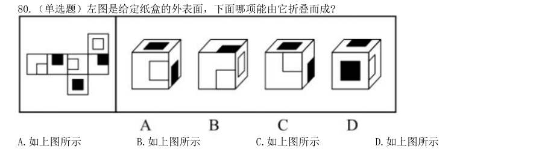
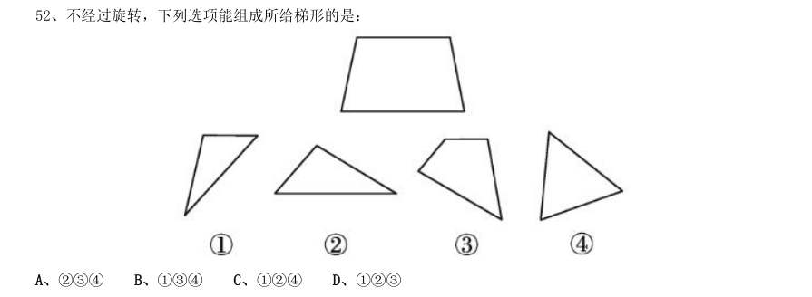
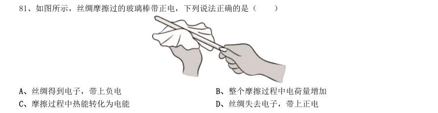
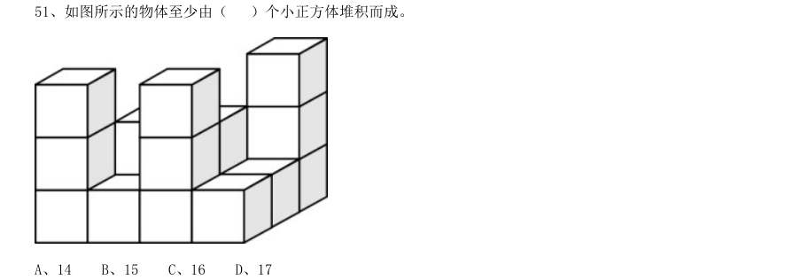

# 判断推理 · 类比推理 · 2020 年代真题

> 所属考点：[PD-LB](../PD-LB-类比推理.md)　｜　本片 201 题

> 本片子考点：逻辑关系 81　类比推理（综合） 54　对应关系 41　语义关系 25

### 2026 国考·副省级　第 102 题　（逻辑关系）

与“口腔:唾液:淀粉酶”在逻辑关系上最相近的是:

- **A.** 种子:孜然:调味品
- **B.** 叶片:叶肉:叶绿体
- **C.** 松树:松脂:树脂醇
- **D.** 试剂:试纸:pH 试纸

**答案：C**

### 2026 国考·副省级　第 103 题　（对应关系）

与“减数:被减数:差”在逻辑关系上最相近的是:

- **A.** 粮食产量:播种面积:粮食单产
- **B.** 溶质质量:溶液质量:溶剂质量
- **C.** 可售天数:库存总量:日均销量
- **D.** 间隔天数:结束日期:开始日期

**答案：B**

### 2026 国考·副省级　第 104 题　（逻辑关系）

颅内疾病对于()相当于()对于岩石断裂依次填入括号中最恰当的是:

- **A.** 颅内感染;岩石熔融
- **B.** 机体疾病;地壳应力
- **C.** 核磁共振;地下采样
- **D.** 视野缺失;冰川运动

**答案：D**

### 2026 国考·地市级　第 97 题　（逻辑关系）

与“细胞凋亡:基因调控:细胞增殖”在逻辑关系上最相近的是:

- **A.** 成本降低:税率调整:成本增加
- **B.** 经济萧条:经济周期:经济复苏
- **C.** 价格尺度:货币职能:流通手段
- **D.** 人工智能:智能时代:具身智能

**答案：A**

### 2026 国考·地市级　第 98 题　（类比推理（综合））

与“护士人数:护患比:患者人数”在逻辑关系上最相近的是:

- **A.** 理赔总额:平均理赔金额:理赔次数
- **B.** 签收率:实际签收数量:应签收数量
- **C.** 流动资产:流动负债:流动比率
- **D.** 旅客数:入住率:客房数

**答案：A**

### 2026 国考·行政执法　第 96 题　（语义关系）

与“经年:积岁”在逻辑关系上最相近的是:

- **A.** 善本:版本
- **B.** 秘方:偏方
- **C.** 仲夏:夏季
- **D.** 黎民:百姓

**答案：D**

### 2026 国考·行政执法　第 97 题　（逻辑关系）

与“口腔:唾液:淀粉酶”在逻辑关系上最相近的是:

- **A.** 种子:孜然:调味品
- **B.** 叶片:叶肉:叶绿体
- **C.** 松树:松脂:树脂醇
- **D.** 试剂:试纸:pH 试纸

**答案：C**

### 2026 国考·行政执法　第 98 题　（类比推理（综合））

与“护士人数:护患比:患者人数”在逻辑关系上最相近的是:

- **A.** 理赔总额:平均理赔金额:理赔次数
- **B.** 签收率:实际签收数量:应签收数量
- **C.** 流动资产:流动负债:流动比率
- **D.** 旅客数:入住率:客房数

**答案：A**

### 2025 湖北·统一卷　第 86 题　（类比推理（综合））

言之无文:行之不远

- **A.** 一叶障目:不见泰山
- **B.** 宁为玉碎:不为瓦全
- **C.** 藏诸名山:传之其人
- **D.** 取之不尽:用之不竭

**答案：A**

### 2025 湖北·统一卷　第 87 题　（类比推理（综合））

柠檬水:酸梅汤

- **A.** 橘子汁:香蕉水
- **B.** 梅子酒:葡萄干
- **C.** 苹果派:草莓挞
- **D.** 西瓜霜:荔枝蜜

**答案：C**

### 2025 湖北·统一卷　第 88 题　（类比推理（综合））

低碳排放:保护环境

- **A.** 候鸟迁徙:气候变化
- **B.** 昆虫叮咬:过敏反应
- **C.** 收集数据:调查研究
- **D.** 滴水成冰:热胀冷缩

**答案：C**

### 2025 湖北·统一卷　第 89 题　（类比推理（综合））

石料:木材:印章

- **A.** 毛笔:墨水:书法
- **B.** 湘绣:蜀绣:刺绣
- **C.** 宣纸:年画:国画
- **D.** 搪瓷:塑料:脸盆

**答案：D**

### 2025 湖北·统一卷　第 90 题　（类比推理（综合））

衰弱:噪声:听力

- **A.** 锻炼:饮食:健康
- **B.** 杠杆:重力:质量
- **C.** 降低:摩擦:速度
- **D.** 气候变暖:冰层融化:环境

**答案：C**

### 2025 湖北·统一卷　第 91 题　（类比推理（综合））

车辆:货车:运输

- **A.** 温室气体:甲烷:二氧化碳
- **B.** 未来产业:量子信息:研究监管
- **C.** 自我意识:人格:心理调节
- **D.** 绿色能源:太阳能:发电

**答案：D**

### 2025 湖北·统一卷　第 92 题　（类比推理（综合））

名垂青史:光耀千秋:光前裕后

- **A.** 畏首畏尾:犹犹豫豫:瞻前顾后
- **B.** 投鼠忌器:缩手缩脚:慎终追远
- **C.** 光宗耀祖:光耀门楣:落叶归根
- **D.** 空前绝后:开天辟地:继往开来

**答案：A**

### 2025 湖北·统一卷　第 93 题　（类比推理（综合））

( ) 对于 众志成城 相当于 拒谏饰非 对于 ( )

- **A.** 孤掌难鸣 广开言路
- **B.** 寸积铢累 从谏如流
- **C.** 众擎易举 集思广益
- **D.** 独木难支 闭目塞听

**答案：A**

### 2025 湖北·统一卷　第 94 题　（类比推理（综合））

( ) 对于 松树 相当于 CPU 对于 ( )

- **A.** 松果 显卡
- **B.** 植物 电器
- **C.** 松子 电脑
- **D.** 松茸 芯片

**答案：暂缺**

### 2025 湖北·统一卷　第 95 题　（类比推理（综合））

( ) 对于 运动器材 相当于 玫瑰 对于 ( )

- **A.** 单杠 爱情
- **B.** 哑铃 花卉
- **C.** 健身 精油
- **D.** 铸铁 月季

**答案：暂缺**

### 2025 国考·副省级　第 101 题　（语义关系）

逐客令:挡箭牌

- **A.** 急先锋:领航者
- **B.** 避风港:马后炮
- **C.** 敲门砖:绊脚石
- **D.** 鸿门宴:攻心计

**答案：C**

### 2025 国考·副省级　第 102 题　（逻辑关系）

嘤其鸣矣:求其友声

- **A.** 遏其生气:以求重价
- **B.** 求之其本:经旬必得
- **C.** 道不拾遗:夜不闭户
- **D.** 避其锐气:击其惰归

**答案：A**

### 2025 国考·副省级　第 103 题　（对应关系）

直观性:即时性:网络直播

- **A.** 等边性:对称性:等腰梯形
- **B.** 公开性:权威性:行政法律
- **C.** 周期性:延展性:机械钟摆
- **D.** 挥发性:保温性:石棉纤维

**答案：B**

### 2025 国考·副省级　第 104 题　（逻辑关系）

光伏电站:电池板:发电

- **A.** 跨海大桥:桥墩支架:交通
- **B.** 射电望远镜:电磁波:信号
- **C.** 海底气田:油气管道:钻井
- **D.** 游乐设施:球幕电影:娱乐

**答案：A**

### 2025 国考·副省级　第 105 题　（逻辑关系）

稀树草原 对于 ( ) 相当于 ( ) 对于 国际公约

- **A.** 物种多样性;缔约国家
- **B.** 落叶阔叶林;多边条约
- **C.** 气候变迁;政治协调
- **D.** 植被类型;联合国宪章

**答案：D**

### 2025 国考·地市级　第 96 题　（语义关系）

殚精竭虑:费尽心机

- **A.** 狐假虎威:虚张声势
- **B.** 舍生忘死:死里逃生
- **C.** 侃侃而谈:喋喋不休
- **D.** 光怪陆离:五光十色

**答案：C**

### 2025 国考·地市级　第 97 题　（语义关系）

逐客令:挡箭牌

- **A.** 急先锋:领航者
- **B.** 避风港:马后炮
- **C.** 敲门砖:绊脚石
- **D.** 鸿门宴:攻心计

**答案：C**

### 2025 国考·地市级　第 98 题　（对应关系）

直观性:即时性:网络直播

- **A.** 等边性:对称性:等腰梯形
- **B.** 公开性:权威性:行政法律
- **C.** 周期性:延展性:机械钟摆
- **D.** 挥发性:保温性:石棉纤维

**答案：B**

### 2025 国考·地市级　第 99 题　（对应关系）

群众来访:窗口接访:调查督办

- **A.** 地面试验:点火飞行:燃料加注
- **B.** 支付本币:兑换外币:确认汇率
- **C.** 建造堤坝:潮汐发电:送电入户
- **D.** 重启谈判:临时休战:边境冲突

**答案：C**

### 2025 国考·地市级　第 100 题　（逻辑关系）

稀树草原 对于 ( ) 相当于 ( ) 对于 国际公约

- **A.** 物种多样性;缔约国家
- **B.** 落叶阔叶林;多边条约
- **C.** 气候变迁;政治协调
- **D.** 植被类型;联合国宪章

**答案：D**

### 2025 国考·行政执法　第 96 题　（逻辑关系）

嘤其鸣矣:求其友声

- **A.** 遏其生气:以求重价
- **B.** 求之其本:经旬必得
- **C.** 道不拾遗:夜不闭户
- **D.** 避其锐气:击其惰归

**答案：A**

### 2025 国考·行政执法　第 97 题　（语义关系）

殚精竭虑:费尽心机

- **A.** 狐假虎威:虚张声势
- **B.** 舍生忘死:死里逃生
- **C.** 侃侃而谈:喋喋不休
- **D.** 光怪陆离:五光十色

**答案：C**

### 2025 国考·行政执法　第 98 题　（对应关系）

群众来访:窗口接访:调查督办

- **A.** 地面试验:点火飞行:燃料加注
- **B.** 支付本币:兑换外币:确认汇率
- **C.** 建造堤坝:潮汐发电:送电入户
- **D.** 重启谈判:临时休战:边境冲突

**答案：C**

### 2025 国考·行政执法　第 99 题　（对应关系）

收集罪证:提取指纹:透明胶

- **A.** 温度不当:叶子发黄:营养液
- **B.** 逃生自救:敲碎车窗:安全锤
- **C.** 道路施工:设置防护:混凝土
- **D.** 冷风侵入:肩周疼痛:艾草贴

**答案：B**

### 2025 国考·行政执法　第 100 题　（逻辑关系）

行政文书 对于 ( ) 相当于 ( ) 对于 汇编语言

- **A.** 行政机关;编程人员
- **B.** 行政管理;传送指令
- **C.** 商务文书;符号语言
- **D.** 监管函;计算机语言

**答案：D**

### 2025 国考·行政执法　第 107 题　（类比推理（综合））

下列哪2次会议可以安排在第一季度?

- **A.** 甲和戊
- **B.** 丙和丁
- **C.** 丁和己
- **D.** 己和庚

**答案：D**

### 2024 湖北·统一卷　第 86 题　（类比推理（综合））

兵符:信物

- **A.** 七律:绝句
- **B.** 汉字:偏旁
- **C.** 干戈:战争
- **D.** 寒露:节气

**答案：D**

### 2024 湖北·统一卷　第 87 题　（类比推理（综合））

伸延:延伸

- **A.** 登攀:攀登
- **B.** 喜欢:欢喜
- **C.** 生产:产生
- **D.** 等次:次等

**答案：A**

### 2024 湖北·统一卷　第 88 题　（类比推理（综合））

牡丹花:牵牛花

- **A.** 金枪鱼:八爪鱼
- **B.** 东北菜:黄花菜
- **C.** 布谷鸟:啄木鸟
- **D.** 变色龙:霸王龙

**答案：C**

### 2024 湖北·统一卷　第 89 题　（类比推理（综合））

虫害:植物受损

- **A.** 雾霾:慢性肺炎
- **B.** 除名:查无此人
- **C.** 赤潮:海水污染
- **D.** 失眠:辗转反侧

**答案：A**

### 2024 湖北·统一卷　第 90 题　（类比推理（综合））

网箱养殖:深海养殖

- **A.** 网络设备:无线网卡
- **B.** 成人教育:职业教育
- **C.** 载人飞船:返回舱
- **D.** 娱乐项目:剧本杀

**答案：B**

### 2024 湖北·统一卷　第 91 题　（类比推理（综合））

锁骨:肋骨:坐骨

- **A.** 头脑:头皮:头发
- **B.** 腹腔:口腔:鼻腔
- **C.** 盲肠:大肠:直肠
- **D.** 颈椎:胸椎:腰椎

**答案：D**

### 2024 湖北·统一卷　第 92 题　（类比推理（综合））

热传递:热传导:热辐射

- **A.** 隔离:冷却:灭火
- **B.** 混合物:化合物:纯净物
- **C.** 播种:撒播:条播
- **D.** 说明文:举例子:作比较

**答案：C**

### 2024 湖北·统一卷　第 93 题　（类比推理（综合））

服装:唐装:西装

- **A.** 刷牙:牙刷:牙膏
- **B.** 豪车:赛车:轿车
- **C.** 旗帜:国旗:红旗
- **D.** 武术:太极拳:咏春拳

**答案：D**

### 2024 湖北·统一卷　第 94 题　（类比推理（综合））

数字经济 对于 ( ),相当于 ( ) 对于 人工智能

- **A.** 信息工具 家用电器
- **B.** 信息技术 无人驾驶
- **C.** 数字资源 现代农业
- **D.** 数字货币 远程医疗

**答案：B**

### 2024 湖北·统一卷　第 95 题　（类比推理（综合））

缘木求鱼 对于 ( ) 相当于 ( ) 对于 抱薪救火

- **A.** 事与愿违 抽薪止沸
- **B.** 南辕北辙 通宵达旦
- **C.** 刻舟求剑 纵风止燎
- **D.** 扬汤止沸 凿壁偷光

**答案：C**

### 2024 国考·副省级　第 96 题　（对应关系）

卫冕:夺冠

- **A.** 庄园:田园
- **B.** 追讨:诉讼
- **C.** 续约:签约
- **D.** 姓名:笔名

**答案：C**

### 2024 国考·副省级　第 97 题　（逻辑关系）

花生壳:核桃仁

- **A.** 刺梨汁:桃花扇
- **B.** 丝瓜络:石榴籽
- **C.** 杏仁露:葡萄皮
- **D.** 葛根茶:芡实粉

**答案：B**

### 2024 国考·副省级　第 98 题　（语义关系）

花香四溢:分子运动

- **A.** 波光粼粼:光的反射
- **B.** 聚沙成塔:质量互变
- **C.** 水落石出:水的浮力
- **D.** 炉火纯青:金属炼制

**答案：A**

### 2024 国考·副省级　第 99 题　（语义关系）

诛禁不当:反受其央

- **A.** 为者常成:行者常至
- **B.** 君子检身:常若有过
- **C.** 其身不正:虽令不从
- **D.** 麻雀虽小:五脏俱全

**答案：C**

### 2024 国考·副省级　第 100 题　（逻辑关系）

酒器:尊:爵

- **A.** 门楣:门框:门槛
- **B.** 服装:礼服:常服
- **C.** 人居:巢居:穴居
- **D.** 木柱:石柱:砖柱

**答案：B**

### 2024 国考·副省级　第 101 题　（对应关系）

蚜虫:七星瓢虫:小麦

- **A.** 蛇:鸟:谷子
- **B.** 稗草:螳螂:水稻
- **C.** 蚊子:青蛙:高粱
- **D.** 老鼠:黄鼬:玉米

**答案：D**

### 2024 国考·副省级　第 102 题　（语义关系）

感想:主观性:体会

- **A.** 典范:示范性:表率
- **B.** 发明:创造性:方法
- **C.** 泥土:可塑性:材料
- **D.** 规律:普适性:定理

**答案：A**

### 2024 国考·副省级　第 103 题　（对应关系）

识别敌舰:发射鱼雷:击毁目标

- **A.** 线上挂号:远程问诊:开具处方
- **B.** 环境评估:铁路铺设:桥梁建造
- **C.** 立案审查:提起公诉:证据确凿
- **D.** 交通事故:保险赔付:救治伤员

**答案：A**

### 2024 国考·副省级　第 104 题　（逻辑关系）

牛皮纸 对于 ( ) 相当于 ( ) 对于 背筐

- **A.** 包装;运输
- **B.** 木纤维;拎筐
- **C.** 纸袋;柳条
- **D.** 羊皮纸;竹筐

**答案：C**

### 2024 国考·副省级　第 105 题　（语义关系）

领头雁 对于 ( ) 相当于 ( ) 对于 先驱

- **A.** 领导者;拓荒牛
- **B.** 鸟类;革命
- **C.** 迁徙;先锋
- **D.** 出头鸟;先行者

**答案：A**

### 2024 国考·地市级　第 91 题　（对应关系）

卫冕:夺冠

- **A.** 庄园:田园
- **B.** 追讨:诉讼
- **C.** 续约:签约
- **D.** 姓名:笔名

**答案：C**

### 2024 国考·地市级　第 92 题　（逻辑关系）

花生壳:核桃仁

- **A.** 刺梨汁:桃花扇
- **B.** 丝瓜络:石榴籽
- **C.** 杏仁露:葡萄皮
- **D.** 葛根茶:芡实粉

**答案：B**

### 2024 国考·地市级　第 93 题　（语义关系）

诛禁不当:反受其央

- **A.** 为者常成:行者常至
- **B.** 君子检身:常若有过
- **C.** 其身不正:虽令不从
- **D.** 麻雀虽小:五脏俱全

**答案：C**

### 2024 国考·地市级　第 94 题　（语义关系）

明辨是非:静待成败

- **A.** 判若云泥:开释左右
- **B.** 洞鉴古今:博观始终
- **C.** 一争高低:弱肉强食
- **D.** 惩恶劝善:天差地别

**答案：B**

### 2024 国考·地市级　第 95 题　（对应关系）

蚜虫:七星瓢虫:小麦

- **A.** 蛇:鸟:谷子
- **B.** 稗草:螳螂:水稻
- **C.** 蚊子:青蛙:高粱
- **D.** 老鼠:黄鼬:玉米

**答案：D**

### 2024 国考·地市级　第 96 题　（语义关系）

感想:主观性:体会

- **A.** 典范:示范性:表率
- **B.** 发明:创造性:方法
- **C.** 泥土:可塑性:材料
- **D.** 规律:普适性:定理

**答案：A**

### 2024 国考·地市级　第 97 题　（逻辑关系）

自发裂变:核裂变:诱发裂变

- **A.** 波浪能:太阳能:可再生能源
- **B.** 铁路交通:现代交通:公路交通
- **C.** 贸易逆差:贸易平衡:贸易顺差
- **D.** 负有理数:负实数:负无理数

**答案：D**

### 2024 国考·地市级　第 98 题　（对应关系）

轮作休耕:耕地保护:严禁占用

- **A.** 植树造林:碳中和:节能减排
- **B.** 登月计划:空间站:太空探索
- **C.** 商品交换:国际贸易:技术服务
- **D.** 观众评选:荣获大奖:出类拔萃

**答案：A**

### 2024 国考·地市级　第 99 题　（语义关系）

领头雁 对于 ( ) 相当于 ( ) 对于 先驱

- **A.** 领导者;拓荒牛
- **B.** 鸟类;革命
- **C.** 迁徙;先锋
- **D.** 出头鸟;先行者

**答案：A**

### 2024 国考·地市级　第 100 题　（逻辑关系）

重型战机 对于 ( ) 相当于 ( ) 对于 分辨率

- **A.** 隐形战机 清晰度
- **B.** 战斗机 性能指标
- **C.** 轻型战机 订单量
- **D.** 载弹量 显示器

**答案：D**

### 2024 国考·行政执法　第 91 题　（对应关系）

质证:法庭

- **A.** 缴费:窗口
- **B.** 监狱:拘役
- **C.** 监考:考场
- **D.** 采访:现场

**答案：C**

### 2024 国考·行政执法　第 92 题　（逻辑关系）

花生壳:核桃仁

- **A.** 刺梨汁:桃花扇
- **B.** 丝瓜络:石榴籽
- **C.** 杏仁露:葡萄皮
- **D.** 葛根茶:芡实粉

**答案：B**

### 2024 国考·行政执法　第 93 题　（语义关系）

诛禁不当:反受其央

- **A.** 为者常成:行者常至
- **B.** 君子检身:常若有过
- **C.** 其身不正:虽令不从
- **D.** 麻雀虽小:五脏俱全

**答案：C**

### 2024 国考·行政执法　第 94 题　（语义关系）

花香四溢:分子运动

- **A.** 波光粼粼:光的反射
- **B.** 聚沙成塔:质量互变
- **C.** 水落石出:水的浮力
- **D.** 炉火纯青:金属炼制

**答案：A**

### 2024 国考·行政执法　第 95 题　（逻辑关系）

发酵:灌装:生产红酒

- **A.** 摇晃:搅拌:冲泡奶粉
- **B.** 下载:打印:检索资料
- **C.** 养殖:运输:销售对虾
- **D.** 折叠:粘合:制作信封

**答案：D**

### 2024 国考·行政执法　第 96 题　（对应关系）

蚜虫:七星瓢虫:小麦

- **A.** 蛇:鸟:谷子
- **B.** 稗草:螳螂:水稻
- **C.** 蚊子:青蛙:高粱
- **D.** 老鼠:黄鼬:玉米

**答案：D**

### 2024 国考·行政执法　第 97 题　（语义关系）

感想:主观性:体会

- **A.** 典范:示范性:表率
- **B.** 发明:创造性:方法
- **C.** 泥土:可塑性:材料
- **D.** 规律:普适性:定理

**答案：A**

### 2024 国考·行政执法　第 98 题　（逻辑关系）

放养过密:饲喂不当:鱼病发生

- **A.** 任务繁重:临时加班:积劳成疾
- **B.** 材料审核:实地考核:评估通过
- **C.** 地基下沉:结构老化:房屋倾斜
- **D.** 市场饱和:利润下降:分红减少

**答案：C**

### 2024 国考·行政执法　第 99 题　（语义关系）

嬗变 对于 ( ) 相当于 ( ) 对于 生肖

- **A.** 改变;中国
- **B.** 演变;属相
- **C.** 剧变;动物
- **D.** 巨变;传统

**答案：B**

### 2024 国考·行政执法　第 100 题　（逻辑关系）

重型战机 对于 ( ) 相当于 ( ) 对于 分辨率

- **A.** 隐形战机 清晰度
- **B.** 战斗机 性能指标
- **C.** 轻型战机 订单量
- **D.** 载弹量 显示器

**答案：D**

### 2023 广东·县级　第 50 题　（逻辑关系）

下列选项与框内字符串规律最接近的是: <

- **A.** A
- **B.** B
- **C.** C
- **D.** D

**答案：A**

### 2023 广东·县级　第 51 题　（逻辑关系）

问:答

- **A.** 求:应
- **B.** 教:学
- **C.** 来:去
- **D.** 买:卖

**答案：A**

### 2023 广东·县级　第 52 题　（逻辑关系）

章:节

- **A.** 年:月
- **B.** 桌:椅
- **C.** 中考:高考
- **D.** 班主任:班长

**答案：A**

### 2023 广东·县级　第 53 题　（对应关系）

舍身:取义

- **A.** 摩拳:擦掌
- **B.** 含苞:欲放
- **C.** 得陇:望蜀
- **D.** 格物:致知

**答案：D**

### 2023 广东·县级　第 54 题　（语义关系）

海底捞月:缘木求鱼

- **A.** 抱薪救火:釜底抽薪
- **B.** 七嘴八舌:鹦鹉学舌
- **C.** 趁火打劫:浑水摸鱼
- **D.** 锦上添花:画蛇添足

**答案：C**

### 2023 广东·县级　第 55 题　（对应关系）

园丁:灌木:剪刀

- **A.** 医生:手术:处方
- **B.** 裁缝:衣服:针线
- **C.** 渔民:捕鱼:渔网
- **D.** 司机:乘客:驾照

**答案：B**

### 2023 广东·县级　第 84 题　（类比推理（综合））

下面是某森林生态系统食物网的示意图,下列表述正确的是( )。

- **A.** 该食物网中有3 条食物链
- **B.** 该食物网中,己的个体总数最多
- **C.** 该森林生态系统的最终能量来自于甲
- **D.** 该食物网中,丁与戊既是捕食关系,又是竞争关系

**答案：D**

### 2023 国考·行政执法　第 91 题　（逻辑关系）

铜镜:化妆镜

- **A.** 门帘:纱帘
- **B.** 木碗:汤碗
- **C.** 金簪:发簪
- **D.** 瓷瓶:古瓶

**答案：B**

### 2023 国考·行政执法　第 92 题　（对应关系）

小计:总计

- **A.** 平均值:总值
- **B.** 被乘数:总数
- **C.** 单科分:总分
- **D.** 分目录:总目

**答案：C**

### 2023 国考·行政执法　第 93 题　（逻辑关系）

海棠红:南瓜橙

- **A.** 苏丹红:景泰蓝
- **B.** 孔雀蓝:柠檬黄
- **C.** 日落黄:鱼肚白
- **D.** 橄榄绿:梅子青

**答案：D**

### 2023 国考·行政执法　第 94 题　（逻辑关系）

脱脂棉:原棉

- **A.** 白酒:烧酒
- **B.** 黑陶:黏土
- **C.** 摄像头:镜头
- **D.** 视力:视力表

**答案：B**

### 2023 国考·行政执法　第 95 题　（逻辑关系）

匿名投票:实名投票:现场投票

- **A.** 早间会议:午间会议:工作会议
- **B.** 战国文字:象形文字:古代汉字
- **C.** 金融危机:粮食危机:生态危机
- **D.** 油料作物:糖料作物:经济作物

**答案：A**

### 2023 国考·行政执法　第 96 题　（对应关系）

春季过敏:花粉:喷嚏

- **A.** 肺炎:咳嗽:支原体
- **B.** 乙型脑炎:病毒:发热
- **C.** 失眠:恐惧:噩梦
- **D.** 秋季腹泻:饮食:脱水

**答案：B**

### 2023 国考·行政执法　第 97 题　（对应关系）

资产评估:审核通过:股票发售

- **A.** 预定新车:加装内饰:购买车险
- **B.** 修剪草坪:设备检修:园林养护
- **C.** 选购家电:上门安装:维修保养
- **D.** 收看节目:视频连线:观众互动

**答案：C**

### 2023 国考·行政执法　第 98 题　（逻辑关系）

标清:高清:超清

- **A.** 亚音速:音速:超音速
- **B.** 厅级:市级:省级
- **C.** 迁怒:愤怒:暴怒
- **D.** 幽静:寂静:安静

**答案：A**

### 2023 国考·行政执法　第 99 题　（逻辑关系）

深空探测 对于 ( ) 相当于 ( ) 对于 公益组织

- **A.** 无人采样;慈善捐款
- **B.** 遥感技术;红十字会
- **C.** 宇宙空间;公益事业
- **D.** 火星探测;社会组织

**答案：D**

### 2023 国考·行政执法　第 100 题　（逻辑关系）

刑事警察 对于 ( ) 相当于 ( ) 对于 对外交涉

- **A.** 公安机关;维护主权
- **B.** 刑事案件;驻外武官
- **C.** 打击犯罪;外交人员
- **D.** 交通警察;外交领事

**答案：C**

### 2023 国考·行政执法　第 107 题　（类比推理（综合））

后勤部门的人可以安排在哪几天值班?

- **A.** 只有第二天、第四天、第五天
- **B.** 只有第一天、第三天、第五天
- **C.** 只有第二天、第六天
- **D.** 只有第一天、第三天

**答案：A**

### 2022 广东·乡镇　第 56 题　（逻辑关系）

默念:朗诵

- **A.** 竞走:散步
- **B.** 贩卖:赶集
- **C.** 讲授:练习
- **D.** 调节:管理

**答案：A**

### 2022 广东·乡镇　第 57 题　（逻辑关系）

书桌:椅子

- **A.** 柜子:抽屉
- **B.** 沙发:靠枕
- **C.** 灯泡:插座
- **D.** 窗户:玻璃

**答案：B**

### 2022 广东·乡镇　第 58 题　（对应关系）

航海:指南针

- **A.** 粉笔:黑板报
- **B.** 潜水:救生圈
- **C.** 通信:屏蔽器
- **D.** 驾驶:发动机

**答案：B**

### 2022 广东·乡镇　第 59 题　（对应关系）

创作:印刷:发行

- **A.** 撒网:钓鱼:捕捞
- **B.** 生产:研发:采购
- **C.** 播种:开花:结果
- **D.** 拆除:安装:维修

**答案：C**

### 2022 广东·乡镇　第 60 题　（对应关系）

法律:诉讼:胜败

- **A.** 策略:经营:盈亏
- **B.** 战争:武器:存亡
- **C.** 判断:事实:对错
- **D.** 教师:教学:优劣

**答案：A**

### 2022 广东·乡镇　第 70 题　（类比推理（综合））

为提升其行驶过程的稳定性,挖掘机装有履带,其原理是:

- **A.** 减小挖掘机对地面的压强
- **B.** 增大挖掘机对地面的压强
- **C.** 减小挖掘机对地面的压力
- **D.** 增大挖掘机对地面的压力

**答案：A**

### 2022 广东·县级　第 51 题　（对应关系）

耳塞:噪音

- **A.** 书籍:知识
- **B.** 蜡烛:光明
- **C.** 肥皂:污渍
- **D.** 风扇:低温

**答案：C**

### 2022 广东·县级　第 52 题　（逻辑关系）

洽淡:合作

- **A.** 考试:成绩
- **B.** 打磨:切割
- **C.** 施肥:灌溉
- **D.** 投资:收益

**答案：D**

### 2022 广东·县级　第 53 题　（逻辑关系）

文字:诗词:绝句

- **A.** 笔画:隶书:汉字
- **B.** 音符:乐谱:五线谱
- **C.** 税收:财政:货币
- **D.** 树木:森林:生态

**答案：B**

### 2022 广东·县级　第 54 题　（对应关系）

法律:诉讼:胜败

- **A.** 策略:经营:盈亏
- **B.** 战争:武器:存亡
- **C.** 判断:事实:对错
- **D.** 教师:教学:优劣

**答案：A**

### 2022 广东·县级　第 55 题　（语义关系）

志同道合:沆瀣一气

- **A.** 居安思危:杞人忧天
- **B.** 鼠目寸光:高瞻远瞩
- **C.** 举棋不定:优柔寡断
- **D.** 口若悬河:信口开河

**答案：A**

### 2022 国考·副省级　第 80 题　（类比推理（综合））

(单选题)左图是给定纸盒的外表面,下面哪项能由它折叠而成?

- **A.** 如上图所示
- **B.** 如上图所示
- **C.** 如上图所示
- **D.** 如上图所示

**答案：A**

### 2022 国考·副省级　第 96 题　（语义关系）

(单选题)珍珠:珍珠婚

- **A.** 面包:面包树
- **B.** 槐花:槐花蜜
- **C.** 蘑菇:蘑菇云
- **D.** 母亲:母亲河

**答案：D**

### 2022 国考·副省级　第 97 题　（逻辑关系）

(单选题)呼吸系统∶生殖系统

- **A.** 生产计划∶年度计划
- **B.** 观赏花卉∶药用花卉
- **C.** 水面舰艇∶巡洋舰艇
- **D.** 简牍公文∶纸质公文

**答案：D**

### 2022 国考·副省级　第 98 题　（逻辑关系）

(单选题)载歌∶载舞

- **A.** 人云∶亦云
- **B.** 且战∶且退
- **C.** 自作∶自受
- **D.** 全心∶全意

**答案：B**

### 2022 国考·副省级　第 99 题　（对应关系）

(单选题)边防检查∶走私

- **A.** 科普宣传∶迷信
- **B.** 农药喷洒∶除害
- **C.** 个税申报∶偷税
- **D.** 手术治疗∶患病

**答案：A**

### 2022 国考·副省级　第 100 题　（逻辑关系）

(单选题)独幕剧∶歌剧∶话剧

- **A.** 流行歌曲∶通俗歌曲∶现代歌曲
- **B.** 自由体操∶竞技体操∶艺术体操
- **C.** 远程面试∶单独面试∶小组面试
- **D.** 顺序作业∶流水作业∶平行作业

**答案：C**

### 2022 国考·副省级　第 101 题　（逻辑关系）

(单选题)剪发∶烫发剂∶烫发

- **A.** 催熟∶防腐剂∶防腐
- **B.** 伐树∶植树节∶植树
- **C.** 风蚀∶碳酸钙∶溶蚀
- **D.** 镇痛∶止痛药∶止痛

**答案：A**

### 2022 国考·副省级　第 102 题　（对应关系）

(单选题)提起公诉∶宣告判决∶收押罪犯

- **A.** 撰写教案∶课堂教学∶解答疑问
- **B.** 手机点餐∶外卖送餐∶五星好评
- **C.** 违章行驶∶交警处罚∶行人受伤
- **D.** 方案设计∶建筑施工∶竣工验收

**答案：D**

### 2022 国考·副省级　第 103 题　（逻辑关系）

(单选题)二线城市∶港口城市∶商业城市

- **A.** 海上战争∶常规战争∶空中战争
- **B.** 科技期刊∶电子期刊∶纸本期刊
- **C.** 自助旅游∶国内旅游∶探亲旅游
- **D.** 街心公园∶森林公园∶湿地公园

**答案：C**

### 2022 国考·副省级　第 104 题　（逻辑关系）

(单选题)纪录片 对于 ( ) 相当于 ( ) 对于 客观题

- **A.** 电影;主观题
- **B.** 国产片;选择题
- **C.** 动画片;考试题
- **D.** 译制片;必答题

**答案：D**

### 2022 国考·副省级　第 105 题　（逻辑关系）

(单选题)自然声源 对于 ( ) 相当于 ( ) 对于 煤炭

- **A.** 人工声源;植物遗骸
- **B.** 燕语莺声;矿石燃料
- **C.** 传播介质;社区供暖
- **D.** 物体振动;地质危害

**答案：B**

### 2022 国考·地市级　第 91 题　（对应关系）

贸易摩擦∶出口下滑

- **A.** 商业垄断∶市场失灵
- **B.** 醉酒驾驶∶例行检查
- **C.** 行政处罚∶违规生产
- **D.** 职务犯罪∶谋取私利

**答案：A**

### 2022 国考·地市级　第 92 题　（对应关系）

边防检查∶走私

- **A.** 科普宣传∶迷信
- **B.** 农药喷洒∶除害
- **C.** 个税申报∶偷税
- **D.** 手术治疗∶患病

**答案：A**

### 2022 国考·地市级　第 93 题　（逻辑关系）

呼吸系统∶生殖系统

- **A.** 生产计划∶年度计划
- **B.** 观赏花卉∶药用花卉
- **C.** 水面舰艇∶巡洋舰艇
- **D.** 简牍公文∶纸质公文

**答案：D**

### 2022 国考·地市级　第 94 题　（逻辑关系）

微型无人机∶旋翼无人机

- **A.** 热带植物∶香料植物
- **B.** 集体决策∶个人决策
- **C.** 形象思维∶抽象思维
- **D.** 开环系统∶闭环系统

**答案：A**

### 2022 国考·地市级　第 95 题　（逻辑关系）

独幕剧∶歌剧∶话剧

- **A.** 流行歌曲∶通俗歌曲∶现代歌曲
- **B.** 自由体操∶竞技体操∶艺术体操
- **C.** 远程面试∶单独面试∶小组面试
- **D.** 顺序作业∶流水作业∶平行作业

**答案：C**

### 2022 国考·地市级　第 96 题　（逻辑关系）

青铜器物∶商朝礼器∶文化遗产

- **A.** 科幻小说∶微型小说∶文学作品
- **B.** 中式建筑∶苏州园林∶特色建筑
- **C.** 仰韶文化∶半坡遗址∶华夏文明
- **D.** 进口食品∶速冻海鲜∶冷冻食品

**答案：A**

### 2022 国考·地市级　第 97 题　（逻辑关系）

剪发∶烫发剂∶烫发

- **A.** 催熟∶防腐剂∶防腐
- **B.** 伐树∶植树节∶植树
- **C.** 风蚀∶碳酸钙∶溶蚀
- **D.** 阵痛∶止痛药∶止痛

**答案：A**

### 2022 国考·地市级　第 98 题　（逻辑关系）

城市公园∶公共设施∶休闲娱乐

- **A.** 国宾礼炮∶电子礼炮∶国事庆祝
- **B.** 升降舞台∶露天剧场∶演出空间
- **C.** 云服务器∶虚拟技术∶信息备份
- **D.** 医用口罩∶卫生用品∶过滤空气

**答案：D**

### 2022 国考·地市级　第 99 题　（语义关系）

国色天香对于()相当于()对于玉树临风

- **A.** 面如冠玉;螓首蛾眉
- **B.** 倾国倾城;明眸皓齿
- **C.** 一表人才;仪表堂堂
- **D.** 才高八斗;亭亭玉立

**答案：A**

### 2022 国考·地市级　第 100 题　（逻辑关系）

自然声源对于()相当于()对于煤炭

- **A.** 人工声源;植物遗骸
- **B.** 燕语莺声;矿石燃料
- **C.** 传播介质;社区供暖
- **D.** 物体振动;地质危害

**答案：B**

### 2022 国考·行政执法　第 91 题　（对应关系）

(单选题)贸易摩擦∶出口下滑

- **A.** 商业垄断∶市场失灵
- **B.** 醉酒驾驶∶例行检查
- **C.** 行政处罚∶违规生产
- **D.** 职务犯罪∶谋取私利

**答案：A**

### 2022 国考·行政执法　第 92 题　（逻辑关系）

(单选题)载歌∶载舞

- **A.** 人云∶亦云
- **B.** 且战∶且退
- **C.** 自作∶自受
- **D.** 全心∶全意

**答案：B**

### 2022 国考·行政执法　第 93 题　（逻辑关系）

(单选题)微型无人机∶旋翼无人机

- **A.** 热带植物∶香料植物
- **B.** 集体决策∶个人决策
- **C.** 形象思维∶抽象思维
- **D.** 开环系统∶闭环系统

**答案：A**

### 2022 国考·行政执法　第 94 题　（逻辑关系）

(单选题)呼吸系统∶生殖系统

- **A.** 生产计划∶年度计划
- **B.** 观赏花卉∶药用花卉
- **C.** 水面舰艇∶巡洋舰艇
- **D.** 简牍公文∶纸质公文

**答案：D**

### 2022 国考·行政执法　第 95 题　（逻辑关系）

(单选题)青铜器物∶商朝礼器∶文化遗产

- **A.** 科幻小说∶微型小说∶文学作品
- **B.** 中式建筑∶苏州园林∶特色建筑
- **C.** 仰韶文化∶半坡遗址∶华夏文明
- **D.** 进口食品∶速冻海鲜∶冷冻食品

**答案：A**

### 2022 国考·行政执法　第 96 题　（逻辑关系）

(单选题)独幕剧∶歌剧∶话剧

- **A.** 流行歌曲∶通俗歌曲∶现代歌曲
- **B.** 自由体操∶竞技体操∶艺术体操
- **C.** 远程面试∶单独面试∶小组面试
- **D.** 顺序作业∶流水作业∶平行作业

**答案：C**

### 2022 国考·行政执法　第 97 题　（对应关系）

(单选题)提起公诉∶宣告判决∶收押罪犯

- **A.** 撰写教案∶课堂教学∶解答疑问
- **B.** 手机点餐∶外卖送餐∶五星好评
- **C.** 违章行驶∶交警处罚∶行人受伤
- **D.** 方案设计∶建筑施工∶竣工验收

**答案：D**

### 2022 国考·行政执法　第 98 题　（逻辑关系）

(单选题)城市公园∶公共设施∶休闲娱乐

- **A.** 国宾礼炮∶电子礼炮∶国事庆祝
- **B.** 升降舞台∶露天剧场∶演出空间
- **C.** 云服务器∶虚拟技术∶信息备份
- **D.** 医用口罩∶卫生用品∶过滤空气

**答案：D**

### 2022 国考·行政执法　第 99 题　（逻辑关系）

(单选题)自然声源 对于 ( ) 相当于 ( ) 对于 煤炭

- **A.** 人工声源;植物遗骸
- **B.** 燕语莺声;矿石燃料
- **C.** 传播介质;社区供暖
- **D.** 物体振动;地质危害

**答案：B**

### 2022 国考·行政执法　第 100 题　（逻辑关系）

(单选题)纪录片 对于 ( ) 相当于 ( ) 对于 客观题

- **A.** 电影;主观题
- **B.** 国产片;选择题
- **C.** 动画片;考试题
- **D.** 译制片;必答题

**答案：D**

### 2021 广东·乡镇　第 52 题　（逻辑关系）

不经过旋转,下列选项能组成所给梯形的是:

- **A.** 234
- **B.** 134
- **C.** 124
- **D.** 123

**答案：暂缺**

### 2021 广东·乡镇　第 56 题　（类比推理（综合））

开∶关

- **A.** 听∶闻
- **B.** 念∶想
- **C.** 推∶拉
- **D.** 聚∶合

**答案：暂缺**

### 2021 广东·乡镇　第 57 题　（类比推理（综合））

学习∶进步

- **A.** 改革∶发展
- **B.** 开花∶收获
- **C.** 心平∶气和
- **D.** 跑步∶健身

**答案：暂缺**

### 2021 广东·乡镇　第 58 题　（类比推理（综合））

恳求∶要求

- **A.** 复杂∶嘈杂
- **B.** 恪守∶遵守
- **C.** 动机∶动力
- **D.** 妥协∶协调

**答案：暂缺**

### 2021 广东·乡镇　第 59 题　（类比推理（综合））

东奔∶西走

- **A.** 跋山∶涉水
- **B.** 完整∶无缺
- **C.** 顾此∶失彼
- **D.** 大街∶小巷

**答案：暂缺**

### 2021 广东·乡镇　第 60 题　（类比推理（综合））

老师∶学生∶知识

- **A.** 父母∶子女∶家庭
- **B.** 青蛙∶害虫∶庄稼
- **C.** 园丁∶农田∶花朵
- **D.** 医生∶病人∶疾病

**答案：暂缺**

### 2021 广东·乡镇　第 81 题　（类比推理（综合））

如图所示,丝绸摩擦过的玻璃棒带正电,下列说法正确的是( )

- **A.** 丝绸得到电子,带上负电
- **B.** 整个摩擦过程中电荷量增加
- **C.** 摩擦过程中热能转化为电能
- **D.** 丝绸失去电子,带上正电

**答案：暂缺**

### 2021 国考·副省级　第 96 题　（类比推理（综合））

江河湖海∶水体

- **A.** 鳏寡孤独∶身份
- **B.** 油盐酱醋∶调味
- **C.** 山珍海味∶美食
- **D.** 绫罗绸缎∶面料

**答案：暂缺**

### 2021 国考·副省级　第 97 题　（类比推理（综合））

船舶抛锚∶请求救援

- **A.** 安全着陆∶平稳飞行
- **B.** 行政复议∶获得赔偿
- **C.** 卖出高粱∶买入白酒
- **D.** 违规销售∶停业整顿

**答案：暂缺**

### 2021 国考·副省级　第 98 题　（类比推理（综合））

春山暖日和风∶阑干楼阁帘栊

- **A.** 绿蚁新醅酒∶红泥小火炉
- **B.** 鸡声茅店月∶人迹板桥霜
- **C.** 江碧鸟逾白∶山青花欲燃
- **D.** 柴门闻犬吠∶风雪夜归人

**答案：暂缺**

### 2021 国考·副省级　第 100 题　（类比推理（综合））

风筝∶篾刀∶竹条

- **A.** 泥塑∶黏土∶颜料
- **B.** 绣品∶绣针∶绣线
- **C.** 糖人∶蔗糖∶竹签
- **D.** 漆器∶描金∶涂料

**答案：暂缺**

### 2021 国考·副省级　第 101 题　（类比推理（综合））

檀香∶麝香∶香料

- **A.** 木材∶钢筋∶建材
- **B.** 日光∶月光∶光明
- **C.** 薯条∶粉条∶食物
- **D.** 鲸鱼∶鲍鱼∶海鱼

**答案：暂缺**

### 2021 国考·副省级　第 102 题　（类比推理（综合））

中央预算∶年度预算∶地方预算

- **A.** 历史题材∶军事题材∶现实题材
- **B.** 户外广告∶文字广告∶电视广告
- **C.** 知识创新∶技术创新∶管理创新
- **D.** 人身权利∶生命权利∶财产权利

**答案：暂缺**

### 2021 国考·副省级　第 103 题　（类比推理（综合））

健康监测∶体检∶疾病筛查

- **A.** 为国聚财∶税收∶调节分配
- **B.** 发掘遗迹∶考古∶考证年代
- **C.** 解决争议∶审判∶强制执行
- **D.** 太空飞行∶航天∶地质分析

**答案：暂缺**

### 2021 国考·副省级　第 104 题　（类比推理（综合））

( )对于 口罩 相当于 竹子 对于 ( )

- **A.** 耳挂;竹炭
- **B.** 无纺布;斗笠
- **C.** 卫生用品;竹叶
- **D.** 医用口罩;箭竹

**答案：暂缺**

### 2021 国考·副省级　第 105 题　（类比推理（综合））

核安全 对于( )相当于( ) 对于 虚拟货币

- **A.** 核技术;货币
- **B.** 核泄漏;交易货币
- **C.** 国家安全;比特币
- **D.** 网络安全;游戏币

**答案：暂缺**

### 2021 国考·地市级　第 91 题　（对应关系）

易拉罐∶拉环

- **A.** 金库∶黄金
- **B.** 燃气灶∶点火器
- **C.** 台历∶农历
- **D.** 拦水坝∶河流

**答案：B**

### 2021 国考·地市级　第 92 题　（对应关系）

船舶抛锚∶请求救援

- **A.** 安全着陆∶平稳飞行
- **B.** 行政复议∶获得赔偿
- **C.** 卖出高粱∶买入白酒
- **D.** 违规销售∶停业整顿

**答案：D**

### 2021 国考·地市级　第 93 题　（逻辑关系）

春山暖日和风∶阑干楼阁帘栊

- **A.** 绿蚁新醅酒∶红泥小火炉
- **B.** 鸡声茅店月∶人迹板桥霜
- **C.** 江碧鸟逾白∶山青花欲燃
- **D.** 柴门闻犬吠∶风雪夜归人

**答案：B**

### 2021 国考·地市级　第 95 题　（对应关系）

风筝∶篾刀∶竹条

- **A.** 泥塑∶黏土∶颜料
- **B.** 绣品∶绣针∶绣线
- **C.** 糖人∶蔗糖∶竹签
- **D.** 漆器∶描金∶涂料

**答案：B**

### 2021 国考·地市级　第 96 题　（逻辑关系）

檀香∶麝香∶香料

- **A.** 木材∶钢筋∶建材
- **B.** 日光∶月光∶光明
- **C.** 薯条∶粉条∶食物
- **D.** 鲸鱼∶鲍鱼∶海鱼

**答案：A**

### 2021 国考·地市级　第 97 题　（逻辑关系）

中央预算∶年度预算∶地方预算

- **A.** 历史题材∶军事题材∶现实题材
- **B.** 户外广告∶文字广告∶电视广告
- **C.** 知识创新∶技术创新∶管理创新
- **D.** 人身权利∶生命权利∶财产权利

**答案：A**

### 2021 国考·地市级　第 98 题　（逻辑关系）

健康监测∶体检∶疾病筛查

- **A.** 为国聚财∶税收∶调节分配
- **B.** 发掘遗迹∶考古∶考证年代
- **C.** 解决争议∶审判∶强制执行
- **D.** 太空飞行∶航天∶地质分析

**答案：A**

### 2021 国考·地市级　第 99 题　（逻辑关系）

杠杆 对于( )相当于( )对于 成语

- **A.** 滑轮;固定短语
- **B.** 力臂;水滴石穿
- **C.** 省力杠杆;春夏秋冬
- **D.** 简单机械;四字成语

**答案：D**

### 2021 国考·地市级　第 100 题　（逻辑关系）

( )对于 口罩 相当于 竹子 对于 ( )

- **A.** 耳挂;竹炭
- **B.** 无纺布;斗笠
- **C.** 卫生用品;竹叶
- **D.** 医用口罩;箭竹

**答案：B**

### 2020 湖北·统一卷　第 86 题　（逻辑关系）

牵牛花∶喇叭花

- **A.** 乞巧节∶七夕节
- **B.** 七巧板∶橡皮泥
- **C.** 人行道∶车行道
- **D.** 防腐剂∶添加剂

**答案：A**

### 2020 湖北·统一卷　第 87 题　（逻辑关系）

售后∶品控

- **A.** 数据∶科学
- **B.** 融资∶风投
- **C.** 龙骨∶地板
- **D.** 听证∶监管

**答案：D**

### 2020 湖北·统一卷　第 88 题　（逻辑关系）

鲜花∶塑料花

- **A.** 纸质书∶电子书
- **B.** 相片∶画像
- **C.** 原本∶复印本
- **D.** 钤章∶印泥

**答案：C**

### 2020 湖北·统一卷　第 89 题　（对应关系）

羊∶羊奶∶腥膻

- **A.** 蚕∶蚕丝∶雪白
- **B.** 蜘蛛∶蛛丝∶粘缚
- **C.** 蜂∶蜂蜜∶甘甜
- **D.** 雨燕∶燕窝∶营养

**答案：C**

### 2020 湖北·统一卷　第 90 题　（逻辑关系）

花∶牡丹∶玫瑰

- **A.** 茶∶红茶∶绿茶
- **B.** 草∶艾草∶蓼草
- **C.** 球∶足球∶绒球
- **D.** 车∶轿车∶客车

**答案：B**

### 2020 湖北·统一卷　第 91 题　（逻辑关系）

空运∶海运∶运输

- **A.** 平装∶精装∶装帧
- **B.** 货轮∶客轮∶邮轮
- **C.** 晚会∶聚会∶集会
- **D.** 试飞∶试航∶航天

**答案：A**

### 2020 湖北·统一卷　第 92 题　（逻辑关系）

初伏∶中伏∶末伏

- **A.** 火星∶木星∶土星
- **B.** 大雨∶小雨∶谷雨
- **C.** 上旬∶中旬∶下旬
- **D.** 大暑∶小暑∶处暑

**答案：C**

### 2020 湖北·统一卷　第 93 题　（语义关系）

十年寒窗∶悬梁刺股∶囊萤映雪

- **A.** 七月流火∶以荻画地∶临池学书
- **B.** 三月肉味∶蓝田种玉∶程门立雪
- **C.** 一寸光阴∶凿壁偷光∶闻鸡起舞
- **D.** 一日三秋∶卧薪尝胆∶铁杆磨针

**答案：C**

### 2020 湖北·统一卷　第 94 题　（语义关系）

了如指掌 对于 ( ) 相当于 ( ) 对于 坚固

- **A.** 知道;铁板一块
- **B.** 明白;坚不可摧
- **C.** 理解;铜墙铁壁
- **D.** 了解;固若金汤

**答案：D**

### 2020 湖北·统一卷　第 95 题　（对应关系）

( ) 对于 裁判 相当于 案件 对于 ( )

- **A.** 球员;法庭
- **B.** 黑哨;上诉
- **C.** 比赛;法官
- **D.** 比分;律师

**答案：C**

### 2020 广东·乡镇　第 51 题　（类比推理（综合））

如图所示的物体至少由( )个小正方体堆积而成。

- **A.** 14
- **B.** 15
- **C.** 16
- **D.** 17

**答案：暂缺**

### 2020 广东·乡镇　第 56 题　（类比推理（综合））

精准∶扶贫( )

- **A.** 保护∶环境
- **B.** 热心∶助人
- **C.** 进退∶自如
- **D.** 粗犷∶生产

**答案：暂缺**

### 2020 广东·乡镇　第 57 题　（类比推理（综合））

端午∶中秋( )

- **A.** 红色∶绿色
- **B.** 生存∶死亡
- **C.** 物质∶精神
- **D.** 线路∶电路

**答案：暂缺**

### 2020 广东·乡镇　第 58 题　（类比推理（综合））

海螺∶号角( )

- **A.** 树枝∶剪刀
- **B.** 羽毛∶衣服
- **C.** 葫芦∶水瓢
- **D.** 孔雀∶折扇

**答案：暂缺**

### 2020 广东·乡镇　第 59 题　（类比推理（综合））

耳朵∶助听器( )

- **A.** 眼睛∶望远镜
- **B.** 手指∶手套
- **C.** 嘴唇∶口罩
- **D.** 腿脚∶拐杖

**答案：暂缺**

### 2020 广东·乡镇　第 60 题　（类比推理（综合））

瓜熟蒂落∶水到渠成 ( )

- **A.** 朝三暮四∶朝秦暮楚
- **B.** 翻云覆雨∶翻天覆地
- **C.** 耳濡目染∶耳熟能详
- **D.** 大功告成∶功败垂成

**答案：暂缺**

### 2020 广东·县级　第 51 题　（类比推理（综合））

清风∶朗月

- **A.** 钢墙∶铁壁
- **B.** 斗转∶星移
- **C.** 惊涛∶骇浪
- **D.** 高山∶流水

**答案：暂缺**

### 2020 广东·县级　第 52 题　（类比推理（综合））

油田∶汽油

- **A.** 伐木场∶家具
- **B.** 商场∶服装
- **C.** 农田∶稻谷
- **D.** 水库∶水

**答案：暂缺**

### 2020 广东·县级　第 53 题　（类比推理（综合））

夜晚∶路灯

- **A.** 孤舟∶灯塔
- **B.** 站台∶路标
- **C.** 春节∶春联
- **D.** 黄昏∶道别

**答案：暂缺**

### 2020 广东·县级　第 54 题　（类比推理（综合））

人∶成年人∶未成年人

- **A.** 门∶开门∶关门
- **B.** 手∶左手∶右手
- **C.** 天气∶晴天∶阴天
- **D.** 车祸∶幸存者∶遇难者

**答案：暂缺**

### 2020 广东·县级　第 55 题　（类比推理（综合））

瓜熟蒂落∶水到渠成

- **A.** 朝三暮四∶朝秦暮楚
- **B.** 翻云覆雨∶翻天覆地
- **C.** 耳濡目染∶耳熟能详
- **D.** 大功告成∶功败垂成

**答案：暂缺**

### 2020 国考·地市级　第 91 题　（对应关系）

物体:惯性

- **A.** 气体:稳定性
- **B.** 观察:客观性
- **C.** 贵金属:磁性
- **D.** 液体:流动性

**答案：D**

### 2020 国考·地市级　第 92 题　（逻辑关系）

全身麻醉:注射麻醉

- **A.** 网络存储:单机存储
- **B.** 胸式呼吸:腹式呼吸
- **C.** 物理消毒:加热消毒
- **D.** 抽样调查:问卷调查

**答案：D**

### 2020 国考·地市级　第 93 题　（逻辑关系）

物必先腐:而后虫生

- **A.** 古木无人径:深山何处钟
- **B.** 水落鱼梁浅:天寒梦泽深
- **C.** 少壮不努力:老大徒伤悲
- **D.** 欲投人处宿:隔水问樵夫

**答案：C**

### 2020 国考·地市级　第 94 题　（语义关系）

轻车熟路:人生地疏

- **A.** 廉洁奉公:卑躬屈膝
- **B.** 任重道远:无所事事
- **C.** 前仆后继:贪生怕死
- **D.** 河清海晏:国泰民安

**答案：C**

### 2020 国考·地市级　第 95 题　（对应关系）

路由器:连接:网络

- **A.** 千斤顶:修补:轮胎
- **B.** 石英钟:显示:时间
- **C.** 万花筒:观察:花卉
- **D.** 烽火台:侦察:敌情

**答案：B**

### 2020 国考·地市级　第 96 题　（对应关系）

建筑材料:混凝土:水泥

- **A.** 饮料:汽水:二氧化碳
- **B.** 医疗用具:注射器:药物
- **C.** 监控:监视器:画面
- **D.** 交通设施:减速带:警示牌

**答案：A**

### 2020 国考·地市级　第 97 题　（逻辑关系）

本能行为:学习行为:乌贼喷墨

- **A.** 合法行为:合理行为:盗窃财物
- **B.** 物理变化:化学变化:树木折断
- **C.** 生产管理:销售管理:退货处理
- **D.** 社会现象:自然现象:四季变换

**答案：B**

### 2020 国考·地市级　第 98 题　（逻辑关系）

税前收入:税后收入:税金

- **A.** 法律规定:道德规范:规则
- **B.** 测量高度:真实高度:误差
- **C.** 高原地区:平原地区:纬度
- **D.** 生产成本:出厂价格:销售价

**答案：B**

### 2020 国考·地市级　第 99 题　（逻辑关系）

薄荷对于( )相当于( )对于计时器

- **A.** 川芎;水钟
- **B.** 清凉;精准
- **C.** 茯苓;倒计时
- **D.** 药用植物;沙漏

**答案：D**

### 2020 国考·地市级　第 100 题　（逻辑关系）

玻璃瓶对于( )相当于( )对于秋播作物

- **A.** 石英砂;农作物
- **B.** 塑料瓶;水生植物
- **C.** 饮料瓶;春播作物
- **D.** 广口瓶;大棚作物

**答案：D**

### 2020 国考·地市级　第 108 题　（类比推理（综合））

如果法务部在壬字楼,那么销售部在:

- **A.** 庚字楼
- **B.** 辛字楼
- **C.** 戊字楼
- **D.** 己字楼

**答案：C**

### 2020 国考·省级　第 96 题　（对应关系）

物体:惯性

- **A.** 气体:稳定性
- **B.** 观察:客观性
- **C.** 贵金属:磁性
- **D.** 液体:流动性

**答案：D**

### 2020 国考·省级　第 97 题　（逻辑关系）

全身麻醉:注射麻醉

- **A.** 网络存储:单机存储
- **B.** 胸式呼吸:腹式呼吸
- **C.** 物理消毒:加热消毒
- **D.** 抽样调查:问卷调查

**答案：D**

### 2020 国考·省级　第 98 题　（逻辑关系）

物必先腐:而后虫生

- **A.** 古木无人径:深山何处钟
- **B.** 水落鱼梁浅:天寒梦泽深
- **C.** 少壮不努力:老大徒伤悲
- **D.** 欲投人处宿:隔水问樵夫

**答案：C**

### 2020 国考·省级　第 99 题　（语义关系）

轻车熟路:人生地疏

- **A.** 廉洁奉公:卑躬屈膝
- **B.** 任重道远:无所事事
- **C.** 前仆后继:贪生怕死
- **D.** 河清海晏:国泰民安

**答案：C**

### 2020 国考·省级　第 100 题　（对应关系）

路由器:连接:网络

- **A.** 千斤顶:修补:轮胎
- **B.** 石英钟:显示:时间
- **C.** 万花筒:观察:花卉
- **D.** 烽火台:侦察:敌情

**答案：B**

### 2020 国考·省级　第 101 题　（对应关系）

建筑材料:混凝土:水泥

- **A.** 饮料:汽水:二氧化碳
- **B.** 医疗用具:注射器:药物
- **C.** 监控:监视器:画面
- **D.** 交通设施:减速带:警示牌

**答案：A**

### 2020 国考·省级　第 102 题　（逻辑关系）

本能行为:学习行为:乌贼喷墨

- **A.** 合法行为:合理行为:盗窃财物
- **B.** 物理变化:化学变化:树木折断
- **C.** 生产管理:销售管理:退货处理
- **D.** 社会现象:自然现象:四季变换

**答案：B**

### 2020 国考·省级　第 103 题　（逻辑关系）

税前收入:税后收入:税金

- **A.** 法律规定:道德规范:规则
- **B.** 测量高度:真实高度:误差
- **C.** 高原地区:平原地区:纬度
- **D.** 生产成本:出厂价格:销售价

**答案：B**

### 2020 国考·省级　第 104 题　（逻辑关系）

薄荷对于( )相当于( )对于计时器

- **A.** 川芎;水钟
- **B.** 清凉;精准
- **C.** 茯苓;倒计时
- **D.** 药用植物;沙漏

**答案：D**

### 2020 国考·省级　第 105 题　（逻辑关系）

玻璃瓶对于( )相当于( )对于秋播作物

- **A.** 石英砂;农作物
- **B.** 塑料瓶;水生植物
- **C.** 饮料瓶;春播作物
- **D.** 广口瓶;大棚作物

**答案：D**
