# 判断推理 · 逻辑判断 · 2010 年代真题

> 所属考点：[PD-LJ](../PD-LJ-逻辑判断.md)　｜　本片 432 题

### 2019 湖北·统一卷　第 91 题　（逻辑判断（综合））

效率:公平:市场经济

- **A.** 科学:理性:政治哲学
- **B.** 革命:改良:社会制度C、民主:集中:组织原则D、美丑:善恶:审美范畴

**答案：C**

### 2019 湖北·统一卷　第 95 题　（加强）

多数家长的投入对子女学业投入具有显著的正向预测作用,家长投入程度随子女学段升高而降低,同时多数 家长更注重在家辅导的投入,对子女参与社区及学校活动的投入较欠缺。而家长自主支持或控制的教养风格在家 长投入与子女学业投入的关系中起调节作用,且部分通过子女学业心理需要的满足这一中介变量产生作用。 由此可以推出:

- **A.** 多数家长对子女教育投入的减少,意味着子女学段的升高
- **B.** 家长的投入、教养风格必然会对子女的学业投入产生影响
- **C.** 家中学习环境的创设、形成和学校、社区间的联系呈反比关系
- **D.** 子女学业心理需要的满足是影响其学业投入的内驱和首要因素

**答案：A**

### 2019 湖北·统一卷　第 96 题　（加强）

快速、持续、无法预测的竞争环境要求企业规模小,结构简化,同时要有足够的技术储备和抵抗资金风险的 能力。目前解决这一矛盾的途径通常是建立全球范围内的“基于双赢原则”的虚拟企业。虚拟企业是企业间的一 种动态联盟,参加虚拟企业的各成员企业有一定的自主权。当出现了市场机会,各加盟企业就组织在一起,共同 开发并生产销售新产品,一旦发现该产品无利可图,便自动解散。因此,虚拟企业被认为是21 世纪最有竞争力 的企业运行模式。 以下哪项如果为真,最能支持上述观点?

- **A.** 当今社会发达的现代信息技术和通讯手段为各企业间的沟通提供了便利
- **B.** 企业想在当前的竞争环境中生存发展扩大优势,需要一种新的运行模式
- **C.** 虚拟企业中的任一加盟企业生产上出现问题都会中断整个生产链的运行
- **D.** 虚拟企业可迅速集中最强设计加工与销售力量,实现对市场的快速反应

**答案：D**

### 2019 湖北·统一卷　第 97 题　（加强）

信天翁属于鹱形目,有着管状的鼻子,嗅觉灵敏,经常为了觅食在外海上长距离飞行。那些漂浮在海上的塑 料垃圾看起来并非美味,可信天翁为什么会吃下它们,并为此付出沉重代价呢?研究人员认为原因在于:对于信 天翁而言,这些塑料垃圾闻起来“很好吃”。“美食信号”是一种名叫二甲基硫醚(DMS)的化学物质,这种气 味物质在海洋浮游植物的作用下产生。 以下哪项如果为真,无法支持研究人员的观点?

- **A.** 鹱形目鸟类当中有一部分物种常聚集在海洋浮游植物丰盛的地方
- **B.** 误食塑料垃圾会导致海鸟行动不便、消化道阻塞,健康慢性受损
- **C.** 实验证明在海中浸泡三周后的塑料样品上都检测到了DMS 成分
- **D.** 对DMS 气味敏感的鹱形目鸟类可以探测到浓度极低的气味分子

**答案：B**

### 2019 湖北·统一卷　第 98 题　（削弱）

研究发现,20 到39 岁的群体更热衷于使用智能手机中的运动类应用。最主要的原因在于该群体大部分都已 经参加工作,且亚健康在该群体中较普遍,所以越来越多的白领和年轻人更注重身体健康;同时,年轻人肥胖率 占比较高,而年轻人对美的追求远远超过中老年人,所以他们更在乎运动;此外,该年龄段的用户群体也更熟悉 智能手机的操作。 以下哪项如果为真,最能削弱上述调研发现?

- **A.** 许多年轻人沉迷于智能手机中的游戏
- **B.** 许多年轻人长期加班,睡眠远远不足
- **C.** 年轻人不坚持运动易引发亚健康问题
- **D.** 当代年轻人营养过于丰富,体型偏胖

**答案：A**

### 2019 湖北·统一卷　第 99 题　（加强）

长久以来,心理学家都支持“数学天赋论”:数学能力是人类自打娘胎里出来就有的能力,就连动物也有这 种能力。他们认为存在一种天生的数学内核,通过自我慢慢发展,这种数学内核最后会“长”成我们所熟悉的一 切数学能力。最近有反对者提出了不同的看法:数学能力没有天赋,只能是文化的产物。 以下哪项如果为真,最能支持反对者的看法?

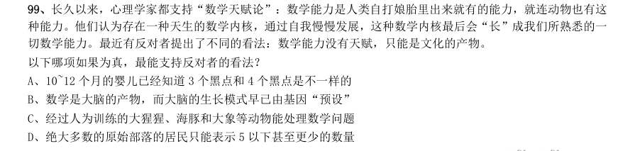

- **A.** 10~12 个月的婴儿已经知道3 个黑点和4 个黑点是不一样的
- **B.** 数学是大脑的产物,而大脑的生长模式早已由基因“预设”
- **C.** 经过人为训练的大猩猩、海豚和大象等动物能处理数学问题
- **D.** 绝大多数的原始部落的居民只能表示5 以下甚至更少的数量

**答案：D**

### 2019 湖北·统一卷　第 100 题　（归纳推导）

牙医在治疗龋齿时,先要去除牙齿龋坏的部分,再填充材料以修补缺损的牙体。但是, 至 的补牙会 失败,且所用的填充物并不具备使牙齿自愈的功能,甚至还有副作用。有鉴于此,研究人员研发出一种用合成生 物材料制成的填充物,可以刺激牙髓中干细胞的生长,修复受损部位。这种填充物能刺激干细胞的增殖,并分化 成牙本质。如果未来补牙的填充物都用这样的再生材料制成,将降低补牙失败率,也可减少蛀牙患者治疗牙髓之 苦。 由此可以推出:

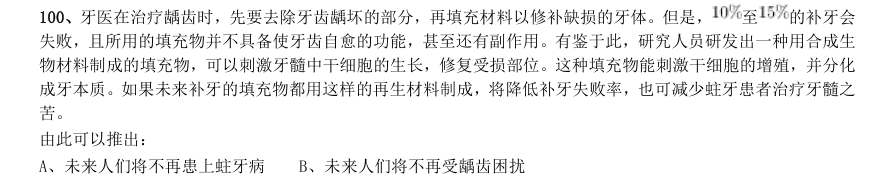

- **A.** 未来人们将不再患上蛀牙病
- **B.** 未来人们将不再受龋齿困扰
- **C.** 新研发的补牙填充物能刺激受损牙齿自愈
- **D.** 新研发的补牙填充物能促进牙本质的生长

**答案：C**

### 2019 湖北·统一卷　第 101 题　（削弱）

如今,基于互联网的新型科普方式层出不穷。浅阅读、视频直播以及游戏互动等方式,使得如今获取科学 知识的渠道越来越多、门槛也越来越低。研究者认为,尽管“互联网+科普”令科学知识的获取和传播方式发生 了很大变化,但这不是对科普传播的一种颠覆,而是显示了公民科学素养的提升。 以下哪项如果为真,最能质疑研究者的观点?

- **A.** 新闻应用、微博等资讯类媒体是用户了解科学热点事件的最主要渠道
- **B.** 在许多科学热点事件的传播过程中,公众很难见到权威科学家的身影
- **C.** 数据表明,用户普遍乐于通过图文资讯这样轻松愉悦的形式获取知识
- **D.** 比起明星八卦,在社交媒体转发科普内容更能为转发者本人形象加分

**答案：B**

### 2019 湖北·统一卷　第 102 题　（削弱）

在抗生素大规模医用之前,耐药效果对细菌几乎没有意义,突变自身的有害效果更加重要。正常使用抗生 素能杀死几乎所有的目标细菌,个别漏网之鱼通常也会被人体免疫系统消灭殆尽。其中一些细菌个体虽然已经带 有耐药性的萌芽,但这些萌芽不足以抵御正常剂量抗生素,也会随着个体死去而消失。 由此可以推出:

- **A.** 基因突变是耐药细菌泛滥成灾的根本原因
- **B.** 细菌通过基因突变,来削弱抗生素的作用效果
- **C.** 致病菌产生耐药性之后,抗生素将无法攻击病菌
- **D.** 如果没有抗生素滥用,耐药性不会快速蔓延开来

**答案：D**

### 2019 湖北·统一卷　第 103 题　（加强）

某国际古生物学研究团队最新报告称,在2.8 亿年前生活在南非的正南龟是现代乌龟的祖先,它们是在二 叠纪至三叠纪大规模物种灭绝事件中幸存下来的。当时,为了躲避严酷的自然环境,它们努力向地下挖洞,同时 为保证前肢的挖掘动作足够有力,身体需要一个稳定的支撑,从而导致了肋骨不断加宽。由此可知,乌龟有壳是 适应环境的表现,只不过不是为了保护,而是为了向地下挖洞。 上述结论的成立需要补充以下哪项作为前提?

- **A.** 只有挖洞才能从大规模物种灭绝事件中幸存
- **B.** 现代乌龟继承了正南龟善于挖洞的某些习性
- **C.** 正南龟前肢足够有力因而并不需要龟壳保护
- **D.** 龟壳是由乌龟的肋骨逐渐加宽后进化而来的

**答案：D**

### 2019 湖北·统一卷　第 104 题　（加强）

自制力不仅关乎自我控制,还包括排除不相关刺激的干扰和坚持完成相关任务(即使是自己不喜欢的任务) 的能力。自制力是稳定不变的,还是会被消耗的,学界各派的看法不一。心理学家把实验对象分为两组,让他们 同场解决难题。一组解题时只能吃萝卜,另一组还可以吃饼干。结果只吃萝卜的这组坚持时间更短,因为他们在 抵制饼干的诱惑的同时,消耗了自制力。他们由此得出结论:人们的自制力是有限的,过度使用会导致自制力下 降。 上述结论的成立需要补充以下哪项作为前提?

- **A.** 实验对象对解决难题的兴趣不完全相同
- **B.** 饼干和萝卜对实验对象的诱惑力不相同
- **C.** 饼干和萝卜补充人体能量的效果不相同
- **D.** 两组实验对象抗干扰的能力不完全相同

**答案：B**

### 2019 湖北·统一卷　第 105 题　（削弱）

有研究声称:癌细胞怕热,高体温可以抗癌。人体最容易罹癌的器官包括肺、胃、大肠、乳腺等都是体温 较低的部位,心脏之类的“高温器官”不容易得癌症。因此,可以用运动、喝热水、泡澡等方法提高体温来抗癌。 以下哪项如果为真,最能反驳上述论断?

- **A.** 受呼吸、饮食等影响,人的口腔温度一般比直肠温度低,而世界范围内直肠癌的发生率要高于口腔癌
- **B.** 人的体温存在精准的调控机制,基本保持平稳状态,体内各个脏器之间并没有什么明显的温度差异
- **C.** 热疗或许可以帮助放疗或一些化疗发挥更好的作用,但证明其可靠性的研究数据依然不足
- **D.** 心脏很少发生恶性肿瘤,是因为这里的心肌细胞不再进行分裂增殖,而与温度高低无关

**答案：B**

### 2019 湖北·选调　第 106 题　（削弱）

相信∶坚信∶质疑

- **A.** 希望∶盼望∶奢望
- **B.** 报道∶报告∶封杀
- **C.** 微词∶批判∶赞扬
- **D.** 诚恳∶诚信∶伪装

**答案：C**

### 2019 湖北·选调　第 110 题　（加强）

《自然》期刊发表的一项新研究表明,基因改造过的猪心脏,在被同位移植到狒狒体内后,保持完整功能 地跳动了195 天。这预示着未来人类也能受益于此,可以解决人类器官供应短缺的棘手问题。 以下哪项如果为真,最能支持上述结论?

- **A.** 猪心脏与人的心脏在解剖学结构上非常相似
- **B.** 猪心脏移植到狒狒身上具有非常高的生存率
- **C.** 猪心脏异种移植距离实验成功仅仅一步之遥
- **D.** 猪心脏可以在人类以外的灵长动物体内存活

**答案：A**

### 2019 湖北·选调　第 111 题　（加强）

一项长达20 年的研究表明,爱做家务的求职者比不爱做家务的求职者更容易成功就业,就业后的收入前者 也比后者高。此外,爱做家务的求职者比不爱做家务的求职者生活幸福感更高。通过做家务,求职者能养成合理 规划的习惯和不骄不躁的品质。从这个角度看,做家务有助于培养更多的社会精英。 下列哪项如果为真,最能够加强上述论证?

- **A.** 养成合理规划和不骄不躁的习惯为求职者所必需
- **B.** 非常多的求职者都在被他们父母积极鼓励做家务
- **C.** 合理规划和保持不骄不躁是社会精英的必备品质
- **D.** 做家务可以提升求职者的规划能力和生活幸福感

**答案：C**

### 2019 湖北·选调　第 113 题　（削弱）

一位地铁安检员声称,他通过长期的地铁安检工作养成了一种特殊技能。即,他能够准确地识别一位乘客 是否在欺骗他。他的根据是,在地铁安检入口检查时,他只需要与乘客进行短短的几句对话就能断定对方是否可 疑;而在他认为可疑的乘客身上,无一例外地都查出了违禁物品。 下列哪项如果为真,最能削弱上述地铁安检员的论证?

- **A.** 在他认为不可疑而未经检查的乘客中有人无意地携带了违禁物品
- **B.** 在他认为可疑而进行检查的乘客中大部分有意地携带了违禁物品
- **C.** 在他认为可疑并查出违禁物品的乘客中有人无意地携带违禁物品
- **D.** 在他认为不可疑而未经检查的乘客中大部分都没有携带违禁物品

**答案：C**

### 2019 湖北·选调　第 114 题　（削弱）

一项针对两组行政单位科级职员的调查发现,第一组职员在10 周内户外活动的次数不少于7 次;第二组职 员则10 周内户外活动的次数不多于3 次。调查结果显示,第二组职员面临的工作压力大于第一组职员。因此, 调查得出结论,科级职员户外活动次数少导致他们工作压力大。 下列哪项如果为真,最能对上述调查结论提出质疑?

- **A.** 第一组中有的职员感到自己的工作压力并不大
- **B.** 第一组中有职员工作压力比第二组的职员还高
- **C.** 第二组中有一些职员的工作压力并不是非常大
- **D.** 第二组职员因工作压力大导致户外活动次数少

**答案：D**

### 2019 湖北·选调　第 115 题　（归纳推导）

某地方政府计划削减财政预算,原计划削减9%。为此,计划撤销两个部门,这两个部门的预算正好占地方 政府总预算的9%。计划实施后,上述两个部门被撤销6%,整个地方政府预算实际削减。在此过程中,地方政府 各部门预算有所调整。 如果上述判定为真,则以下哪项一定为真? 1上述计划实施后,有的职能部门预算增加。 2上述计划实施后,没有一个职能部门预算增加额度超出地方政府原来总预算的3%。 3上述计划实施后,被削减的财政预算,都来自于被撤销的两个部门原有的预算。

- **A.** 只有1
- **B.** 只有1和2
- **C.** 只有2和3
- **D.** 全部都为真

**答案：A**

### 2019 广东·乡镇　第 41 题　（加强）

一座城市要想发展好会展产业,就需要“筑巢引凤”——先具备软硬件基础,再吸引会展活动。拥有完备的会 展设施和理想的交通条件,只是说明一座城市具备了发展会展产业的硬件基础,要想吸引足够数量的高质量会展活 动,还需要提高公共服务水平、构建良好的营商环境,从而加强软实力的建设。 如果上述表述为真,则以下情况中不可能发生的是( )。

- **A.** 甲市具备了发展会展产业的硬件基础,却发展不好会展产业
- **B.** 乙市大力提升公共服务水平,吸引了足够数量的高质量会展活动
- **C.** 丙市的会展产业非常发达,但市政设施老化的问题日渐突出
- **D.** 丁市会展设施完备、交通条件理想,但未具备发展会展产业的硬件基础

**答案：暂缺**

### 2019 广东·乡镇　第 42 题　（削弱）

G 市经济发达、教育资源丰富,许多在G 市就读的大学生毕业后都选择留在G 市工作生活。但在今年,G 市周 边的几个城市都出台了一系列针对大学生落户的优惠政策,许多G 市大学生因此选择将户口迁往周边城市。由此可 以预测,今年留在G 市的大学生将会更容易找到工作。 以下最能反驳上述论证的是( )。

- **A.** G 市周边的几个城市中,大学生同样不容易找到心仪的工作
- **B.** 与去年相比,今年G 市的几个大型工厂招收工人数量有所减少
- **C.** 绝大多数将户口迁往周边城市的G 市大学生仍然选择在G 市工作
- **D.** 有调查指出,过去几年在G 市的大学生并没有面临很大的就业压力

**答案：暂缺**

### 2019 广东·乡镇　第 43 题　（前提假设）

在发达国家的产业结构中,服务业占了很高的比重。根据他们的经验,提高服务业占比就可以促进就业。但是, 服务业具有较高的进入壁垒,这也是我国服务业发展相对滞后的一个重要原因。因此,我国可以通过打破服务业的 行业壁垒进一步促进就业。 以下最可能是上述论证潜在假设的是( )。

- **A.** 服务业促进就业的规律适用于我国
- **B.** 我国创造就业的能力弱于发达国家
- **C.** 发达国家的服务业也存在行业壁垒
- **D.** 其他行业对促进就业没有显著作用

**答案：暂缺**

### 2019 广东·乡镇　第 44 题　（解释评价）

近年来随着大型野生动物园的兴起,有人提出,传统城市动物园已经没有存在的必要性。但传统城市动物园具 有票价低、交通便利等优点,中小学组织参观十分方便,因而具有很强的教育功能,所以传统城市动物园不可或缺。 以下不属于上述论证缺陷的是( )。

- **A.** 忽视了野生动物园和传统城市动物园具有并存的可能性
- **B.** 默认了具有很强教育功能的传统城市动物园就应该保留
- **C.** 忽视了票价低、交通便利不等同于方便中小学组织参观
- **D.** 默认了方便中小学组织参观的动物园都具有很强的教育功能

**答案：暂缺**

### 2019 广东·乡镇　第 45 题　（逻辑判断（综合））

历史经验告诉我们,世界经济危机往往伴随着巨大的世界变革:1857 年世界经济危机后的电气革命,推动人 类社会从蒸汽时代进入电气时代;1929 年世界经济危机引发了第二次世界大战,客观上推动了科学技术的发展。 由此可知,是经济危机造成了巨大的世界变革。 以下和该论证过程的逻辑最为类似的是( )。

- **A.** 不正确的坐姿会加重颈部负担,因而是腰酸背痛的主要诱因
- **B.** 海底地震是海啸的主要成因,因为海啸发生前往往能观测到海底地震
- **C.** 宇航员的预期寿命明显高于一般人,因此太空旅行中的辐射暴露并不会危害人体
- **D.** 许多体弱多病的人都不喜欢吃蔬菜,所以想保持身体健康就必须从蔬菜中摄入足量的膳食纤维

**答案：暂缺**

### 2019 广东·乡镇　第 46 题　（逻辑判断（综合））
> 材料：判断,从4 个备选项中选出最合理的1 项。…

风能是一种清洁的可再生能源,很早就被人们所利用。下列关于利用风能发电的说法不正确的是( )。

- **A.** 风力发电场可以建在海上
- **B.** 风力发电是将风的动能转换为电能
- **C.** 风力发电的能量最终来源于太阳能
- **D.** 风力发电的过程中不会有能量的损失

**答案：暂缺**

### 2019 广东·乡镇　第 47 题　（逻辑判断（综合））

人在短时间内从低海拔处上升至高海拔处时,环境气压变化大,但鼓膜内的气压不变,鼓膜会感觉不适。这时, 可通过做咀嚼运动或大口呼吸缓解,其原理是( )。

- **A.** 通过转移人的注意力,减少不适感
- **B.** 吸入更多的氧气,使机体的新陈代谢加快
- **C.** 疏通咽鼓管,使外耳道与鼓室之间的气压平衡
- **D.** 提高鼓膜的震动频率,缓解不适症状

**答案：暂缺**

### 2019 广东·乡镇　第 49 题　（逻辑判断（综合））

将瘪了的乒乓球放在热水里一段时间后,乒乓球便会恢复原来的圆形状态。其原理是( )。

- **A.** 乒乓球内部气体溢出,内部气体减少
- **B.** 乒乓球受热后球壁变软,恢复原来形状
- **C.** 乒乓球内部气体受热膨胀,挤压乒乓球内壁
- **D.** 水蒸气流入乒乓球内部,乒乓球内部压强增大

**答案：暂缺**

### 2019 广东·乡镇　第 50 题　（逻辑判断（综合））

如图所示,货车停在某处卸货时货物从倾斜的货箱滑下。那么,下列关于货车车轮所受的摩擦力说法正确的是 ( )。

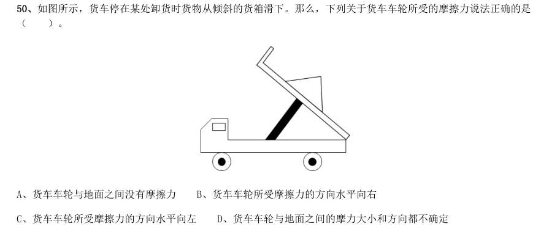

- **A.** 货车车轮与地面之间没有摩擦力
- **B.** 货车车轮所受摩擦力的方向水平向右
- **C.** 货车车轮所受摩擦力的方向水平向左
- **D.** 货车车轮与地面之间的摩力大小和方向都不确定

**答案：暂缺**

### 2019 广东·乡镇　第 51 题　（逻辑判断（综合））

如图所示,将一只充了气的密封小气球放在针筒壁内,封闭针筒孔后向外抽拉针筒推杆,忽略摩擦力的影响, 则在这一过程中( )。

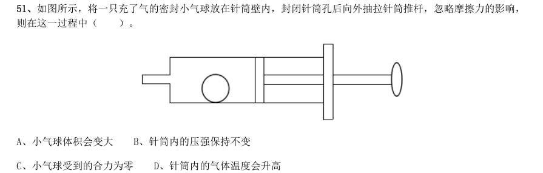

- **A.** 小气球体积会变大
- **B.** 针筒内的压强保持不变
- **C.** 小气球受到的合力为零
- **D.** 针筒内的气体温度会升高

**答案：暂缺**

### 2019 广东·乡镇　第 52 题　（逻辑判断（综合））

物质的用途与性质密切相关。下列说法正确的是( )。

- **A.** 木炭能作为炼钢的原料,是利用了木炭的可燃性
- **B.** 钨常用作灯丝,是因为钨在高温下化学性质稳定
- **C.** 活性炭可以去除水中杂质,是因为其具有很强的吸附能力
- **D.** 铝制品的表面可以不做防锈处理,是因为铝的金属活动性不强

**答案：暂缺**

### 2019 广东·乡镇　第 53 题　（逻辑判断（综合））

办公室里的四盏灯型号相同,电路如下图所示。如果逐一打开这四盏灯,在电源的输出电压不变的情况下,下 列说法正确的是( )。

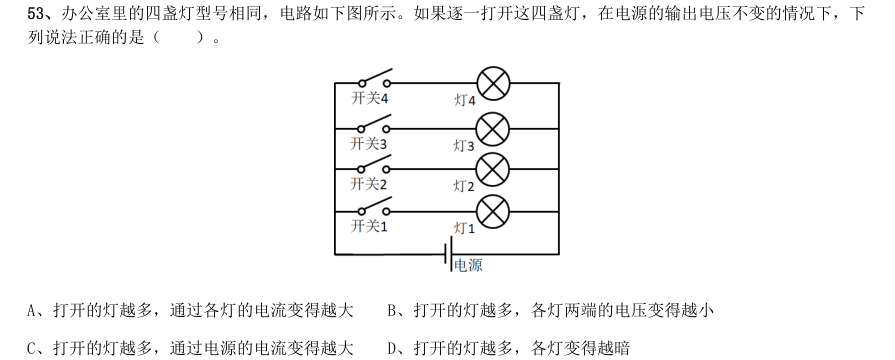

- **A.** 打开的灯越多,通过各灯的电流变得越大
- **B.** 打开的灯越多,各灯两端的电压变得越小
- **C.** 打开的灯越多,通过电源的电流变得越大
- **D.** 打开的灯越多,各灯变得越暗

**答案：暂缺**

### 2019 广东·乡镇　第 54 题　（逻辑判断（综合））

冬天气温很低的时候往玻璃杯里倒开水,杯壁较厚的玻璃杯更容易发生炸裂,这是因为( )。

- **A.** 内壁和外壁受热不均
- **B.** 开水遇到玻璃后温度迅速降低
- **C.** 空气对杯壁的压力超过杯壁的承受范围
- **D.** 倒水时水的冲击力将玻璃杯击破

**答案：暂缺**

### 2019 广东·乡镇　第 55 题　（逻辑判断（综合））

如图所示,甲、乙两个大小相同的实心金属球放置在光滑水平面上,甲球以水平向右的速度碰撞静止的乙球。 已知甲球质量大于乙球,则有关碰撞后的情形,下列说法正确的是( )。

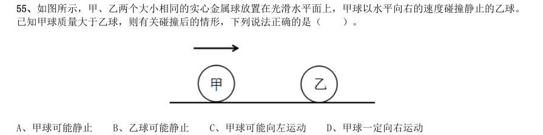

- **A.** 甲球可能静止
- **B.** 乙球可能静止
- **C.** 甲球可能向左运动
- **D.** 甲球一定向右运动

**答案：暂缺**

### 2019 广东·乡镇　第 57 题　（逻辑判断（综合））

人们在乘坐小船时,应尽量坐下,站立会降低小船的稳定性,其根本原因是( )。

- **A.** 人和船的整体重量增加
- **B.** 人和船的整体重心变高
- **C.** 船的行驶速度增加
- **D.** 水流波动幅度变大

**答案：暂缺**

### 2019 广东·乡镇　第 59 题　（逻辑判断（综合））

如图所示,将所点燃的一高一矮两只蜡烛放入圆筒,圆筒顶端不封闭,并从圆筒侧壁缓慢注入二氧化碳气体。 则最可能发生的情况是( )。

- **A.** 高蜡烛先熄灭
- **B.** 矮蜡烛先熄灭
- **C.** 两只蜡烛的火苗没有变化
- **D.** 两只蜡烛的火苗都变矮并逐渐熄灭

**答案：暂缺**

### 2019 广东·乡镇　第 60 题　（逻辑判断（综合））

为了整治超速,交警采用了一套系统。在某一路段,系统会自动记录车辆进入和离开的时间,从而判断该车辆 是否超速。这种方法是计算车辆的( )。

- **A.** 平均速率
- **B.** 瞬时速率
- **C.** 加速度
- **D.** 位移

**答案：暂缺**

### 2019 广东·县级　第 35 题　（逻辑判断（综合））

如图所示,下列物体均由纯黑色和纯白色的小立方体组成。则物体1与物体2中,( )由5 块物体3 堆积而成。

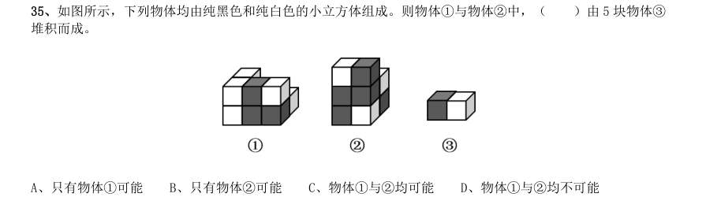

- **A.** 只有物体1可能
- **B.** 只有物体2可能
- **C.** 物体1与2均可能
- **D.** 物体1与2均不可能

**答案：暂缺**

### 2019 广东·县级　第 47 题　（逻辑判断（综合））

芯片产业是全球分工合作的产业,其分布的领域非常广,不同领域面对的问题和挑战也大不相同,没有一 个国家能够拥有完完整整的自主可控芯片产业链。但一国想要获得芯片产业的话语权,至少应该掌握产业链条 上某些环节的关键技术,这样才能避免受制于人。 根据上述表述,下列判断一定正确的是( )。

- **A.** 一个国家只要有了芯片产业话语权,该国就可能拥有完整的芯片产业链
- **B.** 一个国家如果没有芯片产业的关键技术,则该国的芯片产业将受制于人
- **C.** 一个国家的芯片产业要想不受制于人,就必须拥有完整的芯片产业链
- **D.** 一个国家如果掌握了芯片产业的关键技术,那么该国一定具有芯片产业的话语权

**答案：暂缺**

### 2019 广东·县级　第 49 题　（逻辑判断（综合））

某办公室有教育学硕士、教育学学士、哲学硕士、哲学学士各一人。四人中,甲不是教育学硕士也不是哲 学学士;甲和丙学习的是同一门学科;乙只获得了学士学位;丁不学哲学。 如果上述表述为真,则以下说法正确的是( )。

- **A.** 甲是教育学学士
- **B.** 乙是哲学学士
- **C.** 丙是哲学学士
- **D.** 丁是教育学学士

**答案：暂缺**

### 2019 广东·县级　第 52 题　（解释评价）

有研究表明,向他人倾诉自己的烦恼是缓解压力的有效方式,但是在现实生活中,有四成以上的人不会向 他人倾诉自己的烦恼,而这一部分人常感觉自己的工作与生活压力更大。因此,一个人越经常向他人倾诉自己 的烦恼,在工作与生活中感受到的压力越小。 以下选项最能指出上述论证缺陷的是( )。

- **A.** 默认了对于个体而言,缓解压力的行为是必要的
- **B.** 忽视了每个人对压力的承受能力具有显著差异
- **C.** 默认了提高行为的频率有助于加强行为的效果
- **D.** 忽视了向他人倾诉烦恼可能会造成隐私泄露等问题

**答案：暂缺**

### 2019 广东·县级　第 53 题　（加强）

近几年,“痕迹管理”在基层工作中被广泛应用。其优势在于通过保留下来的文字、图片等工作资料,有 效还原服务群众的工作情况,供日后查证。某地基层单位为了强化“痕迹管理”,极大增加了工作资料在考核 分值中的比重。显然,这样的做法会使当地基层干部将大量精力耗费在保留工作痕迹上。 以下最可能是上述论证潜在假设的是( )。

- **A.** 基层干部对于考核分值十分重视
- **B.** 有些基层干部对群众缺少服务意识
- **C.** “痕迹管理”要求保留所有工作痕迹
- **D.** 绝大多数基层干部缺少“留痕”条件

**答案：暂缺**

### 2019 广东·县级　第 54 题　（加强）

某研究机构对3 个品牌的老年代步车进行安全性碰撞实验。实验表明,这3 个品牌的代步车都无法在发生 交通事故时保护驾驶人。该机构因此认为:老年代步车十分危险,政府应该禁止代步车上路,引导老年人驾驶 普通汽车。 以下选项最无法支持上述论断的是( )。

- **A.** 代步车的价格一般低于普通汽车
- **B.** 这3 个品牌的代步车市场占有率极高
- **C.** 使用代步车的老人普遍拥有汽车驾驶资格
- **D.** 安全性是决定代步车能否上路行驶的首要因素

**答案：暂缺**

### 2019 广东·县级　第 56 题　（前提假设）

研究表明,糖尿病是一种由多病因引起的以慢性高血糖为特征的代谢性疾病,是多种因素共同作用的结果, 有家族聚集现象。家族史是提示可能患糖尿病风险的重要依据,因此,了解家族史,有助于更好地预防糖尿病。 要得出上述结论,必须补充的前提是( )。

- **A.** 家族聚集现象体现在家族史中
- **B.** 了解患糖尿病风险有助于预防糖尿病
- **C.** 绝大多数人有途径了解自己的家族史
- **D.** 不健康的生活方式也是影响糖尿病发病的因素

**答案：暂缺**

### 2019 广东·县级　第 57 题　（逻辑判断（综合））

过分密集的城市布局不仅容易使城市产生热岛效应,也不符合生态美学的要求。因此,城市建设应该尽可 能拉开布局,合理地间隔各城市组团,使城市看起来舒缓有序,不拥挤、不杂乱。 以下和该论述过程的逻辑最为类似的是( )。

- **A.** 只有有趣的故事和通俗的理论相结合,才能吸引人,让人真正理解其中的内涵,爱上科学。所以,从日常生活中的小事入手,科普也可以很有趣
- **B.** 中小学课业负担太重,是影响中小学生快乐健康成长的大问题。所以,要将课业减负进行到底,扫除线上培训等减负盲区
- **C.** 天文学的起源与文明的起源大致处于同一时期。因此,追寻天文学的起源也就意味着我们可以在某种程度上把握文明诞生和发展的脉络
- **D.** 律师队伍事关群众对法治的需求,也与一个地方的竞争力直接相关。所以,完善的法律服务是营商环境的重

**答案：暂缺**

### 2019 广东·县级　第 58 题　（逻辑判断（综合））

某地区自上世纪70 年代开始,引入栽种欧美黑杨,用于造纸。这些欧美黑杨适应当地气候环境,生长速度 快,种植面积迅速扩大。然而近年来,当地生态环境问题日趋严重。因此有人认为,可以通过砍掉这些欧美黑 杨来修复该地区生态环境。 以下选项最能指出上述论述缺陷的是( )。

- **A.** 假设了有其他的作物可以替代欧美黑杨的经济价值
- **B.** 忽视了该地区引入栽种的其他外来植物也会影响生态环境
- **C.** 假设了该地区引入的欧美黑杨栽种面积远超当地树种面积
- **D.** 默认了欧美黑杨种植面积扩大和生态环境问题间存在因果关系

**答案：暂缺**

### 2019 广东·县级　第 59 题　（削弱）

随着生活节奏的加快,很多人都会用时间管理软件来规划自己的时间,以提升工作效率。这一做法是可行 的。因为大脑的“提醒功能”不够准确,很少能在正确的时间做出正确的提醒,而外部提醒可以让人更好地掌 握时间。 以下选项中最能削弱上述论断的是( )。

- **A.** 时间管理软件会让人压力增大,影响工作效率
- **B.** 时间管理软件质量参差不齐,人们难以辨别优劣
- **C.** 时间管理软件会使人们的生活节奏进一步加快
- **D.** 时间管理软件难以适用所有工作、生活事项

**答案：暂缺**

### 2019 广东·县级　第 60 题　（逻辑判断（综合））

文学作品的电子书会给作品带来很高的关注度,这种关注度能够拉动纸质书的销售。因此,所有想要提高 纸质版文学作品销售量的出版社都会为文学作品发行电子书。 以下和该论证过程的逻辑最为类似的是( )。

- **A.** 家庭教育可以培养孩子的见识、性格、技能,从而确保孩子的天赋得到发展。所以,家长对家庭教育的重视,是确保孩子天赋得到发展的充分条件
- **B.** 是否掌握作品命脉是作家是否拥有自己语言体系的判断标准。这是因为,一个作家拥有了自己的语言体系,就掌握了作品的命脉,就能成为优秀的作家
- **C.** 家风与民风交相辉映,民风与国风休戚相关。在现代社会,好的家风必然能影响好的社会风气的形成。唯有良好的家风能孕育一个文明向上的社会
- **D.** 要传承好传统文化,就必须构建传统文化传承体系。因为一旦构建好这一体系,就可以系统性地取其精华、

**答案：暂缺**

### 2019 广东·县级　第 63 题　（逻辑判断（综合））

日常生活中的一些简单器械都应用了杠杆原理,根据使用杠杆时的用力情况,杠杆可以分为省力杠杆、费 力杠杆和等臂杠杆。拾取垃圾使用的钳子(图1)和修剪树枝用的剪刀(图2),这两者的杠杆类型( )。

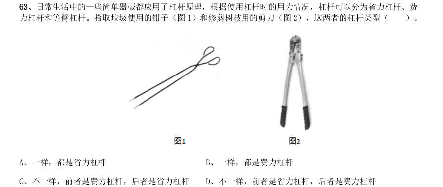

- **A.** 一样,都是省力杠杆
- **B.** 一样,都是费力杠杆
- **C.** 不一样,前者是费力杠杆,后者是省力杠杆
- **D.** 不一样,前者是省力杠杆,后者是费力杠杆

**答案：暂缺**

### 2019 广东·县级　第 65 题　（逻辑判断（综合））

物质的用途与性质密切相关。下列说法正确的是( )。

- **A.** 木炭能作为炼钢的原料,是利用了木炭的可燃性
- **B.** 钨常用作灯丝,是因为钨在高温下化学性质稳定
- **C.** 活性炭可以去除水中杂质,是因为其具有很强的吸附能力
- **D.** 铝制品的表面可以不做防锈处理,是因为铝的金属活动性不强

**答案：暂缺**

### 2019 广东·思维能力测验　第 18 题　（削弱）

一项针对11 岁青少年的研究发现,生活在绿化程度较低的社区的青少年空间工作记忆能力较差,生活 在绿化程度较高的社区的青少年空间工作记忆能力较强。据此,有人建议青少年应该居住在绿化程度较高的地 方。 以下最能质疑上述建议的是()。

- **A.** 青少年在10 岁到14 岁间的空间工作记忆能力较差
- **B.** 生活在绿化程度低的城市的成年人空间工作记忆能力较强
- **C.** 社区绿地数量多有利于促进青少年的大脑发育
- **D.** 绿化程度较高社区的家庭通常更注重青少年空间工作记忆能力的培养

**答案：D**

### 2019 广东·思维能力测验　第 25 题　（削弱）

一项针对糖尿病患者饮食的研究发现,那些选择高膳食纤维饮食的患者,其肠道内的益生菌生长速度 快,进而促进糖化血红蛋白明显下降。因此,高膳食纤维饮食有利于防治糖尿病。 以下最能质疑上述论证的是()。

- **A.** 不少糖尿病患者患病前后一直有着高膳食纤维饮食的习惯
- **B.** 某山区的人经常喝含益生菌的酸牛奶,当地极少有人患糖尿病
- **C.** 高膳食纤维饮食可使进餐后血糖保持稳定
- **D.** 糖化血红蛋白指标可有效反映糖尿病患者过去1-2 个月内血糖控制情况

**答案：A**

### 2019 广东·思维能力测验　第 43 题　（削弱）

随着社会发展,以及疾病谱、生态环境、生活方式等的不断变化,我国面临多重疾病威胁并存、多种 健康影响因素交织的复杂局面。这一局面将会严重影响人们的健康。 以下选项中最能削弱上述论断的是()。

- **A.** 近年来我国主要疾病发病率持续降低
- **B.** 调查研究表明,这一局面难以在短时间内改变
- **C.** 人们的健康会受到多方面因素的综合影响
- **D.** 这一局面已经持续了很长时间

**答案：A**

### 2019 广东·思维能力测验　第 47 题　（削弱）

一项针对老年人的跟踪调查发现,存在牙缺失、牙敏感等口腔问题的被调查者体弱多病的几率明显高 于其他被调查者。因此,糟糕的口腔健康问题是令老年人身体格外虚弱的重要原因之一。 以下选项中最能削弱上述论断的是()。

- **A.** 身体虚弱容易诱发口腔健康向题
- **B.** 此研究的跟踪调查时间仅有3 年
- **C.** 一些口腔状况糟糕的老人身体并不虚弱
- **D.** 该调查的研究对象未包含青少年及中年人

**答案：A**

### 2019 国考·地市级　第 84 题　（逻辑判断（综合））

物候现象是生物随着气候一年四季的周期性变化而发生的相应季节性变化的现象。影响物候现象的因素主要 包括海拔的差异、经度的差异、纬度的差异和时间的差异。 下列诗句反映的物候现象受到海拔差异影响的是:

- **A.** 日出江花红胜火,春来江水绿如蓝
- **B.** 竹外桃花三两枝,春江水暖鸭先知
- **C.** 人间四月芳菲尽,山寺桃花始盛开
- **D.** 羌笛何须怨杨柳,春风不度玉门关

**答案：C**

### 2019 国考·地市级　第 101 题　（加强）

一般来说,塑料极难被分解,即使是较小的碎片也很难被生态系统降解,因此它造成的环境破坏十分严重。 近期科学家发现,一种被称为蜡虫的昆虫能够降解聚乙烯,而且速度极快。如果使用生物技术复制蜡虫降解聚乙 烯,将能够帮助我们有效清理垃圾填埋厂和海洋中累积的塑料垃圾。 以下哪项如果为真,不能支持上述结论?

- **A.** 世界各地的塑料垃圾的主要成分是聚乙烯
- **B.** 蜡虫的确能够破坏聚乙烯塑料的高分子链
- **C.** 聚乙烯被蜡虫降解后的物质对环境的影响尚不明确
- **D.** 现有科技手段能够将蜡虫降解聚乙烯的酶纯化出来

**答案：C**

### 2019 国考·地市级　第 102 题　（解释评价）

所有的幼儿园都面临同一个问题:就是对于那些在幼儿园放学之后不能及时来接孩子的家长,幼儿园老师 除了等待别无他法,因此许多幼儿园都向晚接孩子的家长收取费用。然而,有调查显示,收取费用后晚接孩子的 家长数量并未因此减少,反而增加了。 以下哪项如果为真,最能解释上述调查结果?

- **A.** 收费标准太低,对原本经常晚来接孩子的家长没有太大的约束力
- **B.** 有个别家长对收费行为不满,有时会故意以晚接孩子的行为来抗议
- **C.** 有些家长因工作忙碌,常常不能及时来接孩子
- **D.** 收费后,更多的家长认为即使晚来接孩子也不必愧疚,只要付费即可

**答案：D**

### 2019 国考·地市级　第 103 题　（削弱）

应激本身没有致痛能力,但是流行病学调查发现,长期应激与疼痛慢性化的发生正相关,即长期处于巨大 压力下的人群,其疼痛症状更易迁延,进而发展为慢性疼痛。 以下哪项如果为真,最能支持上述调查结果?

- **A.** 具有焦虑倾向的人,其应激水平往往较高,疼痛慢性化的发生率也会更高
- **B.** 长期应激可影响神经内分泌系统,使人的疼痛抑制系统的功能被削弱
- **C.** 吸烟使人体神经内分泌系统发生紊乱,对疼痛感知的影响与应激相似
- **D.** 如果能有效缓解应激,保持心态平和,疼痛慢性化的发生率将会降低50%

**答案：B**

### 2019 国考·地市级　第 104 题　（削弱）

自从前年甲航运公司实行了经理任期目标责任制之后,公司的经济效益也随之逐年上升。可见,只有实行 经理任期目标责任制,才能使甲公司经济效益稳步增长。 以下哪项如果为真,最能削弱上述论证?

- **A.** 近两年国家经济发展速度较快,航运行业的整体形势大好
- **B.** 没实行任期目标责任制的乙航运公司,近两年的经济效益也稳步增长
- **C.** 前年甲公司开始实行职工薪酬管理制度改革,极大地调动了公司员工的积极性
- **D.** 如果甲航运公司没有实行任期目标责任制,近两年的经济效益会增长得更快

**答案：D**

### 2019 国考·地市级　第 105 题　（加强）

所有的地震都是以P 波开始的,这些P 波移动快速,使地面发生上下震动,造成的破坏较小。下一个是S 波,它的移动很慢,使地面前后、左右晃动,破坏性极大。早期预警系统通过测量P 波沿地面移动的情况,来预 测S 波所造成的影响,然后发出警报。然而,从事此类系统工作的科学家们发现,事实上人们并没有多少时间为 大地震做好准备。 要得到上述结论,需要补充的最重要前提是:

- **A.** 地球上每年大约发生500 多万次地震,绝大多数的地震人们根本感觉不到
- **B.** 根据历年大地震的记载,强震大多在夜里瞬间发生,无法在短时间内组织有效的防御行动
- **C.** 地震越大,P 波与S 波之间的间隔越短,留给人们预警的时间不多
- **D.** 发生较大地震时,人们先感到上下颠簸,而后才有很强的水平晃动,这种晃动是由S 波造成的

**答案：C**

### 2019 国考·地市级　第 107 题　（朴素逻辑（排序/匹配））

如果在该场比赛中,陈佳和赵义均答对了一半的题目,则该场比赛“镇美”队答对的总题数最少为:

- **A.** 1 题
- **B.** 2 题
- **C.** 3 题
- **D.** 4 题

**答案：C**

### 2019 国考·地市级　第 109 题　（朴素逻辑（排序/匹配））

如果在该场比赛中,所有的历史题都答对了,而所有的地理题都答错了,假定每题1 分,则以下哪项中选 手的得分情况是不可能的?

- **A.** 陈佳=1;赵义=2;王冰=1
- **B.** 陈佳=2;赵义=1;王冰=1
- **C.** 陈佳=1;赵义=3;王冰=0
- **D.** 陈佳=2;赵义=2;王冰=0

**答案：B**

### 2019 国考·省级　第 107 题　（削弱）

有实验表明,秋葵的提取物——秋葵素,对于治疗动物糖尿病有一定效果。有人据此认为,秋葵切片泡水 喝,有助于降低糖尿病人的血糖。 以下哪项如果为真,最能质疑上述论证?

- **A.** 只有使用提取、浓缩后的大剂量秋葵素才能降低糖尿病人的血糖
- **B.** 接受正规治疗才是糖尿病人控制血糖最为安全有效的途径
- **C.** 秋葵素对II型糖尿病患者有效,对I型糖尿病患者无效
- **D.** 秋葵中所含有的膳食纤维和多种维生素并不比一般蔬菜高

**答案：A**

### 2019 国考·省级　第 109 题　（削弱）

有研究人员认为,人类脱发是由于营养不均衡导致的。当人体无法吸收到均衡的营养,毛囊就会萎缩,从 而导致脱发。但是,有反对者认为,脱发是由于毛囊受损导致的。当毛囊受损后,处于“假性死亡”状态,毛囊 退化并萎缩,导致毛发停止生长,逐渐枯萎脱落。 以下哪项如果为真,最能削弱反对者的观点?

- **A.** 毛囊受损是由营养不均衡导致的
- **B.** 长期营养不足的人往往头发枯黄,易脱发
- **C.** 使用洗发水也会对毛囊造成一定程度的损害
- **D.** 毛囊受损使其不能从头皮中吸收营养,从而导致脱发

**答案：A**

### 2019 国考·省级　第 113 题　（逻辑判断（综合））

有位青年到杂志社询问投稿结果。编辑说:“你的稿子我看过了,总的来说有一些基础,不过在语言表达 上仍不够成熟,流于幼稚。”青年问:“那能不能把它当作儿童文学作品呢?” 下列选项中与青年所犯的逻辑错误相同的是:

- **A.** 甲到处宣扬说:“我从来不炫耀自己的优点。”
- **B.** 甲说:“人生太短暂,我们应该珍惜时间,抓住机会,尽情挥霍。”
- **C.** 甲问:“我能用蓝笔墨水写出红字,你信吗?”乙答:“不信。”甲就提笔在纸上写了一个“红”字
- **D.** 甲开车撞到了行人乙,二人争执起来,甲说:“我有多年驾驶经验,责任不可能在我。”

**答案：C**

### 2019 国考·省级　第 114 题　（朴素逻辑（排序/匹配））

小溪根据学习计划制定了阅读书单,准备阅读《红楼梦》《水浒传》《三国演义》《西游记》《论语》《道德经》 《诗经》七部名著,每部均要阅读,但是她的阅读顺序必须符合如下要求: (1)阅读《道德经》之前要先阅读《三国演义》,阅读这两部著作之间还要阅读另外两部著作(《诗经》除外); (2)第一部或者最后一部阅读《西游记》; (3)第三部阅读《论语》; (4)阅读《诗经》要在阅读《道德经》之前或者刚刚阅读完《道德经》之后。 如果小溪首先要阅读《三国演义》,则可以确定她的阅读顺序是:

- **A.** 第二部阅读《水浒传》
- **B.** 第五部阅读《道德经》
- **C.** 第二部阅读《红楼梦》
- **D.** 第五部阅读《诗经》

**答案：D**

### 2019 国考·省级　第 115 题　（归纳推导）

小若为了参加一项法律考试,准备在一周之内复习14 门课程,其中民法课程5 门、经济法课程3 门、行政 法课程3 门、商法课程2 门、国际私法课程1 门。但是因为精力有限,小若每天只能复习2 门课程,并且需要满 足以下条件: (1)星期四只能复习2 门民法课程,其余每天必须复习两类不同的课程; (2)国际私法必须在星期天复习; (3)民法和行政法不能在同一天复习; (4)经济法和商法不能在同一天复习。 由此可以推出,以下哪两类课程不可能在同一天复习?

- **A.** 经济法和国际私法
- **B.** 行政法和经济法
- **C.** 行政法和商法
- **D.** 民法和经济法

**答案：A**

### 2018 湖北·统一卷　第 96 题　（加强）

我们身体的生物钟系统会受到许多因素的影响,其中之一就是光照。研究表明,光照可以有效地欺骗大脑 进入“白昼模式”,哪怕当时人的眼睛是闭着的也没关系。研究人员发现可以用光照疗法来帮助我们调整时差, 包括持续光照和不同间隔的闪光,而每10 秒一次持续仅2 毫秒的闪光最有效。研究还发现,在睡眠时经历过 “闪光处理”的人出现困意的周期会延后两个小时。 以下哪项如果是真,最能支持上述观点?

- **A.** 每次闪光间隙的黑暗都有助于让眼睛重启,从而恢复眼睛对光照的敏感
- **B.** 大部分睡眠时经历“闪光处理”的人的睡眠质量都不会受到闪光的影响
- **C.** 去时区早两小时的城市,启程日日出前两小时经光照疗法的人无时差感
- **D.** 依靠自身来调节时差耗时良久,大概平均每天只能倒过一个小时的时差

**答案：C**

### 2018 湖北·统一卷　第 97 题　（加强）

研究人员在普遍使用的功能性磁共振成像技术(fMRI)专用软件中发现了算法错误。他们采集499 名健康 的人处于静息状态时的检查结果,发现其统计方法还需用真实呈现的病例加以验证。这意味着软件有时会错得 离谱,就算大脑处于静止状态时也会显示有活动——软件显示出的活动是软件算法的产物,而非被研究大脑真 的处于活跃状态。 以下哪项如果为真,最能支持上述结论?

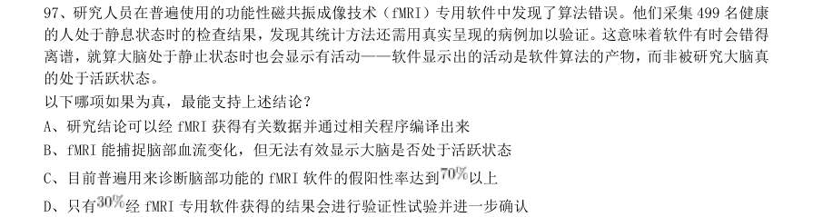

- **A.** 研究结论可以经fMRI 获得有关数据并通过相关程序编译出来
- **B.** fMRI 能捕捉脑部血流变化,但无法有效显示大脑是否处于活跃状态
- **C.** 目前普遍用来诊断脑部功能的fMRI 软件的假阳性率达到以上
- **D.** 只有

**答案：C**

### 2018 湖北·统一卷　第 98 题　（加强）

如果央行允许人民币继续贬值,那么市场对于人民币贬值的预期就容易强化。如果市场形成较强的人民币 贬值预期,大量的资金就会流出我国。资金流出我国,不仅会强化这种人民币的贬值预期,导致更多的资金流 出我国,而且可能会导致我国资产价格全面下跌,继而可能引爆金融市场的区域性风险及系统性风险。这些都 是我们不愿意看到且不允许出现的情况。 由此可以推出:

- **A.** 货币持续贬值会导致资产全面下跌
- **B.** 资金流失严重会出现货币贬值预期
- **C.** 央行不会允许人民币继续贬值
- **D.** 我国将重点着手干预资金外流

**答案：C**

### 2018 湖北·统一卷　第 99 题　（削弱）

母亲年龄是唐氏综合征筛查所考虑的风险因素之一。一般认为,母亲年龄越大,宝宝出现遗传异常的风险 就越高。当卵子里有一条多余的21 号染色体时,胎儿就会出现唐氏综合征。随着女性年龄的增长,出现此类 异常的风险也随之升高。最近,一些专家开始对这种筛查方法提出质疑,认为遗传异常并不仅仅只是女方年龄 的问题。 以下哪项如果为真,最能支持上述专家质疑?

- **A.** 精子的21 号染色体也可能粘连多余的遗传物质,父亲的年龄越大,制造精子过程出错的概率就越高
- **B.** 造成宝宝精神健康问题的重点似乎并不在于母亲的“绝对年龄”,而在于父亲与母亲的“相对年龄”
- **C.** 子宫基本不会随着年龄增长发生变化,只要激素水平充足,年老妇女的子宫也能够正常养育胎儿
- **D.** 现代人因为环境以及生活习惯影响,容易产生基因突变,即便是健康夫妇也有生育“唐氏儿”的风险

**答案：A**

### 2018 湖北·统一卷　第 100 题　（真假推理）

四位球迷在某球赛的晋级赛开始之前对几个队伍的赛况进行预测,他们比较关注其中的两支球队,分别 作了如下预测: 方某说:如果甲队不能晋级,那么乙队也不能晋级。 白某说:不管甲队能不能晋级,乙队都不能晋级。 夏某说:乙队能晋级,但甲队不能晋级。 邓某说:我看这几支球队都不能晋级。 比赛结果证明,四位球迷中只有一位的预测是正确的。 根据上述情况,以下哪项一定为真?

- **A.** 白某预测是正确的
- **B.** 邓某预测是正确的
- **C.** 如果甲队能够晋级,那么方某的预测是正确的
- **D.** 如果甲队不能晋级,那么方某的预测是正确的

**答案：C**

### 2018 湖北·统一卷　第 101 题　（削弱）

场所恐惧症主要表现为对某些特定环境的恐惧,如高处、广场、客观环境和拥挤的公共场所等,常以自 发性惊恐发作开始,然后产生预期焦虑和回避行为,进而出现条件化的形成。一些临床研究表明,场所恐惧症 患者常伴有惊恐发作。然而,有专家认为最初一次惊恐发作是场所恐惧症起病的必备条件,因而认为场所恐惧 症是惊恐发作发展的后果,应归入惊恐障碍这一类别。 以下哪项如果为真,最能质疑上述专家观点?

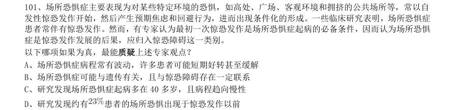

- **A.** 场所恐惧症病程常有波动,许多患者可能短期好转甚至缓解
- **B.** 场所恐惧症可能与遗传有关,且与惊恐障碍存在一定联系
- **C.** 研究发现场所恐惧症起病多在40 多岁,且病程趋向慢性
- **D.** 研究发现约有

**答案：D**

### 2018 湖北·统一卷　第 102 题　（前提假设）

月球潮汐力与地球上的地震、海啸、火山爆发等自然灾害存在明显相关性的说法是可疑的,因为每年自 然灾害很多,而“超级月亮”每14 个月才一次,即便考虑月球经过近地点,每个月也只有一次。部分学者会 找出一些和“超级月亮”出现时间相隔不远的灾害来论证,这显然缺乏证据支撑。也忽略了大量事例,比如月 球在远地点前后发生的灾害。基于大量关于地震和月球关系数据的研究表明,地震发生频率和月球经过近地点 没有统计上的相关性,因此说月球潮汐力会引发地震显然缺乏可靠证据。 由此可以推出:

- **A.** 月球潮汐力与月球在远地点前后发生的地震具有相关性
- **B.** 月球潮汐力与月球经过近地点发生的地震具有因果关系
- **C.** 月球潮汐力与地震之间的关系需要在时间和空间上综合分析
- **D.** 地震触发机制有多种因素,但月球潮汐力的作用效果较明显

**答案：C**

### 2018 湖北·统一卷　第 103 题　（削弱）

某研究团队让两批测试者分别进入睡眠实验室里睡上一夜。第一批被安排睡得很晚,从而减少总睡眠时 间;第二批被安排睡得早,但在睡眠过程中多次被吵醒。第二晚过后,结果就已经显现:第二批测试者的积极 情绪受到严重影响。他们的精力水平较低,同情心和友善度等积极情绪指数有所下滑。部分研究者据此认为, 被吵醒导致了测试者无法得到足够的慢波睡眠,而慢波睡眠是恢复精力感的关键,但也有研究者对此项研究的 可信度提出质疑。 以下哪项如果为真,最能反驳质疑者?

- **A.** 第一批测试者积极情绪的指数下滑程度不太明显
- **B.** 第二批测试者中大部分人长期以来情绪不够积极
- **C.** 两批测试者的健康状况和心理素质原本就很接近
- **D.** 两批测试者在参与睡眠实验前精力水平参差不齐

**答案：A**

### 2018 湖北·统一卷　第 104 题　（加强）

宇宙加速膨胀是因为物质之间相互排斥,减速膨胀是因为物质之间相互吸引。因此,要在此基础上解释 宇宙的加速或减速膨胀,必须要有不同特性的物质在不同的时期占主导地位,从而产生强大的排斥力或吸引力。 粒子物理标准模型中的所有粒子都产生吸引的引力,然而星系转动曲线的研究表明,在星系里面还有大量的、 看不到的物质,这些物质可以产生非常强大的吸引性引力。 以上论证如果为真,那么星系转动曲线研究结论隐含了下列哪一项前提?

- **A.** 粒子物理标准模型中的所有粒子产生的吸引性引力不足
- **B.** 粒子物理标准模型中的粒子不是唯一的,存在其它粒子
- **C.** 星系转动曲线的研究说明这个时期的宇宙正在加速膨胀
- **D.** 星系转动曲线的研究说明存在超大质量、看不到的黑洞

**答案：A**

### 2018 湖北·统一卷　第 105 题　（加强）

我国在西南地区进行的页岩气勘探获得重大成果,估算天然气资源量达千亿立方米,这是我国首次在四 川盆地以外的南方复杂构造区取得页岩气勘探的重大突破。有专家称该地有望成为新的工业气田,可以满足上 千万居民的生活和工农业发展的用气需求,促进经济发展。 该专家观点成立的假设前提是:

- **A.** 南方复杂的地质构造有利于天然气生成
- **B.** 凡是勘探到的天然气都能顺利开采出来
- **C.** 我国目前天然气产量无法满足实际需求
- **D.** 天然气作为清洁能源是促进经济发展的重要动力

**答案：B**

### 2018 广东·统一卷　第 51 题　（解释评价）

某市举行春季音乐节系列活动,其中一项活动首次邀请了某知名交响乐团前来该市演出,该市交响 乐爱好者对此十分期待。考虑到该乐团的影响力,主办方预计为期两天的交响乐团演出将“一票难求”。但 开始售票后发现,实际情况并非如此。 以下哪项为真,最能解释这一情况?

- **A.** 音乐节的其他活动吸引了许多观众
- **B.** 交响乐未能被该市大部分群众所接受
- **C.** 音乐节活动期间该市一直为阴雨天气
- **D.** 此次交响乐团演出门票价格过高

**答案：暂缺**

### 2018 广东·统一卷　第 52 题　（加强）

对多个省份的调查研究发现,对于外向者而言,花大量时间用于网络社交并不会影响与他人面对面 交流的意愿,而内向者即使不进行网络社交也不会变成社交达人。因此,有研究者认为,网络社交会妨碍传 统社交的担忧是毫无必要的。 以下哪项为真,最有助于支持上述结论?

- **A.** 有许多花费大量时间在网络社交上的人不愿意与他人面对面交流
- **B.** 无论采用哪种方式,大多数人参与社会活动的总时间是相对固定的
- **C.** 在网络社交的帮助下,许多人在传统社交中的能力和自信得到了提升
- **D.** 该研究由某大学开展,而在该校学生中,网络社交并不是主要的社交方式

**答案：暂缺**

### 2018 广东·统一卷　第 53 题　（加强）

近年来,某公司生产的汽车发生了几起严重的交通事故,有人认为这是因为该汽车在设计上存在缺 陷导致的。对此,该公司坚决否认设计上存在缺陷,理由是根据这几起交通事故的分析报告,发生事故时, 司机都存在酒后驾驶或疲劳驾驶的情况。 以下哪项为真,最不能支持该公司的观点?

- **A.** 该公司一直宣称自己的产品安全性能良好
- **B.** 该公司所依据的交通事故分析报告真实可靠
- **C.** 喝酒和疲劳都会严重影响司机驾驶时的判断力D、经过对事故车辆的检测,并没有发现存在设计缺陷

**答案：暂缺**

### 2018 广东·统一卷　第 54 题　（逻辑判断（综合））

某围棋队有选手会在比赛时喝茶,他们或者喝红茶,或者喝绿茶。 如果以上描述为真,下列哪项一定是真的? I.该围棋队一名在比赛时不喝红茶的选手,一定喝绿茶。 II.该围棋队没有选手比赛时喝黑茶。 III.该围棋队有的选手比赛时不喝茶。

- **A.** 只有II
- **B.** 只有III
- **C.** I 和II
- **D.** II 和III

**答案：暂缺**

### 2018 广东·统一卷　第 55 题　（解释评价）

某市高新区离老城区较远,且公交车班次很少。高新区企业的员工大部分居住在老城区,他们经常 会因为无法按时坐上公交车而迟到。为此,公交车公司大量增加了高新区与老城区之间的公交车班次,以满 足这些员工的乘车需求。但是经过一段时间的观察,情况并没有得到改善,这些员工依然经常迟到。 以下哪项为真,最能解释上述现象?

- **A.** 高新区的许多企业都调整了上班时间
- **B.** 部分原来开车上班的高新区企业员工改为乘坐公交车
- **C.** 由于道路狭窄,公交车班次大量增加后经常出现长时间塞车
- **D.** 许多原本乘坐公交车上班的高新区企业员工改为开车或乘坐出租车

**答案：暂缺**

### 2018 广东·统一卷　第 56 题　（削弱）

有研究小组调查显示,在封闭环境中入睡的人更容易频繁醒来,而且自我感觉睡眠质量不佳。因此, 有人认为,就寝时关闭门窗将会降低睡眠质量。 以下哪项为真,最能削弱上述结论?

- **A.** 研究小组调查的对象大多是年轻人
- **B.** 睡眠质量差的人更喜欢关闭门窗睡觉
- **C.** 门窗紧闭会影响室内空气质量,从而影响睡眠
- **D.** 由于安全、保暖等原因,夜间开窗并不适合所有房间

**答案：暂缺**

### 2018 广东·统一卷　第 57 题　（逻辑判断（综合））

外界环境中的阳光辐射、空气污染等都会使人体产生更多活性氧自由基。体内活性氧自由基正是人 类衰老的根源,而抗氧化剂可以有效清除体内多余的自由基。 如果以上描述为真,下列哪项一定是正确的?

- **A.** 清除体内多余的自由基,要么避免阳光辐射和空气污染,要么摄入抗氧化剂
- **B.** 人的衰老速度可能由环境决定,也可能受抗氧化剂的影响
- **C.** 严重的空气污染会影响人的衰老速度和抗氧化剂的效果
- **D.** 抗氧化剂能够有效延长人的寿命

**答案：暂缺**

### 2018 广东·统一卷　第 58 题　（削弱）

近期,某公司推出了一款空调,其耗电量比市面上所有其他同类产品都要低。因此,该公司管理层 认为,这款空调的销量将会超过市面上所有其他同类产品。 以下哪项为真,最能质疑该公司管理层的判断?

- **A.** 该公司的品牌知名度低于其他同类企业
- **B.** 该款空调的售后服务质量比不上其他同类产品
- **C.** 该款空调的使用寿命低于同类产品的平均水平
- **D.** 耗电量并不是大部分消费者在选购空调时的主要关注点

**答案：暂缺**

### 2018 广东·统一卷　第 59 题　（逻辑判断（综合））

单位接到一项工作任务,领导决定从张、王、李、林、沈、赵6 人中选出3 人组成工作小组。工作 组应符合以下3 个条件: 1张、林两人中至少需要一人入选。 2王、李两人中至多能有一人入选。 3如果沈、赵两人同时入选,则王不能入选。 以下工作人员组成不符合条件的是:

- **A.** 沈、李、赵
- **B.** 李、张、林
- **C.** 赵、张、王
- **D.** 沈、王、林

**答案：暂缺**

### 2018 广东·统一卷　第 60 题　（解释评价）

某市实体零售店的数量由2013 年的3800 家,增加到了2017 年的4500 家。但这几年来,该市实体 零售店的销售额在整个零售业中所占的比例并没有增加,反而有所下降。 以下哪项为真,最不能解释上述现象?

- **A.** 这几年来该市实体零售店的整体销售额显著下降
- **B.** 这几年来该市非实体零售店的整体销售额迅速增加
- **C.** 这几年来该市零售业的整体销售额有了大幅度的提升
- **D.** 这几年来该市非实体零售店数量的增长速度快于实体零售店

**答案：暂缺**

### 2018 广东·统一卷　第 61 题　（逻辑判断（综合））

如图所示,质量为m 的物体A 在水平力F 的作用下,恰好沿竖直墙壁匀速下滑,当水平力增大为2F 时,物体A 逐渐减速,最后保持静止。则静止时物体A 所受摩擦力的大小( )。

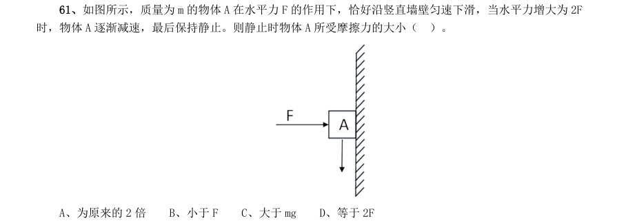

- **A.** 为原来的2 倍
- **B.** 小于F
- **C.** 大于mg
- **D.** 等于2F

**答案：暂缺**

### 2018 广东·统一卷　第 62 题　（逻辑判断（综合））

一颗种子在地下生根发芽,最终破土而出,长成一株小树苗。在这个过程中,其有机物总量( )。

- **A.** 逐渐增加
- **B.** 先增加后减少
- **C.** 先减少后增加
- **D.** 先保持不变,后逐渐增加

**答案：暂缺**

### 2018 广东·统一卷　第 63 题　（逻辑判断（综合））

现在,人们常利用碘化银实现人工降雨。通过高炮将含有碘化银的炮弹打入云雾厚度比较大的高空 中,碘化银因为炮弹的爆炸在高空扩散,促使降雨产生(如图所示)。下列说法正确的是( )。

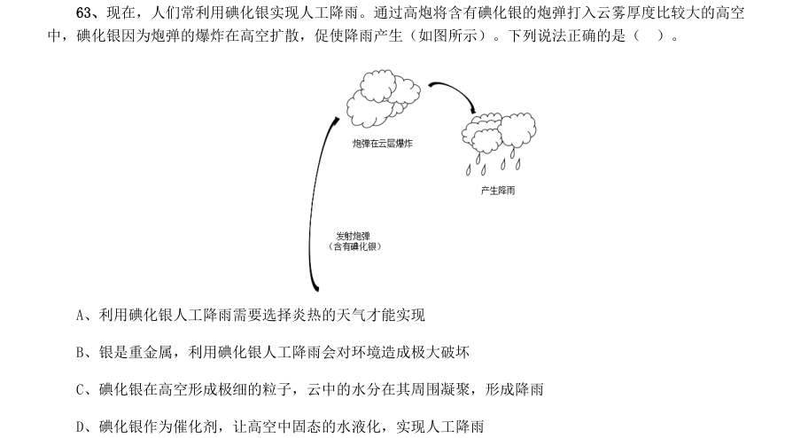

- **A.** 利用碘化银人工降雨需要选择炎热的天气才能实现
- **B.** 银是重金属,利用碘化银人工降雨会对环境造成极大破坏
- **C.** 碘化银在高空形成极细的粒子,云中的水分在其周围凝聚,形成降雨
- **D.** 碘化银作为催化剂,让高空中固态的水液化,实现人工降雨

**答案：暂缺**

### 2018 广东·统一卷　第 64 题　（逻辑判断（综合））

用手推车将两箱货物A 和B 拉到仓库存储,途中要经过一段斜坡(如图所示)。已知货物A 和B 的 质量均为m,斜坡的坡度为30°。当手推车匀速经过斜坡时,货物A 和B 均处于静止状态,则受力情况正确 的是( )。

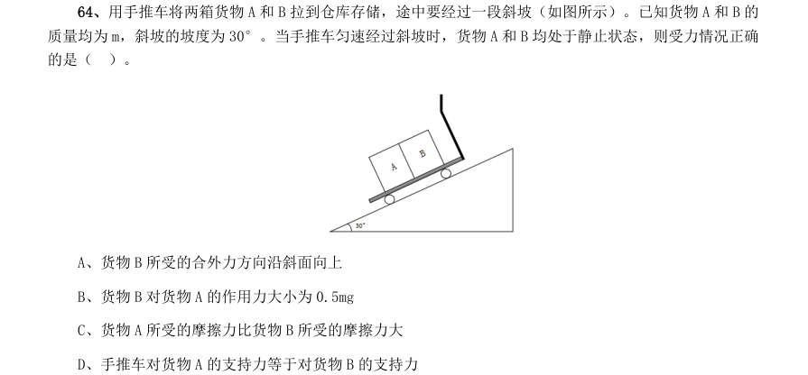

- **A.** 货物B 所受的合外力方向沿斜面向上
- **B.** 货物B 对货物A 的作用力大小为0.5mg
- **C.** 货物A 所受的摩擦力比货物B 所受的摩擦力大
- **D.** 手推车对货物A 的支持力等于对货物B 的支持力

**答案：暂缺**

### 2018 广东·统一卷　第 65 题　（逻辑判断（综合））

下图是两种不同导体( 、 )的伏安特性曲线,则以下选项无法确定的是( )。

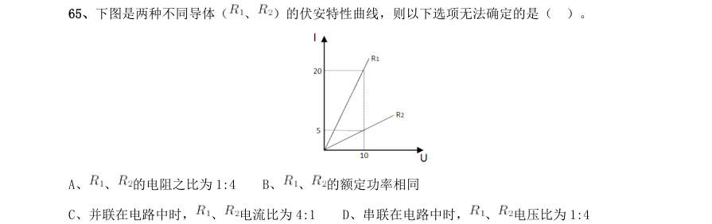

- **A.** 、
- **B.** 、的额定功率相同
- **C.** 并联在电路中时,、
- **D.** 串联在电路中时,

**答案：暂缺**

### 2018 广东·统一卷　第 66 题　（逻辑判断（综合））
> 材料：电压比为1:4…

地表某相对独立的生态系统,其主要物种及数量如图所示,则下列说法必然正确的是( )。

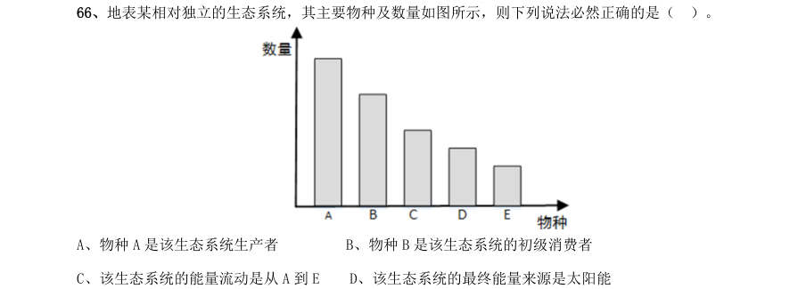

- **A.** 物种A 是该生态系统生产者
- **B.** 物种B 是该生态系统的初级消费者
- **C.** 该生态系统的能量流动是从A 到E
- **D.** 该生态系统的最终能量来源是太阳能

**答案：暂缺**

### 2018 广东·统一卷　第 67 题　（逻辑判断（综合））

用如图所示的杠杆提升物体。从B 点垂直向下用力,在将物体匀速提升到一定高度的过程中,用力 的大小将( )。

- **A.** 保持不变
- **B.** 逐渐变小
- **C.** 逐渐变大
- **D.** 先变大,后变小

**答案：暂缺**

### 2018 广东·统一卷　第 68 题　（逻辑判断（综合））

在检查视力时,检查者通常从面前的平面镜中看身后的视力表(如图所示)。下列说法正确的是 ( )。

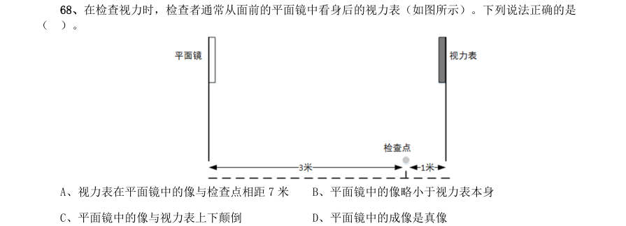

- **A.** 视力表在平面镜中的像与检查点相距7 米
- **B.** 平面镜中的像略小于视力表本身
- **C.** 平面镜中的像与视力表上下颠倒
- **D.** 平面镜中的成像是真像

**答案：暂缺**

### 2018 广东·统一卷　第 69 题　（逻辑判断（综合））

以下关于惯性的分析,正确的是( )。

- **A.** 滚动的足球受地面摩擦,滚动速度逐渐减慢,惯性也随之减小
- **B.** 月球绕地球转动,其惯性与地球对它的引力相关
- **C.** 自由落体在下落过程中速度增大,惯性也增加
- **D.** 桌面上静止不动的乒乓球也有惯性

**答案：暂缺**

### 2018 广东·统一卷　第 70 题　（逻辑判断（综合））

现有三个同样的玻璃瓶,分别装有空气、氧气和氢气。以下能将三瓶气体区分开来的是( )。

- **A.** 观察气体的颜色
- **B.** 倒入澄清石灰水
- **C.** 插入燃着的木条
- **D.** 闻气体的气味

**答案：暂缺**

### 2018 国考·副省级　第 95 题　（逻辑判断（综合））

蜂鸣式营销是一种通过向潜在消费者直接提供企业产品或服务,使其获得产品或服务体验的销售方式。根据 上述定义,下列不属于蜂鸣式营销的是:

- **A.** 某软件公司在网上推出一款试用版软件,用户可免费试用三个月
- **B.** 某公司聘请演员在各大城市繁华地区扮演情侣,邀请可能成为目标客户的路人为他们拍照,借机向其宣传新款相机的功能
- **C.** 某企业定期向用户发送邮件,寄送产品杂志,推送优惠信息,并承诺购买产品一个月内不满意可以无条件退货
- **D.** 某饮料公司让营销人员频频出现在街道、咖啡馆、酒吧、超市等场所,请路人品尝不同口味的饮料来宣传自

**答案：C**

### 2018 国考·副省级　第 106 题　（加强）

扶贫必扶智。让贫困地区的孩子们接受良好教育,是扶贫开发的重要任务,也是阻断贫困代际传递的重要 途径。 以上观点的前提是:

- **A.** 贫困的代际传递导致教育的落后
- **B.** 富有阶层大都受过良好教育
- **C.** 扶贫工作难,扶智工作更难
- **D.** 知识改变命运,教育成就财富

**答案：D**

### 2018 国考·副省级　第 107 题　（加强）

有一种理论认为,距今约5000 万年前,生活在马达加斯加岛上的环尾狐猴、狐蝠以及其他哺乳动物的祖先 当年乘坐天然的“木筏”,来到了马达加斯加这座位于印度洋的岛屿上。根据这一理论,来自非洲大陆东南部的 哺乳动物当年漂流到马达加斯加,它们利用的交通工具是大原木或者漂浮的植被。在上演漂流记前,风暴将它们 卷入大海,在洋流的带动下,这些古代“难民”漂流数周,来到马达加斯加。 以下哪项如果为真,不能支持上述漂流理论?

- **A.** 5000 万年前,两个大陆板块周围的洋流曾一度向东流动,也就是流向马达加斯加
- **B.** 小型哺乳动物天生新陈代谢缓慢,能够在没有太多食物和淡水的情况下存活数周
- **C.** 在从非洲大陆东南部到达马达加斯加的动物中,没有大象,狮子等超重超大哺乳动物
- **D.** 5000 万年前,非洲大陆和马达加斯加之间的距离与今天不同

**答案：D**

### 2018 国考·副省级　第 108 题　（加强）

有调查显示,部分学生缺乏创造力。研究者认为,具有创造力的孩子在幼年时都比较淘气,而在一些家庭, 小孩如果淘气就会被家长严厉呵斥,这导致他们只能乖乖听话,创造力就有所下降。 这项调查最能支持的论断是:

- **A.** 幼年是创造力发展的关键时期
- **B.** 教育方式会影响孩子创造力的发展
- **C.** 幼年听话的孩子长大之后可能缺乏创造力
- **D.** 有些家长对小孩淘气倾向于采取比较严厉的态度

**答案：B**

### 2018 国考·副省级　第 109 题　（真假推理）

某省游泳队进行了为期一个月的高原集训,集训最后一日所有队员进行了一次队内测试,几位教练预测了 一下队员的成绩: 张教练说:这次集训时间短,没人会达标。 孙教练说:有队员会达标。 王教练说:省运会冠军或国家队队员可达标。 测试结束后,只有一位教练的预测是正确的。 由此可以推出:

- **A.** 没有人达标
- **B.** 全队都达标了
- **C.** 省运会冠军达标
- **D.** 国家队队员未达标

**答案：D**

### 2018 国考·副省级　第 110 题　（归纳推导）

某公司30 岁以下的年轻员工中有一部分报名参加了公司在周末举办的外语培训班。该公司的部门经理一致 同意在本周末开展野外拓展训练。所有报名参加外语培训班的员工都反对在本周末开展拓展训练。 由此可以推出:

- **A.** 所有部门经理年龄都在30 岁以上
- **B.** 该公司部门经理中有人报名参加了周末的外语培训班
- **C.** 报名参加周末外语培训班的员工都是30 岁以下的年轻人
- **D.** 有些30 岁以下的年轻员工不是部门经理

**答案：D**

### 2018 国考·副省级　第 111 题　（削弱）

人们普遍认为,保持乐观心态会促进健康。但一项对7 万名50 岁左右的女性进行的长达十年的追踪研究发 现,长期保持乐观心态的被试与悲观被试在死亡率上并没有差异,研究者据此认为,心态乐观与否与健康没有关 系。 以下哪项如果为真,最能质疑研究者的结论?

- **A.** 在这项研究的被试中悲观的人更多患有慢性疾病,虽然尚未严重到致命的程度
- **B.** 与悲观的人相比,乐观的人患病后会更积极主动地治疗
- **C.** 乐观的人往往对身体不会特别关注,有时一些致命性疾病无法及早发现
- **D.** 女性更善于维持和谐的人际关系,而良好的人际关系有助于健康

**答案：A**

### 2018 国考·副省级　第 112 题　（削弱）

开车斗气、胡乱变线、强行超车等“路怒症”是一种被称为间歇性、暴发性障碍(IED)的心理疾病。有研究 发现,IED 患者弓形虫检测呈阳性的比例是非IED 组的两倍。研究者认为,弓形虫感染有可能是导致包括“路怒 症”在内的IED 的罪魁祸首。 以下哪项如果为真,无法支持研究者的观点?

- **A.** 感染了弓形虫的老鼠往往更大胆、更敢于冒险,也因此更容易被猫抓到
- **B.** 弓形虫使大脑中控制威胁反应的神经元受到过度刺激,易引发攻击行为
- **C.** 对弓形虫检测呈阳性的IED 患者施以抗虫感染治疗之后,冲动行为减少
- **D.** 弓形虫是猫身上的一种原生动物寄生虫,但猫是比较温顺的动物

**答案：D**

### 2018 国考·副省级　第 113 题　（削弱）

日前,研究人员发明了一种弹性超强的新材料,这种材料可以由1 英寸被拉伸到100 英寸以上,同时这一 材料可以自行修复且能通过电压控制动作。因此研究者认为,利用该材料可以制成人工肌肉,替代人体肌肉,从 而为那些肌肉损伤后无法恢复功能的患者带来福音。 以下哪项如果为真,不能支持研究者的观点?

- **A.** 该材料制成的人工肌肉在受到破坏或损伤后能立即启动修复机制,比正常肌肉的康复速度快
- **B.** 该材料在电刺激下会发生膨胀或收缩,具有良好的柔韧性,与正常肌肉十分接近
- **C.** 目前,该材料研制成的人工肌肉尚不能与人体神经很好的契合,无法实现精准抓取物体等动作
- **D.** 一般材料如果被破坏,需通过溶剂修复或热修复复原,而该材料在室温下就能自行恢复

**答案：C**

### 2018 国考·副省级　第 114 题　（削弱）

自上世纪50 年代以来,全球每年平均爆发的大型龙卷风的次数从10 次左右上升至15 次。与此同时,人类 活动激增,全球气候明显变暖,有人据此认为,气候变暖导致龙卷风爆发次数增加。 以下哪项如果为真,不能削弱上述结论?

- **A.** 龙卷风的类型多样,全球变暖后,小型龙卷风出现的次数并没有明显的变化
- **B.** 气候温暖是龙卷风形成的一个必要条件,几乎所有龙卷风的形成都与当地较高的温度有关
- **C.** 尽管全球变暖,龙卷风依然最多地发生在美国的中西部地区,其他地区的龙卷风现象并不多见
- **D.** 龙卷风是雷暴天气(即伴有雷击和闪电的局地对流性天气)的产物,只要在雷雨天气下出现极强的空气对流,

**答案：B**

### 2018 国考·副省级　第 115 题　（前提假设）

某次会议讨论期间,甲、乙、丙、丁、戊被安排在一张圆桌前进行讨论,圆桌边放着标有1~5 号的五张座 椅(未必按序排列)。实际讨论时,甲、乙、丙、丁、戊5 人均未按顺序坐在1~5 号的座椅上,已知: (1)甲坐在1 号座椅右边第二张座椅上; (2)乙坐在5 号座椅左边第二张座椅上; (3)丙坐在3 号座椅左边第一张座椅上; (4)丁坐在2 号座椅左边第一张座椅上。 如果丙坐在1 号座椅上,则可知甲坐的是哪个座椅?

- **A.** 2 号
- **B.** 3 号
- **C.** 4 号
- **D.** 5 号

**答案：C**

### 2018 国考·地市级　第 107 题　（前提假设）

以下哪门课程安排在任意一天都有可能?

- **A.** 数学
- **B.** 宗教
- **C.** 统计
- **D.** 以上都不是

**答案：B**

### 2018 国考·地市级　第 110 题　（前提假设）

如果宗教课程开设两次,那么历史课程安排在哪一天?

- **A.** 第1 天
- **B.** 第2 天
- **C.** 第3 天
- **D.** 第4 天

**答案：D**

### 2017 湖北·统一卷　第 96 题　（归纳推导）

汽车行业作为制造业中技术含量、智能化程度和产业集中度较高的代表,已经成为了德国“工业4.0”的先导阵 地。长期处于2.0 工业思维的中国汽车制造业要在全球占有一席之地,进行技术创新与变革和拥有丰富经验的资深人 才必不可少,而高薪和福利成为吸引人才的制胜法宝。 由此可以推出:

- **A.** 如果能够吸引到资深人才,中国汽车制造业的改革就能成功
- **B.** 高薪和福利是很多中国职场人士选择职业时的一个重要关注点
- **C.** 不进行技术变革,中国汽车制造业就不能在全球占有一席之地
- **D.** 德国汽车制造业在世界汽车行业具有举足轻重的地位和影响力

**答案：C**

### 2017 湖北·统一卷　第 97 题　（削弱）

一项研究显示,先让受试者参加消除某项偏见的学习,并给受试者播放与消除该偏见学习相关联的声音。之后, 让受试者进入深度睡眠状态,同时重复播放那些相关联的声音,以重新激活消除该偏见的学习。结果发现,该偏见比 睡眠前大大减少,且睡眠质量越高,偏见减少得越多。研究人员由此推测,睡眠干预可减少社会偏见与歧视。 以下哪项如果为真,最能支持上述论证?

- **A.** 普通民众难以得到消除偏见学习的睡眠干预
- **B.** 睡眠充足、睡眠质量高的人比其他人更不易产生偏见与歧视
- **C.** 有身高歧视、相貌歧视的人经过睡眠干预后,歧视程度明显降低
- **D.** 在接受睡眠干预的受试者中,有一部分人并不存在明显的偏见或歧视

**答案：C**

### 2017 湖北·统一卷　第 98 题　（真假推理）

在汇率贬值期间,除非借入货币的利率和其他成本足够高卖空贬值货币的投机活动不可避免。如果货币当局有足 够的外汇储备坚持到最后,投机者就只能铩羽而归。但是,如果外汇储备不足,投机者最终就将“饱食远扬”,无论 是在升值还是在贬值的压力下,如果汇率不能迅速反映市场的供求关系,将损害宏观经济稳定,不利于经济结构的调 整。 如果以上论述为真,不能推出下列哪些结论?

- **A.** 或者货币当局有足够的外汇储备坚持到最后,或者投机者“饱食远扬”
- **B.** 如果汇率能够迅速反映市场的供求关系,那么就不会损害宏观经济稳定
- **C.** 除非汇率迅速反映市场供求关系,否则会损害宏观经济稳定,不利于经济结构调整
- **D.** 如果借入货币的利率和其他成本不够高,那么卖空贬值货币的投机活动就不可避免

**答案：B**

### 2017 湖北·统一卷　第 99 题　（加强）

提高能源使用效率、鼓励能源灵活利用是英国减少温室气体排放政策的一个必要环节,它需要采用智能技术,包 括通过智能表将能源使用信息从需求方面或客户发送到能源公司等。该信息可用于制定和实施更高效的能源使用条 例。但英国消费者对此态度不一,因为该技术用于监控和支持能源高效率使用行为时,居民个人及家庭的能源数据不 得不被动分享。所以,个人使用能源相关数据的被动分享有可能成为推广智能技术的最主要障碍。 以下哪项如果为真,最能支持上述结论?

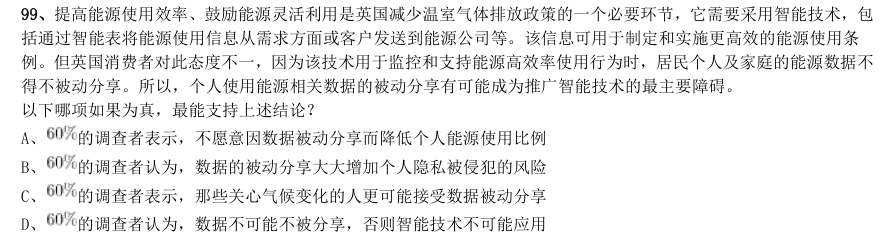

- **A.** 的调查者表示,不愿意因数据被动分享而降低个人能源使用比例
- **B.** 的调查者认为,数据的被动分享大大增加个人隐私被侵犯的风险
- **C.** 的调查者表示,那些关心气候变化的人更可能接受数据被动分享
- **D.** 

**答案：B**

### 2017 湖北·统一卷　第 100 题　（削弱）

荷兰研究人员一直在试图模拟月球和火星的土壤条件进行农作物栽培实验。他们对该项实验种出的小红萝卜、 豌豆、黑麦和西红柿进行初步分析。实验结果令人充满希望,这些产品不仅安全,而且可能比在地球土壤种出的农作 物更健康。英国媒体称,能在火星土壤种出可食用作物,殖民火星的希望又向前迈进了一步。 如果以下各项为真,不能质疑英国媒体说法的是:

- **A.** 火星土壤重金属占比和地球土壤不一样
- **B.** 在另一个同类实验中土豆的长势很糟糕
- **C.** 从实验到真正付诸实践还有很长的路要走
- **D.** 月球、火星、地球的气候条件有很大不同

**答案：A**

### 2017 湖北·统一卷　第 101 题　（削弱）

作为抗衰老药物,雷帕霉素延长寿命的秘密在于能够阻断mTOR 通道——这也是控制着影响细胞生长繁殖流程的 “主开关”之一。当食物充足时,这种通道从激素和营养物质中获得信号使细胞吸收营养并生长,但细胞进行新陈代 谢和生长的过程中会产生激发细胞老化的副产物;当限制食物热量的摄入时,这个通道可以发出信号使细胞停止生长, 借此来延缓衰老。雷帕霉素可能是目前已发现的最有效可靠的抗衰老药物。 以下哪项如果为真,不能支持上述结论?

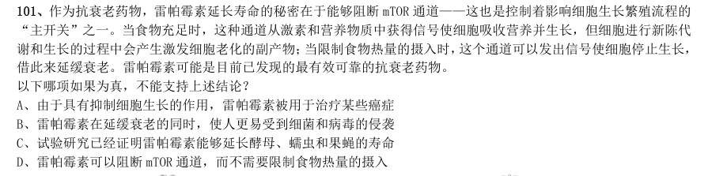

- **A.** 由于具有抑制细胞生长的作用,雷帕霉素被用于治疗某些癌症
- **B.** 雷帕霉素在延缓衰老的同时,使人更易受到细菌和病毒的侵袭
- **C.** 试验研究已经证明雷帕霉素能够延长酵母、蠕虫和果蝇的寿命
- **D.** 雷帕霉素可以阻断mTOR 通道,而不需要限制食物热量的摄入

**答案：B**

### 2017 湖北·统一卷　第 102 题　（加强）

如果向大气排放的 累积超过32000 亿吨,那么到本世纪末,将升温控制在 以内的门槛就守不住了。有科 学家认为,为了达到将升温幅度控制在 以内的目标,仅仅限制 排放是不够的,必须在全球范围内大规模开展 大气 的回收行动,使大气污染程度得到有效控制和缓解。 若要使上述科学家的想法成立,最需要补充以下哪项作为前提?

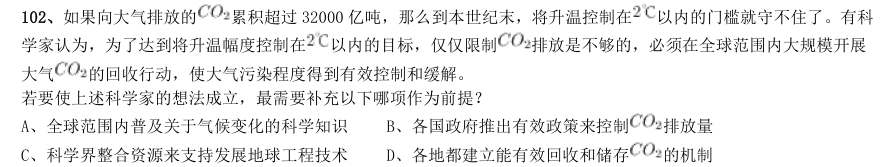

- **A.** 全球范围内普及关于气候变化的科学知识
- **B.** 各国政府推出有效政策来控制排放量
- **C.** 科学界整合资源来支持发展地球工程技术
- **D.** 各地都建立能有效回收和储存

**答案：D**

### 2017 湖北·统一卷　第 103 题　（削弱）

正常情况下,人的大脑左前颞叶及眶频皮层会抑制位于大脑后部、负责处理眼部信号的视觉系统的神经活动, 而在FTD(额频叶痴呆)患者中,这两个区域可能无法发出抑制性信号,如此,大脑就能以一种全新的方式来处理视 觉和声音,尽管额叶的损伤可能会导致患者出现一些病态的异常行为,但也会将患者的艺术敏感性或其他创造力释放 出来。可以说,FTD 是通向艺术殿堂的一扇窗。 如果以下各项为真,最能质疑上述结论的是:

- **A.** 只有不到1%的FTD 患者在患病期间能成为杰出艺术家
- **B.** 20 世纪最伟大的100 名艺术家里,没有一个是FTD 患者
- **C.** 冥想或苦练能让右脑更具创造性进而开发出潜在艺术才能
- **D.** FTD 患者患病后所获得的艺术才能只能是家族遗传的结果

**答案：D**

### 2017 湖北·统一卷　第 104 题　（归纳推导）

柠烯,俗称柠檬精油。它通常被用于制作柑橘香味剂,是很多空气清新剂、身体喷雾剂等芳香剂重要的化学成 分之一。柠烯本身并不可怕,因为该化学物质对人体不会形成大的危害,事实上,它可被用于食品的调味剂。然而柠 烯一旦被喷入空气中,很快就会有所变化。研究表明,当柠烯暴露于普遍存在于空气的臭氧中时,两个柠烯分子会形 成一个单分子化合物——甲醇。当房间中大量的柠烯被转化成甲醇时,其影响将迥然不同。 由此可以推出:

- **A.** 使用空气清新剂,可能会对我们自身有害处
- **B.** 柠烯被用作食品的调味剂时,会对人体产生危害
- **C.** 如果房间中测出甲醇浓度高,则说明使用了太多芳香剂D、在生活中,我们应该尽量避免使用含有柠烯成分的物品

**答案：A**

### 2017 湖北·统一卷　第 105 题　（削弱）

某科研机构提出潮湿的沙子是古埃及人在沙漠中搬运巨大石块和雕像的关键。研究人员指出,古埃及人将沉重 的石块放上滑橇后,先在滑橇前铺设一层潮湿的沙子,再牵引它们,这种搬运方式起到了意想不到的效果。在实验中, 研究人员使用流变仪测试沙子的硬度,以证实需要多少牵引力才能使一定数量的沙子变形,并在此基础上设计了牵引 模型,从中发现将潮湿的沙子铺在滑橇前能更容易移动重物,而且沙子所含水分决定了沙子的硬度和牵引力。 如果以下哪项为真,最能支持上述结论?

- **A.** 在一幅古埃及墓室壁画中,一名男子站在滑橇前方,似乎正在浇水
- **B.** 滑橇牵引力与沙子硬度成反比,潮湿沙子的硬度是干燥沙子的两倍
- **C.** 实验证明,铺设在滑橇前的潮湿沙子容易堆积,形成较大滑动阻力
- **D.** 一个实验室版的埃及滑橇被成功建造,能够模拟古埃及工地的实况

**答案：B**

### 2017 广东·统一卷　第 51 题　（逻辑判断（综合））

某单位每个月都要对工作人员的工作表现进行考评。去年上半年,该单位的甲、乙、丙、丁4 位员工均 获得了3 次月度优秀奖。已知,甲和乙有2 个月同时获奖,乙和丙也有2 个月同时获奖,甲和丁获奖的月份 完全不同。 以下说法一定正确的是:

- **A.** 只有3 个人同时获奖的月份有2 个
- **B.** 只有2 个人同时获奖的月份有3 个
- **C.** 只有1 个人获奖的月份有1 个
- **D.** 只有2 个人同时获奖的月份少于只有1 个人获奖的月份

**答案：暂缺**

### 2017 广东·统一卷　第 52 题　（削弱）

现在人们常常提到大学毕业生就业难。但据统计,近年我国就业市场空缺岗位与求职人数的比率一般大 于1,劳动力市场的需求大于供给。而在求职人群中,大学毕业生的文化水平较高。因此,我国大学毕业生 实际上不存在就业难的问题。 以下信息如果为真,能够有效反驳上述结论的是:

- **A.** 当前经济下行压力较大,不少企业严控用工成本,已经开始裁员
- **B.** 劳动力市场最紧缺的一些岗位主要是适合高级技工的岗位
- **C.** 大学毕业生愿意从事的岗位往往竞争激烈
- **D.** 一些高级技能人才的收入水平要高于大学毕业生

**答案：暂缺**

### 2017 广东·统一卷　第 53 题　（逻辑判断（综合））

甲和乙都有可能受邀参加某专家论坛。现在,甲得知了以下消息: (1)论坛主办方决定,至少邀请甲或乙中的一位。 (2)论坛主办方决定不邀请甲。 (3)论坛主办方一定会邀请甲。 (4)论坛主办方决定邀请乙。 假如上述消息中,两条为真,两条为假,则:

- **A.** 论坛主办方决定邀请甲,不邀请乙
- **B.** 论坛主办方决定邀请乙,不邀请甲
- **C.** 论坛主办方决定同时邀请甲和乙
- **D.** 论坛主办方决定既不邀请甲,也不邀请乙

**答案：暂缺**

### 2017 广东·统一卷　第 54 题　（削弱）

某科研机构研发了一项神经刺激技术,他们在试验中对一批滑雪选手实施了该刺激,持续数周后发现, 相比未接受刺激的选手,接受刺激选手的跳跃能力和协调性分别提高了 和 。本国体育部门计划与该机 构合作,在滑雪运动员的训练、比赛中推广使用这一技术。 以下哪项为真,最能质疑该国体育部门的计划?

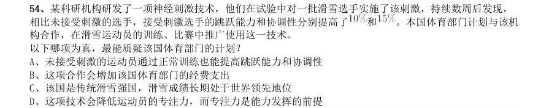

- **A.** 未接受刺激的运动员通过正常训练也能提高跳跃能力和协调性
- **B.** 这项合作会增加该国体育部门的经费支出
- **C.** 该国是传统滑雪强国,滑雪成绩长期处于世界领先地位
- **D.** 这项技术会降低运动员的专注力,而专注力是能力发挥的前提

**答案：暂缺**

### 2017 广东·统一卷　第 55 题　（逻辑判断（综合））

一名茶叶经销商在对客人介绍一种茶叶时说:“这种茶叶产自云山,而大名鼎鼎的云山茶正是产自云山, 所以这就是正宗的云山茶。” 以下与该经销商介绍茶叶时的逻辑最为相似的是:

- **A.** 三班的学生都勤奋好学,小李是三班的学生,所以小李勤奋好学
- **B.** 飞驰牌汽车产自某国,刚才那辆汽车不是飞驰牌,所以肯定不是该国产的
- **C.** 所有司机都必须有驾照,小郑有驾照,所以小郑是司机
- **D.** 好医生需要具备精湛的医术和高尚的医德,小陈二者兼备,所以他是好医生

**答案：暂缺**

### 2017 广东·统一卷　第 56 题　（逻辑判断（综合））

某公司招聘业务经理,小张和小李前来应聘。小张说:“如果我做了业务经理,我会积极进取,开拓新 业务。”小李说:“如果我做了经理,我会优化管理,精减人员。”最终,他们其中一人当上了业务经理, 并顺利实现了自己的工作主张。 由此可知,以下说法必定为真的是:

- **A.** 该公司不仅开拓了新业务,还精减了人员
- **B.** 如果该公司开拓了新业务,那么肯定是小张当上了业务经理
- **C.** 如果该公司精减了人员,那么肯定是小李当上了业务经理
- **D.** 如果该公司没有开拓新业务,就肯定精减了人员

**答案：暂缺**

### 2017 广东·统一卷　第 57 题　（解释评价）

由于按揭贷款的利率下调,人们每月还贷压力减小,因此一家机构预测某地的商品房销售量会增长,但 实际上,销售量并未出现明显增长。 下列哪项如果为真,最能解释以上现象?

- **A.** 当地一直存在人口外流的现象
- **B.** 本地的商品房价格没有明显下降
- **C.** 有的开发商取消了购房优惠政策
- **D.** 因经济环境不好,当地人均收入下降

**答案：暂缺**

### 2017 广东·统一卷　第 58 题　（削弱）

媒体A 报道称:今年以来,患季节性皮肤病的人数大幅上升,这是因为城市水污染日益严重和空气质量 恶化造成的。 媒体B 报道称:患季节性皮肤病的人数大幅上升与城市水污染、空气质量恶化没有关系,主要是因为人们缺 乏锻炼,身体素质下降造成的。 以下哪项如果为真,最能对媒体B 的观点提出质疑?

- **A.** 目前7-12 周岁儿童的身体素质比10 年前普遍下降
- **B.** 大多数春季患皮肤病的人,在秋冬季节症状会有所好转
- **C.** 环保局承认,城市水污染和空气质量问题日益严重
- **D.** 游泳运动员患季节性皮肤病的人数逐年增多

**答案：暂缺**

### 2017 广东·统一卷　第 59 题　（解释评价）

某投资公司在评价一个项目时说:我们挑选投资项目,主要是看项目的技术门槛和未来市场需求量,而 不是当前的业务增长率。现在新的可投资项目这么多,短期内发展很迅速但很快就被其他项目追赶上来的也 不少,这显然不是我们想要的。这个项目在一年内营业额就增加了5 倍,倒是很有必要怀疑它将来的状况。 以下和该投资公司评价项目的逻辑最为类似的是:

- **A.** 婚姻生活是否幸福取决于夫妻双方的和谐程度,而不是家庭收入,有些收入高的夫妻,婚姻生活反而不幸福
- **B.** 通过票房评价一部电影并不靠谱,一部电影即使票房再高,观众的口碑也不一定好
- **C.** 某足球队在选拔新队员时,除了关注他们的技术水平,更看重他们的训练状态和发展潜力
- **D.** 歌手要成功,天赋和优秀的市场推广缺一不可。那些失败的歌手,要么没有天赋,要么市场推广做得不好

**答案：暂缺**

### 2017 广东·统一卷　第 60 题　（削弱）

流感病毒的变异速度相当快,即使疫苗每年更新,也不能保证疫苗接种覆盖全部的“当季流行款”。接 种流感疫苗,既不能保证百分之百不得流感,还可能导致接种人群出现低烧等副作用。因此,没有必要接种 流感疫苗。 以下选项如果为真,不能有效反驳上文结论的是:

- **A.** 接种流感疫苗可以减少儿童、慢性病患者等高危人群因流感而发生严重并发症的风险
- **B.** 接种季节性流感疫苗可以降低易感人群感染流感病毒的概率
- **C.** 接种流感疫苗后只有极少数人会出现全身反应,且一两天可以缓解,比流感的症状要轻很多
- **D.** 从疾病中恢复过来的人可以获得一定的免疫力,1 年内不会再次被同样的流感病毒感染

**答案：暂缺**

### 2017 广东·统一卷　第 61 题　（逻辑判断（综合））

在下面的电路图中,c、d 是两个不同的灯泡,e、f 均为安培表。当开关g 闭合时(如图1),e 显示读 数为1.3A,f 显示读数为0.9A。如果将断开的开关g 与灯泡c 的位置互换(如图2),则以下情况不会出现 的是:

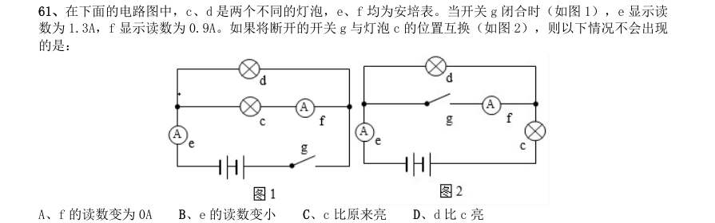

- **A.** f 的读数变为0A
- **B.** e 的读数变小
- **C.** c 比原来亮
- **D.** d 比c 亮

**答案：暂缺**

### 2017 广东·统一卷　第 62 题　（逻辑判断（综合））

下列关于蔬菜大棚内氧气和二氧化碳含量变化的说法,不正确的是:

- **A.** 在无光的环境下,植物只进行呼吸作用,二氧化碳含量增加
- **B.** 在有光的环境下,植物同时进行光合作用和呼吸作用,氧气含量增加
- **C.** 光线逐渐增强时,植物的光合作用逐渐增强,氧气含量增加
- **D.** 光线逐渐减弱时,植物的光合作用和呼吸作用也逐渐减弱,氧气含量降低

**答案：暂缺**

### 2017 广东·统一卷　第 63 题　（逻辑判断（综合））

小王用塑料圆筒做了一个简易哨子(如图),当他从吹气口吹气的同时,将活塞慢慢往下拉,可以听到 哨声:

- **A.** 逐渐变小声
- **B.** 音调越来越高
- **C.** 音调越来越低
- **D.** 没有变化

**答案：暂缺**

### 2017 广东·统一卷　第 64 题　（逻辑判断（综合））

两块完全相同的平面玻璃砖相互垂直放置(如图),一束单色光从左侧水平射入左边的玻璃砖,从右边 的玻璃砖射出,则出射光线相对入射光线:

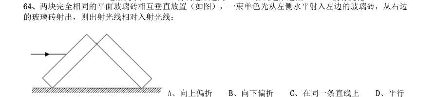

- **A.** 向上偏折
- **B.** 向下偏折
- **C.** 在同一条直线上
- **D.** 平行

**答案：暂缺**

### 2017 广东·统一卷　第 65 题　（逻辑判断（综合））

有一家四口,包括一对夫妻和他们的两个亲生子女,四人的ABO 血型各不相同。已知儿子有一次受伤时, 是爸爸献的血,那么,以下信息可以确定的是:

- **A.** 爸爸的血可以献给家里所有人使用
- **B.** 妈妈的血不能献给家里所有人使用
- **C.** 女儿有可能是AB 型血
- **D.** 儿子只可能是A 型或B 型血

**答案：暂缺**

### 2017 广东·统一卷　第 67 题　（逻辑判断（综合））

下图是某地市区与郊区之间的热力环流图。根据该图,为保证市区空气质量,下列说法正确的是:

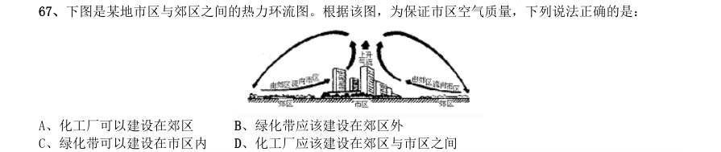

- **A.** 化工厂可以建设在郊区
- **B.** 绿化带应该建设在郊区外
- **C.** 绿化带可以建设在市区内
- **D.** 化工厂应该建设在郊区与市区之间

**答案：暂缺**

### 2017 广东·统一卷　第 68 题　（逻辑判断（综合））

如图所示,两物体M、N 用绳子连接,绳子跨过固定在斜面顶端的滑轮(不计滑轮的质量和摩擦力),N 悬于空中,M 放在斜面上,均处于静止状态。当用水平向右的拉力F 作用于物体M 时,M、N 仍静止不动,则 下列说法正确的是:

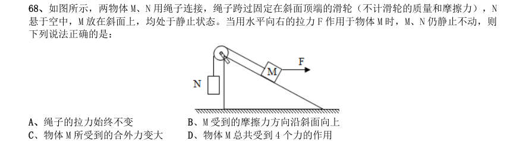

- **A.** 绳子的拉力始终不变
- **B.** M 受到的摩擦力方向沿斜面向上
- **C.** 物体M 所受到的合外力变大
- **D.** 物体M 总共受到4 个力的作用

**答案：暂缺**

### 2017 广东·统一卷　第 69 题　（逻辑判断（综合））

下图是某辆汽车的位移x 随着时间t 变化而变化的图像,下列说法中正确的是:

- **A.** 在a 到b 的时间段内,汽车的加速度不断增大
- **B.** 在b 到c 的时间段内,汽车做匀速运动
- **C.** 在c 到d 的时间段内,汽车的速度保持不变
- **D.** 在d 时间点,汽车回到出发地

**答案：暂缺**

### 2017 国考·副省级　第 106 题　（削弱）

某网购平台发布了一份网购调研报告,分析亚洲女性的网购特点。分析显示,当代亚洲女性在网购服饰、 化妆品方面的决定权为88%,在网购家居用品方面的决定权为85%。研究者由此认为,那些喜爱网购的亚洲女性 在家庭中拥有更大的控制权。 以下哪项如果为真,最能反驳上述结论?

- **A.** 喜爱网购的亚洲女性的网购支出只占其家庭消费支出的25%
- **B.** 亚洲女性中,习惯上网购物的人数只占女性总人数的30%左右
- **C.** 亚洲女性在购买贵重商品时往往会与丈夫商量,共同决定
- **D.** 一些亚洲女性经济不独立,对家庭收入没有贡献

**答案：A**

### 2017 国考·副省级　第 107 题　（加强）

公元250 年至800 年,玛雅文明还十分发达,城市繁荣,庄稼收成也很喜人。气候记录显示,这一时期玛 雅地区的降水量相对较高。此后玛雅文明开始衰落。从公元820 年左右起,在连续95 年的时间里,该地区开始 经历断断续续的干旱,有些地方的干旱甚至持续了数十年之久。许多专家由此认为,9 世纪的气候变化或许正是 玛雅文明消亡的原因。 以下哪项如果为真,最能支持上述专家的观点?

- **A.** 在9 世纪衰退的玛雅城市大多分布在南部,使用木材进行的建造活动也大大减少
- **B.** 和所有大型农耕文明一样,玛雅人的社会很大程度上依赖于农作物,干旱导致农产品减少,严重影响玛雅人的生存
- **C.** 大多数玛雅城市是在公元850 年到925 年之间衰落的,和干旱发生的时间高度重合
- **D.** 公元1000 年至1075 年期间,玛雅地区石雕和其他建造活动减少了将近一半,而那时当地又一次遭受了严重

**答案：B**

### 2017 国考·副省级　第 108 题　（削弱）

人体的大脑与血液之间有一道“血脑屏障”,任何起安眠作用的物质首先必须能穿过这个屏障才能起效。 牛奶中含有一种名为色氨酸的氨基酸能够穿过血脑屏障,制造诱发睡眠的荷尔蒙5-羟色胺,因此人们认为睡前 喝牛奶是促进睡眠非常有效的方法。 以下哪项如果为真,最能削弱上述结论?

- **A.** 皮肤温度上升,入睡速度就快,故而喝一杯热牛奶就如同洗热水浴一样,能够加快入睡速度
- **B.** 小份的牛奶所含的色氨酸总量不足以让身体的激素水平发生较大的波动,只有喝大量的牛奶助眠效果才会好
- **C.** 米饭等碳水化合物助眠效果更好,它们会刺激胰岛素的合成,让色氨酸以外的氨基酸进入肌肉组织,从而使色氨酸更易进入大脑
- **D.** 牛奶中蕴含许多种类的氨基酸,这些物质进入血液后,会争抢穿过血脑屏障的通道,从而降低色氨酸穿过血

**答案：D**

### 2017 国考·副省级　第 109 题　（加强）

阿尔茨海默病是一种较为严重的疾病,4 号基因突变曾被认为是阿尔茨海默病的一项致病因素。但近期有 科学家提出导致这一复杂疾病的病因可能很简单,就是一些能引起脑部感染的微生物,如HSV-1 病毒。 以下哪项如果为真,最能支持上述科学家的观点?

- **A.** 携带4 号突变基因同时感染了HSV-1 病毒的人群罹患阿尔茨海默病的概率会比单独具有此类突变基因的群体高2 倍
- **B.** 当大鼠脑部受到HSV-1 感染时,携带4 号突变基因的大鼠产生的病毒DNA 是正常大鼠的14 倍
- **C.** 有些携带4 号突变基因的患者使用抗病毒药物治疗后,其病情有所好转
- **D.** 在一些健康老年人的大脑中也存在着HSV-1 病毒

**答案：A**

### 2017 国考·副省级　第 110 题　（削弱）

研究显示,约200 万年前,人类开始使用石器处理食物,例如切肉和捣碎植物。与此同时,人类逐渐演化 形成较小的牙齿和脸型,以及更弱的咀嚼肌和咬力。因此研究者推测,工具的使用减弱了咀嚼的力量,从而导致 人类脸型的变化。 以下哪项如果为真,最能削弱上述研究者的观点?

- **A.** 对与人类较为接近的灵长类动物进行研究,发现它们白天有一半时间用于咀嚼,它们的口腔肌肉非常发达、脸型也较大
- **B.** 200 万年前人类食物类型发生了变化,这加速了人类脸型的变化
- **C.** 在利用石器处理食物后,越来越多的食物经过了程度更高的处理,变得易于咀嚼
- **D.** 早期人类进化出较小的咀嚼结构,这一过程使其他变化成为可能,比如大脑体积的增大

**答案：B**

### 2017 国考·副省级　第 111 题　（前提假设）

针对地球冰川的研究发现,当冰川之下的火山开始喷发后,会快速产生蒸汽流,爆炸式穿透冰层,释放灰 烬进入高空,并且产生出沸石、硫化物和黏土等物质。日前人们发现,在火星表面的一些圆形平顶山丘也探测到 这些矿物质,并且广泛而大量地存在。因此,人们推测火星早期是覆盖着冰原的,那里曾有过较多的火山活动。 要得到上述结论,需要补充的前提是:

- **A.** 近日火星侦察影像频谱仪发现,火星南极存在火山
- **B.** 火星地质活动不活跃,地表地貌大部分形成于远古较活跃的时期
- **C.** 沸石、硫化物和黏土这三类物质是仅在冰川下的火山活动后才会产生的独特物质
- **D.** 在火星平顶山丘的岩石中发现了某种远古细菌,说明这里很可能曾经有水源

**答案：C**

### 2017 国考·副省级　第 112 题　（加强）

复活节岛是位于太平洋上的一座孤岛。在报道中,复活节岛文明的衰落常作为一个警世故事,讲述人类肆 意采伐棕榈树林,致使肥沃的土壤流失,最终导致岛中食物短缺,文明自此衰落。然而近日有专家提出,复活节 岛文明的衰落与树木砍伐并无必然联系。 以下哪项如果为真,最能支持上述专家的观点?

- **A.** 大约公元1200 年,岛上居民开始砍伐棕榈树,用于建造木船,运送大型石质雕像
- **B.** 考古发现,当岛上最后的树木(棕榈树)被砍伐之后,仍有大量原住居民生活着,其农业耕作的水平没有下降
- **C.** 花粉分析表明,早在公元800 年,森林的毁灭就已经开始,岛屿地层中的大棕榈树和其他树木的花粉越来越少
- **D.** 1772 年荷兰殖民者开始登陆复活节岛,并对当地居民进行奴役,那时岛上的土著人口是4000 人,到1875 年

**答案：B**

### 2017 国考·副省级　第 113 题　（真假推理）

教练在甲、乙、丙三人背上分别贴了三个数字,三人都能看到对方的数字,但是看不到自己的数字,甲、 乙、丙背上的数字分别用

- **A.** A>B>C
- **B.** C>B>A
- **C.** B>C>A
- **D.** B>A>C

**答案：A**

### 2017 国考·副省级　第 114 题　（归纳推导）

在某公司中,李明帮助了王刚,而王刚帮助了赵贤。李明纳税比赵贤多。 由此可以推出:

- **A.** 王刚纳税比赵贤多
- **B.** 李明纳税和王刚一样多
- **C.** 有人帮助了一个纳税比他多的人
- **D.** 有人帮助了一个纳税比他少的人

**答案：D**

### 2017 国考·副省级　第 115 题　（翻译推理）

大学毕业的张、王、李、赵4 人应聘到了同一家大型公司,每人负责一项工作,其中一人做行政管理,一 人做销售,一人做研发,另一人做安保。 已知: 1张不做行政管理,也不做安保; 2王不做行政管理,也不做研发; 3如果张没有做研发,那么赵也没有做行政管理; 4李不做行政管理,也不做安保; 5赵不做研发,也不做安保。 由此可以推出:

- **A.** 张做销售,李做研发
- **B.** 赵做研发,李做销售
- **C.** 李做销售,张做研发
- **D.** 李做研发,赵做安保

**答案：C**

### 2017 国考·地市级　第 106 题　（翻译推理）

根据所给材料,回答106~110 题。 某办公室有王莉、李明和丁勇3 名工作人员,本周有分别涉及网络、财务、管理、人事和教育的5 项工作需要他 们完成。关于任务安排,需要满足下列条件: 1每人均需至少完成其中的一项工作,一项工作只能由一人完成; 2人事和管理工作都不是由王莉完成的; 3如果人事工作由丁勇完成,那么财务工作由李明完成; 4完成教育工作的人至少还需完成一项其他工作。 到了周末,3 人顺利地完成了上述5 项工作。 以下哪项的工作安排符合上述条件?

- **A.** 王莉:管理、网络;李明:教育、人事;丁勇:财务
- **B.** 王莉:教育、财务;李明:人事、管理;丁勇:网络
- **C.** 王莉:网络;李明:人事、管理、财务;丁勇:教育
- **D.** 王莉:网络;李明:教育、管理;丁勇:人事、财务

**答案：B**

### 2017 国考·地市级　第 107 题　（前提假设）

如果李明只完成5 项工作中的一项,那么包括该工作的所有可能性是以下哪项?

- **A.** 人事、财务
- **B.** 人事、管理、财务
- **C.** 人事、网络
- **D.** 财务

**答案：A**

### 2017 国考·地市级　第 108 题　（逻辑判断（综合））

以下哪项中的任务不可能均由李明完成?

- **A.** 教育、人事、财务
- **B.** 教育、人事、网络
- **C.** 教育、管理、财务
- **D.** 教育、管理、网络

**答案：D**

### 2017 国考·地市级　第 109 题　（逻辑判断（综合））

以下哪项中的任务不可能均由丁勇完成?

- **A.** 财务、管理
- **B.** 网络、人事
- **C.** 管理、人事
- **D.** 教育、管理

**答案：B**

### 2017 国考·地市级　第 110 题　（前提假设）

如果管理工作和网络工作是由同一个人完成的,则以下哪项是可能的?

- **A.** 教育工作是由李明完成的
- **B.** 财务工作是由丁勇完成的
- **C.** 管理工作是由李明完成的
- **D.** 人事工作是由丁勇完成的

**答案：A**

### 2016 湖北·统一卷　第 82 题　（逻辑判断（综合））

“气候难民”指的是生存因气候变暖等特殊气候因素而受到威胁的人们,这是一个逐渐扩大的族群。某基金 会发表的一份报告称,在未来40 年,全球约5 到6 亿人都面临着沦为“气候难民”的危险。 下列描述中被迫迁移的人们,不属于“气候难民”的是:

- **A.** 土地沙漠化使曾经繁荣的楼兰古国消亡,国民外迁
- **B.** 海平面上涨使马尔代夫领导人为国民另觅栖身之所
- **C.** 卡特里娜飓风使得墨西哥海岸的众多居民逃离家乡
- **D.** 印度洋海啸导致了印度、泰国等多国居民被迫迁移

**答案：D**

### 2016 湖北·统一卷　第 96 题　（削弱）

干细胞遍布人体,因为拥有变成任何类型细胞的能力而令科学家们着迷,这种能力意味着它们有可能修复或 者取代受损的组织。而通过激光刺激干细胞生长很有可能实现组织生长,因此研究人员认为激光技术或许将成为 医学领域的一种变革工具。 以下哪项如果为真,最能支持上述结论?

- **A.** 不同波段的激光对机体组织作用的原理尚不清楚
- **B.** 已有病例表明,激光会对儿童视网膜造成损伤,影响视力
- **C.** 目前激光刺激生长法尚未在人类机体上进行试验,风险还待评估
- **D.** 用激光治疗带有牙洞的臼齿,受损的牙体组织能逐渐恢复

**答案：D**

### 2016 湖北·统一卷　第 97 题　（归纳推导）

理论认为,反物质是正常物质的反状态,当正反物质相遇时,双方就会相互湮灭抵消,发生爆炸并产生巨大 能量,有人认为,反物质是存在的,因为到目前为止没有任何证据证明反物质是不存在的。 以下哪项与题干中的论证方式相同?

- **A.** 圣女贞德的审问者们曾对她说,我们没有证据证明上帝与你有过对话,你可能是在胡编乱造,也可能精神失常
- **B.** 动物进化论是正确的,例如始祖鸟就是陆地生物向鸟类进化过程中的一类生物
- **C.** 既然不能证明平行世界不存在,那么平行世界就是存在的
- **D.** 长白山天池有怪兽,因为有人看见过怪兽曾在天池内活动的踪迹

**答案：C**

### 2016 湖北·统一卷　第 98 题　（削弱）

人们在社会生活中常会面临选择,要么选择风险小,报酬低的机会;要么选择风险大,报酬高的机会。究竟 是在个人决策的情况下富于冒险性,还是在群体决策的情况下富于冒险性?有研究表明,群体比个体更富有冒险 精神,群体倾向于获利大但成功率小的行为。 以下哪项如果为真,最能支持上述研究结论?( )

- **A.** 在群体进行决策时,人们往往会比个人决策时更倾向于向某一个极端偏斜,从而背离最佳决策
- **B.** 个体会将其意见与群体其他成员相互比较,因其想要被其他群体成员所接受及喜爱,所以个体往往会顺从群体的一般意见
- **C.** 在群体决策中,很可能出现以个体或子群体为主发表意见、进行决策的情况,使群体决策为个体或子群体所左右
- **D.** 群体决策有利于充分利用其成员不同的教育程度、经验和背景,他们的广泛参与有利于最高决策的科学性

**答案：A**

### 2016 湖北·统一卷　第 99 题　（削弱）

某市为了发展文化强市战略,在2008 年、2010 年先后建成了两个图书馆,2008 年底共办理市民借书证7 万 余个,到2010 年底共办理市民借书证13 万个。2011 年,该市又在新区建立了第三个图书馆,于2012 年初落成 开放。截至2012 年底,全市共计办理市民借书证20 余万个。市政府由此认为,该项举措是有实效的,因为在短 短的4 年间,光顾图书馆的市民增加了近两倍。 以下哪项如果为真,最能削弱上述结论?

- **A.** 图书馆要不断购置新书,维护成本也很高,这会影响该市其他文化设施建设
- **B.** 该市有两所高等学校,许多在校生也办理了这3 个图书馆的借书证
- **C.** 很多办理了第一个图书馆借书证的市民又办理了另外两个图书馆的借书证
- **D.** 该市新区建设发展迅速,4 年间很多外来人口大量涌入新区

**答案：C**

### 2016 湖北·统一卷　第 100 题　（削弱）

近日,火星车在加勒陨坑拍摄的图像发现,火星陨坑内的远古土壤存在着类似地球土壤裂纹剖面的土壤样 本,通常这样的土壤存在于南极干燥谷和智利阿塔卡马沙漠,这暗示着远古时期火星可能存在生命。 以下哪项如果为真,最能支持上述结论?

- **A.** 地球沙漠土壤中存在土块,具有多孔中空结构,硫酸盐浓度较高,这一特征在火星土壤层并不明显
- **B.** 化学物质分析显示,陨坑内土壤的化学风化过程以及粘土沉积中橄榄石矿损耗情况与地球土壤的状况较为接近
- **C.** 这些火星远古土壤样本仅表明火星早期可能曾是温暖潮湿的,那时的环境比现今更具宜居性
- **D.** 土壤裂纹剖面中的磷损耗特别引人注意,因为地球土壤也存在这种现象,这是由于微生物的活跃性所致

**答案：D**

### 2016 湖北·统一卷　第 101 题　（加强）

酒精本身没有明显的致癌能力。但是许多流行病学调查发现,喝酒与多种癌症的发生风险正相关——也就 是说,喝酒的人群中,多种癌症的发病率升高了。 以下哪项如果为真,最能支持上述发现?

- **A.** 酒精在体内的代谢产物乙醛可以稳定地附着在DNA 分子上,导致癌变或者突变
- **B.** 东欧地区的人广泛食用甜烈性酒,该地区的食管癌发病率很高
- **C.** 烟草中含有多种致癌成分,其在人体内代谢物与酒精在人体内代谢物相似
- **D.** 有科学家估计,如果美国人都戒掉烟酒,那么80%的消化道癌可以避免

**答案：A**

### 2016 湖北·统一卷　第 102 题　（削弱）

有报道称,由于人类大量排放温室气体,过去150 多年中全球气温一直在持续上升。但与1970 至1998 年 相比,1999 年至今全球表面平均气温的上升速度明显放缓,近15 年来该平均气温的上升幅度不明显,因此全球 变暖并不是那么严重。 如果以下各项为真,最能削弱上述论证的是?

- **A.** 海洋和气候系统的调整过程使得海洋表层热量向深海输送
- **B.** 此现象在上世纪50~70 年代曾出现过,随后又开始加速变暖
- **C.** 联合国气候专家指出,空气中的二氧化碳浓度处于80 万年来的最高点
- **D.** 近几年发生多起因气候变暖而产生的自然灾害

**答案：B**

### 2016 湖北·统一卷　第 103 题　（削弱）

X 分子具有Y 结构,串联起了大量的原子,由该分子组成的某种物质在同类型的物质中具有很强的的导热 性。很明显,分子内包含大量原子是使得该物质拥有极强的导热性所必不可少的。 以下哪项如果为真,最能削弱上述结论?

- **A.** 有的分子拥有别的结构,也串联起了大量的原子,并拥有很强的导热性
- **B.** 有的物质导热性不强,但是它的分子中包含了大量的原子
- **C.** 有的物质导热性很强,但是其分子不具备Y 结构
- **D.** 有的物质导热性不强,但是其分子具备类似的结构

**答案：B**

### 2016 湖北·统一卷　第 104 题　（加强）

一个没有普通话一级甲等证书的人不可能成为一个主持人,因为主持人不能发音不标准。 上述论证还需基于以下哪一前提?

- **A.** 没有一级甲等证书的人都会发音不标准
- **B.** 发音不标准的主持人可能没有一级甲等证书
- **C.** 一个发音不标准的人有可能获得一级甲等证书
- **D.** 一个发音不标准的主持人不可能成为一个受人欢迎的主持人

**答案：A**

### 2016 湖北·统一卷　第 105 题　（翻译推理）

记者采访时的提问要具体、简洁明了,切忌空泛、笼统、不着边际。约翰·布雷迪在《采访技巧》中剖析 了记者采访时向访问对象提出诸如“您感觉如何?”等问题的弊端,认为这些提问“实际上在信息获取上等于原 地踏步,它使采访对象没法回答,除非用含混不清或枯燥无味的话来应付。” 由此可以推出:

- **A.** 记者采访时的提问如果具体、筒洁明了,就不会给采访对象带来回答的困难
- **B.** 采访对象如果没法回答提问,说明他没有用含混不清或枯燥无味的话来应付
- **C.** 采访对象只有用含混不清或枯燥无味的话来应付,才能回答那些空泛、笼统的提问
- **D.** 诸如“您感觉如何?”这样的问题,只能使采访对象抓不住问题的要点而作泛泛的或言不由衷的回答

**答案：C**

### 2016 广东·乡镇　第 51 题　（削弱）

某县计划引进一种生长快、肉质好的良种牛,在本县推广养殖,以提高农民养牛的经济收益。 以下最能对该计划可行性提出质疑的是( )。

- **A.** 该良种牛不适应当地气候
- **B.** 当地农民养牛的积极性不高
- **C.** 该良种牛的养殖成本较高
- **D.** 当地农民没有饲养过该良种牛

**答案：暂缺**

### 2016 广东·乡镇　第 52 题　（削弱）

老张为了试验某品牌化肥的效果,把自家的稻田分成东边、西边两块,在东边地块施肥,西 边地块不施肥。水稻收割后,东边地块亩产700 公斤,西边地块亩产400 公斤。因此,该品牌化肥能 有效增产。 以下最能反驳上述论证的是( )。

- **A.** 东边地块的土壤肥力原本就比西边地块高
- **B.** 东西两块地种植的是同一种品种的水稻
- **C.** 东边地块的水稻遭受过病虫害
- **D.** 老张收割西边地块的水稻先于东边地块

**答案：暂缺**

### 2016 广东·乡镇　第 53 题　（削弱）

全球气候变暖给人类带来诸多影响的同时也影响着地球上的其他生物,降水的增加可以改善 植被,从而有利于鼠类的增长。研究表明,降水的增加使原本干旱的内蒙古地区植物更加丰富,也增 加了鼠类的食物,长爪沙鼠数量随之增加。 以下最能削弱上述论断的一项是( )。

- **A.** 据统计,一些地区的植被覆盖率并没有增加
- **B.** 据测算,全球沙漠化面积近年有所增加
- **C.** 内蒙古地区植被的增加和近年的生态保护有很大关系
- **D.** 植被的增加使各种动物包括鼠类的天敌都增加了

**答案：暂缺**

### 2016 广东·乡镇　第 54 题　（逻辑判断（综合））

根据人事部门的数据,某单位的女性员工多于男性员工。中共党员员工多于政治面貌为群众 的员工。(该单位员工政治面貌只有中共党员和群众两种情况) 下列判断一定正确的是( )。

- **A.** 政治面貌为群众的女性员工多于政治面貌为群众的男性员工
- **B.** 政治面貌为中共党员的男性员工多于政治面貌为中共党员的女性员工
- **C.** 政治面貌为中共党员的女性员工多于政治面貌为群众的男性员工
- **D.** 政治面貌为群众的男性员工多于政治面貌为中共党员的男性员工

**答案：暂缺**

### 2016 广东·乡镇　第 55 题　（削弱）

随着网络的普及,电子版图书也越来越多,其中包括电子版的文学名著,而且价格很低。人 们只要打开电脑,在网上几乎可以浏览到任何一本名著。电子版文学名著的问世,会改变大众的阅读 品味,有利于造就高素质读者群体。 以下最能削弱上述结论的一项是( )。

- **A.** 对文学没有兴趣的人不会因为文学名著的价钱高低或者是否方便而阅读文学名著
- **B.** 文学名著的普及率一直不如娱乐杂志、时事报刊等大众读物
- **C.** 许多读者认为阅读电子书籍的感觉不如阅读印刷书籍的那么好,宁愿选择印刷版读物
- **D.** 在互联网上阅读文学名著仍然需要收费

**答案：暂缺**

### 2016 广东·乡镇　第 56 题　（逻辑判断（综合））

有研究表明,运动,特别是大量运动,会提高人体内血清基的水平。在某种程度上,人的心 情由体内血清基的水平决定。抗抑郁药物可以通过提高体内血清基的水平来起作用。 下列论断一定正确的是( )。 I.提高体内血清基水平,要么大量运动,要么吃抗抑郁药物。 II.人的心情,可能由运动量决定,也可能受抗抑郁药物影响。 III.大量运动会影响人的心情,或影响抗抑郁药物的疗效。

- **A.** I
- **B.** II
- **C.** I 和II
- **D.** II 和III

**答案：暂缺**

### 2016 广东·乡镇　第 57 题　（削弱）

气候与经济发展具有密切关系。在欧洲,北部气候较冷的国家总体上比南部国家发达;在美 洲,加拿大和美国比南部的墨西哥发达;在亚洲,韩国的GDP 是东南亚所有国家的总和。之所以有这 种差别,是因为寒冷地区的人们为了生存,大脑会进一步地复杂化,而热带的人们,由于食物充足, 大脑失去了进一步进化的动力。 以下最能削弱上述论断的一项是( )

- **A.** 人类共有的惰性使任何地区的人都类似
- **B.** 寒冷地区的人并不比热带的人智商高
- **C.** 经济的发达与文化的繁荣没有必然联系
- **D.** 获取食物并不是人类主要的脑力活动

**答案：暂缺**

### 2016 广东·乡镇　第 58 题　（前提假设）

我国以占世界7%的耕地养活了占世界22%的人口,其中年平均生产大豆1200 万吨左右。同时, 还利用国外的耕地、国外的农民,继续开放市场,降低关税或免除关税,年平均进口大豆5800 万吨左 右。更多利用国外的资源来让我国人民生活得更好。 以上论断基于下列假设,除了( )。

- **A.** 大量进口粮食不会带来粮食安全问题
- **B.** 政府相关部门对进口粮食严把质量关
- **C.** 进口粮食的价格能被国内群众所接受
- **D.** 大量进口粮食损害了国内生产者的利益

**答案：暂缺**

### 2016 广东·乡镇　第 59 题　（削弱）

一项研究发现:经常喝咖啡的成年人患上心脏病的概率是不常喝咖啡成年人患心脏病概率的2.5 倍。由此可以判定,咖啡中的某种物质能够导致人患上心脏疾病。 以下最能削弱上述结论的一项是( )。

- **A.** 咖啡含有提高心脏活力的成分
- **B.** 用餐时喝咖啡有降低血脂的作用
- **C.** 心脏病高危人群更容易爱上喝咖啡
- **D.** 爱喝咖啡的人大都性格开朗,喜欢运动

**答案：暂缺**

### 2016 广东·乡镇　第 60 题　（逻辑判断（综合））

液体都能够流动。水能够流动,所以水是液体。 以下与上述推理在结构上最为相似的一项是( )。

- **A.** 哲学家都爱思考。李教授是哲学家,所以他爱思考
- **B.** 哺乳类动物都是恒温动物。蛇不是哺乳类动物,所以蛇不是恒温动物
- **C.** 平板电脑都有触摸屏。手机有触摸屏,所以手机是平板电脑
- **D.** 工作态度端正就能取得好的业绩。小刘取得好业绩,所以他工作态度端正

**答案：暂缺**

### 2016 广东·乡镇　第 61 题　（逻辑判断（综合））

如图所示,一个装有水的杯子中悬浮着一个小球,杯子放在斜面上,该小球受到的浮力方向 是( )。

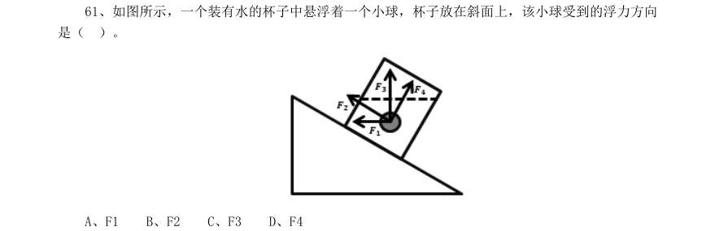

- **A.** F1
- **B.** F2
- **C.** F3
- **D.** F4

**答案：暂缺**

### 2016 广东·乡镇　第 62 题　（逻辑判断（综合））

如图所示,物体沿斜面匀速滑下时,它的( )。

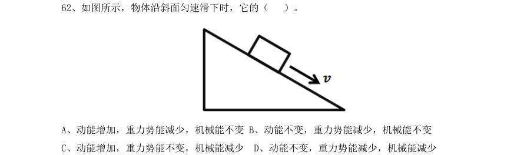

- **A.** 动能增加,重力势能减少,机械能不变
- **B.** 动能不变,重力势能减少,机械能不变
- **C.** 动能增加,重力势能不变,机械能减少
- **D.** 动能不变,重力势能减少,机械能减少

**答案：暂缺**

### 2016 广东·乡镇　第 63 题　（逻辑判断（综合））

如图所示,实心蜡球漂浮在杯中的水面上,当向杯中不断慢慢加入酒精时, 以下不可能出现 的情况是( )。(己知:水的密度>蜡球的密度>酒精的密度)

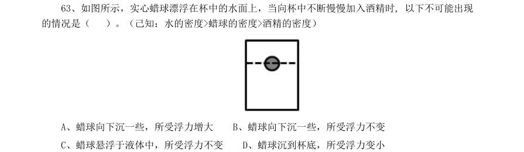

- **A.** 蜡球向下沉一些,所受浮力增大
- **B.** 蜡球向下沉一些,所受浮力不变
- **C.** 蜡球悬浮于液体中,所受浮力不变
- **D.** 蜡球沉到杯底,所受浮力变小

**答案：暂缺**

### 2016 广东·乡镇　第 65 题　（逻辑判断（综合））

下图表示了在温度变化时,加酶洗衣粉和普通洗衣粉去污力的变化情况。曲线A 表示加酶洗 衣粉的变化情况,曲线B 表示普通洗衣粉的变化情况。则下列说法正确的是( )。

- **A.** 加酶洗衣粉的去污力与温度成正比关系
- **B.** 加酶洗衣粉对温度的敏感性比普通洗衣粉小
- **C.** 在较高温度时加酶洗衣粉的去污力低于普通洗衣粉
- **D.** 在较低温度时加酶洗衣粉中酶的活性受到抑制

**答案：暂缺**

### 2016 广东·乡镇　第 66 题　（逻辑判断（综合））

如图所示,四个外形相同的铅球、铁球、铝球、木球静止在水中,其中能判断是实心还是空 心的是( )。

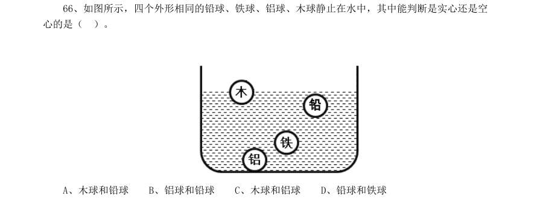

- **A.** 木球和铅球
- **B.** 铝球和铅球
- **C.** 木球和铝球
- **D.** 铅球和铁球

**答案：暂缺**

### 2016 广东·乡镇　第 68 题　（逻辑判断（综合））

如图所示,将弹簧测力计一端固定,另一端钩住长方体木块A,木块下面是一长木板,实验时 拉着长木板沿水平地面向左运动,读出弹簧测力计示数即可测出木块A 所受摩擦力大小,在木板运动 的过程中,以下说法正确的是( )。

- **A.** 木块A 受到的是静摩擦力
- **B.** 木块A 会相对地面匀速运动
- **C.** 木块A 所受摩擦力的方向向左
- **D.** 拉动速度变大时,弹簧测力计示数变大

**答案：暂缺**

### 2016 广东·乡镇　第 69 题　（逻辑判断（综合））

如图所示,在一个装着水的杯子里放进一块冰,则在冰块融化的过程中,杯子水面高度的变 化情况应当是()。

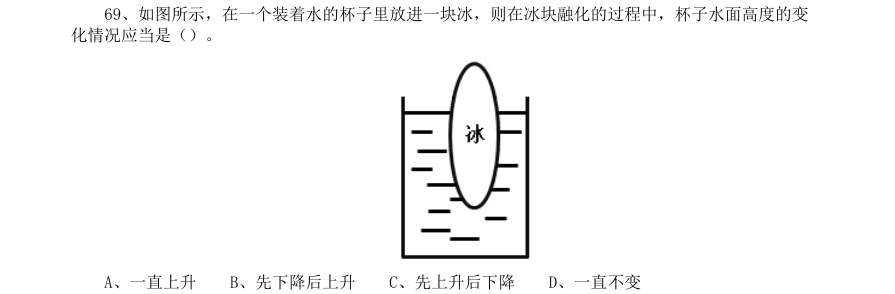

- **A.** 一直上升
- **B.** 先下降后上升
- **C.** 先上升后下降
- **D.** 一直不变

**答案：暂缺**

### 2016 广东·乡镇　第 70 题　（逻辑判断（综合））

如图所示,地面上有一架天平,天平左端系有一个50g 的物体,右端通过绳子连接一组滑轮。 滑轮组合中,O、Q 为定滑轮,P 为动滑轮,下端系有一个100g 的物体。要使天平两端平衡,需要的操 作是( )。

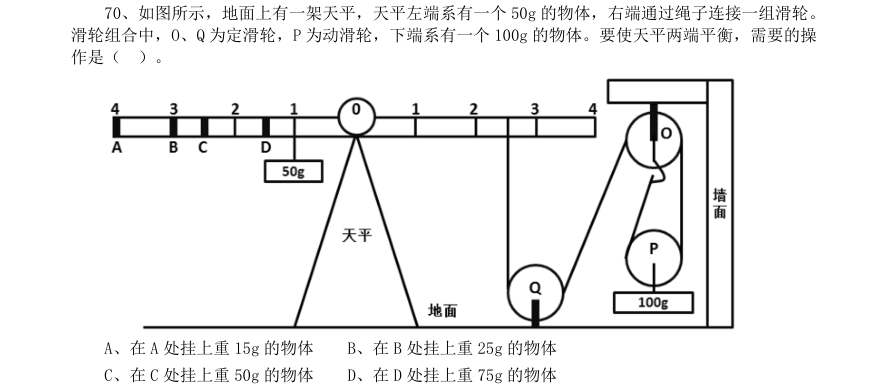

- **A.** 在A 处挂上重15g 的物体
- **B.** 在B 处挂上重25g 的物体
- **C.** 在C 处挂上重50g 的物体
- **D.** 在D 处挂上重75g 的物体

**答案：暂缺**

### 2016 广东·县级　第 82 题　（逻辑判断（综合））

如图所示,物体沿斜面匀速滑下时,它的( )。

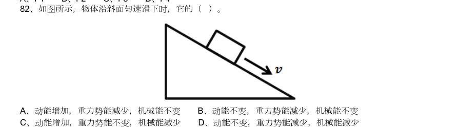

- **A.** 动能增加,重力势能减少,机械能不变
- **B.** 动能不变,重力势能减少,机械能不变
- **C.** 动能增加,重力势能不变,机械能减少
- **D.** 动能不变,重力势能减少,机械能减少

**答案：暂缺**

### 2016 国考·副省级　第 94 题　（翻译推理）

图灵测试是测试者在与被测试者(一个人和―台机器)隔开的情况下,通过一些装置(如键盘)向被测试者 随意提问。问过一些问题后,如果被测试者有超过30%的答复不能使测试者确认出哪个是人、哪个是机器,那么 这台机器就通过了测试,并被认为具有人类智能。 据上述定义,以下哪项中的测试―定通过了图灵测试?

- **A.** 对机器甲40%的答复所有人都确认其为机器
- **B.** 对机器乙60%的答复测试者能确认其为机器或人
- **C.** 对机器丙30%的答复有90%的某小区居民确认其为机器
- **D.** 对机器丁30%的答复只有10%的某校大学生不能确认其为机器

**答案：B**

### 2016 国考·副省级　第 106 题　（削弱）

人类与疟疾已经进行了几个世纪的斗争,但一直是“治标不治本”——无法阻断疟疾传染源。日前研究者 培育出一种经过基因改造的蚊子,它具备了不再感染疟疾的能力,并且能妨碍野生蚊子繁衍,从而有效切断人与 蚊子的疟疾传播途径,假以时日,就能根绝疟疾这个顽症。 以下哪项如果为真,最能支持上述结论?

- **A.** 转基因蚊子的体质比野生蚊子差,一旦被放到野外很容易死亡
- **B.** 转基因蚊子只在疟疾存在时才有生存优势,当生存环境中没有疟疾时,它们和野生蚊子的存活率是相同的
- **C.** 转基因蚊子的生殖能力在繁衍了9 代后显著增加,可能带来野生蚊子种群的灭亡
- **D.** 转基因蚊子与野生蚊子交配产下的后代并不都具有抗疟疾基因,但在基因层面上都会产生突变,形成新型蚊

**答案：C**

### 2016 国考·副省级　第 107 题　（加强）

格陵兰岛是地球上最大的岛屿,形成于38 亿年前,大部分地区被冰雪覆盖。有大量远古的岩石化石埋藏在 格陵兰岛地下,它们的排列就像是一个整齐的堤坝,也被称为蛇纹石。通过这些蛇纹石,人们可以断定格陵兰岛 在远古时可能是一块海底大陆。 补充以下哪项作为前提可以得出上述结论?

- **A.** 蛇纹石是两个大陆板块在运动中相互碰撞时挤压海底大陆而形成的一种岩石
- **B.** 这些蛇纹石化石的年代和特征与伊苏亚地区发现的一致,而后者曾是一片海底大陆
- **C.** 蛇纹石中碳的形状呈现出生物组织特有的管状和洋葱型结构,类似于早期的海洋微生物
- **D.** 由于大陆板块的运动才创造出了许多新的大陆,在板块运动发生之前,地球上绝大部分地区是一片汪洋大海

**答案：A**

### 2016 国考·副省级　第 109 题　（削弱）

研究人员在观察开普勒太空望远镜发现的数千颗太阳系外行星后,发现银河系内拥有大量的行星,几乎每 一颗恒星周围都存在行星,许多恒星系统内存在两至六颗行星,其中约三分之一的行星处于宜居带上,行星表面 的温度适合液态水存在,这可能意味着银河系内几乎处处有宜居的星球。 以下哪项如果为真,最能支持上述结论?

- **A.** 只要存在水资源,就有生命存在的可能性,但不一定能完成进化
- **B.** 许多宜居带行星与恒星之间的距离小于地球和太阳的间距,恒星释放的耀斑可能扼杀生命
- **C.** “恒星系统内存在两至六颗行星”这一结论是根据200 多年前的提丢斯—波得定则推算而出,非实测结果
- **D.** 银河系内2000~4000 亿颗恒星中80%是红矮星,超过一半的红矮星周围环绕的行星与地球类似,并存在水

**答案：D**

### 2016 国考·副省级　第 110 题　（翻译推理）

记者采访时的提问要具体、简洁明了,切忌空泛、笼统、不着边际。《采访技巧》一书中尖锐地剖析了“您 感觉如何”等问题的弊端,认为这些提问实际上在信息获取上等于原地踏步,它使采访对象没法回答,除非用含 混不清或枯燥无味的话来应付。 由此可以推出:

- **A.** 记者采访时的提问如果具体、简洁明了,就不会给采访对象带来回答的困难
- **B.** 采访对象如果没法回答提问,说明他没有用含混不清或枯燥无味的话来应付
- **C.** 采访对象只有用含混不清或枯燥无味的话来应付,才能回答“您感觉如何”等问题的提问
- **D.** 诸如“您感觉如何”这样的问题,只能使采访对象抓不住问题的要点而作泛泛的或言不由衷的回答

**答案：暂缺**

### 2016 国考·副省级　第 111 题　（加强）

某大型晚会的导演组在对节目进行终审时,有六个节目尚未确定是否通过,这六个节目分别是歌曲

- **A.** 无法确定魔术F 是否能通过
- **B.** 歌曲A 不能通过
- **C.** 无法确定两个相声节目是否能通过
- **D.** 歌曲B 能通过

**答案：A**

### 2016 国考·副省级　第 112 题　（削弱）

9 月初大学入学报到时,有多家手机运营商到某大学校园进行产品销售宣传。有好几家运营商推出了免费 套餐服务。但是其中一家运营商推出了价格优惠的套餐,同时其业务员向学生宣传说:其他运营商所谓的“免费” 套餐是通过出售消费者的身份信息来获得运营费用的。 以下哪项如果为真,最能质疑该业务员的宣传?

- **A.** 免费套餐运营商所提供的手机信号质量很差
- **B.** 免费套餐运营商是通过广告来获得运营费用的
- **C.** 有法律明确规定,手机运营商不得出售消费者的身份信息
- **D.** 很难保证价格优惠的运营商不会同样出售消费者的身份信息

**答案：B**

### 2016 国考·副省级　第 113 题　（削弱）

有研究者认为,有些人罹患哮喘病是由于情绪问题。焦虑、抑郁和愤怒等消极情绪,可促使机体释放组织 胺等物质,从而引发哮喘病。但是,反对者认为,迷走神经兴奋性的提高和交感神经反应性的降低才是引发哮喘 病的原因,与患者的情绪问题无关。 以下哪项如果为真,最能削弱反对者的观点?

- **A.** 现代医学已经证实,消极情绪也可诱发身体疾病
- **B.** 哮喘病发作会造成患者情绪焦虑、抑郁和愤怒等
- **C.** 焦虑、抑郁和愤怒等消极情绪是现代人的普遍问题
- **D.** 消极情绪会提高患者迷走神经的兴奋性并降低交感神经的反应性

**答案：D**

### 2016 国考·副省级　第 114 题　（逻辑判断（综合））

甲、乙、丙、丁四人商量周末出游。甲说:乙去,我就肯定去;乙说:丙去我就不去;丙说:无论丁去不 去,我都去;丁说:甲乙中至少有一人去,我就去。 以下哪项推论可能是正确的?

- **A.** 乙、丙两个人去了
- **B.** 甲一个人去了
- **C.** 甲、丙、丁三个人去了
- **D.** 四个人都去了

**答案：C**

### 2016 国考·副省级　第 115 题　（削弱）

某国的科研机构跟踪研究了出生于上世纪50 至70 年代的1 万多人的精神健康状况,其间测试了他们在13 岁至18 岁时的语言能力、空间感知能力和归纳能力。结果发现,在此期间语言能力远低于同龄人水平的青少年, 成年后患精神分裂症等精神疾病的风险较高。研究人员认为,青少年期语言能力的高低将是预测成年后精神疾病 的重要指标。 以下哪项如果为真,能够质疑上述观点?

- **A.** 青少年期激素分泌水平异常,影响大脑发育,导致语言能力发展迟缓
- **B.** 患精神分裂症的青少年,其归纳能力相比语言能力的发展更加缓慢
- **C.** 许多精神健康的脑肿瘤患者在青少年时期也经常出现语言能力发展迟缓的问题
- **D.** 适当的教育可显著提高青少年的语言能力,但对中老年人影响不大

**答案：C**

### 2016 国考·地市级　第 103 题　（加强）

近来,国外一些学者和媒体对西方民主体制较为集中地进行了反思和批评,指出西方民主正在衰败。对此, 有学者认为,西方民主衰败的原因之一是其存在基因缺陷。西方民主是建立在一个假设前提的基础上的,即权利 是绝对的。也就是说,权利与义务本应是相对的,但在西方民主模式中,权利绝对化已成为主流,各种权利绝对 化,个人主义至上,社会责任缺乏。 以下哪项如果为真,最能支持学者的观点?

- **A.** 西方民主制对权利绝对化的偏好,导致对他人权利与生存环境的忽视
- **B.** 权利是有限度的,超越了权利的限度,就可能走向权利滥用
- **C.** 美国两党常把自己的权利放在国家利益之上,互相否决,危害国家和公民的利益
- **D.** “程序万能”理论导致了西方民主制度的游戏化,民主被简化为竞选程序

**答案：B**

### 2015 湖北·统一卷　第 79 题　（前提假设）

反社会人格犯罪是行为人基于反社会型变态人格而实施的犯罪行为。行为人的特点是:1智力和精神上并无 明显缺陷,没有妄想或其他思维障碍;2多数有劣迹前科,有多次、多类型的违纪、违法、犯罪行为;3行为冲 动、缺乏深思熟虑和明确的动机;4没有悔过和自责的心理,在接受服刑以后仍然照旧违法犯罪,难以自控。 下列选项中行为人精神智力正常,其中最符合反社会人格犯罪特征的是:

- **A.** 陈某经常怀疑有人跟踪自己,某天下班后将走在自己后面的李某刺伤
- **B.** 林某多次上班迟到被领导当众呵斥,林某感觉受辱,将领导打成重伤
- **C.** 吴某有偷盗前科,某天下班遭遇抢劫,与劫匪搏斗中将劫匪打成残疾
- **D.** 王某街上闲逛,突然将陌生人郭某连刺两刀,随后将停在路边的汽车砸毁

**答案：D**

### 2015 湖北·统一卷　第 80 题　（逻辑判断（综合））

“公众参与”是一种有计划的行动。它通过政府部门与公众之间双向交流,使公民能参加行政决策过程并且 防止和化解公民和政府机构与开发单位之间、公民与公民之间的冲突。 下列选项与上述定义最不符合的是:

- **A.** 某市宣传部发布倡议书,号召全体市民“绿色出行”,十万人回应支持
- **B.** 居民多次向某市人大投诉规划局违规审批项目,该项目在实施前被叫停
- **C.** 某县政府拟在工业园区内引进两条茶籽油生产线,组织附近村民座谈
- **D.** 某市政府公开新建垃圾填埋场选址方案,收到10 万条反对意见而缓行

**答案：A**

### 2015 湖北·统一卷　第 97 题　（削弱）

美国一项新研究发现,人体生理反应的节奏跟昼夜交替一致,一旦这个节奏被破坏,人们免疫系统的抗病能 力就会降低。 如果以下各项为真,最能削弱上述观点的是:

- **A.** 坐飞机到不同时区易产生头疼反胃等时差综合症
- **B.** 熬夜易使胃酸分泌过多而诱发胃溃疡病症
- **C.** 长跑运动后立即大量饮水容易破坏体内代谢平衡而致病
- **D.** 免疫系统先天缺陷的病人,即使正常饮食患病概率也很高

**答案：D**

### 2015 湖北·统一卷　第 98 题　（加强）

研究发现,大西洋、太平洋海面水温的微小变化与南美洲亚马逊热带雨林地区火灾的面积具有密切联系,将 这种联系建立数学模型,可以用来预测亚马逊热带雨林地区来年的火灾情况。 以下哪项如果为真,最能支持上述观点:

- **A.** 大西洋海水温度升高0.2°C,亚马逊雨林次年火灾发生面积增加11%
- **B.** 海水温度增高会引起水分蒸发,导致降水减少,发生干旱或致火灾
- **C.** 海水温度变化虽然微小,但可能对热带雨林生态系统造成重要影响
- **D.** 北冰洋等海面水温可预测其附近的西伯利亚雨林火灾发生率和面积

**答案：暂缺**

### 2015 湖北·统一卷　第 99 题　（削弱）

蚊子可传播多种疾病,如疟疾、丝虫病、乙型脑炎等。有人担心由于蚊子叮咬了HIV 感染的人而在叮咬下一 位时会将存在蚊子体内的HIV 在人际间传播。但研究人员指出这样的担心大可不必。 如果以下各项为真,最能支持研究人员观点的是:

- **A.** HIV 感染的人血液中并不总是拥有高水平的HIV 病毒
- **B.** 蚊子叮咬HIV 感染的人后不一定立即去叮咬下一个人
- **C.** 蚊子通过食管吸入血液,这种血液的吸入总是单向的
- **D.** 孩子容易被蚊子叮咬,但他们身上极少发生HIV 感染

**答案：C**

### 2015 湖北·统一卷　第 100 题　（削弱）

研究者发现细菌就像人类的简化版本,它们有自我意识,有自己的语言,群居,既交友也树敌,喜欢偷窥 邻居家的隐私,还能以讹传讹,甚至杀害手足。各种细菌在自己的地盘上各司其职,相互配合,促进社会的稳定。 如果以下各项为真,最能质疑上述论断的是:

- **A.** 通过释放某种物质,细菌可召集群体成员执行各种任务
- **B.** 新型研制的阻断细菌交流的药物可以代替普通的抗菌素
- **C.** 细菌的生活极其单调,不是在单独进食,就是在自我繁殖
- **D.** 霍乱、肺炎和食物中毒,实际就是各种细菌聚集的后果

**答案：C**

### 2015 湖北·统一卷　第 101 题　（削弱）

科学就是不断接近真理的过程,我们深信不疑的事情中很大部分是会过期的,所以理解这一点的人都明白 在发展过程中不断更新知识才是科学进步的正道。然而这个过程有时会令人困惑和不安。 如果以下各项为真,最能质疑上述论断的是:

- **A.** 婴儿该仰睡还是趴着睡,孕妇抽烟喝酒是否安全,答案一代和一代不同
- **B.** 医学院的老师会告诉学生,五年内他们所学的知识里有一半都不会适用
- **C.** 我一直以为“雷龙”这个名字正确无误,但后来才发现根本没有雷龙
- **D.** 吸烟有害健康被大量科学研究和事实所证实,这一结论至今难以改变

**答案：暂缺**

### 2015 湖北·统一卷　第 102 题　（加强）

矿产勘探人员观察发现,不同颜色和形状的矿物结晶体虽然有各自不同的名称和表象,但可能是化学组成 相同的物质在不同的物理化学条件下结晶成不同结构的晶体,而且一般都有着不同的物理特征。所以说,不同的 矿物种类可以有相同的化学成分。 以下选项最能支持上述论断的是:

- **A.** 二氧化碳和干冰名称不同而且表象也不同
- **B.** 不同颜色的矿物晶体暴露在空气中会变色
- **C.** 分析仪器能快速判断矿物晶体的化学成分
- **D.** 二氧化硅可以有12 种不同的矿物结晶体

**答案：D**

### 2015 湖北·统一卷　第 103 题　（前提假设）

国外的心理学研究表明,当遇到有人冒犯你时,如果你选择原谅冒犯者,冒犯者会更有可能在心理上感到 悔恨而产生内在的愧疚。因此,类似的冒犯行为再次发生的可能性将会大大降低。 根据以上观点,可以推出:

- **A.** 遇到冒犯者,原谅是唯一避免再次发生冒犯的方法
- **B.** 如果你不原谅冒犯者,类似的冒犯行为必然会增加
- **C.** 经常原谅冒犯者,就可能减少自己被冒犯的可能性
- **D.** 被冒犯者原谅冒犯者,将可能有助于感化冒犯者

**答案：暂缺**

### 2015 湖北·统一卷　第 104 题　（归纳推导）

根据经济学家最新的研究显示,年收入在10000 美元以下时,随着家庭收入的增加,家庭成员的幸福感会 明显增强。但是,一旦年收入达到10000 美元以上,即使经济持续繁荣,家庭收入持续增加,家庭成员幸福感的 增强却很缓慢。 根据上述观点,可以推出:

- **A.** 年收入不足10000 美元的家庭可能会更加幸福
- **B.** 研究显示,幸福感与金钱之间并没有直接关系
- **C.** 调查表明,幸福感随家庭年收入的增加而增加
- **D.** 收入10000 美元以上的家庭将面临幸福感危机

**答案：C**

### 2015 湖北·统一卷　第 105 题　（削弱）

有关研究表明,手机比电脑更伤人,因为手机屏幕小,玩手机时注意力更投入,目不转睛,因此更伤眼。 使用电脑时,人们的肢体还能活动活动,可是“手机控”往往很少活动,这对身心健康更为不利。 如果以下各项为真,最能削弱上述论断的是:

- **A.** 电脑在使用过程中,显示屏会发出电磁、电离辐射
- **B.** 科学研究表明使用手机与脑瘤和癌症的发病率无关
- **C.** 电脑背景光比手机更容易引起使用者视力下降和头痛
- **D.** 长期使用电脑人群容易患鼠标手、颈椎病等“电脑病”

**答案：C**

### 2015 广东·乡镇　第 56 题　（削弱）

据统计,和去年相比,今年1 月以来流感患者的数量有明显的下降。这得益于新型特效药的 发明和投入使用。以下最能反驳上述结论的是:

- **A.** 2 月份为流感的高发期
- **B.** 流感患者很少到医院去治疗
- **C.** 流感病毒具有抗药性
- **D.** 新型特效药定价高,患者使用少

**答案：暂缺**

### 2015 广东·乡镇　第 57 题　（削弱）

某项科学研究发现:经常使用左手能更好地锻炼右脑,使得人的形象思维能力增强,更利于 促进创造性思维的发展。但事实证明:发明家中左撇子的比例并不高。因此,这个科学研究的结论不 可信。以下最能削弱上述结论的是:

- **A.** 用右手也可以达到锻炼右脑的效果
- **B.** 用右手的人数大大超过用左手的人数
- **C.** 发明创造主要依靠天赋,而非后天锻炼
- **D.** 发明创造不依靠形象思维能力

**答案：暂缺**

### 2015 广东·乡镇　第 58 题　（削弱）

有甲、乙两家公司,甲公司售后服务部门接到的产品投诉电话是乙公司的3 倍。因此,甲公 司产品的质量没有乙公司的好。以下最能反驳上述结论的是:

- **A.** 乙公司的产品操作相对来说更为简单
- **B.** 甲公司接到电话大多数是咨询电话
- **C.** 甲公司的咨询电话机数量比乙公司多
- **D.** 甲公司产品的市场占有率达到76%

**答案：暂缺**

### 2015 广东·乡镇　第 59 题　（逻辑判断（综合））

已知甲、乙、丙、丁四人具有以下直系、旁系血亲关系:甲是乙的父亲,丙是甲的弟弟,丁 是丙的母亲。则甲、乙、丙、丁四人中年龄最大的是:

- **A.** 甲
- **B.** 乙
- **C.** 丙
- **D.** 丁

**答案：暂缺**

### 2015 广东·乡镇　第 60 题　（逻辑判断（综合））

某高中只有文科班和理科班,男生人数比女生多,理科班人数比文科班多。根据以上条件, 可以判断下列说法必定为真的是:

- **A.** 文科班的男生总人数多于文科班的女生总人数
- **B.** 理科班的男生总人数多于理科班的女生总人数
- **C.** 文科班的男生总人数多于理科班的女生总人数
- **D.** 理科班的男生总人数多于文科班的女生总人数

**答案：暂缺**

### 2015 广东·乡镇　第 61 题　（翻译推理）

只有遇到下雨天,客车才不会准时到达。现在,客车没有准时到达,所以( )遇到下雨天。 填入划横线部分最恰当的一项是:

- **A.** 没有
- **B.** 可能
- **C.** 一定
- **D.** 不可能

**答案：暂缺**

### 2015 广东·乡镇　第 62 题　（逻辑判断（综合））

到游泳池深水区游泳,只需要具备两个条件,一是戴泳帽,二是持有深水游泳证。小王戴着 游泳帽到深水区游泳,被工作人员阻止。 根据以上条件,下列条件必定为真的是:

- **A.** 小王不会游泳,到深水区游泳比较危险
- **B.** 小王是儿童,不适合到深水区游泳
- **C.** 小王没有深水游泳证
- **D.** 小王到游泳池时,深水区已经暂停开放

**答案：暂缺**

### 2015 广东·乡镇　第 63 题　（削弱）

有调查显示,那些作息时间不同的夫妻,虽然每天相处的时间较少,但他们发生争吵的次数 比作息时间基本相同的夫妻更多。因此,为了建立良好的夫妻关系,夫妻之间应当尽量有相同的作息 时间。最能削弱上述论点的一项是:

- **A.** 夫妻产生矛盾后,往往以作息时间不同来表现不满
- **B.** 具有同事关系的夫妻更容易在工作上产生矛盾
- **C.** 作息时间不同的夫妻更容易产生矛盾
- **D.** 生活习惯不同是夫妻产生矛盾的主要原因

**答案：暂缺**

### 2015 广东·乡镇　第 64 题　（真假推理）

小张准备在下周去观看一场比赛,但他忘了具体是哪一天,便分别询问了甲、乙、丙、丁和 戊,他们五人的回答如下: 甲:肯定是在双休日。 乙:是周二、周四、周六的其中的一天。 丙:就是周一。 丁:绝对是周一、周三、周五、周日的其中一天。 戊:肯定是周五。 甲、乙、丙、丁和戊只有一个人说对了。那么比赛时间是:

- **A.** 周一
- **B.** 周三
- **C.** 周五
- **D.** 周六

**答案：暂缺**

### 2015 广东·乡镇　第 65 题　（朴素逻辑（排序/匹配））

某市举办了一场职业技能竞赛,有甲、乙、丙、丁四支代表队进入决赛,每支队伍有两名参 赛选手,获得第一名的选手将得10 分,第二名得8 分,第三名到第八名分别是6、5、4、3、2、1 分, 最后总分最高的队伍将获得冠军。比赛的排名情况如下: 甲队选手的排名都是偶数,乙队两名选手的排名相连,丙队选手的排名一个是奇数一个是偶数, 丁队选手的排名都是奇数;第一名是丁队选手,第八名是丙队选手;乙队两名选手的排名在甲队两名 选手之间,同时也在丙队两名选手之间。 根据以上条件,可以判断各队总分由高到低的排列顺序为:

- **A.** 丁>甲>丙>乙
- **B.** 甲>丁>乙>丙
- **C.** 甲>丁>丙>乙
- **D.** 丁>甲>乙>丙

**答案：暂缺**

### 2015 广东·乡镇　第 66 题　（逻辑判断（综合））

检查视力时,要求眼睛与视力表的距离为5 米,如下图所示,人面对平面镜而坐,背后为视 力表。视力表到平面镜的距离3 米,那么人到镜子的距离应为:

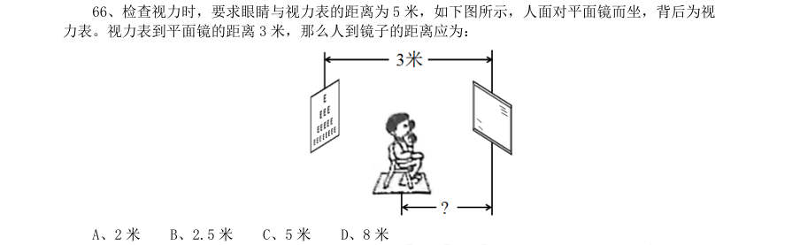

- **A.** 2 米
- **B.** 2.5 米
- **C.** 5 米
- **D.** 8 米

**答案：暂缺**

### 2015 广东·乡镇　第 67 题　（逻辑判断（综合））

在下图所示的电路中,电源电压保持不变, ,则下列情况中电流表 的示数最大 的是:

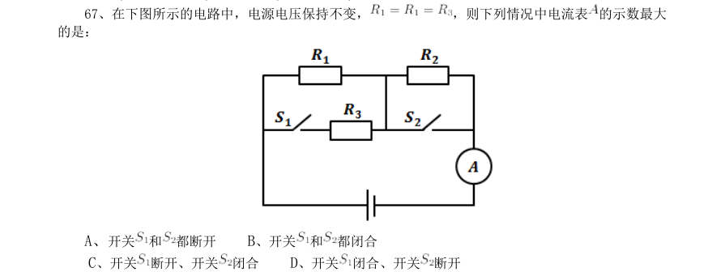

- **A.** 开关和
- **B.** 开关和都闭合
- **C.** 开关断开、开关
- **D.** 开关

**答案：暂缺**

### 2015 广东·乡镇　第 68 题　（逻辑判断（综合））
> 材料：断开…

下图是蹦极运动过程的简化示意图,弹性绳一端固定在O 点,另一端系住运动员,运动员从 O 点自由下落,到达A 点处弹性绳自然伸直,在B 点处运动员受到的重力与弹性绳对运动员的拉力相等, C 点是运动员所能到达的最低点,运动员从O 点到C 点是运动过程中忽略空气阻力,则:

- **A.** 从O 至A 过程中运动员速度一直减小
- **B.** 从A 至B 过程中运动员速度一直减小
- **C.** 从B 至C 过程中运动员速度一直减小
- **D.** 从C 至A 过程中运动员速度一直减小

**答案：暂缺**

### 2015 广东·乡镇　第 70 题　（逻辑判断（综合））
> 材料：°C时,没有B 物质析出…

如下图所示,将一根蜡烛的下端插入一根小铁钉,使蜡烛能直立漂浮,有一部分露出水面, 当把蜡烛露出水面以上的部分截掉后,则剩余部分将:

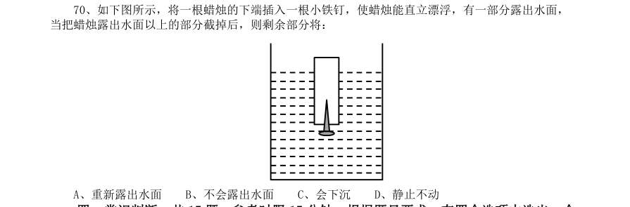

- **A.** 重新露出水面
- **B.** 不会露出水面
- **C.** 会下沉
- **D.** 静止不动

**答案：暂缺**

### 2015 广东·县级　第 58 题　（削弱）

海水经过海水淡化技术的处理可变成淡水,而海水的量是极其巨大的。因此,无须节约使用淡水资源。 最能质疑上述结论的是:

- **A.** 近海海水的污染比较严重
- **B.** 海水淡化成本高昂
- **C.** 冰川水储量巨大,可替代海水淡化
- **D.** 地球上的水资源总量是恒定的

**答案：暂缺**

### 2015 广东·县级　第 66 题　（逻辑判断（综合））

如下图所示,木框里面有两个平面镜相互垂直。一束入射光射入木框内,经两个平面镜反射出去。则 入射光与出射光的位置关系是:

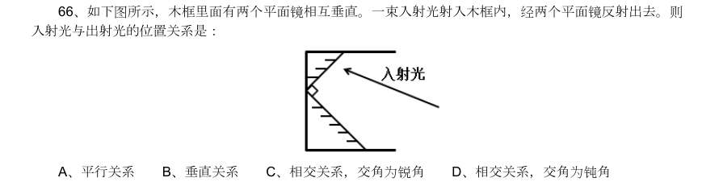

- **A.** 平行关系
- **B.** 垂直关系
- **C.** 相交关系,交角为锐角
- **D.** 相交关系,交角为钝角

**答案：暂缺**

### 2015 广东·县级　第 67 题　（逻辑判断（综合））

如下图所示,一支试管口朝下插入水中,管内封闭有一定的量的空气,恰好悬浮在水中。当水的温度 升高时,下列说法正确的是:

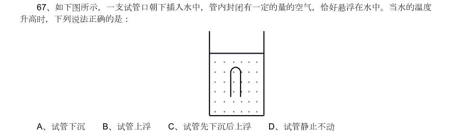

- **A.** 试管下沉
- **B.** 试管上浮
- **C.** 试管先下沉后上浮
- **D.** 试管静止不动

**答案：暂缺**

### 2015 广东·县级　第 68 题　（逻辑判断（综合））

如下图所示,小球A 从斜面上由静止状态开始向下滑,撞击静止于水平木板上的木块B,下列说法正 确的是:

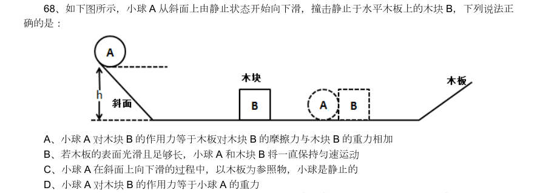

- **A.** 小球A 对木块B 的作用力等于木板对木块B 的摩擦力与木块B 的重力相加
- **B.** 若木板的表面光滑且足够长,小球A 和木块B 将一直保持匀速运动
- **C.** 小球A 在斜面上向下滑的过程中,以木板为参照物,小球是静止的
- **D.** 小球A 对木块B 的作用力等于小球A 的重力

**答案：暂缺**

### 2015 国考·副省级　第 91 题　（逻辑判断（综合））

隐域性是指自然地理现象在受到局部的地形、水文、土壤、气流、洋流、季风等因素的影响下,在地球表面 不按或偏离纬向地带性规律分布的特性,它使地带性分布规律变得不鲜明,使自然环境变得更具复杂性与多样性。 以下属于隐域性分布的是:

- **A.** 关汉卿《窦娥冤》中描写的“六月飞雪”
- **B.** 余秋雨所描写的丝绸之路上的“月牙泉”
- **C.** 岑参在诗中所描述的“北风卷地白草折”
- **D.** 电影《木乃伊归来》中所出现的大沙漠

**答案：B**

### 2015 国考·副省级　第 106 题　（归纳推导）

在防治癌症方面,橙汁有多种潜在的积极作用,尤其由于它富含橙皮素和柚苷素等类黄酮抗氧化剂。研究 证据已经表明,橙汁可以减少儿童患白血病的风险,并有助于预防乳腺癌、肝癌和结肠癌。根据研究结果,橙汁 的生物效应在很大程度上受到其成分的影响,而其成分的变化又依赖于气候、土壤、水果成熟度以及采摘后的存 储方法等条件。 由此可以推出:

- **A.** 并非所有的橙汁都有相同的防癌功效
- **B.** 过度饮用橙汁会给身体健康造成不良影响
- **C.** 相对于健康儿童而言,白血病患儿的橙汁饮用量较小
- **D.** 生长于良好的气候土壤条件下,成熟并避光保存的橙子最有功效

**答案：A**

### 2015 国考·副省级　第 107 题　（真假推理）

某国际小组对从已灭绝的一种恐鸟骨骼化石中提取的DNA 进行遗传物质衰变速率分析发现,虽然短DNA 片 段可能存在100 万年,但30 个或者更多碱基对序列在确定条件下的半衰期只有大约15.8 万年。某位科学家据此 认为,利用古代DNA 再造恐龙等类似于电影《侏罗纪公园》中的故事不可能发生。 以下哪项如果为真,最能反驳该科学家的观点:

- **A.** 《侏罗纪公园》虽然是一部科幻电影,但也要有事实依据
- **B.** 上述研究的化石样本可能受到人类DNA 的“污染”
- **C.** 环境因素会影响DNA 等遗传物质的衰变速率
- **D.** 恐鸟与恐龙的碱基对序列排列顺序不同

**答案：C**

### 2015 国考·副省级　第 108 题　（削弱）

碎片化时代人们的注意力很难持久。让用户在邮件页面停留更长时间已经成为了营销者不断努力的方向。 随着富媒体化的逐步流行,邮件逐步从单一静态向动态转变,个性化邮件的特性也逐步凸显。GIF 制作简单,兼 容性强,在邮件中可以增加视觉冲击力。因此,在邮件中插入GIF 动态图片,更能吸引用户的目光,增加用户的 点击率。 以下哪项如果为真,最能支持上述结论:

- **A.** 如果针对特定用户群而制定个性化营销邮件,那么销售机会会增加20%
- **B.** 过去没有插入GIF 动态图片的个性化营销邮件,也为很多企业带来了成功
- **C.** 上世纪70 年代出生的人习惯于电子邮件的静态界面,不喜欢花里胡哨的东西
- **D.** 插入GIF 动态图片的个性化营销邮件,比普通发送的邮件给企业带来的收入多18 倍

**答案：D**

### 2015 国考·副省级　第 109 题　（逻辑判断（综合））

一个旅行者要去火车站,早上从旅馆出发,到达一个十字路口。十字路口分别通向东南西北四个方向,四 个方向上分别有饭店、旅馆、书店和火车站。书店在饭店的东北方,饭店在火车站的西北方。 该旅行者要去火车站,应当往哪个方向走:

- **A.** 东
- **B.** 南
- **C.** 西
- **D.** 北

**答案：B**

### 2015 国考·副省级　第 110 题　（加强）

由于一种新的电池技术装置的出现,手机在几分钟内充满电很快就会变成现实。这种新装置是一种超级电 容器,它储存电流的方式是通过让带电离子聚集到多孔材料表面,而非像传统电池那样通过化学反应储存这些离 子。因此这种超级电容器能在几分钟内储满电。研究人员认为这种技术装置将会替代传统电池。 以下哪项如果为真,不能支持上述结论:

- **A.** 超级电容器能够储存大量电能,保证长时间正常运行
- **B.** 超级电容器能循环使用数百万次,相比之下传统电池只能使用数千次
- **C.** 超级电容器可嵌入汽车底盘为汽车提供动力,可更方便地进行无线充电
- **D.** 超级电容器充电时所耗电能比传统电池少90%,但供电时间比后者长10 倍

**答案：C**

### 2015 国考·副省级　第 111 题　（前提假设）

台风是大自然最具破坏性的灾害之一。有研究表明:通过向空中喷洒海水水滴,增加台风形成区域上空云 层对日光的反射,那么台风将不能聚集足够的能量,这一做法将有效阻止台风的前进,从而避免更大程度的破坏。 上述结论的成立需要补充以下哪项作为前提:

- **A.** 喷洒到空中的水滴能够在云层之上重新聚集
- **B.** 人工制造的云层将会对邻近区域的降雨产生影响
- **C.** 台风经过时,常伴随着大风和暴雨等强对流天气
- **D.** 台风前进的动力来源于海水表面日光照射所产生的热量

**答案：D**

### 2015 国考·副省级　第 112 题　（解释评价）

有一段时间,电视机生产行业竞争激烈。由于电视机品牌众多,产品质量成为消费者考虑的首要因素。某 电视机生产厂家为了扩大市场份额,一方面加大研发力度,进一步提高了电视机产品的质量;另一方面在价格上 作调整,适当降低了产品的价格。然而,调整之后的头三个月,其电视机产品的市场份额不但没有提高反而有所 下降。 以下哪项如果为真,最能解释上述现象:

- **A.** 消费者通常会考虑不同产品的价格差异,而非同一产品在不同时期的价格差异
- **B.** 一个家庭再次购买电视机产品时会首先考虑原来的品牌
- **C.** 消费者通常是通过价格来衡量电视机产品质量的
- **D.** 其他电视机生产厂家也调整了产品价格

**答案：C**

### 2015 国考·副省级　第 113 题　（削弱）

“有好消息,也有坏消息”。无论是谈起什么主题,这样的开场白都顿时让人觉得一丝寒意传遍全身。接 着这句话,后边往往是这样一个问题:你想先听好消息还是坏消息?一项新的研究表明,你可能想先听坏消息。 如果以下各项为真,最能削弱上述论证的是:

- **A.** 若消息是来自一个你信任的人,那么你想先听好坏消息的顺序会不同
- **B.** 研究发现,若由发布消息的人来决定,那么结果往往总是先说好消息
- **C.** 心理学家发现,发布好坏消息的先后顺序很可能改变人们对消息的感觉
- **D.** 心理评估结果证明先听到坏消息的学生比先听到好消息的学生焦虑要小

**答案：A**

### 2015 国考·副省级　第 114 题　（削弱）

城市病指的是人口涌入大城市,导致其公共服务功能被过度消费,最终造成交通拥挤、住房紧张、空气污 染等问题。有专家认为,当城市病严重到一定程度时,大城市的吸引力就会下降,人们不会再像从前一样向大城 市集聚,城市病将会减轻,从而焕发新的活力。 如果以下各项为真,能够削弱上述观点的是:

- **A.** 我国已经进入城市病的爆发期,居民生活已受到影响
- **B.** 大城市能够提供的公共服务是中小城市所无法替代的
- **C.** 政府应该将更多财力用于发展中小城市、乡镇、农村
- **D.** 中小城市活力足,发展潜力大,对人们吸引力会很强

**答案：B**

### 2015 国考·副省级　第 115 题　（逻辑判断（综合））

今年联赛决赛的最后4 支队伍是甲、乙、丙和丁。其中N 与T 分别为甲队和丁队的主教练。有人指出,甲 队此前每次夺该项桂冠的赛季都曾战胜过T 教练所在的球队;过去4 年间,丁队在N 教练的指导下,每隔一年都 能夺得该项桂冠,而去年丁队没有夺冠。 以下哪项如果为真,与上述表述相矛盾:

- **A.** T 教练可能执教过丁队
- **B.** N 教练去年曾执教丁队
- **C.** 甲队曾4 次夺得该项冠军
- **D.** 丁队前年未获得该项冠军

**答案：D**

### 2014 湖北·统一卷　第 96 题　（加强）

低热量食物是指含淀粉、糖类等碳水化合物类较少的食物。通过食用低热量食品,可以有效控制能量的摄入 量,避免多余能量在体内以脂肪形式储存下来。如果体重已经较重的人改为食用低热量食品,则可在保持饱腹感 的同时达到减肥效果。另外,有许多人认为,低热量食物对糖尿病患者也十分有益。 以下哪项为真,最能支持上述推论:

- **A.** 改食用低热量食物需要逐步进行,否则会引起机体代谢紊乱
- **B.** 研究表明低热量饮食可减少脂肪在胰脏中的沉积,恢复胰岛素的分泌
- **C.** 低热量食品可适当增加进食量,满足饱腹感,享受吃饱的乐趣
- **D.** 低热量食品可以降低超重或糖尿病患者的体重,但需要补充其他营养

**答案：B**

### 2014 湖北·统一卷　第 97 题　（削弱）

噬菌体是一种病菌,它能够捕食细菌,目前随着医疗中植入技术的发展,越来越多的患者接受着诸如导尿管、 心脏支架等医学植入装置,但随之也带来了细菌感染的风险,因此,一些研究人员认为如果噬菌体吸附在植入装 置材料表面,再将其放入患者体内,就可以避免植入装置引发的感染。 以下哪项为真,最能削弱上述结论:

- **A.** 对植入医学装置的患者,一般通过服用抗生素来防御细菌感染
- **B.** 有细菌的场所就可能有相应噬菌体的存在,只是数量差异
- **C.** 噬菌体能够攻击治病细菌,但有时也“捕食”有益的细菌
- **D.** 一些噬菌体进入机体后,无法适应体液环境,难以保持活性

**答案：D**

### 2014 湖北·统一卷　第 98 题　（削弱）

以往的研究认为火山喷发会释放大量热量,引发全球变暖,但今日研究发现,火山喷发不仅不会引发全球温 度上升,还可以削弱全球变暖的影响。 以下哪项为真,最能支持上述结论:

- **A.** 研究表明,火山爆发时地下岩浆喷出地面,与空气接触,产生氧化反应,引起局部温度升高。
- **B.** 火山爆发能够抑制某种分解有机物的细菌,其分解的有机物中含有甲烷,甲烷是一种可燃性气体,可产生热能。
- **C.** 火山喷发后会带来大规模的酸雨,酸雨能在短期内降低火山区气温,但是也引发了农作物虫害。
- **D.** 研究发现火山喷发物质——二氧化硫可与大气物质形成“水粒”并将阳光反射,减少对地面的热辐射,延缓

**答案：D**

### 2014 湖北·统一卷　第 99 题　（削弱）

随着人们的生活和工作环境进入高楼大厦,人们接触日光的机会变少,研究发现,日光是合成维生素D 的必 要条件,而维生素D 是促进钙吸收的关键因素。因此有人得出结论:现代人更容易患骨质疏松等因缺钙引起的疾 病。 以下哪项为真,最能质疑上述结论:

- **A.** 骨质疏松疾病患者多晒太阳就可以缓解或治愈
- **B.** 现代人饮食结构中的含钙食品比以前丰富很多
- **C.** 骨质疏松症患者接触日光的时长与其他人无异
- **D.** 口服维生素D 片是加了促吸收剂的合成配方

**答案：C**

### 2014 湖北·统一卷　第 100 题　（归纳推导）

软件用户的调查显示,通常一个软件会有1000 个用户采用,如果一个软件每天被下载安装的次数达到55 次,这个软件的流行度会急速上升,最多时有1200 万个用户采用,大量用户几乎是完全根据其他用户的行为来 选择安装这个软件,而很少关注其本身的内在特点。 根据以上描述可以推出:

- **A.** 网站上最流行的软件未必是最实用的软件
- **B.** 参考别人选择安装软件是不明智的
- **C.** 网站上推出的软件未必都是有用的
- **D.** 用户安装在电脑上的一些软件或许会被删除

**答案：A**

### 2014 湖北·统一卷　第 101 题　（加强）

一项新的研究发现,短期摄入高脂食物有益心脏,研究人员在实验后期人工引发老鼠心脏缺血性伤害,类 似人心脏病发作时的情况。他们发现,吃高脂食物24 小时、1 周和2 周的老鼠心脏组织受损状况比吃6 周高脂 食物的老鼠和“吃素”的老鼠轻70%。研究人员认为这是由于短期摄入高脂食品可以使心脏肌肉获得更多能量, 增强抵御伤害能力。他们认为,短期摄入高脂饮食或可保护心脏机能。 以下哪项为真,最能支持题干的结论:

- **A.** 高脂食物中所含有的低密度脂蛋白胆固醇是人体所不可缺少的物质
- **B.** 高脂食物可以使人体获得进行新陈代谢等活动所必需的物质和能量
- **C.** 如果让老鼠“吃一天荤”后改“吃素”,它们心脏抵御伤害的能力比一开始就“吃素”的老鼠强
- **D.** 要想降低患心脏病风险,应注意饮食平衡,适当摄入脂肪和胆固醇

**答案：C**

### 2014 湖北·统一卷　第 103 题　（加强）

在地球构造活动频繁的时期,环非洲、南美和欧洲的新海洋盆地开始扩展,产生了新的空间,大气中大量 二氧化碳与光合作用的生物发生反应,死亡的生物随后被埋在海底沉积物中,形成了富含碳元素的页岩。大气中 的碳被固定下来,使得大气中二氧化碳的水平下降,减小了温室效应并降低了全球温度,这对海洋生命来说是非 常严重的后果。因此科学家认为,全球变冷或变暖后果同样严重。 下列哪项为真,最能支持科学家的论断:

- **A.** 在全球变冷的200 年后,由于频繁的火山爆发,使得固化在岩叶中的碳以二氧化碳的形式重回到大气层,部分恢复了温室效应
- **B.** 全球变暖会导致海洋生物生态危机,科学家发现在26 万年前全球变冷的时期,海洋生物发生过类似的危机
- **C.** 大规模且长期的自然变化,或由于人类活动而造成全球温室效应在短期内的巨大改变对整个系统来说都具有冲击作用
- **D.** 科学家观察到气候变冷的发生超过几百万年,而不是几十年或几百年,这还很难和我们迅速变化的现代气候

**答案：B**

### 2014 湖北·统一卷　第 104 题　（真假推理）

兄弟姐妹四人,甲、乙、丙、丁。甲说:丁是最小的妹妹。乙说:兄弟姐妹中只有哥哥一个男孩。丙说: 我是甲的姐姐。 如果上述都为真。以下推断正确的是:

- **A.** 丙排行第二,是女孩;丁排行最小,是女孩
- **B.** 乙排行第二,是女孩:丙排行第一,是女孩
- **C.** 甲排行第二,是男孩;乙排行第三,是女孩
- **D.** 甲排行第二,是女孩;丙排行第一,是女孩

**答案：C**

### 2014 湖北·统一卷　第 105 题　（归纳推导）

研究人员认为肥胖症和人体内寄生某些能产生特定气体的微生物有关,这些微生物使他们呼出的气体味道 更难闻。加州洛杉矶CS 医学中心分析了792 位体检者的呼吸,发现呼出甲烷和氢气量高的人的身高体重指数(BMI) 比正常人要高2.4 点,即属于肥胖人群。 根据以上描述不能推出:

- **A.** 胖人体内可能寄生着某些产生特定气体的微生物
- **B.** 可以通过气体是否难闻来判定呼气者是否是肥胖症患者
- **C.** 呼出气体中甲烷和氢气含量高的人群比正常人群更胖
- **D.** 甲烷和氢气的混合物味道较难闻

**答案：B**

### 2014 广东·乡镇　第 81 题　（逻辑判断（综合））

爸爸、妈妈只要有一个人在家时,孩子可以留在家里;爸爸、妈妈都出差时,家中必须有人照顾孩子,才 能把孩子留在家里。 根据以上条件,下列判断必定成真的是:

- **A.** 爸爸出差时,孩子不能留在家里
- **B.** 妈妈出差时,孩子不能留在家里
- **C.** 孩子不能和爸爸、妈妈一起外出
- **D.** 爸爸、妈妈出差时,可以由外祖母在家照顾孩子

**答案：暂缺**

### 2014 广东·乡镇　第 82 题　（逻辑判断（综合））

某公司计划招聘一批员工,最不可能被录用的是学历在初中以下,或者是没有工作经历的人,在有可能被 录用的人中,品德高尚的会被优先录用。 以下最有可能被该公司录用的是:

- **A.** 老李,小学文化水平,从未放松过学习,常参加各种培训班,收获较大
- **B.** 小张,大学应届毕业生,学习成绩优秀,品德高尚
- **C.** 孙先生,40 岁,高中文化水平,具有8 年工作经验
- **D.** 赵女士,小学文化水平,为人随和,品德高尚

**答案：暂缺**

### 2014 广东·乡镇　第 83 题　（前提假设）

某县政府部门工作人员表示:“总的来说,我县居民的家庭经济困难情况比起以前更加严峻了。这种情况 十分明显,因为我们县居民申请最低生活补助的人数越来越多了。” 以上结论基于的假设是:

- **A.** 金融危机使得很多下岗工人面临家庭经济困难的问题
- **B.** 许多人不找工作,所以申请最低生活补助的人就多了
- **C.** 尽管有的居民有工作,但是他们仍然申请了最低生活补助
- **D.** 是否申请最低生活补助是判断一个家庭经济是否困难的重要标志

**答案：暂缺**

### 2014 广东·乡镇　第 84 题　（归纳推导）

对某城镇居民休闲运动的一项调查显示:所有广场舞爱好者都爱好看电视;有些电视爱好者喜欢打羽毛球, 所有喜欢打羽毛球的人都不爱好太极拳,有些广场舞爱好者同时爱好太极拳。 根据以上结论,下列判断必定为假的是:

- **A.** 有些广场舞爱好者喜欢打羽毛球
- **B.** 所有电视爱好者都爱好太极拳
- **C.** 所有喜欢打羽毛球的人都爱好看电视
- **D.** 有些太极拳爱好者不喜欢打羽毛球

**答案：暂缺**

### 2014 广东·乡镇　第 85 题　（逻辑判断（综合））

村里新来一位干部,乡镇村民分别听到这位干部的如下情况: (1)姓莫,中年,女干部,精通会计 (2)姓徐,中年,男干部,懂建筑设计 (3)姓刘,青年,男干部,熟悉农业生产技术 (4)姓昌,青年,男干部,懂建筑设计 (5)姓莫,老年,男干部,熟悉农业生产技术 每位村民听到的四项情况中各有一项正确,这位新来的干部是一位:

- **A.** 姓刘的青年女干部
- **B.** 姓莫的老年男干部
- **C.** 精通会计的干部
- **D.** 懂建筑设计的干部

**答案：暂缺**

### 2014 广东·县级　第 67 题　（解释评价）

解释∶理解

- **A.** 分析∶结论
- **B.** 奉献∶赞许
- **C.** 拼搏∶成功
- **D.** 分享∶满足

**答案：暂缺**

### 2014 广东·县级　第 76 题　（前提假设）

甲、乙两份报纸的编辑部,都有专门校对文稿的工作人员。去年,甲报纸出现了一些文字错误,而乙报纸 没有文字错误。因此,在去年的校对工作中,乙报纸的校稿员比甲报纸的校稿员的工作更有成效。 以上结论基于的假设是:

- **A.** 乙报纸校稿员的工作时间比甲报纸校稿员长
- **B.** 甲报纸收到的稿件存在文字错误的数量不比乙报纸少
- **C.** 甲报纸每期的版面数量比乙报纸少
- **D.** 文字错误出现的数量是评价校稿员工作成效的标准

**答案：暂缺**

### 2014 广东·县级　第 77 题　（削弱）

据统计,与文科专业的大学毕业生相比,理工科大学毕业生刚入职时的收入更高。因此,高中毕业生要想 将来毕业后获得较高收入,应该报考理工科专业。 最能削弱上述结论的一项是:

- **A.** 文科生最终获得高收入的比例高于理工科学生
- **B.** 理工科专业由于知识难度大而不容易毕业
- **C.** 如今不少年轻人更愿意按自己的兴趣选择专业
- **D.** 有些没有读过大学的人最后成了著名的企业家

**答案：暂缺**

### 2014 广东·县级　第 78 题　（削弱）

公众人物需要担当更多的道德责任,因为权力和责任是相等的,既然拥有常人不具备的优势地位,那么就 应该比一般人承担更高的道德要求。因此,承受更多的舆论批评甚至人身攻击,哪怕是一定程度的失真,也是 不得不付出的必要代价。 最能质疑上述观点的一项是:

- **A.** 普通人和公众人物应该具有同等的道德责任
- **B.** 失真评价会影响公众人物对道德义务的履行
- **C.** 更多的道德责任并不意味着一定要承受舆论批评
- **D.** 公众人物正是因为没有尽到道德责任才会受到舆论批评

**答案：暂缺**

### 2014 广东·县级　第 79 题　（削弱）

某市环保部门的监测结果显示:今年上半年,该市的空气质量整体处于优良水平,严重污染天数不足15 天,污染天数比去年同期少了4 天。由此可知,今年的空气质量好于去年。 最能质疑上述结论的一项是:

- **A.** 该市去年关停了几家重污染企业
- **B.** 该市今年开展了植树造林活动
- **C.** 该市的严重污染时段一般在下半年
- **D.** 该市环保部门今年更新了空气检测设备

**答案：暂缺**

### 2014 广东·县级　第 80 题　（前提假设）

某市人口普查结果显示,35 岁以上单身男性人数是35 岁以上单身女性的1.5 倍。显而易见,除非这些男 性中的一些人娶外地女性为妻,否则这些单身男性中的一部分将被迫一直保持单身状态。 以上结论基于的假设是:

- **A.** 这些单身男性持有“先立业再成家”的观念
- **B.** 本市单身女性中外出务工的较多
- **C.** 这些单身男性不愿娶比他们年龄大的女性为妻
- **D.** 这些单身男性倾向于娶与他们同龄的女性为妻

**答案：暂缺**

### 2014 广东·县级　第 81 题　（削弱）

由于销量过少难以回收药品的研发和生产成本,因此,制药厂生产治疗罕见疾病的药物,就会遭受经济损 失。 最能削弱上述结论的一项是:

- **A.** 一些治疗罕见疾病的药物对其他疾病也有良好的疗效
- **B.** 治疗罕见疾病的药物的研发会推动医学的进步
- **C.** 相对经济效益,有些制药厂更注重社会效益
- **D.** 药物生产数量越大,每个单位的药物平均成本越小

**答案：暂缺**

### 2014 广东·县级　第 82 题　（逻辑判断（综合））

赵先生、钱先生、孙先生、李先生四人参加一项技能比赛,获得了比赛的前四名。据了解,他们之间有以 下关系: 1孙先生和李先生经常相约一起打篮球; 2第一名和第三名在这次比赛中刚认识; 3第二名不会骑自行车,也不打篮球; 4赵先生的名次比钱先生的名次靠前; 5钱先生和李先生每天一起骑自行车上班。 根据以上条件,可以判断此次比赛的第一、二、三、四名次的获得者是:

- **A.** 孙先生、赵先生、钱先生、李先生
- **B.** 李先生、赵先生、孙先生、钱先生
- **C.** 李先生、孙先生、赵先生、钱先生
- **D.** 孙先生、李先生、赵先生、钱先生

**答案：暂缺**

### 2014 广东·县级　第 83 题　（前提假设）

在过去五年中,某地所有家庭所购买衣服的平均价格增长了50%,但在平均家庭消费支出中,购买衣服支 出所占比例没发生变化,因此,所有家庭的平均消费支出在这五年中也增长了50%。 以上结论基于的假设是:

- **A.** 在这五年中,所有家庭在购买衣服上的平均花费没有变化
- **B.** 在这五年中,所有家庭所购衣服的平均数量没有变化
- **C.** 在这五年中,该地的家庭数量增加了50%
- **D.** 在这五年中,该地所有家庭用于购买衣服的支出总和增长了50%

**答案：暂缺**

### 2014 广东·县级　第 84 题　（真假推理）

甲、乙、丙、丁四名青少年拥有手机、电脑、相机三种电子产品的情况如下: 1只有一个同时拥有手机、电脑、相机; 2有三个人拥有手机,有两个人拥有电脑,只有一个人拥有相机; 3每个人至少拥有三种电子产品中的一种; 4甲和乙是否拥有电脑的情况相同(要么两人都有,要么两人都没有); 5乙和丙是否拥有手机情况相同; 6丙和丁是否拥有手机的情况不同。 拥有相机的是:

- **A.** 甲
- **B.** 乙
- **C.** 丙
- **D.** 丁

**答案：暂缺**

### 2014 广东·县级　第 85 题　（前提假设）

随着技术的进步,科学家可以通过对木料的检测来确定树木被砍伐的年份。因此,通过古建筑中幸存的木 料,就可以确定古建筑的建造年份。 上述论述基于的假设是:

- **A.** 古建筑中的木料在使用前没有闲置很长时间
- **B.** 古建筑大量使用木料作为建筑材料
- **C.** 一栋古建筑的建造通常只使用一种木料
- **D.** 保存完好的古建筑是使用最耐久的木料建造的

**答案：暂缺**

### 2014 国考·统一卷　第 106 题　（削弱）

该不该让小孩玩电脑游戏?这让很多家长困扰,因为有太多的报告指责游戏正摧毁着下一代,不过一项新 的研究显示,玩游戏有益于小孩的阅读能力,甚至可帮助他们克服阅读障碍。 以下哪项如果为真,最不能支持上述结论:

- **A.** 研究发现,如果让孩子们玩体感游戏,即依靠肢体动作变化来操作的游戏,累计超过12 小时,孩子的阅读速度及认字准确率会显著提升
- **B.** 长期玩游戏的儿童阅读游戏规则更容易,还会对游戏中出现的画面变得敏感,但对周围的事物表现冷漠
- **C.** 相比玩单机版游戏的儿童,玩网络互动游戏的儿童会更加注重相互交流,因此他们的阅读能力提高得更快
- **D.** 儿童阅读障碍主要与神经发育迟缓或出现障碍有关,游戏只能暂时提高阅读速度,却无法克服阅读障碍

**答案：D**

### 2014 国考·统一卷　第 107 题　（加强）

在南极海域冰冷的海水中,有一种独特的鱼类,它们的血液和体液中具有一种防冻蛋白,因为该蛋白它们 才得以存活并演化至今。时至今日,该种鱼类的生存却面临巨大挑战。有人认为这是海水升温导致的。 以下哪项如果为真,最能支持上述观点:

- **A.** 南极海水中的含氧量随气温上升而下降,缺氧导致防冻蛋白变性,易积于血管,导致供血不足,从而缩短鱼的寿命
- **B.** 防冻蛋白能够防止水分子凝结,从而保证南极鱼类正常的活动,气候变暖使得该蛋白变得可有可无
- **C.** 南极鱼类在低温稳定的海水中能够持续地演化,而温暖的海水不利于南极鱼类的多样性
- **D.** 并非所有南极物种都具有防冻蛋白,某些生活于副极地的物种并没有这种蛋白

**答案：A**

### 2014 国考·统一卷　第 108 题　（前提假设）

如果用户手机里安装了企业的手机客户端,那么就可以大大提高用户浏览手机时看到企业标识和名称的机 会,进而达到宣传企业形象和品牌的目的,提高企业的知名度。 上述结论的假设前提是:

- **A.** 手机用户数量增长势头强劲
- **B.** 手机客户端是项成熟的技术
- **C.** 手机用户有浏览手机的习惯
- **D.** 手机管制的时效强、成本低

**答案：C**

### 2014 国考·统一卷　第 109 题　（削弱）

研究发现,试管婴儿的出生缺陷率约为9%,自然受孕婴儿的出生缺陷率约为6.6%。这两部分婴儿的眼部缺 陷比例分别为0.3%和0.2%,心脏异常比例为5%和3%,生殖系统缺陷的比例分别为1.5%和1%。因而可以说明, 试管婴儿技术导致试管婴儿比自然受孕婴儿出生缺陷率高。 以下哪项如果为真,最能质疑该结论:

- **A.** 试管婴儿要经过体外受精和胚胎移植过程,人为操作都会加大受精卵受损的风险
- **B.** 选择试管婴儿技术的父母大都有生殖系统功能异常,这些异常会令此技术失败率增加
- **C.** 试管婴儿在体外受精阶段可以产生很多受精卵,只有最优质的才被拣选到母体进行孕育
- **D.** 试管婴儿的父母比自然受孕婴儿的父母年龄大很多,父母年龄越大,新生儿出生缺陷率越高

**答案：D**

### 2014 国考·统一卷　第 110 题　（削弱）

在一项实验中,让80 名焦虑程度不同的女性完成同样的字母识别任务,同时在她们头上放置电极,观察大 脑活动。结果表明,焦虑程度高的女性完成任务时脑电活动更复杂,更容易出错。实验者由此得出结论:女性焦 虑影响完成任务的质量。 以下哪项如果为真,最能反驳上述结论:

- **A.** 焦虑程度高的女性与其他女性相比在实验前对任务不熟悉
- **B.** 女性焦虑时,大脑会受到各种思绪的干扰而无法专注
- **C.** 女性焦虑容易引起强迫症、广泛性焦虑等心理问题
- **D.** 有研究显示,焦虑和大脑反应错误率是正相关的

**答案：A**

### 2014 国考·统一卷　第 111 题　（削弱）

素数是指只含有两个因子的自然数(即只能被自身和1 整除),孪生素数是指两个相差为2 的素数。比如,3 和5,17 和19 等。所谓的孪生素数猜想,是由希腊数学家欧几里得提出的,意思是存在着无穷对孪生素数。该 论题一直未得到证明。近期,美国一位华人讲师的最新研究表明,虽然还无法证明存在无穷多个之差为2 的素数 对,但存在无数多个之差小于7000 万的素数对。有关方面认为,如果这个结果成立,那么将是数论发展的一项 重大突破。 以下哪项如果为真,最能支持有关方面的观点:

- **A.** 这位华人讲师长期从事数学领域的相关教学和科研工作
- **B.** 关于孪生素数猜想的证明需要一个漫长的、逐步推进的过程
- **C.** 这是第一次有人正式证明存在无穷多组间距小于定值的素数对
- **D.** 7000 万这个数字很大,离孪生素数猜想给出的2 还有很大距离

**答案：C**

### 2014 国考·统一卷　第 112 题　（翻译推理）

一个人生活虽然很难,但也必须学会一个人,不要轻易依赖别人,这样以后身边的人都离开你的时候,你 还可以好好活下去。 如果以上为真,则以下哪项为真:

- **A.** 身边人都离开时还可以好好活,未必是因你以前学会如何一个人生活
- **B.** 不能独自生活的人,在身边的人都离开他的时候,就无法好好活下去
- **C.** 一个人生活虽然艰难,但也比身边的人都离开他的时候要来得容易些
- **D.** 不要轻易依赖别人,因为一个人生活的时候会很艰难无法好好活下去

**答案：A**

### 2014 国考·统一卷　第 113 题　（归纳推导）

调查显示,中国消费者对奢侈品品牌的忠诚度远远低于西方消费者,对许多中国消费者而言,高价格仍然 很重要,物有所值仍然比品牌重要,而且现阶段甚至比质量还重要。 由此可以推出:

- **A.** 中国消费者购买奢侈品时往往不会考虑价格因素
- **B.** 中国消费者喜欢购买价格高且物有所值的奢侈品
- **C.** 比起知名度来,奢侈品的价格更吸引中国消费者
- **D.** 中国消费者不甚关注知名奢侈品的价格及其质量

**答案：B**

### 2014 国考·统一卷　第 114 题　（归纳推导）

研究小组利用超级计算机模拟宇宙,并结合多种其他计算,证明了在我们这个加速膨胀的宇宙中,描述大 尺度时空结构的因果关系网络曲线图,是一个具有显著聚类特征的幂函数曲线,和许多复杂网络如互联网、社交 网、生物网络等惊人地相似。 由此可以推出:

- **A.** 人脑研究有助于了解宇宙的结构
- **B.** 宇宙就是一个大脑或一台计算机
- **C.** 宇宙万物的演化遵循同样的规律
- **D.** 复杂系统演化存在某种相似法则

**答案：D**

### 2014 国考·统一卷　第 115 题　（归纳推导）

某局办公室共有10 个文件柜按序号一字排开。其中1 个文件柜只放上级文件,2 个只放本局文件,3 个只 放各处室材料,4 个只放基层单位材料。 1 号和10 号文件柜放各处室材料; 两个放本局文件的文件柜连号; 放基层单位材料的文件柜与放本局文件的文件柜不连号; 放各处室材料的文件柜与放上级文件的文件柜不连号。 已知4 号文件柜放本局文件,5 号文件柜放上级文件,由此可以推出:

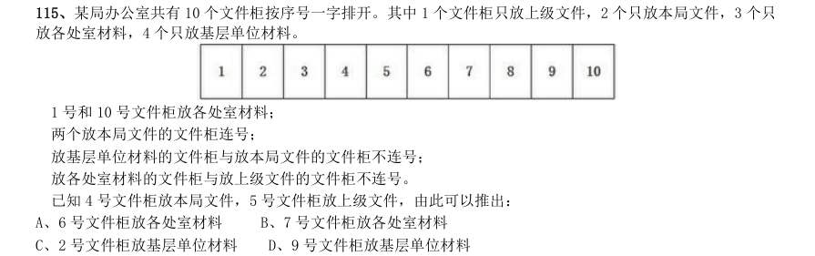

- **A.** 6 号文件柜放各处室材料
- **B.** 7 号文件柜放各处室材料
- **C.** 2 号文件柜放基层单位材料
- **D.** 9 号文件柜放基层单位材料

**答案：D**

### 2013 湖北·统一卷　第 121 题　（朴素逻辑（排序/匹配））

( )对于领航相当于规则对于( )

- **A.** 航班选手
- **B.** 航标犯规
- **C.** 导航比赛
- **D.** 航线裁判

**答案：D**

### 2013 湖北·统一卷　第 123 题　（加强）

2 亿年前,在恐龙统治地球之时,一小撮夜行性的远古爬行动物在不知不觉中找到了一条生存策略,并 最终走向了大脑进化之路。科学家从与原始哺乳动物及其类似的远古爬行动物的头骨化石中得出结论,正是嗅觉 的发展促进了远古爬行动物的大脑的进化。 以下哪项如果为真,最能支持以上述结论?

- **A.** 许多早期哺乳动物由于自然进化出了更小的身体,而它们的脑却未能按比例缩小
- **B.** 研究人员分析了爬行动物犬齿龙类化石,其中早期哺乳动物摩根兽亲缘关系很近,但摩根兽的大脑比犬齿龙要大一倍,其中处理嗅觉的区域明显增大
- **C.** 早期夜行性哺乳动物进化出更大的脑是为了促进他们的听觉,因为视觉在夜晚并不能起到很大的作用
- **D.** 研究表明,与现存哺乳动物关系最近的巨颅兽,其大脑容量和鼻腔所占空间都要比早期爬行动物大一些

**答案：B**

### 2013 湖北·统一卷　第 124 题　（削弱）

我国生产婴幼儿配方奶粉的企业有130 多家,而美国只有4 家企业,但是美国吃配方奶粉的婴幼儿数量远 高于我国。“设想一下,如果只有4 家企业生产配方奶粉,企业会倍加珍惜自己的品牌价值,不断加强食品安全 意识,任何可能的食品安全风险都是企业自身无法容忍的,发生三聚氰胺这样的问题是不可想象的”。 以下哪项如果为真,最能削弱上述观点?

- **A.** 我国市场的婴幼儿奶粉的企业太多,品牌价值对于企业并不重要,所以这些企业敢在奶粉中添加三聚氰胺
- **B.** 某国的婴幼儿配方奶粉有90 多家,它们之中大多数企业生产出的奶粉均未查出过三聚氰胺
- **C.** 某公司是我国生产奶制品的著名企业,其品牌价值很高,但是在其生产出的奶制品中查出了三聚氰胺
- **D.** 某企业是美国婴幼儿配方奶粉的著名生产商,在他们生产的某品牌配方奶粉中查出了三聚氰胺

**答案：D**

### 2013 湖北·统一卷　第 125 题　（加强）

科学家们认为,梦是大脑中主管人体各种功能的各个中心点联合作用的结果。人在睡眠时其部分脑细胞仍 然在活动着,这就是梦的基础。最近的研究成果证实,做梦不仅不会影响人的睡眠和健康,而且还是保护大脑健 康所必需的生理活动之一。 以下哪项如果为真,最能支持以上述结论?

- **A.** 根据问卷分析,长期不做梦的人比经常做梦者所需的睡眠时间更长,在休息后有一半人仍会感到疲倦
- **B.** 实验中研究人员在睡眠者出现做梦的脑电波时,就立即将其阻断,结果发现被试者的血压和体温明显增高
- **C.** 研究中,梦境被打扰的被试者在醒来后显得焦虑不安,容易紧张,并出现记忆的短期障碍
- **D.** 调查显示,能完整讲述梦境的被试者相比遗忘梦境者,在工作中更能快速集中注意力,从而工作效率更高

**答案：A**

### 2013 湖北·统一卷　第 126 题　（削弱）

研究人员在正常的海水和包含两倍二氧化碳浓度的海水中分别培育了某种鱼苗,鱼苗长大后被放入一个迷 宫。每当遇到障碍物时,在正常海水中孵化的鱼都会选择正确的方向避开。然而那些在高二氧化碳浓度下孵化的 鱼却会随机地选择左转或向右转,这样,这种鱼遇到天敌时,生存机会减少。因此,研究人员认为在高二氧化碳 环境中孵化的鱼,生存的能力将会减弱。 以下哪项如果为真,不能支持该项结论?

- **A.** 人类燃烧化石燃料产生的二氧化碳大约有三分之一都被地球上的海洋吸收了,这使得海水逐渐酸化,会软化海洋生物的外壳和骨骼
- **B.** 在二氧化碳含量高的海洋区域,氧气含量较低。氧气少使海洋生物呼吸困难,觅食、躲避掠食者以及繁衍后代也变得更加困难
- **C.** 二氧化碳是很多海洋生物的重要营养物质,它们在曝光照射下把叶子吸收的二氧化碳和概况输送来的水分转变为糖、淀粉以及氧气
- **D.** 将小丑鱼幼鱼放在二氧化碳浓度较高的海水中饲养,并播放天敌发出的声音,结果这组小鱼听不到声音

**答案：C**

### 2013 湖北·统一卷　第 127 题　（归纳推导）

富裕起来的这一代中国父母,仍然处在家庭教育的“初级阶段”内,习惯于物质欲望的满足、用金钱砸下 的“抢跑”来帮助孩子“赢在起跑线上”,用不肯放手来表达对孩子的爱、对教育的重视。快乐对于单纯的孩子 而言,实在是很简单的事。有爱心的父母,没有那么多期望与要求,放下怀抱的焦虑感,没有那么多对社会、制 度、他人的怨愤,单纯地和孩子在一起,为他们营造一个更安全的环境,一起度过快乐美好的一天。 由此可以推出:

- **A.** 关心孩子会给孩子带来比金钱更多的快乐
- **B.** 让孩子“赢在起跑线上”是一种错误的想法
- **C.** 满足孩子的物质欲望也是爱孩子的一种方式D、孩子希望父母陪伴而不是把孩子们送进补习班

**答案：D**

### 2013 湖北·统一卷　第 128 题　（翻译推理）

某单位每逢年底会针对全体员工进行评优,评优项有5 个,分别是最佳敬业奖、最佳创意奖、最佳协作奖、 最佳写作奖、年度明星奖。其中如果评选了年度明星奖则不能再评选最佳创意奖和最佳敬业奖;如果评选了协作 奖,就不能再获得写作奖;如果评选了敬业奖,则不能再获得协作奖。每个人最多获得两个奖项。综合科一共3 位员工,揽括了所有奖项,每个人都获奖,但是奖项各不相同。已知员工甲获得了明星奖,员工乙和员工丙二人 之间有人获得了写作奖。 由此可知,下列推测一定正确的是:

- **A.** 如果乙获得了写作奖,则其还获得了敬业奖
- **B.** 如果乙获得了协作奖,则乙和丙各获得两个奖项
- **C.** 如果乙获得了写作奖和创意奖,则甲一定只获得一个奖项
- **D.** 如果丙获得了协作奖,则乙一定不能获得敬业奖

**答案：B**

### 2013 湖北·统一卷　第 129 题　（加强）

树木枝干和许多植物的茎秆通常含有大量难以分解的木质素,因此利用它们来提炼生物燃料的效率要大打 折扣。目前,人们发现了一种名为红球菌的细菌,它具有分解木头和其他植物中木质素的能力,因此,人们认为 可以将红球菌广泛用于以往大都废弃的茎秆,从而大大提高生物燃料的利用率。 以下哪项如果为真,最能支持以上述结论?

- **A.** 红球菌能分泌一种酶,这种酶具有分解木质素的能力,但是其分泌能力呈现周期性变化
- **B.** 一些真菌也具有分解木质素的能力,研究发现,这些真菌的生长需要特定的温度和湿度
- **C.** 红球菌易于培养,目前对红球菌已完成基因测序,因此可以利用红球菌大规模地生产分解木质素的酶
- **D.** 木质素是一种优质高分子材料,迄今为止,超过95%的木质素都是直接排入江河或浓缩后烧掉,很少有效利

**答案：C**

### 2013 湖北·统一卷　第 130 题　（削弱）

研究人员完成了两项记忆实验,实验一中参试者学习10 组单词,实验二中参试者学习一系列手指信号。两 实验中,只告诉一半参试者10 小时后将接受测试,实际上所有参试者都将测试。只安排一部分参试者在学习和 测试之间小睡。结果发现,睡觉组参试者比不睡觉参试者表现更好;事先被告知要进行测试的参试者,测试成绩 也比较高,因此,研究人员认为,睡眠有助于大脑存储对将来有用的记忆信息。 如果以下各项为真,最能反驳该结论的一项是:

- **A.** 实验一中参试者都是记忆力较好的,在某语言专业学习的年轻人
- **B.** 有些被告知要进行测试的参试者,小睡时没有睡着,他们无意识地在大脑中复习所学过的内容
- **C.** 安排小睡时间的参试者,均为年龄较小的少年,而众所周知,人在少年时期的记忆力比较好
- **D.** 实验二中部分小睡的参试者以放松的心态参加考试,取得了较好的成绩

**答案：C**

### 2013 湖北·统一卷　第 131 题　（翻译推理）

所有的战争和混乱都是在没有协商、无理可讲的时候发生的,讲理和协商都离不开语言,然而,并非有语 言的地方就自动会有说理,有语言的地方必须有自由才能有说理。 由此可以推出:

- **A.** 所有的战争和混乱都是因为没有自由而发生的
- **B.** 并非所有的战争和混乱都是在不可以协商和不可以讲理的时候发生的
- **C.** 如果没有自由,不能讲理,就可能发生战争和混乱
- **D.** 有语言和自由的地方就一定不会发生战争

**答案：C**

### 2013 湖北·统一卷　第 132 题　（削弱）

科学家发现,儿童时期不接触细菌和病菌,是5 岁以下人群糖尿病病例近年来急剧增加的主要原因之一。 而那些生活在农村的孩子由于更早接触到带菌的物质,有更多机会与宠物相处,患过敏症、哮喘和湿疹等疾病的 几率反而很低。所以,将细菌消灭得过于彻底的环境可能反而会给儿童的健康带来危害。 以下哪项如果为真,将有力地支持上述结论?

- **A.** 刚出生的婴儿,其体表和体内是无菌的,但开始吃奶、喝水后,细菌便乘机进入体内
- **B.** 人体皮肤上的细菌大多起保护作用,并为每个人制造出独特的体味
- **C.** 大部分细菌是有益于身体健康的,人的健康长寿离不开正常的菌群
- **D.** 很多有害细菌平时与人体相安无事,当人体免疫力下降时,细菌便开始侵害人体

**答案：C**

### 2013 湖北·统一卷　第 133 题　（削弱）

传统观点认为,尽管用于制造贫铀弹所使用的贫铀放射性低,仍会导致人类染色体受损,从而引发肿瘤或 癌症。但是,在最近的一项研究中,研究员对接触过贫铀弹的退伍老兵的血细胞进行研究,到目前为止,还没有 检测到任何染色体断裂和重复,并没有发现任何由于接触贫铀弹而造成的负面健康影响。因此相关研究人员认为, 放射性低的贫铀弹不会对人类的健康造成影响。 以下哪项如果为真,最能削弱研究人员的结论?

- **A.** 某地居民向法院起诉,声称该国军队试验贫铀弹,已影响该地居民健康
- **B.** 世界上很多国家的专家都在致力于解决贫铀弹的放射性问题
- **C.** 有数据显示,这些退伍老兵的后代患有先天性缺陷的比率高于正常值
- **D.** 没有接触过贫铀弹的人也会患有肿瘤或癌症

**答案：C**

### 2013 广东·一卷　第 56 题　（逻辑判断（综合））

“一切为了群众,一切依靠群众,从群众中来,到群众中去”是中国共产党的:

- **A.** 政治路线
- **B.** 群众路线
- **C.** 经济路线
- **D.** 文化路线

**答案：暂缺**

### 2013 广东·一卷　第 58 题　（加强）

党中央、国务院把“三农”问题作为全国工作的重中之重,明确提出了城乡统筹发展的基本方略,制定了“工 业反哺农业、城市支持乡村”和( )的基本方针。

- **A.** “多予、少取、放活”
- **B.** “改革、创新、搞活”
- **C.** “互惠互利、相互促进、协调发展”
- **D.** “先富带后富,最终实现共同富裕”

**答案：暂缺**

### 2013 广东·一卷　第 59 题　（逻辑判断（综合））

近年来,我国通过“三下乡”活动,把发展经济、建设小康和扶贫攻坚结合起来,为农村中心工作服务。“三 下乡”是指文化、科技、( )三下乡。

- **A.** 卫生
- **B.** 教育
- **C.** 人才
- **D.** 金融

**答案：暂缺**

### 2013 广东·一卷　第 60 题　（逻辑判断（综合））

党在社会主义初级阶段的基本路线是坚持“一个中心,两个基本点”,其中“一个中心”是指以( )为中心。

- **A.** 经济建设
- **B.** 政治建设
- **C.** 文化建设
- **D.** 党风建设

**答案：暂缺**

### 2013 广东·一卷　第 62 题　（逻辑判断（综合））

“青红皂白”现在常用来比喻事情的是非曲直,其原意是指各种深浅不同的颜色。其中“皂”指的是:

- **A.** 黑色
- **B.** 灰色
- **C.** 黄色
- **D.** 绿色

**答案：暂缺**

### 2013 广东·一卷　第 76 题　（逻辑判断（综合））

小周、小吴、小郑三人中,一人是工人,一人是农民,一人是知识分子。已知:小郑的年龄比知识分子大; 小周的年龄和农民不同;农民的年龄比小吴小。 根据以上情况,判断正确的是:

- **A.** 小周是工人、小吴是知识分子、小郑是农民
- **B.** 小周是知识分子、小吴是农民、小郑是工人
- **C.** 小周是工人、小吴是农民、小郑是知识分子
- **D.** 小周是知识分子、小吴是工人、小郑是农民

**答案：暂缺**

### 2013 广东·一卷　第 77 题　（解释评价）

所有关心员工个人发展的企业老板,都被证明是管理得法的企业老板;而切实关心员工个人发展的企业老 板,都首先把注意力放在员工的职业生涯发展上。因此,那些不首先把注意力放在关心员工职业生涯发展上的 企业老板,都不是管理得法的企业老板。 为使上述论证成立,必须为真的一项是:

- **A.** 员工的职业生涯发展,是员工个人发展中最突出的问题
- **B.** 所有管理得法的企业老板,都是关心员工个人发展的企业老板
- **C.** 近年来,员工普遍比较关心自己的个人发展
- **D.** 员工个人发展同企业发展密切相关

**答案：暂缺**

### 2013 广东·一卷　第 78 题　（朴素逻辑（排序/匹配））

某村有老赵、老钱、老孙、老李四个养鸡专业户,已知老赵、老钱两户养鸡的总数量与老孙、老李两户养 鸡的总数量相等,老赵、老李两户养鸡的总数量比老钱、老孙两户养鸡的总数量多,而老钱养鸡的数量比老赵、 老孙两户养鸡的总数量还要多。 由此可知,四个养鸡专业户养鸡数量由多到少的顺序是:

- **A.** 老赵、老钱、老孙、老李
- **B.** 老孙、老钱、老赵、老李
- **C.** 老李、老钱、老赵、老孙
- **D.** 老钱、老李、老赵、老孙

**答案：暂缺**

### 2013 广东·一卷　第 79 题　（前提假设）

某村村民反映,作为村主要农作物的甘蓝出现了根肿病,产量严重下降,村民收入锐减。对此,村里引进 了多个蔬菜品种,并组织村民进行了蔬菜种植技术培训,可以预见,村民的收入将因此而有较大提高。 要上述推断成立,必备的前提条件不包括:

- **A.** 村民经培训后开始种植其他品种的蔬菜
- **B.** 村民掌握了种植其他品种蔬菜的技术
- **C.** 村官有销售其他蔬菜品种的渠道
- **D.** 其他蔬菜品种的产量比甘蓝要高

**答案：暂缺**

### 2013 广东·一卷　第 80 题　（削弱）

某地一企业今年招聘时,平均每个职位的应聘人数比去年减少了30%。因此,该公司对求职者的吸引力有 所下降。 以下最能削弱上述推论的一项是:

- **A.** 今年全国应届毕业生人数比去年有所增加
- **B.** 今年到该地求职的总人数有所减少
- **C.** 该企业今年招聘的部分职位应聘人数多于去年
- **D.** 该企业今年招聘的职位有八成提高了用人标准

**答案：暂缺**

### 2013 广东·一卷　第 81 题　（削弱）

过年放鞭炮,上元吃汤圆,端午赛龙舟,随着社会的发展,许多传统文化中的节日习俗离我们渐行渐远。 90 年代出生的人开始相信圣诞老人,开始在西餐厅里过生日。文化发展是个“取其精华,去其糟粕”的过程,因 此,有人认为,西方文化优于中国传统文化。 以下各项最有助于反驳上述观点的是:

- **A.** 我国传统文化中的许多内容在西方国家受到热捧
- **B.** 现代社会的一些不文明行为源于西方社会
- **C.** 国家的经济优势有利于本国文化的对外传播
- **D.** 能够不断吸收和借鉴正是我国文化的优势

**答案：暂缺**

### 2013 广东·一卷　第 82 题　（解释评价）

据国家权威科研机构研究证实,当前市场上热销的某品牌保健食品并不含有提高人类身体机能、增强个体 免疫力的成分。但调查结果表明,不少身体虚弱的人在购买服用了该品牌的保健食品一段时间后,身体素质明 显提高。 以下最有助于解释上述矛盾的一项是:

- **A.** 保健食品作用的发挥具有一定的时间滞后性
- **B.** 许多身体健康的人在服用保健食品后体质也增强了
- **C.** 购买该品牌保健品的人大多经济条件较好
- **D.** 服用保健品的人在生活其他方面也开始注重健康

**答案：暂缺**

### 2013 广东·一卷　第 83 题　（解释评价）

某公司研发了一种空调管理系统,通过对人流量的检测系统自动启动。关闭空调,这个系统的应用,将使 得办公场所的空调用电量大大节省。但这个系统推出几年来,购买的单位并不多,销售不理想。 以下最能够合理解释上述现象的是:

- **A.** 该空调管理系统受到许多城市家庭用户的欢迎
- **B.** 该空调管理系统操作复杂,需配备专业人员才能运作
- **C.** 市场上节能空调占主流,空调能耗较以往已大大降低
- **D.** 许多单位的职工环保意识强,养成了出门关空调的习惯

**答案：暂缺**

### 2013 广东·一卷　第 84 题　（归纳推导）

相比于化工“污染地”、重金属“污染地”,化肥、农药、农膜带来的农地污染并没有那么触目惊心,但却具有 量大、面广、隐蔽性强、持续时间长等特点。一些受污染严重的土地,已经不能进行正常的农业生产。农地的 “批量污染”治理已经到了刻不容缓的地步。以农膜为例,由于塑料残余物在自然条件下可在土壤中残存数十年甚 至上百年而不降解,这些废膜的存在会影响土壤的通透性,阻碍土壤水分的补给和养分转移。 根据以上表述,可以得出的结论是: 1化工和重金属的污染往往量不大、面不广、易发现、持续时间不长 2农膜残留通过阻碍土壤的水分补给和养分转移对农地产生影响 3农膜残留是当前农地“批量污染”中最为突出和严重的 4农地污染不能因其隐蔽性强等特点而在治理土地污染中被人们忽视 5化工和金属对土地的污染比农地污染更为严重

- **A.** 12
- **B.** 134
- **C.** 24
- **D.** 235

**答案：暂缺**

### 2013 广东·一卷　第 85 题　（逻辑判断（综合））

“没有经济的快速发展,就不会有社会事业的进步。现在经济发展速度很快,所以社会事业的建设也会取得 显著的成绩。” 与上述文字推理形式相同的是:

- **A.** 社会主义民主和法制相辅相成,缺一不可,民主是法制的前提,法制是民主的体现。现在法制体系不断健全,因此民主得以保障
- **B.** 效益与公平是矛盾统一体,没有公平很难取得更大的效益。某企业的效益提高了,因此,该企业也实现了分配公平
- **C.** 社会化程度越高,社会分工越细。现在社会化程度提高了,因此现在的社会分工也更细了
- **D.** 清正廉洁是对领导干部的基本要求。一名作风正派、严于律己的领导干部就是合格的领导干部

**答案：暂缺**

### 2013 广东·三卷　第 58 题　（逻辑判断（综合））

今年年初,严重影响我国华北华东地区的灰霾天气再次引发人们对 PM2.5 的关注。以 下关于 PM2.5 的说法错误的一项是:

- **A.** PM2.5 的主要来源是日常发电、工业生产、汽车燃油等过程中经过燃烧而排 放的残留物
- **B.** 与较粗的大气颗粒物相比,PM2.5 粒径小,含有大量的有毒、有害物质且在大气中的停留时间长、输送距离远
- **C.** PM2.5 主要对呼吸系统和心血管系统造成伤害,老人、小孩以及心肺疾病患 者是 PM2.5污染的敏感人群
- **D.** 空气中不同大小的颗粒物均能降低能见度,不过相对粗颗粒物,PM2.5 由于颗粒细小,

**答案：暂缺**

### 2013 广东·三卷　第 59 题　（逻辑判断（综合））

日常生活中的污染现象可以分为不同的种类。下列污染不属于物理性污染的是:

- **A.** 遗弃的废旧荧光灯管
- **B.** 夜间刺眼的汽车灯光
- **C.** 歌厅震耳欲聋的音乐
- **D.** 变压器的电磁波

**答案：暂缺**

### 2013 广东·三卷　第 60 题　（逻辑判断（综合））

下列关于日常礼仪说法正确的一项是:

- **A.** 在宴会中,将筷子横搁就表示自己已饱不需要再进食了
- **B.** 行拱手礼时,双手的叠放次序为右手包在左手之外
- **C.** 拜访别人时,如果有非常充分的理由,也可不提前预约
- **D.** 同事开车时,为表示尊重,最好坐在后面一排而不要与同事并排而坐

**答案：暂缺**

### 2013 广东·三卷　第 61 题　（逻辑判断（综合））

据统计,地震常常发生在夜间,而且还常常发生在农历初一或十五前后,这是因为:

- **A.** 人们的错觉,因为人们在白天接收的刺激比较多,不容易感知小地震的发生
- **B.** 农历初一、十五与夜间,地球表面受太阳、月球引力较大
- **C.** 夜间气温较低,地表容易为炙热的岩浆冲破,而农历初一或十五也常常是当月中气温最低的时段
- **D.** 地震统计仅统计较为剧烈的地震,而大多数地震是较为轻微的

**答案：暂缺**

### 2013 广东·三卷　第 62 题　（逻辑判断（综合））

下列说法错误的一项是:

- **A.** 日常生活中的无糖食品一般是指不含蔗糖、葡萄糖等的甜味食品
- **B.** 人的汗液发臭主要是由于细菌分解了汗液中的有机物导致的
- **C.** 人补充钙时加服维生素D 可以促进钙剂的吸收
- **D.** 肌肉系统是负责人体各类运动功能的重要系统

**答案：暂缺**

### 2013 广东·三卷　第 64 题　（逻辑判断（综合））

可再生能源是指自然界中可以不断利用、循环再生的能源。以下属于可再生能源的是:

- **A.** 风能
- **B.** 煤炭
- **C.** 石油
- **D.** 天然气

**答案：暂缺**

### 2013 广东·三卷　第 65 题　（逻辑判断（综合））

发生雷暴时,有时会下冰雹。大的冰雹甚至可以击穿飞机的机翼,砸伤地面的动植物。 影响冰雹大小的主要因素是:

- **A.** 风速
- **B.** 云团
- **C.** 上升气流
- **D.** 空气中的固体颗粒

**答案：暂缺**

### 2013 广东·三卷　第 76 题　（解释评价）

据国家权威机构研究证实,当前市场上热销的某品牌保健食品并不含有提高人类身体机 能、增强个体免疫力的成分。但调查结果表明,不少身体虚弱的人在购买服用了该品牌的保健食 品一段时间后,身体素质明显提高。 以下最有助于解释上述矛盾的一项是:

- **A.** 保健食品作用的发挥具有一定的时间滞后性
- **B.** 许多身体健康的人在服用保健食品后体质也增强了
- **C.** 购买该品牌保健食品的人大多经济条件较好
- **D.** 服用保健品的人在生活其他方面也开始注重健康

**答案：暂缺**

### 2013 广东·三卷　第 80 题　（逻辑判断（综合））

由于某市路边的报刊亭大多属于违章建筑,影响城市管理,而且普遍存在超范围经营等 问题,当地政府考虑拆除路边报刊亭,居民可以直接到当地超市、书店或专门的报刊销售点购买 报刊、杂志。 以下有助于推动当地政府作出拆除路边报刊亭决定的信息不包括:

- **A.** 不少路边的报刊亭存在贩卖非法出版物的问题
- **B.** 当地超市、书店和专门的报刊销售点相当充足,随处可见
- **C.** 路边报刊亭的销售收入主要来源于贩卖烟酒零食而非报刊
- **D.** 数据显示,当地居民购买报刊、杂志主要还是通过邮局订购

**答案：暂缺**

### 2013 广东·三卷　第 81 题　（加强）

在我国的黄海和东海的海底地层中,蕴藏着丰富的石油资源,这些石油就是 远古时大量 陆地植物的遗骸生成的。这说明,远古时代,黄海和东海的 大陆架是一片生长茂密植物的大平原。 以下能够支持上述结论的一项是:

- **A.** 大陆架会随着地球地壳的移动而持续着缓慢但永不停息的变化
- **B.** 川流不息的江河就像传送带,把陆地上的有机物质源源不断的运到大海中
- **C.** 中东的海湾地区大多是广袤的沙漠,地下蕴藏着丰富的石油资源
- **D.** 一般来讲,陆地上相近纬度的山区比平原地区的植被资源更加丰富

**答案：暂缺**

### 2013 广东·三卷　第 82 题　（加强）

中国社会的未来发展,离不开包括儒学在内的传统文化的滋养和作用,这一点已被越来 越多的人们所认同和接受。因此,大力弘扬中国传统文化的优良传统应当成为当前我国文化建设 的一项重要内容。 以下最能够支持上述主张的一项是:

- **A.** 中国传统文化中的许多优良传统面临将要失传的危机
- **B.** 许多地方政府加大了对本地各类文化遗产的保护和宣传力度
- **C.** 经过历史积淀的传统文化对一个民族具有无可替代的积极作用
- **D.** 传统文化对经济社会发展的积极作用在越来越多的地方呈现出来

**答案：暂缺**

### 2013 广东·三卷　第 83 题　（削弱）

为了让居者有其屋,某市筹措资金推进保障房建设。明年该市保障房建设将进入建成完 工的高潮。目前,保障房申请资格如何界定引起市民的普遍关注。有人认为,保障房是政府筹资 建设的,因此只能让本市居民购买。对于非本市户籍的人口,不应具有保障房申请资格。 以下最能够质疑这一观点的是:

- **A.** 保障房建设的资金来源除了政府财政外,还有大量商业资本
- **B.** 该市非户籍常住人口为政府财政上缴了大量税费
- **C.** 该市户籍人口的收入水平普遍高于非户籍人口
- **D.** 该市的常住人口有一半以上为非户籍人口

**答案：暂缺**

### 2013 广东·三卷　第 84 题　（削弱）

据统计,自1901 年起共有786 位男性和44 位女性科学家获得诺贝尔奖。这一男女比例 为18:1。其中,在经济学和物理学领域,几乎没有女性科学家获奖。据此,诺贝尔奖存在着严 重的性别歧视。 以下最能削弱上述结论的一项是:

- **A.** 能否获得诺贝尔奖不是衡量工作潜能的唯一标准
- **B.** 女性从事科研工作的人数远远低于男性
- **C.** 近些年,诺贝尔评审委员会中女性评委的人数不断提高
- **D.** 其他的国际科学大奖也存在此类获奖者男女失调的现象

**答案：暂缺**

### 2013 广东·三卷　第 85 题　（逻辑判断（综合））

小周、小吴、小郑三人中,一个是工人,一个是农民,一个是知识分子。已知:小郑的 年龄比知识分子大;小周的年龄和农民不同;农民的年龄比小吴小。 根据以上情况,判断正确的是:

- **A.** 小周是工人、小吴是知识分子、小郑是农民
- **B.** 小周是知识分子、小吴是农民、小郑是工人
- **C.** 小周是工人、小吴是农民、小郑是知识分子
- **D.** 小周是知识分子、小吴是工人、小郑是农民

**答案：暂缺**

### 2013 国考·统一卷　第 106 题　（削弱）

研究显示,在115 摄氏度下,将甜玉米分别加热10 分钟、25 分钟和50 分钟后发现,其抗自由基的活性分 别升高了22%、44%和53%,因此,加热时间越长的玉米,抗衰老的作用越好。 以下各项如果为真,无法削弱上述结论的是:

- **A.** 加热65 分钟后,玉米抗自由基的活性反而降低了
- **B.** 与甜玉米相比,糯玉米在加热相同时间后,其抗自由基的活性增高的幅度很小
- **C.** 甜玉米是玉米中比较少见的一种,不具有代表性
- **D.** 对于玉米来说,并非是抗自由基的活性越高,其抗衰老的作用越好

**答案：B**

### 2013 国考·统一卷　第 107 题　（削弱）

5000 多年前某地是大汶口文化,但在距今约4400 年的时候,为龙山文化所替代。是什么原因导致这两种 文化的更迭?考古人员发现,在距今约4400 年的时候,发生了一次严重的“冷事件”,环境由原来的温暖湿润 转变为寒冷干燥,植被大量减少,藻类、水生植物基本绝迹了,大汶口文化向南迁移,而龙山文化由北迁到此地。 他们据此认为,距今4400 年左右的极端气候变化,可能是导致这次文化变迁的主要原因。 以下哪项如果为真,最能支持上述论证:

- **A.** 大汶口文化有不断向南方迁移的传统
- **B.** 龙山文化刚迁来时,人口较多,但之后逐渐减少,在距今约4000 年的时候消失了
- **C.** 大汶口文化的族群以藻类和水生植物作为食物的主要来源
- **D.** 不同生存方式的族群对气候和环境都有相对稳定的需求

**答案：D**

### 2013 国考·统一卷　第 108 题　（削弱）

有研究表明,要成为男性至少需要拥有一条Y 染色体。3 亿年前,男性特有的Y 染色体在产生之际含有1438 个基因,但现在只剩下45 个。按照这种速度,Y 染色体将在大约1000 万年内消失殆尽。因此,随着Y 染色体的 消亡,人类也将走向消亡。 如果以下各项为真,最不能质疑上述论证的是:

- **A.** 恒河猴Y 染色体基因确实经历过早期高速的丧失过程,但在过去的2500 万年内则未丢失任何一个基因
- **B.** 男性即使失去Y 染色体也有可能继续生存下去,因为其他染色体有类似基因可以分担Y 染色体的功能
- **C.** 人类进化过程中,可以找到单性繁殖或无性繁殖后代的方法,从而避免因基因缺失引发的繁殖风险
- **D.** Y 染色体存在独特的回文结构,该结构具有自我修复功能,可以保持丢失基因的信息,实现基因再生

**答案：A**

### 2013 国考·统一卷　第 109 题　（归纳推导）

我国的佛教寺庙分布于全国各地,普济寺是我国的佛教寺庙,所以普济寺分布于我国各地。 下列选项中所犯逻辑错误与上述推理最为相似的是:

- **A.** 父母酗酒的孩子爱冒险,小华爱冒险,所以小华的父母酗酒
- **B.** 文明公民都是遵纪守法的,有些大学生遵纪守法,所以有些大学生是文明公民
- **C.** 寒门学子上大学机会减少,大学生小飞不是寒门学子,所以小飞上大学的机会不会减少
- **D.** 现在的独生子女娇生惯养,何况他还是三代单传的独苗呢

**答案：D**

### 2013 国考·统一卷　第 110 题　（翻译推理）

某公司行政部人员手机使用情况如下: 1小王拨打过行政部所有人的电话; 2小李曾经拨打过小赵的电话,但是小赵不曾拨打过其他人的电话; 3不曾接听来自行政部其他人电话的人也就不曾拨打过其他人的电话。 由此可以推出:

- **A.** 小赵不曾接听过来自小李的电话
- **B.** 小李曾经接听过来自小王的电话
- **C.** 行政部曾有人拨打过小王的电话
- **D.** 小王接听过来自行政部所有人的电话

**答案：C**

### 2013 国考·统一卷　第 111 题　（削弱）

现代企业在管理过程中发现,人力资源管理部门对于公司的发展虽然十分重要,但由于该部门并没有全程 参与公司发展战略的决策,而且公司聘请的高级经理均由CEO 决定,所以人力资源管理部门更多的时候起到的是 支持和辅助的作用。 如果以下各项为真,最能削弱上述论证的是:

- **A.** 世界500 强的企业中,人力资源管理部门的员工一般都有丰富的经验
- **B.** 人力资源管理部门能为公司设计出人性化的报酬体系,进而留住人才
- **C.** 世界上最大的物流公司,人力资源部经理有权参加公司最高决策会议
- **D.** 人力资源部虽没有决定雇用高级经理的权力,但有权雇用中层管理者

**答案：C**

### 2013 国考·统一卷　第 112 题　（翻译推理）

有人说,工作的时候,我们要将重要事务放在主要位置,重要事务是必要条件,关系着一件事情成功与否, 重要的事务没做好,一定不成功。但是,细节也是很重要的,细节是成功的充分条件,同样也与一件事情成功与 否相关。一个成功的人是能够协调好重要事务与细节的关系的。 由此可推出:

- **A.** 成功并不代表着所有细节都处理好了
- **B.** 如果不成功则说明重要事务没有做好
- **C.** 成功的前提条件是既要做好重要事务,又要处理好细节
- **D.** 虽然处理好了细节,但没做好重要事务,也不一定成功

**答案：A**

### 2013 国考·统一卷　第 113 题　（加强）

在不同语言中,数字的发音和写法都不一样。一些科学家认为,代表不同文化背景的语言,会对人们大脑 处理数学信息的方式产生影响。 以下哪项如果为真,最能支持上述结论:

- **A.** 相比欧洲,亚洲地区的人们在进行数量大小比较时,大脑中个别区域的活跃程度有所不同
- **B.** 在同一国家,不同方言区的人们进行数学运算时,大脑语言区的神经传递路线并不十分一致
- **C.** 研究发现,以英语为母语的人进行心算时主要依赖大脑的语言区,而以中文为母语的人主要动用了大脑的视觉信息识别区
- **D.** 研究发现,不同专业背景的人们在计算数学题时会选择不同的思考方法,但都会不同程度地依赖大脑的语言

**答案：C**

### 2013 国考·统一卷　第 114 题　（加强）

20 世纪50 年代以来,人类丢弃了多达10 亿吨塑料,这种垃圾可能存在数百年甚至数千年。近日,一个科 研小组在亚马逊雨林中发现一种名为内生菌的真菌,它能降解普通的聚氨酯塑料。科研人员认为利用这种真菌的 特性,将有望帮助人类消除塑料垃圾所带来的威胁。 科研人员的判断还需基于以下哪一前提:

- **A.** 塑料垃圾是人类活动产生的最主要的废弃物种类
- **B.** 内生菌在任何条件下都可以很好地分解塑料制品
- **C.** 目前绝大多数塑料垃圾都属于普通的聚氨酯塑料
- **D.** 这种真菌在地球上其他地区也能正常地存活生长

**答案：C**

### 2012 湖北·统一卷　第 91 题　（加强）

据英国《每日邮报》报道,日本富士摄影胶片公司将利用所掌握的胶片技术创新护肤产品,进军美容业, 感光乳剂中的胶原蛋白可以防止胶片被氧化,与利用胶原蛋白保护皮肤免受紫外线伤害有着异曲同工之妙。一 些忠实于富士品牌的消费者认为这对于爱美人士来说是一个好消息。 消费者得出上述结论隐含的假设是:

- **A.** 含有胶原蛋白的护肤品在亚洲欧洲等地区广受消费者欢迎
- **B.** 富士公司具备了生产含有胶原蛋白护肤品的巨大生产能力
- **C.** 科学家们已经从富士公司的护肤产品中发现了抗氧化物
- **D.** 护肤产品能利用富士公司生产胶卷使用的科研成果和工艺

**答案：D**

### 2012 湖北·统一卷　第 92 题　（翻译推理）

某市以生产加工“工艺品”出口到欧盟国家著称。去年以来,受到欧洲债务危机影响,该市对欧盟工艺品 出口锐减。鉴于市场的变化,作为该市最大的工艺品生产企业A 公司,必须在以后两年的时间里提高5%的生 产率,否则它就会破产。根据该市外经贸局的研究,A 公司按照目前的生产状况和经管结构,如果能提高5% 的生产率,就能增加10%的生产利润。 如果上述陈述为真,以下选项必然为真的是:

- **A.** 如果A 公司不能达到提高10%利润的目标,它就会破产
- **B.** A 公司的生产率两年内必须提高10%,否则它就会破产
- **C.** 只要经济形势好转,A 公司不提高生产率,也不会破产
- **D.** A 公司生产状况和经管结构两年不变,利润才能提高10%

**答案：A**

### 2012 湖北·统一卷　第 93 题　（加强）

近年来,我国城乡儿童学前教育事业发展取得了长足的进步,但是农村学前儿童“入园难”的问题仍然没 有得到彻底的解决,解决儿童“入园难”的问题,不能够依靠大量使用校车来接送儿童,“合理布局,就近入 园”才是确保儿童安全,解决入园难的根本。 如果以上各项为真,最能支持上述论证的是:

- **A.** 国家财政每年对农村学前教育的投入占国民教育投入的比例不断加大
- **B.** 按照国际安全标准采购的校车维护费用高,部分地区幼儿园无法承担
- **C.** 每个乡镇应规划建设一所公办幼儿园,大村独立办园,小村联合办园
- **D.** 国家招收幼儿教师免费培养定向分配,毕业后回到当地从事学前教育

**答案：B**

### 2012 湖北·统一卷　第 94 题　（真假推理）

小王、小张、小李、小顾四位舍友预测某次考试的结果。 小王:我想这次大家都能过吧! 小张:怎么可能?你没看见我乌云密布吗? 小李:小顾肯定是没问题的。 小顾:拜托!要是我没问题,大家就都没问题。 成绩公布后,证明四人中只有一个人的说法是错误的。说法错误的是:

- **A.** 小王
- **B.** 小张
- **C.** 小李
- **D.** 小顾

**答案：B**

### 2012 湖北·统一卷　第 95 题　（加强）

有专家认为,全球经济正缓慢复苏,其主要证据是,美国的经济表现超出预期,在就业和住房方面都有不 错的表现;欧洲央行启动了融资运作计划,用比较低的利率贷款,为更多的企业以及中小企业进行融资;全球 整个大宗商品市场树立了足够的信心。因此,这都是非常好的迹象。 如果以下各项为真,最有可能成为上述论证前提的是:

- **A.** 专家先前对美国经济表示不乐观
- **B.** 欧洲央行原有利率较高,银根紧
- **C.** 非欧美国家的经济状况保持稳定
- **D.** 全球大宗商品交易缺乏信心支持

**答案：C**

### 2012 湖北·统一卷　第 96 题　（削弱）

德国和瑞士的专家经过研究得出一个有趣的结论:餐具颜色能直接影响食欲,红色餐具可降低人们40%的 食欲,在人们的传统观念中,红色是极具攻击性的色彩,用红色餐具盛放食物往往会让人难以下咽,因为在潜 意识中人们会给自己发出不能吃红色餐具中食物的心理暗示,从而令食欲下降。 如果以下各项为真,最能质疑上述论断的是:

- **A.** 快餐巨头常在大堂中使用大片鲜亮的红色图案,并没有影响快餐销量
- **B.** 红色易使人产生紧张感,暴饮暴食是人在精神紧张时放松自己的一种方式
- **C.** 试验表明,使用红色水杯者比使用蓝色水杯者平均饮水量要减少44%
- **D.** 红色预示着不安和担忧,人们看到红色餐具会本能地担心食物有危险

**答案：B**

### 2012 湖北·统一卷　第 97 题　（加强）

超级笔记本作为市场中一个非常有竞争力的新生力量,2011 年销量只占移动计算机市场销量的20%,低于 预期的30%,有供应商表示,超级本之所以遭遇销售低迷很大程度上是因为欧洲市场对超级本需求过小,调查 显示,欧洲消费者普遍青睐15 英寸及以上尺寸的笔记本电脑,有数据显示,目前欧洲售出的移动计算机中有 40%~45%都是15 英寸的机型,而超级本根本就没有这样的尺寸。 供应商得出上述结论的前提假设是:

- **A.** 生产前厂家未考虑欧洲消费者的使用习惯
- **B.** 超级本应该设计生产15 英寸级别的产品
- **C.** 欧洲消费者的消费习惯与其他地区相类似
- **D.** 欧洲市场在全球笔记本市场中占较大比例

**答案：D**

### 2012 湖北·统一卷　第 98 题　（削弱）

有经济学者不赞成政府对低收入人群的直接救助,主张政府对大企业家和富人采取优惠的财政和税收政策, 认为大企业家和富人的投资与消费活动会促进经济发展,增加穷人的就业机会,将财富从社会上层传递到社会 底层。 如果以下各项为真,最能削弱上述理论的观点是:

- **A.** 政府对大企业家和富人采取优惠的财政和税收政策,导致因贫富差距拉大而引发不确定的社会矛盾
- **B.** 打破收入分配方面的平均主义,鼓励一部分人先富起来,但具体实施这一政策存在不可预见的风险
- **C.** 高收入者的消费需求达到饱和后,人的“自私性”将抑制投资需求,社会投资规模也不再继续增长
- **D.** 政府的财政和税收政策应该优惠穷人,提高穷人购买力同样会增加有效消费需求促使经济持续发展

**答案：C**

### 2012 湖北·统一卷　第 99 题　（加强）

部分英国医生宣称,他们开始对苹果iPad 用户类似重复性劳损的病症进行治疗,这类被戏称为“i 伤害” 的病症,主要表现为用户的手和点击、触摸屏幕的手指出现各种各样的病痛。专家推测:大多数iPad 用户左 手拿着平板电脑以保持其稳定,右手食指点击屏幕发送邮件或生成文件。这使得他们有患上诸如重复性劳损、 腕管综合症以及其他肌腱伤害的风险。 如果以下各项为真,最能支持上述专家推测的是:

- **A.** 使用iPad 的用户患上此类病症的概率比较高
- **B.** 使用其他品牌平板电脑的用户出现了类似病症
- **C.** 未普及iPad 的地区此类病症出现的比率极少
- **D.** 使用台式机的用户患上此类病症的概率比较低

**答案：A**

### 2012 湖北·统一卷　第 100 题　（翻译推理）

法国总统萨科奇正式宣布竞选连任,打出了“强盛法国”的竞选口号,承诺带领法国走出经济危机。巴 黎街头萨科奇竞选广告上写着:“只有强盛的法国才能保护你的家庭。” 根据此竞选口号的推理方式,下列选项为真的是:

- **A.** 虚弱的法国保护不了你的家庭
- **B.** 强盛的法国可以保护你的家庭
- **C.** 法国虚弱是因为没有保护家庭
- **D.** 家庭得到保护,法国就能强盛

**答案：A**

### 2012 广东·统一卷　第 50 题　（逻辑判断（综合））

水至清则无鱼

- **A.** 名不正言不顺
- **B.** 胜不骄败不馁
- **C.** 食不言寝不语
- **D.** 高不成低不就

**答案：暂缺**

### 2012 广东·统一卷　第 55 题　（逻辑判断（综合））

一言既出驷马难追 吐口唾液是个钉

- **A.** 进山不怕虎伤人下海不怕龙卷身 吃得苦中苦方为人上人
- **B.** 穷在街上无人问富在深山有远亲 贫贱亲戚离富贵他人合
- **C.** 话未说前先考虑鸟未飞前先展翅 话到舌尖留半句事从理上让三分
- **D.** 良药苦口利于病忠言逆耳利于行 不听老人言吃亏在眼前

**答案：暂缺**

### 2012 广东·统一卷　第 57 题　（逻辑判断（综合））

自2011 年9 月1 日起,个人所得税工资薪金所得扣除标准(即起征点)由2000 元/月提高到3500 元/月。 这一调整有利于:

- **A.** 促进分配公平
- **B.** 鼓励多劳多得
- **C.** 增加税收收入
- **D.** 扩大征税范围

**答案：暂缺**

### 2012 广东·统一卷　第 58 题　（逻辑判断（综合））

在现代社会中,信息技术广泛应用于工作生活的各个方面。 下列信息技术的应用中,主要属于信息获取的是:

- **A.** 用播放软件欣赏音乐
- **B.** 通过网络视频聊天
- **C.** 发送电子邮件
- **D.** 用扫描仪扫描文件

**答案：暂缺**

### 2012 广东·统一卷　第 59 题　（逻辑判断（综合））

适当食用粗粮,增加纤维素的摄入有益人体健康。 下列有关纤维素的说法,错误的是:

- **A.** 纤维素在胃肠中可被分解为葡萄糖,并被人体有效吸收
- **B.** 食物中的纤维素能够使人产生饱腹感,有利于减肥
- **C.** 纤维素能够吸附一些有害物质,有利于体内毒素的排除
- **D.** 纤维素是一种天然有机高分子化合物,能够吸附大量水分

**答案：暂缺**

### 2012 广东·统一卷　第 60 题　（逻辑判断（综合））

当乘坐升降电梯上楼时,从电梯开始启动到最后停下来,身体所处的状态先后分别为:

- **A.** 失重 正常 超重
- **B.** 超重 正常 失重
- **C.** 超重 失重 正常
- **D.** 正常 超重 失重

**答案：暂缺**

### 2012 广东·统一卷　第 61 题　（逻辑判断（综合））

人们在剧烈运动后会感到非常口渴,这时为补充水分、恢复体力,适量饮用下列哪种饮料更为合适:

- **A.** 淡盐水
- **B.** 白开水
- **C.** 茶饮料
- **D.** 碳酸饮料

**答案：暂缺**

### 2012 广东·统一卷　第 62 题　（逻辑判断（综合））

废旧电池是一种常见的污染物,是破坏生态环境的“杀手”,下列关于废旧电池的说法,错误的是:

- **A.** 废旧电池含有大量的重金属
- **B.** 废旧电池无法回收再利用,应集中处理
- **C.** 有害物质会从废旧电池中溢出,污染水和土壤
- **D.** 废旧电池如果随意丢弃,其中的有害物质会通过各种媒介进入人体

**答案：暂缺**

### 2012 广东·统一卷　第 64 题　（逻辑判断（综合））

下列说法正确的一项是:

- **A.** 大气中二氧化碳浓度的增加导致全球变暖,也不利于植物的光合作用
- **B.** 树桩上年轮较稀疏的一边是南方,年轮较紧的一边是北方
- **C.** 在寒冷的冬季用手直接触摸金属门把手会感觉很冷,这是因为门把手将寒气传递给了手掌
- **D.** 日环食的出现是由于月球在太阳和地球之间时距地球较近,不能完全遮住太阳形成的

**答案：暂缺**

### 2012 广东·统一卷　第 65 题　（逻辑判断（综合））

下列说法错误的一项是:

- **A.** 绿色食品是指安全无污染且富有营养的蔬菜水果
- **B.** 人们空腹喝牛奶不利于营养成分的吸收
- **C.** 香蕉是热带水果,不适宜放在冰箱中冷藏
- **D.** 摄入过多食品添加剂会危害人体健康

**答案：暂缺**

### 2012 广东·统一卷　第 76 题　（归纳推导）

十二五期间,我国进入社会主义建设为重点的新时期,社会主义建设的顺利进行离不开产业结构调 整与民生问题的有效解决。要解决民生问题,需要在关系人民群众切身利益的领域加大财政投入,并创新社 会管理模式。 这段文字可以推出:

- **A.** 只要加大财政投入就能保证社会主义建设的顺利进行
- **B.** 不创新社会管理模式就无法有效解决民生问题
- **C.** 产业结构调整有利于创新社会管理模式
- **D.** 加大财政投入是产业结构调整的基础

**答案：暂缺**

### 2012 广东·统一卷　第 77 题　（前提假设）

每逢开学,各大书店总有不少家长拿着老师开列的书单为孩子买辅导书,然而有时却不容易买到。 尽管有些辅导书内容上大同小异,但不同的版本却往往让家长不放心,让老师不满意。其实,家长和老师们 都有点庸人自扰了。辅导书是买给孩子用的,应该多和孩子商量,把选择权交给孩子。 上述论断的前提是:

- **A.** 辅导书是教材的补充,是学生学习必备的参考资料
- **B.** 对孩子发展的引导应从孩子自身的个性、能力出发
- **C.** 老师和家长在购买辅导书时与孩子缺乏足够的交流
- **D.** 孩子对自己的学习需求有较为清晰的认识

**答案：暂缺**

### 2012 广东·统一卷　第 78 题　（加强）

电动汽车因为节能、环保,被誉为未来汽车发展的方向,许多国家都在大力发展电动汽车产业。然 而,某国对此并不热衷,没有出台相关的产业扶持政策。 以下不能支持该国做法的一项是:

- **A.** 石油产业是该国的支柱产业
- **B.** 该国的电能较为紧张
- **C.** 电动汽车技术已经成熟
- **D.** 该国燃油发动机制造水平世界领先

**答案：暂缺**

### 2012 广东·统一卷　第 79 题　（前提假设）

某公共服务部门发言人在接受记者采访时称,去年没有群众针对该部门的服务提起投诉,因此社会 对于该部门去年的服务工作是满意的。 上述发言人的结论基于的假设是:

- **A.** 该部门的投诉渠道不畅通,投诉信箱只是摆设
- **B.** 如果接到群众投诉,该部门会进行整改
- **C.** 群众只要对该部门的服务不满意,就会提起投诉
- **D.** 上级对于该部门去年的服务工作十分满意

**答案：暂缺**

### 2012 广东·统一卷　第 80 题　（削弱）

宗教是弱势群体的避难所。这个观点无疑是对的。弱势群体确实更容易信仰宗教,以女性为例,在 中国,妇女地位比以前有了很大提高,她们在学业、社会活动、人际交往等方面也越来越不弱于男性,因此, 在中国,信仰宗教的女性并不多见,而在一些西方国家,很多女性是信仰宗教的,这正是因为她们的社会地 位比中国女性的社会地位低。 以下最能削弱上述论断的一项是:

- **A.** 一些国家女性的社会地位比中国女性的社会地位高
- **B.** 信仰宗教与家庭教育以及社会历史传统有很大关系
- **C.** 近些年中国信仰宗教的妇女人数有所增加
- **D.** 中国人对宗教信仰的理解与西方人有很大差异

**答案：暂缺**

### 2012 广东·统一卷　第 81 题　（削弱）

消费者声称在市场上买到的假鸡蛋,经鉴定均为过期变质蛋、孵化蛋等真鸡蛋,而非化工合成品。 专家认为,依据现在的技术条件,要做出以假乱真的假鸡蛋成本很高,根本不可能牟利,因此市场上不可能 有所谓的假鸡蛋。 以下无法削弱上述专家结论的一项是:

- **A.** 以现在的技术水平完全能够做出以假乱真的假鸡蛋
- **B.** 一些企业生产假鸡蛋用于工艺品或表演道具
- **C.** 一些不法商贩掌握了降低假鸡蛋生产成本的技术
- **D.** 即使假鸡蛋做不到以假乱真也能被一些粗心的人购买

**答案：暂缺**

### 2012 广东·统一卷　第 82 题　（削弱）

在欧债危机日益恶化的形势下,欧洲以及其他地区和国家的央行可能会大量印刷钞票应对,由此会 形成热钱新一轮的泛滥,届时将持续提高诸如房地产等不动产的价格,因此投资者现在应该继续买进房产。 以下无法削弱上述结论的一项是:

- **A.** 为了本国经济的健康发展,许多国家将不会增发货币
- **B.** 当前的房地产价格平稳,短期内不会有大的波动
- **C.** 由于房地产市场泡沫严重,国家出台了一系列打击房地产投机的政策
- **D.** 由于大量外来人口涌入城市,人们对于住房的刚性需求依然存在

**答案：暂缺**

### 2012 广东·统一卷　第 83 题　（解释评价）

某市电视台推出了一个面向老年观众的养生节目,这个节目在试播时组织了许多老年人观看,获得 一致好评,但在正式播出后,收视率非常不理想。 以下最能够解释上述矛盾现象的一项是:

- **A.** 一些老年人认为节目内容对于养生作用不大
- **B.** 节目的包装过于娱乐化,与老年人的需求不符
- **C.** 看电视时间过长不利于老年人的身体健康
- **D.** 节目播出时间较晚,此时大多数老年人已经休息

**答案：暂缺**

### 2012 广东·统一卷　第 84 题　（加强）

一家刚开业的大型超市决定开展降价促销活动,部分商品售价甚至低于成本价,在这种情况下,销 售量越大,超市的经济损失就越大。这一决定遭到很多超市员工反对,但超市经理依然坚持这一决定。 以下最能支持经理决定的一项是:

- **A.** 薄利多销的方式有利于提高超市销售收入
- **B.** 物美价廉的商品更容易受到消费者的欢迎
- **C.** 扩大知名度对于新开业的超市至关重要
- **D.** 许多超市在开业时都开展降价促销活动

**答案：暂缺**

### 2012 广东·统一卷　第 85 题　（削弱）

有人主张,国家应当发行500 元和1000 元的大面额人民币,他认为目前的人民币最大面额偏小,在 当前经济总量急剧增长的情况下,已经不能满足市场交易的需要。大面额人民币有许多好处:一是便于携带; 二是提高流通效率;三是节约纸张。 以下最能够质疑该人主张的一项是:

- **A.** 大面额人民币在日常小额消费使用时很不方便
- **B.** 发行大面额人民币会给低收入人群带来挫折感
- **C.** 大面额人民币丢失或被盗会给人们带来较大经济损失
- **D.** 人们在大额交易时更习惯于用电子货币支付

**答案：暂缺**

### 2012 国考·统一卷　第 93 题　（逻辑判断（综合））

根据我国有关规定,职工遇有下列情形之一的,可以认定为工伤:(一)在工作时间和工作场所内,因工作 原因受到事故伤害的;(二)在工作时间和工作场所内,因履行工作职责受到暴力等意外伤害的;(三)因工外 出期间,由于工作原因受到伤害或者发生事故下落不明的;(四)在上下班途中,受到非本人负主要责任的交通 事故或者城市轨道交通、客运轮渡、火车事故伤害的。 根据上述规定,下列情形中可以认定为工伤的是:

- **A.** 周某开车在下班途中违章驾驶,与前车发生追尾事故,导致颅骨骨折
- **B.** 交警小李因纠正王某的违章行为引起王某不满,在上班途中遭到王某的殴打
- **C.** 赵某在车间加班时因操作不当,手指被绞进机器中,事后被鉴定为二级伤残
- **D.** 张经理为加深与同事的感情,在工作日邀请同事共进午餐,结果同事在用餐后不慎摔伤

**答案：C**

### 2012 国考·统一卷　第 106 题　（加强）

任何无法量化及不设定时限的目标都是无效目标,而任何无效的目标都没有实际操作的方法。因此,详细 的职业规划不是无法量化及不设定时限的目标 为使上述论证成立,必须补充以下哪项作为前提:

- **A.** 详细的职业规划不都是无效的目标
- **B.** 详细的职业规划有实际操作的方法
- **C.** 有效的目标都是可以量化和设定时限的目标
- **D.** 无法量化及不设定时限的目标没有实际操作的方法

**答案：B**

### 2012 国考·统一卷　第 107 题　（削弱）

一项调查结果显示:78%的儿童中耳炎均来自二手烟家庭。研究人员表示,二手烟环境会增加空气中的不健 康颗粒,其中包括尼古丁和其他有毒物质。与居住在无烟环境的孩子相比,居住于二手烟环境的孩子患中耳炎几 率更大,因此医学专家表示,父母等家人吸烟,是造成儿童罹患中耳炎的重要原因。 以下哪项如果为真,最能削弱上述论证:

- **A.** 调查中还显示,无烟家庭的比率呈逐年上升的趋势
- **B.** 研究证明,二手烟家庭中儿童中耳炎的治愈率较高
- **C.** 门诊数据显示,儿童中耳炎就诊人数下降了4.6%
- **D.** 在这次调查的人群中,只有20%的儿童来自无烟家庭

**答案：D**

### 2012 国考·统一卷　第 108 题　（归纳推导）

某刑事人类学家在对260 名杀人犯的外貌进行了考察后,发现他们具有一些共同的生理特征,于是得出“杀 人犯具有广颚、颧骨突出、头发黑而短的特征”的结论。 以下哪项与上述推理方式相同:

- **A.** 24~28 之间没有质数
- **B.** 八月十五云遮月,正月十五雪打灯
- **C.** 植物种子经超声波处理后可增产,所以玉米种子经超声波处理后也可以增产
- **D.** 某高校在对全校学生进行调查后,得出“我校同学学习态度普遍较好”的结论

**答案：B**

### 2012 国考·统一卷　第 109 题　（加强）

分手不仅令人心理痛苦,还可能造成身体疼痛。美国研究人员征募40 名志愿者,他们在过去半年中被迫与 配偶分手,至今依然相当介意遭人拒绝。研究人员借助功能性磁共振成像技术观察志愿者的大脑活动,结果发现 他们对分手等社会拒绝产生反应的大脑部位与对躯体疼痛反应的部位重合,因此分手这类社会拒绝行为会引起他 们躯体疼痛。 得到上述结论,隐含的假设是什么:

- **A.** 个体对于疼痛的感受与社会应激事件有密切关系
- **B.** 功能性磁共振技术是目前进行大脑定位的常用方法
- **C.** 个体情绪等心理过程的改变能影响其生理反应
- **D.** 生理与心理反应可以通过大脑产生关联

**答案：D**

### 2012 国考·统一卷　第 110 题　（加强）

众所周知,西医利用现代科学技术手段可以解决很多中医无法解决的病症,而中医依靠对人体经络和气血 的特殊理解也治愈了很多令西医束手无策的难题。据此,针对某些复杂疾病,很多人认为中西医结合的治疗方法 是有必要的。 上述这些人在论断时作的假设是:

- **A.** 针对这些疾病的中医和西医的治疗方法可以相互结合,扬长避短
- **B.** 这些疾病单独用中医疗法或者单独用西医疗法并不能有效治疗
- **C.** 针对这些疾病,医疗界已经掌握了中西医疗法结合的方法
- **D.** 针对这些疾病,医学界已经尝试了中西医结合的疗法取得了良好的效果

**答案：A**

### 2012 国考·统一卷　第 111 题　（加强）

近来网上出现了一则有关“公务员绿色出行”的报道,即A 市教育局通过添置公务自行车,使得较近距离 的公务活动不再派汽车,从而大幅降低了公务汽车使用率。B 市环保局负责人看了这则报道,认为引进公务自行 车能缩减财政开支,于是决定也采取这种做法。 以下哪项如果为真,不能构成上述决定的前提条件:

- **A.** 自行车出行的方式结合B 城市的地理环境以及道路交通状况是可行又可取的B
- **B.** 市环保局的办公人员规模和已有公车数量与A 市教育局相近
- **C.** 较近距离的公务活动用自行车取代汽车不会影响办公效率D

**答案：B**

### 2012 国考·统一卷　第 112 题　（翻译推理）

某高校外语教研室新招进五位外语老师,每位老师只教授一门外语。并且满足以下条件: (1)如果小钱教德语,那么小孙不教俄语 (2)或者小李教德语,或者小钱教德语 (3)如果小孙不教俄语,那么小赵不教法语 (4)或者小赵教法语,或者小周不教英语。 以下选项如果为真,可以得出“小李教德语”的结论:

- **A.** 小孙不教俄语
- **B.** 小钱教德语
- **C.** 小周教英语
- **D.** 小赵不教法语

**答案：C**

### 2012 国考·统一卷　第 113 题　（归纳推导）

美国研究人员分析了南极半岛和邻近的斯科舍海地区的实地数据后发现,20 世纪70 年代以来,当地气温 上升了5 至6 摄氏度,并且来自其他海域的哺乳动物增多导致南极哺乳动物捕食竞争加剧。因此,在上述地区作 为哺乳动物主要食物来源的磷虾的密度降低了80%。而同一时期,生活在该地区以磷虾为主食的阿德利企鹅和帽 带企鹅的数量也急剧减少。 由此可以推出:

- **A.** 气温上升造成了南极海洋哺乳动物捕食的竞争加剧
- **B.** 如果磷虾的密度继续减少,阿德利企鹅和帽带企鹅都会灭绝
- **C.** 气候变暖和哺乳动物的捕食竞争加剧威胁了帽带企鹅的生存
- **D.** 气温上升对南极地区生态环境的破坏极大

**答案：C**

### 2012 国考·统一卷　第 114 题　（朴素逻辑（排序/匹配））

张老师将文房四宝装在一个有四层抽屉的柜子里,让学生猜笔、墨、纸、砚分别在哪一层。按照笔、墨、 纸、砚的顺序,小李猜测四宝依次装在第一、二、三、四层,小王猜测四宝依次装在第一、第三、第四和第二层, 小赵猜测四宝依次装在第四、第三、第一和第二层,而小杨猜测四宝依次装在第四、第二、第三和第一层。张老 师说,小赵一个都没有猜对,小李和小王各猜对了一个,而小杨猜对了两个。 由此可以推测:

- **A.** 第一层抽屉里装的是墨
- **B.** 第二层抽屉里装的是纸
- **C.** 第三层抽屉里装的不是笔
- **D.** 第四层抽屉里装的不是砚

**答案：D**

### 2012 国考·统一卷　第 115 题　（加强）

碳纳米管材料具有重量轻、强度高等优点,被广泛应用于自行车和球拍等产品生产中。但是近日研究发现, 长期从事生产碳纳米管工作或利用该材料制造其他产品的工人,有可能因吸入碳纳米管而致癌。 以下哪项如果为真,最能支持上述研究发现:

- **A.** 研究表明,容易引发癌症的是一些较长的碳纳米管,这可能是因为它们更容易卡在肺部或腹部细胞间的空腔中
- **B.** 在使用体外培养的人体皮肤细胞进行实验时显示,碳纳米管可以进入细胞内部,降低细胞自身的免疫能力
- **C.** 动物实验显示,如果碳纳米管大量进入实验鼠的腹部,约有10%的实验鼠会在一年内患腹腔炎症
- **D.** 石棉是国际癌症组织确认的致癌物质,而碳纳米管在化学分子结构上和石棉存在一些相似之处

**答案：A**

### 2011 湖北·统一卷　第 71 题　（归纳推导）

小刘是环保志愿者组织“拯救地球”的成员,由于身患重病,不能到上海做世博会志愿者,而该组织其他 成员都是获得了上海世博会志愿者的资格。 由此可以推出:

- **A.** 小刘是“拯救地球”的成员,但未获得上海世博会志愿者资格
- **B.** 上海世博会志愿者都是“拯救地球”的成员
- **C.** 如果有人是上海世博会志愿者,又是“拯救地球”成员,他一定不是小刘
- **D.** 如果有人是“拯救地球”的成员,但不是上海世博会志愿者,他一定是小刘

**答案：C**

### 2011 湖北·统一卷　第 72 题　（削弱）

在选购地板时,消费都很关心地板散发的气味,因为地板的刺激性气味强,往往是有毒有害物质超标的一 种表现,最近有一种据称是香味环保地板赢得了不少消费者的青睐。销售人员声称地板散发的香味可以消毒杀 菌,去除空气中的异味。当销售人员在推销这种产品时,往往会拿来几种不同的地板,让有购买意向的消费者 闻一闻,并指出散发着清香气味的地板,即是香味环保地板。 以下哪项如果为真,最能削弱销售人员的观点:

- **A.** 气味并不是判别地板是否环保的唯一标准,除气味外,消费者更关心地板中有机挥发物的含量
- **B.** 事实上,由于木材本身的气味以及受制造工艺所限,地板或多或少都带有一定的刺激性气味
- **C.** 到目前为止,国家有关部门还没有出台香味环保地板的专门标准,所谓的“香味”不过是厂家炒作的概念
- **D.** 检验证明,不少厂商是通过在地板中添加大量香精等化学助剂来达到掩盖或者中和刺激性气味的目的

**答案：D**

### 2011 湖北·统一卷　第 73 题　（削弱）

生理学家发现,人类掌管记忆和思维等高级认知功能的大脑皮质在正常情况下有6 层,如果胎儿缺乏一种 名为“Cdk5”的酶,大脑皮质的发育就会变得极为缓慢,无法最终形成正常大脑皮质的层结构,从而严重影响 儿童认知发展,一些医药界人士推测,利用这一发现,将有望研发出药物,普遍提高学生的学习能力。 如果以下为真,哪项不能质疑上述推测:

- **A.** 人体不能吸收外部补充的“Cdk5”酶
- **B.** 学生的学习能力主要是通过后天学习获得的
- **C.** 青少年过了脑发育关键期后,补充“Cdk5”酶不起作用
- **D.** 一些“Cdk5”酶含量高的人学习能力并不突出

**答案：D**

### 2011 湖北·统一卷　第 74 题　（翻译推理）

食品安全的实现,必须有政府的有效管理。只有政府部门之间的相互协调配合,才能确保政府进行有效的 管理。但是,如果没有健全的监督制约机制,是不可能实现政府各部门之间协调配合的。 由此可以推出:

- **A.** 没有健全的监督制约机制,不可能实现食品安全
- **B.** 要想健全监督的机制,必须有政府的有效管理
- **C.** 有了政府各部门之间的相互协调配合,就能实现食品安全
- **D.** 一个不能进行有效管理的政府,即是没有建立起健全的监督制约机制的政府

**答案：A**

### 2011 湖北·统一卷　第 75 题　（加强）

虎山长城遗址除一号台址发现很少的残砖之外,其他地方均没有发现城砖。虎山村及附近村庄也没有从长 城上拆下城砖用于民房建筑的情况。由此可以推测,虎山长城用砖是极少的。 上述推测还需要隐含哪一项假设:

- **A.** 虎山长城遗址附近没有发现古砖窑
- **B.** 当地县志记载虎山长城是夯土筑成
- **C.** 此地山高坡陡,城砖难以运进运出
- **D.** 此地土质极差,不适宜烧制长城用砖

**答案：C**

### 2011 湖北·统一卷　第 76 题　（削弱）

伏案工作者长时间低头阅读,书写很容易患腰颈椎疾病,为帮助这部分人预防和缓解腰颈椎疾病,某单位 工会为职工印发了宣传册,教大家一些预防和治疗腰颈椎疾病的一些方法。 以下哪项如果为真,最能对上述宣传效果提出质疑:

- **A.** 预防和缓解腰颈椎疾病的方法因人而异
- **B.** 腰颈椎疾病很难进行自我预防和治疗
- **C.** 预防和治疗腰颈椎疾病需要专业人士指导
- **D.** 不经常伏案工作的人也可能患腰颈椎疾病

**答案：B**

### 2011 湖北·统一卷　第 77 题　（削弱）

克山病是一种原因未明的地方性心肌病,山东省两次克山病流行均发生在病区居民生活困难时期,此时居 民饮食结构单一,营养缺乏。1978 年以后,由于农村经济体制的改革,病区居民生活逐渐好转,营养结构趋 向合理,克山病新发病人越来越少,达到基本控制标准。一些研究者据此推测,营养缺乏可能是克山病发病的 重要因素。 如果以下各项为真,哪项不能质疑上述推论:

- **A.** 原来克山病病区的土壤、水质在几十年中发生了较大变化
- **B.** 1978 前农村生活水平普遍较低,但克山病仅在个别地方出现
- **C.** 一些生活水平高的地区,也出现过克山病病例
- **D.** 通过调整饮食结构,无法治愈克山病

**答案：D**

### 2011 湖北·统一卷　第 78 题　（真假推理）

出于安全考虑,使用年限超过10 年的电梯必须更换钢索,在必须更换钢索的电梯中有一些是S 品牌的, 所有S 品牌电梯都不存在安全隐患。 由此可以推出:

- **A.** 有些存在安全隐患的电梯必须更换钢索
- **B.** 有些S 品牌的电梯必须更换钢索
- **C.** 有些S 品牌的电梯不需要更换钢索
- **D.** 所有必须更换钢索的电梯使用限都超过了10 年

**答案：B**

### 2011 湖北·统一卷　第 79 题　（真假推理）

德国经济在席卷全球的金融危机当中受到的冲击与其他发达国家相比较小,主要原因是德国经济建立在先 进的制造业的基础上,德国的机械装备和汽车制造业保持了很强的竞争力。一些人根据德国的例子得出结论: 只有具备强大的制造业竞争水平,一个国家的经济才有高度的稳定性。 如果以下各项为真,哪项能够质疑上述结论:

- **A.** 有些制造业不发达的国家在金融危机中受影响较小
- **B.** 某国制造业不发达,该国经济一直动荡不安
- **C.** 有些国家保持长期经济稳定,却没有发达的制造业
- **D.** 有些国家制造业很发达,但经济并没有长期保持稳定

**答案：C**

### 2011 湖北·统一卷　第 80 题　（削弱）

传统观点认为鸡蛋黄胆固醇含量高是直接造成高血压,动脉粥样硬化、冠心病及脑中风的罪魁祸首。所以, 很多中老年人不敢吃鸡蛋黄,最近,营养学家组织了一个专门研究鸡蛋黄与胆固醇之间关系的小组,对116 名 50 至65 岁男性进行了为期半年的实验。 假定以下是几种实验的结果,哪种将最能削弱传统观点:

- **A.** 将被试者分为两组,分别食用蛋黄和蛋清,结果发现两组被试者体内胆固醇含量没有明显差异
- **B.** 将被试者分为两组,分别食用蛋黄和蛋清,结果发现食用蛋清的一组被试者体内胆固醇含量明显增加
- **C.** 将被试者分为两组,一组食用蛋黄,一组不食用蛋黄,半年后发现没有食用蛋黄的被试者体内胆固醇含量有所减少
- **D.** 将被试者分为两组,一组食用蛋黄,一组不食用蛋黄,半年后被试者体内的胆固醇含量均没有发生变化

**答案：D**

### 2011 广东·统一卷　第 66 题　（逻辑判断（综合））

描写过年习俗的古诗“千门万户曈曈日,总把新桃换旧符”中,“新桃”指的是:

- **A.** 新鲜的桃子
- **B.** 桃色的新衣
- **C.** 桃木制作的新门神
- **D.** 绘有寿桃的新年画

**答案：暂缺**

### 2011 广东·统一卷　第 69 题　（逻辑判断（综合））

在中国东部沿海部分地区,“用工荒”现象已出现多年。每年春节过后,几乎所有的劳动密集型企 业都在为工人的事儿犯愁,甚至出现了中西部和东部争夺普通劳务工人的新现象。而另一方面,大学生在找 工作的过程中却面临“就业难”的窘境。出现上述矛盾现象的原因是:

- **A.** 企业的薪酬没有达到大学生期望值
- **B.** 近几年,我国大量工人通过劳务输出到海外工作
- **C.** 大学生的就业要求与劳动密集型企业提供的工作岗位不相符
- **D.** 很多年轻人选择自主创业,而非外出打工

**答案：暂缺**

### 2011 广东·统一卷　第 71 题　（逻辑判断（综合））

《论语》中孔子教我们最好的交友原则:“益者三友。友直,友谅,友多闻,益矣。”其中“友谅” 是指:

- **A.** 能听取他人意见的朋友
- **B.** 能帮助自己的朋友
- **C.** 诚实守信的朋友
- **D.** 知识广博的朋友

**答案：暂缺**

### 2011 广东·统一卷　第 72 题　（逻辑判断（综合））

北回归线是太阳在北半球能够直射到的离赤道最远的位置。当太阳的直射点位于北回归线时,以下 说法正确的是:

- **A.** 是一年中北半球最热的时候
- **B.** 是一年中北半球白昼最长的时候
- **C.** 是北半球夏天开始的时间
- **D.** 是北半球昼夜温差最大的时间

**答案：暂缺**

### 2011 广东·统一卷　第 73 题　（逻辑判断（综合））

为确保血液质量和减少献血者在献血过程中的不良反应,献血者在献血前一天和献血的当天,需注 意一些事项。据此,下列不正确的一项是:

- **A.** 要保持献血前一晚的良好睡眠,献血前也不要空腹
- **B.** 献血前不要吃高脂肪食物,但要吃高蛋白食物
- **C.** 献血前两天如有感冒、发烧、咳嗽等应暂缓献血
- **D.** 应该阅读一些献血宣传资料,以减轻和解除思想负担

**答案：暂缺**

### 2011 广东·统一卷　第 74 题　（逻辑判断（综合））

一些动物能够敏锐地感知天气的变化。如果蜘蛛张网、补网,可能会出现的天气状况是:

- **A.** 下雨
- **B.** 刮风
- **C.** 晴天
- **D.** 阴天

**答案：暂缺**

### 2011 广东·统一卷　第 75 题　（逻辑判断（综合））

西汉初年,经济凋敝,农民大量流亡,城市物价高涨,商人投机囤货。新建立的西汉政权国库空虚, 财政困难。汉高祖刘邦为应对这一危机,所采取的措施是: (1)士兵罢归家乡,并分配土地(2)均分田地,打压贵族(3)严刑罚,重法制(4)对商人加倍征收 赋税,禁止商人衣丝、为官(5)重新建立税赋制度,加大税收力度

- **A.** (1)(4)
- **B.** (1)(2)(3)
- **C.** (2)(4)(5)
- **D.** (3)(4)

**答案：暂缺**

### 2011 广东·统一卷　第 76 题　（加强）

应该清醒地认识到,目前房地产市场最大的矛盾不是供需之间的矛盾,而是百姓囊中羞涩与房价不 断上涨之间的矛盾。而这一问题产生的根源就在于房子被当作奇货可居、有利可图的商品,被房地产商和手 有余钱的业主一而再再而三地热炒。于是我们看到一些房地产商宁愿把房子成片闲置也不愿平价或降价出售; 某些富有的业主拥有两三套,甚至十数套房产,而大量炒房团也应运而生。以下最能加强上述结论的是:

- **A.** 经济学家近来十分关注炒房对房价上涨的影响作用
- **B.** 在一些内陆地区,未发生炒房现象,房价比较平稳
- **C.** 在一些经济发达的地区,炒房现象虽不突出,但房价仍然居高不下
- **D.** 一些地区拟对拥有多套房者开征土地使用税,可以有效地抑制虚假的住房需求

**答案：暂缺**

### 2011 广东·统一卷　第 77 题　（翻译推理）

体育馆如果在同一天既开放乒乓球室又开放羽毛球室的话,那么这一天也一定开放网球室。该体育 馆星期三不开放网球室。高同学只有当开放乒乓球室的时候才去体育馆。如果上述情况都是属实的,那么以 下选项正确的是:

- **A.** 星期三高同学不会去体育馆
- **B.** 高同学不会在同一天既去学校体育馆的乒乓球室又去羽毛球室
- **C.** 如果体育馆在星期三开放羽毛球室,那么这一天一定不开放乒乓球室
- **D.** 体育馆在星期三不开放羽毛球室

**答案：暂缺**

### 2011 广东·统一卷　第 78 题　（解释评价）

某人得了心脏病,做手术会改善他的身体状况,但这种手术是有风险的。研究人员让第一组测试者 分别给这位患者提建议,请他们在如下的手术成功率中做选择:10%、30%、50%、70%、90%。测试结果 表明:成功率在50%时可以接受手术,风险率为50%。接着,研究人员找另一组测试者先经过小组讨论再给 患者提出建议,小组讨论的结果是有30%的成功率就可以动手术,风险率为70%。最能解释这一现象的是:

- **A.** 群体决策集思广益、博采众长,因而应该比个人决策更为合理、有效
- **B.** 群体决策容易出现责任分摊等现象,因而往往比个人决策更趋于冒险
- **C.** 个人在做出决策时比较谨慎、保守,因而个人决策往往阻碍事业的发展
- **D.** 个人要对自己做出的决策负责,因而个人决策比群体决策更具有可信性

**答案：暂缺**

### 2011 广东·统一卷　第 79 题　（逻辑判断（综合））

为贯彻落实节能减排的政策,某国政府调整了该国的汽车消费税,对排量2.0 升以上的汽车提高消 费税。受消费税调整影响,大排量轿车的购车成本将会有所增加。因此,人们普遍认为,以往备受冷落的 2.0 升以下的小排量汽车将迎来销售的热潮。以下不是上述分析中隐含的假定的选项是:

- **A.** 计划购买2.0 升以下小排量汽车的消费者数量不会缩减
- **B.** 原本生产排量2.0 升以上汽车的厂家转产2.0 升以下小排量汽车
- **C.** 2.0 升以下小排量汽车的性价比提高,吸引原本没有购车计划的消费者
- **D.** 原计划购买排量2.0 升以上汽车的消费者转而购买2.0 升以下的小排量汽车

**答案：暂缺**

### 2011 广东·统一卷　第 80 题　（削弱）

一项调查结果显示,即使普通人的后代与成功人士的后代同样的努力,其成功的几率也仅为后者的 一半。由此可以得出结论,成功与否主要取决于遗传因素。下列最能反驳上述结论的是:

- **A.** 成功人士的后代往往比普通人更加努力
- **B.** 许多成功人士的后代事业上毫无建树
- **C.** 很多所谓的成功人士出身于普通家庭
- **D.** 成功人士的后代较普通人后代有更好的成长环

**答案：暂缺**

### 2011 广东·统一卷　第 81 题　（削弱）

合理、精简的机构设置使得甲县卫生局的工作效率非常高,甲县卫生局的部门结构与乙县卫生局十 分相似。因此乙县的卫生局工作效率也会很高。下列最能反驳上述结论的是:

- **A.** 乙县卫生局的部门结构未必与甲县的相同
- **B.** 两县卫生局的工作人员数量有较大的差异
- **C.** 工作流程的设置对工作效率有重要影响
- **D.** 甲县卫生局的不同部门的工作效率有高有低

**答案：暂缺**

### 2011 广东·统一卷　第 82 题　（翻译推理）

红红、丹丹、阳阳、珍珍和慧慧是同一家公司的同事,因工作的需要,她们不能同时出席公司举办 的新产品发布会。她们的出席情况是:(1)只有红红出席,丹丹、阳阳和珍珍才都出席;(2)红红不能出 席;(3)如果丹丹不出席,阳阳也不出席;(4)如果阳阳不出席,慧慧也不出席;(5)已经决定慧慧出席 发布会。根据上述情况,可以推出:

- **A.** 丹丹出席发布会,阳阳和珍珍不出席发布会
- **B.** 珍珍出席发布会,丹丹和阳阳不出席发布会
- **C.** 阳阳和珍珍出席发布会,丹丹不出席发布会
- **D.** 丹丹和阳阳出席发布会,珍珍不出席发布会

**答案：暂缺**

### 2011 广东·统一卷　第 83 题　（逻辑判断（综合））

某市政府出台该市《关于推进城乡社会救助体系建设的意见》,意见指出,推进城乡社会救助体系 建设的基本原则之一是实施积极的就业扶持政策,促进困难群众就业。以下各项做法中符合这一原则的是:

- **A.** 该市人事局规定,在每年开发的公益性就业岗位中,优先安置低保、特困和零就业家庭等特殊困难群体的未就业高校毕业生
- **B.** 该市教育局对义务教育阶段的城乡困难家庭子女,免除其杂费、书本费,并对寄宿生的生活费给予补助
- **C.** 该市司法局规定,对发生劳动争议的困难家庭的当事人提供诉讼、非诉讼代理以及法律咨询、代书等免费法律服务,依法维护他们的合法权益
- **D.** 该市中小企业发展局、工商局联合作出规定,对近3 年毕业的大中专学生,允许以普通合伙的方式,

**答案：暂缺**

### 2011 广东·统一卷　第 84 题　（逻辑判断（综合））

某省发布地质灾害防治方案,方案指出,全省各地区、各有关部门要结合实际情况,因地制宜,突 出重点,迅速组织开展地质灾害隐患巡查排查工作,特别要逐一排查城镇乡村等人口密集区和江河流域、交 通干线、重要设施等重点区域的地质灾害隐患,不留死角。下列各项做法中属于贯彻执行该方案中这一要求 的是:

- **A.** 甲县气象局预测,该年度极端天气较历年偏多,局部暴雨、冰雹等强对流天气将频繁发生,容易造成崩塌、滑坡、泥石流、地面塌陷、地裂缝等地质灾害
- **B.** 乙县充分发挥基层党组织和干部群众的作用,建立汛期值班等制度,并把防灾避险、监测预警的任务具体落实到城镇、乡村、学校、医院、企业等单位及相关责任人员
- **C.** 丙县要求全县各乡、村自查自纠,发现该县某处煤矿采空区地面塌陷,危及尚未拆迁的居民房屋和公共设施以及铁路运行安全
- **D.** 丁县建有大型水库,因而该县水利部门认真做好水库周边和河道两侧的地质灾害防治工作,严防地质

**答案：暂缺**

### 2011 广东·统一卷　第 85 题　（逻辑判断（综合））

某市为做好全市政府系统政务督促检查,实现政务督查工作科学化、制度化、规范化、程序化,明 确规定政务督查工作的主要任务是:(1)上级和本级政府及政府各部门重大决策、重大工作部署的贯彻落实 情况;(2)上级和本级政府及政府各部门下发的重要文件的贯彻落实情况;(3)本级政府及政府各部门重 要会议决定事项的贯彻落实情况;(4)上级机关和本级党委转来的批办件、督查件的落实情况;(5)上级 和本级政府领导批办件和交办事项的落实情况。 根据上述规定,下列各项中属于该市所辖某区政府督查工作的任务的是:

- **A.** 市长亲自交办的该区贫困儿童洋洋减免学费事项的落实情况
- **B.** 市政府召开的净化中小学校园周边环境会议决定的贯彻落实情况
- **C.** 该区东湖社区开展的洁净社区——消灭非法小广告行动落实情况
- **D.** 市委下发全市党员进一步深入学习科学发展观重要文件的落实情况

**答案：暂缺**

### 2011 国考·统一卷　第 111 题　（加强）

据某知名房产中介机构统计,2010 年9 月份第二周全国十大城市的商品房成交量总体呈上涨趋势,并且与 8 月份第二周相比上涨幅度更明显。如果没有其他因素抑制,按照这种趋势发展,9 月份或将创新政以来成交量 最高水平,虽然现在还不能明确楼市完全回暖,但未来楼价调控的压力还是很大的。 下列最有可能是上述论证前提假设的是:

- **A.** 炒房者将大量资金投入楼市
- **B.** 国家对楼价的调控手段不足
- **C.** 消费者对房子的购买热情没有减退
- **D.** 楼市成交量的增长会带动楼价的上涨

**答案：D**

### 2011 国考·统一卷　第 112 题　（加强）

研究人员认为,如果母亲在怀孕的头几个月接触杀虫剂较多,那么出生的婴儿在智力上可能较差。他们认 为,妇女怀孕后不久胚胎大脑便开始发育,因此怀孕前期是婴儿大脑发育的关键时期,接触杀虫剂较多可能改变 孕妇体内正在发育的胚胎大脑周围的环境。 以下哪项如果为真,最能支持研究人员的观点:

- **A.** 由于母亲接触杀虫剂较多,导致许多婴儿提前出生
- **B.** 杀虫剂对人们的健康是一个潜在的威胁,它还会导致帕金森症、癌症和心理疾病等很多疾病
- **C.** 此前的研究已经发现,较多地接触杀虫剂会导致孕妇的甲状腺出现问题,而孕妇的甲状腺状况会影响胎儿的智力发育
- **D.** 研究人员对1500 个孕妇进行了跟踪调查,发现较多地接触杀虫剂的孕妇所生育的孩子在数学和语言学科上表

**答案：C**

### 2011 国考·统一卷　第 113 题　（翻译推理）

知己知彼,才能百战不殆。这句话同样适用于人际交往之中,一个人只有先了解自己,才能了解别人;任 何人也只信赖充分了解他的人,包括他自己。试想,如果一个人根本不了解你,他如何值得你信赖呢? 由此可以推出:

- **A.** 只有信赖自己,才能信赖别人
- **B.** 不了解自己,就不会被任何人信赖
- **C.** 他充分了解你,所以他值得你信赖
- **D.** 充分了解自己,就可以获得许多人的信赖

**答案：B**

### 2011 国考·统一卷　第 114 题　（削弱）

研究人员对四川地区出生的一批恐龙骨骼化石进行分析后发现,骨骼化石内的砷、钡、铬、铀、稀土元素 等含量超高,与现代陆生动物相比,其体内的有毒元素要高出几百甚至上千倍。于是一些古生物学家推测这些恐 龙死于慢性中毒。 如果以下各项为真,不能质疑上述推测的是:

- **A.** 恐龙化石附近土壤中的有毒元素会渗进化石
- **B.** 恐龙化石内还有很多相应的解毒元素
- **C.** 这批恐龙化石都是老年恐龙,属于自然死亡
- **D.** 在恐龙化石附近的植物化石里,有毒元素含量很少

**答案：D**

### 2011 国考·统一卷　第 115 题　（翻译推理）

从世界经济的发展历程来看,如果一国或者地区的经济保持着稳定的增长速度,大多数商品和服务的价格 必然会随之上涨,只要这种涨幅始终在一个较小的区间内就不会对经济造成负面影响。 由此可以推出,在一定时期内:

- **A.** 如果大多数商品价格上涨,说明该国经济在稳定增长
- **B.** 如果大多数商品价格涨幅过大,对该国经济必然有负面影响
- **C.** 如果大多数商品价格不上涨,说明该国经济没有保持稳定增长
- **D.** 如果经济发展水平下降,该国的大多数商品价格也会下降

**答案：C**

### 2011 国考·统一卷　第 116 题　（逻辑判断（综合））

北京市为了缓解交通压力实行机动车辆限行政策,每辆机动车周一到周五都要限行一天,周末不限行。某 公司有

- **A.** 今天是周四
- **B.** 今天是周六
- **C.** A 车周三限行
- **D.** C 车周五限行

**答案：A**

### 2011 国考·统一卷　第 117 题　（削弱）

2008 年上半年原油期货价格一度上涨到每桶147 美元,是2000 年同期价格的4.2 倍,年均增长20%,而同 期世界经济年均增长率在5%左右,世界石油消费需求并没有出现跳跃式的、急剧的增长。这说明原油价格的迅 速攀升并不是由于世界石油供求关系的变化引起的,而是国际投机资本在石油期货市场进行疯狂投机的结果。 如果以下各项为真,哪项不能质疑上述推论:

- **A.** 2000 年至2008 年,各国政府普遍加大了石油的战略储备量
- **B.** 较小的经济增长率总带来较大的石油需求增长率
- **C.** 石油需求变化率和石油价格变化率并不对称
- **D.** 即便对于国际投机资本身,投资石油期货也是风险巨大

**答案：D**

### 2011 国考·统一卷　第 118 题　（加强）

一项最新研究发现,经常喝酸奶能降低儿童患上蛀牙的风险。在此之前,也有研究人员提出酸奶可预防儿 童蛀牙,还有研究显示,黄油、奶酪和牛奶对预防蛀牙并没有明显效果。虽然多喝酸奶对儿童的牙齿有保护作用, 但酸奶能降低蛀牙风险的原因仍不明确。目前一种说法是酸奶中所含的蛋白质附着在牙齿表面,从而预防有害酸 侵蚀牙齿。 以下哪项如果为真,最能支持这项研究发现:

- **A.** 黄油、奶酪和牛奶的蛋白质成分没有酸奶丰富,对儿童牙齿的防蛀效果不明显
- **B.** 儿童牙龈的牙釉质处于未成熟阶段,对抗酸腐蚀的能力低,人工加糖的酸奶会增加蛀牙的风险
- **C.** 有研究表明,儿童每周至少食用4 次酸奶可将蛀牙发生率降低15%
- **D.** 世界有许多国家的科学家都在研究酸奶对预防儿童蛀牙的作用

**答案：C**

### 2011 国考·统一卷　第 119 题　（解释评价）

S 市规定,适龄儿童须接种麻疹疫苗,适龄儿童必须接受义务教育,下图表示: 1990 年到2010 年间S 市儿童数量的一些统计,其中M 表示接受义务教育的儿童总数,N 表示新生儿总数,P 表 示接种麻疹疫苗的儿童总数,下面哪一项最能解释2000 年到2010 年间S 市接受义务教育的儿童总数与接种麻疹 疫苗的儿童总数下降程度的不同:

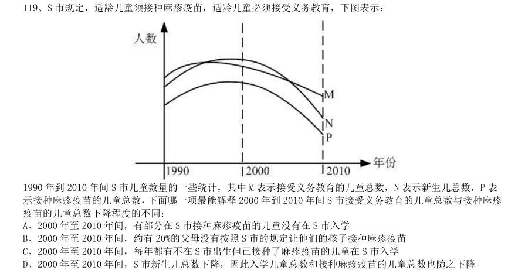

- **A.** 2000 年至2010 年间,有部分在S 市接种麻疹疫苗的儿童没有在S 市入学
- **B.** 2000 年至2010 年间,约有20%的父母没有按照S 市的规定让他们的孩子接种麻疹疫苗
- **C.** 2000 年至2010 年间,每年都有不在S 市出生但已接种了麻疹疫苗的儿童在S 市入学
- **D.** 2000 年至2010 年间,S 市新生儿总数下降,因此入学儿童总数和接种麻疹疫苗的儿童总数也随之下降

**答案：C**

### 2011 国考·统一卷　第 120 题　（削弱）

提起极地冰,很多人眼前总是浮现一幅洁白无瑕、晶莹剔透的景观。然而,在北纬71 度、西经168 度附近 的北冰洋海域,“雪龙”号首次驶入一片“脏”冰区,只见一块淡蓝色的浮冰中间夹杂了许多脏兮兮的黄色冰块, 这种黄色冰块,既出现在当年的新生冰块上,也出现在多年冰块上。对于“人类造成的污染已经殃及极地浮冰” 的说法,有专家解释说这只是生活在极地冰中的一种特有生物--黄褐色的冰藻。 如果以下各项为真,能够反驳专家上述观点的是:

- **A.** 在新生冰块上形成冰藻需要多年
- **B.** 北极冰中生长有冰藻并不是普遍现象
- **C.** 近年来人类踏上北极的次数逐年增加
- **D.** 北冰洋周围的陆地有沙尘天气

**答案：A**

### 2010 湖北·统一卷　第 74 题　（逻辑判断（综合））

学习迁移即一种学习对另一种学习的影响,它广泛地存在于知识、技能、态度和行为规范的学习中。任何一 种学习都会受到学习者已有知识经验、技能、态度等的影响,只要有学习,就有迁移。 下列属于学习迁移的是:

- **A.** 小王的父亲是著名的画家,受父亲影响,他从小就对绘画产生了兴趣,后来也成为一名画家
- **B.** 某大学生在人多的教室里复习功课总容易分心,于是换到一个独处的安静环境,学习效率非常高
- **C.** 小芳学会了拉二胡,自己尝试拉小提琴,结果也很快学会
- **D.** 某学生沉迷于网络游戏致使学习成绩下降,后来通过老师的教育和同学的帮助,改掉了毛病,学习进步非常快

**答案：C**

### 2010 湖北·统一卷　第 81 题　（解释评价）

进入6 月份,不少市民发现,蚊子越来越多,简直无法控制,灭蚊剂也杀不死,一些曾经“一用就灵”的灭 蚊剂如今渐渐失效。在武汉的各大医院皮肤科被蚊虫叮咬的儿童患者挤满了病房。 以下哪项不是这一现象出现的原因:

- **A.** 6 月份气温适中,雨量充沛,最适宜蚊子繁殖生长
- **B.** 蚊子的抗药性非常强,被杀死的往往是“娇弱”的蚊种,适者则顽强地生存了下来
- **C.** 蚊子特别喜欢叮咬儿童
- **D.** 不规范使用灭蚊剂导致蚊子抗药性的产生和快速增强

**答案：C**

### 2010 湖北·统一卷　第 82 题　（翻译推理）

如果不能有效解决房价过高、房租不断上涨以及不成正比的工资收入这些问题,那么“蚁族”生活的期限将 被延长,“蚁族”的梦想也将推迟实现。 由此推出:

- **A.** 只有有效抑制房价过高和租金上涨,保持工资收入增长的合理比例,才能不推迟“蚁族”梦想的实现
- **B.** 如果有效解决了房价过高、房屋租金不断上涨以及不成正比的工资收入这些问题,“蚁族”生活的期限将会缩短,“蚁族”的梦想也能够实现
- **C.** 缩短“蚁族”生活的期限,就能加速“蚁族”梦想的实现
- **D.** 如果“蚁族”的梦想被推迟实现,就不能有效解决房价过高、房屋租金不断上涨以及不成正比的工资收入这些

**答案：A**

### 2010 湖北·统一卷　第 83 题　（削弱）

每年高考成绩公布期间,社会总要掀起一阵“状元热”和“排名热”。国人热衷于排名的做法,往往会阻碍 了创新型人才的成长。 以下哪项不能支持上述观点:

- **A.** “排名热”具有社会需求,有利于促进竞争
- **B.** 排名就是固化,容易滋生固步自封情绪,而创新排斥各种排名
- **C.** 过分支持一次考试的赢者,容易形成不宽容失败者的氛围,不利于创新型人才的成长
- **D.** 社会需要各式各样的人才,高考只是评价人才的一种标准

**答案：A**

### 2010 湖北·统一卷　第 84 题　（归纳推导）

某学校甲、乙、丙三位老师年龄各不相同,一位喜欢足球,一位喜欢篮球,一位喜欢排球。现在知道:甲比 喜欢足球的人年龄大;喜欢排球的老师比喜欢篮球的老师年龄小;乙老师年龄最大。 由此可以推出:

- **A.** 甲老师年龄最小
- **B.** 乙老师喜欢排球
- **C.** 丙老师喜欢足球
- **D.** 三人年龄大小无法确定

**答案：C**

### 2010 湖北·统一卷　第 85 题　（加强）

吸烟有害健康是众所周知的说法,如何在烟盒上做出恰当的警示,从而有效降低人们尤其是青少年的吸烟欲 望,却很不容易。加拿大规定,每一条香烟都必须从政府规定的16 种警示语中选择至少6 种,并且要经常更换; 最好不用大字标题,不得出现“禁止向未成年人销售”字句。 这种做法是以下面哪项为前提假设的: I.用语气生硬的大字标题容易引起青少年的逆反心理 II.“禁止向未成年人销售”字句会被青少年认为“香烟是成年人的专用品”而更加起劲地尝试 III.过分强调吸烟有害健康会引起烟草企业的反对 IV.警示语经常更换以免被当成老生常谈或出现过期消息

- **A.** I、II、III和IV
- **B.** I、II和III
- **C.** I、II和IV
- **D.** I和II

**答案：C**

### 2010 湖北·统一卷　第 86 题　（削弱）

托勒密派天文学家坚持“地球静止说”,其根据是如果地球是转动的,每天一圈,那么地球表面上任何一点 在很短的时间都将运动很大一段距离。这时,如果一块石头从塔顶落下来,应该落在离塔很远的地方。可是人们 看到的情景并非如此。石头总是落在塔基边缘,可见“地球运动说”是错误的。 下面哪个选项最能对这些论断提出质疑:

- **A.** 难道从塔顶落下的石头不会受到人为的干扰吗?
- **B.** 难道塔一定是垂直的吗?
- **C.** 地球不转动怎么会有白天和黑夜的替换?
- **D.** 从正在航行的船桅杆顶上落下的一件重物不也是落到桅杆脚下而没有落到船底吗?

**答案：D**

### 2010 湖北·统一卷　第 87 题　（前提假设）

文化是活的生命。持久的生命力有赖于其影响力,而社会大众的喜爱是构成影响力的前提条件。 由此可以推出:

- **A.** 受到大众喜爱的文化就会有影响力和持久的生命力
- **B.** 不受大众喜爱的文化就没有持久的生命力
- **C.** 文化没有影响力就不会受到社会大众的喜爱
- **D.** 只有具备了持久的生命力,才可能会受到社会大众的喜爱

**答案：B**

### 2010 湖北·统一卷　第 88 题　（加强）

尽管中国现在不缺乏大企业,也不缺乏受重视的企业,但他们不等同于受人尊重的企业。对企业内部的员工、 外部的消费者、利益相关者不尊重,尤其是对资源、环境及其利益相关者不负责任的企业,即使每天都在捐款, 也不会受到尊重。 上述论证是以下面哪项为前提假设的?( )

- **A.** 企业知名度与受人尊重的程度不一定成正比
- **B.** 只有主动承担内部与外部责任的企业才能成为受人尊重的企业
- **C.** 受人尊重的程度对企业的长远发展至关重要
- **D.** 企业受尊重不一定要捐款

**答案：B**

### 2010 湖北·统一卷　第 89 题　（削弱）

实行低利率政策是抗击通货膨胀的有效手段。目前的低利率水平可以使中国通货膨胀处于可控范围之内,不 会发生恶性通胀,也使企业能够以较低廉的利息代价得到资金支持,从而使企业渡过难关。 以下哪项如果为真,最能反驳上述论断:

- **A.** 我国的利率不仅是低利率,而且已经是负利率
- **B.** 最近政府正在考虑提高利率
- **C.** 实行低利率未必对企业有利
- **D.** 低利率政策下的信贷爆发式增长在一定程度上增加了通胀发生的可能性

**答案：D**

### 2010 湖北·统一卷　第 90 题　（削弱）

长期以来,大家对金融危机的认识是,发生金融危机的国家受损最大。的确,过去的金融危机是受伤,而这 次金融危机则让所在国受益。美国是这次金融危机的源头,赚的却比赔的多。 下列哪些选项可以支持这个结论: I.欧债危机泛滥,使欧洲的竞争力弱化,而美国的竞争力则在增强 II.美国利用危机强化了对石油、黄金的捆绑,使之变成美元的另类筹码 III.美国非常善于利用危机实现自己的长远目的,使之成为实现战略目标的契机 IV.美元独霸的货币制度在成功回归,美元地位并未下降和削弱

- **A.** I、II、III和IV
- **B.** I、II和III
- **C.** I、II和IV
- **D.** I和II

**答案：A**

### 2010 广东·统一卷　第 41 题　（逻辑判断（综合））

为实现垃圾分类回收,许多公共场所的垃圾箱已分为“可回收”和“不可回收”两类,下列几种垃 圾,应放入“不可回收”标志垃圾箱的是: 1 玻璃瓶 2 易拉罐 3 果皮 4 菜叶 5 无毒塑料制品 6 纸质包装袋 7 剩饭菜

- **A.** 3 4 6
- **B.** 3 4 7
- **C.** 2 3 6
- **D.** 2 4 6

**答案：暂缺**

### 2010 广东·统一卷　第 42 题　（逻辑判断（综合））

古人对于我国姓氏的来历有如下阐述:“氏于国,则齐鲁秦吴;氏于谥,则文武成宜......氏于事, 则巫乙匠淘。” 由此可以推断,王、侯、公孙等姓氏应源自:

- **A.** 族号
- **B.** 邑名
- **C.** 官名
- **D.** 爵号

**答案：暂缺**

### 2010 广东·统一卷　第 43 题　（加强）

一般人进入高海拔地区后会出现头晕、气喘、易疲劳等症状,即高原反应。然而,一些竞技体育项 目的运动员却在比赛前专门到高海拔地区进行强化训练,其主要原因是:

- **A.** 高海拨地区空气清新,有利于运动员身体健康
- **B.** 高海拨地区气压较低,有利于运动员强化训练
- **C.** 高海拔地区环境恶劣,在这种环境下训练能够磨炼运动员的意志
- **D.** 高海拔地区空气稀薄,在这种环境下训练可以增强运动员的心肺功能

**答案：暂缺**

### 2010 广东·统一卷　第 47 题　（逻辑判断（综合））

2008 年美国爆发金融危机后出现以下经济现象:1. 消费下降,消费品进口减少;2. 失业增加, 居民收入降低;3. 融资困难,企业倒闭增多,这些现象会引发其他国家的经济金融危机,其主要路径是:

- **A.** 2-1-3
- **B.** 3-2-1
- **C.** 3-1-2
- **D.** 1-3-2

**答案：暂缺**

### 2010 广东·统一卷　第 48 题　（解释评价）

下列生活现象用分子的相关知识解释不正确的是:

- **A.** 湿衣服晾干表明分子在不断地运动
- **B.** 葡萄酿成酒表明分子的种类发生了变化
- **C.** 酒精溶于水表明分子间有空隙
- **D.** 充足气的自行车内胎在烈日下爆裂,表明分子的体积随温度升高而增大

**答案：暂缺**

### 2010 广东·统一卷　第 49 题　（逻辑判断（综合））

“春雨惊春清谷天,夏满芒夏暑相连,秋处露秋寒霜降,冬雪雪冬小大寒。”节气对于指导农业生 产具有很强的科学性。 下列反映阳历六月初节气的农谚是:

- **A.** 立夏桑果像樱桃
- **B.** 小满养蚕又种田
- **C.** 芒种玉秧放庭前
- **D.** 夏至稻花如白练

**答案：暂缺**

### 2010 广东·统一卷　第 61 题　（逻辑判断（综合））

为维护外出务工人员的合法权益,甲地劳动部门为外出务工人员“量身定制”了务工维权卡,把劳 动者的权利和义务、劳动纠纷解决的步骤、咨询电话等内容编印在卡上,利用春节期间发放到外出务工人员 手中。一旦务工人员的合法权益受到侵害,就可凭务工维权卡高效便捷地到务工所在地的劳动部门申诉解决。 以下最有助于务工维权卡取得实效的一项是:

- **A.** 乙地劳动部门的类似举措已经取得成功
- **B.** 该项举措得到甲地劳动部门领导的大力支持
- **C.** 甲地劳动部门与务工人员所在地的劳动部门有长期的合作关系
- **D.** 务工人员所在地的劳动部门为持有务工维权卡的务工人员无偿提供全方位服务

**答案：暂缺**

### 2010 广东·统一卷　第 62 题　（加强）

去年某地大力招商引资,吸引国内外投资23 亿元,国民生产总值增长两个百分点。今年有人提出 如果吸引到50 亿元的国内外投资,该地的国民生产总值将可以增长四个百分点,对此有人反对,认为即使 能够吸引到50 亿元的资金,这一愿望也未必能实现。 以下能够支持反对者意见的是: 1去年国民生产总值增长两个百分点主要得益于国际经济形势的好转 2该地今年很难吸引到50 亿元的国内外的投资 3该地不具备支持国民生产总值增长四个百分点的重工业基础

- **A.** 1 和2
- **B.** 1 和3
- **C.** 2 和3
- **D.** 1、2、3

**答案：暂缺**

### 2010 广东·统一卷　第 63 题　（削弱）

近来西方舆论界存在一种观点认为中国经济高速发展,除污染了地球环境外,还成了国际上石油等 能源价格的暴涨的原因。 以下最能反驳西方舆论界的观点的是:

- **A.** 石油输出国组织的石油产量近年不断下降
- **B.** 去年中国经济依然高速发展,但是国际上石油等能源价格比往年低
- **C.** 西方发达国家的生产生活方式造成了国际上石油等能源价格的暴涨
- **D.** 汽车业的高速发展以及汽车的普及造成了国际上石油等能源价格的暴涨

**答案：暂缺**

### 2010 广东·统一卷　第 64 题　（削弱）

很多人反对焚烧垃圾,他们认为垃圾焚烧会污染环境。一位环境专家在接受媒体采访时说:“垃圾 焚烧会产生有害气体,但与垃圾污染本身相比,危害要小得多。通过引进国际先进技术,垃圾焚烧的污染排 放能够符合国家有关标准,不会对环境造成太大影响,是可以接受的。” 以下最能反驳这位专家观点的一项是:

- **A.** 垃圾焚烧不仅仅污染焚烧地的环境,也会污染周边的环境
- **B.** 目前尚不存在成熟的垃圾焚烧技术
- **C.** 垃圾焚烧比垃圾本身对环境的危害还要大
- **D.** 即使符合国家标准的垃圾焚烧污染排放,如长期存在,仍将对环境造成较大污染

**答案：暂缺**

### 2010 广东·统一卷　第 65 题　（削弱）

据调查,某地90%以上有过迷路经历的司机都没有安装车载卫星导航系统。这表明,车载卫星导航 系统能有效防止司机迷路。 以下最能削弱上述论证的一项是:

- **A.** 很多老司机没有安装车载卫星导航系统,很少迷路
- **B.** 车载卫星导航系统的使用效果不理想,对防止迷路没有多大作用
- **C.** 当地目前只有不足10%的汽车安装了车载卫星导航系统
- **D.** 安装了车载卫星导航系统的司机,90%以上经常使用

**答案：暂缺**

### 2010 广东·统一卷　第 66 题　（前提假设）

为了鼓励孩子在学校取得好成绩,许多家长这样教育孩子:“在学校里从来都是以学习成绩论优劣。 你要么成绩好,要么成绩差。在老师的眼里,你要么是好学生,要么是差学生。由于所有学习成绩好的学生 在老师眼里都是好学生,所以每个学习差的学生在老师眼里都是差学生。” 为使家长的论证成立,以下假设必须成立的一项是:

- **A.** 在学校里,学习成绩不是评价学生优劣的唯一指标
- **B.** 老师具有区分好学生和差学生的能力
- **C.** 在老师眼里,学习成绩好的学生未必是好学生
- **D.** 在老师眼里,好学生就是学习成绩好

**答案：暂缺**

### 2010 广东·统一卷　第 67 题　（削弱）

如果在橙子开花季节持续干旱,橙子产量将会受到影响,今年某地在橙子开花季节出现旱情,因此 有人担心橙子价格会上涨,从而使得该地橙汁饮料厂的生产成本提高。 以下最能削弱上述论证的一项是:

- **A.** 今年橙汁饮料的价格是历年最低的
- **B.** 该地的旱情并没有预计的严重
- **C.** 今年该地扩大了橙子的种植面积
- **D.** 该地橙汁饮料厂的原料供应大多来自外地

**答案：暂缺**

### 2010 广东·统一卷　第 68 题　（逻辑判断（综合））

质检部门对ABCDE 五种不同品牌的32 寸平板电视机进行检测,发现:A 的耗电量低于B,B 的耗电 量不比C 高,D 的耗电量不如E 低,E 的耗电量不如B 低,其中两种品牌电视机的耗电量是相同的。 以下论述肯定与以上事实不符的一项是:

- **A.** B 和C 的耗电量相同
- **B.** A 和C 的耗电量相同
- **C.** A 的耗电量低于D
- **D.** E 的耗电量不如C 高

**答案：暂缺**

### 2010 广东·统一卷　第 69 题　（削弱）

物理学家霍金认为:“地球生命被某一灾难消灭的危险正以前所未有的速度与日俱增突如其来的全 球变暖、核战争、基因病毒或其他危险。”霍金在此基础上认为地球越来越不适合人类居住,并提出“太空 移民”的观点。 以下最能质疑霍金观点的一项是:

- **A.** 绝大多数星球的环境不适合人类生存
- **B.** 人类面临的危险通过人类的共同努力能够得到解决
- **C.** 地球处于其生命年龄的幼年时期
- **D.** 地球所拥有的适合居住的表面区域太小,抵御毁灭性灾难的能力差

**答案：暂缺**

### 2010 国考·统一卷　第 67 题　（逻辑判断（综合））

美国社会学家默顿将社会功能划分为显功能和潜功能两个层次,显功能是有助于系统的调整和适应的客观后 果,这种适应和调整是系统中的参与者所期望达到或能预料、认识到的;潜功能是没有被预料也没有被认识的客 观后果。 下列选项不包含对潜功能描述的一项是:

- **A.** 电视剧《渴望》播放期间,万人空巷,社会治安明显好转
- **B.** 张某根据自己的家庭收入状况,贷款30 万买了一套房子,由于利率上升,自己的生活变得捉襟见肘
- **C.** 为抵御外族入侵,秦始皇修筑了长城,客观上促进了我国民间建筑工艺的发展
- **D.** 来自偏远山区的小刘为了摆脱贫困,让父母过上好日子,从小刻苦学习,做事认真,没几年功夫就成为一家

**答案：暂缺**

### 2010 国考·统一卷　第 81 题　（削弱）

海洋中珊瑚的美丽颜色来自于其体内与之共存的藻类生物,其中虫黄藻是最重要的一类单细胞海藻。二者各 取所需,相互提供食物。全球气候变暖造成的海水升温导致虫黄藻等藻类大量死亡,进而造成珊瑚本身死亡,引 发珊瑚礁白化现象,然而研究发现,珊瑚能通过选择耐热的其他藻类生物等途径,来应对气候变暖带来的挑战。 以下哪项如果为真,将削弱这一研究发现:

- **A.** 一些虫黄藻能够比耐热的其他藻类耐受更高的海水温度
- **B.** 有些藻类耐热性的形成需要一个长期的过程
- **C.** 有些虫黄藻逐渐适应了海水温度的升高并存活下来
- **D.** 有些已白化的珊瑚礁中也发现了死去的耐热藻类生物

**答案：暂缺**

### 2010 国考·统一卷　第 82 题　（削弱）

有医学研究显示,吃维生素和矿物质补充剂对人体没有显著帮助,有时甚至会对人体造成伤害。一些医生给 出劝告,不要再吃维生素和矿物质补充剂了,而应该通过均衡的饮食来补充人体所需的维生素和矿物质。 以下哪项如果为真,最能削弱上述研究结果:

- **A.** 一项对3 万名妇女进行的7 年追踪调查发现,服用维生素D 加上钙补充剂并没有给她们的身体造成伤害
- **B.** 一项对1 万名男性展开的8 年追踪调查显示,不服用维生素和矿物质补充剂并没有增加他们患病的风险
- **C.** 一项对1 万名发达地区和欠发达地区老年人的对照调查显示,他们的健康状况差异不显著
- **D.** 一项对2 万名儿童展开的3 年追踪调查显示,不服用维生素和矿物质补充剂的儿童,营养缺乏的发生率较高

**答案：暂缺**

### 2010 国考·统一卷　第 83 题　（翻译推理）

甲乙丙丁四人的车分别为白色、银色、蓝色和红色。在问到他们各自车的颜色时,甲说:“乙的车不是白色。” 乙说:“丙的车是红色的。”丙说:“丁的车不是蓝色的。”丁说:“甲、乙、丙三人中有一个人的车是红色的, 而且只有这个人说的是实话。” 如果丁说的是实话,那么以下说法正确的是:

- **A.** 甲的车是白色的,乙的车是银色的
- **B.** 乙的车是蓝色的,丙的车是红色的
- **C.** 丙的车是白色的,丁的车是蓝色的
- **D.** 丁的车是银色的,甲的车是红色的

**答案：暂缺**

### 2010 国考·统一卷　第 84 题　（削弱）

在一次考古发掘中,考古人员在一座唐代古墓中发现多片先秦时期的夔文(音kui,一种变体的龙文)陶片。 对此,专家解释说,由于雨水冲刷等原因,这些先秦时期的陶片后来被冲至唐代的墓穴中。 以下哪项如果为真,最能质疑上述专家的观点:

- **A.** 在这座唐代古墓中还发现多件西汉时期的文物
- **B.** 这座唐代古墓保存完好,没有漏水、毁塌迹象
- **C.** 并非只有先秦时期才使用夔文,唐代文人以书写夔文为能事
- **D.** 唐代的墓葬风俗是将墓主生前喜爱的物品随同墓主一同下葬

**答案：暂缺**

### 2010 国考·统一卷　第 85 题　（逻辑判断（综合））

以下是一则广告:本网络文学培训班有着其他同类培训班所没有的特点,除了传授高超的写作技巧、帮助同 学打开认识世界的多维视角和宏观视野、丰富学员的文化知识和艺术涵养外,还负责向毕业班学员提供切实有效 的就业咨询。去年进行咨询的毕业班学员,100%都找到了工作。为了在网络文学创作事业上开创一片天地,欢迎 加入我们的行列。 为了确定该广告的可信任,以下相关问题必须询问清楚的是: I 去年共举办了多少期这类培训班,共有多少学员毕业? II 去年有多少毕业班学员进行了就业咨询? III 对于找到工作的学员,就业咨询究竟起到了什么作用? IV 咨询者找到的是否都是网络文学创作工作?

- **A.** I、II、III 和IV
- **B.** I、II 和III
- **C.** II、III 和IV
- **D.** III、IV

**答案：暂缺**

### 2010 国考·统一卷　第 86 题　（加强）

在由发展中国家向经济发达国家前进的过程中,大量资本支持是必不可少的条件,而高储蓄率是获得大量资 本的必要条件。就目前来说,中国正处于经济起飞时期,因此储蓄率高是当前经济发展中一种正常而合理的现象。 由此可以推出:

- **A.** 有了大量的资本支持,就可以实现由发展中国向发达国家的跨越
- **B.** 有了高储蓄率,就可以获得大量的资本支持
- **C.** 如果没有获得大量的资本支持,说明储蓄率不高
- **D.** 如果没有高储蓄率,就不能实现向发达国家的转变

**答案：暂缺**

### 2010 国考·统一卷　第 87 题　（削弱）

当代知名的动漫设计大师,绝大部分还没从动漫设计学校毕业就已经离开学校,开始自己的动漫设计生涯。 因此,有人认为动漫设计的专业学习对学生们今后的职业发展并没能提供有力的帮助。 以下哪项如果为真,能够最有力地反驳上述推论:

- **A.** 动漫设计大师都承认,他们学习了动漫设计学校的基础课程
- **B.** 知名动漫公司在招聘设计师时,很看重应聘人员的毕业院校
- **C.** 调查显示,动漫设计学校毕业生的平均年收入要显著高于同类院校其他专业的毕业生
- **D.** 在动漫设计行业中职业发展比较好的从业者,基本都毕业于动漫设计学校

**答案：暂缺**

### 2010 国考·统一卷　第 88 题　（前提假设）

以往,境内企业进出口只能以美元或第三方货币结算,在合同签约至合同执行完毕期间汇率的变化会使企业 的实际盈收出现波动,现在银行推出了人民币结算业务。由于人民币是境内企业的本币,合同计价和企业运营的 主要货币相一致,境内企业在合同签订前能够切实了解交易的成本和收入,从而防范了汇率风险。因经,使用跨 境贸易人民币结算业务的企业必定会增多。 以下哪项为真,最佳作为上述论证的前提条件:

- **A.** 有了跨境贸易人民币结算业务,开展对外贸易的企业数量会越来越多
- **B.** 在与国内企业发展贸易时,由于人民币币值保持稳定,境外企业愿意使用人民币作为结算货币
- **C.** 有了跨境贸易人民币结算业务,国内企业可以更方便地将跨境贸易开展到世界各地
- **D.** 由于国内巨大的市场空间,越来越多的境外企业愿意与国内企业开展贸易往来

**答案：暂缺**

### 2010 国考·统一卷　第 89 题　（削弱）

某国人口总量自2005 年起开始下降,预计到2100 年,该国人口总数将只有现在的一半。为此,该国政府出 台了一系列鼓励生育的政策。但到目前为止,该国妇女平均只生育1.3 个孩子,远低于维持人口正常更新的水平 (2.07 个)。因此,有人认为该国政府实施的这些鼓励生育的政策没有达到预期效果。 以下哪项如果为真,最能反驳上述论断:

- **A.** 该国政府实施的这些鼓励生育的政策是一项长期国策,短时间内看不出效果
- **B.** 如果该国政府没有出台鼓励生育政策,该国儿童人口总数会比现在低很多
- **C.** 如果该国政府出台更加有效的鼓励生育政策,就可以提高人口数量
- **D.** 近年来该国人口总数呈缓慢上升的趋势

**答案：暂缺**

### 2010 国考·统一卷　第 90 题　（削弱）

甲国生产了一种型号为su-34 的新型战斗机,乙国在是否要引进这种战斗机的问题上,出现了两种不同的声 音。支持者认为su-34 较以往引进的su-30 有更加强大的对地攻击作战能力。 以下哪项如果为真,最能削弱支持者的声音:

- **A.** 目前市场上有比su-34 性能更好的其他型号战斗机
- **B.** su-30 足以满足对地攻击的需要,目前乙国需要提升的是对空攻击作战能力
- **C.** 目前还没有实际数据显示究竟是su-34 有更加强大的对地攻击作战能力
- **D.** 甲乙两国目前在双边贸易中存在诸多摩擦,引入su-34 会有很多实际困难

**答案：暂缺**
