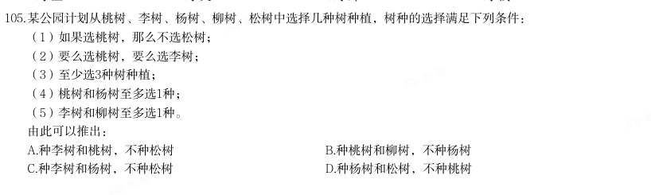

# 判断推理 · 逻辑判断 · 2020 年代真题

> 所属考点：[PD-LJ](../PD-LJ-逻辑判断.md)　｜　本片 361 题

### 2026 广东·统一卷　第 53 题　（解释评价）
> 材料：某种水毛茛是A市特有的野生植物,对水质要求极高,其仅生长于清澈、流动的水体中,因此被誉为优良水质 的“指示物种”。2023年受特大暴雨影响,A市某自然保护区内的水毛茛大面积消失,其所依赖的自然条件难 以自行恢复,因而面临灭绝的风险。但在今年春季,有人发现,该自然保护区内重新出现了这种水毛茛,且群 落规模远超以往。…

· 本试卷由粉笔用户上岸张同学66生成 下列选项如果为真,最能解释上述现象的是( )。

- **A.** 这种水毛茛的分布范围已扩展至与自然保护区相邻的多处水域
- **B.** 即使经历了暴雨,该自然保护区的水质仍然优于周边河流水域
- **C.** 这种水毛茛同时具备有性繁殖和无性繁殖的能力,繁殖能力较强
- **D.** 近两年,通过水系修复等人工措施,该自然保护区的水质大幅提高了

**答案：D**

### 2026 广东·统一卷　第 54 题　（归纳推导）

某单位计划组织职工参观科技馆、文化馆、博物馆和美术馆。但由于时间有限,这4个场馆不能都去。有职工 提出了如下建议并被采纳: (1)由于相距较远,不建议既去文化馆又去博物馆; (2)美术馆和文化馆的展览都很有吸引力,至少参观其中的一个; (3)去年已经去过美术馆,今年就不去了。 补充下列选项中的( ),可以得出“该单位一定会去科技馆”的结论。

- **A.** 如果不去科技馆,就去博物馆
- **B.** 只有不去科技馆,才去博物馆
- **C.** 只有不去博物馆,才不去科技馆
- **D.** 如果要去博物馆,不去科技馆

**答案：A**

### 2026 广东·统一卷　第 55 题　（加强）

太空环境具有高真空、高辐射、微重力、极端温度变化等特点,对人造卫星的材料和电子元件提出了极高的要 求。近日,我国成功发射了太空计算卫星。由于太空计算卫星具备强大的数据实时处理能力,有专家据此认 为,未来太空计算卫星将广泛应用于应急安全、城市治理等领域。 下列选项最有可能是上述推论暗含前提的是( )。

- **A.** 太空计算卫星能够同时适应地面环境和太空环境
- **B.** 太空计算卫星在太空中的数据处理速度显著快于地面
- **C.** 我国目前亟需采集应急安全、城市治理等领域的实时数据
- **D.** 应急安全、城市治理等领域存在大量需要实时处理的数据

**答案：D**

### 2026 广东·统一卷　第 56 题　（解释评价）

针对某款即将上市的新产品,商家开展了预售活动,预订的人数远超预期。但在产品正式发货前,许多顾客却 取消了该产品的预订。 下列选项如果为真,最不能解释上述现象的是( )。

- **A.** 因为产能问题,该产品发货日期一再延后
- **B.** 收到货后,许多顾客反映该产品质量欠佳
- **C.** 预售还未结束,商家就对新预订的用户给予了更大的优惠
- **D.** 产品预售期间,其他商家推出了多款设计接近但价格更低的竞品

**答案：B**

### 2026 广东·统一卷　第 57 题　（逻辑判断（综合））

不建立主体明确、要求清晰的责任体系,就不能压紧压实安全生产责任。当前主体明确、要求清晰的责任体系 已经建立,因此安全生产责任已经压紧压实。 下列选项与题干逻辑结构最为相似的是( )。

- **A.** 只有实行多元共治,才能构建和谐社区。某社区建成了和谐社区,因此该社区实行了多元共治
- **B.** 不实现教育资源的公平分配,就无法提高全民素质。当前全民素质还有待提高,所以教育资源的公平分配还未实现
- **C.** 如果某地区深入推进生态文明建设,那么该地区已经实现了资源循环利用。这是因为不深入推进生态文明建设,就无法实现资源循环利用
- **D.** 如果合理开采资源,就能实现自然资源的可持续利用。多地政府已经出台法律法规禁止过度开采,因此许多

**答案：C**

### 2026 广东·统一卷　第 59 题　（削弱）

对于研发型企业来说,获得突破性的研发成果至关重要。某研发型企业在回顾其发展历程后发现,企业大多数 突破性的研发成果都源自新手研发人员。该企业因此认为,要想获得更多的突破性研发成果,在组建新的研发 团队时应当只考虑新手研发人员。 以下选项如果为真,最能反驳这一结论的是( )。

- **A.** 该企业现有的多数重要研发成果尚未成功转化应用
- **B.** 对于大多数的新手研发人员,该企业目前的薪资吸引力不高
- **C.** 突破性的研究设想都需要经过经验丰富的研发人员改进才能实现
- **D.** 将新手研发人员培养成经验丰富的研发人员需要投入大量的资源

**答案：C**

### 2026 广东·统一卷　第 60 题　（加强）

研究团队开发了一种新型抗衰老水凝胶材料,为了验证这一材料的实际效果,研究团队开展了系列实验。结果 发现,与未注入该材料的实验鼠相比,注入该材料的实验鼠肌肉组织中细胞的代谢水平显著提高,细胞端粒长 度平均延长15%,且肌肉再生能力提升40%。由此可以推断,该材料能在一定程度上抗衰老。 以下选项如果为真,最不能支持这一结论的是( )。

- **A.** 细胞的代谢水平往往与其衰老程度呈负相关
- **B.** 老年动物的肌肉再生能力显著低于青壮年动物
- **C.** 将该材料注入小鼠体内后,小鼠未产生明显的免疫反应
- **D.** 端粒长度延长是细胞分裂激活的伴随现象,表明细胞恢复了“年轻”

**答案：C**

### 2026 广东·统一卷　第 61 题　（逻辑判断（综合））

绿化率高的小区,居民幸福感强。居民幸福感强的小区,环境卫生状况好。因此,绿化率高的小区环境卫生状 况好。 下列选项与上述推理的逻辑结构最为相似的是( )。

- **A.** 粉尘浓度高的区域遇明火易发生爆炸,易发生爆炸的区域都应严禁烟火。因此粉尘浓度不高的区域无需禁止烟火
- **B.** 员工满意度较高的公司离职率较低,而绩效考核合理的公司员工满意度较高。因此绩效考核合理的公司离职率较低
- **C.** 利润增长快的企业都进行了技术创新,这是因为企业通过技术创新可以提高生产效率,而生产效率的提高可以促进利润增长
- **D.** 双减政策的落实减轻了学生的学习压力,课外活动时间的增加也减轻了学生的学习压力。因此,课外活动时

**答案：B**

### 2026 广东·统一卷　第 62 题　（朴素逻辑（排序/匹配））

间的增加体现了双减政策的落实 某市召开年度经济工作会议,根据安排,某一排是教育局、住建局、交通局、农业局、人社局、财政局6个职 能局的座位。已知: 1财政局在人社局的右手边并与之相邻,在住建局的左手边但与之不相邻; 2教育局与交通局之间隔着一个职能局。 如果农业局和财政局相邻,则下列选项必然正确的是( )。

- **A.** 教育局在从右到左第三位
- **B.** 住建局在从右到左第二位
- **C.** 交通局在从左到右第三位
- **D.** 人社局在从左到右第二位

**答案：暂缺**

### 2026 广东·统一卷　第 63 题　（前提假设）
> 材料：某次“特色示范村”评选活动设立了文化旅游、非遗传承、生态农业、数字农业示范村4个奖项,甲、乙、 丙、丁4个村庄各获其中之一。已知:…

· 本试卷由粉笔用户上岸张同学66生成 1文化旅游示范村的经济收入高于丙村; 2甲村和数字农业示范村的经济收入相当,且都不是最高的; 3生态农业示范村的经济收入比丁村高; 4丙村的经济收入高于非遗传承示范村。 根据上述条件,下列选项必然正确的是( )。

- **A.** 甲村的经济收入在4个村庄中位列第二
- **B.** 乙村获评文化旅游示范村
- **C.** 丙村获评数字农业示范村
- **D.** 丁村获评非遗传承示范村

**答案：暂缺**

### 2026 广东·统一卷　第 64 题　（加强）

某古生物学研究小组在一处白垩纪晚期地层中发现了保存完整的恐龙皮肤化石。通过高分辨率显微镜,研究人 员发现该恐龙皮肤表面存在大量微小的中空管状结构。由于这些结构类似于现代鸟类羽毛中用于体温调节的羽 茎,研究人员推测,这些微小的中空管状结构是恐龙用于调节体温的特殊结构。 以下选项如果为真,最能支持上述推测的是( )。

- **A.** 这些中空管状结构能够增强生物体表的散热能力
- **B.** 其他恐龙化石之中也发现了类似的中空管状结构
- **C.** 现代爬行类动物的皮肤表面不存在类似的中空管状结构
- **D.** 由于白垩纪晚期气候异常,恐龙需要体温调节机制维持生存

**答案：A**

### 2026 广东·统一卷　第 65 题　（加强）

企业节能减排必须通过购买碳配额或自主开发减排项目实现。某企业未购买碳配额,因此该企业要节能减排需 自主开发减排项目。 下列选项与题干逻辑结构最为相似的是( )。

- **A.** 申请绿色产品认证的公司需通过专家评审或提交检测报告。某公司未提交过检测报告,因此该公司应当组织开展专家评审
- **B.** 有的地区支持企业购买碳汇,有的地区则支持企业使用清洁能源。某地区支持企业使用清洁能源,因此该地区不支持企业购买碳汇
- **C.** 企业申请创业补贴或者通过线上申请,或者通过线下窗口办理。某企业已经通过线上渠道提交了申请,因此无需前往线下窗口办理
- **D.** 重点排放单位应通过安装监测设备或委托第三方核查排放情况。某企业属重点排放单位且未委托第三方核查

**答案：暂缺**

### 2026 广东·统一卷　第 67 题　（逻辑判断（综合））

如图所示,实心铜方块放置在容器底部,沿容器内壁往容器内加入水,直至杯中完全装满水。下列选项中,最 有可能正确反映方块对容器底部压力(p)随水深(h)变化情况的是( )。

- **A.** A
- **B.** B
- **C.** C
- **D.** D

**答案：暂缺**

### 2026 广东·统一卷　第 68 题　（逻辑判断（综合））

某款电热毯有3个档位,由一个开关控制。其中,0档为关机,1档为低功率加热,2档为高功率加热,则以下选 项最可能是该款电热毯电路示意图的是( )。

- **A.** A
- **B.** B
- **C.** C
- **D.** D

**答案：暂缺**

### 2026 广东·统一卷　第 70 题　（逻辑判断（综合））

下图为海洋生态系统中部分生物之间的捕食关系,则以下有关说法正确的是( )。

- **A.** 磷虾大量减少会对该系统产生毁灭性的影响
- **B.** 该食物网中包括了生产者、消费者以及分解者
- **C.** 图中最短的食物链有3个营养级
- **D.** 该食物网共涉及6条食物链

**答案：C**

### 2026 国考·副省级　第 105 题　（翻译推理）

如果用一个圆来表示词语所指称的对象的集合,那么以下哪项中画横线词语之间的关系符合 下图?

- **A.** 船舶按用途分为军用船舶(1)和民用船舶两大类,潜艇、航空母舰(3)、驱逐舰等都属于军用船舶;按推进动力分为机动船和非机动船(2)
- **B.** 水杉( 3)是我国的特有树种,属于落叶树( 1), 是一种高大的乔木(2), 是世界上珍稀的“活化石”植物
- **C.** 图书按照读者群可分为少儿读物(3)和成人读物等;按照载体可分为纸质书和电子书(2)等;按照学科可分为历史书、文学书和哲学书(1)等
- **D.** 大熊猫属于哺乳动物(1),是中国特有动物(2),被列为中国国家一级保护野生动物(3)

**答案：B**

### 2026 国考·副省级　第 106 题　（加强）

研究发现,受人喜爱、知名度高的物种更易成为科研人员研究的对象。有观点认为,每一物 种都有研究的意义和价值,科研人员不应对研究对象差别对待,但反对者期却认为,科学研究 进行重点突破比“一视同仁”更有意义,因为把有限的科研资源用在合适的地方,才能更好地 平衡投入与回报。 以下哪项如果为真,没有支持反对者的观点?

- **A.** 关系人类基本需求的粮食作物,家禽家畜等产能的不断增长,得益于当初人们对其进行选择性的专门研究
- **B.** 对那些生长周期短,基因组简单且分布广泛的模式生物进行重点研究更易揭示生命种学的普通规律
- **C.** 由于文化、知名度等原因,对某些物种的保护性研究对唤醒人们的生态保护意识具有特殊的号召力和吸引力
- **D.** 网络上搜索到关于树袋熊的相关论文有5000 多篇,而更为濒危的昆士兰毛树袋熊的论文则不

**答案：D**

### 2026 国考·副省级　第 107 题　（削弱）

部分研究认为,白垩纪陆地生态系统的变革是由植物、昆虫、脊椎动物与地质过程等多个要 素相互作用推动的,形成了一个高度协同演化的系统结构。鉴于这一机制在当时造就了复杂而稳 定的生态格局,有学者提出,现代陆地生态系统的高度复杂性,正是这种古老协同机制延续和演 化的结果。 以下哪项如果为真,最能削弱上述学者的观点?

- **A.** 在地质记录中,白垩纪末期的生态危机主要影响海洋系统,而陆地系统显示出相对稳定的演替趋势
- **B.** 对白垩纪地层的系统分析表明,植物、昆虫、脊椎动物与地质过程的演化几乎是在同一时期进行的
- **C.** 现代陆地生态系统的复杂性主要受群落内部随机扰动、自组织演化和外源干扰的共同影响,与白垩纪显著不同
- **D.** 被子植物的全球扩张早于部分动物类群多样化,其当时对生态结构的主导作用可能被高估

**答案：C**

### 2026 国考·副省级　第 108 题　（加强）

近年来,盲盒等“非确定性产品”的市场规模迅速扩张,有分析人士指出,非确定性产品 的热销说明有相当一部分消费者受到感受性消费动机的驱动,不同于实用性消费动机对商品实 用价值的看重,感受性消费动机更看重商品带来的主观体验。 以下哪项如果为真,不能支持上述分析人士的观点?

- **A.** 盲盒等产品通常设计精美,能够给消费者带来愉悦的审美体验
- **B.** 限量款盲盒产品吸引许多消费者以投资为目的购买并加价转手
- **C.** 许多盲盒产品设计有隐藏款,消费者开出时会感受到惊喜、满足
- **D.** 非确定性产品制造的信息缺口能够激发部分消费者强烈的好奇心

**答案：B**

### 2026 国考·副省级　第 109 题　（加强）

在过去几十年,某大型沿海河口的河岸和沼泽边缘不断被侵蚀且侵蚀速度逐渐加快,这使得 河口的湿地退化,生态环境变得脆弱。同时,人们发现该河口中沼泽蟹的数量持续增加,这加剧 了沼泽边缘的退缩。因此,可以适度引入海獭来减缓沼泽边缘的侵蚀。 以下除哪项外,均能支持上述论证?

- **A.** 沼泽蟹会在泥沙中挖掘洞穴,这是导致沼泽边缘不断退缩的主要原因
- **B.** 该地区原有的海獭曾因人类活动而消失,重新引入不易引发生态失衡
- **C.** 近年来,受海平面上升和潮汐冲刷的影响,许多河口都出现了湿地退化
- **D.** 海獭是沼泽蟹的天敌,包括沼泽蟹在内的无脊椎动物是海獭的主要食物

**答案：C**

### 2026 国考·副省级　第 110 题　（逻辑判断（综合））

某学术会议共有甲、乙、丙、丁、戊、己、庚7 名代表参加,在专题讨论环节,受时间限 制,对于代表发言的安排,有如下考虑: (1)甲、丁至多安排其中一人发言; (2)如果丙、戊至少安排其一,则安排甲而不安排己发言; (3)如果乙、庚至少安排其一,则安排丁而不安排甲发言。 专题讨论最终安排了4 名代表发言,上述考虑均被满足。下列说法正确的是:

- **A.** 安排了乙、庚发言
- **B.** 安排了丙、丁发言
- **C.** 安排了己、戊发言
- **D.** 安排了甲、乙发言

**答案：A**

### 2026 国考·副省级　第 111 题　（加强）

“三医”是医疗、医保、医药的简称,只有提高卫生事业发展水平且相关部门密切合作、 同向发力,才能促进“三医”协同发展和治理。只有深化医改领导体制和工作推进机制,才 能促进“三医”协同发展和治理。深化医改领导体制和工作推进机制,必须强化区域医疗卫生 规划和医疗机构设置规划的刚性约束。只有深化医改领导体制和工作推进机制,才能满足人民对 美好生活的期待,进而提高人民群众获得感、幸福感和安全感。 由此可以推出:

- **A.** 只要提高卫生事业发展水平,就能使相关部门密切合作、同向发力
- **B.** 只有强化区域医疗卫生规划和医疗机构设置规划的刚性约束,才能提高人民群众获得感、幸福感和安全感
- **C.** 要深化医改领导体制和工作推进机制,就必须促进“三医”协同发展和治理
- **D.** 如果不能更好满足人民群众对美好生活的新期待,就不能促进“三医”协同发展和治理

**答案：B**

### 2026 国考·副省级　第 112 题　（加强）

抓挠是对皮肤瘙痒感觉的一种反应。一般来说,抓挠会激活皮肤中表达TRPVI 的痛觉神经 元,促进其释放P 物质,激活肥大细胞,增强炎症反应,而最近的研究发现,皮肤瘙痒的小鼠 抓挠皮肤后,相比未抓挠的皮肤、抓挠处的皮肤更少受到细菌感染。因此研究人员认为,抓挠皮 肤并非毫无益处,这一行为可以增强该部位皮肤对细菌的防御能力。 以下哪项如果为真,最能支持上述研究人员的观点?

- **A.** 抓挠激活肥大细胞后,肥大细胞可在局部召集免疫细胞,进而抵抗病原菌的侵害
- **B.** 近期一项研究发现,抓挠仅增加了皮肤的损伤程度,而并未加剧皮肤的炎症反应
- **C.** 抓挠产生的痛感强度低于大脑疼痛阈值时,大脑会分泌血清素,让人产生愉悦感
- **D.** 抓挠耳廓或耳垂能够刺激外耳皮肤中的迷走神经小分支,有助于增强神经活跃度

**答案：A**

### 2026 国考·副省级　第 113 题　（削弱）

数据显示,当前我国的宠物数量已超过1.2 亿只,养宠家庭规模破亿。在整体上升的趋势 中,猫狗的数量增长并不同步,宠物猫的增速远高于宠物狗,尤其是在大城市,宠物猫的数量上 升得更快。部分人士认为,随着城市化进程的加快,城市居民的居住空间越来越有限,养狗可能 会面临空间不足的问题,而猫体型小巧,对空间的要求不高。因此居住空间受限是城市中的人们 更倾向于养宠物猫的主要原因。 以下除哪项外,均能削弱上述观点?

- **A.** 狗易吠叫且更具人身危险性,容易引发邻里矛盾,有些居民担心养狗会带来麻烦
- **B.** 猫不需每天遛,也不需花费大量时间陪伴,这对于上班族来说更具吸引力
- **C.** 人们饲养宠物猫后,增加了与其他猫主人之间的交流,拓展了社交圈
- **D.** 相比宠物狗,猫体型较小且食量也较少,食物和日常用品的开支较低

**答案：C**

### 2026 国考·副省级　第 114 题　（削弱）

一项针对中学生的研究发现:直接使用通用AI 工具可短暂提高学生数学测试成绩,但最终 削弱了学生的数学学习能力。研究持续一学期,学生被分为三组,分别在课堂练习阶段使用不同 工具:1组使用标准课本和笔记;2组使用通用AI 工具,可以直接查询答案;3组使用特别设 计的AI 工具,指导而不直接给出答案。随堂考核发现,2组和3组学生比1组学生的成绩高出 48%和127%。但期末考试时,2组比1组成绩低了17%;而3组和1组无明显差异。 以下除哪项外,均能削弱上述结论?

- **A.** 研究中未对学生做AI 工具使用培训,研究结果不能说明正确使用AI 工具的效果
- **B.** 学生的数学基础水平、学习动机、课后自主练习等变量都会影响考试成绩
- **C.** 研究仅针对数学学科,不能说明AI 工具辅助教学对其他学科的影响
- **D.** 研究持续时间不够,不足以说明长期使用AI 工具可能带来的效果

**答案：C**

### 2026 国考·副省级　第 115 题　（解释评价）

R 市最近出现较强降雨。因为冷空气与暖湿气流交汇时会产生强降雨,可见R 市最近出现 了冷空气与暖湿气流的交汇。 以下哪项与上述论证方式最为相似?

- **A.** 某草场今年牧草稀疏,因为牧草稀疏时绵羊无法摄入足够的营养,进而影响生长发育,所以该草场今年绵羊的生长发育会受到影响
- **B.** 某地图书馆春节期间图书借阅量减少,因为旅游人数增加不会导致图书借阅量减少,可见该地图书馆图书借阅量减少与旅游人数增加无关
- **C.** 由于地质松软会导致建设隧道时工期延长,某区域建设隧道时工期延长,所以该区域的地质松软
- **D.** 因为小质量恒星坍缩后大多会变成白矮星,科学家发现某个小质量恒星正在发生坍缩,所以这

**答案：C**

### 2026 国考·地市级　第 101 题　（加强）

科技行业越来越多地使用合成数据来满足AI 模型数据训练的需要。合成数据是通过算法和 统计模型人为创建的数据,在理论上可以无限供应。但合成数据存在一个关键问题:当AI 模型 过于依赖合成数据时,它们会产生更多“幻觉”,编造看似合理可信但实际上并不存在的信 息。可见,合成数据的使用会影响AI 的准确性。 以下哪项如果为真,最能支持上述结论?

- **A.** 即使经过处理,合成数据仍然可能泄露敏感信息,从而引发隐私风险
- **B.** 合成数据存在过于简单化的风险,无法完全模拟真实世界的复杂性
- **C.** 合成数据会放大源数据本身的错误或偏差,导致“失之毫厘,差之千里”
- **D.** 合成数据的多样性可能不如真实数据,限制了AI 模型的泛化能力

**答案：C**

### 2026 国考·地市级　第 106 题　（逻辑判断（综合））
> 材料：(1)王和韩没有参加同一个项目; (2)若韩参加羽毛球项目,则宋参加网球项目; (3)若王参加乒乓球项目,则吴参加网球项目,若王不参加乒乓球项目,则吴也不参加网球项 目。…

对于3 支双打队伍的组成情况,以下哪项是可能的?

- **A.** 如果推进户籍制度改革,就能优化城乡公共资源配置机制
- **B.** 只要完善农业农村优先发展的投入保障机制,就能完善城乡融合发展体制机制
- **C.** 除非完善农业农村优先发展的投入保障机制,否则不能提高土地出让收入用于农业农村的比例
- **D.** 加大中央预算内投资和地方政府专项债券支持力度是破除我国城乡二元结构、拓展高质量发展

**答案：D**

### 2026 国考·地市级　第 107 题　（逻辑判断（综合））
> 材料：104.平台企业依赖金融资本投资,需要迎合金融市场的估值逻辑,通过轻资产运营、扩大市场规 模和用户数据挖掘与开发等,来提升自身在金融市场上的估值。随着平台企业金融化程度的日益 加深,平台劳动者的具体劳动和生产过程也在发生变化。研究者认为,平台企业金融化程度的加 深使得平台劳动者的劳动权益保护问题日益突出。 以下哪项如果为真,最能支持上述研究者的观点? A.为扩大市场规模、争夺消费者注意力,平台企业在资金投入和服务提升方面容易陷入无序竞争 B.为塑造轻资产企业形象、摆脱劳动密集…

若宋和韩组队网球双打,则以下哪项一定正确?

- **A.** 吴参加乒乓球项目
- **B.** 王参加羽毛球项目
- **C.** 宋参加乒乓球项目
- **D.** 吴参加羽毛球项目

**答案：B**

### 2026 国考·地市级　第 108 题　（逻辑判断（综合））

若吴参加3 个项目,则以下哪项是可能的?

- **A.** 宋参加网球项目
- **B.** 王参加网球项目
- **C.** 宋参加乒乓球项目
- **D.** 王参加羽毛球项目

**答案：A**

### 2026 国考·地市级　第 109 题　（逻辑判断（综合））

以下哪项中的两人可能同时组队网球和羽毛球双打?

- **A.** 王和吴
- **B.** 王和宋
- **C.** 吴和宋
- **D.** 韩和宋

**答案：B**

### 2026 国考·地市级　第 110 题　（逻辑判断（综合））

若宋和韩组队乒乓球双打,则以下哪项是可能的?

- **A.** 吴和韩组队网球双打
- **B.** 吴和宋组队网球双打
- **C.** 宋和韩组队羽毛球双打
- **D.** 吴和宋组队羽毛球双打

**答案：D**

### 2026 国考·行政执法　第 101 题　（加强）

考古人员在某地发掘出一些似鸟动物化石,同位素测年显示这些动物生存于中侏罗世晚期 (距今1.72 亿~1.64 亿年)。经考古推算,这些似鸟动物体型与现代鸟类大致接近,尾巴很 短,最重要的是它们都具有愈合的尾综骨。考古人员据此认为,这些动物一定属于鸟类。 以下哪项最有可能是考古人员论证的前提?

- **A.** 这些似鸟动物长有与现代鸟类相似的脚骨,可以在陆地上行走
- **B.** 这些化石保存了诸如肩胛骨、乌喙骨、尾综骨等骨骼,形态清晰
- **C.** 鸟类与爬行动物最显著的区别就是鸟类最后几枚尾椎愈合成为尾综骨
- **D.** 尾综骨结构的出现对似鸟动物后肢和尾骨的独立运动及飞行能力的完善至关重要

**答案：C**

### 2026 国考·行政执法　第 102 题　（加强）

S 遗址近年来出土了大量与众不同的奇特文物,不少人认定S 遗址展现了一个特色鲜明且区 域封闭的南部地方文化。然而最新研究发现,在距离S 遗址较远的北部Y 遗址,出土的青铜器 曾大量使用了来自S 遗址附近矿床的铅铜矿料,在S 遗址文化消亡后,Y 遗址出土的青铜器 基本不再含有这种矿料。这说明S 遗址不是封闭区域,其所在的古国曾与Y 遗址的古国或其他 区域存在着交流互动。 以下哪项如果为真,没有支持上述结论?

- **A.** S 遗址的青铜器制造业在当时非常发达,出土的青铜器含有多种不同的铅铜矿料
- **B.** 随着考古发掘的深入,S 遗址出土了越来越多带有明显Y 遗址文化元素的青铜器
- **C.** 在铸造工艺上,S 遗址出土的部分文物采用了Y 遗址多见的“泥模块铸法”
- **D.** 原本流行于东部地区的牙璋、铜牌饰、陶盉等也在位于南部的S 遗址中大量出现

**答案：A**

### 2026 国考·行政执法　第 103 题　（加强）

完善城乡融合发展体制机制是破除我国城乡二元结构、拓展高质量发展空间的必要举措。只 有完善农业农村优先发展的投入保障机制,并且优化城乡公共资源配置机制,才能完善城乡融合 发展体制机制。只有加大中央预算内投资和地方政府专项债券支持力度,并且提高土地出让收入 用于农业农村的比例,才能完善农业农村优先发展的投入保障机制。只有推进户籍制度改革,才 能优化城乡公共资源配置机制。 由此可以推出的是()。

- **A.** 如果推进户籍制度改革,就能优化城乡公共资源配置机制
- **B.** 只要完善农业农村优先发展的投入保障机制,就能完善城乡融合发展体制机制
- **C.** 除非完善农业农村优先发展的投入保障机制,否则不能提高土地出让收入用于农业农村的比例
- **D.** 加大中央预算内投资和地方政府专项债券支持力度是破除我国城乡二元结构、拓展高质量发展

**答案：D**

### 2026 国考·行政执法　第 104 题　（加强）

平台企业依赖金融资本投资,需要迎合金融市场的估值逻辑,通过轻资产运营、扩大市场规 模和用户数据挖掘与开发等,来提升自身在金融市场上的估值。随着平台企业金融化程度的日益 加深,平台劳动者的具体劳动和生产过程也在发生变化。研究者认为,平台企业金融化程度的加 深使得平台劳动者的劳动权益保护问题日益突出。 以下哪项如果为真,最能支持上述研究者的观点?

- **A.** 为扩大市场规模、争夺消费者注意力,平台企业在资金投入和服务提升方面容易陷入无序竞争
- **B.** 为塑造轻资产企业形象、摆脱劳动密集型标签,平台企业采用弹性用工制,增加劳动者就业不稳定性
- **C.** 越来越多的平台企业日益注重用户数据挖掘,以增加企业竞争力,为此更加注重员工培训
- **D.** 部分平台企业以缴纳保证金、押金或其他名义向劳动者收取财物,限制劳动者在多平台就业

**答案：B**

### 2026 国考·行政执法　第 106 题　（逻辑判断（综合））
> 材料：人组成网球、乒乓球和羽毛球3 支双打队伍参赛,每支队伍由其中2 人组成,4 人均至少参加 了其中的一支队伍。已知: (1)王和韩没有参加同一个项目; (2)若韩参加羽毛球项目,则宋参加网球项目; (3)若王参加乒乓球项目,则吴参加网球项目,若王不参加乒乓球项目,则吴也不参加网球项 目。…

对于3 支双打队伍的组成情况,以下哪项是可能的?

- **A.** 网球——王、宋;乒乓球——吴、宋;羽毛球——王、韩
- **B.** 网球——吴、韩;乒乓球——吴、王;羽毛球——韩、宋
- **C.** 网球——韩、宋;乒乓球——吴、王;羽毛球——王、宋
- **D.** 网球——王、宋;乒乓球——吴、韩;羽毛球——王、吴

**答案：D**

### 2026 国考·行政执法　第 107 题　（逻辑判断（综合））

若宋和韩组队网球双打,则以下哪项一定正确?

- **A.** 吴参加乒乓球项目
- **B.** 王参加羽毛球项目
- **C.** 宋参加乒乓球项目
- **D.** 吴参加羽毛球项目

**答案：B**

### 2026 国考·行政执法　第 108 题　（逻辑判断（综合））

若吴参加3 个项目,则以下哪项是可能的?

- **A.** 宋参加网球项目
- **B.** 王参加网球项目
- **C.** 宋参加乒乓球项目
- **D.** 王参加羽毛球项目

**答案：A**

### 2026 国考·行政执法　第 109 题　（逻辑判断（综合））

以下哪项中的两人可能同时组队网球和羽毛球双打?

- **A.** 王和吴
- **B.** 王和宋
- **C.** 吴和宋
- **D.** 韩和宋

**答案：B**

### 2026 国考·行政执法　第 110 题　（逻辑判断（综合））

若宋和韩组队乒乓球双打,则以下哪项是可能的?

- **A.** 吴和韩组队网球双打
- **B.** 吴和宋组队网球双打
- **C.** 宋和韩组队羽毛球双打
- **D.** 吴和宋组队羽毛球双打

**答案：D**

### 2025 湖北·统一卷　第 66 题　（逻辑判断（综合））

出一个最恰当的答案。 高速公路某路段转向处靠近居民楼,为减少噪声需设置隔音板(如下图所示),安装隔音板范围为公路转向处 的一段圆曲线(即从点A至点B圆弧),测控人员在过点A、B的两条切线的交点C处,测得从A到B转角 为 ,若此圆曲线的半径OA=1km,则这段隔音板的安装长度为:

- **A.** 
- **B.** 
- **C.** 
- **D.** 

**答案：D**

### 2025 湖北·统一卷　第 67 题　（逻辑判断（综合））

某工厂生产A、B两种商品,需要用到猪肉和土豆两种原材料。已知生成100份A食品需要猪肉50公斤,土豆50公 斤,利润为500元。生产100份B食品需要猪肉20公斤,土豆75公斤,利润400元。目前猪肉和土豆只能进货500 公斤和600公斤,则生产A、B两种食品最大利润为:

- **A.** 5272元
- **B.** 5313元
- **C.** 5363元
- **D.** 5432元

**答案：D**

### 2025 湖北·统一卷　第 68 题　（逻辑判断（综合））

某汽车生产基地计划生产燃油车和电动汽车2种不同的汽车,为了响应国家节能减排政策,总公司规定每生产 一辆燃油车减去2个环保积分,生产一辆电动汽车增加3个环保积分,已知生产一辆燃油车、电动车的利润分别 为2万元、1万元,该基地每月最多能生产3000辆汽车。那么环保积分总和不为负数的情况下,该基地一个月的 最大利润是多少万元?

- **A.** 5200
- **B.** 5000
- **C.** 4800
- **D.** 4000

**答案：C**

### 2025 湖北·统一卷　第 69 题　（逻辑判断（综合））

某农科所将一块上底长为20米的直角梯形状实验田划分为4个完全相同的区域(如下图所示),种上4个不同品 种的玉米,产量分别为110、115、125和130千克。那么,该实验田玉米的平均产量为多少千克/平方米?

- **A.** 0.6
- **B.** 0.8
- **C.** 1
- **D.** 1.25

**答案：D**

### 2025 湖北·统一卷　第 70 题　（逻辑判断（综合））

某风景区内有5个收费景点,门票分别为10元、10元、20元、20元、20元。老李花了40元购买门票,依次游览 了不同景点。那么可能的游览方式有多少种?

- **A.** 6
- **B.** 18
- **C.** 24
- **D.** 60

**答案：D**

### 2025 湖北·统一卷　第 76 题　（逻辑判断（综合））

近零碳建筑是指建筑物通过适应气候特征和场地条件,最大幅度地降低建筑对能源的需求,运行过程中全电 化,不使用燃气,建筑排放的碳量处于较低水平,近零碳建筑不仅利用各种方法减少自身产生的碳排放,还收 集并利用雨水、太阳能等可再生能源,最终达到零废水、零能耗、零废弃物的理想状态。 下列做法不符合近零碳建筑理念的是:

- **A.** 加大物联网、大数据、人工智能等技术在建筑上的应用
- **B.** 淘汰预制模块化建筑技术,采用传热系数高的幕墙建材
- **C.** 实现建筑内空调精细化运行,始终保持温湿度的独立控制
- **D.** 利用集成地源热泵、空气源热泵、光伏发电等可再生能源

**答案：C**

### 2025 湖北·统一卷　第 78 题　（逻辑判断（综合））

假定有一个理想化的纯黑体,它能将所有吸收的能量以“光”的形式释放,则称之为绝对黑体,它从绝对零度 (单位为“K”即开尔文、 )开始被加热升温会由黑变为发红光、黄光、白光、蓝光、加热到N (K)时,绝对黑体发光所含的光谱成分,就称N(K)色温:某发光物与N(K)温度下绝对黑体发光所含的光 谱成分相同,就称其色温为N(K)。 以下关于色温的叙述正确的是:

- **A.** 把红、黄划分为暖色调,白、蓝划分为冷色调是由色温而来的
- **B.** 一天内,肉眼看到的太阳颜色的变化是温差引起的色温变化导致的
- **C.** 某发光体的光谱成分与绝对黑体在时的相同,则它的色温是3000K
- **D.** 某灯光的色温是1000K、则与之光谱成分相同的绝对黑体温度是

**答案：A**

### 2025 湖北·统一卷　第 79 题　（逻辑判断（综合））

在某个定义域上有加减乘除等多种二元运算(用★代表其中一种)如果在定义域内存在一个数w,对于定义域 范围内的每个数m(包括w),都有w★m=m,则称w为该种二元运算上的左幺元。 以下关于左幺元的叙述正确的是:

- **A.** 在整数范围内的乘法运算中,1是左幺元
- **B.** 在整数范围内的加法运算中,1是左幺元
- **C.** 在整数范围内的减法运算中,0是左幺元
- **D.** 在整数范围内的除法运算中,0是左幺元

**答案：A**

### 2025 湖北·统一卷　第 81 题　（逻辑判断（综合））

印客也称in客,指的是把自己在网络平台上所写的、画的、摘录的任何文字和图片整理成册,自己制作或请人 制作成具有保存价值并体现个性的印刷品的人。 根据以上定义,下列属于印客的是:

- **A.** 小楠是某大学的特聘教师,撰写不少高水平学术文章,去年她将这些文章分类整理成册,目前正与出版社商量印刷排版事宜
- **B.** 小雪是某印刷服务社的美工,具备较高专业素养,业务内容是美化处理客户发来的图片和文字,成品在网络上得到海量好评
- **C.** 小影是某网站的专栏作家,在网络上发表多篇高阅读量和点赞量的文章,不少读者将她的文章打印出来,作为范本交流学习
- **D.** 小芳是某企业员工,经常在微博上用图片加文字的形式表达心灵感悟,她定期收集这些记录,请专业人士排

**答案：B**

### 2025 湖北·统一卷　第 96 题　（削弱）

有研究人员针对素食对心血管疾病高危人群的影响进行数据分析发现,素食与低密度脂蛋白胆固醇、葡萄糖水 平和体重的显著改善有关,因此,研究人员提出素食可有效降低胆固醇、血糖和体重。 以下哪项如果为真,不能削弱上述结论:

- **A.** 快餐店素食套餐含有精制碳水化合物、糖、玉米糖浆等,热量更高
- **B.** 部分素食含有大量反式脂肪酸,反式脂肪酸的摄入会引起胆固醇升高
- **C.** 广义上的素食不仅包括蔬菜等纯素食,还包括鸡蛋、奶和乳制品
- **D.** 素食中的蔬菜多是油炸的,这使素食者变胖的风险更大

**答案：暂缺**

### 2025 湖北·统一卷　第 97 题　（加强）

某研究团队发布了一项关于睡眠习惯、时间与癌症风险的研究。研究分析了近1.5万人,发现睡眠时间短导致癌 症风险升高,和睡眠时间为6-8小时的参与者相比,夜间睡眠时间少于6小时的人,患癌风险升高41%,和午睡 时间多于60分钟的参与者相比,从不午睡的参与者患癌风险升高60%。 以下哪项如果为真,最能加强上述观点:

- **A.** 睡眠时间短会损害免疫功能、降低人体对肿瘤细胞的识别和消灭能力
- **B.** 人类环境、卫生资源和睡眠习惯的变化,导致癌症发病原因发生了变化
- **C.** 夜间睡眠时间短或不午睡的参与者,大多年龄较大且缺少锻炼,健康状况不佳
- **D.** 和总睡眠时间为7-8小时的参与者相比,总睡眠时间少于7小时的男性,患痛风险升高69%

**答案：暂缺**

### 2025 湖北·统一卷　第 98 题　（削弱）

有研究发现,儿童受试者考夫曼简明智力测验得分下降与其居住地点黑碳浓度的提高有关。此外,在老年男性 群体中,黑碳浓度水平升高1倍,其简易智力状态检查量表(MMSE)得分小于25的OR值为1.3,相当于衰老1.9 年。由此,专家认为,黑碳暴露会导致神经系统损伤。 以下哪项如果为真,最能削弱上述论证:

- **A.** 相关研究所关注的儿童和老人群体本身血脑屏障较脆弱,易受黑碳暴露影响
- **B.** 颗粒物可以通过嗅球,沿嗅觉神经元传输到大脑,对神经系统产生不良影响
- **C.** 最新研究表明,黑碳因其特有的物化属性可能具有比细颗粒物更大的健康影响
- **D.** 黑碳暴露与男孩在考夫曼简明智力测验中的反应时间延长和错误率增加有关,而在女孩中未观察到显著相关

**答案：暂缺**

### 2025 湖北·统一卷　第 99 题　（前提假设）
> 材料：性 某研究指出,阻力训练可以帮助预防或延缓阿尔茨海默病(AD),研究者给小鼠的尾部绑上拉力带,将其放置 在一个倾斜的木板上并训练向上爬,训练四周后,小鼠的血液样本分析表明,参与阻力训练小鼠的大脑中很少 出现 -淀粉样蛋白累积,皮质酮(相当于人类分泌的皮质醇)也处于正常水平,除此之外,阻力训练增加了小…

鼠大脑中小胶质细胞的数量,这种细胞在AD早期对大脑有重要保护作用,比如清除 -淀粉样蛋白的多肽和细 胞钾片,减轻大脑局部炎症。 以上论述如果为真,必须基于的前提是:

- **A.** 皮质醇水平在AD早期阶段会呈现升高的趋势
- **B.** 大脑中累积的-淀粉样蛋白是导致罹患AD的元凶
- **C.** 阻力训练会使小胶质细胞从促炎状态转变成抗炎症状态
- **D.** 皮质醇会在压力过大时生成并使得个体容易焦虑和躁动

**答案：暂缺**

### 2025 湖北·统一卷　第 100 题　（归纳推导）

与人类的眼球是一整个球形不同,鸟类眼球是由一大一小的两个半球构成,小的半球是角膜,大的半球是视网 膜,在角膜周围有一圈小骨片形成的一个环状的支撑性的脊,这个骨片环即巩膜环,保护眼球的同时也限制了 眼球的转动,人类在走路时,通过眼球的转动抵消走路时的振动来保持视觉的稳定,而鸟类无法大幅度地转动 眼球。因此,很多鸟类走路时,让头部先移至前方保持稳定,身体再前进。保持不动的头部像是向后缩了一 样,于是就成了脖子一伸一缩的样子。 由此可以推出:

- **A.** 鸟类的眼球构造有助于形成更锐利的远视力
- **B.** 鸟类走路时脖子的伸缩有助于维持身体的平衡
- **C.** 鸟类通过颈部运动让眼睛成像保持更持久的稳定
- **D.** 鸟类通过运动头部来获得视差以增强空间的深度感知

**答案：暂缺**

### 2025 湖北·统一卷　第 101 题　（削弱）

某地湖水水位的季节性变化显著,洪水期和枯水期的湖水面积和蓄水量相差悬殊,每到秋冬季节进入枯水期, 湖水水位急剧下降,湖面沙洲裸露,仅剩几条蜿蜒的水道,对当地居民的生产生活造成不良影响。当地政府计 划在湖泊口建设一道巨型水闸,可以在秋冬季节蓄住湖水,以满足灌溉、航运、生活等需求。生态专家认为, 水闸不会对生态环境造成负面影响,甚至能够优化当地物种的生存环境。 以下哪项如果为真,最能削弱上述论证:

- **A.** 该湖泊是某些候鸟的栖息地,每年都会吸引它们来此越冬
- **B.** 蓄水会导致湖泊的冬季水位上涨,某些种类的候鸟喜爱浮水游动
- **C.** 水闸上会预留数个60米宽的洄游通道,供江豚等水生动物洄游觅食
- **D.** 湖泊周围主要的鸟类种群以水生植物块茎和底栖生物为食,需要栖息在较浅的水陆交错环境

**答案：暂缺**

### 2025 湖北·统一卷　第 102 题　（削弱）

大蚕蛾具有其他昆虫无法比拟的巨大翅膀,长度可达28cm,是自然界中最为绚丽灿烂的昆虫之一。在自然界 中,为了吸引异性,许多动物都拥有鲜艳美丽的外形,因此,科学家认为,大蚕蛾的“锦衣华服”是用于吸引 异性,从而增加交配繁殖的几率。 以下哪项如果为真,最能削弱上述结论:

- **A.** 绝大部分种类的大蚕蛾生存繁衍于群山密林之中,昼伏夜出,无法看清同类的翅膀
- **B.** 大蚕蛾翅膀的绚丽来自于鳞片的密集排布,能折射和衍射光线,从而让天敌分心或疑惑
- **C.** 大蚕蛾头顶的触角是重要的感觉器官,主要起到嗅觉和触觉作用,可以通过触角进行信息交流
- **D.** 大蚕蛾雌雄两性的色泽不同,雄性大体呈橘黄色,翅膀以杏黄色为主,雌性为青白色,翅膀以淡绿色为主

**答案：暂缺**

### 2025 湖北·统一卷　第 103 题　（前提假设）

人类的饮食需在更具营养的同时减少对气候的影响。因此,未来饮食策略应思考降低温室气体的排放,多考虑 基于海产的“蓝色”饮食。海产品是良好的蛋白、脂酸、维生素和矿物质来源,其中有一半营养密度高于牛 肉、猪肉和鸡肉。专家通过资料分析了全球野外捕捞和养殖的海产品营养密度及其对气候的影响发现,野外捕 捞鲑鱼、鲱鱼及养殖贻贝、牡蛎等海产品温室气体排放量较低,对气候的影响也小。因此,可持续的海产品消 费能够在为人类提供更多营养的同时减轻环境压力。 由此可以推出:

- **A.** 为进一步降低碳排放,渔业应采用节能高效的捕捞技术
- **B.** 未来,人们在饮食策略中将大量采用海产品替代其他肉类进行分析、比较、计算和判断处理。

**答案：暂缺**

### 2025 湖北·统一卷　第 105 题　（翻译推理）

某公园计划从桃树、李树、杨树、柳树、松树中选择几种树种植,树种的选择满足下列条件: (1)如果选桃树,那么不选松树; (2)要么选桃树,要么选李树; (3)至少选3种树种植; (4)桃树和杨树至多选1种; (5)李树和柳树至多选1种。 由此可以推出:

- **A.** 种李树和桃树,不种松树
- **B.** 种桃树和柳树,不种杨树
- **C.** 种李树和杨树,不种松树
- **D.** 种杨树和松树,不种桃树

**答案：暂缺**

### 2025 广东·统一卷　第 41 题　（逻辑判断（综合））

【认准淘宝店铺:通关达人资料库】公考,事业编,遴选,考研,一站式备考,持续更新 当的答案。 某商场在售的四款家电产品能效、标价及折扣等信息如下表所示。根据补贴规则,二级能效的家电产品可获得 最终销售价格15%的补贴,一级能效的家电产品可获得最终销售价格20%的补贴,如果家电产品的最终销售价 格=标价×折扣,则购买以下家电中的( )获得的补贴金额最多。

- **A.** 甲冰箱
- **B.** 乙油烟机
- **C.** 丙电视
- **D.** 丁空调

**答案：B**

### 2025 广东·统一卷　第 42 题　（加强）

某企业技术部门有7名员工,其中,有3人只能提供软件支持,有2人只能提供硬件支持,另外2人能同时提供 软、硬件支持。现该部门向甲、乙两个客户派驻技术团队,要求每个团队中正好有2人能提供软件支持、2人能 提供硬件支持。则不同的派驻方式共有( )种。

- **A.** 30
- **B.** 42
- **C.** 70
- **D.** 144

**答案：B**

### 2025 广东·统一卷　第 43 题　（逻辑判断（综合））

某助农电商企业销售柠檬、蜜柚两种水果,由于季节变化,这个月蜜柚的销量比上月增加了40%,而柠檬的销 量降低了20%,最终当月这两种水果的总销量比上个月增加4%,则蜜柚上月销量占这两种水果上月销量的( )。

- **A.** 60%
- **B.** 50%
- **C.** 40%
- **D.** 30%

**答案：A**

### 2025 广东·统一卷　第 44 题　（逻辑判断（综合））

小王参加工作时的年龄,和他弟弟现在的年龄相同,小王工作两年后,弟弟也正式参加工作,现在兄弟俩的年 龄之和,正好是他们工龄之和的8倍。如果弟弟20岁正式参加工作,则小王比弟弟大( )岁。

- **A.** 3
- **B.** 4
- **C.** 5
- **D.** 6

**答案：B**

### 2025 广东·统一卷　第 45 题　（逻辑判断（综合））

3名求职者参加某企业的面试,每人在6道面试题中随机抽取2道题作答,则有且仅有1道题没有被任何人抽到的 概率( )。

- **A.** 不到20%
- **B.** 在20%到25%之间
- **C.** 在25%到30%之间
- **D.** 超过30%

**答案：A**

### 2025 广东·统一卷　第 46 题　（逻辑判断（综合））

如图所示,四棱锥的底面为矩阵,其中一条棱垂直于底面,那么该四棱锥的俯视图最有可能是( )。

- **A.** A
- **B.** B
- **C.** C
- **D.** D

**答案：C**

### 2025 广东·统一卷　第 51 题　（前提假设）

具身智能是能感知决策并与物理世界互动的人工智能系统,目前具身智能机器人强调“大脑”和“小脑”的协 同工作,它能精准的完成细节操作,且能合理规划任务。因此,外科手术机器人“达芬奇”,虽具备精密操作 能力,但仍不能算是具身智能机器人。 要使上述结论成立,需要补充的前提是( )。

- **A.** 只有具备规划任务能力的机器人才是具身智能机器人
- **B.** 外科手术机器人“达芬奇”不能做到合理规划任务
- **C.** 具身智能机器人的核心特征体现在能够感知并作出决策
- **D.** 具身智能赋予传统机器人“大脑”和“小脑”协同工作的能力

**答案：D**

### 2025 广东·统一卷　第 52 题　（解释评价）

某地共享单车采用阶段收费模式,第一小时收费1.5元,其后每半小时收费1元。最近,共享单车运营商调整了 收费标准,第一小时收费不变,其后每半小时收费2元,涨幅高达100%,但当地共享单车月均使用人次并未因 价格调整而减少。 对上述现象,以下解释最为合理的是( )。

- **A.** 与多次换乘公交相比,使用共享单车的花费更低
- **B.** 随着生活水平的提高,人们的消费意愿逐步增强
- **C.** 单次使用共享单车时长超过一小时的当地市民微乎其微
- **D.** 当地仅有一家共享单车运营商,市场缺乏竞争

**答案：C**

### 2025 广东·统一卷　第 53 题　（翻译推理）

研究所计划从7名在读研究生中,推选2名男生、2名女生到企业实习。已知:(1)赵、钱、孙是男生;(2) 李、刘、王、吴是女生;(3)如果推选刘、吴其中一人,那么孙也会被推选。 根据上述陈述,可以得知( )。

- **A.** 赵、李中至少有1人被推选
- **B.** 孙、王中至少有1人被推选
- **C.** 钱、王中至少有1人被推选
- **D.** 孙、刘中至少有1人被推选

**答案：A**

### 2025 广东·统一卷　第 54 题　（前提假设）

某种贫血症属于遗传性疾病,患者的血红蛋白分子结构异常,从而影响红细胞正常功能。目前,科学家已能够 利用基因组编辑技术,治疗因基因突变导致的遗传性疾病。因此,这种贫血症患者有望通过基因组编辑技术被 治愈。 要使上述结论成立,需要补充的前提是( )。

- **A.** 血红蛋白分子结构异常是这种贫血症的主要表现
- **B.** 这种贫血症是一种由基因突变导致的遗传性疾病
- **C.** 这种贫血症患者的红细胞可由直系亲属的代替
- **D.** 血红蛋白基因是导致这种贫血症的相关基因

**答案：D**

### 2025 广东·统一卷　第 56 题　（逻辑判断（综合））

庑殿顶是中国古代建筑的一种屋顶形式,由一条正脊和四条垂脊组成,而中国古代许多皇宫大殿有庑殿顶,因 此许多皇宫大殿的屋顶只有一条正脊。 以下选项的推理逻辑与题干最相似的是( )。

- **A.** 现代主义建筑通常没有复杂的装饰,追求功能属性与简约美,而西班牙的许多建筑造型奇特,装饰繁复,因此这些建筑不属于现代主义建筑
- **B.** 哥特式建筑都有尖形拱门,而欧洲中世纪的建筑多数属于哥特式建筑,因此部分欧洲中世纪的建筑有尖形拱门
- **C.** 古罗马时期的建筑多数都有穹顶,而同一时期的建筑多为砖石结构,因此有的砖石结构建筑有穹顶
- **D.** 客家围屋都设有用于防御土匪侵扰的炮楼,因此有客家围屋的地区,都需要防御土匪侵扰

**答案：A**

### 2025 广东·统一卷　第 57 题　（解释评价）

网络购物平台的数据分析显示,网店为商品提供免费的运费险能够增加销量,但其商品退费率远高于不提供这 项服务的网店,从而增加了运营成本。但提供免费运费险的很多网店仍未关闭这一服务。 如果以下选项为真,最有可能解释这一现象的是( )。

- **A.** 提供这一服务的网店比其他网店获得了更高的净利润
- **B.** 商品销量和运费成本是衡量网店经营状况的两项关键指标
- **C.** 人工、场地等成本不受退货率影响,且占运营成本的比重不低
- **D.** 提供免费的运费险能够显著提升消费者的信任度

**答案：D**

### 2025 广东·统一卷　第 58 题　（逻辑判断（综合））

古丝绸之路之所以举世闻名,靠的不仅是经济互利,更是丰富物产和多元文化交流,所以,只有经济互利,不 可能重现古丝绸之路的辉煌。 以下选项推理逻辑与题干最相似的是( )。

- **A.** 我国要实现高水平科技自立自强,归根结底是要靠高水平创新人才,所以,创新能力培养应该成为人才培养的核心
- **B.** 粮食丰收,及时收割和晒干入库都是关键环节,所以,天气连续晴好有助于实现粮食丰收
- **C.** 高水平大学不仅要有完整的设施设备,更要有高水平的教师队伍,因此,仅靠完善设施设备并不能成为高水平大学
- **D.** 体育活动需要合适的运动场所,因此,如果城市缺少合适的运动场所,居民就难以积极参加体育活动

**答案：D**

### 2025 广东·统一卷　第 59 题　（逻辑判断（综合））

在一次技能竞赛中,甲、乙、丙、丁4人排名前四且无人并列,已知甲和第三名是好友且名次比该好友高;丁 和甲不是好友但和第一名是好友;乙的名次比丙高。 根据上述信息,以下判断错误的是( )。

- **A.** 丙的名次不高于第三名
- **B.** 甲的名次一定高于丙
- **C.** 乙和丁是好友
- **D.** 乙不可能是第一名

**答案：A**

### 2025 广东·统一卷　第 60 题　（加强）

某研究者选取同一年级的两个班级进行教学实验,第一个班级的学生在听课过程中被鼓励随时提问,而第二个 班级的学生没有受到同样的鼓励,结果显示,第一个班级学生的课堂专注度明显高于第二个班级。研究者据此 建议在教学过程中学生应随时提问,以提升知识掌握效果。 如果以下选项为真,最能支持研究者建议的是( )。

- **A.** 学生在课堂上随时主动提问能活跃课堂气氛
- **B.** 课堂专注度是影响知识掌握效果的重要因素
- **C.** 这两个班级的学生在实验前的学习成绩相当
- **D.** 随时提问能帮助学生增强自我认同感和自信

**答案：A**

### 2025 广东·统一卷　第 61 题　（逻辑判断（综合））
> 材料：作为高端羽毛球的必备原料,羽毛切片是鸭鹅养殖的副产品,其供应量上要取决于养殖规模,如果养殖规模有 所下降,羽毛切片价格将会一路走高,进而导致高端羽毛球生产成本高企、厂家将因此被迫提高出厂价格,所 以,如果近期鸭鹅养殖规模保持平稳,则高端羽毛球的出厂价格将不会明显上涨。 上述论证的主要逻辑错误在于( )。…

【认准淘宝店铺:通关达人资料库】公考,事业编,遴选,考研,一站式备考,持续更新 备选项中选出最合理的1项。

- **A.** 忽视了其他因素对高端羽毛球出厂价格的影响
- **B.** 忽视了影响鸭鹅养殖规模的其他因素
- **C.** 默认了高端羽毛球生产所需的羽毛切片没有替代品
- **D.** 默认了鸭鹅养殖规模严重影响高端羽毛球的生产

**答案：C**

### 2025 广东·统一卷　第 62 题　（逻辑判断（综合））

D.默认了鸭鹅养殖规模严重影响高端羽毛球的生产 根据法律,公共场所禁止吸烟,因此,如果有人在某个区域吸烟却不违法,说明该区域不属于公共场所。 以下选项的推理逻辑与题干最相似的是( )。

- **A.** 长时间室内活动是近视的主要原因,因此近视的人都缺乏户外运动
- **B.** 优秀的工匠在学徒时期就追求精益求精,如果某学徒自我要求不高,那他就无法成为优秀的工匠
- **C.** 超过9层的楼房都会配建电梯,因此,如果某住宅楼低于9层,那么住户只能走楼梯
- **D.** 织物表面的纳米涂层可以阻止液体渗入,因此,某种面料防水,说明它有纳米涂层

**答案：B**

### 2025 广东·统一卷　第 63 题　（削弱）

某厂家用“除菌去残留,效果看得见”这一广告语,宣传其生产的果蔬清洗机,并展示该产品与其他果蔬清洗 机清洗同一种水果的视频,视频显示,该清洗机清洗产生的泡沫最多。该厂家宣称泡沫是被清洗机清洗出来的 有害残留,故其产品除菌去残留效果更好。 如果下列选项为真,最能反驳上述推论的是( )。

- **A.** 用果蔬清洗机清洗食材,不管清洗多少遍,都会出现泡沫
- **B.** 市面上绝大部分果蔬的农药残留均未超标,有害物质极少
- **C.** 用普通烹饪方式加工肉类食材,或多或少也会产生泡沫
- **D.** 专业化学检测是检验果蔬除菌去残留效果的唯一有效手段

**答案：暂缺**

### 2025 广东·统一卷　第 64 题　（逻辑判断（综合））

小陈计划假期前往某市旅游,他的设想如下: 1欢乐世界,动物园至少会去一个; 2艺术中心,欢乐世界和人民公园至少会去一个; 3动物园,人民公园和博物馆至少会去两个; 4如果去动物园,则不去艺术中心。 根据上述设想,可以得出小陈( )。

- **A.** 一定会去博物馆
- **B.** 动物园,艺术中心至少会去一个
- **C.** 人民公园,欢乐世界至少会去一个
- **D.** 至少会去3个景点

**答案：暂缺**

### 2025 广东·统一卷　第 65 题　（削弱）

鉴于漂流项目偶尔会出现游客落水伤亡的情况,某旅游景区为每一位参加漂流项目的游客购买了意外保险,并 要求游客必须穿上景区配备的救生衣,有游客对此提出疑问,既然景区已经购买了意外保险,游客出现意外伤 亡由保险公司赔付,那么游客为寻求刺激的漂流体验,可以选择不穿救生衣。 如果以下选项为真,最能反驳这一质疑的是( )。

- **A.** 如果未穿救生衣的游客出现意外伤亡,保险公司将不予赔付
- **B.** 该景区为参加蹦极、过山车等项目的游客也购买了意外保险
- **C.** 该景区在免费为游客提供了救生衣的同时,还配备了救生员
- **D.** 保障游客的人身安全是景区经营方的基本职责之一

**答案：暂缺**

### 2025 广东·统一卷　第 66 题　（逻辑判断（综合））

下表为一些常见溶液的酸碱度,根据表中的信息,以下说法不恰当的是( )。

- **A.** 草木灰水能改良酸性土壤
- **B.** 食醋能中和皮蛋中的碱性物质
- **C.** 肥皂水能中和蚂蚁叮咬皮肤时分泌的蚁酸
- **D.** 胃酸过多的人适宜多喝苹果汁

**答案：暂缺**

### 2025 广东·统一卷　第 67 题　（逻辑判断（综合））

【认准淘宝店铺:通关达人资料库】公考,事业编,遴选,考研,一站式备考,持续更新 如图所示,通过夹物器匀速夹起表面粗糙的木块M1、M2、M3,木块M1、M2、M3始终保持相对静止,关于 M1、M2、M3的受力情况,下列说法不正确的是( )。

- **A.** 木块M2受到的摩擦力的方向竖直向上
- **B.** 木块M1、M3受到的摩擦力数量相等
- **C.** 木块M1、M2、M3都受到两个方向相同的摩擦力
- **D.** 木块M2作用于M1、M3的摩擦力方向与重力方向相同

**答案：暂缺**

### 2025 广东·统一卷　第 68 题　（逻辑判断（综合））

图示为海陆风示意图,昼夜交替过程中海洋与陆地间的气温差,造成了近地面大气的密度和气压差,推动气流 由高压(低温)区域向低压(高温)区域运动,从而形成了海陆风,下列关于海陆风的说法正确的是( )。

- **A.** 日间海面上气温低于陆地,而夜间则高于陆地
- **B.** 日间,近地面气流由陆地向海面移动
- **C.** 海面上的昼夜温差较陆地大
- **D.** 图1是夜间海陆风示意图

**答案：暂缺**

### 2025 广东·统一卷　第 69 题　（逻辑判断（综合））

如图所示, 是热敏电阻,其电阻值随温度升高而减小,已知电源电压不变,闭合开关S后,随着 温度升 高,下列说法不正确的是( )。

- **A.** 通过电阻的电流变小
- **B.** 电流表的读数增大
- **C.** 灯泡亮度增大
- **D.** 电路总电阻变大

**答案：暂缺**

### 2025 广东·统一卷　第 70 题　（逻辑判断（综合））

在日常生活中,人们总是难以避免与细菌接触,以下有关细菌的说法错误的是( )。

- **A.** 我国甲类传染病中的鼠疫是由细菌引发的
- **B.** 有的细菌可用于食品生产、废水处理或生物分解
- **C.** 细菌是微生物也是细胞,可以自行分裂繁殖
- **D.** 杀灭细菌,只能依靠人体自身免疫力

**答案：暂缺**

### 2025 国考·副省级　第 87 题　（真假推理）

左边为给定的多面体,现用经P、Q、R三个顶点的平面对其进行切割,问哪个选项是其切面?

- **A.** A
- **B.** B
- **C.** C
- **D.** D

**答案：B**

### 2025 国考·副省级　第 106 题　（削弱）
> 材料：某企业对于如何进行产教融合,形成如下两种方案:一是“做深”,企业自建培训中心,成立专职和兼职的企 业培训师队伍,并根据企业需求,制定专门的培训大纲和计划,该中心与毕业生未来形成签约。二是“做…

浅”,在学校设立“冠名班”和“订单班”,以学校教育为主,企业与学生当前没有签约意向,但随时保持互 相选择的权利。 以下理由中,能够支持企业选择第二方案的是:

- **A.** 企业必须付出人力成本,人力资源自带“稀缺”和“增值”属性,在企业面临竞争压力时尤其要重视
- **B.** 企业订单量并不是稳定的,遇到订单量突然增加需要扩产的时候,才临时需要大量的人参与进来
- **C.** 该企业生产使用的是特种专业设备,竞争对手稀少,不具备从市场上挖掘技术人员的条件
- **D.** 学校教育内容具有普适性,而自建培训中心有利于企业保障准员工的培养质量,提前锁定毕业生

**答案：B**

### 2025 国考·副省级　第 107 题　（削弱）

海山是海面下的岛屿,与岛屿中的火山岛有相同的起源和相似的形态,以往的海山生物调查发现,海山岩石上 的生物群落与海山周边的软底沉积和深海平原上的生物群落大不相同。而且,一些海山之间的生物群落在物种 构成上较少重叠。因此,有一些学者认为,相对孤立的海山存在独特的生物群落且拥有高度特有的动物群。 以下哪项如果为真,最能反驳上述学者的观点?

- **A.** 远离大陆的孤岛,因为海洋的分割往往会形成相对孤立且独特的岛屿生物群
- **B.** 物理隔离海洋的现象在海洋中很少出现,所以海山不可能长期被隔离成水下孤岛
- **C.** 早期一些海山中发现的高度特有物种其实是采样不足造成的,很多海山都有相同的生物来源
- **D.** 地形和海流的相互作用在某些海山顶部形成封闭环流,使栖息其上的生物幼体难以扩散

**答案：C**

### 2025 国考·副省级　第 108 题　（削弱）

飞行信息记录系统,也就是俗标的黑匣子,在空难事故调查中的重要作用不需赘言,但无论在陆上还是海上的 空难事故中,搜寻黑匣子都极其不易。有人建议,可利用现在飞速发展的互联技术,把黑匣子升级成为“云匣 子”,那么飞机在空中就能够实时与地面进行信息交互,使空难事故的分析变得更加便捷。 以下哪项如果为真,最能质疑上述建议?

- **A.** 飞机接入互联网,其信号稳定性受到太多外界不可控因素的影响
- **B.** 空难是极小概率事件,投入高昂的数据管理成本不如直接用于提升飞行安全
- **C.** 即使救援人员能够顺利搜寻到黑匣子,想要依靠其揭开事故真相也绝非易事
- **D.** 实时同步每一架飞机的海量数据,对飞行管理并无帮助,更无必要

**答案：A**

### 2025 国考·副省级　第 109 题　（加强）

某项研究显示,与未接触空气污染的人相比,暴露于空气污染中的人死于乳腺癌的风险增加了80%,死于其他 各类癌症的风险增加了22%。该研究团队由此认为,这可能与空气污染物中的PM2.5有关,因为PM2.5会导致脏 器的炎症和氧化应激反应。 以下哪项如果为真,最可能是上述专家预设的前提?

- **A.** 脏器的炎症和氧化应激反应是明确的致癌危险因素
- **B.** PM2.5在大气成分中含量较少,但对空气质量有重要影响
- **C.** 吸食香烟和电子烟等都可以将PM2.5直接输送到肺部
- **D.** 女性更易接触烹饪油烟,其中含有大量的PM2.5

**答案：A**

### 2025 国考·副省级　第 110 题　（真假推理）

甲、乙、丙、丁4人按顺时针依次围坐在四方桌前,每人坐一面,4人中只有1人说真话。 甲:坐在东面的人说谎; 乙:坐在南面的人说谎; 丙:我坐在西面或者北面; 丁:我坐在北面。 根据以上陈述,可以得出:

- **A.** 甲坐在北面
- **B.** 甲坐在东面
- **C.** 乙坐在西面
- **D.** 乙坐在南面

**答案：A**

### 2025 国考·副省级　第 111 题　（削弱）
> 材料：随着通货膨胀的蔓延,H国电子企业主要产品的原材料价格大幅上涨。该国最大的电子企业公报显示,今年该 企业智能手机应用处理器价格较上年上涨30%,用于智能手机的相机模块价格上涨11%,用于电视和显示器的…

面板价格上涨9%。H国经济界认为,电子企业原材料价格居高不下,将严重削弱该国电子企业在国际市场上的 竞争力。 以下哪项如果为真,最能支持上述结论?

- **A.** 近年来,无论是国际还是国内,硅化合物价格始终呈上涨趋势,这是导致H国电子企业主要产品原材料价格大幅上涨的原因
- **B.** 在H国电子企业主要产品的原材料价格大幅上涨的同时,由于购买力下降等原因,电子产品的全球消费需求在缩减
- **C.** 其他国家电子企业都在通过科技创新降低产品原材料价格上涨的影响,以求通过低价在竞争激烈的国际电子产品市场中脱颖而出
- **D.** 一直以来,H国电子企业生产的产品以其卓越的技术和质量优势在国际市场上极具竞争力,近年来这种竞争

**答案：D**

### 2025 国考·副省级　第 112 题　（加强）

优势在逐渐减弱 我军军语惯于将数字1、2、7、9、0变读为幺、两、拐、勾、洞,这些数字有个共同特点,即其原本的发音部 位与发音方法使得在读这些数字时无法发出较大声音,在噪声干扰较为强烈的战场上,通信兵使用通讯设备进 行情报交流时,话筒对这些数字的实际增音效果并不明显,可能会影响信息的准确性。因此,在军语中将这些 数字变读,是为了符合实际需要。 以下哪项如果为真,不能支持上述结论?

- **A.** 常规数字念法中1、7的韵尾相同,发音相似,在嘈杂的战场环境中容易混淆,造成信息传达错误
- **B.** 士兵一般都来自不同的兵源地,不可避免地带有家乡口音,将数字变读可以避免口音问题
- **C.** 在国际无线电通话中,也会对字母读音进行变读,如将A读成Alpha,将D读成Delta
- **D.** 将0读成“洞”时,更容易提高声音,同时也使声音更加干脆清晰,确保信息的准确性

**答案：C**

### 2025 国考·副省级　第 113 题　（加强）

国内市场只有形成完备的市场体系与商业规则环境,才能为企业参与出口竞争提供真正的市场根基,要形成完 备的市场体系,必须深化要素市场化配置体制机制改革,只有促进要素自主有序流动,且提高要素配置效率, 才能深化要素市场化配置体制机制改革,要形成完备的商业规则环境,必须推进全方位开放并建立全国统一大 市场,且加强执法效率和市场司法保障。 根据以上陈述,可以推出下列哪项?

- **A.** 只要深化要素市场化配置体制机制改革就能形成完备的市场体系
- **B.** 如果加强执法效率和司法保障,就能推进全方位开放并建立全国统一大市场
- **C.** 只有促进要素自主有序流动,且提高要素配置效率,才能使国内市场形成完备的商业规则环境
- **D.** 除非推进全方位开放并建立全国统一大市场,且加强执法效率和司法保障,否则不能为企业参与进出口竞争

**答案：D**

### 2025 国考·副省级　第 114 题　（削弱）

提供真正的市场根基 红霉素是一种抗生素,最早从放线菌糖多孢红霉菌的分泌物中发现,最新研究中,人们发现一种名为文蛤的贝 类体内也会分泌红霉素。红霉素主要由微生物合成,此前从未在动物体内发现,研究者据此推测,文蛤合成红 霉素的能力应当源于文蛤体内的微生物,正是这些微生物帮助文蛤合成了红霉素。 以下哪项如果为真,最能削弱研究者的推测?

- **A.** 文蛤的基因组中具有红霉素合成基因,该基因表达在文蛤外套膜的粘液细胞中
- **B.** 文蛤贝壳下有一层外套膜,膜的上皮内分布着粘液细胞,它们能存储红霉素
- **C.** 通过对文蛤体内的所有维生素进行检测并没有发现糖多孢红霉素菌
- **D.** 研究者在其他贝类体内也发现了类似红霉素的抗生素

**答案：A**

### 2025 国考·副省级　第 115 题　（逻辑判断（综合））
> 材料：甲、乙、丙、丁、戊、己、庚7人报名参加象棋比赛,对于比赛结果,大家预测如下: (1)戊、己、庚至少有2人获奖; (2)如果甲、丙、戊至少有1人获奖,则丁、己均不获奖;…

(3)如果乙、戊、己至少有1人获奖,则丁获奖而丙不获奖。 比赛结束后,发现上述预测完全正确。 根据上述信息,一定获奖的是:

- **A.** 甲
- **B.** 乙
- **C.** 丙
- **D.** 丁

**答案：D**

### 2025 国考·地市级　第 80 题　（真假推理）

左边为给定的多面体,现用经P、Q、R三点的平面对其进行切割,问哪个选项是其切面?

- **A.** A
- **B.** B
- **C.** C
- **D.** D

**答案：A**

### 2025 国考·地市级　第 101 题　（削弱）

研究者设计了一个“拔河比赛”的实验,要求被试分别在单独和群体的情境下拔河,同时用仪器来测量他们的 拉力。结果发现随着被试人数的增加,平均每个被试使出的力减少了。据此研究者认为,提高团队业绩的最佳 途径就是减少团队人数。 下列选项如果为真,除哪项外均能质疑上述研究者的观点?

- **A.** 团队合作中各取所长很重要,人数过少效率也会随之下降
- **B.** 团队一起工作时,个人的贡献不被凸显,很容易失去积极性
- **C.** 团队的合作与管理方式要比拔河复杂得多,不能一概而论
- **D.** 增强个体对团队的归属感、责任感,能够更好地提高团队业绩

**答案：B**

### 2025 国考·地市级　第 102 题　（加强）

考古人员发现了近300枚16亿年前的丝状体生物化石,这些丝状体均由巨型细胞组成,直径20~194微米不等。 化石中,有些丝状体直径保持不变,细胞呈短柱状至长柱状;有些丝状体整体向一端均匀收缩,细胞呈柱状、 桶状或杯状;而有的丝状体仅一端变细,形态呈现了一定的复杂性。考古人员据此认为,这些丝状体很可能属 于真核生物。 以下各项如果为真,除哪项外均能支持上述观点?

- **A.** 这些化石中被发现有类似于现生繁殖细胞——孢子一样的圆形结构,这一结构只出现在真核生物中
- **B.** 原核生物细胞的直径一般小于2微米,而真核生物细胞的直径一般在10~100微米之间
- **C.** 在目前已知的原核生物中,大多数的丝状体形态都比较简单,只有个别呈现出过渡期形态
- **D.** 经比对,该化石中丝状体与一些现生绿藻(一种真核生物)的藻丝体形态、细胞大小分布和繁殖方式等最为

**答案：C**

### 2025 国考·地市级　第 103 题　（削弱）

接近 某企业对于如何进行产教融合,形成如下两种方案:一是“做深”,企业自建培训中心,成立专职和兼职的企 业培训师队伍,并根据企业需求,制定专门的培训大纲和计划,该中心与毕业生未来形成签约。二是“做 浅”,在学校设立“冠名班”和“订单班”,以学校教育为主,企业与学生当前没有签约意向,但随时保持互 相选择的权利。 以下理由中,能够支持企业选择第二方案的是:

- **A.** 企业必须付出人力成本,人力资源自带“稀缺”和“增值”属性,在企业面临竞争压力时尤其要重视
- **B.** 企业订单量并不是稳定的,遇到订单量突然增加需要扩产的时候,才临时需要大量的人参与进来
- **C.** 该企业生产使用的是特种专业设备,竞争对手稀少,不具备从市场上挖掘技术人员的条件
- **D.** 学校教育内容具有普适性,而自建培训中心有利于企业保障准员工的培养质量,提前锁定毕业生

**答案：B**

### 2025 国考·地市级　第 104 题　（加强）

我军军语惯于将数字1、2、7、9、0变读为幺、两、拐、勾、洞,这些数字有个共同特点,即其原本的发音部 位与发音方法使得在读这些数字时无法发出较大声音,在噪声干扰较为强烈的战场上,通信兵使用通讯设备进 行情报交流时,话筒对这些数字的实际增音效果并不明显,可能会影响信息的准确性。因此,在军语中将这些 数字变读,是为了符合实际需要。 以下哪项如果为真,不能支持上述结论?

- **A.** 常规数字念法中1、7的韵尾相同,发音相似,在嘈杂的战场环境中容易混淆,造成信息传达错误
- **B.** 士兵一般都来自不同的兵源地,不可避免地带有家乡口音,将数字变读可以避免口音问题
- **C.** 在国际无线电通话中,也会对字母读音进行变读,如将A读成Alpha,将D读成Delta
- **D.** 将0读成“洞”时,更容易提高声音,同时也使声音更加干脆清晰,确保信息的准确性

**答案：C**

### 2025 国考·地市级　第 106 题　（逻辑判断（综合））

(一) 某科研机构今年拟举办甲、乙、丙、丁、戊、己、庚、辛8次学术会议,每个季度最多举办3次,且各次会议举 办时间不重叠。具体安排要求如下: (1)丁、辛安排在第二季度; (2)甲、戊安排在同一个季度; (3)丁在乙之后丙之前举办; (4)丙在甲之前己之后举办。 下列哪2次会议可以安排在第一季度?

- **A.** 甲和戊
- **B.** 丙和丁
- **C.** 丁和己
- **D.** 己和庚

**答案：D**

### 2025 国考·地市级　第 107 题　（翻译推理）

如果第二季度只安排2次会议,那么以下哪次会议一定安排在第一季度?

- **A.** 甲
- **B.** 乙
- **C.** 庚
- **D.** 丙

**答案：B**

### 2025 国考·地市级　第 108 题　（逻辑判断（综合））

如果丙、戊安排在第四季度,下列哪2次会议可以安排在第三季度?

- **A.** 甲和庚
- **B.** 乙和丁
- **C.** 乙和己
- **D.** 己和庚

**答案：D**

### 2025 国考·地市级　第 109 题　（逻辑判断（综合））

如果每个季度至少安排1次会议,并且最后一个季度仅安排1次会议,下列哪2次会议一定安排在第三季度?

- **A.** 甲和戊
- **B.** 乙和丙
- **C.** 丙和己
- **D.** 己和庚

**答案：A**

### 2025 国考·地市级　第 110 题　（前提假设）

如果甲安排在第三季度,第四季度不安排会议,庚不可能和哪次会议安排在同一个季度?

- **A.** 乙
- **B.** 丙
- **C.** 己
- **D.** 辛

**答案：B**

### 2025 国考·行政执法　第 81 题　（逻辑判断（综合））

以下为4个由若干棱长为1的正方体拼成的多面体,将它们在3×3×4空间内进行拼接,不可能拼成以下四个选 项中的哪一个多面体?

- **A.** A
- **B.** B
- **C.** C
- **D.** D

**答案：C**

### 2025 国考·行政执法　第 90 题　（逻辑判断（综合））

都、国、鄙、邑四个词在古汉语中表示不同的概念。“国”既可以指诸侯的封地,又可以指天子或诸侯的都 城。“都”本义是大城邑,后引申为具有重要政治地位的大城邑。“鄙”在古汉语中是指边邑,即边远的小 城。“邑”在古汉语中是指城镇。 下列图示对上述概念关系的描述,正确的是:

- **A.** 
- **B.** 
- **C.** 
- **D.** 

**答案：D**

### 2025 国考·行政执法　第 102 题　（削弱）

随着通货膨胀的蔓延,H国电子企业主要产品的原材料价格大幅上涨。该国最大的电子企业公报显示,今年该 企业智能手机应用处理器价格较上年上涨30%,用于智能手机的相机模块价格上涨11%,用于电视和显示器的 面板价格上涨9%。H国经济界认为,电子企业原材料价格居高不下,将严重削弱该国电子企业在国际市场上的 竞争力。 以下哪项如果为真,最能支持上述结论?

- **A.** 近年来,无论是国际还是国内,硅化合物价格始终呈上涨趋势,这是导致H国电子企业主要产品原材料价格大幅上涨的原因
- **B.** 在H国电子企业主要产品的原材料价格大幅上涨的同时,由于购买力下降等原因,电子产品的全球消费需求在缩减
- **C.** 其他国家电子企业都在通过科技创新降低产品原材料价格上涨的影响,以求通过低价在竞争激烈的国际电子产品市场中脱颖而出
- **D.** 一直以来,H国电子企业生产的产品以其卓越的技术和质量优势在国际市场上极具竞争力,近年来这种竞争

**答案：D**

### 2025 国考·行政执法　第 103 题　（加强）

优势在逐渐减弱 考古人员发现了近300枚16亿年前的丝状体生物化石,这些丝状体均由巨型细胞组成,直径20~194微米不等。 化石中,有些丝状体直径保持不变,细胞呈短柱状至长柱状;有些丝状体整体向一端均匀收缩,细胞呈柱状、 桶状或杯状;而有的丝状体仅一端变细,形态呈现了一定的复杂性。考古人员据此认为,这些丝状体很可能属 于真核生物。 以下各项如果为真,除哪项外均能支持上述观点?

- **A.** 这些化石中被发现有类似于现生繁殖细胞——孢子一样的圆形结构,这一结构只出现在真核生物中
- **B.** 原核生物细胞的直径一般小于2微米,而真核生物细胞的直径一般在10~100微米之间
- **C.** 在目前已知的原核生物中,大多数的丝状体形态都比较简单,只有个别呈现出过渡期形态
- **D.** 经比对,该化石中丝状体与一些现生绿藻(一种真核生物)的藻丝体形态、细胞大小分布和繁殖方式等最为

**答案：C**

### 2025 国考·行政执法　第 104 题　（加强）

接近 某项研究显示,与未接触空气污染的人相比,暴露于空气污染中的人死于乳腺癌的风险增加了80%,死于其他 各类癌症的风险增加了22%。该研究团队由此认为,这可能与空气污染物中的PM2.5有关,因为PM2.5会导致脏 器的炎症和氧化应激反应。 以下哪项如果为真,最可能是上述专家预设的前提?

- **A.** 脏器的炎症和氧化应激反应是明确的致癌危险因素
- **B.** PM2.5在大气成分中含量较少,但对空气质量有重要影响
- **C.** 吸食香烟和电子烟等都可以将PM2.5直接输送到肺部
- **D.** 女性更易接触烹饪油烟,其中含有大量的PM2.5

**答案：A**

### 2025 国考·行政执法　第 105 题　（削弱）

某桃园5月份对其种植的蟠桃进行套袋。6月份,桃果出现异常,50克左右的大果很少;10余克的小果特别多, 约占75%,正常情况下,此时果实应重50克左右。有人推测,今年出现小果占比过大是由于套袋较早造成的, 因为过早套袋会使果实失去营养竞争力,在营养供应不足的情况下,果实竞争不过新梢。 以下哪项如果为真,最能削弱上述推测?

- **A.** 今年套果袋时果实大小基本一致,并且期间无病虫危害
- **B.** 纸袋的遮光作用影响果实光合能力,进而影响甜度
- **C.** 今年在没有分出大小果实就完成了疏除冗余幼果的操作,留下的不一定是优质大果
- **D.** 今年桃树长得太快,加之萌芽肥、花后肥都没有追施,导致后期果实营养供应不足

**答案：D**

### 2024 湖北·统一卷　第 77 题　（归纳推导）

在统计学中,生态谬误是指用一种高层次的分析单位做调查,却用另一种低层次的分析单位做结论,即运用数 据时错误地将整组的汇总结果应用到组内的单位中。 根据以上定义,下列属于生态谬误的是:

- **A.** 一项调研发现甲地居民的收入普遍比乙地居民的收入更高,由此认为甲地教师的收入高于乙地教师的收入
- **B.** 服务业占比大的区域比服务业占比小的区域更容易吸引高层次人才,由此认为服务业占比大的区域高层次人才更多
- **C.** 某杂志开设了读者意见反馈邮箱,几天后收到28个不喜欢时装栏目的反馈邮件。某编辑认为有读者不喜欢,就一定有读者喜欢
- **D.** 某公司规定,上一年工资数额在公司前6%的要降低工资,小王上一年的工资低于公司的平均水平,可以推出

**答案：A**

### 2024 湖北·统一卷　第 96 题　（加强）
> 材料：对世界上最常见的火山类型而言,含水量较高的岩浆往往储存在地壳更深处。水在很大程度上引发并助长了火 山爆发,岩浆的含水量越多,岩浆上升得越快,喷发就越猛烈。此时,岩浆的浮力不再是岩浆喷发的关键,岩…

浆中越多的水分含量才意味着越多的气泡和潜在更猛烈的喷发。 以下哪项如果为真,最能加强上述研究发现?

- **A.** 岩浆之所以能通过地壳裂缝上升,是因为岩浆比周围岩石的浮力更大
- **B.** 若除水外还有额外的浮力,也会在火山被触发时将更多的岩浆带到地面
- **C.** 水和岩浆的混合物在上升过程中有时会发生脱气现象,使混合物变得更加粘稠,导致上升缓慢甚至停滞
- **D.** 水和岩浆的混合物储存在火山中,当岩浆上升到地表附近后,压力下降就会形成气泡,气泡迅速膨胀导致岩

**答案：D**

### 2024 湖北·统一卷　第 97 题　（削弱）

浆喷射而出 某智库调查表明,某省2022年的长租房成交量呈不断上涨的趋势,排在全国前列,成交总量超过3000套,较去 年增长超过40%,有效解决了新市民、青年人等群体的住房难题。因此有专家认为,加快发展长租房市场是我 国解决住房难题的一剂良药。 以下哪项如果为真,最能削弱上述结论?

- **A.** 长租房市场发展时间短,目前缺乏有效监管
- **B.** 2022年,我国的长租房市场规模已达1.73万亿元
- **C.** 长租房无法享受与购房者同等的公共服务,在一二线城市难以推广
- **D.** 有数据表明,我国租赁人口约有2.2亿,占流动人口总数的90%左右

**答案：C**

### 2024 湖北·统一卷　第 98 题　（加强）

白居易在《荔枝图序》中言道:“若离本枝,一日而色变,二日而香变,三日而味变,四五日外,色香味尽去 矣。”研究表明,荔枝难以保鲜是因为果实的呼吸强度很高,导致果实品质急剧下降。 以下哪项如果为真,最能支持上述研究结论?

- **A.** 荔枝的可食用部位不是像桃子那样的果皮,而是“假果皮”,它与外皮之间没有直接的维管束相连,外皮失水时不能直接从果肉处获得补充
- **B.** 荔枝离枝后会继续分解糖分:氧气充足时,糖分会分解为二氧化碳;氧气不足时,糖分会转化为一些影响风味的醇、醛类物质
- **C.** 荔枝自身会不断产生乙烯,加速果实成熟甚至腐烂,自然更容易变质
- **D.** 荔枝花能产生花蜜,并且它们的蜜腺很发达,是很好的蜜源植物

**答案：B**

### 2024 湖北·统一卷　第 99 题　（加强）

河西走廊西部的荒原地处内陆,气候干燥,大部分地方都是戈壁沙漠,绿洲面积仅占总面积的很小一部分。千 百年来,这里留下了一座又一座的古城址,它们有的彼此连缀,仿佛庞大的星座,有的则间断闪耀,形成多层 结构。专家认为,水源变化是形成多个古城址的原因。 以下哪项如果为真,最能支持上述专家的观点?

- **A.** 河西走廊西部的部分地区素有“世界风库”之称,每年三分之一的时间刮着七级以上大风
- **B.** 一旦水量减少,耕地很快会沙化,古城烟火无以为继,人们就会寻找新的绿洲再建一座城
- **C.** 在1000多年的时间中,河西走廊骆驼城的地下水位下降了几十米
- **D.** 在河西走廊,古城都是依水而建

**答案：B**

### 2024 湖北·统一卷　第 100 题　（加强）

长期只给中老年人提供一些对大脑神经系统有益的营养素,如DHA、抗氧化剂等,对预防脑力衰老似乎没有明 显的效果,但改变整体的膳食模式则有利于延缓中老年人的认知退化。研究者发现地中海膳食和得舒膳食模式 能保护老年人的认知能力。绿叶蔬菜、鱼类和全谷物是这两种膳食模式强调要充分摄入的三类核心食物。此 外,还要严格限制油炸、高盐、甜食饮料等,因为它们不利于预防肥胖和三高,而这些则都是加剧认知退化的 重要因素。 以下哪项如果为真,最能支持上述研究发现?

- **A.** 蔬果总量高的老年人认知能力保持得较好
- **B.** 地中海膳食、得舒膳食等饮食模式有利于延缓认知退化
- **C.** 预防脑力衰老仅靠摄入营养素或改变整体的膳食模式是不够的
- **D.** 全谷物有利于控制血糖,绿叶蔬菜有利于改善血脂,鱼类所含的脂肪酸更易消化

**答案：D**

### 2024 湖北·统一卷　第 101 题　（前提假设）

土楼是客家文化的象征,主要集中在福建。其实,在广东潮汕地区也存在大量土楼,仅潮州饶平县就有781 座。潮汕的土楼始建于元代,盛于明清,迄今已有700余年的营造史。专家认为,土楼生于乱世,是应潮客先 民们聚族而居,集体防卫的需要而产生的。 要得到上述结论,需要补充的前提是:

- **A.** 在古老的土楼守护下,家族得以躲过漫长岁月中的种种侵袭和战乱
- **B.** 潮汕历史上有过漫长的山海动荡,从明至清屡遭山贼、海盗的侵扰
- **C.** 千百年来,大量的客家人和闽南人从陆路和水路迁入潮汕,带去了土楼文化
- **D.** 潮汕地区古有“无村不寨”的说法,曾有大量军事性、封闭型的围寨,类型多样

**答案：B**

### 2024 湖北·统一卷　第 102 题　（削弱）

心理学家曾做过一个实验,将被试者分为两组,给他们看同一张交通事故的照片,并询问有关车速的问题。对 第一组问“你认为是以多快的速度相撞的”,而对第二组则问“你认为是以多快的速度猛烈撞击到一起的”。 后者是让人想到撞击非常猛烈的表达方式。一周后,再询问被试者“汽车的挡风玻璃是否撞碎了”(实际上并 没有撞碎)。结果显示,回答“是”的人,第二组的比例比第一组多两倍以上。心理学家由此得出结论:人类 的记忆并不是固定的,而是根据之后获取的信息而变化。 以下哪项如果为真,最能削弱心理学家的结论?

- **A.** 第二组被试者的人数比第一组的多
- **B.** 第二组被试者的记忆力本来就偏弱
- **C.** 时隔一周再询问的合理性有待斟酌
- **D.** 两组被试者在认知水平上没有差距

**答案：B**

### 2024 湖北·统一卷　第 103 题　（前提假设）

目前,研究人员已可以利用基因组编辑技术,破坏致病基因或插入外源基因,来预防或治疗疾病。艾滋病 (AIDS)是具有免疫功能的淋巴细胞感染了艾滋病病毒(HIV)造成的,在感染淋巴细胞时,HIV通过识别淋 巴细胞表面一种名为CCR5的蛋白质,以此为记号并进行侵入。研究人员可以从患者身上采集淋巴细胞,对其进 行基因组编辑,再把编辑后的淋巴细胞送回患者体内,达到治疗效果。 要得到上述结论,需要补充的前提是:

- **A.** CCR5基因是AIDS的相关基因
- **B.** 患者的淋巴细胞可以由直系亲属的淋巴细胞代替
- **C.** HIV面对丧失功能的CCR5,会找到淋巴细胞上的另一种CXCR4细胞来侵入
- **D.** 基因组编辑技术可以使CCR5基因丧失功能,这样HIV就无法感染淋巴细胞了

**答案：D**

### 2024 湖北·统一卷　第 104 题　（逻辑判断（综合））

学校计划开展暑期夏令营活动,就陈老师和林老师是否担任夏令营带队老师,几个家长纷纷猜测: 吴妈妈:如果陈老师没去带队,林老师肯定也没去; 李妈妈:陈老师是这个夏令营活动的策划者,她一定会去带队; 郑妈妈:你们等着看吧,陈老师和林老师至少有一个人会去; 张妈妈:我认为林老师会去带队,陈老师要回家探亲不会去。 结果发现其中两个妈妈猜对了,两个妈妈猜错了。请问猜对了的妈妈是:

- **A.** 李妈妈和郑妈妈
- **B.** 吴妈妈和张妈妈
- **C.** 吴妈妈和李妈妈
- **D.** 郑妈妈和张妈妈

**答案：D**

### 2024 湖北·统一卷　第 105 题　（翻译推理）

某单位由于工作需要,本周六必须安排赵、钱、孙、李、周、吴、郑7名工作人员值班,每个人都要值半天 班,上午安排4人一起值班,下午安排3人一起值班。值班人员的分配满足下列条件: (1)赵和孙不在一起值班; (2)周和孙不在一起值班; (3)如果郑在下午值班,那么赵和李也在下午值班; (4)或者钱在上午值班,或者郑在下午值班。 根据以上信息,必须在上午值班的工作人员是:

- **A.** 钱和郑
- **B.** 赵和郑
- **C.** 赵和周
- **D.** 吴和孙

**答案：A**

### 2024 广东·统一卷　第 51 题　（翻译推理）

如果某地不禁止在鱼类繁衍季节捕鱼,当地的鱼类资源就会枯竭。如果鱼类资源枯竭了,当地渔民的渔业生涯 就会终结。只有鱼类资源良性循环,渔民的收入才能得到保障。 由此可以推出( )。

- **A.** 如果某地的鱼类资源没有枯竭,那么当地渔民的收入就能得到保障
- **B.** 如果某地禁止在鱼类繁衍季节捕鱼,那么当地渔民的收入就能得到保障
- **C.** 如果某地渔民的渔业生涯没有终结,那么当地一定禁止在鱼类繁衍季节捕鱼
- **D.** 如果某地渔民的收入没有得到保障,那么当地的鱼类资源一定不能良性循环

**答案：B**

### 2024 广东·统一卷　第 52 题　（解释评价）

如今,越来越多的消费者习惯在第三方平台查看商家的好评率与他人对商家的具体评价,再作出消费选择。一 直以来,甲餐厅的好评率始终略高于乙餐厅,但是乙餐厅的日营业额却远远超过甲餐厅。 下列选项如果为真,最能解释这一现象的是( ) 。

- **A.** 与乙餐厅相比,甲餐厅有更多的常客
- **B.** 乙餐厅的人均消费金额远高于甲餐厅
- **C.** 甲餐厅无法为消费者提供免费停车服务
- **D.** 许多消费者在平台上表达了对乙餐厅菜品的喜爱

**答案：D**

### 2024 广东·统一卷　第 53 题　（前提假设）

过去,直播带货中虚假宣传、销售假冒伪劣产品等违法现象层出不穷。最近,针对直播“乱象”,相关部门拓 宽了消费者的投诉渠道,因此,直播带货中违法现象将有所减少。 要使上述推理成立,需要补充的前提条件是( )。

- **A.** 拓宽消费者投诉渠道有助于遏制直播带货中的违法现象
- **B.** 投诉能促使直播带货平台严格把关上架产品的质量
- **C.** 从事直播带货经营活动需要承担相应的法律责任
- **D.** 所有消费者都能准确识别侵权行为

**答案：A**

### 2024 广东·统一卷　第 54 题　（解释评价）

去年9月起,某高校图书馆开设了通宵学习室。该学习室受到许多学生的欢迎,在4个月后,由于使用人数大幅 减少,图书馆关闭了通宵学习室。 以下各项如果为真,最能解释这一现象的是( )。

- **A.** 许多学生认为,通宵学习不可持续
- **B.** 通宵学习室座位少,能容纳的学生有限
- **C.** 图书馆需要为通宵学习室配备专门的管理人员
- **D.** 通宵学习的学生大多在备考12月的研究生入学考试

**答案：D**

### 2024 广东·统一卷　第 55 题　（归纳推导）

某单位派出小李、小王、小杨、小张四人参加技能比赛。小李和小王的得分之和大于小杨和小张的得分之和, 小李和小张的得分之和大于小王和小杨的得分之和,小王和小张的得分之和大于小李和小杨的得分之和。 由此可以推出,四个人中得分最低的是( )。

- **A.** 小李
- **B.** 小王
- **C.** 小杨
- **D.** 小张

**答案：C**

### 2024 广东·统一卷　第 56 题　（前提假设）

对于要不要读《红楼梦》,许多学者认为:读《红楼梦》有助于了解中国传统文化,因此年轻人都应该读《红 楼梦》。 以下属于这一推论暗含前提的是( )。

- **A.** 《红楼梦》是中国古典文学著作
- **B.** 年轻人都应该了解中国传统文化
- **C.** 大部分学者都读过《红楼梦》
- **D.** 《红楼梦》与中国文化相辅相成

**答案：C**

### 2024 广东·统一卷　第 57 题　（逻辑判断（综合））

水火是无情的,人不是水火,所以人不是无情的。 下列选项所犯的逻辑错误与题干最相似的是( )。

- **A.** 所有羊都是白色的,羊毛是白色的,所以羊毛是羊
- **B.** 蛋糕都是圆的,蛋糕里面添加了鸡蛋,所以鸡蛋也是圆的
- **C.** 水星是星球,水星上没有人类;地球是星球,所以地球上也没有人类
- **D.** 所有不遵守规则的司机都会被处罚,司机小陈一直遵守规则,所以他不会被处罚

**答案：D**

### 2024 广东·统一卷　第 58 题　（归纳推导）

甲、乙、丙、丁4人每人都会演奏钢琴、小提琴、二胡和古筝4种乐器中的2种,且每种乐器都有2人会演奏。已 知: 1甲不会演奏钢琴; 2丁不会演奏古筝; 3丙不会演奏钢琴和小提琴; 4乙和丙会演奏的乐器中有且仅有1种相同。 由此可以推出( )。

- **A.** 甲会演奏小提琴
- **B.** 甲不会演奏二胡
- **C.** 乙会演奏古筝
- **D.** 甲和丁会演奏的乐器完全不同

**答案：D**

### 2024 广东·统一卷　第 59 题　（削弱）

研究表明,购物行为能够刺激大脑的多个区域,使人们感到幸福。进一步研究发现,在别人身上花的钱占购物 支出的比例越大的人,其幸福感越强;但在自己身上花钱的多少和幸福感的关系则不那么明显。有人因此认 为,为了提高个人幸福感,在购物时,应该给别人花更多的钱。 下列选项如果为真,最能反驳这一结论的是( )。

- **A.** 向他人推荐的商品如果受到了他人的认可,人们也会感到幸福
- **B.** 如果为他人购买的商品没有受到他人的喜爱,容易使人变得沮丧
- **C.** 购物带来的快乐很短暂,个人所面对的困难和压力不会因为购物而消失
- **D.** 与他人关系好的人往往更加幸福,且更愿意在购物时为他人花更多的钱

**答案：A**

### 2024 广东·统一卷　第 60 题　（逻辑判断（综合））

建设生态公园可以保护生态环境,保护生态环境有利于经济社会的绿色发展,所以建设生态公园有利于经济社 会的绿色发展。 以下选项的逻辑结构与题干最为相似的是( )。

- **A.** 诚实的人被尊敬,虚伪的人被疏远,所以,诚实的人不会被疏远
- **B.** 运动有利于身体健康,跑步有利于身体健康,所以跑步是一种运动
- **C.** 新能源汽车使用清洁能源,使用清洁能源是绿色环保的,所以新能源汽车是绿色环保的
- **D.** 正直的人做的事都是合法的,不正直的人才会做不合法的事,所以,做事是否合法是判断正直与否的标准

**答案：B**

### 2024 广东·统一卷　第 61 题　（削弱）

有研究发现,即使经过多次清洗,塑料水壶瓶身的化学成分还是会释放到水中。而在用清洁剂清洗水壶后,不 但没有解决问题,水壶内还增加了多种来自清洁剂的化学成分。有人因此认为,与金属材质水壶相比,塑料水 壶更不利于人体健康。 下列选项如果为真,最能质疑上述观点的是:

- **A.** 如果使用不当,金属材质水壶可能会生锈
- **B.** 在多数情况下,人们不会用清洁剂清洗塑料水壶
- **C.** 由于剂量低,这些化学成分无法对人体产生任何影响
- **D.** 不同种类的塑料水壶,其瓶身的化学成分具有显著差异

**答案：A**

### 2024 广东·统一卷　第 62 题　（前提假设）

最近,市场上中药材的价格有所下降。据调查,中药材产量的增加是价格下降的主要原因。由于近年来中药材 种植业蓬勃发展,而野生中药材的产量没有显著增加,因此中药材产量的增加主要缘于中药材种植业的蓬勃发 展。 要使上述推理成立,需要补充的前提条件是:

- **A.** 多种中药材的产量大幅增加
- **B.** 一些消费者偏好野生中药材
- **C.** 部分中药材已经实现规模化种植
- **D.** 中药材只能通过种植和野外采集获得

**答案：B**

### 2024 广东·统一卷　第 63 题　（逻辑判断（综合））

成年人读书,既可以提升专业技能,又能提升个人修养;儿童读书,不仅可以开阔视野,还能提高阅读写作能 力。所以,读书没有年龄的限制,任何人读书都有好处。 以下选项的逻辑结构与题干最为相似的是( )。

- **A.** 无论是一线还是二、三线城市,有人就有商机。因此,无论在哪一座城市,人口数量都是商业发展的决定性因素
- **B.** 冬季家中的温度计,量出来的不只是室内温度,更是民生的“温度”。民众越是费心,越说明政府工作没有用心;民众越是舒心,越体现政府工作的暖心
- **C.** 经济工作千头万绪,善于抓住并集中力量解决主要矛盾、关键问题,就能在错综复杂的局面中育新机、开新局。所以,局面越是复杂,越需要团结协力
- **D.** 劳动者懂法,可以在个人利益受到侵犯时,运用法律武器维护自身权益;用人单位懂法,可以减少劳动纠

**答案：D**

### 2024 广东·统一卷　第 64 题　（加强）

纷,使劳动关系更加和谐。所以,懂法对劳动关系双方都是有益的 某团队开展了一项关于预防中风的研究。研究对象分为两组,一组食用低钠盐(约75%的氯化钠和25%的氯化 钾),一组食用普通盐(约97%的氯化钠)。在5年的跟踪调查中发现,食用低钠盐的群体,其中风发病率显著 低于食用普通盐的群体。因此,减少钠的摄入有助于预防中风。 以下各项如果为真,最不能支持这一结论的是( )。

- **A.** 食用低钠盐的中风患者的死亡率远低于食用普通盐的中风患者
- **B.** 两组研究对象在性别、年龄等方面不存在明显差异
- **C.** 研究期间,两组研究对象每日摄入的盐含量接近
- **D.** 摄入氯化钾不会影响中风发病率

**答案：C**

### 2024 广东·统一卷　第 65 题　（解释评价）

为降低景区人流量负荷,某景区从原先的窗口售票制改为网上预约制,每个时段限量放票,游客仅可在网上预 约的时段进入景区。实行网上预约制一段时间后,许多时间段里景区依然拥挤,游客的旅游体验并未得到明显 改善。 以下各项如果为真,最不能解释这一现象的是( )。

- **A.** 该景区各时段放票数量过多,超过了景区承载能力
- **B.** 该景区门票预约系统操作繁琐,许多游客反映预约体验不佳
- **C.** 该景区未规定游客离开的时间,许多游客在景区内长时间逗留
- **D.** 游客预约的时段过于集中,一些时段人满为患、一些时段无人预约

**答案：D**

### 2024 广东·统一卷　第 66 题　（逻辑判断（综合））

中选出最合理的1项。 有一种传统的制墨工艺:把冷碟子放在蜡烛火焰的上方,蜡烛燃烧一段时间后,冷碟子底部会有黑色物质生 成,黑色物质经过进一步加工可以变成墨,则以下说法有误的是( )。

- **A.** 所使用的蜡烛由该黑色物质和其他材料混合制成
- **B.** 该黑色物质具有还原性
- **C.** 冷碟子会影响蜡烛燃烧过程中氧气的补充,导致蜡烛不完全燃烧
- **D.** 冷碟子能冷却底部的黑色物质,使其无法燃烧

**答案：C**

### 2024 广东·统一卷　第 67 题　（逻辑判断（综合））

根据某地等高线地形图,下列说法最不可能属实的是( )。

- **A.** 图中A处是海拔400米以上露营的最佳选择地
- **B.** 图中B处发展耕作业比发展林业更合适
- **C.** 图中C处可能发育河流
- **D.** 图中D处适合攀岩活动

**答案：B**

### 2024 广东·统一卷　第 68 题　（逻辑判断（综合））

如图1所示,物体M在力F的作用下开始移动,其F-t图像、v-t图像如图2、图3所示,则下列说法正确的是 ( )。

- **A.** 在0-2s,力F对物体做正功
- **B.** 在4-6s,物体所受的摩擦力不做功
- **C.** 在4-6s,物体所受的合外力大于零
- **D.** 物体所受的摩擦力在2-4s做的功与在6-8s做的功相等

**答案：D**

### 2024 广东·统一卷　第 69 题　（逻辑判断（综合））

某汽车设置了灯光关闭提醒系统。当汽车熄火后,开关 闭合。此时,若灯光未关闭,则开关 断开,仪表台 的提示灯亮起,蜂鸣器发出警示声;若灯光关闭,则开关 闭合,仪表台的提示灯熄灭,蜂鸣器停止警示声。 则下列选项最有可能正确反映该系统电路图的是( )。

- **A.** 
- **B.** 
- **C.** 
- **D.** 

**答案：A**

### 2024 广东·统一卷　第 70 题　（逻辑判断（综合））

胰岛素是一种蛋白质,可以用于治疗糖尿病。以下有关胰岛素的说法,正确的是( )。

- **A.** 胰岛素能够抑制血糖分解
- **B.** 人体中的胰岛素由肝脏分泌
- **C.** 一般通过口服胰岛素治疗糖尿病
- **D.** 血液中的胰岛素浓度过高会导致低血糖

**答案：C**

### 2024 国考·副省级　第 106 题　（翻译推理）

人民是创作的源头活水,只有扎根人民,创作才能获得取之不尽、用之不竭的源泉。文化文艺工作者要走进实 践深处,观照人民生活,表达人民心声,用心用情用功抒写人民、描绘人民、歌唱人民。哲学社会科学工作者 要多到实地调查研究,了解百姓生活状况,把握群众思想脉搏,着眼群众需要解疑释惑、阐明道理,把学问写 进群众心坎儿里。 由此可以推出:

- **A.** 文化文艺工作者只有走进实践深处,才能观照人民生活
- **B.** 如果不扎根人民,创作就不能获得取之不尽、用之不竭的源泉
- **C.** 哲学社会科学工作者只有到实地调查研究,才能了解百姓生活状况,把握群众思想脉搏
- **D.** 如果哲学社会科学工作者没有着眼群众需要解疑释惑、阐明道理,就说明他们没有进行实地调查研究

**答案：B**

### 2024 国考·副省级　第 107 题　（削弱）

冰雪旅游是利用冰雪气候资源体验冰雪文化的旅游活动,包括冰雪观光演艺、运动竞技等内容。H地区冰雪旅 游开展了五年,调查显示:在近万名受访者中,有90%的人曾以不同形式体验过冰雪旅游,平均每年有65%的 人体验过1~2次冰雪旅游,有25%的人体验过3~4次,且这一比例逐年升高。这说明H地区冰雪旅游的需求较 高,常态化多次消费正成为H地区越来越多人的选择。 以下哪项如果为真,最能削弱上述结论?

- **A.** 参与调查的受访者几乎都是了解或喜爱冰雪旅游的年轻人
- **B.** 近五年,H地区冰雪旅游产业的年均投资额接近,没有增加
- **C.** H地区位于北半球北部,冬季较长,许多游客会来此体验冰雪旅游
- **D.** 为扩大宣传,H地区许多冰雪项目会推出优惠组合套餐,吸引人们多次消费

**答案：A**

### 2024 国考·副省级　第 108 题　（加强）

多重宇宙理论通常也称为平行宇宙理论,该理论认为有无数个宇宙与我们所在的宇宙并存,虽然我们无法意识 到这一点。这些宇宙可能与我们所处的宇宙截然不同,但也可能与我们的宇宙极其相似,在更广的意义上,要 证明多重宇宙存在远比单纯想象它困难得多。甚至从一开始,有一部分科学家就认为这个理论称不上是“真正 意义上的科学”。因为没有人能证明多重宇宙理论是错误的——即它无法被证伪。 以下哪项可能是上述科学家论证的前提?

- **A.** 平行宇宙理论至今未获证实,只是单纯的想象
- **B.** 只有能被证伪的理论,才能称得上是“真正意义上的科学”
- **C.** 平行宇宙理论即使变成现实,对于人类的文明进步也未必是坏事
- **D.** 如果平行宇宙的数量足够多,那可能意味着在我们认为的虚拟世界中发生的事情也会真实地发生在平行宇宙

**答案：B**

### 2024 国考·副省级　第 109 题　（逻辑判断（综合））

中 今年1-4月,张、王、李、杨4人到长三角城市上海、苏州、杭州和南京调研,每个城市每人调研1个月,每个 月中4人调研的城市均不同。已知: (1)王3月在苏州调研; (2)李1月在南京调研; (3)杨2月在杭州调研; (4)张1月、3月分别在苏州、上海调研。 根据以上信息,以下哪项是不可能的?

- **A.** 杨3月在南京调研
- **B.** 张4月在杭州调研
- **C.** 王4月在上海调研
- **D.** 李2月在苏州调研

**答案：C**

### 2024 国考·副省级　第 110 题　（加强）

墨西哥丽脂鲤是一类洞穴鱼,生活在寒冷漆黑的洞穴中,它们的身体不产生色素,因此呈现白化状态。与其他 鱼类相比,墨西哥丽脂鲤的某一基因发生突变,使其难以合成酪氨酸,因此抑制了黑色素的形成。研究人员认 为这一基因改变并不是生物进化中的偶然事件,而是鱼类为了生存所做出的适应性策略。 以下除哪项外,均能支持研究人员的观点?

- **A.** 酪氨酸是合成多巴胺等激素的前体,许多动物在应对生存压力时都会分泌多巴胺类物质
- **B.** 与墨西哥丽脂鲤类似,一些生存在阴暗寒冷环境中的海底生物也会出现身体白化现象
- **C.** 这一基因改变促使墨西哥丽脂鲤血液中的红细胞体积更大,血红蛋白容量更高,更能应对缺氧环境
- **D.** 形成黑色素需要耗费能量,而墨西哥丽脂鲤长期处在能量匮乏的环境中,减少酪氨酸的合成有助于自身能量

**答案：A**

### 2024 国考·副省级　第 111 题　（削弱）

的储备 研究中,实验组小鼠每天晚上接受两小时的蓝光照射,对照组小鼠白天接受两个小时的蓝光照射。三周之后, 所有小鼠进行“强迫游泳”和“糖水偏好”测试。这两项测试常用来检测小鼠是否出现了类似抑郁的症状。结 果发现,相比于白天接受光照的小鼠,夜间接受光照的小鼠明显表现出类似抑郁的症状。研究者认为,长期在 夜间暴露于蓝光下,人们出现抑郁情绪的风险会提高。 以下除哪项外,均能削弱研究者的观点?

- **A.** 小鼠与人的生活习性完全不同,小鼠昼伏夜出,而人类基本是白天活动,晚上休息
- **B.** 光对于小鼠是厌恶型刺激,小鼠回避光以降低被发现和捕食的风险,而人通常在光明的环境感觉更加安全
- **C.** 行为测试是否能够测试主观情绪体验,类似抑郁的症状是否等同于出现抑郁的情绪体验,尚存在争议
- **D.** 相比白天,夜间的光照更容易通过视网膜神经节细胞激活伏隔核,该脑区与负性情绪的产生有关

**答案：D**

### 2024 国考·副省级　第 112 题　（加强）

蕨类植物是一类无性繁殖的植物,通过释放孢子进行繁殖,不会开花结果。人们发现,与开花植物相比,蕨类 植物的基因组极为庞大,一种普通树蕨就拥有超过60亿个DNA碱基对。此外,与开花植物相比,蕨类植物在地 球上出现的时间更为久远,因此人们认为:蕨类植物的这一特征有助于它们长期应对地球环境的变化。 以下哪项如果为真,最能支持上述观点?

- **A.** 蕨类植物寿命较长,演变得更慢,这可能是它们保留大量遗传物质的原因
- **B.** 不同生境类型中,蕨类植物的基因组大小差异显著,基因组较大的更多是附生蕨类植物
- **C.** 对于无性繁殖的植物,庞大的基因组可增加有益突变的概率,以适应环境
- **D.** 与蕨类植物相比,开花植物更擅长去除多余的基因,在少量复制后缩减染色体大小

**答案：C**

### 2024 国考·副省级　第 113 题　（削弱）

软件通常存在漏洞,攻击者为接近并操控目标主机,往往会主动寻找漏洞,攻击者会花费大量时间区分软件 中“真正危险的漏洞”和“良性漏洞”,并在找到前者后实施攻击。因此有观点认为:如果添加大量良性漏洞 欺骗攻击者,使其耗尽资源去寻找和测试那些毫无攻击用途的漏洞,将会减少对软件“真正危险的漏洞”的攻 击,从而保证软件不被攻击者恶意控制。 以下哪项如果为真,最能削弱上述观点?

- **A.** 与软件中“真正危险的漏洞”相比,良性漏洞被攻击后只会导致程序崩溃
- **B.** 添加漏洞意味着要更改代码,有时候代码运行不良可能会影响软件的功能
- **C.** 许多军用飞机、舰艇都配有假目标系统,与此类似,良性漏洞也将起到干扰作用
- **D.** 大量添加良性漏洞会让其呈现很多人为特征,攻击者可利用其识别并忽略良性漏洞

**答案：D**

### 2024 国考·副省级　第 114 题　（加强）

研究团队对欧洲各地发现的古代遗骸进行DNA分析,这些遗骸的年代可追溯到12000年前欧洲出现农业之前和 之后的一段时期。数据显示,从狩猎—采集生活方式转变为种植农作物方式,人们的平均身高降低了约3.8厘 米。因此,研究团队认为:农业的兴起是欧洲人在那一历史时期身高改变的重要因素。 以下哪项如果为真,最能支持上述观点?

- **A.** 早期农业社会的古代人类遗骸中存在海绵状及多孔性骨组织区域
- **B.** 早期狩猎—采集社会并未留下能做出规模性统计的遗址,古代人的样本量十分有限
- **C.** 欧洲工业革命后,劳动条件改善及营养的增强使欧洲人在近百年时间里平均身高迅速增加
- **D.** 相比种植农作物的生活方式,狩猎—采集生活方式下人类肉食比例较高,虽然食物总体相对缺乏,但仍能达

**答案：D**

### 2024 国考·副省级　第 115 题　（前提假设）

到较高的平均身高 甲、乙、丙、丁4人参加预选赛。对于预选赛结果,几位教练预测如下: (1)如果甲、乙均未通过,则丙通过; (2)如果乙、丙至少有1人通过,则丁也通过; (3)如果甲、乙至少有1人通过,则丙也通过,但是丁不通过。 根据几位教练的预测,可以推出:

- **A.** 丙和丁通过
- **B.** 甲和丁通过
- **C.** 甲和乙通过
- **D.** 乙和丙通过

**答案：A**

### 2024 国考·地市级　第 86 题　（朴素逻辑（排序/匹配））

总被引频次是指期刊自创刊以来登载的全部论文在统计当年被引用的总次数。扩散因子是一个用于评估期刊影 响力的学术指标,显示总被引频次扩散的范围,具体意义为期刊当年每被引100次所涉及的期刊数,即扩散因 子 。 甲刊:创刊于1980年,2022年总被引频次为2000,涉及期刊800种 乙刊:创刊于2000年,2022年总被引频次为1500,涉及期刊500种 丙刊:创刊于2020年,2022年总被引频次为200,涉及期刊60种 根据定义,在2022年,上述三种期刊按照扩散因子由大到小排序正确的是:

- **A.** 丙、甲、乙
- **B.** 丙、乙、甲
- **C.** 乙、丙、甲
- **D.** 甲、乙、丙

**答案：D**

### 2024 国考·地市级　第 103 题　（加强）

中 在过去,药物的研发主要来自于陆地生物,这与陆地生物更被熟知且容易获得有关。近几十年来,越来越多的 药物开始从海洋生物中产生,海洋生态环境极具复杂性,因而海洋生物相比于陆地生物有着更为广泛的多样 性。有人据此认为,海洋生物产业潜力巨大,海洋生物更有可能是未来新型抗生素、抗癌药物的来源。 以下除哪项外,均能支持上述观点?

- **A.** 目前抗生素都来源于陆地微生物,病菌耐药性不断上升,而海洋微生物药物已经对一些感染性疾病提供了替代性疗法
- **B.** 借助计算机工具,人们已经将庞大的生物基因组库和具有生物活性的化合物库进行关联,用以探索新药物
- **C.** 一些海洋生物如鲸、鲨等终身不得癌症,有近300种海洋生物含有抗肿瘤物质,它们是研究抗癌药物的重要资源
- **D.** 当前已经发现的3.5万个海洋天然产物中有一半以上都具有生物活性,还有更多数以万计的未知海洋天然产物

**答案：B**

### 2024 国考·地市级　第 104 题　（削弱）

亟待开发 研究中,实验组小鼠每天晚上接受两小时的蓝光照射,对照组小鼠白天接受两个小时的蓝光照射。三周之后, 所有小鼠进行“强迫游泳”和“糖水偏好”测试。这两项测试常用来检测小鼠是否出现了类似抑郁的症状。结 果发现,相比于白天接受光照的小鼠,夜间接受光照的小鼠明显表现出类似抑郁的症状。研究者认为,长期在 夜间暴露于蓝光下,人们出现抑郁情绪的风险会提高。 以下除哪项外,均能削弱研究者的观点?

- **A.** 小鼠与人的生活习性完全不同,小鼠昼伏夜出,而人类基本是白天活动,晚上休息
- **B.** 光对于小鼠是厌恶型刺激,小鼠回避光以降低被发现和捕食的风险,而人通常在光明的环境感觉更加安全
- **C.** 行为测试是否能够测试主观情绪体验,类似抑郁的症状是否等同于出现抑郁的情绪体验,尚存在争议
- **D.** 相比白天,夜间的光照更容易通过视网膜神经节细胞激活伏隔核,该脑区与负性情绪的产生有关

**答案：D**

### 2024 国考·地市级　第 105 题　（加强）

研究发现,一种被称为EPAS1的特殊基因能调节机体生理状态,使人类适应缺氧环境。考古研究表明这种特殊 基因最早可追溯至16万年前已居住于青藏高原的古人类。由于16万年前全国同时生活着尼安德特人、丹尼索瓦 人及古老的直立人,其中只有丹尼索瓦人拥有这一基因,考古学家推测丹尼索瓦人很有可能在16万年前居住于 青藏高原。 以下除哪项外,均能支持考古学家的推测?

- **A.** 通过对牙齿形态的扫描,发现青藏高原古人类的牙齿齿列和丹尼索瓦人最为相似
- **B.** 分析青藏高原人骨化石中的蛋白质序列,发现这些人类与丹尼索瓦人同属一类
- **C.** 考古人员在青藏高原东北部的白石崖溶洞遗址提取到丹尼索瓦人的线粒体DNA
- **D.** 丹尼索瓦人曾在亚洲广泛分布,他们曾在西伯利亚生活过,可耐受高寒环境

**答案：D**

### 2024 国考·地市级　第 107 题　（翻译推理）

如果己是2023年结对的,那么戊一定是和哪个城市结对的?

- **A.** 甲
- **B.** 乙
- **C.** 丙
- **D.** 丁

**答案：D**

### 2024 国考·地市级　第 108 题　（翻译推理）

如果丁是2022年结对的,那么下列各项中,哪两个城市可能结对?

- **A.** 丙和戊
- **B.** 乙和己
- **C.** 甲和戊
- **D.** 乙和戊

**答案：A**

### 2024 国考·地市级　第 109 题　（前提假设）

如果甲和丙结对,下列哪一项一定为真?

- **A.** 丙是2023年结对的
- **B.** 己是2023年结对的
- **C.** 丁是2021年结对的
- **D.** 戊是2021年结对的

**答案：C**

### 2024 国考·地市级　第 110 题　（前提假设）

有几个城市可能是在2022年与其他城市结对的?

- **A.** 6个
- **B.** 5个
- **C.** 4个
- **D.** 3个

**答案：A**

### 2024 国考·行政执法　第 101 题　（加强）

对体外环境的感知是人类生存、交流和进化的基本能力。人体的味觉系统是信息感知的重要组成部分。有学者 认为,苦味的感知是人类长期进化的一种防御机制,这意味其担负着保护人体免于摄入有毒物质的预警任务。 以下哪项最可能是上述学者论述的前提?

- **A.** 苦味受体能监测味觉分子并将信号传递至大脑
- **B.** 已发现人体的25种苦味受体分布于舌头的不同部位
- **C.** 苦味分子与苦味受体结合,激活大脑味觉皮层,产生味觉感知
- **D.** 已有研究表明,自然界的大部分有毒物质是苦的

**答案：D**

### 2024 国考·行政执法　第 102 题　（加强）

在过去,药物的研发主要来自于陆地生物,这与陆地生物更被熟知且容易获得有关。近几十年来,越来越多的 药物开始从海洋生物中产生,海洋生态环境极具复杂性,因而海洋生物相比于陆地生物有着更为广泛的多样 性。有人据此认为,海洋生物产业潜力巨大,海洋生物更有可能是未来新型抗生素、抗癌药物的来源。 以下除哪项外,均能支持上述观点?

- **A.** 目前抗生素都来源于陆地微生物,病菌耐药性不断上升,而海洋微生物药物已经对一些感染性疾病提供了替代性疗法
- **B.** 借助计算机工具,人们已经将庞大的生物基因组库和具有生物活性的化合物库进行关联,用以探索新药物
- **C.** 一些海洋生物如鲸、鲨等终身不得癌症,有近300种海洋生物含有抗肿瘤物质,它们是研究抗癌药物的重要资源
- **D.** 当前已经发现的3.5万个海洋天然产物中有一半以上都具有生物活性,还有更多数以万计的未知海洋天然产物

**答案：B**

### 2024 国考·行政执法　第 103 题　（削弱）

亟待开发 W国对咖啡领域的调查显示,过去W国咖啡领域的融资金额高达5亿元,该国许多知名企业跨界进入咖啡领域, 本土咖啡品牌在快速崛起。然而经过去年一年的销售发现,W国线下咖啡门店的总数量虽然有所增加,但咖啡 销量与往年相比并未明显增加,因此有人认为:咖啡在W国居民中不是很受欢迎。 以下哪项如果为真,最能削弱上述观点?

- **A.** W国个别线下门店提供的速溶咖啡添加了植脂末、白砂糖等成分,摄入过多不利于身体健康
- **B.** 与一些咖啡销量高的国家相比,W国咖啡的单价过高,在一定程度上阻碍了消费欲望
- **C.** W国的一些企业开始倾向咖啡液、速溶咖啡、袋泡咖啡等全品类进军
- **D.** 当前,W国的咖啡文化并不成熟,作为消费主体的年轻人喝咖啡也大多是赶潮流

**答案：B**

### 2024 国考·行政执法　第 104 题　（削弱）
> 材料：软件通常存在漏洞,攻击者为接近并操控目标主机,往往会主动寻找漏洞,攻击者会花费大量时间区分软件 中“真正危险的漏洞”和“良性漏洞”,并在找到前者后实施攻击。因此有观点认为:如果添加大量良性漏洞…

欺骗攻击者,使其耗尽资源去寻找和测试那些毫无攻击用途的漏洞,将会减少对软件“真正危险的漏洞”的攻 击,从而保证软件不被攻击者恶意控制。 以下哪项如果为真,最能削弱上述观点?

- **A.** 与软件中“真正危险的漏洞”相比,良性漏洞被攻击后只会导致程序崩溃
- **B.** 添加漏洞意味着要更改代码,有时候代码运行不良可能会影响软件的功能
- **C.** 许多军用飞机、舰艇都配有假目标系统,与此类似,良性漏洞也将起到干扰作用
- **D.** 大量添加良性漏洞会让其呈现很多人为特征,攻击者可利用其识别并忽略良性漏洞

**答案：D**

### 2024 国考·行政执法　第 109 题　（前提假设）

如果甲和丙结对,下列哪一项一定为真?

- **A.** 丙是2023年结对的
- **B.** 己是2023年结对的
- **C.** 丁是2021年结对的
- **D.** 戊是2021年结对的

**答案：C**

### 2024 国考·行政执法　第 110 题　（前提假设）

有几个城市可能是在2022年与其他城市结对的?

- **A.** 6个
- **B.** 5个
- **C.** 4个
- **D.** 3个

**答案：A**

### 2023 湖北·统一卷　第 96 题　（削弱）

人参的生长与地理环境关系密切。一种观点认为,人参在针叶林里分布很少,而在阔叶 林里分布更多、长得更好,这是因为针叶林的土壤成分相对单一,且能够透下更多光线,这 对于属于半阴性植物的人参生长不利,而阔叶林的遮阳效果更好。并且,阔叶林地表的厚厚 落叶,可以在冬季给人参提供保暖,有利于其存活。 以下哪项如果为真,最能削弱上述观点?

- **A.** 人参在蒙古栎下长不好,是因为蒙古栎的落叶太厚,参苗长不出来
- **B.** 茫茫山区,不同类型的林地,多多少少存在不利于人参生长的因素
- **C.** 山坡的坡度太平,容易积水,导致人参烂根;坡度太陡,则人参吸收不到足够水分
- **D.** 人参在糠椴、紫椴树下生长较好,这两种树的叶子密,遮阴挡雨,风一吹动,又洒光

**答案：A**

### 2023 湖北·统一卷　第 97 题　（削弱）

牛蛙这一水产品种在过去无人问津,现今却成为人们餐桌上的美食。打工族在夜晚加班 后,吃上一盘“泡椒牛蛙”或“干锅牛蛙”,顿时神清气爽,干劲十足。但随着牛蛙美食的 普及,食品安全问题引发了社会关注。有报道称:牛蛙体内含有幼虫裂头蚴、广州管圆线虫 等能够在人体寄生的寄生虫,食入带有这些寄生虫的牛蛙,会严重影响人体健康。 以下哪项如果为真,最能削弱上述结论?

- **A.** 经过高温烹饪,牛蛙身上的寄生虫会被全部杀死
- **B.** 淡水虾蟹中含有肺吸虫,人感染肺吸虫会咳血、呼吸因难
- **C.** 实验室对生态养殖的牛蛙进行解剖,未发现任何裂头蚴寄生虫
- **D.** 牛蛙身上还存在只能在牛蛙本体内寄生而不会传染给人类的寄生虫

**答案：A**

### 2023 湖北·统一卷　第 98 题　（削弱）

某研究机构提取了1200 多名女性研究对象最靠近头皮的3 厘米头发,这代表过去3 个 月新长出的头发。研究人员随后对这些女性进行了一项包含10 个问题的调查,以了解她们 的压力程度。结果表明,压力水平排在前五名的女性头发中含有的皮质醇水平比排在后五名 的女性高出24.3%。研究发现,压力水平会反映在头发中储存的皮质醇的含量上。 以下哪项如果为真,最能削弱上述论证?

- **A.** 长期的压力会对身体产生负面影响,头发则可以显示出人们的压力水平
- **B.** 皮质醇被称为“压力荷尔蒙”,在身体处于“战斗或逃避”模式时释放
- **C.** 压力通过释放荷尔蒙改变头发色素沉着,使其变灰或变白,甚至导致脱落
- **D.** 皮质醇是大自然在人体的内置警报系统,但压力不是它产生的唯一原因

**答案：D**

### 2023 湖北·统一卷　第 99 题　（加强）

一项新研究正在给金星云层中存在生命的可能性泼冷水。科学家研究报告显示,这颗灼 热行星的云层中没有足够的水蒸气来维持众所周知的生命形式。因此,国际天文学界认为金 星不可能有生命。 以下哪项如果为真,最能支持上述观点?

- **A.** 研究人员认定,金星的云层中有足够的水,其大气温度也适合维持生命
- **B.** 研究发现金星云层的水含量仅相当于维持类地生命所需水含量的百分之一
- **C.** 在地球上,磷化氢是一种与生命有关的气体,而金星大气中含有大量的磷化氢
- **D.** 最新的金星生态系统仿真模拟显示,金星的液态水可能维持大约30 亿年,只是在7 亿

**答案：B**

### 2023 湖北·统一卷　第 100 题　（加强）

由于剖宫产分娩是无菌分娩,分娩时胎儿不会接触到妈妈产道中的有益菌群,使得剖 宫产宝宝的肠道菌群定植迟缓,影响免疫系统的发育,过敏风险也随之升高。要降低剖宫产 宝宝的过敏风险,家长们需要把好饮食关。专家指出,母乳喂养可降低剖宫产宝宝过敏风险。 母乳中含有双歧杆菌等益生菌,可帮助宝宝建立健康肠道菌群,训练免疫系统,降低过敏风 险。 以下哪项如果为真,最能支持上述观点?

- **A.** 剖宫产宝宝肠道健康菌群的建立,比自然分娩宝宝晚约6 个月
- **B.** 研究显示,母乳喂养期间母亲进食易过敏食物,会增加宝宝过敏风险
- **C.** 母乳致敏性低,是因为宝宝的免疫系统能将其中的蛋白质识别为“自己的”
- **D.** 把高致敏性的普通牛奶蛋白变成低致敏性的小分子蛋白质,可以降低宝宝过敏的风险

**答案：C**

### 2023 湖北·统一卷　第 101 题　（归纳推导）

油脂是由甘油和脂肪酸结合在一起形成的链状分子,可可脂和黄油都是由无数油脂分 子聚集在一起形成的,但是它们熔化方式不一样。黄油是随温度上升一点点从固体变为液体, 可可脂却是达到熔点时瞬间熔化。科学分析发现,黄油是由100 种以上各种各样的油脂混合 在一起形成的,而可可脂则只由3 种油脂构成。 由此可以推出:

- **A.** 黄油和可可脂熔化所需的温度不一样,可可脂所需温度更高
- **B.** 黄油和可可脂熔化所需要的温度不固定,依环境变化而变化
- **C.** 黄油经常用于烹饪,因为其油脂熔化方式对人体健康更有好处
- **D.** 黄油中的各种油脂性质差异较大,而可可脂中的不同油脂熔点相近

**答案：D**

### 2023 湖北·统一卷　第 102 题　（加强）

心脏是被神经系统控制的,调控心脏的神经是交感神经和迷走神经。安静状态下,迷 走神经对心脏的调控比较强,心跳每分钟75 次左右;运动或情绪激动的时候,交感神经对 心脏的调控比较强,心跳会加快,收缩力也会加强。在血管壁、胃肠道、生殖系统等处都分 布着各种内脏平滑肌,平滑肌运动同样受到神经支配。比如,胃肠道平滑肌接受交感神经和 迷走神经的双重支配。交感神经兴奋使胃肠道运动减弱,而迷走神经兴奋则使胃肠道运动加 强。 由此可以推出:

- **A.** 交感神经或迷走神经对心脏和胃肠的调控不同则产生不同的效应
- **B.** 调控内脏器官的神经是交感神经和迷走神经,它们不受意识支配
- **C.** 要保护我们的内脏器官,必须合理地使用大脑,维持良好的情绪
- **D.** 冠心病、胃溃疡之类的疾病也与神经系统的“功能失常”有关系

**答案：A**

### 2023 广东·乡镇　第 63 题　（加强）

分散的农户经营不成规模,已经远远不能适应各个城市群规模化、批量化的农产品需求, 也限制了农民收入的提高。如果不解决农户的组织化这个问题,就无法推广农业机械化、规 模化,也无法降低农业的经营成本。因此,可以通过推进农户的组织化,让现有的农民实现 增产增收。 以下选项如果为真,最能支持上述论断的是( )。

- **A.** 当前分散的农户是农村的农业经营主体
- **B.** 机械化、规模化种植能有效实现农业增产
- **C.** 推广农业机械化、规模化不需要花费较长时间
- **D.** 实现农业机械化生产后,劳动力投入将有所减少

**答案：B**

### 2023 广东·县级　第 58 题　（逻辑判断（综合））

某中学计划抽调一批骨干教师前往西部地区支教,学校计划抽调2 位高一老师、1 位高二 老师和1 位高三老师,并且这4 位老师所教科目应各不相同。已知各年级候选人如下: 1高一:历史老师甲、地理老师乙、政治老师丙。 2高二:地理老师丁、语文老师戊。 3高三:政治老师己、数学老师庚。 则以下人选符合要求的是( )。

- **A.** 甲、乙、丁、庚
- **B.** 甲、乙、戊、己
- **C.** 乙、丙、戊、己
- **D.** 乙、戊、己、庚

**答案：B**

### 2023 广东·县级　第 59 题　（加强）

甲市城区过去一直实行车辆限号通行。从去年开始,该市取消了车辆限号通行,一年后 全市交通拥堵指数明显下降,平均车速提高了20%,实现了“车辆不限号,交通不拥堵”的 双重效益。 下列选项如果为真,最能解释这一现象的是( )。

- **A.** 甲市城区打造了多个15 分钟便民生活圈,居民购物出行更加便利
- **B.** 甲市加强了新能源汽车的配套设施建设,新能源汽车销量大幅提高
- **C.** 甲市交通线网优化,城区主干道和重点路段交通状况得到明显改善
- **D.** 当油价上涨时,为降低出行成本,部分市民会优先选择公共交通出行

**答案：C**

### 2023 广东·县级　第 60 题　（加强）

人均GDP 可以基于常住人口计算,但算出的结果可能并不准确,因为流动人口同样会为 城市创造GDP。当一个城市的流动人口占比较高时,只用常住人口来计算人均GDP,可能会 导致对城市经济发展水平的高估。有专家因此建议,对经济发展水平相近的城市而言,用“吨 均GDP”(每吨生活垃圾所对应的GDP)替代“人均GDP”,更能准确比较各个城市的发展 水平。 要使该建议成立,必须补充的前提是( )。

- **A.** 所有城市都能准确统计本地区居民产生的生活垃圾数量
- **B.** 气候条件、城市布局等因素不会影响居民的生活垃圾产生量
- **C.** 经济发展水平相近的城市,居民的生活垃圾人均产生量相近
- **D.** 各个城市中,流动人口和常住人口每人每天产生的垃圾数量相近

**答案：C**

### 2023 广东·县级　第 61 题　（削弱）

现在,有些人开始质疑“全球变暖”理论。他们认为,人类活动并不是全球变暖的主要 原因,放在地球气候漫长的演变背景中看,气候变化是正常现象,因此,近期的全球变暖远 没有到需要“拯救地球”的地步。 以下选项如果为真,最能反驳上述论断的是( )。

- **A.** 过去20 年里,全球变暖和海平面上升的速度迅速增加
- **B.** 工业革命以后人类排放的二氧化碳增多,全球气温也在上升
- **C.** 按照目前的趋势,20 年后将有超三分之一的生态系统濒临崩溃
- **D.** 在地球的历史中,气候变暖多次导致了人类生活环境的巨大变化

**答案：C**

### 2023 广东·县级　第 63 题　（真假推理）

甲、乙、丙3 人同时申请某个课题项目。评审专家组进行评审后,最终通过了其中1 人 的申请。专家们最初的预测如下: 1专家一:甲的申请没有通过。 2专家二:乙的申请通过了。 3专家三:丙的申请没有通过。 如果只有1 名专家预测正确,则下列推论必然错误的是( )。

- **A.** 专家一预测正确
- **B.** 专家三预测正确
- **C.** 甲的申请通过了
- **D.** 乙的申请通过了

**答案：D**

### 2023 广东·县级　第 64 题　（归纳推导）

自其变者而观之,则天地没有一瞬间不会发生变化。历史已经不属于这片天地,所以历 史是永恒不变的。 以下选项的逻辑结构与题干最为相似的是( )。

- **A.** 玫瑰是红色的,这朵花是白色的,所以这朵花不是玫瑰
- **B.** 羊都是有角的,被锯掉角的羊没有角,所以被锯掉角的羊不再是羊
- **C.** 地球是行星,有自己的卫星,火星是行星,所以火星也有自己的卫星
- **D.** 有明确奋斗目标的人都是幸福的,他没有明确的奋斗目标,所以他不幸福

**答案：D**

### 2023 广东·县级　第 65 题　（解释评价）

某制片公司历经数年制作了一部电影,该电影上映后得到了业内专家一致好评,在各影 评网站上也得到了很高的评分,然而该电影的放映厅内观众寥寥无几,其实际票房收益也很 不理想。 以下各项如果为真,最不能解释这一现象的是( )。

- **A.** 各电影院对该电影安排的放映场次普遍较少
- **B.** 该电影制作成本高,上映时设定了过高的票价
- **C.** 该电影上映期间有多部更加热门优质的电影同时上映
- **D.** 该电影题材过于小众,大部分普通观众对其缺乏兴趣

**答案：A**

### 2023 广东·县级　第 66 题　（削弱）

科学家曾研究过旁观者对运动员跑步的影响。结果发现,在同一条跑道上,没有旁观者 或旁观者背对跑道时,运动员的跑步速度相近;当旁观者面对跑道时,运动员的跑步速度明 显提高。因此,体育竟赛的现场一定得有观众,这有助于运动员取得更好的成绩。 以下选项如果为真,最能削弱上述论断的是( )。

- **A.** 许多体育竞赛中运动员需要保持高度专注力,避免外界干扰
- **B.** 其他参赛选手的关注也能让运动员在竞赛项目中发挥得更好
- **C.** 运动员短时间内突破自己、超常发挥可能会对其身体造成伤害
- **D.** 在没有观众的情况下,仍然有运动员在体育竞赛中打破了纪录

**答案：A**

### 2023 广东·县级　第 67 题　（解释评价）

小王经营着一家打印店,他发现,店内员工都很忙,大部分精力都花在了文件排版上。 为了节省人力,他给店里的电脑安装了能自动完成常规排版操作的新款软件。然而,软件安 装几个月后,店内员工反而更忙了。 以下选项如果为真,最能解释这一现象的是( )。

- **A.** 部分文档有特殊的排版要求,依然需要人工操作完成
- **B.** 能自动排版文档后,该店的文印装订等业务量也因此大涨
- **C.** 新软件操作有一定难度,员工需要接受培训才能熟练掌握
- **D.** 安装软件后,该店并没有相应地调整排版和打印的收费标准

**答案：B**

### 2023 广东·县级　第 69 题　（翻译推理）

只有不间断地练习曲目,才能在音乐比赛中获奖。小李没有在音乐比赛中获奖,那么他 一定没有不间断地练习曲目。 以下选项的逻辑结构与题干最为相似的是( )。

- **A.** 降低生产成本是实现利润上涨的必要条件。某企业今年的利润没有上涨,因此一定没有降低生产成本
- **B.** 除非自身业务能力过硬,否则无法成为优秀的销售员。小张是优秀的销售员,因此他一定有过硬的业务能力
- **C.** 如果要最大程度减少碳排放,那么就要践行低碳出行的绿色理念。某国并不认可低碳出行,所以无法减少碳排放
- **D.** 如果汽车价格大幅度下降,汽车的销量就会迅速上升,当前汽车的销量没有迅速上升,

**答案：A**

### 2023 广东·县级　第 70 题　（削弱）

为探索每周4 天工作制的可行性,某集团进行了一次大规模的试验。结果表明,尽管减 少了工作天数,数千名员工仍然完成了原定的工作任务,且员工的工作压力水平下降了7%, 企业的办公成本如耗材、水电的消耗量也有所下降。有人因此认为,4 天工作制不仅能降低 企业的运营成本,还大大提高了企业员工的工作效率。 以下选项如果为真,最能质疑上述观点的是( )。

- **A.** 实行4 天工作制后,该集团一些分公司的营业收入有所降低
- **B.** 实行4 天工作制后,员工每天的工作时长从8 小时变为10 小时
- **C.** 劳动法规制定的前提是保护劳动者权益,而非降低企业运营成本
- **D.** 由于运营维护的需要,部分岗位的工作人员并不能实行4 天工作制

**答案：B**

### 2023 广东·县级　第 71 题　（前提假设）

为促进员工交流,营造积极参加体育锻炼的良好氛围,某单位组织了跑步、羽毛球、排 球、篮球等多支运动队。已知: (1)所有员工至少参加了跑步队或羽毛球队中的一个; (2)参加了跑步队的员工都没有加入篮球队; (3)财务部小丽加入了篮球队。 工会委员了解上述情况后推断,小丽也加入了排球队。 要使这一推断成立,可以补充的前提是( )。

- **A.** 小丽没有参加跑步队
- **B.** 小丽没有加入羽毛球队
- **C.** 加入了排球队的人都参加了羽毛球队
- **D.** 未加入排球队的人都没有参加羽毛球队

**答案：D**

### 2023 广东·县级　第 73 题　（归纳推导）

某部门有若干名干部和工勤人员。其中有多名干部是博士;并非所有的博士都是统计学 专业毕业的;所有的男性都是统计学专业毕业的;由此可以推断该部门中( )。

- **A.** 有些男性不是博士
- **B.** 有些博士不是男性
- **C.** 有些男性是工勤人员
- **D.** 有些干部不是统计学专业毕业的

**答案：B**

### 2023 广东·县级　第 74 题　（加强）

酿酒时,蒸馏的酒液流入酒桶,会在表面荡起泡沫状的酒花,这就是古代“看花摘酒” 传统的由来。此外,还可以通过用耳朵倾听酒花爆裂的声音指导酿酒工艺,也即“听花断酒”。 由于从古至今手工酿酒的工艺流程并没有大的变化,有人因此推断,如果“听花断酒”的技 艺仍然存在,现在仍然可以用这一方法来判断一壶酒是否为佳酿。 以下属于上述推论暗含前提的是( )。

- **A.** 佳酿的酒花爆裂声音与其他酒不同
- **B.** “听花断酒”这一古老的方法早已失传多年
- **C.** 通过“听花断酒”可以筛选出品质一般的酒
- **D.** 通过酒花的外形和爆裂发出的声音都能判断酒的品质

**答案：A**

### 2023 广东·县级　第 75 题　（逻辑判断（综合））

有人认为,短视频时代的到来并不会减少好友相互交流的时间,因为不喜欢社交的人即 使在没有短视频可以“刷”的时候也不会增加与人交流的时间。 下列选项所犯的逻辑错误与题干最相似的是( )。

- **A.** 即便不打击犯罪,遵纪守法的人依旧很多,所以犯罪行为并不会影响人们遵纪守法
- **B.** 某个地方节约水资源意义不大,因为无论怎样加大节约力度,世界上也会有严重缺水的地区
- **C.** 不喜欢赚钱的人即使不买奢侈品也不会成为富翁,因此,购买奢侈品并不会妨碍人们成为富翁
- **D.** 课外活动不会影响好学生的成绩,因为喜欢学习的人即使参加了课外活动也不会减少自

**答案：C**

### 2023 国考·行政执法　第 75 题　（逻辑判断（综合））

将一张直角三角形形状的纸片进行两次折叠,展开后的折痕将该三角形分成如图所示的a、b、c、d四个部分, 则两次折叠后的纸片投影面积为:

- **A.** b+d+c-a
- **B.** b+d-c
- **C.** b+c-a
- **D.** b+d-a

**答案：D**

### 2023 国考·行政执法　第 77 题　（逻辑判断（综合））

左图为等大的3个灰色正方体和15个白色正方体组合成的多面体,其可以切割为1、2和3三个小多面体,问 3代表的多面体可能是:

- **A.** A
- **B.** B
- **C.** C
- **D.** D

**答案：A**

### 2023 国考·行政执法　第 101 题　（加强）

深度学习是一系列复杂的算法,使计算机能够识别数据中的模式并作出预测。研究人员利用深度学习技术训练 AI系统自动读取视网膜扫描数据,并识别那些在接下来的一年中患心脏病风险较高的人。研究人员认为该项技 术有可能彻底改变传统的心脏病筛查方式。 上述论证的成立须补充以下哪项作为前提?

- **A.** 视网膜扫描数据反映的微小血管变化是预测心脏疾病较为灵敏的指标
- **B.** 心脏病筛查需要进行复杂且昂贵的超声心动图或心脏磁共振成像检查
- **C.** 视网膜扫描相对便宜,并且在许多配镜服务中被使用
- **D.** AI系统是解开自然界中存在的复杂模式的绝佳工具

**答案：A**

### 2023 国考·行政执法　第 102 题　（削弱）

人们感受气味通过嗅觉受体实现。研究发现:随着人类的演化,编码人类嗅觉受体的基因不断突变,许多在过 去能强烈感觉气味的嗅觉受体已经突变为对气味不敏感的受体,与此同时,人类嗅觉受体的总体数目也随时间 推移逐渐变少。由此可以认为,人类的嗅觉经历着不断削弱、逐渐退化的过程。 以下哪项如果为真,最能支持上述结论?

- **A.** 随着人类进化,嗅觉中枢在大脑皮层中所占面积逐渐减少
- **B.** 相对于视觉而言,嗅觉在人类感觉系统中的重要性较低
- **C.** 人类有大约1000个嗅觉受体相关基因,其中只有390个可以编码嗅觉受体
- **D.** 不同人群之间嗅觉存在很大差异,老年人的嗅觉敏感性明显低于年轻人

**答案：A**

### 2023 国考·行政执法　第 103 题　（削弱）

调查显示,84.8%的家长倾向于给孩子购买标有“儿童”字样的食品。几乎每一款“儿童食品”都宣称“无添 加,适合孩子健康成长”。家长热衷于购买有“儿童”标签的食品是因为他们觉得,标有“儿童”字样的食品 更加营养健康,更适合儿童。 以下哪项如果为真,最能质疑家长的观点?

- **A.** 我国目前并没有设置专门的“儿童食品”分类,“儿童食品”缺乏专门的法律法规与食品安全国家标准
- **B.** 孩子在不同年龄阶段,对各种营养物质的需求量会发生变化,而几乎所有“儿童食品”都没有明确的年龄分段和食用提示
- **C.** 所谓的“儿童食品”,成分通常与普通食品没什么区别,甚至可能因为添加过量的调味物质而有害儿童健康
- **D.** 儿童食品的外包装设计和食品形状设计都更符合儿童的审美,会导致儿童因为喜欢外形而过量进食

**答案：C**

### 2023 国考·行政执法　第 104 题　（加强）

电商直播可以为农产品的营销提供一条有效的渠道,在农产品供应链的运作上要明显优于传统的“农户 批发 商 分销商 消费者”模式。但目前在很多地方,电商直播营销模式并没有有效解决农产品卖难买难的问题。 有从业者认为只要完善农产品物流配送体系,提高直播人员素质,就能有效解决这一问题。 以下哪项如果为真,不能支持上述从业者的观点?

- **A.** 直播内容重复单调,易引起消费者审美疲劳,不利于树立起良好的产品形象,影响了农产品直播的效果
- **B.** 部分地区没有对农产品的生产、包装、运输以及销售等环节制定统一的标准,对农产品的质检投入不足
- **C.** 在电商直播模式下,对物流的需求会增加,现有的冷链物流水平无法满足日益增长的农产品消费需求
- **D.** 许多地区的农户居住比较分散,农产品出村进城“最先一公里”的物流运输难题,始终未能完全得到解决

**答案：B**

### 2023 国考·行政执法　第 105 题　（削弱）

R行星是位于太阳系的一颗小行星,质量不大,平均直径不足500米。在对R行星进行长达一年的观测后,人们 发现其表面长期漂浮着砂粒,且砂粒在漂浮一段时间后,还会重新落在行星表面。由于R行星表面没有稳定的 大气层,因此人们认为砂粒漂浮的现象主要来自静电,原因是太阳风进入行星表面产生电场时,砂粒会因静电 力的作用离开行星表面漂浮游动起来,当没有太阳风时,砂粒又会回落下来。 以下哪项如果为真,没有质疑上述观点?

- **A.** R行星与彗星组成类似,彗星靠近太阳时,受太阳风产生的静电影响,其表面砂粒将会漂浮
- **B.** R行星表面存在一氧化碳、干冰等挥发性物质,其升华会带动砂粒的释放与漂浮
- **C.** R行星质量小,静电作用只能扬起毫米级的砂粒,但目前其表面漂浮的砂粒尺寸都很大
- **D.** R行星自转速度快,星球上的物体受到离心作用强,其表面尘埃与石块会脱离引力束缚,剥落散逸

**答案：A**

### 2023 国考·行政执法　第 106 题　（逻辑判断（综合））

(一) 6天休假期间,单位需要每天安排一人值班。财务、研发、人事、后勤、法务和销售6个部门各推荐了2人,值 班人员从这12人中选择,每人至多值班一天。安排要求: (1)第二天和第四天不安排法务部门的人值班; (2)若安排后勤部门的人值班,则只能安排在法务部门的人值班的前一天; (3)若安排研发部门的人值班,则只能安排在后勤部门的人值班的前一天。 关于6天中的人选,以下哪项安排符合上述条件?

- **A.** 财务、人事、后勤、法务、财务、人事
- **B.** 销售、财务、法务、人事、财务、销售
- **C.** 人事、财务、法务、研发、法务、后勤
- **D.** 法务、销售、人事、后勤、财务、销售

**答案：B**

### 2023 国考·行政执法　第 108 题　（逻辑判断（综合））

如果安排后勤部门的两人值班,则以下哪项一定是错误的?

- **A.** 第一天安排研发部门的人值班
- **B.** 第六天安排人事部门的人值班
- **C.** 第三天安排财务部门的人值班
- **D.** 第五天安排法务部门的人值班

**答案：C**

### 2023 国考·行政执法　第 109 题　（逻辑判断（综合））

如果在第三天、第五天分别安排两个财务部门的人值班,则第一天、第六天可安排的值班人员可能分别来自:

- **A.** 后勤部门和法务部门
- **B.** 法务部门和销售部门
- **C.** 财务部门和销售部门
- **D.** 研发部门和人事部门

**答案：B**

### 2023 国考·行政执法　第 110 题　（逻辑判断（综合））

如果没有安排财务和后勤部门的人值班,则以下哪项一定是正确的?

- **A.** 第四天安排销售部门的人值班
- **B.** 第五天安排法务部门的人值班
- **C.** 第二天安排销售部门或者人事部门的人值班
- **D.** 第三天安排法务部门或者人事部门的人值班

**答案：C**

### 2022 广东·乡镇　第 61 题　（真假推理）

某单位将《稻穗》《播种》两件乡村新风摄影作品选送参赛。关于这两件作品能否获奖,该单位员工有以 下猜测: (1)两件作品都能获奖。 (2)只有一件作品能获奖。 (3)《稻穗》不会获奖。 (4)《播种》会获奖。 结果表明,其中只有一个猜测正确。则以下判断一定正确的是:

- **A.** 《稻穗》获奖了
- **B.** 《稻穗》没获奖
- **C.** 《播种》获奖了
- **D.** 《播种》没获奖

**答案：D**

### 2022 广东·乡镇　第 62 题　（削弱）

某公司产品的各项性能都比竞争对手的更好。所以,如果该公司能够降低产品的市场定价,与竞争对手的 价格持平,那么该公司产品一定会迅速占领市场。 下列选项若为真,最能削弱上述论断的是:

- **A.** 该公司产品的生产成本较高,降低市场定价将会极大影响公司利润
- **B.** 与竞争对手相比,该公司的产品宣传力度和售后服务不具显著优势
- **C.** 该公司的生产规模很小,其产量仅能满足市场需求的百分之一
- **D.** 该公司产品设计瞄准的是高端市场,降低价格不符合其市场定位

**答案：C**

### 2022 广东·乡镇　第 63 题　（加强）

有调查发现,某镇的乡村振兴工作中,由县农业部门工作人员担任驻村工作队队长的村庄其农业产业发展 速度明显快于由其他部门工作人员担任驻村工作队队长的村庄。据此有人认为,县农业部门的工作人员更重视当 地的农业产业发展,而农业产业发展是增加当地农民收入的重要手段,因此县农业部门的工作人员开展乡村振兴 工作成效往往较好。 以下选项中属于上述论证过程中隐含前提的是:

- **A.** 农业部门工作人员往往有更多农业产业相关的专业知识
- **B.** 农民收入是评价乡村振兴工作成效的重要指标
- **C.** 乡村振兴工作的成效只能用农业产业发展情况来衡量
- **D.** 不同村庄农民收入在乡村振兴工作开展前基本持平

**答案：C**

### 2022 广东·乡镇　第 64 题　（解释评价）

某农村合作社购买了两台新型号收割机,这两台机器收割速度快,而且有助于减少收割过程中的粮食损失。 但该农村合作社使用这两台收割机以来,其玉米收割总损失率高达10%,较以往反而有所上升。 以下最能解释这一现象的是:

- **A.** 使用收割机后,该农村合作社收割玉米的效率大幅提高
- **B.** 两台收割机仅被用于收割部分田地的玉米
- **C.** 操作人员培训不到位,操作收割机时常出现失误
- **D.** 玉米并不是当地种植的主要粮食作物

**答案：C**

### 2022 广东·乡镇　第 65 题　（逻辑判断（综合））

每一名战士都是英雄,每一名英雄都值得被纪念,因此每一名战士都值得被纪念。 下列选项的逻辑结构与题干最相似的是:

- **A.** 艺术家往往是浪漫主义者,而有些浪漫主义者会感情用事,因此艺术家常会感情用事
- **B.** 所有素食主义者都是人文主义者,而所有和平主义者都是人文主义者,因此素食主义者一定是和平主义者
- **C.** 所有的科学家都是理性主义者,所有的理性主义者都是天生的哲学家。因此科学家都是天生的哲学家
- **D.** 利己主义者总是以自身利益最大化作为行事准则,而单纯造求自身利益的最大化必然会损害到他人利益,

**答案：C**

### 2022 广东·乡镇　第 66 题　（逻辑判断（综合））

关于水的净化方法和原理,下列说法不准确的是:

- **A.** 静置沉淀可帮助去除水中大颗粒不溶性物质
- **B.** 消毒剂消毒是利用化学方法杀灭水中的细菌
- **C.** 蒸馏法可以去除水中的所有杂质
- **D.** 过滤法可以降低水的硬度从而使硬水软化

**答案：D**

### 2022 广东·乡镇　第 67 题　（加强）

对下列生活中的现象或做法解释不合理的是:

- **A.** 物体的热胀冷缩——分子随温度升高而变大
- **B.** 油锅着火用锅盖盖灭——使可燃物与空气隔绝
- **C.** 在铁制品表面刷油漆——避免铁制品氧化生锈
- **D.** 利用真空袋包装食品——破坏需氧菌类的生存环境

**答案：A**

### 2022 广东·乡镇　第 68 题　（逻辑判断（综合））

以下为甲、乙两车行驶情况的示意图,已知甲、乙同时从一起点出发,甲车在水平道路上匀速直线行驶, 乙车在同一水平的道路上匀减速直线行驶,则在两车行驶的过程中,下列说法准确的是:

- **A.** 甲车的速度为15m/s
- **B.** 乙车的初始速度为25m/s
- **C.** 45s 时,乙车行驶的路程更远
- **D.** 50s 时,乙车仍处于行驶状态

**答案：C**

### 2022 广东·乡镇　第 69 题　（逻辑判断（综合））

如图,小球在细绳的牵引下从A 点自由摆动到C 点,B 点是最低点。若忽略空气阻力,则下列说法不准确 的是:

- **A.** 从A 点到B 点小球的动能增加
- **B.** 从B 点到C 点小球的势能增加
- **C.** 在B 点小球的动能最大
- **D.** 从A 点到C 点小球的机械能增加

**答案：D**

### 2022 广东·乡镇　第 71 题　（加强）

如图,甲、乙叠放在一起,静置于地面上。此时,乙受到一个水平向右的拉力F,但甲、乙仍然保持静止 状态,在此过程中,以下说法准确的是:

- **A.** 甲和乙之间至少有2 对相互作用力
- **B.** 乙对甲的支持力比甲受到的重力大
- **C.** 如果拉力F 方向向左,甲、乙将不再保持静止
- **D.** 乙受到的地面摩擦力等于拉力F

**答案：D**

### 2022 广东·乡镇　第 73 题　（逻辑判断（综合））

关于常见用电器的工作情况,以下说法不准确的是:

- **A.** 道路两边的路灯定时开关,晚上同时亮,早晨同时灭,则所有路灯是串联的
- **B.** 抽油烟机里的照明灯和电动机,既能同时工作,又能单独工作,则照明灯和电动机是并联的
- **C.** 楼道中的感应电灯是由声控开关和光控开关共同控制的,只有在没有光线且出现声音时才能亮起,则电灯和声控开关、光控开关是串联的
- **D.** 电吹风里的电热丝和电动机,可以控制出风温度,则电热丝和电动机是并联的

**答案：A**

### 2022 广东·乡镇　第 75 题　（逻辑判断（综合））

如图是甲、乙两车在同一道路上匀速行驶时路程s 随时间t 变化的曲线图,则在两车行驶的过程中,下列 说法准确的是:

- **A.** 甲车的速度比乙车大
- **B.** 相同时间内,乙车行驶路程更长
- **C.** 甲、乙两车均沿直线运动
- **D.** 甲、乙两车间距离始终保持不变

**答案：A**

### 2022 广东·乡镇　第 76 题　（逻辑判断（综合））

如图,甲、乙两个相同的容器中盛着不同的液体,当相同的小球漂浮在容器中并保持静止时,容器中液面 的高度相同,则下列说法准确的是:

- **A.** 小球在甲容器中受到浮力比在乙容器中的小
- **B.** 小球在甲容器中受到浮力比在乙容器中的大
- **C.** 甲容器中液体的密度比乙容器中液体的小
- **D.** 甲容器中液体的密度比乙容器中液体的大

**答案：C**

### 2022 广东·乡镇　第 77 题　（加强）

如图,物体A、B 分别位于木板上下方,且处于静止状态,如果将物体B 往左移动一段距离,但仍位于木 板下方,则下列说法准确的是:

- **A.** 物体A 所受合力为零
- **B.** 物体A 所受的摩擦力增加
- **C.** 木板对物体A 的作用力减小
- **D.** 木板对物体A 的作用力增加

**答案：A**

### 2022 广东·乡镇　第 78 题　（逻辑判断（综合））

如图是某种固态物质在加热过程中,温度随时间变化的图像。下列说法最不准确的是:

- **A.** 该固态物质有固定的熔点
- **B.** 该固态物质在熔化过程中,比热容增大
- **C.** 温度为0°C时,该物质可能处于固液共存状态
- **D.** 该固态物质在熔化时不断吸收热量,温度不断升高

**答案：D**

### 2022 广东·乡镇　第 79 题　（逻辑判断（综合））

2021 年9 月17 日,神舟十二号在甘肃酒泉东风着陆场顺利着陆。那么,酒泉当地气候和当天昼长情况最 有可能是:

- **A.** 干旱少雨,着陆当天昼长夜短
- **B.** 干旱少雨,着陆当天昼短夜长
- **C.** 湿润多雨,着陆当天昼长夜短
- **D.** 湿润多雨,着陆当天昼短夜长

**答案：A**

### 2022 广东·乡镇　第 80 题　（逻辑判断（综合））

食物链主要反映了生产者与消费者之间的联系,下列关系中最能准确表示食物链的是:

- **A.** 草→兔→狐→鹰
- **B.** 阳光→草→鸡→狼
- **C.** 虫→鸟→蛇
- **D.** 草→羊→虎→微生物

**答案：A**

### 2022 广东·乡镇　第 82 题　（逻辑判断（综合））

果树的光合作用主要通过绿叶进行,因此绿叶被称为“食物加工厂”。关于绿叶,下列说法最不准确的是:

- **A.** 通过光合作用,绿叶只能生成碳水化合物
- **B.** 叶片可以通过表皮的气孔与外界进行气体交换
- **C.** 叶脉可以运输水分和无机物
- **D.** 光能主要在叶绿体内转化为化学能

**答案：A**

### 2022 广东·乡镇　第 83 题　（解释评价）

某蔬菜种植户在农田中种植圆白菜时,采取了以下措施。关于这些情形的解释最不准确的是:

- **A.** 圆白菜和玉米间作套种——提高农田利用率
- **B.** 育苗时覆盖地膜——提高地表温度、保持土壤湿度
- **C.** 长期使用化肥——可就地取材,并能改良土壤结构
- **D.** 移栽圆白菜幼苗时带着土坨——保护幼根和根毛

**答案：C**

### 2022 广东·乡镇　第 84 题　（逻辑判断（综合））

为了缓解或者降低行驶车辆发出的噪音对居民的影响,常在离民居较近的高架桥两旁修建隔音墙。对此, 下列关于隔音墙说法最不准确的是:

- **A.** 可以吸收汽车产生的噪音
- **B.** 可以反射汽车产生的噪音
- **C.** 出现破裂会影响隔音效果
- **D.** 可以从源头上减少噪音

**答案：D**

### 2022 广东·乡镇　第 85 题　（逻辑判断（综合））

如图是某地生态系统的蒸散示意图,下列说法最准确的是:

- **A.** 环境温度升高,森林的蒸散作用减弱
- **B.** 空气湿度越大,森林的蒸散作用越弱
- **C.** 任意环境条件下,湖泊的蒸发量比森林蒸散量大
- **D.** 相较于夜晚,该地生态系统在白天时蒸散作用强度明显减弱

**答案：B**

### 2022 广东·县级　第 56 题　（归纳推导）

我国法律规定,用人单位由于生产经营需要,经协商,取得工会和劳动者同意后可以延长工作时间,且一 般每日不超过一小时。某国有企业有员工在周五晚上延长工作时间,但并没有违法。 根据上述信息可以推知:

- **A.** 该企业员工延长工作一定不超过一小时
- **B.** 该企业所有员工都同意延长工作时间
- **C.** 该企业工会同意延长工作时间
- **D.** 该企业属于不受工作时间限制的特殊行业

**答案：C**

### 2022 广东·县级　第 57 题　（翻译推理）

子日:“名不正,则言不顺;言不顺,则事不成;事不成,则礼乐不兴;礼乐不兴,则刑罚不中;刑罚不 中,则民无所措手足。” 根据以上论述,下列推断必然正确的是: 1名正则言顺 2礼乐兴则事已成 3名不正,则民无所措手足 4只有名正言顺才事可成

- **A.** 12
- **B.** 23
- **C.** 234
- **D.** 1234

**答案：C**

### 2022 广东·县级　第 58 题　（加强）

某机构对在广州有创业、就业、实习等经历的港澳青年进行调查,结果显示,有留穗发展意愿的港澳青年 比例占七成以上;九成港澳青年通过实习了解和认识广州;有超过一半的港澳青年非常看好粤港澳大湾区的发展 前景。因此,来广州实习有助于港澳青年获得对粤港澳大湾区的认同感。 要使上述推论成立,可以补充的前提是:

- **A.** 熟悉广州有助于港澳青年更好地适应在广州工作和生活
- **B.** 港澳青年的留穗发展意愿是其对粤港澳大湾区具有认同感的重要表现
- **C.** 通过实习,港澳青年对粤港澳大湾区发展前景更有信心
- **D.** 超过一半的在穗实习港澳青年参与了这项调查

**答案：B**

### 2022 广东·县级　第 59 题　（归纳推导）

某高校调查本校学生的兴趣爱好后发现,喜欢打羽毛球的学生中,来自体育学院的学生一定喜欢登山。 根据以上条件,下列情况必定属实的是:

- **A.** 甲喜欢打羽毛球和登山,则甲是体育学院的学生
- **B.** 乙是体育学院的学生,且喜欢登山,则乙喜欢打羽毛球
- **C.** 丁不喜欢打羽毛球和登山,则丁不是体育学院的学生
- **D.** 丙喜欢打羽毛球,不喜欢登山,则丙不是体育学院的学生

**答案：D**

### 2022 广东·县级　第 60 题　（解释评价）

逻辑思维能力是一个人最重要的能力之一,但大部分学校都没有开设专门培养逻辑思维能力的课程。 以下选项若为真,最能有效解释上述现象的是:

- **A.** 学校内绝大多数课程的设计核心都是提高学生的逻辑思维能力
- **B.** 人们的逻辑思维能力往往能随着学识和社会阅历的增长自然提高
- **C.** 绝大多数大学设有关于逻辑思维能力的公共选修课程
- **D.** 部分教师对于如何培养逻辑思维能力并没有清晰的认识

**答案：A**

### 2022 广东·县级　第 62 题　（逻辑判断（综合））

某青年教师学习小组需由2 位七年级和1 位八年级的教师组成,并且教师教授的科目各不相同。七年级的 候选人有:语文老师甲,数学老师乙,英语老师丙;八年级的候选人有:数学老师丁,历史老师戊,语文老师己。 则以下人选组合能够满足条件的是:

- **A.** 甲,己,戊
- **B.** 甲,乙,己
- **C.** 乙,丙,戊
- **D.** 乙,丙,丁

**答案：C**

### 2022 广东·县级　第 64 题　（加强）

有研究表明,随着人均收入水平的提高,人民对生活的满意度也提高了。因此,政府应该大力发展经济, 从而增加人民的人均收入。 上述研究的推论暗含的前提是:

- **A.** 人均收入水平的提高能满足人民群众精神层面的需求
- **B.** 人民对生活的满意程度取决于政府在经济建设上的投入力度
- **C.** 提升人民对生活的满意度是政府工作的主要任务之一
- **D.** 人均收入水平的提高对人民满意度的提升作用会不断增强

**答案：B**

### 2022 广东·县级　第 65 题　（解释评价）

如今越来越多企业认识到中欧班列具有时效更高、周转更快等优势,从而选择通过中欧班列发运货物。例 如,在广州大朗站,2021 年前9 个月已开行出口中欧班列97 列、发运标箱9698 个、货值29.47 亿元,同比分别 增长25.97%、33.80%、19.94%。尽管大朗站的工作人员数量没有明显增加,但有不少企业发现,大朗站货物通关 效率比去年更高了。 下列选项最能解释这一现象的是:

- **A.** 珠三角地区增设了多个通关口岸
- **B.** 当地海关简化了通关流程
- **C.** 中欧班列的列车运行速度有所提高
- **D.** 当地货物通关时间较去年有所减少

**答案：B**

### 2022 广东·县级　第 67 题　（加强）

在新的社会发展形势下,如果医生只掌握专业理论知识和实践能力,却缺乏基本职业道德,不仅很难适应 会需求,同时还容易造成医患关系紧张。因此在医学专业学生的培养过程中,不仅要注重专业理论知识的教育, 更应注重提升医德医风职业素养。 以下选项若为真,最能支持上述论断的是:

- **A.** 目前大多数医术水平较高的医生极少与患者产生冲突
- **B.** 医生在救治过程中只顾治病不顾患者感受往往导致医患关系紧张
- **C.** 医学专业学生职业素养的提升,主要依靠学校的思想道德教育
- **D.** 比起专业水平,越来越多患者就医时更看重医生的道德素养

**答案：D**

### 2022 广东·县级　第 68 题　（解释评价）

多年来,甲国居民消耗的主要粮食中,有80%以上由本国生产;而乙国居民消耗的主要粮食中有六成以上 依赖进口。但经过调查发现,当国际大米价格出现上涨时,甲国国内的大米价格涨幅明显高于乙国。 下列选项如果为真,最能解释这一现象的是:

- **A.** 甲国主要粮食进口以大米为主,乙国主要粮食进口以小麦为主
- **B.** 乙国居民对食物品质和口感的要求比甲国居民更高
- **C.** 乙国的粮食产量比甲国更加稳定
- **D.** 与甲国相比乙国人口少、收入高,粮食支出占其收入的比重更低

**答案：A**

### 2022 广东·县级　第 70 题　（逻辑判断（综合））

世界科技强国必须能够在全球范围内吸引人才、留住人才、用好人才。我国要建设世界科技强国。因此, 我国必须注重对国际人才的吸引与使用。 下列选项的逻辑结构与题干最相似的是:

- **A.** 人才的培养培育离不开良好的环境。因此,构筑集聚全球优秀人才的科研创新高地,完善配套制度,就能面向世界汇聚一流人才
- **B.** 国家科技创新力的根本源泉在于人才,国家、民族长远发展离不开科技创新力。因此,培养创新型人才是国家、民族的长远发展之计
- **C.** 科技创新离不开科技人员持久的时间和精力投入。因此,要建立让科研人员把主要精力放在科研上的保障机制
- **D.** 榜样的力量对科技工作者来说是无穷的。两院院士是科技成果的主要贡献者,更应做好表率,激励广大科

**答案：B**

### 2022 广东·县级　第 71 题　（解释评价）

某便利店销售一款牛奶,这款牛奶在店内每瓶售价8 元,在店外自动售货机上的价格为每瓶10 元,但依 然有部分人选择在自动售货机上购买这款牛奶。 以下选项若为真,最不能解释这一现象的是:

- **A.** 有些人赶时间,当店内顾客过多时不愿意进店排队结账
- **B.** 有些人购买目标单一,只想买牛奶并不想购买其他商品
- **C.** 有些人不愿花精力进店寻找商品,自动售货机展示商品更直观
- **D.** 有些人喜欢喝冰牛奶,只有自动售货机销售冰牛奶

**答案：B**

### 2022 广东·县级　第 72 题　（削弱）

某教师收集了本班学生的语文学习兴趣、每天的学习时长等信息,结合期末考试语文成绩分析后发现,与 每天语文学习时长不足2 小时的学生相比,学习超过2 小时的学生学习兴致普遍更高,其语文期末考试平均分也 更高。该教师由此得出结论,增加语文学习时长能够有效培养学习兴趣,进而提高语文成绩。 下列选项若为真,最能质疑上述结论的是:

- **A.** 该班级期末考试语文成绩最好的学生每天学习语文1 小时
- **B.** 该班级的语文期末考试平均分高于其他班级
- **C.** 语文学习兴趣高的学生拥有更好的学习习惯
- **D.** 只有语文学习兴趣高的学生才乐于花更长时间学习语文

**答案：D**

### 2022 广东·县级　第 73 题　（逻辑判断（综合））

农业得到极大发展后,农民的收入水平会显著提高,农业科技水平相对落后的地区农民收入水平不能提高。 由此可知,农业科技水平相对落后的地区,农业产业有待发展。 下列选项的逻辑结构与题干最相似的是:

- **A.** 气温低于10 摄氏度时,某地的滑雪场就会对外开放。每年的国庆节当地的滑雪场都不对外开放。因此,每年国庆节当地气温都在10 摄氏度及以上
- **B.** 景无月不美,酒缺月无味。因此,只有赏月时,才能欣赏到美景、品尝到美味
- **C.** 教育水平不高的地区,往往缺乏优秀的农业生产人才。乡村振兴需要大量的农业生产人才。因此。教育水平不高的地区较难实现乡村振兴
- **D.** 人在逆境中要不忘初心,才能迎难而上,克服挑战;在顺境中也要不忘初心,才能戒骄成躁,稳步前行,

**答案：A**

### 2022 广东·县级　第 75 题　（逻辑判断（综合））

重点民生领域过度金融化,将会在危及广大民众财产安全的同时给相关行业带来沉重打击。因此,为了保 护重点民生领域相关行业的健康发展,应防止其过度金融化。 下列选项的逻辑结构与题干最相似的是:

- **A.** 作家写作时需要持续投入时间和精力。这些作品的销量都很好,看来在写作过程中,创作者都投入了大量的时间和精力
- **B.** 如果未能筑牢网络法治基础,网络上的社会矛盾将会蔓延到现实社会中。因此,为防止现实社会受到网络社会矛盾的冲击,应大力巩固网络法治基础
- **C.** 中国戏剧作品主要通过翻译、演出为海外受众所熟知。近年来演出量大幅下降,而中国传统文化的国际影响力越来越大,可见翻译的作用更大
- **D.** 一个企业越成熟,越能正确地看待过去的成就。某企业总是能正确地看特过去的成就,可以说它是一个成

**答案：B**

### 2022 广东·县级　第 76 题　（加强）

对下列生活中的现象或做法解释不合理的是:

- **A.** 物体的热胀冷缩——分子随温度升高而变大
- **B.** 油锅着火用锅盖盖灭——使可燃物与空气隔绝
- **C.** 在铁制品表面刷油漆——避免铁制品氧化生锈
- **D.** 利用真空袋包装食品——破坏需氧菌类的生存环境

**答案：A**

### 2022 广东·县级　第 81 题　（逻辑判断（综合））

如图是某地生态系统的蒸散示意图,下列说法最准确的是:

- **A.** 环境温度升高,森林的蒸散作用减弱
- **B.** 空气湿度越大,森林的蒸散作用越弱
- **C.** 任意环境条件下,湖泊的蒸发量比森林蒸散量大
- **D.** 相较于夜晚,该地生态系统在白天时蒸散作用强度明显减弱

**答案：B**

### 2022 广东·县级　第 84 题　（逻辑判断（综合））

如图,用绳子分别将两颗不同的磁力球和系在上、下两个平面上,、互相吸引,此时上平面对的作用力为, 下平面对的作用力为 ,则以下关于、说法准确的是:

- **A.** 大于
- **B.** 等于
- **C.** 小于
- **D.** 无法判断

**答案：A**

### 2022 国考·副省级　第 106 题　（加强）

(单选题)最近,主打白噪音的助眠产品引起很多人的兴趣。有人认为,白噪音可以掩盖环境中干扰性 的刺激,有助于促进睡眠、改善睡眠质量。但研究者对此持怀疑态度,认为白噪音可改善睡眠的研究证 据不足,持续白噪音甚至会对睡眠造成影响。 以下哪项如果为真,不能支持研究者的观点?

- **A.** 持续暴露在白噪音下,听觉系统会不断将声音信号转换成神经信号,上传大脑,大脑会持续保持活跃,无法充分休息
- **B.** 持续的白噪音会引起听力的损害,甚至会导致认知功能障碍,严重者还会导致失眠或嗜睡
- **C.** 白噪音会使健康志愿者睡眠期间脑电波的循环交替模式显著改变,这意味着健康人睡眠结构受到干扰
- **D.** 白噪音掩盖环境中干扰性的刺激,也会掩盖环境中有意义的声音,可能对人的生活甚至对生命造成威

**答案：D**

### 2022 国考·副省级　第 107 题　（削弱）

(单选题)聚苯乙烯泡沫塑料广泛用于制造一次性咖啡杯等用品,但其原料来自石油等不可再生能源, 生成的聚苯乙烯高温条件下可能产生对人体有害组分,且无法自然降解,燃烧时还会造成环境污染。研 究人员开发出一种源自特定植物的环保材料,这种环保材料质量较轻,可支撑自身重量200 倍的物体而 不变形,还可自然降解,燃烧不会产生污染性烟尘。研究人员认为,这种环保材料有望成为制造一次 性咖啡杯等用品的重要材料。 以下哪项如果为真,最能削弱上述结论?

- **A.** 这种环保材料不具有一次性咖啡杯所需的良好隔热性能,盛装液体后也很难具有聚苯乙烯泡沫塑料的耐久性
- **B.** 这种环保材料大规模投入生产后,会挤垮生产聚苯乙烯泡沫塑料的厂家,减少市场上一次性咖啡杯等用品的供应量
- **C.** 对该植物有过敏反应的人群使用这种环保材料会产生过敏反应,该环保材料不适用于这类过敏人群
- **D.** 这种环保材料还不能完全替代聚苯乙烯泡沫材料,还有很多用品仍然需要使用聚苯乙烯泡沫材料生产

**答案：A**

### 2022 国考·副省级　第 108 题　（翻译推理）

(单选题)一颗恒星足够大且经过超新星爆发,才会坍缩为一颗中子星并伴随磁场增强。在这些中子星 中,只有拥有强大磁场和高自转速度才能成为磁星。一般认为,磁星的磁场是在恒星变成中子星的首十 秒透过炽热内核物质的对流所产生的,只有在对流现象发生期间拥有高自转速度(周期约10 毫秒左 右),其产生的电流才会传遍整颗天体。 由此可以推出∶

- **A.** 能演变成磁星的星体一定是中子星
- **B.** 拥有高自转速度的中子星会产生强大磁场
- **C.** 如果不经历超新星爆发,大质量恒星是不会成为中子星的
- **D.** 只要中子星的内核物质产生强烈对流,就会在整个星体内出现电流

**答案：C**

### 2022 国考·副省级　第 109 题　（真假推理）

(单选题)小陈、小李、小刘3 人从学校脱颖而出,到市里参加竞赛。5 人预测∶ 小陈、小李都获奖; 小陈、小李至多有1 人获奖; 小陈获奖,小李未获奖; 小陈未获奖,小李获奖; 若小陈获奖,则小刘也获奖。 结果发现,只有1 人预测正确。 由此可以推出∶

- **A.** 小陈、小李都未获奖
- **B.** 小陈、小刘都获奖
- **C.** 小李、小刘都未获奖
- **D.** 小陈、小李都获奖

**答案：D**

### 2022 国考·副省级　第 110 题　（加强）

(单选题)不同的读者在阅读时,会对文章进行不同的加工编码,一种是浏览,从文章中收集观点和信 息,使知识作为独立的单元输入大脑,称为线性策略;一种是做笔记,在阅读时会构建一个层次清晰的 架构,就像用信息积木搭建了一个“金字塔”,称为结构策略。做笔记能够对文章的主要内容进行标 注,因此与单纯的浏览相比,做笔记能够取得更优的阅读效果。 要使上述论证成立,还需基于以下哪一前提?

- **A.** 阅读效果的好坏取决于能否在阅读时抓住要点
- **B.** 用浏览的方式进行阅读属于知识加工的线性策略
- **C.** 做笔记涉及到了更加复杂的认知加工过程
- **D.** 与线性策略相比,结构策略能够让学习提升速度

**答案：A**

### 2022 国考·副省级　第 111 题　（翻译推理）

(单选题)地理老师在五个柜子里放入了五种矿物,每个柜子只放一种矿物:赤铁矿、黑云母、绿泥 石、黄铜矿、方铅矿。已知: (1)如果一号柜放赤铁矿,那么二号柜不放黑云母; (2)或者三号柜放赤铁矿,或者一号柜放赤铁矿; (3)如果二号柜不放黑云母,那么四号柜不放绿泥石; (4)若五号柜放方铅矿,则四号柜放绿泥石。 以下哪项如果为真,可以得出“三号柜放赤铁矿”的结论?

- **A.** 二号柜不放黑云母
- **B.** 一号柜不放黄铜矿
- **C.** 五号柜放的是方铅矿
- **D.** 四号柜不放绿泥石

**答案：C**

### 2022 国考·副省级　第 112 题　（加强）

(单选题)熊蜂是一类多食性昆虫,与蜜蜂相比,熊蜂体型更大且多毛,颜色各异,大多有着经典的黄 黑条纹,黑身红尾。人们发现,由于密集管理型农业系统的推广,熊蜂在这些地方开始衰落,有的种类 已经灭绝,相对而言,普通蜜蜂的数量并没有明显减少。因此,相比普通蜜蜂,农田利用方式的改变对 熊蜂的生存威胁更大。 以下哪项如果为真,最能支持上述结论?

- **A.** 蜜蜂采食会派出“侦查员”,回来后通过一种“摆动舞”告知蜂群食源在哪里,而熊蜂不会跳舞,因此大多独自采食
- **B.** 蜜蜂会在蜂巢内储藏大量食物,熊蜂的蜂巢储存食物量较少,一旦出现食物短缺,熊蜂就会处于劣势
- **C.** 蜜蜂属于大型化社群,而熊蜂属于小型化社群,这会导致基因分异度降低,更易受到寄生虫感染而大量死亡
- **D.** 密集型农田往往种植单一植物,如果植物不是处于花期,熊蜂就会因无法如蜜蜂般进行远距离飞行而

**答案：D**

### 2022 国考·副省级　第 113 题　（削弱）

(单选题)在我国北方的春天,树木花粉是一种主要的过敏源,它们通过空气传播、不可避免地被吸入 体内,使过敏体质人群产生或轻或重的炎症反应。与此同时,作为树木种子的杨柳飞絮同样使过敏人群 感到不适,有研究员认为,杨柳飞絮虽然会使呼吸道产生不适,但它不是过敏源,许多声称杨柳飞絮过 敏的人实际上是花粉过敏。 以下哪项如果为真,不能支持研究人员的论证?

- **A.** 杨柳飞絮容易进入人的呼吸道,并粘附其上产生刺激作用,出现类似过敏的症状
- **B.** 杨柳飞絮漫天飞舞之时,正值很多种树开花之际,二者在时间上存在着重叠
- **C.** 杨柳飞絮含有油质和多糖类物质,作用在皮肤上可通过一系列反应变成一种过敏源
- **D.** 由于被杨柳飞絮包裹携带,风媒花粉更突易进入呼吸道引起过敏反应

**答案：C**

### 2022 国考·副省级　第 114 题　（削弱）

(单选题)由于集合了榨汁机、豆浆机、料理机、研磨机等产品功能,破壁机近年来一直备受消费者青 睐。某公司生产了R 型和W 型两款功能相同的破壁机,相比而言R 型清洗更方便,W 型噪音更小。上市 三年后的数据显示,R 型销量更好,所以公司认为消费者更喜欢易于清洗的破壁机产品。 以下哪项如果为真,最能削弱上述观点?

- **A.** 相比W 型产品,R 型网上促销力度更大,价格更具优势
- **B.** W 型产品的外观设计更美观,许多白领上班族都更倾向于买W 型
- **C.** 和其他生产破壁机产品的公司相比,该公司具有更高的市场占有率
- **D.** R 型和W 型产品在全国的销售渠道一致,主要投放在超市、购物中心

**答案：A**

### 2022 国考·副省级　第 115 题　（削弱）

(单选题)满足乘客用餐多样化的需要,某地区推出了旅客列车的互联网订餐服务。该服务上线一年以 来,通过线上渠道(官网、订票APP 等)进行了大量的宣传,但订单量除了刚推出的前三个月有小幅增 长外,其他月份并未增长,甚至下降。由此可见,该地区出行的旅客对列车提供的网上订餐服务需求量 不高。 以下能够削弱上述结论的有几项? 1接受旅客列车网络订餐的餐厅数量较少,食物品种相对单一 2即使推出了互联网订餐,大部分乘客还是愿意去空间较大的餐车用餐 3该地区的短程列车数量较多,相比短程列车,长程列车的网上订餐量更大 4线上宣传缺少对用户的精准定位,许多订票用户并未注意到列车有网上订餐服务

- **A.** 1 项
- **B.** 2 项
- **C.** 3 项
- **D.** 4 项

**答案：B**

### 2022 国考·地市级　第 101 题　（加强）

最近,主打白噪音的助眠产品引起很多人的兴趣。有人认为,白噪音可以掩盖环境中干扰 性的刺激,有助于促进睡眠、改善睡眠质量。但研究者对此持怀疑态度,认为白噪音可改善睡眠的研 究证据不足,持续白噪音甚至会对睡眠造成影响。 以下哪项如果为真,不能支持研究者的观点?

- **A.** 持续暴露在白噪音下,听觉系统会不断将声音信号转换成神经信号,上传大脑,大脑会持续保持活跃,无法充分休息
- **B.** 持续的白噪音会引起听力的损害,甚至会导致认知功能障碍,严重者还会导致失眠或嗜睡
- **C.** 白噪音会使健康志愿者睡眠期间脑电波的循环交替模式显著改变,这意味着健康人睡眠结构受到干扰
- **D.** 白噪音掩盖环境中干扰性的刺激,也会掩盖环境中有意义的声音,可能对人的生活甚至对生

**答案：D**

### 2022 国考·地市级　第 102 题　（削弱）

动物实验发现,和处于寒冷环境的同等大小的小鼠相比,温暖环境小鼠的骨密度明显增强, 很少出现骨质疏松。与此同时,温暖环境中小鼠的肠道菌群更为活跃,当把这些小鼠的肠道菌群移植 到寒冷环境的小鼠肠道后,后者骨密度也增强了。由此可见,只要改善肠道菌群活性就可以增强骨密 度。 以下哪项如果为真,最能削弱上述论证?

- **A.** 肠道中不是所有的细菌都会引起成骨细胞的增加,从而增加骨密度
- **B.** 改善肠道菌群活性还须与生活环境和饮食习惯相结合才能增强骨密度
- **C.** 改善肠道菌群活性对于年老小鼠增加骨密度的作用不十分明显
- **D.** 接受菌群移植的小鼠若持续处于寒冷环境,骨密度会很快再次降低至原有水平

**答案：B**

### 2022 国考·地市级　第 103 题　（削弱）

一家全国连锁珠宝店的H 分店,去年在当地投放大量电梯促销广告。广告投放后,客流量 激增,净利润和前一年同期相比增长了30%。可见电梯促销广告对于提高企业利润十分有效。假设G、 M、R、S 是与H 分店规模、位置等具有可比性的其他4 家分店,则下列最能削弱上述论证的是:

- **A.** G 分店,去年没有投放电梯广告,利润比H 分店更高
- **B.** M 分店,去年选择投放了报纸广告,销售额同比提升了30%
- **C.** R 分店,去年投放大量电梯广告,销售额却比H 分店低
- **D.** S 分店,去年投放大量电梯广告,利润同比下降了10%

**答案：D**

### 2022 国考·地市级　第 104 题　（加强）

熊蜂是一类多食性昆虫,与蜜蜂相比,熊蜂体型更大且多毛,颜色各异,大多有着经典的 黄黑条纹,黑身红尾。人们发现,由于密集管理型农业系统的推广,熊蜂在这些地方开始衰落,有 的种类已经灭绝,相对而言,普通蜜蜂的数量并没有明显减少。因此,相比普通蜜蜂,农田利用方 式的改变对熊蜂的生存威胁更大。 以下哪项如果为真,最能支持上述结论?

- **A.** 蜜蜂采食会派出“侦查员”,回来后通过一种“摆动舞”告知蜂群食源在哪里,而熊蜂不会跳舞,因此大多独自采食
- **B.** 蜜蜂会在蜂巢内储藏大量食物,熊蜂的蜂巢储存食物量较少,一旦出现食物短缺,熊蜂就会处于劣势
- **C.** 蜜蜂属于大型化社群,而熊蜂属于小型化社群,这会导致基因分异度降低,更易受到寄生虫感染而大量死亡
- **D.** 密集型农田往往种植单一植物,如果植物不是处于花期,熊蜂就会因无法如蜜蜂般进行远距

**答案：D**

### 2022 国考·地市级　第 105 题　（加强）

不同的读者在阅读时,会对文章进行不同的加工编码,一种是浏览,从文章中收集观点和 信息,使知识作为独立的单元输入大脑,称为线性策略;一种是做笔记,在阅读时会构建一个层次 清晰的架构,就像用信息积木搭建了一个“金字塔”,称为结构策略。做笔记能够对文章的主要内 容进行标注,因此与单纯的浏览相比,做笔记能够取得更优的阅读效果。 要使上述论证成立,还需基于以下哪一前提?

- **A.** 阅读效果的好坏取决于能否在阅读时抓住要点
- **B.** 用浏览的方式进行阅读属于知识加工的线性策略
- **C.** 做笔记涉及到了更加复杂的认知加工过程
- **D.** 与线性策略相比,结构策略能够让学习提升速度

**答案：A**

### 2022 国考·地市级　第 106 题　（朴素逻辑（排序/匹配））
> 材料：某超市从前到后整齐排列着7 个货架,放置着文具、零食、调料、日用品、酒、粮油和饮料7 类商品,每类商品占据一排。已知: (1)酒类排在调料类之前; (2)文具类和调料类中间隔着3 排; (3)粮油类在零食类之后,中间隔着2 排; (4)日用品类紧挨着文具类前一排或者后一排。…

下列各项中,哪一类商品不可能排在第一排?

- **A.** 文具类
- **B.** 酒类
- **C.** 粮油类
- **D.** 日用品类

**答案：C**

### 2022 国考·地市级　第 107 题　（朴素逻辑（排序/匹配））

按照从前完后,下列哪项排列是可能的?

- **A.** 文具类、零食类、日用品类、酒类、调料类、粮油类、饮料类
- **B.** 零食类、文具类、日用品类、粮油类、饮料类、调料类、酒类
- **C.** 日用品类、文具类、酒类、零食类、饮料类、调料类、粮油类
- **D.** 日用品类、文具类、零食类、酒类、粮油类、调料类、饮料类

**答案：C**

### 2022 国考·地市级　第 108 题　（朴素逻辑（排序/匹配））

零食类和文具类中间最多可能隔几排?

- **A.** 2 排
- **B.** 3 排
- **C.** 4 排
- **D.** 5 排

**答案：D**

### 2022 国考·地市级　第 109 题　（翻译推理）

如果零食类排在第1 排,那么下列哪项中的两类商品不可能是相邻的两排?

- **A.** 日用品类和酒类
- **B.** 零食类和日用品类
- **C.** 文具类和粮油类
- **D.** 零食类和文具类

**答案：A**

### 2022 国考·地市级　第 110 题　（朴素逻辑（排序/匹配））

如果饮料类排在第1 排,则以下哪项是可能的?

- **A.** 粮油类排在调料类前一排
- **B.** 零食类排在文具类前一排
- **C.** 日用品类排在文具类前一排
- **D.** 酒类排在文具类前一排

**答案：B**

### 2022 国考·行政执法　第 102 题　（加强）

(单选题)研究员让流行音乐爱好者听一组流行歌曲,同时用功能磁共振成像监测他们的大脑活动。在 进行扫描前,研究员通过经颅磁刺激间接刺激或抑制大脑的奖赏回路。结果发现,在听音乐之前刺激奖 赏回路会增加被试听音乐时的愉悦感,而抑制它则会降低愉悦感。因此,研究员认为,大脑的奖赏回路 会影响人们对音乐的喜欢程度。 以下哪项如果为真,最能支持上述结论?

- **A.** 缺乏音乐快感的人听音乐时,其大脑奖赏回路的活动很微弱
- **B.** 人们在享受美食时,也会出现大脑奖赏回路活动性升高
- **C.** 不喜欢流行音乐的人在听流行歌曲时,也会出现大脑奖赏回路的活动
- **D.** 音乐家喜欢的音乐,对"乐盲"而言可能是噪音,因为两者的大脑活动机制不同

**答案：A**

### 2022 国考·行政执法　第 103 题　（削弱）

(单选题)一家全国连锁珠宝店的H 分店,去年在当地投放大量电梯促销广告。广告投放后,客流量激 增,净利润和前一年同期相比增长了30%。可见电梯促销广告对于提高企业利润十分有效。 假设G、M、R、S 是与H 分店规模、位置等具有可比性的其他4 家分店,则下列最能削弱上述论证的是∶

- **A.** G 分店,去年没有投放电梯广告,利润比H 分店更高
- **B.** M 分店,去年选择投放了报纸广告,销售额同比提升了30%
- **C.** R 分店,去年投放大量电梯广告,销售额却比H 分店低
- **D.** S 分店,去年投放大量电梯广告,利润同比下降了10%

**答案：D**

### 2022 国考·行政执法　第 106 题　（朴素逻辑（排序/匹配））
> 材料：某超市从前到后整齐排列着7 个货架,放置着文具、零食、调料、日用品、酒、粮油和饮料7 类商 品,每类商品占据一排。已知: (1)酒类排在调料类之前; (2)文具类和调料类中间隔着3 排; (3)粮油类在零食类之后,中间隔着2 排; (4)日用品类紧挨着文具类前一排或者后一排。…

(单选题)下列各项中,哪一类商品不可能排在第一排?

- **A.** 文具类
- **B.** 酒类
- **C.** 粮油类
- **D.** 日用品类

**答案：C**

### 2022 国考·行政执法　第 107 题　（朴素逻辑（排序/匹配））

(单选题)按照从前完后,下列哪项排列是可能的?

- **A.** 文具类、零食类、日用品类、酒类、调料类、粮油类、饮料类
- **B.** 零食类、文具类、日用品类、粮油类、饮料类、调料类、酒类
- **C.** 日用品类、文具类、酒类、零食类、饮料类、调料类、粮油类
- **D.** 日用品类、文具类、零食类、酒类、粮油类、调料类、饮料类

**答案：C**

### 2022 国考·行政执法　第 108 题　（朴素逻辑（排序/匹配））

(单选题)零食类和文具类中间最多可能隔几排?

- **A.** 2 排
- **B.** 3 排
- **C.** 4 排
- **D.** 5 排

**答案：D**

### 2022 国考·行政执法　第 109 题　（翻译推理）

(单选题)如果零食类排在第1 排,那么下列哪项中的两类商品不可能是相邻的两排?

- **A.** 日用品类和酒类
- **B.** 零食类和日用品类
- **C.** 文具类和粮油类
- **D.** 零食类和文具类

**答案：A**

### 2022 国考·行政执法　第 110 题　（朴素逻辑（排序/匹配））

(单选题)如果饮料类排在第1 排,则以下哪项是可能的?

- **A.** 粮油类排在调料类前一排
- **B.** 零食类排在文具类前一排
- **C.** 日用品类排在文具类前一排
- **D.** 酒类排在文具类前一排

**答案：B**

### 2021 广东·乡镇　第 61 题　（解释评价）

调查研究显示,相较传统的农业生产方式,有机农业生产出的农作物产量会有一定程度的下降。但现在仍然 有越来越多的农民从传统农业转向有机农业,甚至花费资金,添置用于有机农业耕作的农用设备。 以下选项如果为真,最能解释上述现象的是:

- **A.** 有机农业耕作方式更有助于保护生态环境
- **B.** 许多科技节目都在推广有机农业耕作方式
- **C.** 有机农业生产出的农作物市场售价远高于传统农业
- **D.** 对于少部分农作物而言,有机农业耕作并不会降低其产量

**答案：暂缺**

### 2021 广东·乡镇　第 62 题　（前提假设）

今年持续暴雨,各地花椒严重减产。由此可以预见,今年的花椒价格将会显著上涨。 要使上述推理成立,需要补充的前提条件是:

- **A.** 花椒价格仅受到产量的影响
- **B.** 全国花椒需求量与往年持平
- **C.** 花椒的价格不会影响群众的购买意愿
- **D.** 历年花椒价格的波动都与其产量密切相关

**答案：暂缺**

### 2021 广东·乡镇　第 63 题　（逻辑判断（综合））

某镇计划安排小蒋、小陈、小刘3 名干部到甲、乙、丙3 个村子驻点,每 村只安排1 人。3 人中有一人是农学专业,一人是法学专业,一人是工学专业。已知:小陈没有前往甲村,农学 专业的没有前往甲村,工学专业的去了丙村,小陈不是农学专业。 根据以上表述,以下推论必然正确的是( )。

- **A.** 小刘去了甲村
- **B.** 小蒋去了乙村
- **C.** 小刘是工学专业的
- **D.** 小陈是工学专业的

**答案：暂缺**

### 2021 广东·乡镇　第 64 题　（解释评价）

农科院在一档农业电视节目中介绍了一种经济价值高的养殖动物——肉兔,强调肉兔有易于养殖、繁殖速度 快等优点,节目播出后受到了大家的关注。但是,某村在养殖肉兔之后,发现肉兔在当地市场销路并不理想。 以下选项如果为真,最能解释这一现象的是( )。

- **A.** 电视节目播出后,当地许多大型养殖企业都开始养殖肉兔
- **B.** 该村的其他养殖企业同期推出了市场价格更高的黑毛乌骨鸡
- **C.** 虽然当地有食用兔肉的习俗,但在全国范围内兔肉并不被广泛接受
- **D.** 由于养殖技术成熟,肉兔养殖已成为最具经济效益的养殖产业之一

**答案：暂缺**

### 2021 广东·乡镇　第 65 题　（逻辑判断（综合））

希望过上好日子的村民都愿意接受就业辅导。村民小王愿意接受就业辅导,因此,他希望过上好日子。 以下选项存在与题干最为相似的逻辑错误的是( )。

- **A.** 该店所有出售的水果都通过了农药残留检测,苹果通过了农药残留检测,因此该店正在出售苹果
- **B.** 张家苗圃在使用了这批肥料后花木长势很好,李家苗圃长势不好,因此李家苗圃没有使用这批肥料
- **C.** 许多坚持运动的儿童身体都比较健康,许多成年人也会坚持运动,因此坚持运动的成年人身体都比较健康
- **D.** 只有经过III期临床试验的新药才可能被批准上市,该新药没有经过III期临床试验,所以它没有被批准上市

**答案：暂缺**

### 2021 广东·乡镇　第 67 题　（逻辑判断（综合））

小郭在甲、乙两个相同的玻璃杯中装入等量的水,甲杯的水比乙杯的温度高,将这两个玻璃杯同时放进温度 更低的冰箱内,则( )。

- **A.** 乙玻璃杯温度下降得更快
- **B.** 甲玻璃杯温度下降得更快
- **C.** 甲、乙两个玻璃杯温度变化一样快
- **D.** 不能确定两个玻璃杯的温度变化情况

**答案：暂缺**

### 2021 广东·乡镇　第 68 题　（逻辑判断（综合））

右图为地球示意图,则每年夏至,白昼时间最长的是( )点。

- **A.** 甲
- **B.** 乙
- **C.** 丙
- **D.** 丁

**答案：暂缺**

### 2021 广东·乡镇　第 69 题　（逻辑判断（综合））

下面3 个图分别表示两种生物种群随时间(t)推移而发生的数量(a)变化情况,则甲、乙、丙三图表示的 关系最有可能依次是( )。

- **A.** 共生、捕食、竞争
- **B.** 竞争、捕食、共生
- **C.** 捕食、竞争、共生
- **D.** 竞争、共生、捕食

**答案：暂缺**

### 2021 广东·乡镇　第 70 题　（逻辑判断（综合））

如图所示,物体M 在大小相同的力F1 和F2 作用下移动了相同的距离S。下列关于F1、F2 所做的功说法正 确的是( )。

- **A.** A.F1 做的功小于F2 做的功
- **B.** B.F1 做的功等于F2 做的功
- **C.** C.F1 做的功大于F2 做的功
- **D.** D.无法判断

**答案：暂缺**

### 2021 广东·乡镇　第 71 题　（逻辑判断（综合））

下列现象主要是由于分子在不停做无规则运动导致的是( )。

- **A.** 将墨水滴入水中,过会儿整杯水变黑了
- **B.** 用打气筒给篮球充气,感觉越打越吃力
- **C.** 下雪时,雪花漫天飞舞
- **D.** 冰块融化后,体积变小了

**答案：暂缺**

### 2021 广东·乡镇　第 72 题　（逻辑判断（综合））

将同一鸡蛋分别浸入两杯密度不同的液体中。鸡蛋在甲杯沉底,在乙杯中悬浮。则( )。

- **A.** 乙杯中的液体的密度更大,鸡蛋在乙杯中受到的浮力更大
- **B.** 甲杯中的液体的密度更大,鸡蛋在甲杯中受到的浮力更大
- **C.** 乙杯中的液体的密度更大,鸡蛋在两个杯中受到的浮力大小相等
- **D.** 甲杯中的液体的密度更大,鸡蛋在两个杯中受到的浮力大小相等

**答案：暂缺**

### 2021 广东·乡镇　第 73 题　（逻辑判断（综合））

某生物体细胞中含有18 条染色体。则在由一个体细胞正常分裂成两个体细胞的过程中,单个细胞体内染色 体数目变化情况是( )。

- **A.** 36 条→18 条→18 条
- **B.** 18 条→18 条→18 条
- **C.** 18 条→36 条→18 条
- **D.** 18 条→36 条→36 条

**答案：暂缺**

### 2021 广东·乡镇　第 75 题　（逻辑判断（综合））

如图所示,3 只相同的杯子中分别装入了质量相等的水、煤油和盐水,则下列判断正确的是( )。

- **A.** 甲杯中是水,乙杯是盐水,丙杯是煤油
- **B.** 甲杯中是煤油,乙杯是盐水,丙杯是水
- **C.** 甲杯中是煤油,乙杯是水,丙杯是盐水
- **D.** 甲杯中是盐水,乙杯是水,丙杯是煤油

**答案：暂缺**

### 2021 广东·乡镇　第 77 题　（逻辑判断（综合））

在赛车比赛中,赛车在水平直道转入弯道时,常常在弯道上冲出跑道。下列分析正确的是( )。

- **A.** 赛车的速度越快,赛车的惯性越大
- **B.** 赛车的速度越快,转弯所需的向心力越大
- **C.** 赛车的转角越大,发动机对抗的离心力越大
- **D.** 赛车的转角越大,轮胎与地面之间的摩擦系数越小

**答案：暂缺**

### 2021 广东·乡镇　第 78 题　（逻辑判断（综合））

在匀速直线运动的京广高铁车厢内,竖直向上抛出一个小球。下列说法正确的是( )。 1小球在最高点时,垂直于地面方向的速度为零 2小球在最高点时,垂直于地面方向对地速度最大 3小球的落点位置会比时速慢的列车落点位置更近 4小球从抛出到落地的时间与列车运行速度无关

- **A.** 13
- **B.** 34
- **C.** 23
- **D.** 14

**答案：暂缺**

### 2021 广东·乡镇　第 79 题　（逻辑判断（综合））

根据板块构造论,地球分为亚欧板块、美洲板块、非洲板块、印度洋板块、太平洋板块和南极洲板块,除太 平洋板块几乎全为海洋外,其余板块既包括大陆又包括海洋。以下关于板块交界处位置关系对应正确的是 ( )。

- **A.** 亚欧板块和美洲板块一一冰岛
- **B.** 非洲板块和印度洋板块一一蒙古
- **C.** 亚欧板块和太平洋板块一一英国北部
- **D.** 美洲板块和太平洋板块一一美国东海岸

**答案：暂缺**

### 2021 广东·乡镇　第 80 题　（逻辑判断（综合））

下图是一辆汽车行驶在道路上速度(V)随时间(T)变化的关系图,则下列说法正确的是( )。

- **A.** 汽车在第6 分钟的时候回到原出发点
- **B.** 汽车在第2 分钟的时候距离出发点最远
- **C.** 汽车在第2 分钟的速度与第6 分钟的速度大小相等
- **D.** 汽车在0—2 分钟时的加速度与2—4 分钟时的加速度相同

**答案：暂缺**

### 2021 广东·乡镇　第 85 题　（逻辑判断（综合））

如图所示,物体A 在F 的作用下静止在物体B 的斜面上,物体B 始终静止在水平面上,如果物体B 的斜面完 全光滑,则下列说法正确的是( )。

- **A.** 物体B 总共受到3 个力的作用
- **B.** 物体B 受到的摩擦力的大小等于F
- **C.** 物体A 对物体B 的作用力大小为F
- **D.** 物体A 与物体B 的相互作用力大小不等

**答案：暂缺**

### 2021 国考·副省级　第 106 题　（削弱）

中国互联网络信息中心发布报告显示,截至2018 年12 月,我国短视频用户规模达6.48 亿,其中青少年用 户占了很大比重,开展青少年防沉迷工作刻不容缓。相关主管部门组织短视频平台企业研发了青少年防沉迷系统, 进入“青少年模式”后,每日使用时长将限定为累计40 分钟,打赏、充值、提现、直播等功能将不可用,每天 22 时至次日6 时期间,禁止使用短视频App。 以下哪项如果为真,最能质疑该模式的有效性?

- **A.** 用户使用“青少年模式”需提交身份证信息等,增加了泄露个人隐私的风险
- **B.** 不加选择地浏览视频内容,可能会对青少年价值观产生负面影响
- **C.** 该系统通过大数据分析来识别疑似青少年用户,可能会“误伤”成年人
- **D.** “青少年模式”目前尚无法识别网络使用者的真实身份

**答案：暂缺**

### 2021 国考·副省级　第 108 题　（逻辑判断（综合））

小赵和小刘是非常熟悉的好朋友,两家相距很近,疫情期间,小赵曾给本单位同处室的同事发了警示微信, 小刘也给所在小区他认识的所有人发了警示微信,并进一步通过电话进行了确认提醒,小赵、小刘互通了电话, 提醒近期不相互走动,小赵给小刘发过警示微信,小刘没有给小赵发过警示微信。 根据以上陈述,以下哪项不可能?

- **A.** 小赵近期没有去过小刘家
- **B.** 小刘、小赵是同事
- **C.** 小刘、小赵不是一个处室的
- **D.** 小赵、小刘住一个小区

**答案：暂缺**

### 2021 国考·副省级　第 110 题　（加强）

某便利店新进了一批个性商品,如带酸味的啤酒,芥末味道的饼干等,这些个性商品摆放在单独设立的区 域进行销售,三个月之后,店长发现:和之前没有引进个性商品时相比,店里的总销售额大幅提升,所以店长认 为销售额增加的主要原因是引进了这些个性商品。 以下哪项如果为真,最能支持店长的观点?

- **A.** 三个月以来,这些个性化商品的销量和销售额都很有限
- **B.** 来店消费的主要是年轻人,年轻人喜欢尝试新鲜事物
- **C.** 近三个月,该店对货品摆放进行了重新规划和调整,货品陈列更加有序醒目
- **D.** 除了增加个性商品,店里常规商品也增加了一些品牌和种类

**答案：暂缺**

### 2021 国考·副省级　第 111 题　（加强）

研究人员在2011 年至2017 年间采集了600 多名60 岁以上老年人的身高、血压和饮食习惯等多项数据,随 后,又对研究对象进行了神经心理评估和认知障碍评定,在排除吸烟饮酒等风险因素后发现,那些每周吃两次、 每次吃约150 克蘑菇的老年人,比每周吃蘑菇少于一次的老年人患轻度认知障碍的风险低20%。研究人员解释说, 这是因为蘑菇中含有一种特殊化合物—麦角硫因,因此,食用蘑菇有助于降低老年人患轻度认知障碍的风险。 以下哪项如果为真,最能支持上述结论?

- **A.** 研究发现,每周食用两次以上蘑菇的年轻人患心脏病的风险降低
- **B.** 轻度认知障碍老年患者血浆中麦角硫因的水平明显低于同龄健康人
- **C.** 上述研究中老年人主要食用的是金针菇、平菇等6 种常见蘑菇
- **D.** 人体实际上无法自行合成麦角硫因,只能从食物中获取

**答案：暂缺**

### 2021 国考·副省级　第 114 题　（朴素逻辑（排序/匹配））

单位安排甲、乙、丙、丁、戊、己、庚、辛8 人出差,他们恰好被安排在宾馆同一排左右相邻的8 个房间。 已知: 1甲和丙中间隔着3 人; 2乙和已中间隔着2 人; 3丁在庚的左边,他们中间隔着2 人; 4辛和戊中间隔着1 人。 根据以上信息,按照从左到右的顺序,下列哪项是不可能的?

- **A.** 丁在第一个房间
- **B.** 丁在第二个房间
- **C.** 丁在第三个房间
- **D.** 丁在第四个房间

**答案：暂缺**

### 2021 国考·地市级　第 101 题　（削弱）

有研究人员认为,胶原蛋白保持皮肤年轻的说法并不科学,他们认为,皮肤得以保持年轻应归功于皮表干 细胞。哺乳动物的皮表细胞会持续更新,细胞来源于表皮干细胞。这些干细胞会通过一种特定分化的多元蛋白结 构——半桥粒附着在基膜上。表皮干细胞会不断复制分化,产生新细胞,取代受损的老细胞,这一更新有利于维 持皮肤的年轻,因此表皮干细胞的更新才是保持皮肤年轻的原因。 以下哪项如果为真,最能削弱上述结论?

- **A.** 表皮干细胞的更新还需要其他化合物的促进
- **B.** 表皮干细胞的再生能力会随着年龄的增长而衰退
- **C.** 胶原带白对促进表皮干细胞的更新至关重要
- **D.** 胶原蛋白的表达在不同干细胞之间存在很大差异

**答案：C**

### 2021 国考·地市级　第 102 题　（加强）

羟苯甲酮是一种常见的紫外线吸收剂,多用于防晒护肤品中,全球3500 种品牌的防晒霜中均含有该物质, 研究表明,即使是极低浓度的羟苯甲酮,也会给珊瑚带来致命的伤害,有专家指出,为了保护珊瑚,在海滨浴场 应该禁止使用防晒霜。 以下哪项如果为真,最能支持上述观点?

- **A.** 一些远离海岸的大洋中部分水域已检测到羟苯甲酮,但浓度较低
- **B.** 羟苯甲酮易引起皮肤过敏,长期使用会影响人体免疫力和生殖能力
- **C.** 羟苯甲酮会破坏、改变珊瑚的DNA,降低幼年珊瑚正常发育的几率
- **D.** 人们在很多场合都使用防晒霜,仅在海滨浴场限制使用效果有限

**答案：C**

### 2021 国考·地市级　第 103 题　（加强）

地质学家在澳大利亚中部距地表3 公里的地下发现了两处直径超过200 公里的神秘自然景观,景观所含有 的石英砂中有着一簇簇的细线,这些细线大部分是相互平行的直线,地质学家认为,这些景观很可能是巨大陨石 撞击形成的陨石坑,而石英砂的结构就是造成断裂的证据。 以下哪项是上述论证的必要前提?

- **A.** 只有经历高速的陨石撞击,地层中石英砂才会显示出含有平行直线的断裂结构
- **B.** 石英砂普遍存在于地球表面,由于坚硬、耐磨、化学性能稳定而很少发生变化
- **C.** 该景观的直径之大,并不同于其他的陨石坑,很可能不是一次形成的
- **D.** 该景观周围的岩石是3 亿年到4.2 亿年之前形成的,那么撞击也应发生在那一时期

**答案：A**

### 2021 国考·地市级　第 104 题　（解释评价）

近年来,国家从药品生产、流通和销售各环节发力,频频出台降低药价的相关政策。但是,让不少患者感 到疑惑的是,一方面是国家降低药价的政策不断出台,另一方面却是诸多常用药价格不断上涨。 以下哪项如果为真,最能解释上述现象?

- **A.** 价格下降的药品占大多数,价格上涨的药品占少数,因此从整体上来说,药品价格仍然是下降了
- **B.** 常用进口药的需求增多,相关政策无法控制此类药品的价格上涨
- **C.** 国家虽然出台了降低药价的政策,但是其影响要经过一段时间才能显现出来
- **D.** 降低药价的政策可以有效控制药品市场中因制药原料涨价而导致的药价上涨

**答案：B**

### 2021 国考·地市级　第 105 题　（削弱）

近日,有研究团队通过对44 个反刍动物物种的基因组测序研究,创建了一个反刍动物的系统进化树,从而 解析大量反刍动物的演化史。结果揭示,在近10 万年前,反刍动物种群发生大幅衰减,而这些种群数的减少与 人类向非洲之外迁徙的时间相符。有人据此认为,这佐证了早期人类活动造成了反刍动物种群的衰减。 以下哪项如果为真,最能质疑上述结论?

- **A.** 反刍动物种群衰减后,植被愈加茂盛,为人类提供了更多食物
- **B.** 反刍动物通常有角,在遇到人类攻击时能发挥一定的防御作用
- **C.** 同一时期的马、驴等奇蹄目动物的种群也出现大幅衰减的现象
- **D.** 同一时期大型猫科动物繁盛,它们大规模捕杀反刍动物

**答案：D**

### 2021 国考·地市级　第 106 题　（朴素逻辑（排序/匹配））
> 材料：某单位的人事、科研、教育、财务、宣传、后勤和工会7 个部门各由王、卫和丁3 位副主任中的1 人分管。已知: (1)教育和财务由同一人分管; (2)宣传和后勤由同一人分管; (3)丁分管的部门比卫多; (4)教育、工会中的一个部门由王分管; (5)工会、后勤中的一个部门由卫分管。…

关于分管情况,下列哪项是可能的?

- **A.** 王:工会、科研卫:人事、教育、财务丁:宣传、后勤
- **B.** 王:人事、工会卫:宣传、后勤丁:科研、教育、财务
- **C.** 王:教育、财务卫:人事、后勤丁:科研、宣传、工会
- **D.** 王:宣传、后勤

**答案：B**

### 2021 国考·地市级　第 107 题　（朴素逻辑（排序/匹配））
> 材料：丁:科研、教育、财务…

如果王分管的部门多于丁,下列哪项可能为真?

- **A.** 人事由卫分管
- **B.** 科研由卫分管
- **C.** 教育由丁分管
- **D.** 后勤由丁分管

**答案：D**

### 2021 国考·地市级　第 108 题　（朴素逻辑（排序/匹配））

下列哪项是不可能的?

- **A.** 人事和宣传由王分管
- **B.** 人事和宣传由丁分管
- **C.** 科研和宣传由丁分管
- **D.** 教育和宣传由王分管

**答案：A**

### 2021 国考·地市级　第 109 题　（朴素逻辑（排序/匹配））

财务和以下哪个部门不可能由一人分管?

- **A.** 人事
- **B.** 科研
- **C.** 宣传
- **D.** 工会

**答案：D**

### 2021 国考·地市级　第 110 题　（翻译推理）

如果科研和宣传由一个人分管,那么下列哪项是可能的?

- **A.** 人事由卫分管
- **B.** 科研由王分管
- **C.** 教育由丁分管
- **D.** 宣传由卫分管

**答案：A**

### 2020 湖北·统一卷　第 96 题　（归纳推导）

越是身处浮华的地方,我们越是希望能遇到一块心灵栖息地。虽然我们生活在一个商业化社会,但书店仍然 是灵魂的慰藉之地。大到城市,小到商场,若能有一家文化味浓郁的书店,一定能让人们感受到不一样的氛围。 书店入驻商场,这不仅能给商场带来客流,也能提升商场的品位。以书店融合阅读、休闲和其他文化产品的类似 “文化商场”模式,更是可以在商场内部构建一个特别的文化链。 如果以上论断为真,则下列说法正确的是

- **A.** 城市让人们感受到不一样的氛围,是因为拥有文化味浓郁的书店
- **B.** 想要在商场内部构建一个特别的文化链,就不应忽视书店这一环
- **C.** 因为书店提升了商场的品味,所以书店给商场带来了客流
- **D.** 即便不是身处浮华的地方,我们也能遇到一块心灵栖息地

**答案：B**

### 2020 湖北·统一卷　第 97 题　（归纳推导）

在市场竞争十分激烈的时候,一个企业要是不激流勇进,创造出富有竞争力的产品,也不适时撤退、主动割 爱,放弃没有前景的市场,那么这个企业最后一定会陷入危机之中。 如果以上论断为真,下列说法正确的是:

- **A.** 某企业未能创造出富有竞争力的产品,最后一定会惨遭淘汰
- **B.** 某企业紧要关头急流勇退,转向其它市场,就可以避免危机
- **C.** 某企业放弃已显颓势的产业,转向新产品的开发,它可能不会被淘汰
- **D.** 某企业研发出了富有竞争力的产品,它最后一定不会陷入危机之中

**答案：C**

### 2020 湖北·统一卷　第 98 题　（削弱）

心理学家考察了450 位中年男性和女性,他们中有白领阶层,也有蓝领阶层;有技能判断型人群,也有决策 制定型人群。结果发现,那些身居重要职位的高管人士普遍比一般员工更胖。研究者认为,做出许多决定所承受 的压力通过饮食方式得到排解,这最终在一定程度上改变了高管人士之前的饮食习惯,如果你的职位幸运地得到 晋升,你将发现不仅是薪水变多,自己的腰围也在变粗,伴随着体重上升。 以下哪项如果为真,最能质疑上述结论?

- **A.** 比较而言,技能判断型人群腰围较小,决策制定型人群腰围较大
- **B.** 比较而言,身居要职的高管人士更难抽出时间投入锻炼以缩小腰围
- **C.** 每晋升一个工作等级,技能判断型人群的腰围平均会减少0.5 厘米
- **D.** 每晋升一个工作等级,决策制定型人群的腰围平均会增大0.28 厘米

**答案：B**

### 2020 湖北·统一卷　第 99 题　（加强）

食品添加剂是现代食品工业的重要组成部分,按规定使用食品添加剂对人体无害,而且可以改善食品的品质, 起到防腐、保鲜的作用。正是因为有了食品添加剂的发展,才有了大量的方便食品,给人们的生活带来极大的便 利。如果不加入食品添加剂,大部分食品要么难看、难吃或难以保鲜,要么就是价格昂贵。 如果以下各项为真,最能支持上述结论的是:

- **A.** 食品添加剂和人类文明史一样悠久,例如点豆腐用的卤水
- **B.** 如果不使用添加剂,食品会因微生物作用而引起食物中毒
- **C.** 宣称无食品添加剂往往是商家迎合消费者心理造出的噱头
- **D.** 三聚氰胺也是一种添加剂,在水泥里能够作为高效减水剂

**答案：B**

### 2020 湖北·统一卷　第 100 题　（削弱）

二氧化碳的排放量剧增导致全球气候变暖,使珠穆朗玛峰所在的喜马拉雅地区冰川正面临急剧缩小的危险。 研究显示,珠峰海拔在5000 米到6000 米的冰川集中区域出现冰川快速融化的现象,这些地方将只在冬季而不是 在温暖的季节时看到结冰。专家推论说,根据未来的气候变化趋势,喜马拉雅地区的冰川减少的速度还有可能加 快,如果本世纪内气温如预测的一样继续升高,该地区的冰川最终将消失殆尽。 如果以下各项为真,最能削弱上述论证的是:

- **A.** 喜马拉雅山冰川面积每年缩小约0.1%到0.6%
- **B.** 喜马拉雅山其他地方的冰川对气温变化不敏感
- **C.** 过去50 年珠峰周边冰川覆盖面积减少了33.3%
- **D.** 珠峰海拔7000 米以上的冰川没有快速融化迹象

**答案：D**

### 2020 湖北·统一卷　第 101 题　（削弱）

近年来,“类脑计算”从理念走向实践,正走出一条制造类人智能的新途径。所谓“类脑计算”,是指仿 真、模拟和借鉴大脑神经系统结构和信息处理过程的装置,模型和方法,其目标是制造类脑计算机。然而有人提 出质疑:大脑奥秘尚未揭示,我们还不了解智能背后的基本原理,怎么能制造出具有“大脑智能”的类脑计算机 呢? 以下哪项如果为真,最能反驳上述质疑?

- **A.** 类脑计算机的器件速度是生物神经元和突触的百万倍,一旦产生智能,后果难以预料
- **B.** 关于“类脑计算”的伦理制度和风险评估等必须与“类脑计算”的技术发明同步展开
- **C.** 揭示大脑奥秘和发明类脑计算机是相互作用的复杂过程,不是“前者决定后者”的简单关系
- **D.** 国内已经启动集合各高校、科研机构和企业优势研究力量的10 多项“类脑计算”研究项目

**答案：C**

### 2020 湖北·统一卷　第 102 题　（加强）

地球表面的大部分都被海洋覆盖,生命也诞生于海洋之中。然而,据估计,地球有80%的物种生活在陆地 上,而海洋中仅为15%, 剩下的5%生活在淡水中。研究者认为,陆地栖息地的物理布局相对海洋可能更加支离 破碎,是导致陆地物种更加多样化的主要原因之一。 以下哪项如果为真,最能加强上述研究者的观点?

- **A.** 地球表面可分成热带、南温带、北温带、南寒带、北寒带五个温度带,各温度带物种差异性大,种类丰富
- **B.** 深海相对于有阳光照射的浅海岸地区而言,基本上像个冰箱,而且门已经关上很久,物种远不如浅海丰富
- **C.** 根据某群岛记录显示,随着时间推移,自然选择甚至可以把两个岛屿上相同物种的不同族群变成截然不同的物种
- **D.** 森林覆盖许多陆地,而树叶和枝干形成新的生态环境,海洋中的珊瑚也起同样作用,但覆盖海底的面积没那

**答案：C**

### 2020 湖北·统一卷　第 103 题　（加强）

肌萎缩侧索硬化症(ALS),俗称“渐冻症”。某科研团队研究发现,ALS 的疾病发展与肠道微生物AM 菌 的数量密切相关。研究人员观察和比较了37 名ALS 患者及29 名健康亲属的肠道菌群和血液、脑脊液样本。他们 发现肠道细菌菌株有差异,其中有一种菌株与烟酰胺的产生有关。此外,在这些ALS 患者的血液和脑脊液中,烟 酰胺水平有所下降。 若要上述研究发现成立,需要补充的前提是:

- **A.** 人类肠道中的微生物非常复杂
- **B.** 烟酰胺是肠道微生物AM 菌的代谢物
- **C.** 小鼠补充烟酸胺后,ALS 症状得到了减轻
- **D.** 人体肠道细菌的变化与ALS 的疾病发展速度有关

**答案：B**

### 2020 湖北·统一卷　第 104 题　（归纳推导）

一项心理学研究认为,出身经济层次最低家庭的人中年后出现代谢综合征的比例最高,无论他们获得多大 成就都是如此。该研究同时发现代谢综合征虽与童年生活状况有关,但该群体中那些拥有慈母的人不容易出现该 综合征。究其原因,慈母具有同情心,会告诉孩子如何应对压力并鼓励他们健康饮食,保持良好生活方式。因此, 我们在现实中可以设计一套方案,指导母亲教育孩子如何应对压力、健康生活和掌控命运。 由此可以推出:

- **A.** 设计针对母亲的指导方案,有助于降低特定群体出现代谢综合征的比例
- **B.** 因为缺少母爱,出身经济层次最低家庭的人出现代谢综合征的比例最高
- **C.** 因为父亲不教导孩子保持良好生活方式,所以父亲对孩子的健康没影响
- **D.** 出身经济层次最低家庭的人,童年如受到慈母呵护,中年后身体很健康

**答案：A**

### 2020 湖北·统一卷　第 105 题　（加强）

地球距离火星最近约为5500 万公里,最远则超过4 亿公里,只有地球与火星夹角为70°时发射探测器才 能如期抵达火星,因此,我国预计在2020 年发射火星探测器,次年登陆火星,一位航天专家对此评论道:“如 果不能抓住2020 年这个机会,那么,下一次合适的发射时间至少要推迟到2022 年之后。” 上述专家的评论若要成立,需要补充的前提是:

- **A.** 火星探测器发射后,需要经过不少于7 个月的飞行,才能抵达火星轨道
- **B.** 我国需于2020 年发射火星探测器,才能尽快缩小与西方航天大国的差距
- **C.** 地球与火星的相对近点约每15 年出现一次,二者距离近的年份是登陆火星的最佳时机
- **D.** 发射火星探测器须等到地球和火星形成一定夹角,而这个机会每隔26 个月才出现一次

**答案：D**

### 2020 广东·乡镇　第 61 题　（逻辑判断（综合））

某工作组计划开展实地调研,初步确定只选择粤东、粤西或粤北中的一个地区。对此,工作组中的甲、乙、 丙三人提出了以下意见: 甲:在此次调研中粤东更具有代表性,应该前往粤东地区。 乙:上一轮调研已经去过粤北了,这一次应该选择其他地区。 丙:我认为选择粤西或粤北地区开展实地调研更合适。 最终工作组只采纳了其中一个人的意见,则下列陈述一定正确的是( )。

- **A.** 工作组前往了粤东地区
- **B.** 工作组前往了粤西地区
- **C.** 工作组采纳了乙的意见
- **D.** 工作组采纳了丙的意见

**答案：暂缺**

### 2020 广东·乡镇　第 62 题　（削弱）

有人认为,十二生肖起源于动物崇拜。这是因为在原始社会中,人类的生产カ水平很低,猪、牛、羊等牲 畜与农事活动关系密切,动物崇拜也就随之而生。除此之外,虎、蛇等动物可能威胁到人类的自身安全,往往 被视为强大的象征,人们也会因为感到恐惧而形成动物崇拜。 以下选项如果为真,最能反驳上述判断的是( )。

- **A.** 十二生肖中只有龙不是现实中存在的动物
- **B.** “过街老鼠人人喊打”,但它是十二生肖之首
- **C.** 鸡、鸭、鹅与农事活动关系密切,但只有鸡属于十二生肖
- **D.** 牛和猪都与农事相关,但他们在十二生肖中的位置相距很远

**答案：暂缺**

### 2020 广东·乡镇　第 63 题　（归纳推导）

某扶贫产业基地计划种植紫薯、红薯、南瓜以及玉米四种农作物。四种农作物的种植面积大小不一,且需 要满足以下条件: 1要么紫薯种植面积最大,要么南瓜种植面积最大; 2如果紫薯的种植面积最大,红薯的种植面积便最小; 如果红薯的种植面积大于玉米,可以推出的是( )。

- **A.** 南瓜种植面积大于玉米种植面积
- **B.** 紫薯种植面积大于玉米种植面积
- **C.** 紫薯种植面积小于红薯种植面积
- **D.** 玉米种植面积大于南瓜种植面积

**答案：暂缺**

### 2020 广东·乡镇　第 64 题　（削弱）

国内有研究发现,在小学阶段,春季出生的孩子比冬季出生的孩子学习成绩更好,在学业上获得成功的概 率也更高。有人据此推测,这是由于春季出生的孩子年纪更大一些,而年纪大的孩于往往更成熟,更容易获得 老师的关注。 以下选项如果为真,最能反驳上述判断的是( )。

- **A.** 得到老师更多关注并不意味着一定有更多在学业上取得成就的机会
- **B.** 教育部门规定,小学生必须在当年9 月1 日前年满6 周岁才能入学
- **C.** 老师也会倾向于关注成绩不理想的学生
- **D.** 其他研究发现,成绩好的孩子普遍善于独立思考

**答案：暂缺**

### 2020 广东·乡镇　第 65 题　（逻辑判断（综合））

某市实现高质量发展的关键在于,通过推动当地制造业的发展,建立健全现代化产业体系。该市产业园区 的建设发展对建立健全现代化产业体系至关重要,因此也是推动实现高质量发展的关键。 下列选项中,与上述推论过程结构最为类似的是( )。

- **A.** 打好三大攻坚战是全面建成小康社会的前提条件,也是实现高质量发展的必备基础。所以,打好三大攻坚战才能实现经济社会的全面发展
- **B.** 所有战略性新兴领域的产品均为高尖端产品。某公司的产品广泛应用于新型材料等战略性新兴领域。因此,该公司是一家高尖端制造企业
- **C.** 公路网络不发达会导致交通落后,而交通落后已经成为制约乡镇加快发展的最大瓶颈。因此,乡镇要加快发展,必须加强路网建设
- **D.** 与传统育苗方式相比,组织育苗是一种更为高效的组织快繁方式。因此,引进组织育苗技术很有意义

**答案：暂缺**

### 2020 广东·乡镇　第 66 题　（逻辑判断（综合））

农技站为了贮存种子,拟采用以下做法,其中最可行的是

- **A.** 将种子浸泡在含水的容器中
- **B.** 将种子置放在含氧量低于1%的干燥地窖中
- **C.** 将种子置于15 摄氏度左右的低温环境中
- **D.** 将种子封闭在完全避光的黑暗环境中

**答案：暂缺**

### 2020 广东·乡镇　第 67 题　（逻辑判断（综合））

援藏干部小吴发现,夏天在藏区的高山上能看到一条横在半山腰的线,这条线之上冰雪璀璨闪耀,线下则 只有裸露岩坡或草丛树林。当地人告诉他,这就是“雪线”。如果气候稳定,雪线每年大致在同一个高度上, 如果气候或降雪量发生变化,雪线就会发生变化。则小吴最不可能观察到的现象是

- **A.** 气候变暖,降雪量增加,雪线上移
- **B.** 气候变暖,降雪量减少,雪线上移
- **C.** 气候变冷,降雪量减少,雪线下移
- **D.** 气候变冷,降雪量增加,雪线上移

**答案：暂缺**

### 2020 广东·乡镇　第 68 题　（逻辑判断（综合））

一般来说,海水会从密度大的地方向密度小的地方流动,而海水的密度主要受到温度和盐度的影响。则以 下判断正确的是()。

- **A.** 越热越咸的海水,密度越大
- **B.** 越冷越咸的海水,密度越大
- **C.** 越冷越淡的海水,密度越大
- **D.** 越热越淡的海水,密度越大

**答案：暂缺**

### 2020 广东·乡镇　第 69 题　（逻辑判断（综合））

在生活中,我们可以用紫色的蝴蝶兰花溶液作为酸碱指示剂,其遇酸性溶液显红色,遇碱性溶液则显黄色。 下列说法正确的是()。

- **A.** 在盐水中滴入蝴蝶兰花溶液,溶液呈红色
- **B.** 在纯净水中滴入蝴蝶兰花溶液,溶液呈无色
- **C.** 在苏打水中滴入蝴蝶兰花溶液,溶液呈黄色
- **D.** 在酸或碱性溶液滴入蝴蝶兰花溶液后,变色的过程属于物理变化

**答案：暂缺**

### 2020 广东·乡镇　第 70 题　（逻辑判断（综合））

下列物质与其用途搭配正确的是( )。 1臭氧——用作氧化剂 2二氧化碳——用作干燥剂 3氦气——用作燃料 4液氮——用作制冷剂

- **A.** 14
- **B.** 23
- **C.** 12
- **D.** 34

**答案：暂缺**

### 2020 广东·乡镇　第 71 题　（逻辑判断（综合））

甲、乙两人在森林中走散了。为了找到对方,两人都打开了定位器。甲所看到的定位信息显示,乙目前在 甲位置的东偏北37 度方向。如果定位信息无误,则乙看到甲的位置信息应是甲在乙位置的( )。

- **A.** 西偏南37 度
- **B.** 西偏南53 度
- **C.** 西偏北37 度
- **D.** 西偏北53 度

**答案：暂缺**

### 2020 广东·乡镇　第 72 题　（逻辑判断（综合））

有甲、乙、丙三个轻质小球,已知甲与乙相互吸引,甲与丙相互排斥,则以下说法正确的是()。

- **A.** 若乙带正电,丙可能带正电
- **B.** 若乙带正电,丙可能不带电
- **C.** 若丙带负电,乙可能带负电
- **D.** 若丙带负电,乙可能不带电

**答案：暂缺**

### 2020 广东·乡镇　第 73 题　（逻辑判断（综合））

如图所示,肖大伯家有两口水缸摆在一起(1和3、2和4是同一口水缸)。在同一天内,12表示水缸 在日光直射下,34表示水缸在月光直射下。如果忽略其他因素影响,则下列说法不正确的是( )。

- **A.** 34水分蒸发的速度相同
- **B.** 13水分蒸发的速度不同
- **C.** 2水分蒸发的速度最快
- **D.** 3水分蒸发的速度最慢

**答案：暂缺**

### 2020 广东·乡镇　第 74 题　（逻辑判断（综合））

下列关于生活现象的说法,正确的是( )。

- **A.** 不锈钢容器比铁容器更持久耐用是因为所用合金材料永远不会生锈
- **B.** 氮气常用作食品防腐剂是因为其不与食品反应,无毒且容易获得
- **C.** 小苏打可使面团蓬松多孔是因为其在面团发酵过程中会汽化
- **D.** 洗洁精能除去油污是因为洗洁精与油污发生了化学反应,使油粒分解

**答案：暂缺**

### 2020 广东·乡镇　第 77 题　（逻辑判断（综合））

实验员小张计划配制浓度为8%的氯化钠溶液,在配制过程中,他使用托盘天平称量氯化钠的质量,使用量 筒称量水的体积。但由于操作失误,最终配制的溶液浓度偏小,则以下可能导致这一结果的是( )。

- **A.** 称量前未调平衡,天平指针偏右
- **B.** 称量时,使用了已生锈的砝码
- **C.** 用量筒取水时,仰视读数
- **D.** 将水倒入烧杯时,一部分洒在外面

**答案：暂缺**

### 2020 广东·乡镇　第 80 题　（逻辑判断（综合））

小张乘坐的小船在平静的湖面上匀速行驶,他在甲板上竖直跳起后下落,则下落点( )

- **A.** 在起跳点
- **B.** 在起跳点前
- **C.** 在起跳点后
- **D.** 位置不确定

**答案：暂缺**

### 2020 广东·乡镇　第 81 题　（逻辑判断（综合））

如图所示,乙、丙两个正方体漂浮在装有溶液的容器内保持静止状态,且上表面与液面持平,正方体甲下 表面与乙物体的上表面密切接触,球体丁与丙之间用细绳牵连,则下列说法正确的是( )。

- **A.** 液体对物体甲有浮力作用
- **B.** 丙受到的浮力大于丁受到的浮力
- **C.** 乙受到的浮力大于甲乙两物体的重力之和
- **D.** 细绳的牵引力等于丙受到的浮力减去丁的重力

**答案：暂缺**

### 2020 广东·乡镇　第 82 题　（朴素逻辑（排序/匹配））

某可燃物的着火点为t,如图所示,则该物质燃烧火势从大到小的点依次是( )。

- **A.** 123
- **B.** 245
- **C.** 345
- **D.** 542

**答案：暂缺**

### 2020 广东·乡镇　第 83 题　（逻辑判断（综合））

如图所示,仓库工人计划用小车运送三箱货物,第一次先用大小为F 的力将一箱货物从A 仓库推到B 仓库, 第二次用同样大小的力将两箱货物从A 仓库拉到B 仓库。则在货物的移动过程中,关于两次做功的情况下列说 法正确的是( )。

- **A.** 工人第一次做的功比第二次多
- **B.** 工人第一次做的功比第二次少
- **C.** 工人第一次做的功与第二次一样多
- **D.** 无法确定

**答案：暂缺**

### 2020 广东·乡镇　第 84 题　（逻辑判断（综合））

如图所示,小球用橡皮筋固定在天花板上。如果让小球从A 点落下,B 点是橡皮筋的自然长度,C 点是小球 达到的最低点。则下列说法正确的是( )。

- **A.** 在B 点时,小球的重力等于橡皮筋的张力
- **B.** 小球在C 点受到2 个力的作用
- **C.** 小球在C 点受力平衡
- **D.** 小球在A 点的重力势能等于动能

**答案：暂缺**

### 2020 广东·乡镇　第 85 题　（逻辑判断（综合））

李先生驾车外出,用导航计算得知出发地到目的地的直线距离是20km,路途中经过测速点时,他看到车内 记速表显示为60km/h,半小时后到达目的地,导航显示路程是33km。由此可以判断( )。 1李先生驾车的位移是20km 2李先生驾车的位移是33km 3整个路途中,李先生驾车的平均速度为60km/h 4经过测速点时的瞬时速度是60km/h

- **A.** 13
- **B.** 23
- **C.** 24
- **D.** 14

**答案：暂缺**

### 2020 广东·县级　第 61 题　（解释评价）

某全国连锁餐饮企业在北方部分城市新推出了一款糕点,销量与口碑极佳,因此该公司管理层认为,如果在 南方地区推出该产品一定也能受到顾客的喜爱。 下列选项最能指出上述论证缺陷的是( )。

- **A.** 默认了该款产品在北方市场的销量与口碑信息可以用于预测南方市场
- **B.** 忽视了国内的其它餐饮企业也可能会推出同款糕点
- **C.** 默认了该连锁餐饮企业在南方地区开设有分店
- **D.** 忽视了许多南方城市有自己的特色糕点

**答案：暂缺**

### 2020 广东·县级　第 62 题　（解释评价）

有研究表明,长期使用酒精洗手液会对手部皮肤造成损伤,而某品牌免洗洗手液所有成分均从天然植物提取, 不含酒精。因此不会对手部皮肤产生损害。 下列选项最能指出上述论证缺陷的是( )。

- **A.** 默认了洗手液中只有酒精对手部皮肤产生损害
- **B.** 默认了从天然植物中不会提炼出酒精
- **C.** 忽视了酒精会提升洗手液的清洁效果
- **D.** 忽视了从天然植物中提取的成分可能对人体其它部位造成损伤

**答案：暂缺**

### 2020 广东·县级　第 63 题　（解释评价）

没有游子不思乡,思乡之人皆惆怅,故游子无不惆怅。 下列选项,与上述论证逻辑不一致的是( )。

- **A.** 没有人不热爱生命,不热爱生命的人会轻生,因此没有人会轻生
- **B.** 没有国家不希望富强,而要想富强必须发展经济,因此没有国家不希望发展经济
- **C.** 没有哪一场战争不会带来死亡,没有哪一死亡不令人悲伤,因此没有战争不令人感到悲伤
- **D.** 没有人不渴望幸福生活,而幸福生活都是奋斗出来的,因此努力奋斗的人都能获得幸福生活

**答案：暂缺**

### 2020 广东·县级　第 64 题　（加强）

受影视资本”寒冬”和政策收紧的影响,原创剧集整体规模在2019 年出现缩水,有影视数据显示,2019 年 剧集播出数量整体下降16.6%,从452 部缩减至377 部,不过某权威影视网站的评分显示,热度前30 名剧集的 评分均值由2018 年的5.96 分升至2019 年的6.51 分。这在一定程度上表明,剧集数量大幅减少后,排名前列的 精品剧并未受到太大影响,市场淘汰的是一批非精品类型的剧集。 以下哪项为真,最能加强以上论证( )?

- **A.** 有很多原创剧集的拍摄成本非常低,而且还有进一步的压缩空间
- **B.** 针对影视行业的政策主要集中在限制低俗有害的影视作品
- **C.** 2018-2019 年,该权威影视网站的评分流程和标准保持一致
- **D.** 2018 年该权威影视网站对所有原创剧集都有评分

**答案：暂缺**

### 2020 广东·县级　第 65 题　（解释评价）

信息时代似乎给人们提供了前所未有的多样选择。但实际上,社交媒体的兴起和智能算法的应用,使人们逐 渐变得只会选择性接触自己感兴趣的信息,如同春蚕吐丝一样,渐渐形成“信息茧房”。显然,只接触到自己感 兴趣的信息是不全面的。因此,信息时代的到来并不意味着人们能够更为全面地看待社会问题。 下列选项,与上述论证过程最为类似的是( )。

- **A.** 专业人士在科答中容易过分倚重“用数据说话”而忽视了讲故事的技巧,往往导致了科普难以吸引眼球。这或许正是专业科普常常收效甚微的原因
- **B.** 人们对未经证实的信息不加分辨地转发,成为了谣言层出不穷的重要原因。因此,只有提升个人的信息鉴别能力,才能有效切断谣言的传播环节
- **C.** 消费者的环保态度很难转化为实际的购物选择,而且常常会默认所谓的绿色环保产品缺少加工。因此,以绿色环保为卖点的产品并不容易获得成功
- **D.** 经济社会是个动态循环过程,只有结束停摆,让人流、物流、资金有序转动起来,整个循环才能畅通,经济

**答案：暂缺**

### 2020 广东·县级　第 66 题　（前提假设）

某市的志愿者管理采用注册制,其中活跃志愿者约占20%。为进一步增强志愿者服务力量,提高活跃志愿者 数量,该市管理部门制定了以下政策:鼓励所有政府部门及公益组织的工作人员注册成为志愿者。 以下属于该部门制定政策时的假设的是( )。

- **A.** 该城市还有大量的社会活动没有得到足够的志愿者支持
- **B.** 政府部门及公益组织的工作人员的志愿服务意愿都很强
- **C.** 一直以来该市制定的各项政策都得到了市民的积极响应
- **D.** 活跃志愿者的数量会随着注册志愿者人数的增加而增加

**答案：暂缺**

### 2020 广东·县级　第 67 题　（逻辑判断（综合））

某省开展了新高考改革,考试科目按“3+1+2”模式设置,“3”为全国统一高考的语文、数学、外语,“1” 由考生在物理、历史2 门学科中选择1 门,“2”由考生在政治、地理、化学、生物学4 门学科中选择2 门。某 校选了化学的同学大多数都选了物理,选了政治的同学都选了历史。 如果以上描述为真,则下列关于该校的断定必然为真的是( )。 l.有的同学选了化学和政治 II.选了化学的同学都没有选政治 III.有的同学选了化学却没有选政治 IV.有的同学选了政治却没有选化学

- **A.** l 和II
- **B.** III和IV
- **C.** 只有III
- **D.** I 和III

**答案：暂缺**

### 2020 广东·县级　第 68 题　（前提假设）

对于城市街头小摊贩占道经营影响交通的问题,有学者认为应当在不影响城市交通的特定区域设置面向小摊 贩的集中营业区,这样就能够缓解小摊贩随意占道经营产生的交通堵塞问题。 要使上述论证成立,必须补充的前提是( )。

- **A.** 集中营业区不会向入驻的小摊贩收取管理费用
- **B.** 集中营业区不会产生噪音、环境污染等其它城市问题
- **C.** 设置集中营业区后占道经营的小摊贩会前往该处摆设摊位
- **D.** 集中营业区的交通位置便利,小摊贩能够在该处获得更高利润

**答案：暂缺**

### 2020 广东·县级　第 85 题　（逻辑判断（综合））

下列关于生活现象的说法,正确的是( )。

- **A.** 不锈钢容器比铁容器更持久耐用是因为所用合金材料永远不会生锈
- **B.** 氮气常用作食品防腐剂是因为其不与食品反应,无毒且容易获得
- **C.** 小苏打可使面团蓬松多孔是因为其在面团发酵过程中会汽化
- **D.** 洗洁精能除去油污是因为洗洁精与油污发生了化学反应,使油粒分解

**答案：暂缺**

### 2020 广东·思维能力测验　第 21 题　（加强）

有研究指出,智商高的人更容易在某个专业领域取得成绩,而情商高的人,通常有较完满的婚姻和 家庭,有良好的人际关系。专家指出,为了孩子的幸福,父母应该更加注重对孩子情商的培养。 以下最能支持上述专家观点的是( )。

- **A.** 相比于社会环境因素,遗传因素对智商的影响更大
- **B.** 许多成功的专业人士的智商并不是很高,但情商很高
- **C.** 一个人的情商水平,与其童年时期接受的教育培养关系密切
- **D.** 良好的人际关系和家庭状况比专业成就更能让人获得幸福感

**答案：D**

### 2020 广东·思维能力测验　第 23 题　（削弱）

近年来,不少地方政府热衷于参与“国家卫生城市”“国家园林城市”等荣誉称号的评比,并为此 投入了大量的资金。有市民认为,与其为了获得这些城市荣誉称号投入大笔资金,不如把钱花在招商引资等 促进经济发展的领域,这才更加符合广大市民的切身利益。 以下最能削弱该市民的论断的是( )。

- **A.** 招商引资短期内并不会显著提高市民的生活水平
- **B.** 与环境卫生相比,多数市民同样看重城市经济发展
- **C.** 获得城市荣誉称号有助于开展招商引资工作
- **D.** 城市荣誉称号有助于激发市民的城市认同感与自豪感

**答案：C**

### 2020 广东·思维能力测验　第 25 题　（削弱）

破坏森林会导致土地沙漠化,危害是深重的,对人类生存来说是一个极其重大的威胁,目前还没有 任何灾害能达到如此严重的程度。近年来,不少国家的森林都遭受严重破坏,可以预见,全球沙漠化问题将 会越来越严重。 以下最能削弱上述论证的是( )。

- **A.** 多国启动生态保护工程,全球的森林面积逐年增加
- **B.** 沙漠化更多由自然灾害或人类纵火导致森林面积减少而造成
- **C.** 多国启动了防沙治沙工程,地球沙漠化的速度正在逐年降低
- **D.** 经过多年的探讨与实践,人类已经找到了治理沙漠化的办法

**答案：D**

### 2020 广东·思维能力测验　第 38 题　（削弱）

某城市的中心区域车流量大、道路较窄,常年交通拥堵。对此,有市民建议,既然交通拥堵是由于 车多路窄引起的,那么拓宽道路就可以有效解决这一问题。 以下最能削弱上述论证的是( )。

- **A.** 一般来说,遇到下雨天交通拥堵情况会更加严重
- **B.** 道路拓宽施工会加剧该路段的交通拥堵问题
- **C.** 发展公共交通同样有助于减缓道路拥堵
- **D.** 道路拓宽后,行驶的车辆也会相应增加

**答案：D**

### 2020 广东·思维能力测验　第 49 题　（削弱）

随着互联网的发展,人们越来越喜欢选择网约车出行。这是因为网约车能通过网络下单,司机准时 定点接送,具有高效便捷的优点。有人因此认为,出租车行业将会受到网约车的严重冲击,在不远的将来, 会有更多的网约车取代出租车。 下列最能削弱上述论证的是( )。

- **A.** 网约车虽然便利,但容易导致个人信息被不法分子利用
- **B.** 网约车的司机入门门槛低,存在安全隐患
- **C.** 越来越多的出租车公司开通了网上约车服务
- **D.** 出租车能够即走即停,对一些人而言这种用车方式更方便

**答案：C**

### 2020 广东·思维能力测验　第 52 题　（削弱）

由于人类的生存和发展极大地依赖自然资源,可以预测,人类的生存和发展将会受制于自然资源短 缺。 以下最能削弱上述论证的是( )。

- **A.** 虽然自然资源终将枯竭,但进程比我们预想的要慢
- **B.** 自然资源开发技术不断发展,让人类有了更多可利用的资源
- **C.** 人类节约自然资源的意识提高,浪费资源的现象减少
- **D.** 自然资源的结构方式发生变化,人类开始利用清洁能源

**答案：D**

### 2020 广东·思维能力测验　第 55 题　（削弱）

有研究人员分析发现,那些在公共交通领域财政支出更多的城市空气质量也更好,因此,该研究人 员得出结论:增加城市公共交通财政支出有利于提升城市空气质量。 以下最能削弱上述论断的是( )。

- **A.** 城市空气质量可能会受到短期内天气变化的影响
- **B.** 公共交通财政支出高的城市,也有更多的资金用于改善空气质量
- **C.** 随着公共交通财政支出的增加,公共交通工具的数量也会相应增加
- **D.** 公共交通财政支出的增加并不一定带来公共交通质量的提升

**答案：C**

### 2020 国考·地市级　第 84 题　（逻辑判断（综合））

合理使用是指在法律明文规定的情形下,非商业性使用他人已经发表的作品,可以不经著作权人许可,也不 必向其支付报酬。“法律明文规定的情形”主要包括:(1)为个人学习、研究或者欣赏,使用他人已经发表的 作品;(2)免费表演已经发表的作品;(3)对设置或者陈列在室外公共场所的艺术作品进行临摹、绘画、摄影、 录像;(4)将已经发表的以汉语言文字创作的作品翻译成少数民族语言文字作品出版发行。 根据上述规定,下列属于合理使用的是:

- **A.** 甲在班级聚会上演唱了戊未发表的一首歌曲
- **B.** 乙将一部英文作品翻译成蒙文作品出版发行
- **C.** 丙公司拍摄公共广场的雕塑作品后,将其制作成图片发行
- **D.** 丁为撰写论文,复印了庚发表在某期刊上的论文作参考

**答案：D**

### 2020 国考·地市级　第 101 题　（加强）

随着气温上升,热带雨林遭受闪电雷击并引发大火的几率也会上升。然而,目前的监测表明,美洲热带雨 林虽然更频繁地受到闪电雷击,却没有引发更多的森林大火。研究者认为这可能与近年来雨林中藤蔓植物大量增 加有关。 以下哪项如果为真,最能支持上述结论?

- **A.** 闪电雷击常常引起温带森林大火,但热带雨林因为湿度较大,并不会产生较大火灾
- **B.** 1968 年热带雨林中藤蔓植物的覆盖率是32%,当前其覆盖率已经高达60%,有的地区甚至超过75%
- **C.** 藤蔓茎干相对树枝电阻更小,能像建筑上的避雷针那样传导闪电,让大部分电流从自己的茎干传导
- **D.** 雷击这样大规模、速度极快的放电,先摧毁了外部的藤蔓植物,中间的树木得到了保护

**答案：C**

### 2020 国考·地市级　第 102 题　（翻译推理）

一切生命有机体都需要新陈代谢,否则生命就会停止。文明也是一样,如果长期自我封闭,必将走向衰落。 交流互鉴是文明发展的本质要求。只有同其他文明交流互鉴、取长补短,才能保持旺盛生命活力。 由此可以推出:

- **A.** 一种文明如果没有同其他文明交流互鉴,就不能保持旺盛生命活力
- **B.** 一种文明如果没有长期自我封闭,就不会走向衰落
- **C.** 一种文明如果同其他文明交流互鉴、取长补短,就能保持旺盛生命活力
- **D.** 一种文明如果没有保持旺盛生命活力,它就没有同其他文明取长补短

**答案：A**

### 2020 国考·地市级　第 103 题　（前提假设）

澳大利亚箱形水母是世界上毒性最强的动物之一,蜇人后其毒素会使人皮肤坏死并伴随剧痛,还会侵入人 的心脏,使人在短时间内因心脏停搏而死亡。一只箱形水母体内携带的毒液足以致60 人死亡,目前还没有针对 其毒液的特效药物。近日,研究人员通过全基因组筛查的方法发现,人体细胞内一种名为ATP2B1 的蛋白质是箱 形水母毒液发挥毒性的必要条件,研究人员据此认为,通过靶向治疗方法降低胆固醇可以对抗箱形水母的毒液。 以下哪项可以作为上述论证的前提?

- **A.** 靶向治疗方法是一种安全可靠的方法
- **B.** ATP2B1 蛋白质发挥作用需要胆固醇
- **C.** 降低胆固醇后不会对人体产生副作用
- **D.** 已研制出降低胆固醇的靶向治疗药物

**答案：B**

### 2020 国考·地市级　第 104 题　（加强）

2014 年以来,某州已发生了超过230 次3 级及以上地震,而2008 年之前这一数字是年均1 次。频繁的地 震活动引发了人们的疑问,一些研究者发现2014 年以来,全州为了避免石油开采中钻井和水力压裂过程中产生 的有毒废水污染地表水,开始将这些废水注入地下岩石的不透水层之间,这一行为很可能就是引发地震的关键原 因。 以下哪项如果为真,最能支持上述推测?

- **A.** 废水灌入岩石水层中会降低断层之间的摩擦力,使之更易滑动,从而诱发地震
- **B.** 该州自2008 年以来勘探出更多的石油储备,石油开采活动大幅增加
- **C.** 该州2008 年之前的地震次数少但震级大,2014 年以来地震次数多但震级小
- **D.** 大多数连续地震是一次强震后发生的一系列余震,但该州地震并不属于这种情况

**答案：A**

### 2020 国考·地市级　第 105 题　（削弱）

一般来说,动物的蛋会通过土壤中微生物和堆肥分解有机物时产生的热量来孵化,但这些微生物(包含细 菌)也会穿透蛋壳、感染胚胎,自然情况下这一比例高于20%。然而,在澳洲有一种名为丛冢雉的鸟类,其蛋发 生感染的几率仅为9%,研究者发现其蛋壳中含有溶酶酵素,研究者据此认为这种物质很可能就是抵御细菌侵扰 的关键因素。 以下哪项如果为真,没有削弱上述结论?

- **A.** 丛冢雉的蛋壳中所含的溶酶酵素量,与其他动物相比,含量大抵相当
- **B.** 丛冢雉的蛋壳被一层纳米级的碳酸钙层包裹,拥有了更强的防水性和抗细菌入侵能力
- **C.** 丛冢雉蛋散发一种特殊气味,会使附着在其蛋壳上的细菌数减少
- **D.** 与其他动物的蛋壳相比,丛冢雉的蛋壳要薄三分之一,更易受到微生物的入侵

**答案：D**

### 2020 国考·地市级　第 106 题　（朴素逻辑（排序/匹配））
> 材料：某集团公司有生产、销售、研发、人事、财务、法务6 个部门,现有从前到后的6 栋办公楼:戊字楼、己字 楼、庚字楼、辛字楼、壬字楼和癸字楼,每部门各一栋楼,并且各部门安排符合如下要求: (1)销售部在财务部和生产部之前; (2)人事部紧接在研发部或者生产部的后面; (3)紧接在法务部后面的是研发部或者销售部。…

下列各部门办公楼按照从前到后的顺序排列,哪项符合上述要求?

- **A.** 法务部、研发部、销售部、财务部、生产部、人事部
- **B.** 财务部、法务部、研发部、人事部、销售部、生产部
- **C.** 法务部、销售部、研发部、生产部、财务部、人事部
- **D.** 研发部、人事部、销售部、法务部、财务部、生产部

**答案：A**

### 2020 国考·地市级　第 107 题　（翻译推理）

如果研发部在戊字楼,那么下列哪项可能为真?

- **A.** 法务部在辛字楼
- **B.** 人事部在癸字楼
- **C.** 财务部在己字楼
- **D.** 生产部在庚字楼

**答案：B**

### 2020 国考·地市级　第 109 题　（逻辑判断（综合））

如果销售部安排在戊字楼,则以下哪项安排是不可能的?

- **A.** 财务部在癸字楼
- **B.** 研发部在己字楼
- **C.** 法务部在辛字楼
- **D.** 人事部在庚字楼

**答案：B**

### 2020 国考·地市级　第 110 题　（逻辑判断（综合））

下列哪两个部门不可能依次安排在庚字楼和辛字楼?

- **A.** 法务部、销售部
- **B.** 研发部、财务部
- **C.** 人事部、研发部
- **D.** 财务部、法务部

**答案：C**

### 2020 国考·省级　第 106 题　（削弱）

斑头雁在飞行中有一个特点,就是它们经常以某种队形来飞,通常是后面的鸟飞在前一只鸟的侧后方,因 此就有了常见的“人”字形队形。一些研究者认为这一队形可减小空气阻力、降低飞行能耗,然而反对者认为如 果是为了减小阻力,鸟更应该选择直线的队形,因为一个紧跟一个飞行能最大程度地减小跟随者需要克服的空气 阻力。 以下哪项如果为真,最能质疑反对者的结论?

- **A.** 飞行过程中,领头雁会不时地与后方同伴换位,否则它们很容易精疲力尽
- **B.** 斑头雁飞行时偏移于前面的同伴,虽不能最大限度减小空气阻力,但能极大地减少上升时所需的体能消耗
- **C.** 斑头雁在飞行时会有确定方向的需求,所以并不会一直排成“人”字形飞行
- **D.** 速滑比赛中,运动员常以“人”字形前进,一名运动员在前,另外三名紧随其后,后三名队员因阻力变小而

**答案：B**

### 2020 国考·省级　第 108 题　（翻译推理）

小张这个夏天如果去新疆,就要游吐鲁番和喀纳斯,否则就不去;只有与小李同游,小张才会游吐鲁番或 天池;如果与小李同游,小张一定要与小李做约定;如果小张与小李做约定,则小李这个夏天一定要有时间。遗 憾的是,这个夏天小李单位来了一项紧急任务,相关人员一律不得请假,小李也不例外。 由此可以推出:

- **A.** 小张这个夏天未去新疆
- **B.** 小张这个夏天去游喀纳斯
- **C.** 小张这个夏天去游天池
- **D.** 小张这个夏天去游吐鲁番

**答案：A**

### 2020 国考·省级　第 111 题　（逻辑判断（综合））

甲、乙、丙、丁、戊五人乘坐高铁出差,他们正好坐在同一排的

- **A.** 甲坐在A 座
- **B.** 乙坐在D 座
- **C.** 丙坐在C 座
- **D.** 戊坐在F 座

**答案：C**

### 2020 国考·省级　第 112 题　（加强）

一项研究中,研究者观察了近300 名2~4 年级儿童在一个学年中的课堂参与度。参与度是根据上课过程中 的专心行为和分心行为衡量的,前者指的是回答问题、举手发言或参与讨论等,后者指闲聊等行为。实验中,一 半学生站立在高课桌前听课,另一半则坐着听课。结果发现:站立听课的学生比坐着的学生更加专注。 以下哪项如果为真,最能支持上述结论?

- **A.** 站立需要大脑平衡身体、控制轻微肌肉收缩,这些适度的压力会使人的注意力更加集中
- **B.** 长时间坐着听课会增加身体对脊柱的压力,不利于学生的身体健康
- **C.** 即使是站立听课,也有个别学生会来回走动,影响课堂秩序,让他人分心
- **D.** 许多性格活泼的学生更喜欢站立听课,专注力更好,而内向的学生则愿意坐着听课,觉得更利于提高注意力

**答案：A**

### 2020 国考·省级　第 114 题　（加强）

近日,研究人员发现发烧可以促进淋巴细胞向感染部位转移。他们解释说,这是由于发烧会增加热休克蛋 白90(Hsp90)在T 淋巴细胞中的表达,这种蛋白质与整合素结合,促进T 淋巴细胞黏附到血管上,最终加快迁 移到感染的位置。 以下除哪项外,均能支持上述结论?

- **A.** 整合素是一种细胞黏附分子,在发烧时可以控制T 淋巴细胞的转运
- **B.** 发烧能够诱导Hsp90 与整合素的尾部结合,并可激活整合素
- **C.** 不仅仅是发烧,其他压力也能诱导Hsp90 在T 淋巴细胞中的表达
- **D.** Hsp90 与整合素结合后,可激活促进T 淋巴细胞迁移的信号通路

**答案：C**
