# 判断推理 · 图形推理 · 2000 年代真题

> 所属考点：[PD-TX](../PD-TX-图形推理.md)　｜　本片 147 题

> 本片子考点：图形推理（待细分） 53　位置规律 32　数量规律 25　样式规律 13　折纸盒 9　属性规律 8　立体拼合 5　立体图形 2

### 【2009 湖北省考·第 51 题】HB-2009-ty-X051　图形推理｜数量规律

从所给的四个选项中,选择最合适的一个填入问号处,使之呈现一定的规律性:

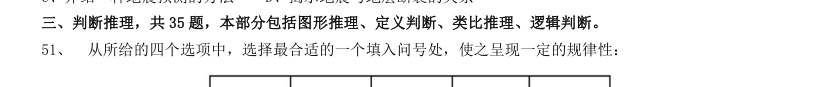

> （本题为图形题，选项为图片，见原卷）

**答案：D**

### 【2009 湖北省考·第 52 题】HB-2009-ty-X052　图形推理｜样式规律

从所给的四个选项中,选择最合适的一个填入问号处,使之呈现一定的规律性:

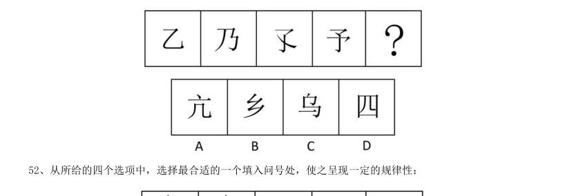

> （本题为图形题，选项为图片，见原卷）

**答案：A**

### 【2009 湖北省考·第 53 题】HB-2009-ty-X053　图形推理｜数量规律

从所给的四个选项中,选择最合适的一个填入问号处,使之呈现一定的规律性:

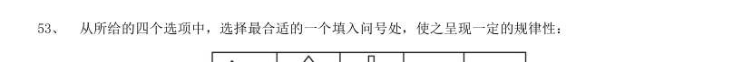

> （本题为图形题，选项为图片，见原卷）

**答案：D**

### 【2009 湖北省考·第 54 题】HB-2009-ty-X054　图形推理｜数量规律

从所给的四个选项中,选择最合适的一个填入问号处,使之呈现一定的规律性:

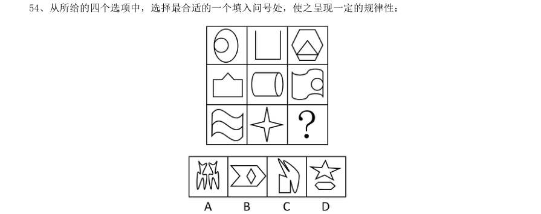

> （本题为图形题，选项为图片，见原卷）

**答案：C**

### 【2009 湖北省考·第 55 题】HB-2009-ty-X055　图形推理｜数量规律

从所给的四个选项中,选择最合适的一个填入问号处,使之呈现一定的规律性:

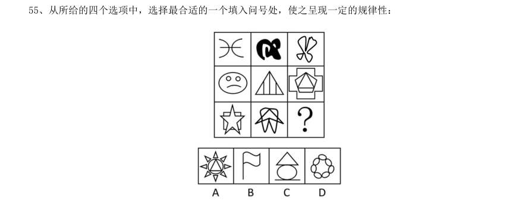

> （本题为图形题，选项为图片，见原卷）

**答案：D**

### 【2009 湖北省考·第 58 题】HB-2009-ty-X058　图形推理｜图形推理（待细分）

脑科学的研究表明,在人脑的发育中存在“关键期”,即人在发展过程中,某一方面在某一阶段发展得最 快,比如,3 岁以前是动作发展的“关键期”,1—3 岁是语言发展的“关键期”,4 岁左右是感知图形的“关 键期”。在这一时期,脑在结构和功能上都具有很强的适应和重组的能力,易于受到环境的影响,关键期内适 宜的刺激和经验是运动、感觉、语言及其他脑功能正常发展的重要前提。 下列利用了“关键期”理论的是:

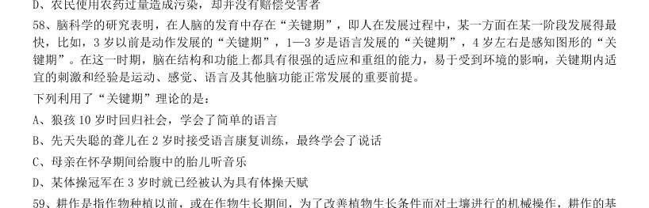

- **A.** 狼孩10 岁时回归社会,学会了简单的语言
- **B.** 先天失聪的聋儿在2 岁时接受语言康复训练,最终学会了说话
- **C.** 母亲在怀孕期间给腹中的胎儿听音乐
- **D.** 某体操冠军在3 岁时就已经被认为具有体操天赋

**答案：B**

### 【2009 广东省考·第 66 题】GD-2009-ty-X066　图形推理｜图形推理（待细分）

（本题题干为图形/公式，文字层无题干，图见原卷）

> （本题为图形题，选项为图片，见原卷）

**答案：该题答案缺失，见原卷**

### 【2009 广东省考·第 67 题】GD-2009-ty-X067　图形推理｜图形推理（待细分）

（本题题干为图形/公式，文字层无题干，图见原卷）

> （本题为图形题，选项为图片，见原卷）

**答案：该题答案缺失，见原卷**

### 【2009 广东省考·第 68 题】GD-2009-ty-X068　图形推理｜图形推理（待细分）

（本题题干为图形/公式，文字层无题干，图见原卷）

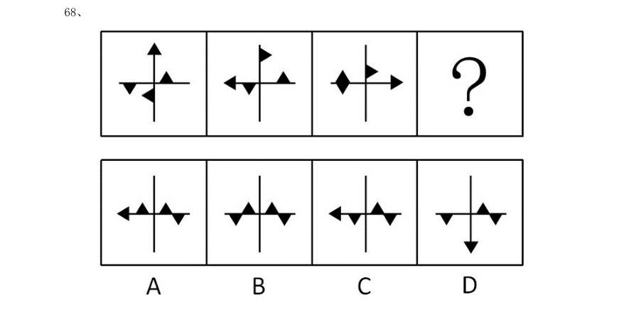

> （本题为图形题，选项为图片，见原卷）

**答案：该题答案缺失，见原卷**

### 【2009 广东省考·第 69 题】GD-2009-ty-X069　图形推理｜图形推理（待细分）

（本题题干为图形/公式，文字层无题干，图见原卷）

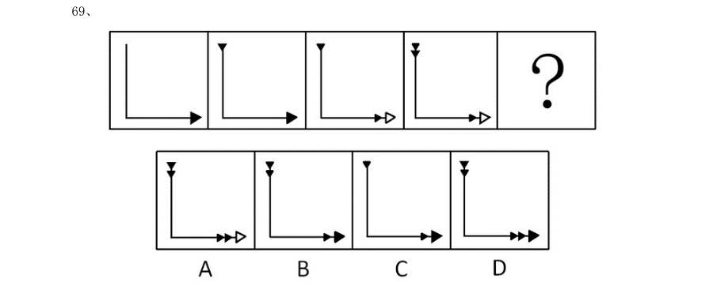

> （本题为图形题，选项为图片，见原卷）

**答案：该题答案缺失，见原卷**

### 【2009 广东省考·第 70 题】GD-2009-ty-X070　图形推理｜图形推理（待细分）

（本题题干为图形/公式，文字层无题干，图见原卷）

> （本题为图形题，选项为图片，见原卷）

**答案：该题答案缺失，见原卷**

### 【2009 广东省考·第 71 题】GD-2009-ty-X071　图形推理｜图形推理（待细分）

（本题题干为图形/公式，文字层无题干，图见原卷）

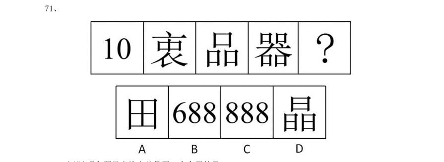

> （本题为图形题，选项为图片，见原卷）

**答案：该题答案缺失，见原卷**

### 【2009 广东省考·第 72 题】GD-2009-ty-X072　图形推理｜图形推理（待细分）

下列选项和题目中给出的是同一个盒子的是:

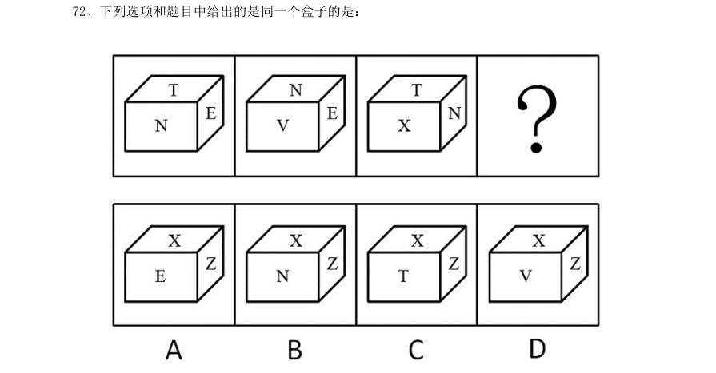

> （本题为图形题，选项为图片，见原卷）

**答案：该题答案缺失，见原卷**

### 【2009 广东省考·第 73 题】GD-2009-ty-X073　图形推理｜图形推理（待细分）

右边的盒子不能由左边给定的图形做成的一个是:

> （本题为图形题，选项为图片，见原卷）

**答案：该题答案缺失，见原卷**

### 【2009 广东省考·第 74 题】GD-2009-ty-X074　图形推理｜图形推理（待细分）

（本题题干为图形/公式，文字层无题干，图见原卷）

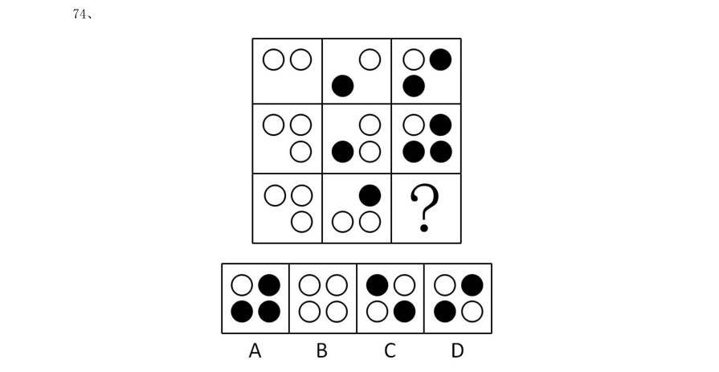

> （本题为图形题，选项为图片，见原卷）

**答案：该题答案缺失，见原卷**

### 【2009 广东省考·第 75 题】GD-2009-ty-X075　图形推理｜图形推理（待细分）

（本题题干为图形/公式，文字层无题干，图见原卷）

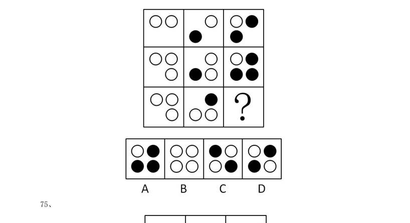

> （本题为图形题，选项为图片，见原卷）

**答案：该题答案缺失，见原卷**

### 【2009 国考·第 66 题】GK-2009-ty-X066　图形推理｜数量规律

请从所给的四个选项中,选择最合适的一个填入问号处,使之呈现一定的规律性:

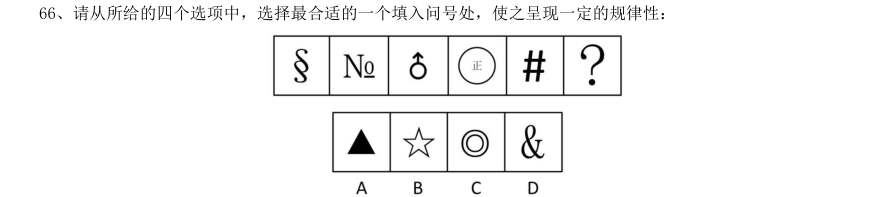

> （本题为图形题，选项为图片，见原卷）

**答案：B**

### 【2009 国考·第 67 题】GK-2009-ty-X067　图形推理｜数量规律

请从所给的四个选项中,选择最合适的一个填入问号处,使之呈现一定的规律性:

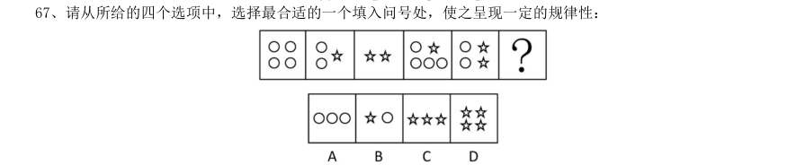

> （本题为图形题，选项为图片，见原卷）

**答案：C**

### 【2009 国考·第 68 题】GK-2009-ty-X068　图形推理｜立体拼合

请从所给的四个选项中,选择最合适的一个填入问号处,使之呈现一定的规律性:

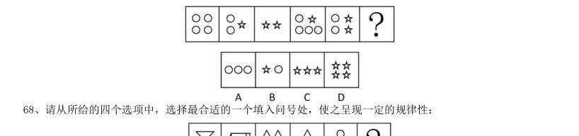

> （本题为图形题，选项为图片，见原卷）

**答案：A**

### 【2009 国考·第 69 题】GK-2009-ty-X069　图形推理｜数量规律

请从所给的四个选项中,选择最合适的一个填入问号处,使之呈现一定的规律性:

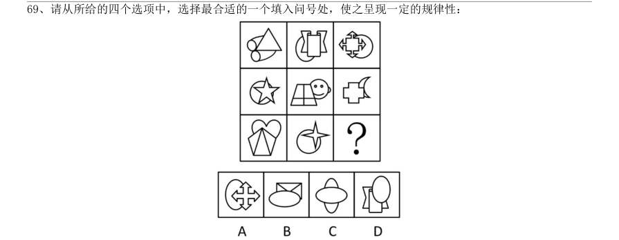

> （本题为图形题，选项为图片，见原卷）

**答案：A**

### 【2009 国考·第 70 题】GK-2009-ty-X070　图形推理｜折纸盒

下面四个所给的选项中,哪一项能折成左边给定的图形:

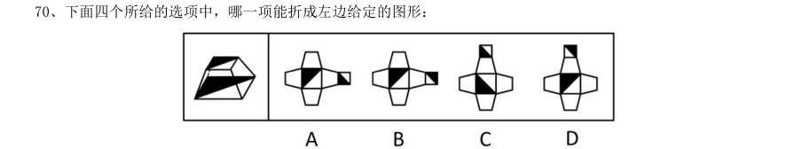

> （本题为图形题，选项为图片，见原卷）

**答案：B**

### 【2008 湖北省考·第 51 题】HB-2008-ty-X051　图形推理｜数量规律

(共40 题,参考时限35 分钟) 本部分包括四种类型的题目: 问题图形具有一定的相似性,也存在某种差异。你要从中找出其变化的规律,并把这种规律正确地运用到解 题过程中,或者依据图形变化的规律进行选择。

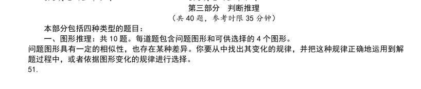

> （本题为图形题，选项为图片，见原卷）

**答案：该题答案缺失，见原卷**

### 【2008 湖北省考·第 52 题】HB-2008-ty-X052　图形推理｜位置规律

（本题题干为图形/公式，文字层无题干，图见原卷）

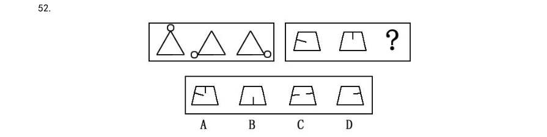

> （本题为图形题，选项为图片，见原卷）

**答案：该题答案缺失，见原卷**

### 【2008 湖北省考·第 53 题】HB-2008-ty-X053　图形推理｜位置规律

（本题题干为图形/公式，文字层无题干，图见原卷）

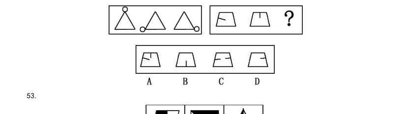

> （本题为图形题，选项为图片，见原卷）

**答案：该题答案缺失，见原卷**

### 【2008 湖北省考·第 54 题】HB-2008-ty-X054　图形推理｜图形推理（待细分）

（本题题干为图形/公式，文字层无题干，图见原卷）

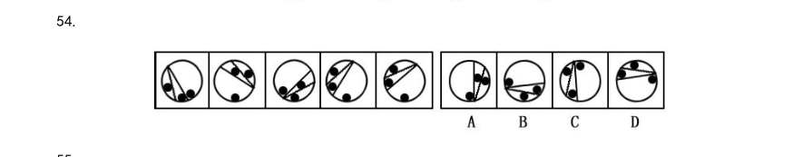

> （本题为图形题，选项为图片，见原卷）

**答案：B**

### 【2008 湖北省考·第 55 题】HB-2008-ty-X055　图形推理｜图形推理（待细分）

（本题题干为图形/公式，文字层无题干，图见原卷）

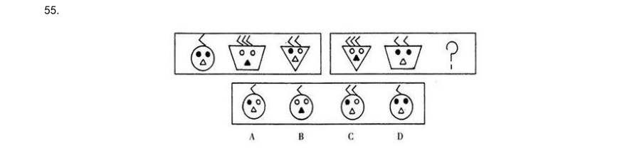

> （本题为图形题，选项为图片，见原卷）

**答案：A**

### 【2008 湖北省考·第 56 题】HB-2008-ty-X056　图形推理｜位置规律

（本题题干为图形/公式，文字层无题干，图见原卷）

> （本题为图形题，选项为图片，见原卷）

**答案：该题答案缺失，见原卷**

### 【2008 湖北省考·第 57 题】HB-2008-ty-X057　图形推理｜属性规律

（本题题干为图形/公式，文字层无题干，图见原卷）

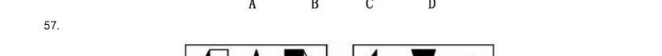

> （本题为图形题，选项为图片，见原卷）

**答案：A**

### 【2008 湖北省考·第 58 题】HB-2008-ty-X058　图形推理｜位置规律

（本题题干为图形/公式，文字层无题干，图见原卷）

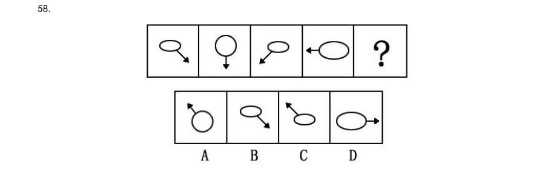

> （本题为图形题，选项为图片，见原卷）

**答案：C**

### 【2008 湖北省考·第 59 题】HB-2008-ty-X059　图形推理｜折纸盒

将下面左图进行折叠后,得到的图形是:

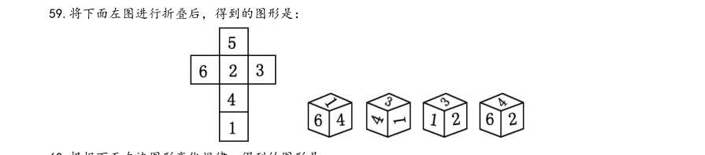

> （本题为图形题，选项为图片，见原卷）

**答案：B**

### 【2008 湖北省考·第 60 题】HB-2008-ty-X060　图形推理｜立体图形

根据下面左边图形变化规律,得到的图形是: 二、演绎推理:共10 题。每道题给出一段陈述,这段陈述被假设是正确的,不容置疑的。要求你根据这 段陈述,选出一个答案。注意,正确的答案应与所给的陈述相符合,不需要任何附加说明即可以从陈述中直 接推出。

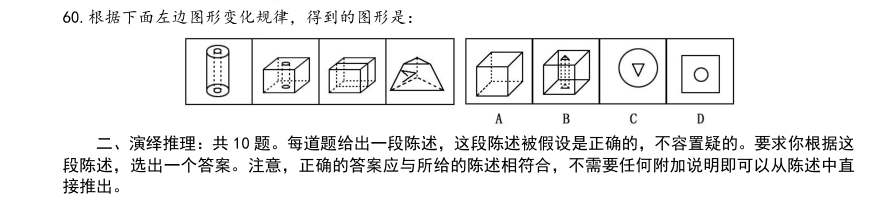

> （本题为图形题，选项为图片，见原卷）

**答案：B**

### 【2008 国考·第 61 题】GK-2008-ty-X061　图形推理｜数量规律

请从所给的四个选项中,选择最合适的一个填入问号处,使之呈现一定的规律性:

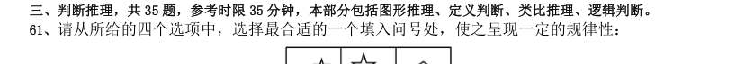

> （本题为图形题，选项为图片，见原卷）

**答案：D**

### 【2008 国考·第 62 题】GK-2008-ty-X062　图形推理｜样式规律

请从所给的四个选项中,选择最合适的一个填入问号处,使之呈现一定的规律性:

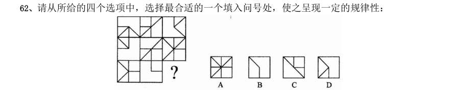

> （本题为图形题，选项为图片，见原卷）

**答案：D**

### 【2008 国考·第 63 题】GK-2008-ty-X063　图形推理｜数量规律

请从所给的四个选项中,选择最合适的一个填入问号处,使之呈现一定的规律性:

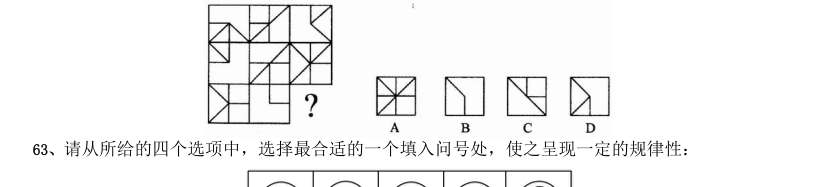

> （本题为图形题，选项为图片，见原卷）

**答案：D**

### 【2008 国考·第 64 题】GK-2008-ty-X064　图形推理｜图形推理（待细分）

请从所给的四个选项中,选择最合适的一个填入问号处,使之呈现一定的规律性:

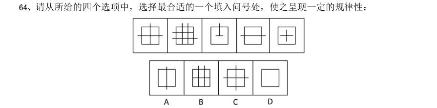

> （本题为图形题，选项为图片，见原卷）

**答案：C**

### 【2008 国考·第 65 题】GK-2008-ty-X065　图形推理｜折纸盒

下面四个所给的选项中,哪一选项的盒子不能由左边给定的图形做成( )。

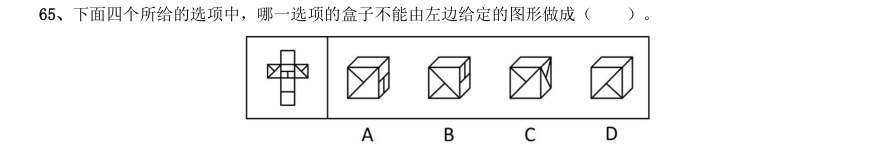

> （本题为图形题，选项为图片，见原卷）

**答案：C**

### 【2007 广东省考·第 66 题】GD-2007-ty-X066　图形推理｜图形推理（待细分）

一定的规律,也存在某种差异,要求你从四个选项中选择你认为最适合取代问号的一个。你要从中找出变化 的规律,并把这种规律正确地运用到解题过程中,或者依据图形变化的规律进行选择。

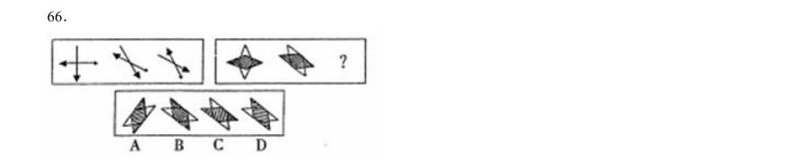

> （本题为图形题，选项为图片，见原卷）

**答案：该题答案缺失，见原卷**

### 【2007 广东省考·第 67 题】GD-2007-ty-X067　图形推理｜图形推理（待细分）

.

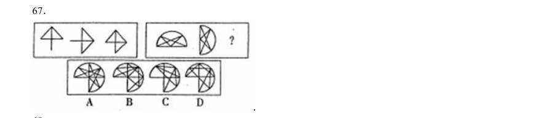

> （本题为图形题，选项为图片，见原卷）

**答案：该题答案缺失，见原卷**

### 【2007 广东省考·第 68 题】GD-2007-ty-X068　图形推理｜图形推理（待细分）

（本题题干为图形/公式，文字层无题干，图见原卷）

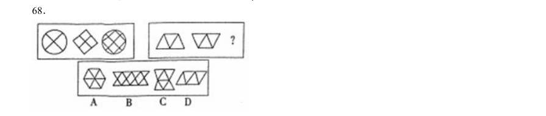

> （本题为图形题，选项为图片，见原卷）

**答案：该题答案缺失，见原卷**

### 【2007 广东省考·第 69 题】GD-2007-ty-X069　图形推理｜图形推理（待细分）

（本题题干为图形/公式，文字层无题干，图见原卷）

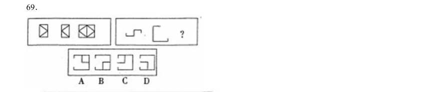

> （本题为图形题，选项为图片，见原卷）

**答案：该题答案缺失，见原卷**

### 【2007 广东省考·第 70 题】GD-2007-ty-X070　图形推理｜图形推理（待细分）

（本题题干为图形/公式，文字层无题干，图见原卷）

> （本题为图形题，选项为图片，见原卷）

**答案：该题答案缺失，见原卷**

### 【2007 广东省考·第 71 题】GD-2007-ty-X071　图形推理｜图形推理（待细分）

（本题题干为图形/公式，文字层无题干，图见原卷）

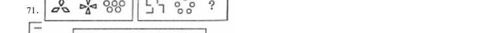

> （本题为图形题，选项为图片，见原卷）

**答案：该题答案缺失，见原卷**

### 【2007 广东省考·第 72 题】GD-2007-ty-X072　图形推理｜图形推理（待细分）

（本题题干为图形/公式，文字层无题干，图见原卷）

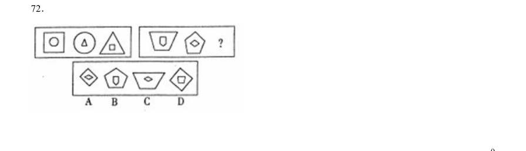

> （本题为图形题，选项为图片，见原卷）

**答案：该题答案缺失，见原卷**

### 【2007 广东省考·第 73 题】GD-2007-ty-X073　图形推理｜图形推理（待细分）

（本题题干为图形/公式，文字层无题干，图见原卷）

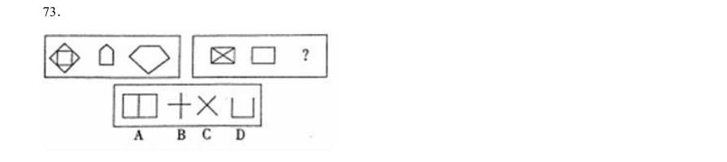

> （本题为图形题，选项为图片，见原卷）

**答案：该题答案缺失，见原卷**

### 【2007 广东省考·第 74 题】GD-2007-ty-X074　图形推理｜图形推理（待细分）

（本题题干为图形/公式，文字层无题干，图见原卷）

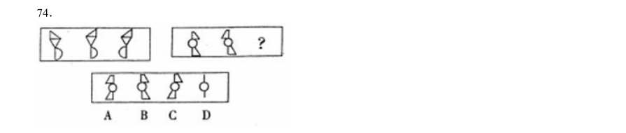

> （本题为图形题，选项为图片，见原卷）

**答案：该题答案缺失，见原卷**

### 【2007 广东省考·第 75 题】GD-2007-ty-X075　图形推理｜图形推理（待细分）

四、演绎推理:共l0 题,每题l.2 分。共12 分。每题给出一段陈述,这段陈述被假设是正确的。不容置疑。 要求你根据这段陈述,选出一个答案。注意,正确的答案应与给定的陈述相符合,不需要任何附加说明即可 以从陈述中直接推出。

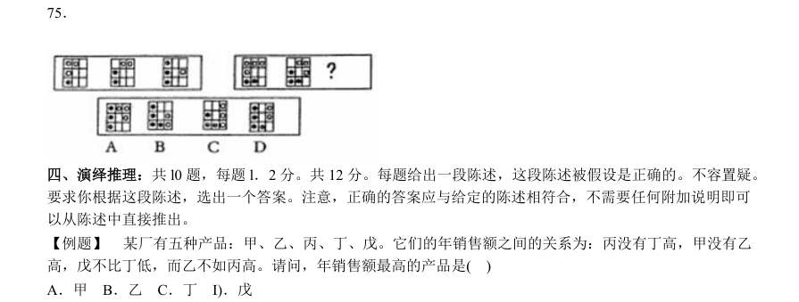

> （本题为图形题，选项为图片，见原卷）

**答案：该题答案缺失，见原卷**

### 【2007 广东省考·第 77 题】GD-2007-ty-X077　图形推理｜图形推理（待细分）

最近某保健医院进行为期lo 周的减肥试验,参加者平均减肥9 公斤。男性参加者平均减肥l3 公斤,女 性参加者平均减肥7 公斤。医生将男女减肥差异归结为男性参加者减肥前体重比女性参加者重。 从上文可推出以下哪个结论?(

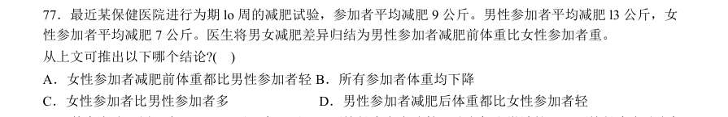

> （本题为图形题，选项为图片，见原卷）

**答案：该题答案缺失，见原卷**

### 【2007 国考·第 61 题】GK-2007-ty-X061　图形推理｜位置规律

请从所给的四个选项中,选择最合适的一个填入问号处,使之呈现一定的规律性:

> （本题为图形题，选项为图片，见原卷）

**答案：B**

### 【2007 国考·第 62 题】GK-2007-ty-X062　图形推理｜数量规律

请从所给的四个选项中,选择最合适的一个填入问号处,使之呈现一定的规律性:

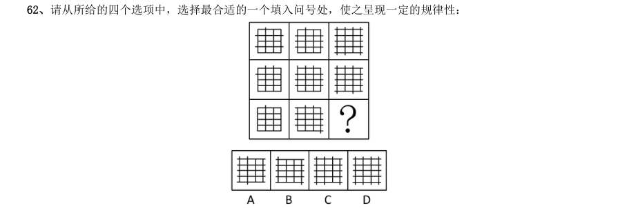

> （本题为图形题，选项为图片，见原卷）

**答案：A**

### 【2007 国考·第 63 题】GK-2007-ty-X063　图形推理｜位置规律

请从所给的四个选项中,选择最合适的一个填入问号处,使之呈现一定的规律性:

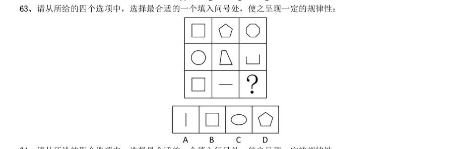

> （本题为图形题，选项为图片，见原卷）

**答案：D**

### 【2007 国考·第 64 题】GK-2007-ty-X064　图形推理｜数量规律

请从所给的四个选项中,选择最合适的一个填入问号处,使之呈现一定的规律性:

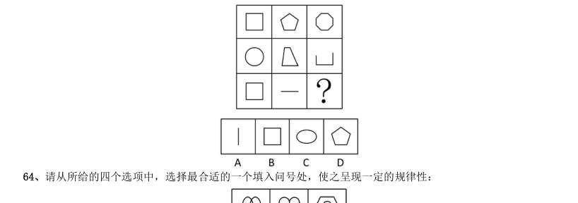

> （本题为图形题，选项为图片，见原卷）

**答案：A**

### 【2007 国考·第 65 题】GK-2007-ty-X065　图形推理｜位置规律

请从所给的四个选项中,选择最合适的一个填入问号处,使之呈现一定的规律性:

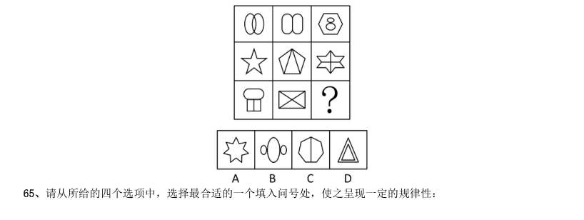

> （本题为图形题，选项为图片，见原卷）

**答案：A**

### 【2006 国考·第 51 题】GK-2006-ty-X051　图形推理｜图形推理（待细分）
> 材料：(共45 题,参考时限40 分钟) 本部分包括四种类型的试题: 1.每道题目的左边4 个图形呈现一定的规律性。你需要在右边所给出的备选答案中选出一个 最合理的正确答案。每道题只有一个正确答案。…

A B C D

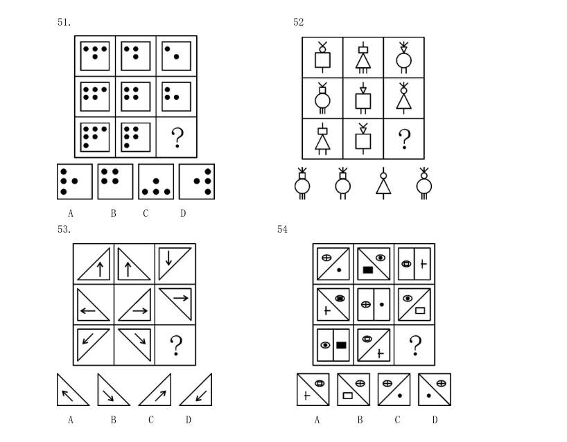

> （本题为图形题，选项为图片，见原卷）

**答案：A**

### 【2006 国考·第 53 题】GK-2006-ty-X053　图形推理｜位置规律

A B C D A B C D

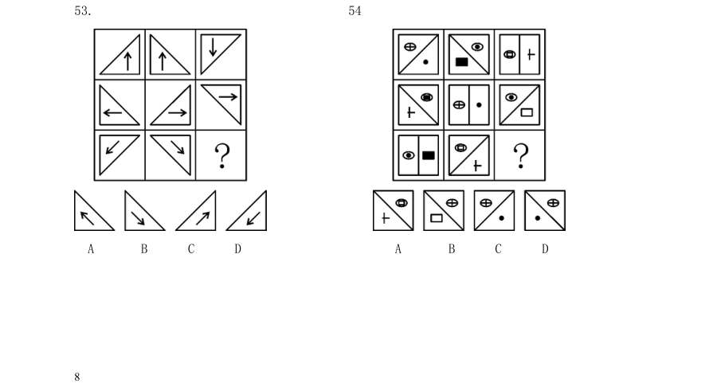

> （本题为图形题，选项为图片，见原卷）

**答案：C**

### 【2006 国考·第 55 题】GK-2006-ty-X055　图形推理｜位置规律

A B C D (二)左边的图形由若干个元素组成。右边的备选图形中只有一个是由组成左边图形的元素 组成的,请选出这一个。注意,组成新的图形时,只能在同一平面上,方向、位置可能出现变化。

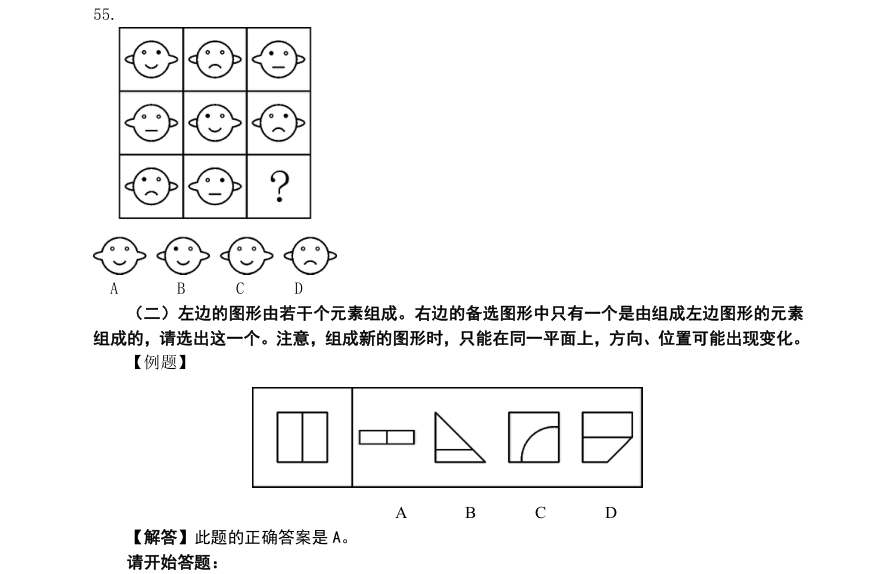

> （本题为图形题，选项为图片，见原卷）

**答案：C**

### 【2006 国考·第 56 题】GK-2006-ty-X056　图形推理｜立体拼合

（本题题干为图形/公式，文字层无题干，图见原卷）

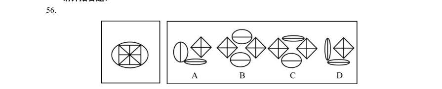

> （本题为图形题，选项为图片，见原卷）

**答案：该题答案缺失，见原卷**

### 【2006 国考·第 57 题】GK-2006-ty-X057　图形推理｜图形推理（待细分）

【解析】C。此题图形有问题,还原成正方形和圆,才能有解。

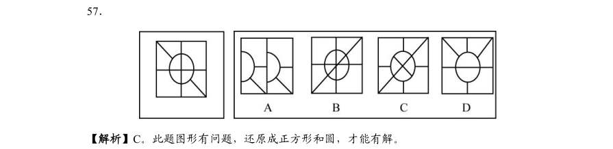

> （本题为图形题，选项为图片，见原卷）

**答案：该题答案缺失，见原卷**

### 【2006 国考·第 58 题】GK-2006-ty-X058　图形推理｜位置规律

【解析】C。原始图形和选项都可分为三个部分,将C 项的前二个部分逆时针旋转180 度即 可得到原始图形。

> （本题为图形题，选项为图片，见原卷）

**答案：该题答案缺失，见原卷**

### 【2006 国考·第 59 题】GK-2006-ty-X059　图形推理｜位置规律

【解析】B。将原始图形切成上下两个半圆,将上半部分平移到下面,即可得到B 选项。

> （本题为图形题，选项为图片，见原卷）

**答案：该题答案缺失，见原卷**

### 【2005 广东省考·第 66 题】GD-2005-ty-X066　图形推理｜位置规律

具有一定的规律,也相隔在某种差异。要求你从四个选项中选择你认为最适合取代问题的一个。你要从中找 出其变化的规律并把这种规律正确地运用到解题过程中, 或者依据图形变化的规律进行选择。

> （本题为图形题，选项为图片，见原卷）

**答案：该题答案缺失，见原卷**

### 【2005 广东省考·第 67 题】GD-2005-ty-X067　图形推理｜图形推理（待细分）

（本题题干为图形/公式，文字层无题干，图见原卷）

> （本题为图形题，选项为图片，见原卷）

**答案：该题答案缺失，见原卷**

### 【2005 广东省考·第 68 题】GD-2005-ty-X068　图形推理｜图形推理（待细分）

（本题题干为图形/公式，文字层无题干，图见原卷）

> （本题为图形题，选项为图片，见原卷）

**答案：该题答案缺失，见原卷**

### 【2005 广东省考·第 69 题】GD-2005-ty-X069　图形推理｜图形推理（待细分）

（本题题干为图形/公式，文字层无题干，图见原卷）

> （本题为图形题，选项为图片，见原卷）

**答案：该题答案缺失，见原卷**

### 【2005 广东省考·第 70 题】GD-2005-ty-X070　图形推理｜图形推理（待细分）

（本题题干为图形/公式，文字层无题干，图见原卷）

> （本题为图形题，选项为图片，见原卷）

**答案：该题答案缺失，见原卷**

### 【2005 广东省考·第 71 题】GD-2005-ty-X071　图形推理｜图形推理（待细分）

（本题题干为图形/公式，文字层无题干，图见原卷）

> （本题为图形题，选项为图片，见原卷）

**答案：该题答案缺失，见原卷**

### 【2005 广东省考·第 73 题】GD-2005-ty-X073　图形推理｜图形推理（待细分）

（本题题干为图形/公式，文字层无题干，图见原卷）

> （本题为图形题，选项为图片，见原卷）

**答案：该题答案缺失，见原卷**

### 【2005 广东省考·第 75 题】GD-2005-ty-X075　图形推理｜图形推理（待细分）

四、演绎推理:共10 题,每题1.2 分,共12 分。每题给出一段陈述,这段陈述被假设是正确的,不 容置疑的。要求你根据这段陈述,选出一个答案。注意,正确的答案应与所给的陈述相符合,不需要任何附 加说明即可以从陈述中直接推出。

> （本题为图形题，选项为图片，见原卷）

**答案：该题答案缺失，见原卷**

### 【2005 国考·第 51 题】GK-2005-ty-X051　图形推理｜数量规律

判断推理(共45 题,参考时限40 分钟) 本部分包括四种类型的试题: 1.每道题目的左边4 个图形呈现一定的规律性。你需要在右边所给出的备选答案中选出一个最合 理的正确答案。每道题只有一个正确答案。

> （本题为图形题，选项为图片，见原卷）

**答案：D**

### 【2005 国考·第 52 题】GK-2005-ty-X052　图形推理｜样式规律

（本题题干为图形/公式，文字层无题干，图见原卷）

> （本题为图形题，选项为图片，见原卷）

**答案：C**

### 【2005 国考·第 53 题】GK-2005-ty-X053　图形推理｜图形推理（待细分）

（本题题干为图形/公式，文字层无题干，图见原卷）

> （本题为图形题，选项为图片，见原卷）

**答案：B**

### 【2005 国考·第 54 题】GK-2005-ty-X054　图形推理｜立体拼合

2.每道题包含两套图形和可供选择的4 个图形。这两套图形具有某种相似性,也存在某种差异。 要求你从四个选项中选择你认为最适合取代问号的一个。正确的答案应不仅使两套图形表现出最大的相 似性,而且使第二套图形也表现出自己的特征。

> （本题为图形题，选项为图片，见原卷）

**答案：A**

### 【2005 国考·第 55 题】GK-2005-ty-X055　图形推理｜属性规律

（本题题干为图形/公式，文字层无题干，图见原卷）

> （本题为图形题，选项为图片，见原卷）

**答案：D**

### 【2005 国考·第 56 题】GK-2005-ty-X056　图形推理｜属性规律

（本题题干为图形/公式，文字层无题干，图见原卷）

> （本题为图形题，选项为图片，见原卷）

**答案：D**

### 【2005 国考·第 57 题】GK-2005-ty-X057　图形推理｜折纸盒

3.在右面的4 个图形中,只有一个是由左边的纸板折叠而成。你需要选出正确的一个。

> （本题为图形题，选项为图片，见原卷）

**答案：A**

### 【2005 国考·第 58 题】GK-2005-ty-X058　图形推理｜图形推理（待细分）

（本题题干为图形/公式，文字层无题干，图见原卷）

> （本题为图形题，选项为图片，见原卷）

**答案：D**

### 【2005 国考·第 59 题】GK-2005-ty-X059　图形推理｜折纸盒

（本题题干为图形/公式，文字层无题干，图见原卷）

> （本题为图形题，选项为图片，见原卷）

**答案：A**

### 【2005 国考·第 60 题】GK-2005-ty-X060　图形推理｜位置规律

据定义从中选出一个最符合或最不符合该定义的答案。注意:假设这个定义是正确的,不容置疑的。 请开始答题:

> （本题为图形题，选项为图片，见原卷）

**答案：B**

### 【2004 国考（A卷）·第 52 题】GK-2004-a-X052　图形推理｜数量规律

每道题目的左边4 个图形呈现一定的规律性。你需要在右边所给出的备选答案中选出一个最合理的正确答案。

> （本题为图形题，选项为图片，见原卷）

**答案：D**

### 【2004 国考（A卷）·第 53 题】GK-2004-a-X053　图形推理｜属性规律

每道题目的左边4 个图形呈现一定的规律性。你需要在右边所给出的备选答案中选出一个最合理的正确答案。

> （本题为图形题，选项为图片，见原卷）

**答案：D**

### 【2004 国考（A卷）·第 54 题】GK-2004-a-X054　图形推理｜数量规律

每道题目的左边4 个图形呈现一定的规律性。你需要在右边所给出的备选答案中选出一个最合理的正确答案。

> （本题为图形题，选项为图片，见原卷）

**答案：A**

### 【2004 国考（A卷）·第 55 题】GK-2004-a-X055　图形推理｜数量规律

每道题目的左边4 个图形呈现一定的规律性。你需要在右边所给出的备选答案中选出一个最合理的正确答案。

> （本题为图形题，选项为图片，见原卷）

**答案：D**

### 【2004 国考（A卷）·第 56 题】GK-2004-a-X056　图形推理｜属性规律

每道题目的左边4 个图形呈现一定的规律性。你需要在右边所给出的备选答案中选出一个最合理的正确答案。

> （本题为图形题，选项为图片，见原卷）

**答案：D**

### 【2004 国考（A卷）·第 57 题】GK-2004-a-X057　图形推理｜属性规律

每道题目的左边4 个图形呈现一定的规律性。你需要在右边所给出的备选答案中选出一个最合理的正确答案。

> （本题为图形题，选项为图片，见原卷）

**答案：D**

### 【2004 国考（A卷）·第 58 题】GK-2004-a-X058　图形推理｜数量规律

每道题目的左边4 个图形呈现一定的规律性。你需要在右边所给出的备选答案中选出一个最合理的正确答案。

> （本题为图形题，选项为图片，见原卷）

**答案：A**

### 【2004 国考（A卷）·第 59 题】GK-2004-a-X059　图形推理｜位置规律

每道题目的左边4 个图形呈现一定的规律性。你需要在右边所给出的备选答案中选出一个最合理的正确答案。

> （本题为图形题，选项为图片，见原卷）

**答案：A**

### 【2004 国考（A卷）·第 60 题】GK-2004-a-X060　图形推理｜折纸盒

每道题目的左边4 个图形呈现一定的规律性。你需要在右边所给出的备选答案中选出一个最合理的正确答案。

> （本题为图形题，选项为图片，见原卷）

**答案：B**

### 【2004 国考（A卷）·第 61 题】GK-2004-a-X061　图形推理｜折纸盒

每道题目的左边4 个图形呈现一定的规律性。你需要在右边所给出的备选答案中选出一个最合理的正确答案。

> （本题为图形题，选项为图片，见原卷）

**答案：B**

### 【2004 国考（B卷）·第 50 题】GK-2004-b-X050　图形推理｜样式规律

（本题题干为图形/公式，文字层无题干，图见原卷）

> （本题为图形题，选项为图片，见原卷）

**答案：D**

### 【2004 国考（B卷）·第 51 题】GK-2004-b-X051　图形推理｜位置规律

（本题题干为图形/公式，文字层无题干，图见原卷）

> （本题为图形题，选项为图片，见原卷）

**答案：A**

### 【2004 国考（B卷）·第 52 题】GK-2004-b-X052　图形推理｜位置规律

（本题题干为图形/公式，文字层无题干，图见原卷）

> （本题为图形题，选项为图片，见原卷）

**答案：C**

### 【2004 国考（B卷）·第 53 题】GK-2004-b-X053　图形推理｜位置规律

（本题题干为图形/公式，文字层无题干，图见原卷）

> （本题为图形题，选项为图片，见原卷）

**答案：D**

### 【2004 国考（B卷）·第 54 题】GK-2004-b-X054　图形推理｜图形推理（待细分）

（本题题干为图形/公式，文字层无题干，图见原卷）

> （本题为图形题，选项为图片，见原卷）

**答案：A**

### 【2004 国考（B卷）·第 55 题】GK-2004-b-X055　图形推理｜位置规律

（本题题干为图形/公式，文字层无题干，图见原卷）

> （本题为图形题，选项为图片，见原卷）

**答案：B**

### 【2004 国考（B卷）·第 56 题】GK-2004-b-X056　图形推理｜数量规律

（本题题干为图形/公式，文字层无题干，图见原卷）

> （本题为图形题，选项为图片，见原卷）

**答案：D**

### 【2004 国考（B卷）·第 57 题】GK-2004-b-X057　图形推理｜样式规律

（本题题干为图形/公式，文字层无题干，图见原卷）

> （本题为图形题，选项为图片，见原卷）

**答案：C**

### 【2004 国考（B卷）·第 58 题】GK-2004-b-X058　图形推理｜折纸盒

（本题题干为图形/公式，文字层无题干，图见原卷）

> （本题为图形题，选项为图片，见原卷）

**答案：A**

### 【2004 国考（B卷）·第 59 题】GK-2004-b-X059　图形推理｜折纸盒

（本题题干为图形/公式，文字层无题干，图见原卷）

> （本题为图形题，选项为图片，见原卷）

**答案：B**

### 【2004 国考（B卷）·第 78 题】GK-2004-b-X078　图形推理｜图形推理（待细分）

面试在求职过程中非常重要。经过面试,如果应聘者的个性不适合待聘工作的要求,则不可能被录用。以上 论断是建立在哪项假设的基础上的?( ) A 必须经过面试才能取得工作,这是工商界的规矩B 面试主持者能够准确地分辨出哪些个性是工作所需要的 C 面试的唯一目的就是测试应聘者的个性 D 若一个人的个性适合工作的要求,他就一定被录用

> （本题为图形题，选项为图片，见原卷）

**答案：B**

### 【2003 国考（A卷）·第 16 题】GK-2003-a-X016　图形推理｜位置规律
> 材料：判断推理(共35 题,参考时限35 分钟) 本部分包括三种类型的题目: 1.每道题目的左边4 个图形呈现一定的规律性。你需要在右边所给出的备选答案中选出一个最合理的正确 答案。每道题只有一个正确答案。…

A B C D

> （本题为图形题，选项为图片，见原卷）

**答案：A**

### 【2003 国考（A卷）·第 17 题】GK-2003-a-X017　图形推理｜图形推理（待细分）

A B C D

> （本题为图形题，选项为图片，见原卷）

**答案：B**

### 【2003 国考（A卷）·第 18 题】GK-2003-a-X018　图形推理｜图形推理（待细分）

A B C D

> （本题为图形题，选项为图片，见原卷）

**答案：B**

### 【2003 国考（A卷）·第 19 题】GK-2003-a-X019　图形推理｜数量规律

A B C D

> （本题为图形题，选项为图片，见原卷）

**答案：A**

### 【2003 国考（A卷）·第 20 题】GK-2003-a-X020　图形推理｜位置规律

A B C D

> （本题为图形题，选项为图片，见原卷）

**答案：C**

### 【2003 国考（A卷）·第 21 题】GK-2003-a-X021　图形推理｜位置规律

A B C D

> （本题为图形题，选项为图片，见原卷）

**答案：A**

### 【2003 国考（A卷）·第 22 题】GK-2003-a-X022　图形推理｜位置规律

A B C D 2.每道题包含两套图形和可供选择的4 个图形。这两套图形具有某种相似性,也存在某种差异。要求你从 四个选项中选择你认为最适合取代问号的一个。正确的答案应不仅使两套图形表现出最大的相似性,而且使第 二套图形也表现出自己的特征。

> （本题为图形题，选项为图片，见原卷）

**答案：D**

### 【2003 国考（A卷）·第 23 题】GK-2003-a-X023　图形推理｜样式规律

A B C D

> （本题为图形题，选项为图片，见原卷）

**答案：A**

### 【2003 国考（A卷）·第 24 题】GK-2003-a-X024　图形推理｜图形推理（待细分）

A B C D

> （本题为图形题，选项为图片，见原卷）

**答案：B**

### 【2003 国考（A卷）·第 25 题】GK-2003-a-X025　图形推理｜立体拼合

A B C D 二、演绎推理:共15 题,每题给出一段陈述,这段陈述假设是正确的,不容置疑的。要求你根据这段陈述, 选择一个答案。注意:正确的答案应与所给的陈述相符合,不需要任何附加说明即可以从陈述中直接推出。

> （本题为图形题，选项为图片，见原卷）

**答案：B**

### 【2002 国考（A卷）·第 87 题】GK-2002-a-X087　图形推理｜位置规律
> 材料：86:单选、…

单选、

> （本题为图形题，选项为图片，见原卷）

**答案：C**

### 【2002 国考（A卷）·第 88 题】GK-2002-a-X088　图形推理｜位置规律

单选、

> （本题为图形题，选项为图片，见原卷）

**答案：C**

### 【2002 国考（A卷）·第 89 题】GK-2002-a-X089　图形推理｜样式规律

单选、

> （本题为图形题，选项为图片，见原卷）

**答案：C**

### 【2002 国考（A卷）·第 90 题】GK-2002-a-X090　图形推理｜数量规律

单选、

> （本题为图形题，选项为图片，见原卷）

**答案：B**

### 【2002 国考（A卷）·第 91 题】GK-2002-a-X091　图形推理｜位置规律

单选、

> （本题为图形题，选项为图片，见原卷）

**答案：C**

### 【2002 国考（A卷）·第 92 题】GK-2002-a-X092　图形推理｜属性规律

单选、

> （本题为图形题，选项为图片，见原卷）

**答案：D**

### 【2002 国考（A卷）·第 93 题】GK-2002-a-X093　图形推理｜位置规律

单选、

> （本题为图形题，选项为图片，见原卷）

**答案：D**

### 【2002 国考（A卷）·第 94 题】GK-2002-a-X094　图形推理｜位置规律

单选、

> （本题为图形题，选项为图片，见原卷）

**答案：C**

### 【2002 国考（A卷）·第 95 题】GK-2002-a-X095　图形推理｜样式规律

单选、

> （本题为图形题，选项为图片，见原卷）

**答案：C**

### 【2002 国考（A卷）·第 105 题】GK-2002-a-X105　图形推理｜图形推理（待细分）

单选、 人文社会科学与自然科学在更高层次上具有统一性和共同性。在我国人文社会科学领域,许多伪劣产品是在人文 社会科学与自然科学的学术规范不同的借口之下生产出来、甚至受到好评的。据此可以得出:

> （本题为图形题，选项为图片，见原卷）

**答案：A**

### 【2002 国考（B卷）·第 97 题】GK-2002-b-X097　图形推理｜图形推理（待细分）
> 材料：96:单选、…

单选、

> （本题为图形题，选项为图片，见原卷）

**答案：该题答案缺失，见原卷**

### 【2002 国考（B卷）·第 98 题】GK-2002-b-X098　图形推理｜图形推理（待细分）

单选、 .

> （本题为图形题，选项为图片，见原卷）

**答案：该题答案缺失，见原卷**

### 【2002 国考（B卷）·第 99 题】GK-2002-b-X099　图形推理｜图形推理（待细分）

单选、

> （本题为图形题，选项为图片，见原卷）

**答案：该题答案缺失，见原卷**

### 【2002 国考（B卷）·第 100 题】GK-2002-b-X100　图形推理｜图形推理（待细分）

单选、

> （本题为图形题，选项为图片，见原卷）

**答案：该题答案缺失，见原卷**

### 【2002 国考（B卷）·第 101 题】GK-2002-b-X101　图形推理｜图形推理（待细分）

单选、

> （本题为图形题，选项为图片，见原卷）

**答案：该题答案缺失，见原卷**

### 【2002 国考（B卷）·第 102 题】GK-2002-b-X102　图形推理｜图形推理（待细分）

单选、

> （本题为图形题，选项为图片，见原卷）

**答案：该题答案缺失，见原卷**

### 【2002 国考（B卷）·第 103 题】GK-2002-b-X103　图形推理｜图形推理（待细分）

单选、

> （本题为图形题，选项为图片，见原卷）

**答案：该题答案缺失，见原卷**

### 【2002 国考（B卷）·第 104 题】GK-2002-b-X104　图形推理｜图形推理（待细分）

单选、

> （本题为图形题，选项为图片，见原卷）

**答案：该题答案缺失，见原卷**

### 【2002 国考（B卷）·第 105 题】GK-2002-b-X105　图形推理｜图形推理（待细分）

单选、

> （本题为图形题，选项为图片，见原卷）

**答案：该题答案缺失，见原卷**

### 【2001 国考·第 71 题】GK-2001-ty-X071　图形推理｜数量规律
> 材料：差异。要求你从四个选项中选择你认为最适合取代问号的一个。正确的答案应不仅使两套图形表现出最大的 相似性,而且使第二套图形也表现出自己的特征。…

A B C D

> （本题为图形题，选项为图片，见原卷）

**答案：B**

### 【2001 国考·第 72 题】GK-2001-ty-X072　图形推理｜位置规律

A B C D

> （本题为图形题，选项为图片，见原卷）

**答案：A**

### 【2001 国考·第 73 题】GK-2001-ty-X073　图形推理｜位置规律

A B C D

> （本题为图形题，选项为图片，见原卷）

**答案：D**

### 【2001 国考·第 74 题】GK-2001-ty-X074　图形推理｜数量规律

A B C D

> （本题为图形题，选项为图片，见原卷）

**答案：D**

### 【2001 国考·第 75 题】GK-2001-ty-X075　图形推理｜图形推理（待细分）

A B C D

> （本题为图形题，选项为图片，见原卷）

**答案：D**

### 【2001 国考·第 76 题】GK-2001-ty-X076　图形推理｜样式规律

A B C D

> （本题为图形题，选项为图片，见原卷）

**答案：C**

### 【2001 国考·第 77 题】GK-2001-ty-X077　图形推理｜位置规律

A B C D

> （本题为图形题，选项为图片，见原卷）

**答案：C**

### 【2001 国考·第 78 题】GK-2001-ty-X078　图形推理｜样式规律

A B C D

> （本题为图形题，选项为图片，见原卷）

**答案：C**

### 【2001 国考·第 79 题】GK-2001-ty-X079　图形推理｜数量规律

A B C D

> （本题为图形题，选项为图片，见原卷）

**答案：C**

### 【2001 国考·第 80 题】GK-2001-ty-X080　图形推理｜数量规律

A B C D 三、演绎推理:共10 题,每题给出一段陈述,这段陈述被假设是正确的、不容置疑的。要求你根据这段陈述 选择一个答案。注意:正确的答案应与所给的陈述相符合,不需要任何附加说明即可从陈述中直接推出。

> （本题为图形题，选项为图片，见原卷）

**答案：B**

### 【2000 国考·第 61 题】GK-2000-ty-X061　图形推理｜图形推理（待细分）

A B C D

> （本题为图形题，选项为图片，见原卷）

**答案：A**

### 【2000 国考·第 62 题】GK-2000-ty-X062　图形推理｜属性规律

A B C D

> （本题为图形题，选项为图片，见原卷）

**答案：B**

### 【2000 国考·第 63 题】GK-2000-ty-X063　图形推理｜数量规律

A B C D

> （本题为图形题，选项为图片，见原卷）

**答案：A**

### 【2000 国考·第 64 题】GK-2000-ty-X064　图形推理｜样式规律

A B C D

> （本题为图形题，选项为图片，见原卷）

**答案：该题答案缺失，见原卷**

### 【2000 国考·第 65 题】GK-2000-ty-X065　图形推理｜样式规律

A B C D

> （本题为图形题，选项为图片，见原卷）

**答案：C**

### 【2000 国考·第 66 题】GK-2000-ty-X066　图形推理｜立体图形

A B C D

> （本题为图形题，选项为图片，见原卷）

**答案：该题答案缺失，见原卷**

### 【2000 国考·第 67 题】GK-2000-ty-X067　图形推理｜立体拼合

A B C D

> （本题为图形题，选项为图片，见原卷）

**答案：C**

### 【2000 国考·第 68 题】GK-2000-ty-X068　图形推理｜位置规律

A B C D

> （本题为图形题，选项为图片，见原卷）

**答案：该题答案缺失，见原卷**

### 【2000 国考·第 69 题】GK-2000-ty-X069　图形推理｜样式规律

A B C D

> （本题为图形题，选项为图片，见原卷）

**答案：该题答案缺失，见原卷**

### 【2000 国考·第 70 题】GK-2000-ty-X070　图形推理｜位置规律

A B C D 四、演绎推理:共10 题,每题给出一段陈述,这段陈述被假设是正确的、不容置疑的。要求你根据这段陈述选 择一个答案。注意:正确的答案应与所给的陈述相符合,不需要任何附加说明即可以从陈述中直接推出。

> （本题为图形题，选项为图片，见原卷）

**答案：C**
