# 判断推理 · 图形推理 · 2010 年代真题

> 所属考点：[PD-TX](../PD-TX-图形推理.md)　｜　本片 370 题

### 2019 湖北·统一卷　第 71 题　（位置规律）
> 材料：最恰当的答案。…

从所给四个选项中,选择最合适的一个填入问号处,使之呈现一定的规律性:

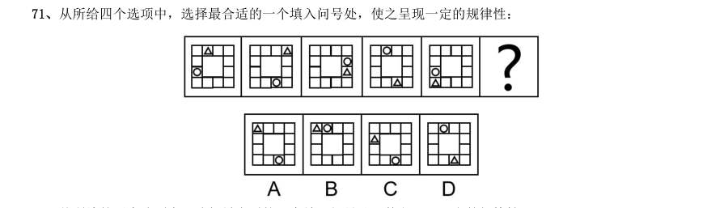

> （本题为图形题，选项为图片，见原卷）

**答案：C**

### 2019 湖北·统一卷　第 72 题　（数量规律）

从所给的四个选项中,选择最合适的一个填入问号处,使之呈现一定的规律性:

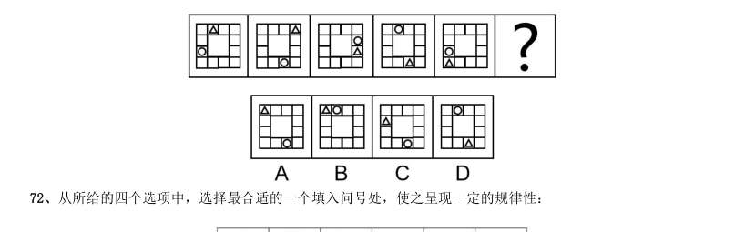

> （本题为图形题，选项为图片，见原卷）

**答案：D**

### 2019 湖北·统一卷　第 73 题　（数量规律）

从所给的四个选项中,选择最合适的一个填入问号处,使之呈现一定的规律性:

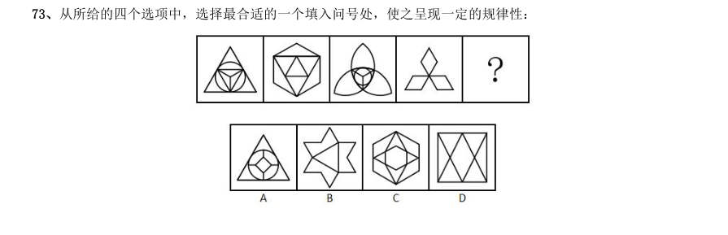

> （本题为图形题，选项为图片，见原卷）

**答案：B**

### 2019 湖北·统一卷　第 74 题　（分组分类）

把下面的图形分为两类,使每一类图形都有各自的共同特征或规律,分类正确的一项是:

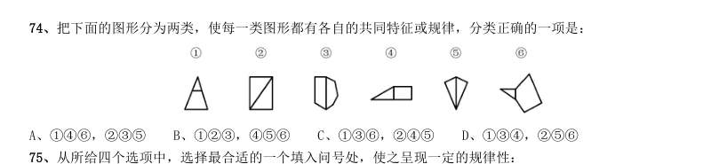

- **A.** 146,235
- **B.** 123,456
- **C.** 136,245
- **D.** 134,256

**答案：A**

### 2019 湖北·统一卷　第 75 题　（立体图形）

从所给四个选项中,选择最合适的一个填入问号处,使之呈现一定的规律性:

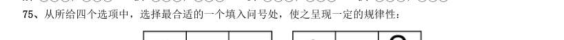

> （本题为图形题，选项为图片，见原卷）

**答案：C**

### 2019 湖北·统一卷　第 76 题　（位置规律）

正方形切掉一块后剩余部分如下图左侧所示,右侧哪一项是其切去部分的形状?

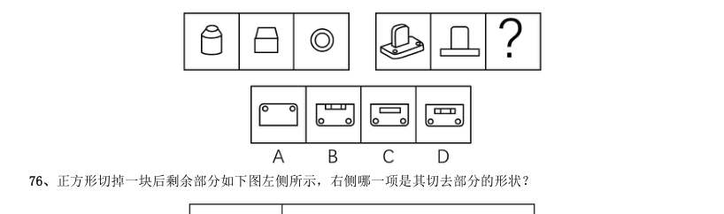

> （本题为图形题，选项为图片，见原卷）

**答案：B**

### 2019 湖北·统一卷　第 79 题　（图形推理（综合））

意志的活动过程会体现以下两大定律。其中,意志强度边际效应定律是指意志的强度随着自身行为的活动规 模的增长而下降;意志强度时间衰减定律是指意志的强度随着自身行为的持续时间的增长而呈现负指数下降。 根据上述定义,下列选项最能体现意志强度时间衰减定律的是:

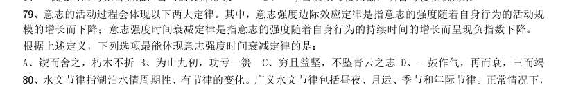

> （本题为图形题，选项为图片，见原卷）

**答案：D**

### 2019 湖北·选调　第 96 题　（数量规律）

请将下面六个图形分为两类,使每一类图形都有各自的共同特征或规律,分类正确的一项是:

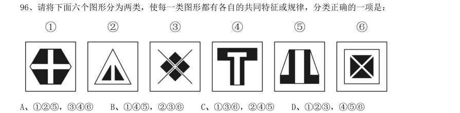

- **A.** 125,346
- **B.** 145,236
- **C.** 136,245
- **D.** 123,456

**答案：C**

### 2019 湖北·选调　第 97 题　（位置规律）

从所给的四个选项中,选择最合适的一个填入问号处,使之呈现一定的规律性:

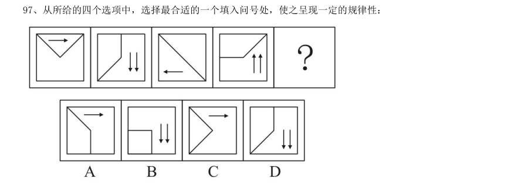

> （本题为图形题，选项为图片，见原卷）

**答案：C**

### 2019 湖北·选调　第 98 题　（数量规律）

从所给的四个选项中,选择最合适的一个填入问号处,使之呈现一定的规律性:

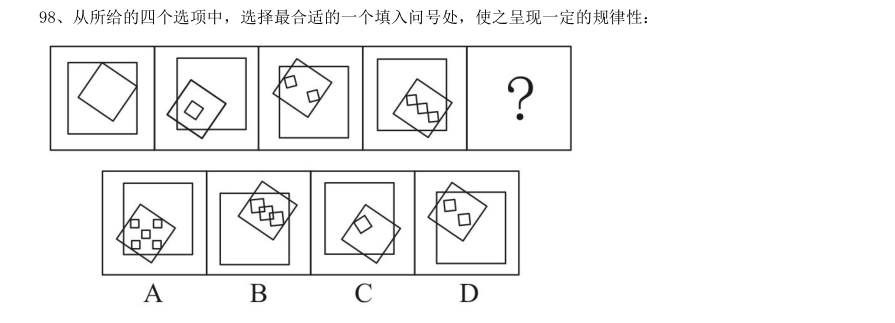

> （本题为图形题，选项为图片，见原卷）

**答案：B**

### 2019 湖北·选调　第 112 题　（图形推理（综合））

A 单位的一项实证调查指出,应当对单位内不断上升的差旅费用采取措施。这项实证调查的理由是,单位 内人均差旅费用,每天高达52 元。而在同等人数规模的B 单位里,其人均差旅费则都在20 元以内。 下列哪项如果为真,最能构成对上述论点的驳斥?

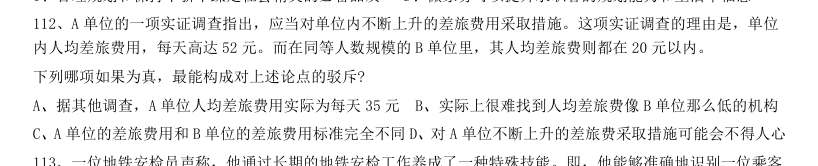

> （本题为图形题，选项为图片，见原卷）

**答案：C**

### 2019 广东·乡镇　第 26 题　（图形推理（综合））
> 材料：选出一个最恰当的答案。…

下列选项中最符合所给图形规律的是( )。

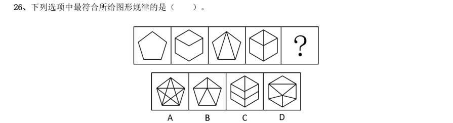

> （本题为图形题，选项为图片，见原卷）

**答案：暂缺**

### 2019 广东·乡镇　第 27 题　（图形推理（综合））

下列选项中最符合所给图形规律的是( )。

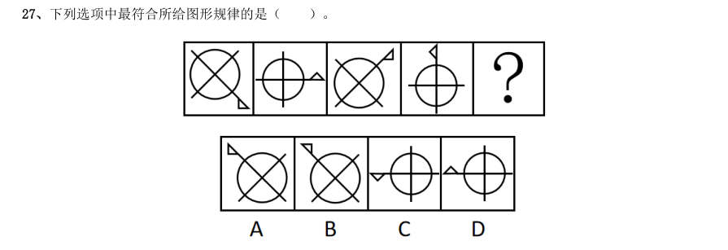

> （本题为图形题，选项为图片，见原卷）

**答案：暂缺**

### 2019 广东·乡镇　第 28 题　（图形推理（综合））

下列选项中最符合所给图形规律的是( )。

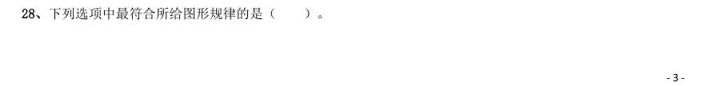

> （本题为图形题，选项为图片，见原卷）

**答案：暂缺**

### 2019 广东·乡镇　第 29 题　（图形推理（综合））

如图所示,这三个小图形可以组成的图形是( )。

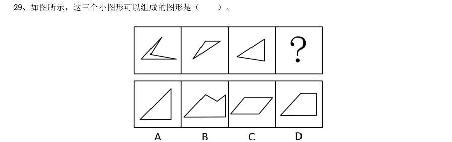

> （本题为图形题，选项为图片，见原卷）

**答案：暂缺**

### 2019 广东·乡镇　第 30 题　（数量规律）

如图所示,四个相同的等腰直角三角形,不可能组成的图形是( )。

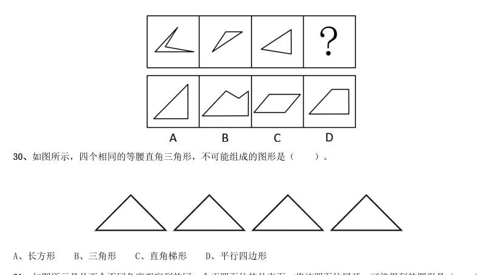

- **A.** 长方形
- **B.** 三角形
- **C.** 直角梯形
- **D.** 平行四边形

**答案：暂缺**

### 2019 广东·乡镇　第 31 题　（数量规律）

如图所示是从两个不同角度观察到的同一个正四面体的外表面,将该四面体展开,可能得到的图形是( )。

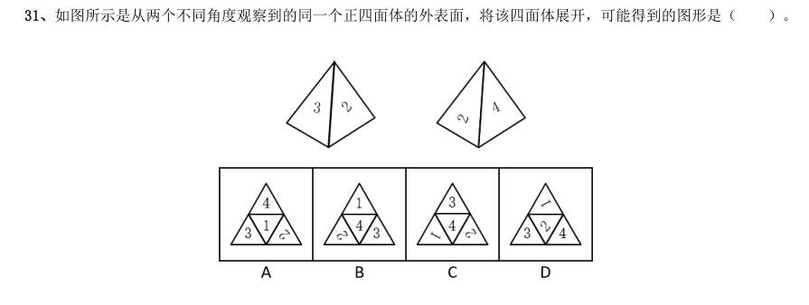

> （本题为图形题，选项为图片，见原卷）

**答案：暂缺**

### 2019 广东·乡镇　第 32 题　（立体图形）

下列选项,与所给立体图形不同的是( )。

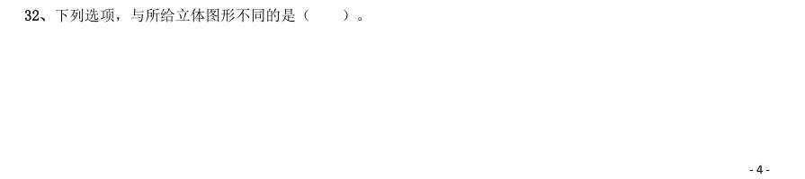

> （本题为图形题，选项为图片，见原卷）

**答案：暂缺**

### 2019 广东·乡镇　第 33 题　（立体图形）

下列选项中,不可能是所给立方体展开图的是( )。

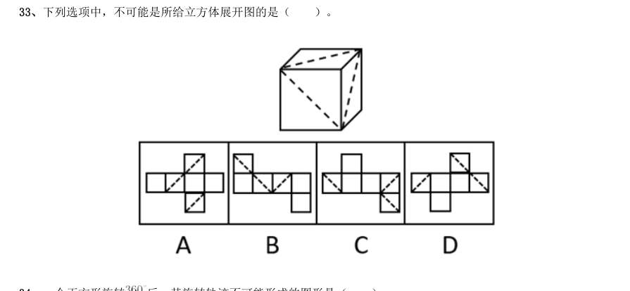

> （本题为图形题，选项为图片，见原卷）

**答案：暂缺**

### 2019 广东·乡镇　第 34 题　（位置规律）

一个正方形旋转 后,其旋转轨迹不可能形成的图形是( )。

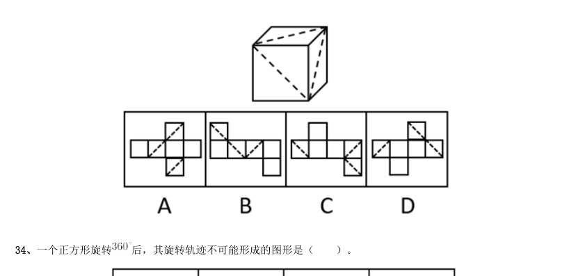

> （本题为图形题，选项为图片，见原卷）

**答案：暂缺**

### 2019 广东·乡镇　第 35 题　（图形推理（综合））

如图所示,所给物体的俯视图不可能是( )。

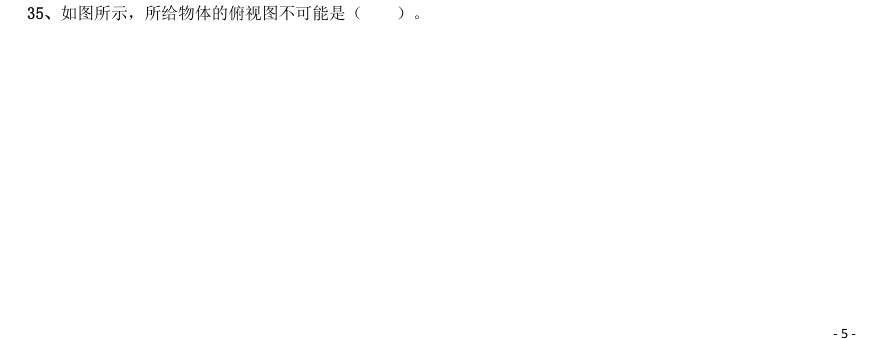

> （本题为图形题，选项为图片，见原卷）

**答案：暂缺**

### 2019 广东·县级　第 31 题　（图形推理（综合））
> 材料：项中选出一个最恰当的答案。…

下列选项中最符合所给图形规律的是( )。

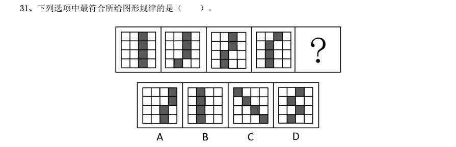

> （本题为图形题，选项为图片，见原卷）

**答案：暂缺**

### 2019 广东·县级　第 32 题　（图形推理（综合））

下列选项中最符合所给图形规律的是( )。

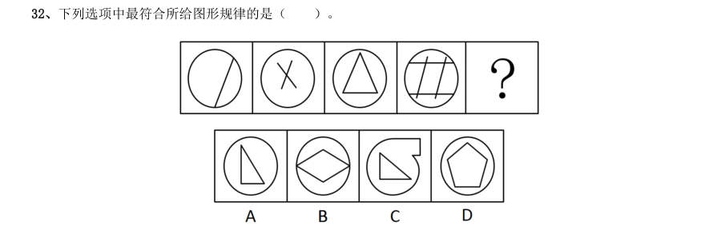

> （本题为图形题，选项为图片，见原卷）

**答案：暂缺**

### 2019 广东·县级　第 33 题　（图形推理（综合））

下列选项中最符合所给图形规律的是( )。

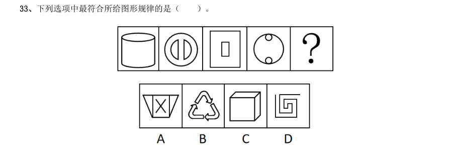

> （本题为图形题，选项为图片，见原卷）

**答案：暂缺**

### 2019 广东·县级　第 36 题　（立体图形）

下列选项,与所给立体图形不同的是( )。

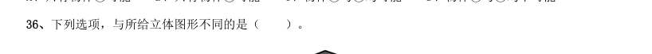

> （本题为图形题，选项为图片，见原卷）

**答案：暂缺**

### 2019 广东·县级　第 38 题　（位置规律）

一个正方形旋转 后,其旋转轨迹不可能形成的图形是( )。

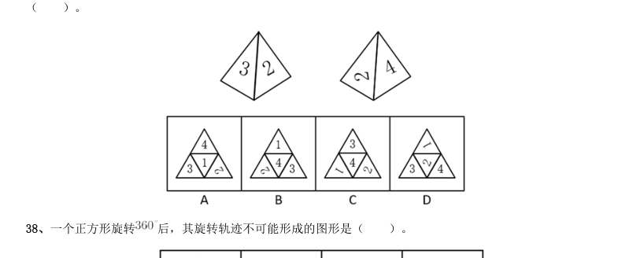

> （本题为图形题，选项为图片，见原卷）

**答案：暂缺**

### 2019 广东·县级　第 39 题　（立体图形）

将一个空心圆柱体斜切,得到下图所示物体。不可能是这一物体截面的是( )。

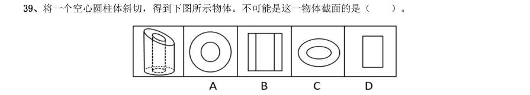

> （本题为图形题，选项为图片，见原卷）

**答案：暂缺**

### 2019 广东·县级　第 40 题　（立体图形）

下列选项中,不可能是所给立方体展开图的是( )。

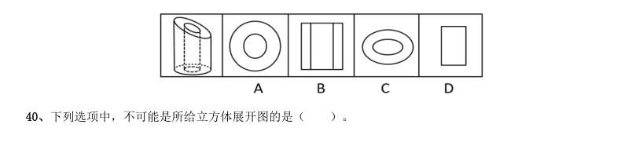

> （本题为图形题，选项为图片，见原卷）

**答案：暂缺**

### 2019 广东·思维能力测验　第 71 题　（位置规律）

如图所示的三个图形可以拼成的是()。

- **A.** 三角形
- **B.** 梯形
- **C.** 正方形
- **D.** 菱形

**答案：A**

### 2019 广东·思维能力测验　第 73 题　（位置规律）

如图所示直角梯形,以它的上底为轴旋转360 度,能够得到的立体图形是()。

> （本题为图形题，选项为图片，见原卷）

**答案：C**

### 2019 广东·思维能力测验　第 74 题　（立体图形）

从一个圆柱体中挖去一个圆柱体和一个圆锥体,得到的立体图形如左图所示。则右边不可能是它的截 面的是

> （本题为图形题，选项为图片，见原卷）

**答案：D**

### 2019 广东·思维能力测验　第 75 题　（位置规律）

以下可由所给立体图形经过旋转得到的是()。

> （本题为图形题，选项为图片，见原卷）

**答案：C**

### 2019 广东·思维能力测验　第 76 题　（立体图形）

以下符合所给三视图的立体图形是()。

> （本题为图形题，选项为图片，见原卷）

**答案：B**

### 2019 广东·思维能力测验　第 79 题　（立体图形）

左图所示立体图形,可以由()三个图形组成。

- **A.** 123
- **B.** 124
- **C.** 134
- **D.** 234

**答案：B**

### 2019 广东·思维能力测验　第 80 题　（图形推理（综合））

以下4 张纸条中,沿折痕能够折出如左图所示图形的是()。

> （本题为图形题，选项为图片，见原卷）

**答案：B**

### 2019 国考·地市级　第 71 题　（位置规律）

从所给的四个选项中,选择最合适的一个填入问号处,使之呈现一定的规律性:

> （本题为图形题，选项为图片，见原卷）

**答案：B**

### 2019 国考·地市级　第 72 题　（位置规律）

从所给的四个选项中,选择最合适的一个填入问号处,使之呈现一定的规律性:

> （本题为图形题，选项为图片，见原卷）

**答案：B**

### 2019 国考·地市级　第 73 题　（位置规律）

从所给的四个选项中,选择最合适的一个填入问号处,使之呈现一定的规律性:

> （本题为图形题，选项为图片，见原卷）

**答案：D**

### 2019 国考·地市级　第 74 题　（位置规律）

从所给的四个选项中,选择最合适的一个填入问号处,使之呈现一定的规律性:

> （本题为图形题，选项为图片，见原卷）

**答案：A**

### 2019 国考·地市级　第 75 题　（立体图形）

左边给定的是正方体的外表面展开图,下面哪一项能由它折叠而成?

> （本题为图形题，选项为图片，见原卷）

**答案：C**

### 2019 国考·地市级　第 76 题　（数量规律）

左图为6 个相同小正方体组合成的多面体,将其从任一面剖开,以下哪一项不可能是该多面体的截面?

> （本题为图形题，选项为图片，见原卷）

**答案：D**

### 2019 国考·地市级　第 77 题　（立体图形）

下图为同样大小的正方体堆叠而成的多面体正视图和后视图。该多面体可拆分为1、2、3和4共4 个多面 体的组合,问下列哪一项能填入问号处?

> （本题为图形题，选项为图片，见原卷）

**答案：D**

### 2019 国考·地市级　第 78 题　（样式规律）

把下面的六个图形分为两类,使每一类图形都有各自的共同特征或规律,分类正确的一项是:

- **A.** 123,456
- **B.** 126,345
- **C.** 146,235
- **D.** 134,256

**答案：B**

### 2019 国考·地市级　第 79 题　（位置规律）

把下面的六个图形分为两类,使每一类图形都有各自的共同特征或规律,分类正确的一项是:

- **A.** 145,236
- **B.** 125,346
- **C.** 146,235
- **D.** 134,256

**答案：A**

### 2019 国考·地市级　第 80 题　（数量规律）

把下面的六个图形分为两类,使每一类图形都有各自的共同特征或规律,分类正确的一项是:

- **A.** 134,256
- **B.** 126,345
- **C.** 135,246
- **D.** 146,235

**答案：C**

### 2019 国考·地市级　第 81 题　（图形推理（综合））

定律假说是对一类事物或现象的性质或发生原因作出推测性解释,得出一个可能具有普遍性意义的规律性命 题,从而试图建立、发展或补充科学理论。 根据上述定义,下列属于定律假说的是:

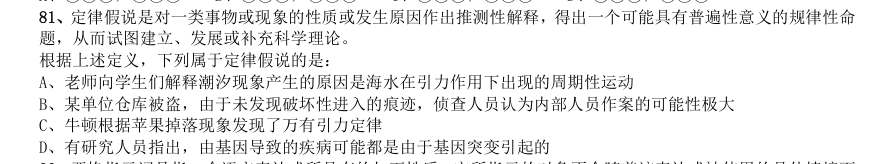

- **A.** 老师向学生们解释潮汐现象产生的原因是海水在引力作用下出现的周期性运动
- **B.** 某单位仓库被盗,由于未发现破坏性进入的痕迹,侦查人员认为内部人员作案的可能性极大
- **C.** 牛顿根据苹果掉落现象发现了万有引力定律
- **D.** 有研究人员指出,由基因导致的疾病可能都是由于基因突变引起的

**答案：C**

### 2019 国考·地市级　第 89 题　（图形推理（综合））

沟通网络是信息沟通的结构形式。常见的沟通网络有四种形式:在轮式网络中,一个下级同时与多个主管联 系,但主管之间没有沟通的情形。在Y 式网络中,第二级有两个上级与之联系,第三级与一个或更多下级发生联 系。在环式网络中,每个成员仅与相邻者联系,而不能与更远的成员进行沟通。在全通道式网络中,所有成员间 充分进行沟通,所有成员的地位是平等的,无核心人物。 根据上述定义,下列图形反映了轮式网络特点的是:

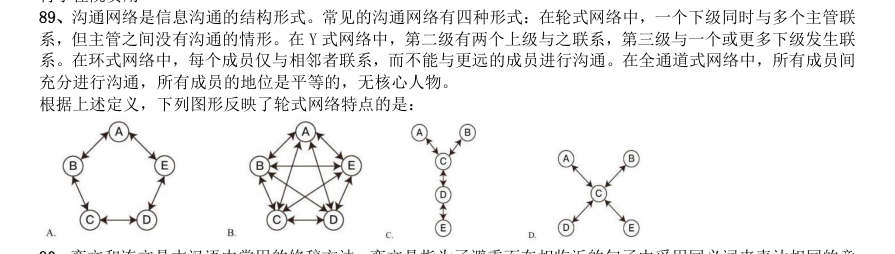

> （本题为图形题，选项为图片，见原卷）

**答案：D**

### 2019 国考·省级　第 76 题　（位置规律）

从所给的四个选项中,选择最合适的一个填入问号处,使之呈现一定的规律性:

> （本题为图形题，选项为图片，见原卷）

**答案：B**

### 2019 国考·省级　第 77 题　（位置规律）

从所给的四个选项中,选择最合适的一个填入问号处,使之呈现一定的规律性:

> （本题为图形题，选项为图片，见原卷）

**答案：B**

### 2019 国考·省级　第 78 题　（位置规律）

从所给的四个选项中,选择最合适的一个填入问号处,使之呈现一定的规律性:

> （本题为图形题，选项为图片，见原卷）

**答案：A**

### 2019 国考·省级　第 79 题　（位置规律）

从所给的四个选项中,选择最合适的一个填入问号处,使之呈现一定的规律性:

> （本题为图形题，选项为图片，见原卷）

**答案：D**

### 2019 国考·省级　第 80 题　（立体图形）

下图为同样大小的正方体堆叠而成的多面体正视图和后视图。该多面体可拆分为1、2、3和4共4 个多面 体的组合,问下列哪一项能填入问号处?

> （本题为图形题，选项为图片，见原卷）

**答案：D**

### 2019 国考·省级　第 83 题　（样式规律）

把下面的六个图形分为两类,使每一类图形都有各自的共同特征或规律,分类正确的一项是:

- **A.** 123,456
- **B.** 126,345
- **C.** 146,235
- **D.** 134,256

**答案：B**

### 2019 国考·省级　第 84 题　（位置规律）

把下面的六个图形分为两类,使每一类图形都有各自的共同特征或规律,分类正确的一项是:

- **A.** 145,236
- **B.** 125,346
- **C.** 146,235
- **D.** 134,256

**答案：A**

### 2019 国考·省级　第 85 题　（数量规律）

把下面的六个图形分为两类,使每一类图形都有各自的共同特征或规律,分类正确的一项是:

- **A.** 134,256
- **B.** 126,345
- **C.** 135,246
- **D.** 146,235

**答案：C**

### 2019 国考·省级　第 86 题　（图形推理（综合））

定律假说是对一类事物或现象的性质或发生原因作出推测性解释,得出一个可能具有普遍性意义的规律性命 题,从而试图建立、发展或补充科学理论。 根据上述定义,下列属于定律假说的是:

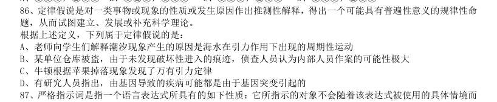

- **A.** 老师向学生们解释潮汐现象产生的原因是海水在引力作用下出现的周期性运动
- **B.** 某单位仓库被盗,由于未发现破坏性进入的痕迹,侦查人员认为内部人员作案的可能性极大
- **C.** 牛顿根据苹果掉落现象发现了万有引力定律
- **D.** 有研究人员指出,由基因导致的疾病可能都是由于基因突变引起的

**答案：C**

### 2018 湖北·统一卷　第 71 题　（数量规律）
> 材料：选项。…

从所给的四个选项中,选择最合适的一个填入问号处,使之呈现一定的规律性:

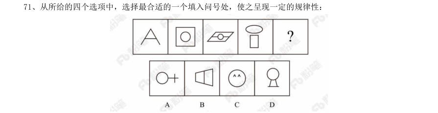

> （本题为图形题，选项为图片，见原卷）

**答案：A**

### 2018 湖北·统一卷　第 72 题　（属性规律）

把下面的图形分为两类,使每一类图形都有各自的共同特征或规律,分类正确的一项是:

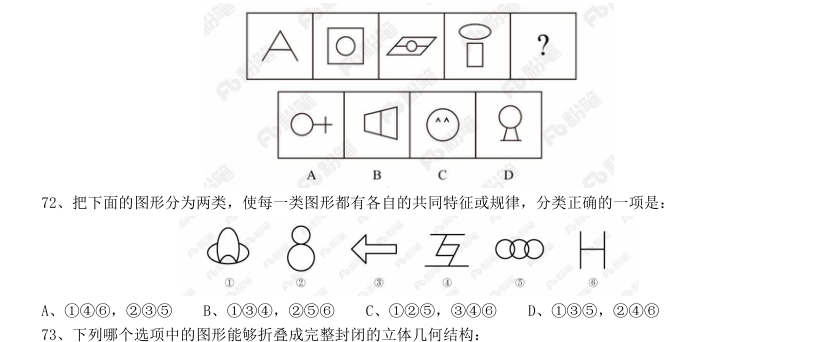

- **A.** 146,235
- **B.** 134,256
- **C.** 125,346
- **D.** 135,246

**答案：C**

### 2018 湖北·统一卷　第 73 题　（属性规律）

下列哪个选项中的图形能够折叠成完整封闭的立体几何结构:

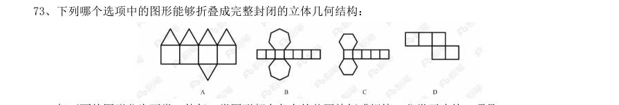

> （本题为图形题，选项为图片，见原卷）

**答案：B**

### 2018 湖北·统一卷　第 74 题　（数量规律）

把下面的图形分为两类,使每一类图形都有各自的共同特征或规律,分类正确的一项是:

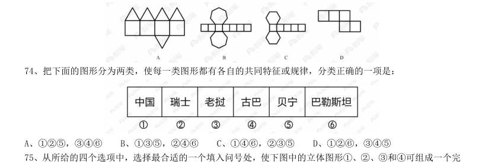

- **A.** 125,346
- **B.** 135,246
- **C.** 146,235
- **D.** 126,345

**答案：C**

### 2018 湖北·统一卷　第 75 题　（位置规律）

从所给的四个选项中,选择最合适的一个填入问号处,使下图中的立体图形1、2、3和4可组成一个完 整的长方体:

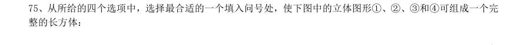

> （本题为图形题，选项为图片，见原卷）

**答案：C**

### 2018 广东·统一卷　第 31 题　（图形推理（综合））

从所给的四个选项中,选择最合适的一个填在问号处,使之呈现一定的规律性:

> （本题为图形题，选项为图片，见原卷）

**答案：暂缺**

### 2018 广东·统一卷　第 32 题　（图形推理（综合））

从所给的四个选项中,选择最合适的一个填在问号处,使之呈现一定的规律性:

> （本题为图形题，选项为图片，见原卷）

**答案：暂缺**

### 2018 广东·统一卷　第 33 题　（图形推理（综合））

从所给的四个选项中,选择最合适的一个填在问号处,使之呈现一定的规律性:

> （本题为图形题，选项为图片，见原卷）

**答案：暂缺**

### 2018 广东·统一卷　第 34 题　（图形推理（综合））

从所给的四个选项中,选择最合适的一个填在问号处,使之呈现一定的规律性:

> （本题为图形题，选项为图片，见原卷）

**答案：暂缺**

### 2018 广东·统一卷　第 35 题　（图形推理（综合））

从所给的四个选项中,选择最合适的一个填在问号处,使之呈现一定的规律性:

> （本题为图形题，选项为图片，见原卷）

**答案：暂缺**

### 2018 广东·统一卷　第 36 题　（图形推理（综合））

从所给的四个选项中,选择最合适的一个填在问号处,使之呈现一定的规律性:

> （本题为图形题，选项为图片，见原卷）

**答案：暂缺**

### 2018 广东·统一卷　第 37 题　（图形推理（综合））

从所给的四个选项中,选择最合适的一个填在问号处,使之呈现一定的规律性:

> （本题为图形题，选项为图片，见原卷）

**答案：暂缺**

### 2018 广东·统一卷　第 38 题　（图形推理（综合））

从所给的四个选项中,选择最合适的一个填在问号处,使之呈现一定的规律性:

> （本题为图形题，选项为图片，见原卷）

**答案：暂缺**

### 2018 广东·统一卷　第 39 题　（图形推理（综合））

从所给的四个选项中,选择最合适的一个填在问号处,使之呈现一定的规律性:

> （本题为图形题，选项为图片，见原卷）

**答案：暂缺**

### 2018 广东·统一卷　第 40 题　（图形推理（综合））

从所给的四个选项中,选择最合适的一个填在问号处,使之呈现一定的规律性:

> （本题为图形题，选项为图片，见原卷）

**答案：暂缺**

### 2018 国考·副省级　第 76 题　（图形推理（综合））

从所给的四个选项中,选出最合适的一个填入问号处,使之呈现一定的规律性:

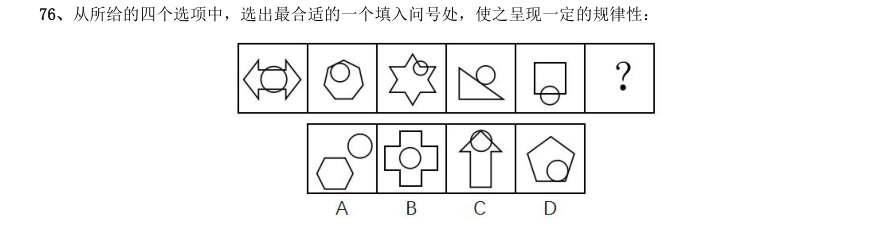

> （本题为图形题，选项为图片，见原卷）

**答案：D**

### 2018 国考·副省级　第 77 题　（数量规律）

从所给的四个选项中,选出最合适的一个填入问号处,使之呈现一定的规律性:

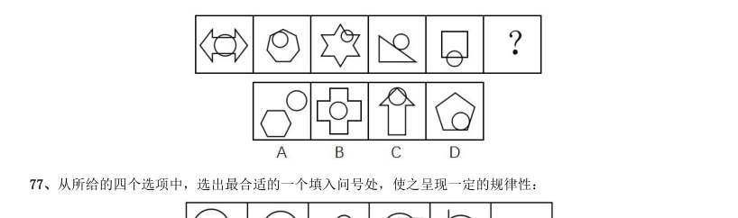

> （本题为图形题，选项为图片，见原卷）

**答案：C**

### 2018 国考·副省级　第 78 题　（数量规律）

从所给的四个选项中,选出最合适的一个填入问号处,使之呈现一定的规律性:

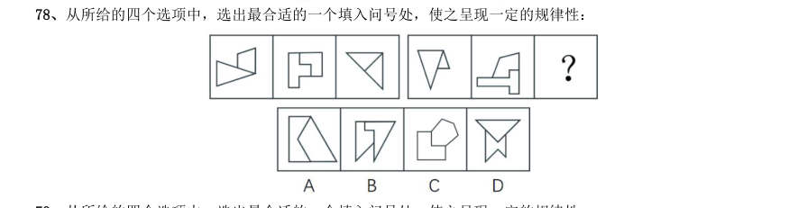

> （本题为图形题，选项为图片，见原卷）

**答案：D**

### 2018 国考·副省级　第 79 题　（样式规律）

从所给的四个选项中,选出最合适的一个填入问号处,使之呈现一定的规律性:

> （本题为图形题，选项为图片，见原卷）

**答案：C**

### 2018 国考·副省级　第 80 题　（数量规律）

左图给定的是正方体纸盒的外表面,下面哪一项能由它折叠而成?

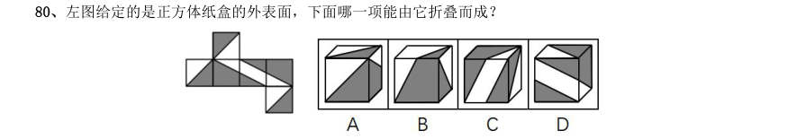

> （本题为图形题，选项为图片，见原卷）

**答案：D**

### 2018 国考·副省级　第 81 题　（数量规律）

左图为给定的多面体,从任一角度观看,下面哪一项不可能是该多面体的视图?

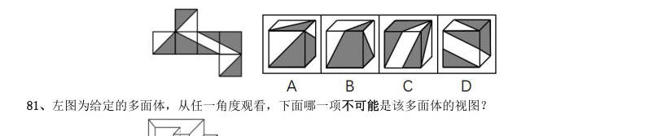

> （本题为图形题，选项为图片，见原卷）

**答案：D**

### 2018 国考·副省级　第 82 题　（数量规律）

下面四个立体图形中,哪一项不能用一个平面分割为两个完全相同或互为镜像的部分?

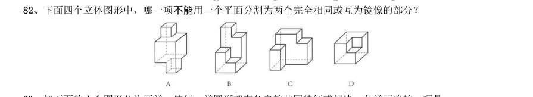

> （本题为图形题，选项为图片，见原卷）

**答案：B**

### 2018 国考·副省级　第 83 题　（分组分类）

把下面的六个图形分为两类,使每一类图形都有各自的共同特征或规律,分类正确的一项是:

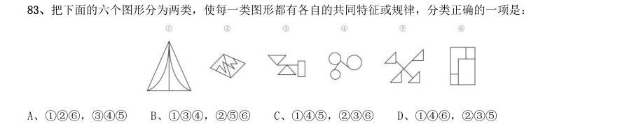

- **A.** 126,345
- **B.** 134,256
- **C.** 145,236
- **D.** 146,235

**答案：A**

### 2018 国考·副省级　第 84 题　（数量规律）

把下面的六个图形分为两类,使每一类图形都有各自的共同特征或规律,分类正确的一项是:

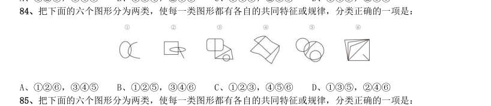

- **A.** 126,345
- **B.** 125,346
- **C.** 123,456
- **D.** 135,246

**答案：B**

### 2018 国考·副省级　第 85 题　（位置规律）

把下面的六个图形分为两类,使每一类图形都有各自的共同特征或规律,分类正确的一项是:

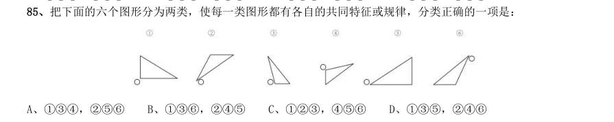

- **A.** 134,256
- **B.** 136,245
- **C.** 123,456
- **D.** 135,246

**答案：A**

### 2018 国考·地市级　第 71 题　（数量规律）

从所给的四个选项中,选出最合适的一个填入问号处,使之呈现一定的规律性:

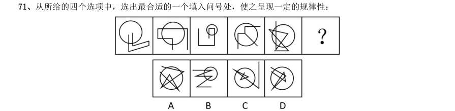

> （本题为图形题，选项为图片，见原卷）

**答案：C**

### 2018 国考·地市级　第 72 题　（图形推理（综合））

从所给的四个选项中,选出最合适的一个填入问号处,使之呈现一定的规律性:

> （本题为图形题，选项为图片，见原卷）

**答案：D**

### 2018 国考·地市级　第 73 题　（数量规律）

从所给的四个选项中,选出最合适的一个填入问号处,使之呈现一定的规律性:

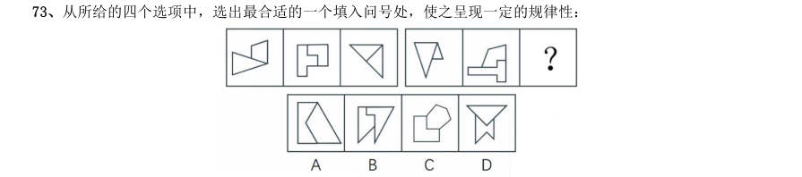

> （本题为图形题，选项为图片，见原卷）

**答案：D**

### 2018 国考·地市级　第 74 题　（样式规律）

从所给的四个选项中,选出最合适的一个填入问号处,使之呈现一定的规律性:

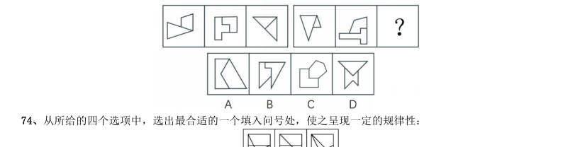

> （本题为图形题，选项为图片，见原卷）

**答案：C**

### 2018 国考·地市级　第 78 题　（分组分类）

把下面的六个图形分为两类,使每一类图形都有各自的共同特征或规律,分类正确的一项是:

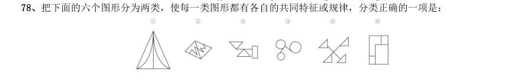

- **A.** 126,345
- **B.** 134,256
- **C.** 145,236
- **D.** 146,235

**答案：A**

### 2018 国考·地市级　第 79 题　（数量规律）

把下面的六个图形分为两类,使每一类图形都有各自的共同特征或规律,分类正确的一项是:

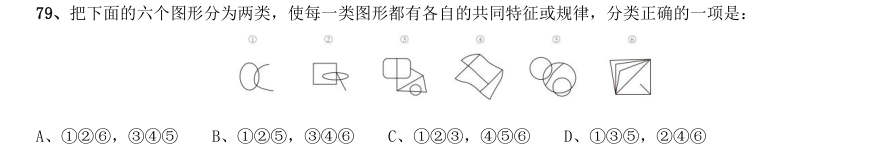

- **A.** 126,345
- **B.** 125,346
- **C.** 123,456
- **D.** 135,246

**答案：B**

### 2018 国考·地市级　第 80 题　（位置规律）

把下面的六个图形分为两类,使每一类图形都有各自的共同特征或规律,分类正确的一项是:

- **A.** 134,256
- **B.** 136,245
- **C.** 123,456
- **D.** 135,246

**答案：A**

### 2017 湖北·统一卷　第 71 题　（数量规律）

左边给定的是削掉一个角的纸盒,下列哪一项不是由它展开而成?

> （本题为图形题，选项为图片，见原卷）

**答案：C**

### 2017 湖北·统一卷　第 72 题　（数量规律）

把下面的六个图形分为两类,使每一类图形都有各自的共同特征或规律,分类正确的一项是:

- **A.** 134,256
- **B.** 126,345
- **C.** 125,346
- **D.** 136,245

**答案：B**

### 2017 湖北·统一卷　第 73 题　（数量规律）

从所给的四个选项中,选择最合适的一个填入问号处,使之呈现一定的规律性:

> （本题为图形题，选项为图片，见原卷）

**答案：A**

### 2017 湖北·统一卷　第 74 题　（位置规律）

从所给的四个选项中,选出一个最合适的填入问号处,使之呈现一定的规律:

> （本题为图形题，选项为图片，见原卷）

**答案：B**

### 2017 湖北·统一卷　第 75 题　（样式规律）

如图所示,立方体上叠加圆柱体再打通一个圆柱孔,然后从任意面剖开,下面哪一项不可能是该立体的截面?

> （本题为图形题，选项为图片，见原卷）

**答案：A**

### 2017 广东·统一卷　第 31 题　（图形推理（综合））

从所给四个选项中,选择最合适的一个填入问号处,使之呈现一定规律性:

> （本题为图形题，选项为图片，见原卷）

**答案：暂缺**

### 2017 广东·统一卷　第 32 题　（图形推理（综合））

从所给四个选项中,选择最合适的一个填入问号处,使之呈现一定规律性:

> （本题为图形题，选项为图片，见原卷）

**答案：暂缺**

### 2017 广东·统一卷　第 33 题　（图形推理（综合））

从所给四个选项中,选择最合适的一个填入问号处,使之呈现一定规律性:

> （本题为图形题，选项为图片，见原卷）

**答案：暂缺**

### 2017 广东·统一卷　第 34 题　（图形推理（综合））

从所给四个选项中,选择最合适的一个填入问号处,使之呈现一定规律性:

> （本题为图形题，选项为图片，见原卷）

**答案：暂缺**

### 2017 广东·统一卷　第 35 题　（图形推理（综合））

从所给四个选项中,选择最合适的一个填入问号处,使之呈现一定规律性:

> （本题为图形题，选项为图片，见原卷）

**答案：暂缺**

### 2017 广东·统一卷　第 36 题　（图形推理（综合））

从所给四个选项中,选择最合适的一个填入问号处,使之呈现一定规律性:

> （本题为图形题，选项为图片，见原卷）

**答案：暂缺**

### 2017 广东·统一卷　第 37 题　（图形推理（综合））

从所给四个选项中,选择最合适的一个填入问号处,使之呈现一定规律性:

> （本题为图形题，选项为图片，见原卷）

**答案：暂缺**

### 2017 广东·统一卷　第 38 题　（图形推理（综合））

从所给四个选项中,选择最合适的一个填入问号处,使之呈现一定规律性:

> （本题为图形题，选项为图片，见原卷）

**答案：暂缺**

### 2017 广东·统一卷　第 39 题　（分组分类）

把下面的六个图形分为两类,使每一类图形都有各自的共同特征或规律,分类正确的一项是:

- **A.** 146,235
- **B.** 125,346
- **C.** 156,234
- **D.** 135,246

**答案：暂缺**

### 2017 广东·统一卷　第 40 题　（分组分类）

把下面的6 个图形分为两类,使每一类图形都有各自的共同规律,分类正确的是:

- **A.** 146,235
- **B.** 125,346
- **C.** 156,234
- **D.** 135,246

**答案：暂缺**

### 2017 国考·副省级　第 76 题　（位置规律）

从所给的四个选项中,选择最合适的一个填入问号处,使之呈现一定的规律性:

> （本题为图形题，选项为图片，见原卷）

**答案：C**

### 2017 国考·副省级　第 77 题　（位置规律）

从所给的四个选项中,选择最合适的一个填入问号处,使之呈现一定的规律性:

> （本题为图形题，选项为图片，见原卷）

**答案：C**

### 2017 国考·副省级　第 78 题　（样式规律）

从所给的四个选项中,选择最合适的一个填入问号处,使之呈现一定的规律性:

> （本题为图形题，选项为图片，见原卷）

**答案：A**

### 2017 国考·副省级　第 79 题　（样式规律）

从所给的四个选项中,选择最合适的一个填入问号处,使之呈现一定的规律性:

> （本题为图形题，选项为图片，见原卷）

**答案：A**

### 2017 国考·副省级　第 80 题　（数量规律）

从所给的四个选项中,选择最合适的一个填入问号处,使之呈现一定的规律性:

> （本题为图形题，选项为图片，见原卷）

**答案：B**

### 2017 国考·副省级　第 82 题　（立体图形）

下图中的立体图形1是由立体图形2,3和4组合而成,下列哪一项不能填入问号处?

> （本题为图形题，选项为图片，见原卷）

**答案：B**

### 2017 国考·副省级　第 83 题　（位置规律）

把下面的六个图形分为两类,使每一类图形都有各自的共同特征或规律,分类正确的一项是:

- **A.** 146,235
- **B.** 123,456
- **C.** 156,234
- **D.** 135,246

**答案：D**

### 2017 国考·副省级　第 84 题　（数量规律）

把下面的六个图形分为两类,使每一类图形都有各自的共同特征或规律,分类正确的一项是:

- **A.** 134,256
- **B.** 125,346
- **C.** 136,245
- **D.** 145,23

**答案：A**

### 2017 国考·副省级　第 85 题　（数量规律）

把下面的六个图形分为两类,使每一类图形都有各自的共同特征或规律,分类正确的一项是:

- **A.** 125,346
- **B.** 123,456
- **C.** 135,246
- **D.** 126,345

**答案：C**

### 2017 国考·地市级　第 71 题　（位置规律）

从所给的四个选项中,选择最合适的一个填入问号处,使之呈现一定的规律性:

> （本题为图形题，选项为图片，见原卷）

**答案：C**

### 2017 国考·地市级　第 72 题　（位置规律）

从所给的四个选项中,选择最合适的一个填入问号处,使之呈现一定的规律性:

> （本题为图形题，选项为图片，见原卷）

**答案：C**

### 2017 国考·地市级　第 73 题　（样式规律）

从所给的四个选项中,选择最合适的一个填入问号处,使之呈现一定的规律性:

> （本题为图形题，选项为图片，见原卷）

**答案：A**

### 2017 国考·地市级　第 74 题　（数量规律）

从所给的四个选项中,选择最合适的一个填入问号处,使之呈现一定的规律性:

> （本题为图形题，选项为图片，见原卷）

**答案：B**

### 2017 国考·地市级　第 75 题　（样式规律）

从所给的四个选项中,选择最合适的一个填入问号处,使之呈现一定的规律性:

> （本题为图形题，选项为图片，见原卷）

**答案：A**

### 2017 国考·地市级　第 77 题　（立体图形）

下图中的立体图形1是由立体图形2,3和4组合而成,下列哪一项不能填入问号处?

> （本题为图形题，选项为图片，见原卷）

**答案：B**

### 2017 国考·地市级　第 78 题　（位置规律）

把下面的六个图形分为两类,使每一类图形都有各自的共同特征或规律,分类正确的一项是:

- **A.** 146,235
- **B.** 123,456
- **C.** 156,234
- **D.** 135,246

**答案：D**

### 2017 国考·地市级　第 79 题　（数量规律）

把下面的六个图形分为两类,使每一类图形都有各自的共同特征或规律,分类正确的一项是:

- **A.** 125,346
- **B.** 123,456
- **C.** 135,246
- **D.** 126,345

**答案：C**

### 2017 国考·地市级　第 80 题　（数量规律）

把下面的六个图形分为两类,使每一类图形都有各自的共同特征或规律,分类正确的一项是:

- **A.** 134,256
- **B.** 125,346
- **C.** 136,245
- **D.** 145,236

**答案：A**

### 2016 湖北·统一卷　第 71 题　（位置规律）

从所给四个选项中,选择最合适的一个填入问号处,使之呈现一定的规律性:

> （本题为图形题，选项为图片，见原卷）

**答案：B**

### 2016 湖北·统一卷　第 72 题　（图形推理（综合））

从所给四个选项中,选择最合适的一个填入问号处,使之呈现一定的规律性:

> （本题为图形题，选项为图片，见原卷）

**答案：B**

### 2016 湖北·统一卷　第 73 题　（位置规律）

把下面的六个图形分为两类,使每一类图形都有各自的共同特征或规律,分类正确的一项是:

- **A.** 123,456
- **B.** 145,236
- **C.** 146,235
- **D.** 135,246

**答案：D**

### 2016 湖北·统一卷　第 74 题　（数量规律）

从所给四个选项中,选择最合适的一个填入问号处,使之呈现一定的规律性:

> （本题为图形题，选项为图片，见原卷）

**答案：暂缺**

### 2016 湖北·统一卷　第 75 题　（数量规律）

从所给四个选项中,选择最合适的一个填入问号处,使之符合所给的题干所示:

> （本题为图形题，选项为图片，见原卷）

**答案：C**

### 2016 广东·乡镇　第 31 题　（图形推理（综合））

判断。

> （本题为图形题，选项为图片，见原卷）

**答案：暂缺**

### 2016 广东·乡镇　第 32 题　（图形推理（综合））

（本题题干为图形/公式，文字层无题干，图见原卷）

> （本题为图形题，选项为图片，见原卷）

**答案：暂缺**

### 2016 广东·乡镇　第 33 题　（图形推理（综合））

（本题题干为图形/公式，文字层无题干，图见原卷）

> （本题为图形题，选项为图片，见原卷）

**答案：暂缺**

### 2016 广东·乡镇　第 34 题　（图形推理（综合））

（本题题干为图形/公式，文字层无题干，图见原卷）

> （本题为图形题，选项为图片，见原卷）

**答案：暂缺**

### 2016 广东·乡镇　第 35 题　（图形推理（综合））

（本题题干为图形/公式，文字层无题干，图见原卷）

> （本题为图形题，选项为图片，见原卷）

**答案：暂缺**

### 2016 广东·乡镇　第 36 题　（图形推理（综合））

（本题题干为图形/公式，文字层无题干，图见原卷）

> （本题为图形题，选项为图片，见原卷）

**答案：暂缺**

### 2016 广东·乡镇　第 37 题　（图形推理（综合））

（本题题干为图形/公式，文字层无题干，图见原卷）

> （本题为图形题，选项为图片，见原卷）

**答案：暂缺**

### 2016 广东·乡镇　第 38 题　（图形推理（综合））

（本题题干为图形/公式，文字层无题干，图见原卷）

> （本题为图形题，选项为图片，见原卷）

**答案：暂缺**

### 2016 广东·乡镇　第 39 题　（图形推理（综合））

（本题题干为图形/公式，文字层无题干，图见原卷）

> （本题为图形题，选项为图片，见原卷）

**答案：暂缺**

### 2016 广东·乡镇　第 40 题　（图形推理（综合））

（本题题干为图形/公式，文字层无题干，图见原卷）

> （本题为图形题，选项为图片，见原卷）

**答案：暂缺**

### 2016 广东·县级　第 51 题　（图形推理（综合））

（本题题干为图形/公式，文字层无题干，图见原卷）

> （本题为图形题，选项为图片，见原卷）

**答案：暂缺**

### 2016 广东·县级　第 52 题　（图形推理（综合））

（本题题干为图形/公式，文字层无题干，图见原卷）

> （本题为图形题，选项为图片，见原卷）

**答案：暂缺**

### 2016 广东·县级　第 53 题　（图形推理（综合））

（本题题干为图形/公式，文字层无题干，图见原卷）

> （本题为图形题，选项为图片，见原卷）

**答案：暂缺**

### 2016 广东·县级　第 54 题　（图形推理（综合））

（本题题干为图形/公式，文字层无题干，图见原卷）

> （本题为图形题，选项为图片，见原卷）

**答案：暂缺**

### 2016 广东·县级　第 55 题　（图形推理（综合））

（本题题干为图形/公式，文字层无题干，图见原卷）

> （本题为图形题，选项为图片，见原卷）

**答案：暂缺**

### 2016 广东·县级　第 56 题　（图形推理（综合））

（本题题干为图形/公式，文字层无题干，图见原卷）

> （本题为图形题，选项为图片，见原卷）

**答案：暂缺**

### 2016 广东·县级　第 57 题　（图形推理（综合））

（本题题干为图形/公式，文字层无题干，图见原卷）

> （本题为图形题，选项为图片，见原卷）

**答案：暂缺**

### 2016 广东·县级　第 58 题　（图形推理（综合））

（本题题干为图形/公式，文字层无题干，图见原卷）

> （本题为图形题，选项为图片，见原卷）

**答案：暂缺**

### 2016 广东·县级　第 59 题　（图形推理（综合））

（本题题干为图形/公式，文字层无题干，图见原卷）

> （本题为图形题，选项为图片，见原卷）

**答案：暂缺**

### 2016 广东·县级　第 60 题　（图形推理（综合））

（本题题干为图形/公式，文字层无题干，图见原卷）

> （本题为图形题，选项为图片，见原卷）

**答案：暂缺**

### 2016 国考·副省级　第 76 题　（图形推理（综合））
> 材料：判断。…

从所给四个选项中,选择最合适的一个填入问号处,使之呈现一定规律性:

> （本题为图形题，选项为图片，见原卷）

**答案：暂缺**

### 2016 国考·副省级　第 78 题　（图形推理（综合））

左边给定的是纸盒的外表面,下列哪一项能由它折叠而成?

> （本题为图形题，选项为图片，见原卷）

**答案：暂缺**

### 2016 国考·副省级　第 79 题　（数量规律）

从所给四个选项中,选择最合适的一个填入问号处,使之呈现一定的规律性:

> （本题为图形题，选项为图片，见原卷）

**答案：B**

### 2016 国考·副省级　第 80 题　（数量规律）

1、2、3、4为四个多面体零件,问A B C D 四个多面体零件中的哪一个与1、2、3、4中 的任一个都不能组成长方体?

> （本题为图形题，选项为图片，见原卷）

**答案：D**

### 2016 国考·副省级　第 81 题　（属性规律）

把下面的六个图形分为两类,使每一类图形都有各自的共同特征或规律,分类正确的一项是:

- **A.** 134,256
- **B.** 146,235
- **C.** 124,356
- **D.** 136,245

**答案：A**

### 2016 国考·副省级　第 82 题　（数量规律）

把下面的六个图形分为两类,使每一类图形都有各自的共同特征或规律,分类正确的一项是:

- **A.** 124,356
- **B.** 125,346
- **C.** 134,256
- **D.** 136,245

**答案：D**

### 2016 国考·副省级　第 83 题　（分组分类）

把下面的六个图形分为两类,使每一类图形都有各自的共同特征或规律,分类正确的一项是:

- **A.** 124,356
- **B.** 136,245
- **C.** 135,246
- **D.** 156,234

**答案：A**

### 2016 国考·副省级　第 84 题　（数量规律）

把下面的六个图形分为两类,使每一类图形都有各自的共同特征或规律,分类正确的一项是:

- **A.** 146,235
- **B.** 135,246
- **C.** 125,346
- **D.** 124,356

**答案：D**

### 2016 国考·副省级　第 85 题　（属性规律）

把下面的六个图形分为两类,使每一类图形都有各自的共同特征或规律,分类正确的一项是:

- **A.** 146,235
- **B.** 135,246
- **C.** 124,356
- **D.** 123,456

**答案：D**

### 2016 国考·地市级　第 71 题　（图形推理（综合））

从所给四个选项中,选择最合适的一个填入问号处,使之呈现一定规律性:

> （本题为图形题，选项为图片，见原卷）

**答案：B**

### 2016 国考·地市级　第 72 题　（数量规律）

从所给四个选项中,选择最合适的一个填入问号处,使之呈现一定的规律性:

> （本题为图形题，选项为图片，见原卷）

**答案：B**

### 2016 国考·地市级　第 73 题　（数量规律）

1、2、3、4为四个多面体零件,问

> （本题为图形题，选项为图片，见原卷）

**答案：D**

### 2016 国考·地市级　第 74 题　（立体图形）

左图是给定的立方图形,将其从任一面剖开,下面哪一项可能是该立方体的截面?

> （本题为图形题，选项为图片，见原卷）

**答案：A**

### 2016 国考·地市级　第 75 题　（数量规律）

左边给定的是纸盒的外表面,下列哪一项能由它折叠而成?

> （本题为图形题，选项为图片，见原卷）

**答案：B**

### 2016 国考·地市级　第 76 题　（数量规律）

把下面的六个图形分为两类,使每一类图形都有各自的共同特征或规律,分类正确的一项是:

- **A.** 124,356
- **B.** 125,346
- **C.** 134,256
- **D.** 136,245

**答案：D**

### 2016 国考·地市级　第 77 题　（属性规律）

把下面的六个图形分为两类,使每一类图形都有各自的共同特征或规律,分类正确的一项是:

- **A.** 146,235
- **B.** 135,246
- **C.** 124,356
- **D.** 123,456

**答案：D**

### 2016 国考·地市级　第 78 题　（属性规律）

把下面的六个图形分为两类,使每一类图形都有各自的共同特征或规律,分类正确的一项是:

- **A.** 134,256
- **B.** 146,235
- **C.** 124,356
- **D.** 136,245

**答案：A**

### 2016 国考·地市级　第 79 题　（分组分类）

把下面的六个图形分为两类,使每一类图形都有各自的共同特征或规律,分类正确的一项是:

- **A.** 124,356
- **B.** 136,245
- **C.** 135,246
- **D.** 156,234

**答案：A**

### 2016 国考·地市级　第 80 题　（数量规律）

把下面的六个图形分为两类,使每一类图形都有各自的共同特征或规律,分类正确的一项是:

- **A.** 146,235
- **B.** 135,246
- **C.** 125,346
- **D.** 124,356

**答案：D**

### 2015 湖北·统一卷　第 70 题　（数量规律）

从所给四个选项中,选择最合适的一个填入问号处,使之呈现一定的规律性:

> （本题为图形题，选项为图片，见原卷）

**答案：D**

### 2015 湖北·统一卷　第 71 题　（样式规律）

从所给四个选项中,选择最合适的一个填入问号处,使之呈现一定的规律性:

> （本题为图形题，选项为图片，见原卷）

**答案：A**

### 2015 湖北·统一卷　第 72 题　（属性规律）

将下面的六个图形分成两类,使每一类图形都有各自的共同特征或规律,分类正确的一项是:

- **A.** 126;345
- **B.** 145;236
- **C.** 125;346
- **D.** 123;456

**答案：暂缺**

### 2015 湖北·统一卷　第 73 题　（数量规律）

把下面的六个图形分为两类,使每一类图形都有各自的共同特征或规律,分类正确的一项是:

- **A.** 123,456
- **B.** 145,236
- **C.** 156,234
- **D.** 146,235

**答案：D**

### 2015 湖北·统一卷　第 74 题　（位置规律）

从所给四个选项中,选择最合适的一个填入问号处,使之呈现一定的规律性:

> （本题为图形题，选项为图片，见原卷）

**答案：C**

### 2015 湖北·统一卷　第 75 题　（数量规律）

请从所给的四个选项中,选择最合适的一项填在问号处,使之呈现一定的规律性:

> （本题为图形题，选项为图片，见原卷）

**答案：B**

### 2015 湖北·统一卷　第 76 题　（数量规律）

左边给定的是纸盒的外表面,下列哪一项能由它折叠而成:

> （本题为图形题，选项为图片，见原卷）

**答案：A**

### 2015 广东·乡镇　第 36 题　（图形推理（综合））
> 材料：推理、逻辑判断。…

从所给的四个选项中选,择最合适的一个填入问号处,使之呈现一定的规律性:

> （本题为图形题，选项为图片，见原卷）

**答案：暂缺**

### 2015 广东·乡镇　第 37 题　（图形推理（综合））

从所给的四个选项中,选择最合适的一个填在问号处,使之呈现一定的规律性:

> （本题为图形题，选项为图片，见原卷）

**答案：暂缺**

### 2015 广东·乡镇　第 38 题　（图形推理（综合））

从所给的四个选项中,选择最合适的一个填入问号处,使之呈现一定的规律性: 38、从所给的四个选项中,选择最合适的一个填入问号处,使之呈现一定的规律性:

> （本题为图形题，选项为图片，见原卷）

**答案：暂缺**

### 2015 广东·乡镇　第 39 题　（图形推理（综合））

（本题题干为图形/公式，文字层无题干，图见原卷）

> （本题为图形题，选项为图片，见原卷）

**答案：暂缺**

### 2015 广东·乡镇　第 40 题　（图形推理（综合））

从所给的四个选项中,选择最合适的一个填入问号处,使之呈现一定的规律性:

> （本题为图形题，选项为图片，见原卷）

**答案：暂缺**

### 2015 广东·乡镇　第 41 题　（图形推理（综合））

从所给的四个选项中,选择最合适的一个填入问号处,使之呈现一定的规律性:

> （本题为图形题，选项为图片，见原卷）

**答案：暂缺**

### 2015 广东·乡镇　第 42 题　（图形推理（综合））

从所给的四个选项中,选择最合适的一个填入问号处,使之呈现一定的规律性:

> （本题为图形题，选项为图片，见原卷）

**答案：暂缺**

### 2015 广东·乡镇　第 43 题　（图形推理（综合））

从所给的四个选项中,选择最合适的一个填入问号处,使之呈现一定的规律性:

> （本题为图形题，选项为图片，见原卷）

**答案：暂缺**

### 2015 广东·乡镇　第 44 题　（图形推理（综合））

请从所给的四个选项中,选择最合适的一项填在问号处,使之呈现一定的规律性:

> （本题为图形题，选项为图片，见原卷）

**答案：暂缺**

### 2015 广东·乡镇　第 45 题　（图形推理（综合））

从所给的四个选项中,选择最合适的一个填入问号处,使之呈现一定的规律性:

> （本题为图形题，选项为图片，见原卷）

**答案：暂缺**

### 2015 广东·县级　第 36 题　（图形推理（综合））
> 材料：逻辑判断。…

从所给的四个选项中,选择最合适的一个填入问号处,使之呈现一定的规律性:

> （本题为图形题，选项为图片，见原卷）

**答案：暂缺**

### 2015 广东·县级　第 37 题　（图形推理（综合））

从所给的四个选项中,选择最合适的一个填入问号处,使之呈现一定的规律性:

> （本题为图形题，选项为图片，见原卷）

**答案：暂缺**

### 2015 广东·县级　第 38 题　（图形推理（综合））

从所给的四个选项中,选择最合适的一个填入问号处,使之呈现一定的规律性:

> （本题为图形题，选项为图片，见原卷）

**答案：暂缺**

### 2015 广东·县级　第 39 题　（图形推理（综合））

请从所给的四个选项中,选择最合适的一项填在问号处,使之呈现一定的规律性:

> （本题为图形题，选项为图片，见原卷）

**答案：暂缺**

### 2015 广东·县级　第 40 题　（图形推理（综合））

从所给的四个选项中,选择最合适的一个填入问号处,使之呈现一定的规律性:

> （本题为图形题，选项为图片，见原卷）

**答案：暂缺**

### 2015 广东·县级　第 41 题　（图形推理（综合））

从所给的四个选项中,选择最合适的一个填入问号处,使之呈现一定的规律性:

> （本题为图形题，选项为图片，见原卷）

**答案：暂缺**

### 2015 广东·县级　第 42 题　（图形推理（综合））

从所给的四个选项中,选择最合适的一个填入问号处,使之呈现一定的规律性:

> （本题为图形题，选项为图片，见原卷）

**答案：暂缺**

### 2015 广东·县级　第 43 题　（图形推理（综合））

从所给的四个选项中,选择最合适的一个填入问号处,使之呈现一定的规律性:

> （本题为图形题，选项为图片，见原卷）

**答案：暂缺**

### 2015 广东·县级　第 44 题　（图形推理（综合））

从所给的四个选项中,选择最合适的一个填入问号处,使之呈现一定的规律性:

> （本题为图形题，选项为图片，见原卷）

**答案：暂缺**

### 2015 广东·县级　第 45 题　（图形推理（综合））

从所给的四个选项中选,择最合适的一个填入问号处,使之呈现一定的规律性:

> （本题为图形题，选项为图片，见原卷）

**答案：暂缺**

### 2015 国考·副省级　第 76 题　（位置规律）

从所给四个选项中,选择最合适的一个填入问号处,使之呈现一定规律性:

> （本题为图形题，选项为图片，见原卷）

**答案：D**

### 2015 国考·副省级　第 77 题　（立体图形）

从所给四个选项中,选择最合适的一个填入问号处,使之呈现一定规律性:

> （本题为图形题，选项为图片，见原卷）

**答案：B**

### 2015 国考·副省级　第 78 题　（位置规律）

从所给四个选项中,选择最合适的一个填入问号处,使之呈现一定规律性:

> （本题为图形题，选项为图片，见原卷）

**答案：D**

### 2015 国考·副省级　第 79 题　（数量规律）

左边给的是纸盒的外表面,下列哪一项能由它折叠而成?

> （本题为图形题，选项为图片，见原卷）

**答案：B**

### 2015 国考·副省级　第 80 题　（立体图形）

一正方体如下图所示切掉了上半部分。现在从任意面剖开,下面哪一项不可能是该多面体的截面?

> （本题为图形题，选项为图片，见原卷）

**答案：A**

### 2015 国考·副省级　第 81 题　（数量规律）

把下面的六个图形分为两类,使每一类图形都有各自的共同特征或规律,分类正确的一项是:

- **A.** 126,345
- **B.** 145,236
- **C.** 125,346
- **D.** 123,456

**答案：B**

### 2015 国考·副省级　第 82 题　（分组分类）

把下面的六个图形分为两类,使每一类图形都有各自的共同特征或规律,分类正确的一项是:

- **A.** 134,256
- **B.** 126,345
- **C.** 135,246
- **D.** 156,234

**答案：A**

### 2015 国考·副省级　第 83 题　（数量规律）

把下面的六个图形分为两类,使每一类图形都有各自的共同特征或规律,分类正确的一项是:

- **A.** 123,456
- **B.** 135,246
- **C.** 126,345
- **D.** 146,235

**答案：C**

### 2015 国考·副省级　第 84 题　（属性规律）

把下面的六个图形分为两类,使每一类图形都有各自的共同特征或规律,分类正确的一项是:

- **A.** 156,234
- **B.** 135,246
- **C.** 123,456
- **D.** 125,346

**答案：D**

### 2015 国考·副省级　第 85 题　（数量规律）

把下面的六个图形分为两类,使每一类图形都有各自的共同特征或规律,分类正确的一项是:

- **A.** 124,356
- **B.** 134,256
- **C.** 146,235
- **D.** 156,234

**答案：B**

### 2015 国考·副省级　第 92 题　（图形推理（综合））

瓿是古代的一种盛酒器和盛水器,亦可用于盛酱。流行于商代至战国。圆体,敛口无颈,广肩,大腹,圈足, 带盖,亦有方形瓿。根据上述描述下列器具中是瓿的是:

> （本题为图形题，选项为图片，见原卷）

**答案：B**

### 2015 国考·地市级　第 71 题　（位置规律）

从所给四个选项中,选择最合适的一个填入问号处,使之呈现一定规律性:

> （本题为图形题，选项为图片，见原卷）

**答案：D**

### 2015 国考·地市级　第 72 题　（立体图形）

从所给四个选项中,选择最合适的一个填入问号处,使之呈现一定规律性:

> （本题为图形题，选项为图片，见原卷）

**答案：B**

### 2015 国考·地市级　第 73 题　（位置规律）

从所给四个选项中,选择最合适的一个填入问号处,使之呈现一定规律性:

> （本题为图形题，选项为图片，见原卷）

**答案：D**

### 2015 国考·地市级　第 74 题　（数量规律）

左边给的是纸盒的外表面,下列哪一项能由它折叠而成?

> （本题为图形题，选项为图片，见原卷）

**答案：B**

### 2015 国考·地市级　第 76 题　（数量规律）

把下面的六个图形分为两类,使每一类图形都有各自的共同特征或规律,分类正确的一项是:

- **A.** 126,345
- **B.** 145,236
- **C.** 125,346
- **D.** 123,456

**答案：B**

### 2015 国考·地市级　第 77 题　（分组分类）

把下面的六个图形分为两类,使每一类图形都有各自的共同特征或规律,分类正确的一项是:

- **A.** 134,256
- **B.** 126,345
- **C.** 135,246
- **D.** 156,234

**答案：A**

### 2015 国考·地市级　第 78 题　（数量规律）

把下面的六个图形分为两类,使每一类图形都有各自的共同特征或规律,分类正确的一项是:

- **A.** 123,456
- **B.** 135,246
- **C.** 126,345
- **D.** 146,235

**答案：C**

### 2015 国考·地市级　第 79 题　（属性规律）

把下面的六个图形分为两类,使每一类图形都有各自的共同特征或规律,分类正确的一项是:

- **A.** 156,234
- **B.** 135,246
- **C.** 123,456
- **D.** 125,346

**答案：D**

### 2015 国考·地市级　第 80 题　（数量规律）

把下面的六个图形分为两类,使每一类图形都有各自的共同特征或规律,分类正确的一项是:

- **A.** 124,356
- **B.** 134,256
- **C.** 146,235
- **D.** 156,234

**答案：B**

### 2014 湖北·统一卷　第 71 题　（位置规律）

把下面的六个图形分成两类,使每一类图形都有各自的共同特征或规律,分类正确的一项是:

- **A.** 123,456
- **B.** 135,246
- **C.** 146,235
- **D.** 156,234

**答案：A**

### 2014 湖北·统一卷　第 72 题　（立体图形）

如用白、灰、黑三种颜色的油漆为正方体盒子的6 个面上色,且两个相对面上的颜色都一样,以下哪一个不 可能是该盒子外表图的展开图:

> （本题为图形题，选项为图片，见原卷）

**答案：C**

### 2014 湖北·统一卷　第 73 题　（数量规律）

左边给定的是纸盒外表面的展开图,右边哪一项能由它折叠而成?请把它找出来:

> （本题为图形题，选项为图片，见原卷）

**答案：A**

### 2014 湖北·统一卷　第 74 题　（数量规律）

从所给的四个选项中,选择最合适的一个填入问号处,使之呈现一定的规律性:

> （本题为图形题，选项为图片，见原卷）

**答案：D**

### 2014 湖北·统一卷　第 75 题　（数量规律）

下列的立体图形是立方体中挖出一个圆锥台孔后形成的,如果从任一面剖开,以下哪一个不可能是该立体图 形的截面:

> （本题为图形题，选项为图片，见原卷）

**答案：A**

### 2014 湖北·统一卷　第 76 题　（数量规律）

从所给的四个选项中,选择最合适的一个填入问号处,使之呈现一定的规律性:

> （本题为图形题，选项为图片，见原卷）

**答案：A**

### 2014 湖北·统一卷　第 77 题　（位置规律）

请从所给的四个选项中,选择最合适的一项填在问号处,使之呈现一定的规律性。

> （本题为图形题，选项为图片，见原卷）

**答案：D**

### 2014 湖北·统一卷　第 102 题　（图形推理（综合））

R 医院连续五年在C 市举办的“我最满意的医院”调查中高居榜首,该医院负责人表示,这是由于该医院 提供了比其他医院更加优质的导诊服务。以下哪项为真,最能支持该医院负责人的观点: A C 市各大医院都在导诊服务中投入了大量精力,力图提高导诊服务质量 B C 市“我最满意的医院”调查已开展20 年,高居榜首的均是公立医院 C C 市共有200 多家医院,并非所有的医院都参与了此次调查 D、与R 医院医疗水平相当,但导诊服务不佳的医院排名均不如R 医院

> （本题为图形题，选项为图片，见原卷）

**答案：D**

### 2014 广东·乡镇　第 76 题　（图形推理（综合））

从所给的四个选项中,选择最合适的一个填入问号处,使之呈现一定的规律性:

> （本题为图形题，选项为图片，见原卷）

**答案：暂缺**

### 2014 广东·乡镇　第 77 题　（图形推理（综合））

从所给的四个选项中,选择最合适的一个填入问号处,使之呈现一定的规律性:

> （本题为图形题，选项为图片，见原卷）

**答案：暂缺**

### 2014 广东·乡镇　第 78 题　（图形推理（综合））

从所给的四个选项中,选择最合适的一个填入问号处,使之呈现一定的规律性:

> （本题为图形题，选项为图片，见原卷）

**答案：暂缺**

### 2014 广东·乡镇　第 79 题　（图形推理（综合））

从所给四个选项中,选择最合适的一个填入问号处,使之呈现一定规律性:

> （本题为图形题，选项为图片，见原卷）

**答案：暂缺**

### 2014 广东·乡镇　第 80 题　（图形推理（综合））

从所给的四个选项中,选择最合适的一个填入问号处,使之呈现一定的规律性:

> （本题为图形题，选项为图片，见原卷）

**答案：暂缺**

### 2014 广东·县级　第 56 题　（图形推理（综合））

从所给四个选项中,选择最合适的一个填入问号处,使之呈现一定规律性:

> （本题为图形题，选项为图片，见原卷）

**答案：暂缺**

### 2014 广东·县级　第 57 题　（图形推理（综合））

从所给四个选项中,选择最合适的一个填入问号处,使之呈现一定规律性:

> （本题为图形题，选项为图片，见原卷）

**答案：暂缺**

### 2014 广东·县级　第 58 题　（图形推理（综合））

从所给四个选项中,选择最合适的一个填入问号处,使之呈现一定规律性:

> （本题为图形题，选项为图片，见原卷）

**答案：暂缺**

### 2014 广东·县级　第 59 题　（图形推理（综合））

从所给四个选项中,选择最合适的一个填入问号处,使之呈现一定规律性:

> （本题为图形题，选项为图片，见原卷）

**答案：暂缺**

### 2014 广东·县级　第 60 题　（图形推理（综合））

从所给四个选项中,选择最合适的一个填入问号处,使之呈现一定规律性:

> （本题为图形题，选项为图片，见原卷）

**答案：暂缺**

### 2014 广东·县级　第 61 题　（图形推理（综合））

从所给四个选项中,选择最合适的一个填入问号处,使之呈现一定规律性:

> （本题为图形题，选项为图片，见原卷）

**答案：暂缺**

### 2014 广东·县级　第 62 题　（图形推理（综合））

从所给四个选项中,选择最合适的一个填入问号处,使之呈现一定规律性:

> （本题为图形题，选项为图片，见原卷）

**答案：暂缺**

### 2014 广东·县级　第 63 题　（图形推理（综合））

把给定图形中的元素重组可以得到的是:

> （本题为图形题，选项为图片，见原卷）

**答案：暂缺**

### 2014 广东·县级　第 64 题　（图形推理（综合））

从所给四个选项中,选择最合适的一个填入问号处,使之呈现一定规律性:

> （本题为图形题，选项为图片，见原卷）

**答案：暂缺**

### 2014 广东·县级　第 65 题　（图形推理（综合））

从所给四个选项中,选择最合适的一个填入问号处,使之呈现一定规律性:

> （本题为图形题，选项为图片，见原卷）

**答案：暂缺**

### 2014 国考·统一卷　第 76 题　（图形推理（综合））

从所给的四个选项中,选择最合适的一个填入问号处,使之呈现一定的规律性:

> （本题为图形题，选项为图片，见原卷）

**答案：C**

### 2014 国考·统一卷　第 77 题　（位置规律）

从所给的四个选项中,选择最合适的一个填入问号处,使之呈现一定的规律性:

> （本题为图形题，选项为图片，见原卷）

**答案：D**

### 2014 国考·统一卷　第 78 题　（立体图形）

从所给的四个选项中,选择最合适的一个填入问号处,使之呈现一定的规律性:

> （本题为图形题，选项为图片，见原卷）

**答案：D**

### 2014 国考·统一卷　第 79 题　（位置规律）

从所给的四个选项中,选择最合适的一个填入问号处,使之呈现一定的规律性:

> （本题为图形题，选项为图片，见原卷）

**答案：A**

### 2014 国考·统一卷　第 80 题　（立体图形）

下图中的立体图形1是由立体图形2、3和4组合而成,下列哪一项能够填入问号处:

> （本题为图形题，选项为图片，见原卷）

**答案：B**

### 2014 国考·统一卷　第 81 题　（属性规律）

把下面的六个图形分为两类,使每一类图形都有各自的共同特征或规律,分类正确的一项是:

- **A.** 134,256
- **B.** 135,246
- **C.** 126,345
- **D.** 146,235

**答案：B**

### 2014 国考·统一卷　第 82 题　（分组分类）

把下面的六个图形分为两类,使每一类图形都有各自的共同特征或规律,分类正确的一项是:

- **A.** 146,235
- **B.** 123,456
- **C.** 136,245
- **D.** 156,234

**答案：A**

### 2014 国考·统一卷　第 83 题　（位置规律）

把下面的六个图形分为两类,使每一类图形都有各自的共同特征或规律,分类正确的一项是:

- **A.** 126,345
- **B.** 136,245
- **C.** 145,236
- **D.** 134,256

**答案：B**

### 2014 国考·统一卷　第 84 题　（位置规律）

把下面的六个图形分为两类,使每一类图形都有各自的共同特征或规律,分类正确的一项是:

- **A.** 135,246
- **B.** 125,346
- **C.** 145,236
- **D.** 134,256

**答案：C**

### 2014 国考·统一卷　第 85 题　（数量规律）

把下面的六个图形分为两类,使每一类图形都有各自的共同特征或规律,分类正确的一项是:

- **A.** 135,246
- **B.** 136,245
- **C.** 134,256
- **D.** 145,236

**答案：B**

### 2013 湖北·统一卷　第 91 题　（图形推理（综合））

请从所给的四个选项中,选择最合适的一个填入问号处,使之呈现一定的规律性:

> （本题为图形题，选项为图片，见原卷）

**答案：D**

### 2013 湖北·统一卷　第 92 题　（数量规律）

从所给的四个选项中,选择最合适的一个填入问号处,使之呈现一定的规律性:

> （本题为图形题，选项为图片，见原卷）

**答案：A**

### 2013 湖北·统一卷　第 93 题　（属性规律）

从所给的四个选项中,选择最合适的一个填入问号处,使之呈现一定的规律性:

> （本题为图形题，选项为图片，见原卷）

**答案：A**

### 2013 湖北·统一卷　第 94 题　（数量规律）

从所给的四个选项中,选择最合适的一个填入问号处,使之呈现一定的规律性:

> （本题为图形题，选项为图片，见原卷）

**答案：B**

### 2013 湖北·统一卷　第 95 题　（样式规律）

从所给的四个选项中,选择最合适的一个填入问号处,使之呈现一定的规律性:

> （本题为图形题，选项为图片，见原卷）

**答案：A**

### 2013 湖北·统一卷　第 96 题　（数量规律）

从所给的四个选项中,选择最合适的一个填入问号处,使之呈现一定的规律性:

> （本题为图形题，选项为图片，见原卷）

**答案：B**

### 2013 湖北·统一卷　第 97 题　（数量规律）

左边为立方体的外表面,右边哪个立方体可以由它折成?

> （本题为图形题，选项为图片，见原卷）

**答案：A**

### 2013 湖北·统一卷　第 98 题　（立体图形）

以下为立方体的外表面,下列哪个立方体可以由此折成:

> （本题为图形题，选项为图片，见原卷）

**答案：A**

### 2013 湖北·统一卷　第 99 题　（图形推理（综合））

心理契约是指个体与组织之间隐含的没有明文规定的双方各自的责任及对对方的期望。 根据上述定义,下列属于建立心理契约的措施是:

> （本题为图形题，选项为图片，见原卷）

**答案：D**

### 2013 湖北·统一卷　第 134 题　（数量规律）
> 材料：传播媒介拥有不可抵抗的强大力量,它们所传递的信息在受传者身上就像子弹击中身体、药剂注入皮肤一 样,受众完全处于被动的地位,消极地等待和接受媒介所灌输的各种思想、感情、知识,受众的性格差异对大众 传媒提供的信息产生的反应可以忽略不计。 如果以下各项为真,最能削弱上述观点的是: A、人受到某种特定刺激就必然引起某种特定反应B、坚持读者需求导向并不能为受众创造最大利益 C、社会对电视节目庸俗化倾向普遍存在担忧心理D、取消电影分级制度未影响其观众的数量和构成 分析、比较、计算和判断处…

全国完工出口船舶规模4305 万载重吨,占全国造船总量的 ;新承接出口船舶订单规模2162 万载重吨,占 新接订单的 ;手持出口船舶订单规模13863 万载重吨,占全部手持订单的 。 9 月当月,我国船舶行业仅承接船舶订单规模94 万载重吨,是2009 年6 月以来月度成交的最低值。截至9 月底,全国约有 的船厂没有接到订单,部分企业明年上半年可能陷入开工任务不足的困境,一些小船厂已开 始停产、转产。

> （本题为图形题，选项为图片，见原卷）

**答案：C**

### 2013 广东·一卷　第 66 题　（图形推理（综合））

A、A B B C C D D

> （本题为图形题，选项为图片，见原卷）

**答案：暂缺**

### 2013 广东·一卷　第 67 题　（图形推理（综合））

A、A B B C C D D

> （本题为图形题，选项为图片，见原卷）

**答案：暂缺**

### 2013 广东·一卷　第 68 题　（图形推理（综合））

A、A B B C C D D

> （本题为图形题，选项为图片，见原卷）

**答案：暂缺**

### 2013 广东·一卷　第 69 题　（图形推理（综合））

A、A B B C C D D

> （本题为图形题，选项为图片，见原卷）

**答案：暂缺**

### 2013 广东·一卷　第 70 题　（图形推理（综合））

A、A B B C C D D

> （本题为图形题，选项为图片，见原卷）

**答案：暂缺**

### 2013 广东·一卷　第 71 题　（图形推理（综合））

请从所给的四个选项中,选择最合适的一项填在问号处,使之呈现一定的规律性。 A、A B B C C D D

> （本题为图形题，选项为图片，见原卷）

**答案：暂缺**

### 2013 广东·一卷　第 72 题　（图形推理（综合））

A、A B B C C D D

> （本题为图形题，选项为图片，见原卷）

**答案：暂缺**

### 2013 广东·一卷　第 73 题　（图形推理（综合））

A、A B B C C D D

> （本题为图形题，选项为图片，见原卷）

**答案：暂缺**

### 2013 广东·一卷　第 74 题　（图形推理（综合））

A、A B B C C D D

> （本题为图形题，选项为图片，见原卷）

**答案：暂缺**

### 2013 广东·一卷　第 75 题　（图形推理（综合））

A、A B B C C D D

> （本题为图形题，选项为图片，见原卷）

**答案：暂缺**

### 2013 广东·三卷　第 66 题　（图形推理（综合））

（本题题干为图形/公式，文字层无题干，图见原卷）

> （本题为图形题，选项为图片，见原卷）

**答案：暂缺**

### 2013 广东·三卷　第 67 题　（图形推理（综合））

（本题题干为图形/公式，文字层无题干，图见原卷）

> （本题为图形题，选项为图片，见原卷）

**答案：暂缺**

### 2013 广东·三卷　第 68 题　（图形推理（综合））

（本题题干为图形/公式，文字层无题干，图见原卷）

> （本题为图形题，选项为图片，见原卷）

**答案：暂缺**

### 2013 广东·三卷　第 69 题　（图形推理（综合））

（本题题干为图形/公式，文字层无题干，图见原卷）

> （本题为图形题，选项为图片，见原卷）

**答案：暂缺**

### 2013 广东·三卷　第 70 题　（图形推理（综合））

（本题题干为图形/公式，文字层无题干，图见原卷）

> （本题为图形题，选项为图片，见原卷）

**答案：暂缺**

### 2013 广东·三卷　第 71 题　（图形推理（综合））

（本题题干为图形/公式，文字层无题干，图见原卷）

> （本题为图形题，选项为图片，见原卷）

**答案：暂缺**

### 2013 广东·三卷　第 72 题　（图形推理（综合））

（本题题干为图形/公式，文字层无题干，图见原卷）

> （本题为图形题，选项为图片，见原卷）

**答案：暂缺**

### 2013 广东·三卷　第 73 题　（图形推理（综合））

（本题题干为图形/公式，文字层无题干，图见原卷）

> （本题为图形题，选项为图片，见原卷）

**答案：暂缺**

### 2013 广东·三卷　第 74 题　（图形推理（综合））

请从所给的四个选项中,选择最合适的一项填在问号处,使之呈现一定的规律性。

> （本题为图形题，选项为图片，见原卷）

**答案：暂缺**

### 2013 广东·三卷　第 75 题　（图形推理（综合））

（本题题干为图形/公式，文字层无题干，图见原卷）

> （本题为图形题，选项为图片，见原卷）

**答案：暂缺**

### 2013 国考·统一卷　第 76 题　（数量规律）

从所给的四个选项中,选择最合适的一个填入问号处,使之呈现一定的规律性:

> （本题为图形题，选项为图片，见原卷）

**答案：C**

### 2013 国考·统一卷　第 77 题　（样式规律）

从所给的四个选项中,选择最合适的一个填入问号处,使之呈现一定的规律性:

> （本题为图形题，选项为图片，见原卷）

**答案：A**

### 2013 国考·统一卷　第 78 题　（位置规律）

从所给的四个选项中,选择最合适的一个填入问号处,使之呈现一定的规律性:

> （本题为图形题，选项为图片，见原卷）

**答案：B**

### 2013 国考·统一卷　第 79 题　（数量规律）

一立方体如图所示从中挖掉一个圆锥体,然后从任意面剖开,下面哪一项不可能是该立方体的截面:

> （本题为图形题，选项为图片，见原卷）

**答案：A**

### 2013 国考·统一卷　第 80 题　（立体图形）

左边给定的是纸盒的外表面,下面哪一项能由它折叠而成:

> （本题为图形题，选项为图片，见原卷）

**答案：C**

### 2013 国考·统一卷　第 81 题　（数量规律）

把下面的六个图形分为两类,使每一类图形都有各自的共同特征或规律,分类正确的一项是:

- **A.** 146,235
- **B.** 145,236
- **C.** 125,346
- **D.** 136,245

**答案：B**

### 2013 国考·统一卷　第 82 题　（位置规律）

把下面的六个图形分为两类,使每一类图形都有各自的共同特征或规律,分类正确的一项是:

- **A.** 135,246
- **B.** 146,235
- **C.** 134,256
- **D.** 125,346

**答案：C**

### 2013 国考·统一卷　第 83 题　（位置规律）

把下面的六个图形分为两类,使每一类图形都有各自的共同特征或规律,分类正确的一项是:

- **A.** 156,234
- **B.** 134,256
- **C.** 124,356
- **D.** 125,346

**答案：B**

### 2013 国考·统一卷　第 84 题　（分组分类）

把下面的六个图形分为两类,使每一类图形都有各自的共同特征或规律,分类正确的一项是:

- **A.** 136,245
- **B.** 125,346
- **C.** 126,345
- **D.** 145,236

**答案：D**

### 2013 国考·统一卷　第 85 题　（属性规律）

把下面的六个图形分为两类,使每一类图形都有各自的共同特征或规律,分类正确的一项是:

- **A.** 124,356
- **B.** 123,456
- **C.** 136,245
- **D.** 135,246

**答案：C**

### 2012 湖北·统一卷　第 66 题　（位置规律）

从所给四个选项中,选择最合适的一个填入问号处,使之呈现一定的规律性:

> （本题为图形题，选项为图片，见原卷）

**答案：B**

### 2012 湖北·统一卷　第 67 题　（样式规律）

从所给四个选项中,选择最合适的一个填入问号处,使之呈现一定的规律性:

> （本题为图形题，选项为图片，见原卷）

**答案：D**

### 2012 湖北·统一卷　第 68 题　（图形推理（综合））

从所给四个选项中,选择最合适的一个填入问号处,使之呈现一定的规律性:

> （本题为图形题，选项为图片，见原卷）

**答案：A**

### 2012 湖北·统一卷　第 69 题　（图形推理（综合））

从所给四个选项中,选择最合适的一个填入问号处,使之呈现一定的规律性:

> （本题为图形题，选项为图片，见原卷）

**答案：C**

### 2012 湖北·统一卷　第 70 题　（位置规律）

左边给定的是纸盒的外表面,下面哪一项是由它折叠而成:

> （本题为图形题，选项为图片，见原卷）

**答案：D**

### 2012 湖北·统一卷　第 72 题　（图形推理（综合））

想象是指在原有经验的基础上创造新形象的思维活动。按照想象是否受意志控制,可分为随意想象和不随 意想象。不随意想象的特点是把各种印象和信息离奇、突然、有时是无意义地组合在一起。随意想象是把各种 印象和信息自觉控制、有目的、经过意志的努力呈现出需要的场景。根据上述定义,下列选项属于随意想象的 是:

> （本题为图形题，选项为图片，见原卷）

**答案：C**

### 2012 广东·统一卷　第 66 题　（图形推理（综合））

从所给的四个选项中,选择最合适的一个填入问号处,使之呈现一定的规律性:

> （本题为图形题，选项为图片，见原卷）

**答案：暂缺**

### 2012 广东·统一卷　第 67 题　（图形推理（综合））

从所给的四个选项中,选择最合适的一个填入问号处,使之呈现一定的规律性:

> （本题为图形题，选项为图片，见原卷）

**答案：暂缺**

### 2012 广东·统一卷　第 68 题　（图形推理（综合））

从所给的四个选项中,选择最合适的一个填入问号处,使之呈现一定的规律性:

> （本题为图形题，选项为图片，见原卷）

**答案：暂缺**

### 2012 广东·统一卷　第 69 题　（图形推理（综合））

从所给的四个选项中,选择最合适的一个填入问号处,使之呈现一定的规律性:

> （本题为图形题，选项为图片，见原卷）

**答案：暂缺**

### 2012 广东·统一卷　第 70 题　（图形推理（综合））

从所给的四个选项中,选择最合适的一个填入问号处,使之呈现一定的规律性:

> （本题为图形题，选项为图片，见原卷）

**答案：暂缺**

### 2012 广东·统一卷　第 71 题　（图形推理（综合））

从所给的四个选项中,选择最合适的一个填入问号处,使之呈现一定的规律性:

> （本题为图形题，选项为图片，见原卷）

**答案：暂缺**

### 2012 广东·统一卷　第 72 题　（图形推理（综合））

从所给的四个选项中,选择最合适的一个填入问号处,使之呈现一定的规律性:

> （本题为图形题，选项为图片，见原卷）

**答案：暂缺**

### 2012 广东·统一卷　第 73 题　（图形推理（综合））

从所给的四个选项中,选择最合适的一个填入问号处,使之呈现一定的规律性:

> （本题为图形题，选项为图片，见原卷）

**答案：暂缺**

### 2012 广东·统一卷　第 74 题　（图形推理（综合））

从所给的四个选项中,选择最合适的一个填入问号处,使之呈现一定的规律性:

> （本题为图形题，选项为图片，见原卷）

**答案：暂缺**

### 2012 广东·统一卷　第 75 题　（图形推理（综合））

从所给的四个选项中,选择最合适的一个填入问号处,使之呈现一定的规律性:

> （本题为图形题，选项为图片，见原卷）

**答案：暂缺**

### 2012 国考·统一卷　第 81 题　（图形推理（综合））

从所给的四个选项中,选择最合适的一个填入问号处,使之呈现一定的规律性:

> （本题为图形题，选项为图片，见原卷）

**答案：D**

### 2012 国考·统一卷　第 82 题　（位置规律）

从所给的四个选项中,选择最合适的一个填入问号处,使之呈现一定的规律性:

> （本题为图形题，选项为图片，见原卷）

**答案：C**

### 2012 国考·统一卷　第 83 题　（数量规律）

从所给的四个选项中,选择最合适的一个填入问号处,使之呈现一定的规律性:

> （本题为图形题，选项为图片，见原卷）

**答案：D**

### 2012 国考·统一卷　第 84 题　（数量规律）

从所给的四个选项中,选择最合适的一个填入问号处,使之呈现一定的规律性:

> （本题为图形题，选项为图片，见原卷）

**答案：B**

### 2012 国考·统一卷　第 85 题　（图形推理（综合））

左边给定的是纸盒的外表面,下面哪一项能由它折叠而成:

> （本题为图形题，选项为图片，见原卷）

**答案：A**

### 2012 国考·统一卷　第 86 题　（位置规律）

把下面的六个图形分为两类,使每一类都有各自共同的特征和规律,分类正确的一项是:

- **A.** 126,345
- **B.** 135,246
- **C.** 124,356
- **D.** 134,256

**答案：D**

### 2012 国考·统一卷　第 87 题　（属性规律）

把下面的六个图形分为两类,使每一类都有各自共同的特征和规律,分类正确的一项是:

- **A.** 134,256
- **B.** 136,245
- **C.** 146,235
- **D.** 135,246

**答案：C**

### 2012 国考·统一卷　第 88 题　（属性规律）

把下面的六个图形分为两类,使每一类都有各自共同的特征和规律,分类正确的一项是:

- **A.** 156,234
- **B.** 135,246
- **C.** 123,456
- **D.** 126,345

**答案：B**

### 2012 国考·统一卷　第 89 题　（数量规律）

把下面的六个图形分为两类,使每一类都有各自共同的特征和规律,分类正确的一项是:

- **A.** 123,456
- **B.** 156,234
- **C.** 124,356
- **D.** 146,235

**答案：C**

### 2012 国考·统一卷　第 90 题　（分组分类）

把下面的六组图形分为两类,使每一类图形都有各自的共同特征后规律,分类正确的一项是:

- **A.** 146,235
- **B.** 136,245
- **C.** 134,256
- **D.** 124,356

**答案：A**

### 2011 湖北·统一卷　第 51 题　（图形推理（综合））

从所给的四个选项中,选择最合适的一个填入问号处,使之呈现一定的规律性。

> （本题为图形题，选项为图片，见原卷）

**答案：A**

### 2011 湖北·统一卷　第 52 题　（样式规律）

从所给的四个选项中,选择最合适的一个填入问号处,使之呈现一定的规律性。

> （本题为图形题，选项为图片，见原卷）

**答案：A**

### 2011 湖北·统一卷　第 53 题　（位置规律）

从所给的四个选项中,选择最合适的一个填入问号处,使之呈现一定的规律性。

> （本题为图形题，选项为图片，见原卷）

**答案：C**

### 2011 湖北·统一卷　第 54 题　（数量规律）

从所给的四个选项中,选择最合适的一个填入问号处,使之呈现一定的规律性。

> （本题为图形题，选项为图片，见原卷）

**答案：D**

### 2011 湖北·统一卷　第 55 题　（数量规律）

请从所给的四个选项中,选择最合适的一个填入问号处,使之呈现一定的规律性。

> （本题为图形题，选项为图片，见原卷）

**答案：D**

### 2011 湖北·统一卷　第 56 题　（属性规律）

从所给的四个选项中,选择最合适的一个填入问号处,使之呈现一定的规律性。

> （本题为图形题，选项为图片，见原卷）

**答案：A**

### 2011 湖北·统一卷　第 57 题　（位置规律）

请从所给的四个选项中,选择最合适的一项填在问号处,使之呈现一定的规律性。

> （本题为图形题，选项为图片，见原卷）

**答案：A**

### 2011 湖北·统一卷　第 58 题　（属性规律）

从所给的四个选项中,选择最合适的一个填入问号处,使之呈现一定的规律性。

> （本题为图形题，选项为图片，见原卷）

**答案：D**

### 2011 湖北·统一卷　第 60 题　（数量规律）

从所给的四个选项中,选择最合适的一个填入问号处,使之呈现一定的规律性。

> （本题为图形题，选项为图片，见原卷）

**答案：D**

### 2011 广东·统一卷　第 46 题　（图形推理（综合））

请从所给的四个选项中,选择最合适的一项填在问号处,使之呈现一定的规律性。

> （本题为图形题，选项为图片，见原卷）

**答案：暂缺**

### 2011 广东·统一卷　第 47 题　（图形推理（综合））

请从所给的四个选项中,选择最合适的一项填在问号处,使之呈现一定的规律性。

> （本题为图形题，选项为图片，见原卷）

**答案：暂缺**

### 2011 广东·统一卷　第 48 题　（图形推理（综合））

请从所给的四个选项中,选择最合适的一项填在问号处,使之呈现一定的规律性。

> （本题为图形题，选项为图片，见原卷）

**答案：暂缺**

### 2011 广东·统一卷　第 49 题　（图形推理（综合））

请从所给的四个选项中,选择最合适的一项填在问号处,使之呈现一定的规律性。

> （本题为图形题，选项为图片，见原卷）

**答案：暂缺**

### 2011 广东·统一卷　第 50 题　（图形推理（综合））

请从所给的四个选项中,选择最合适的一项填在问号处,使之呈现一定的规律性。

> （本题为图形题，选项为图片，见原卷）

**答案：暂缺**

### 2011 广东·统一卷　第 51 题　（图形推理（综合））

请从所给的四个选项中,选择最合适的一项填在问号处,使之呈现一定的规律性。

> （本题为图形题，选项为图片，见原卷）

**答案：暂缺**

### 2011 广东·统一卷　第 52 题　（图形推理（综合））

请从所给的四个选项中,选择最合适的一项填在问号处,使之呈现一定的规律性。

> （本题为图形题，选项为图片，见原卷）

**答案：暂缺**

### 2011 广东·统一卷　第 53 题　（图形推理（综合））

请从所给的四个选项中,选择最合适的一项填在问号处,使之呈现一定的规律性。

> （本题为图形题，选项为图片，见原卷）

**答案：暂缺**

### 2011 广东·统一卷　第 54 题　（图形推理（综合））

请从所给的四个选项中,选择最合适的一项填在问号处,使之呈现一定的规律性。

> （本题为图形题，选项为图片，见原卷）

**答案：暂缺**

### 2011 广东·统一卷　第 55 题　（图形推理（综合））

请从所给的四个选项中,选择最合适的一项填在问号处,使之呈现一定的规律性。

> （本题为图形题，选项为图片，见原卷）

**答案：暂缺**

### 2011 国考·统一卷　第 81 题　（位置规律）

从所给的四个选项中,选择最合适的一个填入问号处,使之呈现一定的规律性:

> （本题为图形题，选项为图片，见原卷）

**答案：C**

### 2011 国考·统一卷　第 83 题　（图形推理（综合））

从所给的四个选项中,选择最合适的一个填入问号处,使之呈现一定的规律性:

> （本题为图形题，选项为图片，见原卷）

**答案：A**

### 2011 国考·统一卷　第 84 题　（样式规律）

从所给的四个选项中,选择最合适的一个填入问号处,使之呈现一定的规律性:

> （本题为图形题，选项为图片，见原卷）

**答案：B**

### 2011 国考·统一卷　第 85 题　（数量规律）

从所给的四个选项中,选择最合适的一个填入问号处,使之呈现一定的规律性:

> （本题为图形题，选项为图片，见原卷）

**答案：C**

### 2011 国考·统一卷　第 86 题　（分组分类）

把下面的六个图形分为两类,使每一类图形都有各自的共同特征或规律,分类正确的一项是:

- **A.** 134,256
- **B.** 156,234
- **C.** 126,345
- **D.** 124,356

**答案：B**

### 2011 国考·统一卷　第 87 题　（属性规律）

把下面的六个图形分为两类,使每一类图形都有各自的共同特征或规律,分类正确的一项是:

- **A.** 125,346
- **B.** 146,235
- **C.** 134,256
- **D.** 135,246

**答案：B**

### 2011 国考·统一卷　第 88 题　（数量规律）

把下面的六个图形分为两类,使每一类图形都有各自的共同特征或规律,分类正确的一项是:

- **A.** 136,245
- **B.** 135,246
- **C.** 134,256
- **D.** 156,234

**答案：C**

### 2011 国考·统一卷　第 89 题　（位置规律）

把下面的六个图形分为两类,使每一类图形都有各自的共同特征或规律,分类正确的一项是:

- **A.** 126,345
- **B.** 123,456
- **C.** 145,236
- **D.** 146,235

**答案：D**

### 2011 国考·统一卷　第 90 题　（分组分类）

把下面的六个图形分为两类,使每一类图形都有各自的共同特征或规律,分类正确的一项是:

- **A.** 136,245
- **B.** 125,346
- **C.** 134,256
- **D.** 145,236

**答案：A**

### 2010 湖北·统一卷　第 61 题　（数量规律）

从四个选项选择最合适的一个填入问号处,使之呈现一定的规律性。

> （本题为图形题，选项为图片，见原卷）

**答案：C**

### 2010 湖北·统一卷　第 62 题　（数量规律）

从四个选项选择最合适的一个填入问号处,使之呈现一定的规律性。

> （本题为图形题，选项为图片，见原卷）

**答案：D**

### 2010 湖北·统一卷　第 63 题　（位置规律）

从四个选项选择最合适的一个填入问号处,使之呈现一定的规律性。

> （本题为图形题，选项为图片，见原卷）

**答案：A**

### 2010 湖北·统一卷　第 64 题　（数量规律）

从四个选项选择最合适的一个填入问号处,使之呈现一定的规律性。

> （本题为图形题，选项为图片，见原卷）

**答案：A**

### 2010 湖北·统一卷　第 65 题　（样式规律）

从四个选项选择最合适的一个填入问号处,使之呈现一定的规律性。

> （本题为图形题，选项为图片，见原卷）

**答案：C**

### 2010 湖北·统一卷　第 66 题　（样式规律）

从四个选项选择最合适的一个填入问号处,使之呈现一定的规律性。

> （本题为图形题，选项为图片，见原卷）

**答案：D**

### 2010 湖北·统一卷　第 67 题　（数量规律）

从四个选项选择最合适的一个填入问号处,使之呈现一定的规律性。

> （本题为图形题，选项为图片，见原卷）

**答案：C**

### 2010 湖北·统一卷　第 68 题　（位置规律）

给定纸盒外表面,下面哪个图形可以和题中图形折成同样的盒子。

> （本题为图形题，选项为图片，见原卷）

**答案：B**

### 2010 湖北·统一卷　第 69 题　（位置规律）

给定纸盒外表面,下面哪一个图形是由他折成的:

> （本题为图形题，选项为图片，见原卷）

**答案：A**

### 2010 湖北·统一卷　第 70 题　（位置规律）

下面左视图和主视图正确的是:

> （本题为图形题，选项为图片，见原卷）

**答案：B**

### 2010 湖北·统一卷　第 77 题　（图形推理（综合））

收入分配:基尼系数 A、食品支出:恩格尔系数 B CPI:消费者价格指数 C、环境保护:幸福指数 D、香港:恒生指数

> （本题为图形题，选项为图片，见原卷）

**答案：A**

### 2010 广东·统一卷　第 51 题　（图形推理（综合））

从所给的四个选项中,选择最合适的一个填入问号处,使之呈现一定的规律性

> （本题为图形题，选项为图片，见原卷）

**答案：暂缺**

### 2010 广东·统一卷　第 52 题　（图形推理（综合））

从所给的四个选项中,选择最合适的一个填入问号处,使之呈现一定的规律性

> （本题为图形题，选项为图片，见原卷）

**答案：暂缺**

### 2010 广东·统一卷　第 53 题　（图形推理（综合））

从所给的四个选项中,选择最合适的一个填入问号处,使之呈现一定的规律性

> （本题为图形题，选项为图片，见原卷）

**答案：暂缺**

### 2010 广东·统一卷　第 54 题　（图形推理（综合））

从所给的四个选项中,选择最合适的一个填入问号处,使之呈现一定的规律性

> （本题为图形题，选项为图片，见原卷）

**答案：暂缺**

### 2010 广东·统一卷　第 55 题　（图形推理（综合））

从所给的四个选项中,选择最合适的一个填入问号处,使之呈现一定的规律性

> （本题为图形题，选项为图片，见原卷）

**答案：暂缺**

### 2010 广东·统一卷　第 56 题　（图形推理（综合））

从所给的四个选项中,选择最合适的一个填入问号处,使之呈现一定的规律性

> （本题为图形题，选项为图片，见原卷）

**答案：暂缺**

### 2010 广东·统一卷　第 57 题　（图形推理（综合））

从所给的四个选项中,选择最合适的一个填入问号处,使之呈现一定的规律性

> （本题为图形题，选项为图片，见原卷）

**答案：暂缺**

### 2010 广东·统一卷　第 58 题　（图形推理（综合））

从所给的四个选项中,选择最合适的一个填入问号处,使之呈现一定的规律性

> （本题为图形题，选项为图片，见原卷）

**答案：暂缺**

### 2010 广东·统一卷　第 59 题　（图形推理（综合））

从所给的四个选项中,选择最合适的一个填入问号处,使之呈现一定的规律性

> （本题为图形题，选项为图片，见原卷）

**答案：暂缺**

### 2010 广东·统一卷　第 60 题　（图形推理（综合））

从所给的四个选项中,选择最合适的一个填入问号处,使之呈现一定的规律性

> （本题为图形题，选项为图片，见原卷）

**答案：暂缺**

### 2010 国考·统一卷　第 56 题　（图形推理（综合））

从所给的四个选项中,选择最合适的一个填入问号处,使之呈现一定的规律性:

> （本题为图形题，选项为图片，见原卷）

**答案：暂缺**

### 2010 国考·统一卷　第 57 题　（图形推理（综合））

请从所给的四个选项中,选择最合适的一个填入问号处,使之呈现一定的规律性:

> （本题为图形题，选项为图片，见原卷）

**答案：暂缺**

### 2010 国考·统一卷　第 58 题　（图形推理（综合））

请从所给的四个选项中,选择最合适的一个填入问号处,使之呈现一定的规律性:

> （本题为图形题，选项为图片，见原卷）

**答案：暂缺**

### 2010 国考·统一卷　第 59 题　（图形推理（综合））

请从所给的四个选项中,选择最合适的一个填入问号处,使之呈现一定的规律性:

> （本题为图形题，选项为图片，见原卷）

**答案：暂缺**

### 2010 国考·统一卷　第 60 题　（图形推理（综合））

从所给的四个选项中,选择最合适的一个填入问号处,使之呈现一定的规律性:

> （本题为图形题，选项为图片，见原卷）

**答案：暂缺**

### 2010 国考·统一卷　第 61 题　（图形推理（综合））

从所给的四个选项中,选择最合适的一个填入问号处,使之呈现一定的规律性:

> （本题为图形题，选项为图片，见原卷）

**答案：暂缺**

### 2010 国考·统一卷　第 62 题　（图形推理（综合））

从所给的四个选项中,选择最合适的一个填入问号处,使之呈现一定的规律性:

> （本题为图形题，选项为图片，见原卷）

**答案：暂缺**

### 2010 国考·统一卷　第 63 题　（图形推理（综合））

从所给的四个选项中,选择最合适的一个填入问号处,使之呈现一定的规律性:

> （本题为图形题，选项为图片，见原卷）

**答案：暂缺**

### 2010 国考·统一卷　第 64 题　（图形推理（综合））

左边给定的是纸盒的外表面,下面哪一项能由它折叠而成:

> （本题为图形题，选项为图片，见原卷）

**答案：暂缺**

### 2010 国考·统一卷　第 65 题　（图形推理（综合））

左边给定的是纸盒的外表面,下面哪一项能由它折叠而成:

> （本题为图形题，选项为图片，见原卷）

**答案：暂缺**
