# 判断推理 · 图形推理 · 2010 年代真题

> 所属考点：[PD-TX](../PD-TX-图形推理.md)　｜　本片 372 题

> 本片子考点：图形推理（待细分） 144　分组分类 71　位置规律 32　折纸盒 28　数量规律 26　属性规律 21　样式规律 14　立体拼合 13

### 【2019 湖北省考·第 71 题】HB-2019-ty-X071　图形推理｜位置规律
> 材料：最恰当的答案。…

从所给四个选项中,选择最合适的一个填入问号处,使之呈现一定的规律性:

> （本题为图形题，选项为图片，见原卷）

**答案：C**

### 【2019 湖北省考·第 72 题】HB-2019-ty-X072　图形推理｜属性规律

从所给的四个选项中,选择最合适的一个填入问号处,使之呈现一定的规律性:

> （本题为图形题，选项为图片，见原卷）

**答案：D**

### 【2019 湖北省考·第 73 题】HB-2019-ty-X073　图形推理｜属性规律

从所给的四个选项中,选择最合适的一个填入问号处,使之呈现一定的规律性:

> （本题为图形题，选项为图片，见原卷）

**答案：B**

### 【2019 湖北省考·第 74 题】HB-2019-ty-X074　图形推理｜分组分类

把下面的图形分为两类,使每一类图形都有各自的共同特征或规律,分类正确的一项是:

- **A.** 146,235
- **B.** 123,456
- **C.** 136,245
- **D.** 134,256

**答案：A**

### 【2019 湖北省考·第 75 题】HB-2019-ty-X075　图形推理｜三视图

从所给四个选项中,选择最合适的一个填入问号处,使之呈现一定的规律性:

> （本题为图形题，选项为图片，见原卷）

**答案：C**

### 【2019 湖北省考·第 76 题】HB-2019-ty-X076　图形推理｜立体拼合

正方形切掉一块后剩余部分如下图左侧所示,右侧哪一项是其切去部分的形状?

> （本题为图形题，选项为图片，见原卷）

**答案：B**

### 【2019 湖北省考（选调）·第 96 题】HB-2019-xd-X096　图形推理｜分组分类

请将下面六个图形分为两类,使每一类图形都有各自的共同特征或规律,分类正确的一项是:

- **A.** 125,346
- **B.** 145,236
- **C.** 136,245
- **D.** 123,456

**答案：C**

### 【2019 湖北省考（选调）·第 97 题】HB-2019-xd-X097　图形推理｜位置规律

从所给的四个选项中,选择最合适的一个填入问号处,使之呈现一定的规律性:

> （本题为图形题，选项为图片，见原卷）

**答案：C**

### 【2019 湖北省考（选调）·第 98 题】HB-2019-xd-X098　图形推理｜数量规律

从所给的四个选项中,选择最合适的一个填入问号处,使之呈现一定的规律性:

> （本题为图形题，选项为图片，见原卷）

**答案：B**

### 【2019 湖北省考（选调）·第 112 题】HB-2019-xd-X112　图形推理｜图形推理（待细分）

A 单位的一项实证调查指出,应当对单位内不断上升的差旅费用采取措施。这项实证调查的理由是,单位 内人均差旅费用,每天高达52 元。而在同等人数规模的B 单位里,其人均差旅费则都在20 元以内。 下列哪项如果为真,最能构成对上述论点的驳斥?

> （本题为图形题，选项为图片，见原卷）

**答案：C**

### 【2019 广东省考（乡镇）·第 26 题】GD-2019-xz-X026　图形推理｜图形推理（待细分）
> 材料：选出一个最恰当的答案。…

下列选项中最符合所给图形规律的是( )。

> （本题为图形题，选项为图片，见原卷）

**答案：该题答案缺失，见原卷**

### 【2019 广东省考（乡镇）·第 27 题】GD-2019-xz-X027　图形推理｜图形推理（待细分）

下列选项中最符合所给图形规律的是( )。

> （本题为图形题，选项为图片，见原卷）

**答案：该题答案缺失，见原卷**

### 【2019 广东省考（乡镇）·第 28 题】GD-2019-xz-X028　图形推理｜图形推理（待细分）

下列选项中最符合所给图形规律的是( )。

> （本题为图形题，选项为图片，见原卷）

**答案：该题答案缺失，见原卷**

### 【2019 广东省考（乡镇）·第 29 题】GD-2019-xz-X029　图形推理｜图形推理（待细分）

如图所示,这三个小图形可以组成的图形是( )。

> （本题为图形题，选项为图片，见原卷）

**答案：该题答案缺失，见原卷**

### 【2019 广东省考（乡镇）·第 30 题】GD-2019-xz-X030　图形推理｜数量规律

如图所示,四个相同的等腰直角三角形,不可能组成的图形是( )。

- **A.** 长方形
- **B.** 三角形
- **C.** 直角梯形
- **D.** 平行四边形

**答案：该题答案缺失，见原卷**

### 【2019 广东省考（乡镇）·第 31 题】GD-2019-xz-X031　图形推理｜折纸盒

如图所示是从两个不同角度观察到的同一个正四面体的外表面,将该四面体展开,可能得到的图形是( )。

> （本题为图形题，选项为图片，见原卷）

**答案：该题答案缺失，见原卷**

### 【2019 广东省考（乡镇）·第 32 题】GD-2019-xz-X032　图形推理｜立体图形

下列选项,与所给立体图形不同的是( )。

> （本题为图形题，选项为图片，见原卷）

**答案：该题答案缺失，见原卷**

### 【2019 广东省考（乡镇）·第 33 题】GD-2019-xz-X033　图形推理｜折纸盒

下列选项中,不可能是所给立方体展开图的是( )。

> （本题为图形题，选项为图片，见原卷）

**答案：该题答案缺失，见原卷**

### 【2019 广东省考（乡镇）·第 34 题】GD-2019-xz-X034　图形推理｜位置规律

一个正方形旋转 后,其旋转轨迹不可能形成的图形是( )。

> （本题为图形题，选项为图片，见原卷）

**答案：该题答案缺失，见原卷**

### 【2019 广东省考（乡镇）·第 35 题】GD-2019-xz-X035　图形推理｜三视图

如图所示,所给物体的俯视图不可能是( )。

> （本题为图形题，选项为图片，见原卷）

**答案：该题答案缺失，见原卷**

### 【2019 广东省考（县级）·第 31 题】GD-2019-xj-X031　图形推理｜图形推理（待细分）
> 材料：项中选出一个最恰当的答案。…

下列选项中最符合所给图形规律的是( )。

> （本题为图形题，选项为图片，见原卷）

**答案：该题答案缺失，见原卷**

### 【2019 广东省考（县级）·第 32 题】GD-2019-xj-X032　图形推理｜图形推理（待细分）

下列选项中最符合所给图形规律的是( )。

> （本题为图形题，选项为图片，见原卷）

**答案：该题答案缺失，见原卷**

### 【2019 广东省考（县级）·第 33 题】GD-2019-xj-X033　图形推理｜图形推理（待细分）

下列选项中最符合所给图形规律的是( )。

> （本题为图形题，选项为图片，见原卷）

**答案：该题答案缺失，见原卷**

### 【2019 广东省考（县级）·第 36 题】GD-2019-xj-X036　图形推理｜立体图形

下列选项,与所给立体图形不同的是( )。

> （本题为图形题，选项为图片，见原卷）

**答案：该题答案缺失，见原卷**

### 【2019 广东省考（县级）·第 38 题】GD-2019-xj-X038　图形推理｜位置规律

一个正方形旋转 后,其旋转轨迹不可能形成的图形是( )。

> （本题为图形题，选项为图片，见原卷）

**答案：该题答案缺失，见原卷**

### 【2019 广东省考（县级）·第 39 题】GD-2019-xj-X039　图形推理｜截面

将一个空心圆柱体斜切,得到下图所示物体。不可能是这一物体截面的是( )。

> （本题为图形题，选项为图片，见原卷）

**答案：该题答案缺失，见原卷**

### 【2019 广东省考（县级）·第 40 题】GD-2019-xj-X040　图形推理｜折纸盒

下列选项中,不可能是所给立方体展开图的是( )。

> （本题为图形题，选项为图片，见原卷）

**答案：该题答案缺失，见原卷**

### 【2019 广东省考（思维能力测验）·第 71 题】GD-2019-sw-X071　图形推理｜立体拼合

如图所示的三个图形可以拼成的是()。

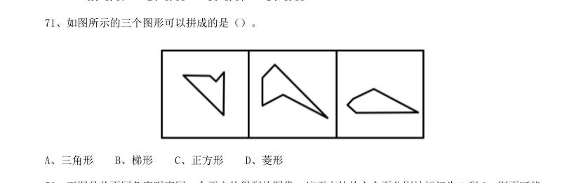

- **A.** 三角形
- **B.** 梯形
- **C.** 正方形
- **D.** 菱形

**答案：A**

### 【2019 广东省考（思维能力测验）·第 73 题】GD-2019-sw-X073　图形推理｜位置规律

如图所示直角梯形,以它的上底为轴旋转360 度,能够得到的立体图形是()。

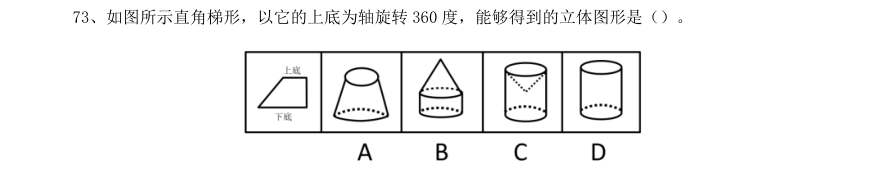

> （本题为图形题，选项为图片，见原卷）

**答案：C**

### 【2019 广东省考（思维能力测验）·第 74 题】GD-2019-sw-X074　图形推理｜截面

从一个圆柱体中挖去一个圆柱体和一个圆锥体,得到的立体图形如左图所示。则右边不可能是它的截 面的是

> （本题为图形题，选项为图片，见原卷）

**答案：D**

### 【2019 广东省考（思维能力测验）·第 75 题】GD-2019-sw-X075　图形推理｜位置规律

以下可由所给立体图形经过旋转得到的是()。

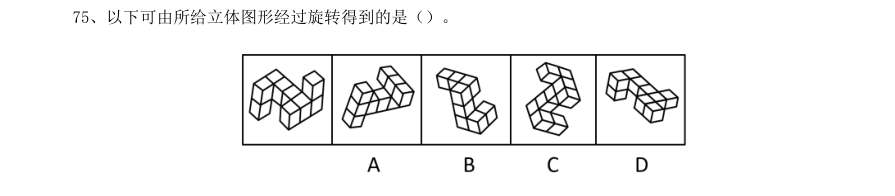

> （本题为图形题，选项为图片，见原卷）

**答案：C**

### 【2019 广东省考（思维能力测验）·第 76 题】GD-2019-sw-X076　图形推理｜三视图

以下符合所给三视图的立体图形是()。

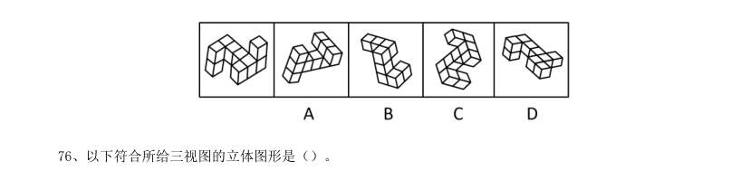

> （本题为图形题，选项为图片，见原卷）

**答案：B**

### 【2019 广东省考（思维能力测验）·第 79 题】GD-2019-sw-X079　图形推理｜立体图形

左图所示立体图形,可以由()三个图形组成。

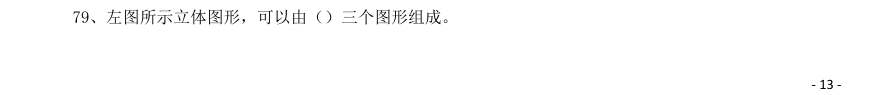

- **A.** 123
- **B.** 124
- **C.** 134
- **D.** 234

**答案：B**

### 【2019 广东省考（思维能力测验）·第 80 题】GD-2019-sw-X080　图形推理｜位置规律

以下4 张纸条中,沿折痕能够折出如左图所示图形的是()。

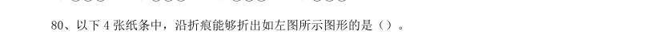

> （本题为图形题，选项为图片，见原卷）

**答案：B**

### 【2019 国考（地市级）·第 71 题】GK-2019-ds-X071　图形推理｜位置规律

从所给的四个选项中,选择最合适的一个填入问号处,使之呈现一定的规律性:

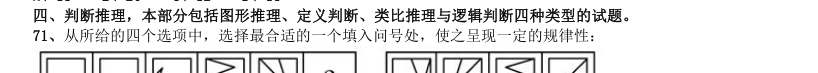

> （本题为图形题，选项为图片，见原卷）

**答案：B**

### 【2019 国考（地市级）·第 72 题】GK-2019-ds-X072　图形推理｜属性规律

从所给的四个选项中,选择最合适的一个填入问号处,使之呈现一定的规律性:

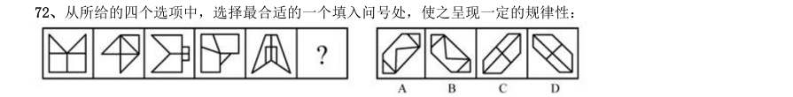

> （本题为图形题，选项为图片，见原卷）

**答案：B**

### 【2019 国考（地市级）·第 73 题】GK-2019-ds-X073　图形推理｜位置规律

从所给的四个选项中,选择最合适的一个填入问号处,使之呈现一定的规律性:

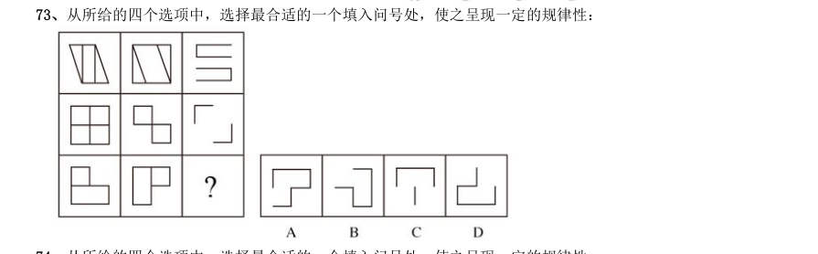

> （本题为图形题，选项为图片，见原卷）

**答案：D**

### 【2019 国考（地市级）·第 74 题】GK-2019-ds-X074　图形推理｜位置规律

从所给的四个选项中,选择最合适的一个填入问号处,使之呈现一定的规律性:

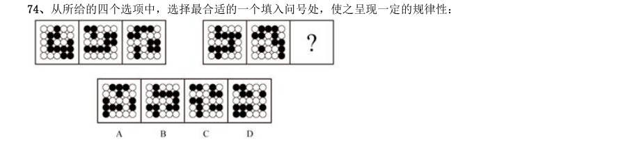

> （本题为图形题，选项为图片，见原卷）

**答案：A**

### 【2019 国考（地市级）·第 75 题】GK-2019-ds-X075　图形推理｜折纸盒

左边给定的是正方体的外表面展开图,下面哪一项能由它折叠而成?

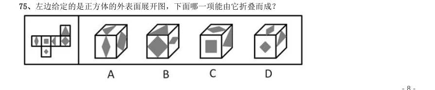

> （本题为图形题，选项为图片，见原卷）

**答案：C**

### 【2019 国考（地市级）·第 76 题】GK-2019-ds-X076　图形推理｜截面

左图为6 个相同小正方体组合成的多面体,将其从任一面剖开,以下哪一项不可能是该多面体的截面?

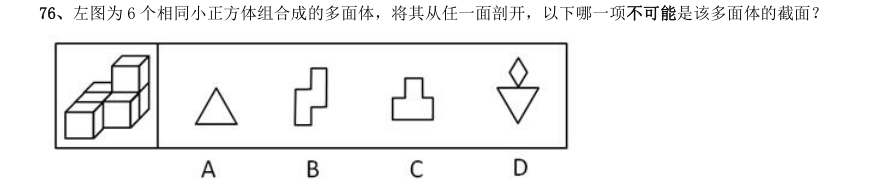

> （本题为图形题，选项为图片，见原卷）

**答案：D**

### 【2019 国考（地市级）·第 77 题】GK-2019-ds-X077　图形推理｜立体拼合

下图为同样大小的正方体堆叠而成的多面体正视图和后视图。该多面体可拆分为1、2、3和4共4 个多面 体的组合,问下列哪一项能填入问号处?

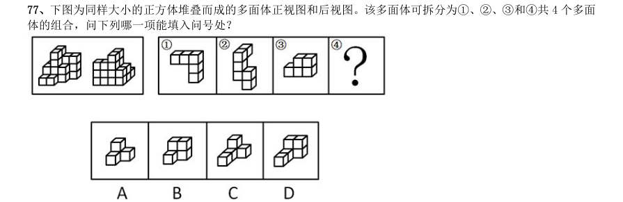

> （本题为图形题，选项为图片，见原卷）

**答案：D**

### 【2019 国考（地市级）·第 78 题】GK-2019-ds-X078　图形推理｜分组分类

把下面的六个图形分为两类,使每一类图形都有各自的共同特征或规律,分类正确的一项是:

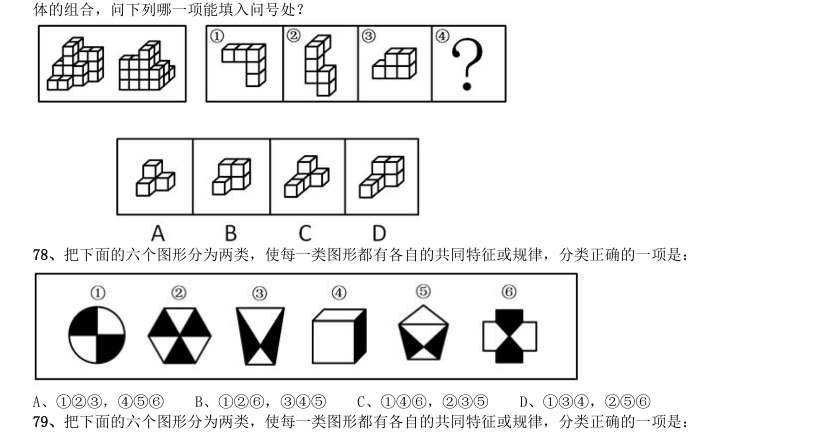

- **A.** 123,456
- **B.** 126,345
- **C.** 146,235
- **D.** 134,256

**答案：B**

### 【2019 国考（地市级）·第 79 题】GK-2019-ds-X079　图形推理｜分组分类

把下面的六个图形分为两类,使每一类图形都有各自的共同特征或规律,分类正确的一项是:

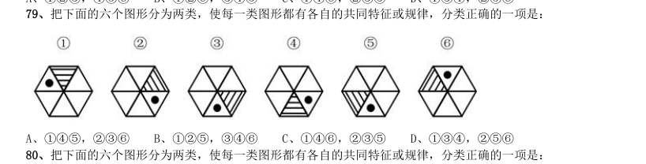

- **A.** 145,236
- **B.** 125,346
- **C.** 146,235
- **D.** 134,256

**答案：A**

### 【2019 国考（地市级）·第 80 题】GK-2019-ds-X080　图形推理｜分组分类

把下面的六个图形分为两类,使每一类图形都有各自的共同特征或规律,分类正确的一项是:

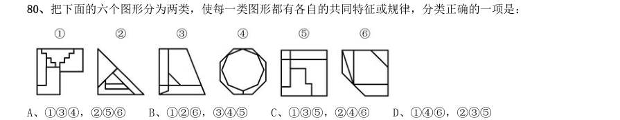

- **A.** 134,256
- **B.** 126,345
- **C.** 135,246
- **D.** 146,235

**答案：C**

### 【2019 国考（省级）·第 76 题】GK-2019-sj-X076　图形推理｜属性规律

从所给的四个选项中,选择最合适的一个填入问号处,使之呈现一定的规律性:

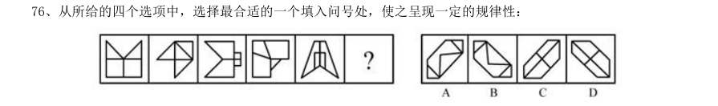

> （本题为图形题，选项为图片，见原卷）

**答案：B**

### 【2019 国考（省级）·第 77 题】GK-2019-sj-X077　图形推理｜位置规律

从所给的四个选项中,选择最合适的一个填入问号处,使之呈现一定的规律性:

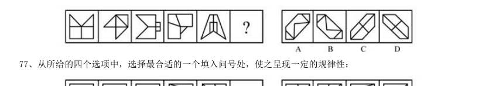

> （本题为图形题，选项为图片，见原卷）

**答案：B**

### 【2019 国考（省级）·第 78 题】GK-2019-sj-X078　图形推理｜位置规律

从所给的四个选项中,选择最合适的一个填入问号处,使之呈现一定的规律性:

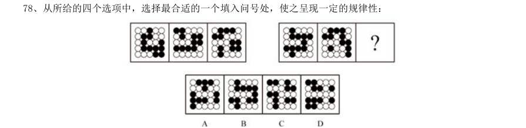

> （本题为图形题，选项为图片，见原卷）

**答案：A**

### 【2019 国考（省级）·第 79 题】GK-2019-sj-X079　图形推理｜位置规律

从所给的四个选项中,选择最合适的一个填入问号处,使之呈现一定的规律性:

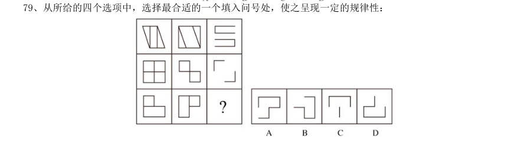

> （本题为图形题，选项为图片，见原卷）

**答案：D**

### 【2019 国考（省级）·第 80 题】GK-2019-sj-X080　图形推理｜立体拼合

下图为同样大小的正方体堆叠而成的多面体正视图和后视图。该多面体可拆分为1、2、3和4共4 个多面 体的组合,问下列哪一项能填入问号处?

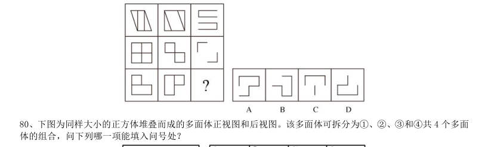

> （本题为图形题，选项为图片，见原卷）

**答案：D**

### 【2019 国考（省级）·第 81 题】GK-2019-sj-X081　图形推理｜截面

左图为6 个相同小正方体组合成的多面体,将其从任一面剖开,以下哪一项不可能是该多面体的截面?

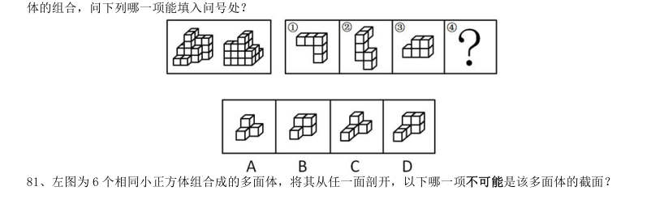

> （本题为图形题，选项为图片，见原卷）

**答案：D**

### 【2019 国考（省级）·第 82 题】GK-2019-sj-X082　图形推理｜折纸盒

左边给定的是正方体的外表面展开图,下面哪一项能由它折叠而成?

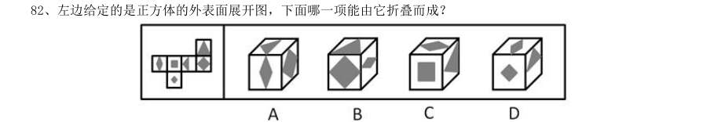

> （本题为图形题，选项为图片，见原卷）

**答案：C**

### 【2019 国考（省级）·第 83 题】GK-2019-sj-X083　图形推理｜分组分类

把下面的六个图形分为两类,使每一类图形都有各自的共同特征或规律,分类正确的一项是:

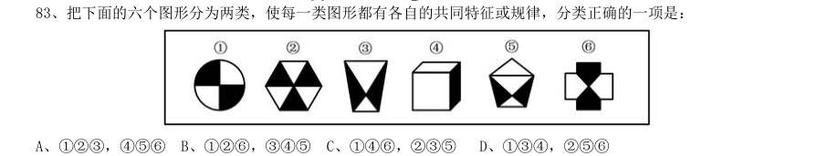

- **A.** 123,456
- **B.** 126,345
- **C.** 146,235
- **D.** 134,256

**答案：B**

### 【2019 国考（省级）·第 84 题】GK-2019-sj-X084　图形推理｜分组分类

把下面的六个图形分为两类,使每一类图形都有各自的共同特征或规律,分类正确的一项是:

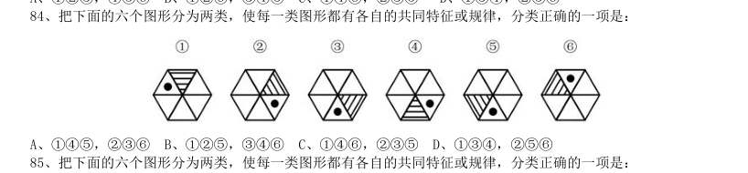

- **A.** 145,236
- **B.** 125,346
- **C.** 146,235
- **D.** 134,256

**答案：A**

### 【2019 国考（省级）·第 85 题】GK-2019-sj-X085　图形推理｜分组分类

把下面的六个图形分为两类,使每一类图形都有各自的共同特征或规律,分类正确的一项是:

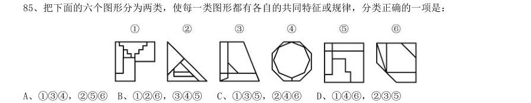

- **A.** 134,256
- **B.** 126,345
- **C.** 135,246
- **D.** 146,235

**答案：C**

### 【2018 湖北省考·第 71 题】HB-2018-ty-X071　图形推理｜属性规律
> 材料：选项。…

从所给的四个选项中,选择最合适的一个填入问号处,使之呈现一定的规律性:

> （本题为图形题，选项为图片，见原卷）

**答案：A**

### 【2018 湖北省考·第 72 题】HB-2018-ty-X072　图形推理｜分组分类

把下面的图形分为两类,使每一类图形都有各自的共同特征或规律,分类正确的一项是:

- **A.** 146,235
- **B.** 134,256
- **C.** 125,346
- **D.** 135,246

**答案：C**

### 【2018 湖北省考·第 73 题】HB-2018-ty-X073　图形推理｜折纸盒

下列哪个选项中的图形能够折叠成完整封闭的立体几何结构:

> （本题为图形题，选项为图片，见原卷）

**答案：B**

### 【2018 湖北省考·第 74 题】HB-2018-ty-X074　图形推理｜分组分类

把下面的图形分为两类,使每一类图形都有各自的共同特征或规律,分类正确的一项是:

- **A.** 125,346
- **B.** 135,246
- **C.** 146,235
- **D.** 126,345

**答案：C**

### 【2018 湖北省考·第 75 题】HB-2018-ty-X075　图形推理｜立体拼合

从所给的四个选项中,选择最合适的一个填入问号处,使下图中的立体图形1、2、3和4可组成一个完 整的长方体:

> （本题为图形题，选项为图片，见原卷）

**答案：C**

### 【2018 广东省考·第 31 题】GD-2018-ty-X031　图形推理｜图形推理（待细分）

从所给的四个选项中,选择最合适的一个填在问号处,使之呈现一定的规律性:

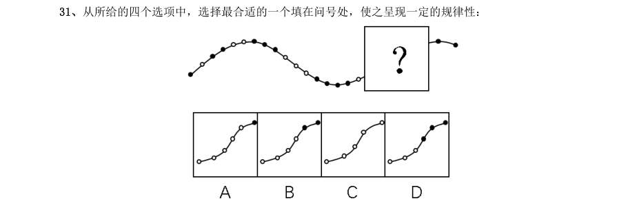

> （本题为图形题，选项为图片，见原卷）

**答案：该题答案缺失，见原卷**

### 【2018 广东省考·第 32 题】GD-2018-ty-X032　图形推理｜图形推理（待细分）

从所给的四个选项中,选择最合适的一个填在问号处,使之呈现一定的规律性:

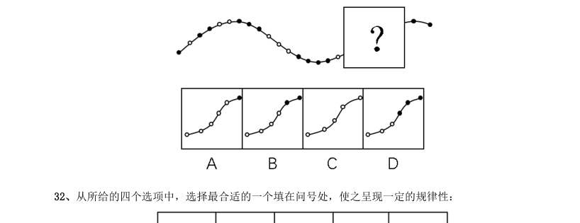

> （本题为图形题，选项为图片，见原卷）

**答案：该题答案缺失，见原卷**

### 【2018 广东省考·第 33 题】GD-2018-ty-X033　图形推理｜图形推理（待细分）

从所给的四个选项中,选择最合适的一个填在问号处,使之呈现一定的规律性:

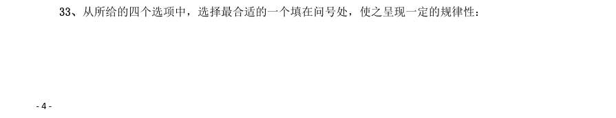

> （本题为图形题，选项为图片，见原卷）

**答案：该题答案缺失，见原卷**

### 【2018 广东省考·第 34 题】GD-2018-ty-X034　图形推理｜图形推理（待细分）

从所给的四个选项中,选择最合适的一个填在问号处,使之呈现一定的规律性:

> （本题为图形题，选项为图片，见原卷）

**答案：该题答案缺失，见原卷**

### 【2018 广东省考·第 35 题】GD-2018-ty-X035　图形推理｜图形推理（待细分）

从所给的四个选项中,选择最合适的一个填在问号处,使之呈现一定的规律性:

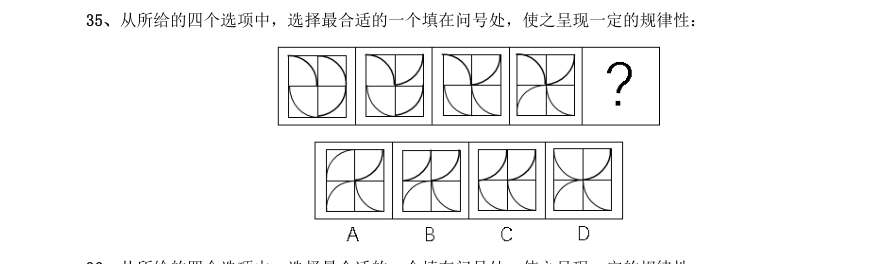

> （本题为图形题，选项为图片，见原卷）

**答案：该题答案缺失，见原卷**

### 【2018 广东省考·第 36 题】GD-2018-ty-X036　图形推理｜图形推理（待细分）

从所给的四个选项中,选择最合适的一个填在问号处,使之呈现一定的规律性:

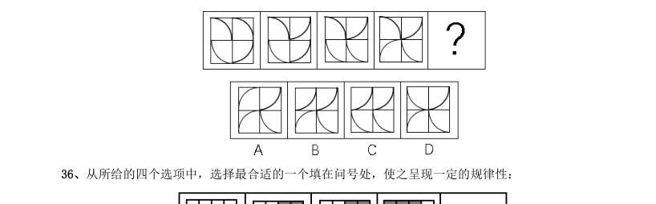

> （本题为图形题，选项为图片，见原卷）

**答案：该题答案缺失，见原卷**

### 【2018 广东省考·第 37 题】GD-2018-ty-X037　图形推理｜图形推理（待细分）

从所给的四个选项中,选择最合适的一个填在问号处,使之呈现一定的规律性:

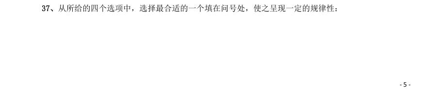

> （本题为图形题，选项为图片，见原卷）

**答案：该题答案缺失，见原卷**

### 【2018 广东省考·第 38 题】GD-2018-ty-X038　图形推理｜图形推理（待细分）

从所给的四个选项中,选择最合适的一个填在问号处,使之呈现一定的规律性:

> （本题为图形题，选项为图片，见原卷）

**答案：该题答案缺失，见原卷**

### 【2018 广东省考·第 39 题】GD-2018-ty-X039　图形推理｜图形推理（待细分）

从所给的四个选项中,选择最合适的一个填在问号处,使之呈现一定的规律性:

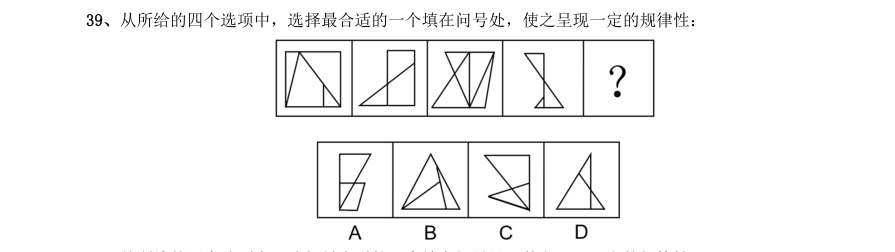

> （本题为图形题，选项为图片，见原卷）

**答案：该题答案缺失，见原卷**

### 【2018 广东省考·第 40 题】GD-2018-ty-X040　图形推理｜图形推理（待细分）

从所给的四个选项中,选择最合适的一个填在问号处,使之呈现一定的规律性:

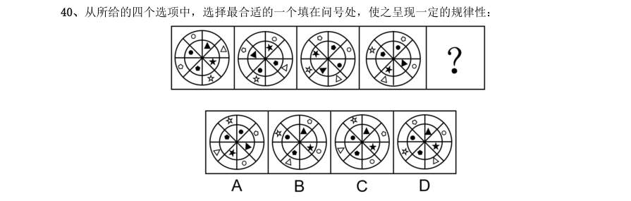

> （本题为图形题，选项为图片，见原卷）

**答案：该题答案缺失，见原卷**

### 【2018 国考（副省级）·第 76 题】GK-2018-fs-X076　图形推理｜图形推理（待细分）

从所给的四个选项中,选出最合适的一个填入问号处,使之呈现一定的规律性:

> （本题为图形题，选项为图片，见原卷）

**答案：D**

### 【2018 国考（副省级）·第 77 题】GK-2018-fs-X077　图形推理｜属性规律

从所给的四个选项中,选出最合适的一个填入问号处,使之呈现一定的规律性:

> （本题为图形题，选项为图片，见原卷）

**答案：C**

### 【2018 国考（副省级）·第 78 题】GK-2018-fs-X078　图形推理｜属性规律

从所给的四个选项中,选出最合适的一个填入问号处,使之呈现一定的规律性:

> （本题为图形题，选项为图片，见原卷）

**答案：D**

### 【2018 国考（副省级）·第 79 题】GK-2018-fs-X079　图形推理｜样式规律

从所给的四个选项中,选出最合适的一个填入问号处,使之呈现一定的规律性:

> （本题为图形题，选项为图片，见原卷）

**答案：C**

### 【2018 国考（副省级）·第 80 题】GK-2018-fs-X080　图形推理｜折纸盒

左图给定的是正方体纸盒的外表面,下面哪一项能由它折叠而成?

> （本题为图形题，选项为图片，见原卷）

**答案：D**

### 【2018 国考（副省级）·第 81 题】GK-2018-fs-X081　图形推理｜三视图

左图为给定的多面体,从任一角度观看,下面哪一项不可能是该多面体的视图?

> （本题为图形题，选项为图片，见原卷）

**答案：D**

### 【2018 国考（副省级）·第 82 题】GK-2018-fs-X082　图形推理｜立体图形

下面四个立体图形中,哪一项不能用一个平面分割为两个完全相同或互为镜像的部分?

> （本题为图形题，选项为图片，见原卷）

**答案：B**

### 【2018 国考（副省级）·第 83 题】GK-2018-fs-X083　图形推理｜分组分类

把下面的六个图形分为两类,使每一类图形都有各自的共同特征或规律,分类正确的一项是:

- **A.** 126,345
- **B.** 134,256
- **C.** 145,236
- **D.** 146,235

**答案：A**

### 【2018 国考（副省级）·第 84 题】GK-2018-fs-X084　图形推理｜分组分类

把下面的六个图形分为两类,使每一类图形都有各自的共同特征或规律,分类正确的一项是:

- **A.** 126,345
- **B.** 125,346
- **C.** 123,456
- **D.** 135,246

**答案：B**

### 【2018 国考（副省级）·第 85 题】GK-2018-fs-X085　图形推理｜分组分类

把下面的六个图形分为两类,使每一类图形都有各自的共同特征或规律,分类正确的一项是:

- **A.** 134,256
- **B.** 136,245
- **C.** 123,456
- **D.** 135,246

**答案：A**

### 【2018 国考（地市级）·第 71 题】GK-2018-ds-X071　图形推理｜属性规律

从所给的四个选项中,选出最合适的一个填入问号处,使之呈现一定的规律性:

> （本题为图形题，选项为图片，见原卷）

**答案：C**

### 【2018 国考（地市级）·第 72 题】GK-2018-ds-X072　图形推理｜图形推理（待细分）

从所给的四个选项中,选出最合适的一个填入问号处,使之呈现一定的规律性:

> （本题为图形题，选项为图片，见原卷）

**答案：D**

### 【2018 国考（地市级）·第 73 题】GK-2018-ds-X073　图形推理｜属性规律

从所给的四个选项中,选出最合适的一个填入问号处,使之呈现一定的规律性:

> （本题为图形题，选项为图片，见原卷）

**答案：D**

### 【2018 国考（地市级）·第 74 题】GK-2018-ds-X074　图形推理｜样式规律

从所给的四个选项中,选出最合适的一个填入问号处,使之呈现一定的规律性:

> （本题为图形题，选项为图片，见原卷）

**答案：C**

### 【2018 国考（地市级）·第 75 题】GK-2018-ds-X075　图形推理｜折纸盒

左图给定的是正方体纸盒的外表面,下面哪一项能由它折叠而成?

> （本题为图形题，选项为图片，见原卷）

**答案：D**

### 【2018 国考（地市级）·第 78 题】GK-2018-ds-X078　图形推理｜分组分类

把下面的六个图形分为两类,使每一类图形都有各自的共同特征或规律,分类正确的一项是:

- **A.** 126,345
- **B.** 134,256
- **C.** 145,236
- **D.** 146,235

**答案：A**

### 【2018 国考（地市级）·第 79 题】GK-2018-ds-X079　图形推理｜分组分类

把下面的六个图形分为两类,使每一类图形都有各自的共同特征或规律,分类正确的一项是:

- **A.** 126,345
- **B.** 125,346
- **C.** 123,456
- **D.** 135,246

**答案：B**

### 【2018 国考（地市级）·第 80 题】GK-2018-ds-X080　图形推理｜分组分类

把下面的六个图形分为两类,使每一类图形都有各自的共同特征或规律,分类正确的一项是:

- **A.** 134,256
- **B.** 136,245
- **C.** 123,456
- **D.** 135,246

**答案：A**

### 【2017 湖北省考·第 71 题】HB-2017-ty-X071　图形推理｜折纸盒

左边给定的是削掉一个角的纸盒,下列哪一项不是由它展开而成?

> （本题为图形题，选项为图片，见原卷）

**答案：C**

### 【2017 湖北省考·第 72 题】HB-2017-ty-X072　图形推理｜分组分类

把下面的六个图形分为两类,使每一类图形都有各自的共同特征或规律,分类正确的一项是:

- **A.** 134,256
- **B.** 126,345
- **C.** 125,346
- **D.** 136,245

**答案：B**

### 【2017 湖北省考·第 73 题】HB-2017-ty-X073　图形推理｜属性规律

从所给的四个选项中,选择最合适的一个填入问号处,使之呈现一定的规律性:

> （本题为图形题，选项为图片，见原卷）

**答案：A**

### 【2017 湖北省考·第 74 题】HB-2017-ty-X074　图形推理｜立体拼合

从所给的四个选项中,选出一个最合适的填入问号处,使之呈现一定的规律:

> （本题为图形题，选项为图片，见原卷）

**答案：B**

### 【2017 湖北省考·第 75 题】HB-2017-ty-X075　图形推理｜截面

如图所示,立方体上叠加圆柱体再打通一个圆柱孔,然后从任意面剖开,下面哪一项不可能是该立体的截面?

> （本题为图形题，选项为图片，见原卷）

**答案：B**

### 【2017 广东省考·第 31 题】GD-2017-ty-X031　图形推理｜图形推理（待细分）

从所给四个选项中,选择最合适的一个填入问号处,使之呈现一定规律性:

> （本题为图形题，选项为图片，见原卷）

**答案：该题答案缺失，见原卷**

### 【2017 广东省考·第 32 题】GD-2017-ty-X032　图形推理｜图形推理（待细分）

从所给四个选项中,选择最合适的一个填入问号处,使之呈现一定规律性:

> （本题为图形题，选项为图片，见原卷）

**答案：该题答案缺失，见原卷**

### 【2017 广东省考·第 33 题】GD-2017-ty-X033　图形推理｜图形推理（待细分）

从所给四个选项中,选择最合适的一个填入问号处,使之呈现一定规律性:

> （本题为图形题，选项为图片，见原卷）

**答案：该题答案缺失，见原卷**

### 【2017 广东省考·第 34 题】GD-2017-ty-X034　图形推理｜图形推理（待细分）

从所给四个选项中,选择最合适的一个填入问号处,使之呈现一定规律性:

> （本题为图形题，选项为图片，见原卷）

**答案：该题答案缺失，见原卷**

### 【2017 广东省考·第 35 题】GD-2017-ty-X035　图形推理｜图形推理（待细分）

从所给四个选项中,选择最合适的一个填入问号处,使之呈现一定规律性:

> （本题为图形题，选项为图片，见原卷）

**答案：该题答案缺失，见原卷**

### 【2017 广东省考·第 36 题】GD-2017-ty-X036　图形推理｜图形推理（待细分）

从所给四个选项中,选择最合适的一个填入问号处,使之呈现一定规律性:

> （本题为图形题，选项为图片，见原卷）

**答案：该题答案缺失，见原卷**

### 【2017 广东省考·第 37 题】GD-2017-ty-X037　图形推理｜图形推理（待细分）

从所给四个选项中,选择最合适的一个填入问号处,使之呈现一定规律性:

> （本题为图形题，选项为图片，见原卷）

**答案：该题答案缺失，见原卷**

### 【2017 广东省考·第 38 题】GD-2017-ty-X038　图形推理｜图形推理（待细分）

从所给四个选项中,选择最合适的一个填入问号处,使之呈现一定规律性:

> （本题为图形题，选项为图片，见原卷）

**答案：该题答案缺失，见原卷**

### 【2017 广东省考·第 39 题】GD-2017-ty-X039　图形推理｜分组分类

把下面的六个图形分为两类,使每一类图形都有各自的共同特征或规律,分类正确的一项是:

- **A.** 146,235
- **B.** 125,346
- **C.** 156,234
- **D.** 135,246

**答案：该题答案缺失，见原卷**

### 【2017 广东省考·第 40 题】GD-2017-ty-X040　图形推理｜分组分类

把下面的6 个图形分为两类,使每一类图形都有各自的共同规律,分类正确的是:

- **A.** 146,235
- **B.** 125,346
- **C.** 156,234
- **D.** 135,246

**答案：该题答案缺失，见原卷**

### 【2017 国考（副省级）·第 76 题】GK-2017-fs-X076　图形推理｜属性规律

从所给的四个选项中,选择最合适的一个填入问号处,使之呈现一定的规律性:

> （本题为图形题，选项为图片，见原卷）

**答案：C**

### 【2017 国考（副省级）·第 77 题】GK-2017-fs-X077　图形推理｜位置规律

从所给的四个选项中,选择最合适的一个填入问号处,使之呈现一定的规律性:

> （本题为图形题，选项为图片，见原卷）

**答案：C**

### 【2017 国考（副省级）·第 78 题】GK-2017-fs-X078　图形推理｜分组分类

从所给的四个选项中,选择最合适的一个填入问号处,使之呈现一定的规律性:

> （本题为图形题，选项为图片，见原卷）

**答案：A**

### 【2017 国考（副省级）·第 79 题】GK-2017-fs-X079　图形推理｜样式规律

从所给的四个选项中,选择最合适的一个填入问号处,使之呈现一定的规律性:

> （本题为图形题，选项为图片，见原卷）

**答案：A**

### 【2017 国考（副省级）·第 80 题】GK-2017-fs-X080　图形推理｜属性规律

从所给的四个选项中,选择最合适的一个填入问号处,使之呈现一定的规律性:

> （本题为图形题，选项为图片，见原卷）

**答案：B**

### 【2017 国考（副省级）·第 81 题】GK-2017-fs-X081　图形推理｜折纸盒

左边给定的是正方体的外表面展开图,下面哪一项能由它折叠而成?

> （本题为图形题，选项为图片，见原卷）

**答案：D**

### 【2017 国考（副省级）·第 82 题】GK-2017-fs-X082　图形推理｜立体拼合

下图中的立体图形1是由立体图形2,3和4组合而成,下列哪一项不能填入问号处?

> （本题为图形题，选项为图片，见原卷）

**答案：B**

### 【2017 国考（副省级）·第 83 题】GK-2017-fs-X083　图形推理｜分组分类

把下面的六个图形分为两类,使每一类图形都有各自的共同特征或规律,分类正确的一项是:

- **A.** 146,235
- **B.** 123,456
- **C.** 156,234
- **D.** 135,246

**答案：D**

### 【2017 国考（副省级）·第 84 题】GK-2017-fs-X084　图形推理｜分组分类

把下面的六个图形分为两类,使每一类图形都有各自的共同特征或规律,分类正确的一项是:

- **A.** 134,256
- **B.** 125,346
- **C.** 136,245
- **D.** 145,23

**答案：A**

### 【2017 国考（副省级）·第 85 题】GK-2017-fs-X085　图形推理｜分组分类

把下面的六个图形分为两类,使每一类图形都有各自的共同特征或规律,分类正确的一项是:

- **A.** 125,346
- **B.** 123,456
- **C.** 135,246
- **D.** 126,345

**答案：C**

### 【2017 国考（地市级）·第 71 题】GK-2017-ds-X071　图形推理｜属性规律

从所给的四个选项中,选择最合适的一个填入问号处,使之呈现一定的规律性:

> （本题为图形题，选项为图片，见原卷）

**答案：C**

### 【2017 国考（地市级）·第 72 题】GK-2017-ds-X072　图形推理｜位置规律

从所给的四个选项中,选择最合适的一个填入问号处,使之呈现一定的规律性:

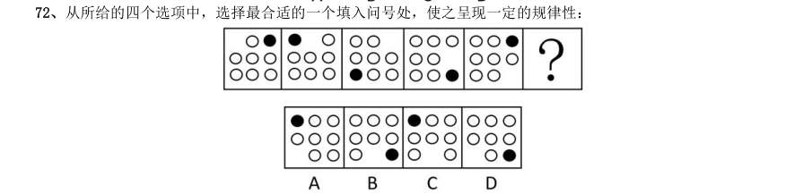

> （本题为图形题，选项为图片，见原卷）

**答案：C**

### 【2017 国考（地市级）·第 73 题】GK-2017-ds-X073　图形推理｜分组分类

从所给的四个选项中,选择最合适的一个填入问号处,使之呈现一定的规律性:

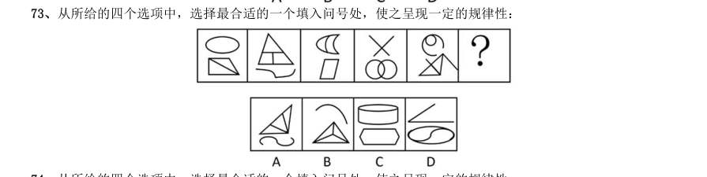

> （本题为图形题，选项为图片，见原卷）

**答案：A**

### 【2017 国考（地市级）·第 74 题】GK-2017-ds-X074　图形推理｜属性规律

从所给的四个选项中,选择最合适的一个填入问号处,使之呈现一定的规律性:

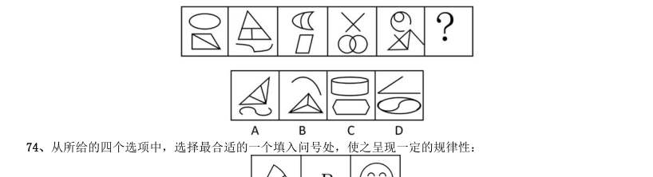

> （本题为图形题，选项为图片，见原卷）

**答案：B**

### 【2017 国考（地市级）·第 75 题】GK-2017-ds-X075　图形推理｜样式规律

从所给的四个选项中,选择最合适的一个填入问号处,使之呈现一定的规律性:

> （本题为图形题，选项为图片，见原卷）

**答案：A**

### 【2017 国考（地市级）·第 76 题】GK-2017-ds-X076　图形推理｜折纸盒

左边给定的是正方体的外表面展开图,下面哪一项能由它折叠而成?

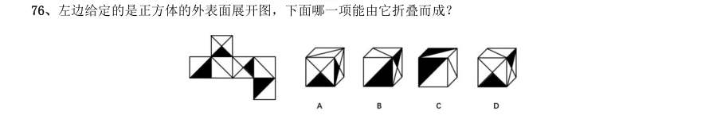

> （本题为图形题，选项为图片，见原卷）

**答案：D**

### 【2017 国考（地市级）·第 77 题】GK-2017-ds-X077　图形推理｜立体拼合

下图中的立体图形1是由立体图形2,3和4组合而成,下列哪一项不能填入问号处?

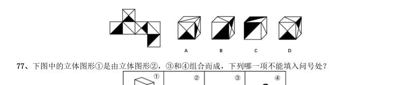

> （本题为图形题，选项为图片，见原卷）

**答案：B**

### 【2017 国考（地市级）·第 78 题】GK-2017-ds-X078　图形推理｜分组分类

把下面的六个图形分为两类,使每一类图形都有各自的共同特征或规律,分类正确的一项是:

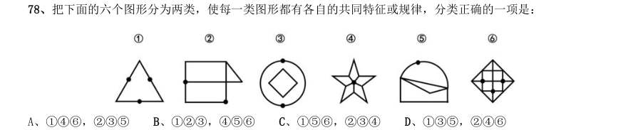

- **A.** 146,235
- **B.** 123,456
- **C.** 156,234
- **D.** 135,246

**答案：D**

### 【2017 国考（地市级）·第 79 题】GK-2017-ds-X079　图形推理｜分组分类

把下面的六个图形分为两类,使每一类图形都有各自的共同特征或规律,分类正确的一项是:

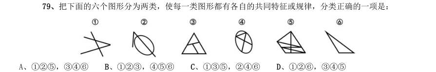

- **A.** 125,346
- **B.** 123,456
- **C.** 135,246
- **D.** 126,345

**答案：C**

### 【2017 国考（地市级）·第 80 题】GK-2017-ds-X080　图形推理｜分组分类

把下面的六个图形分为两类,使每一类图形都有各自的共同特征或规律,分类正确的一项是:

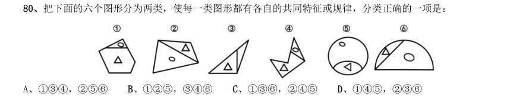

- **A.** 134,256
- **B.** 125,346
- **C.** 136,245
- **D.** 145,236

**答案：A**

### 【2016 湖北省考·第 71 题】HB-2016-ty-X071　图形推理｜位置规律

从所给四个选项中,选择最合适的一个填入问号处,使之呈现一定的规律性:

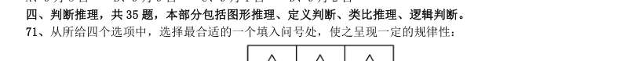

> （本题为图形题，选项为图片，见原卷）

**答案：B**

### 【2016 湖北省考·第 72 题】HB-2016-ty-X072　图形推理｜样式规律

从所给四个选项中,选择最合适的一个填入问号处,使之呈现一定的规律性:

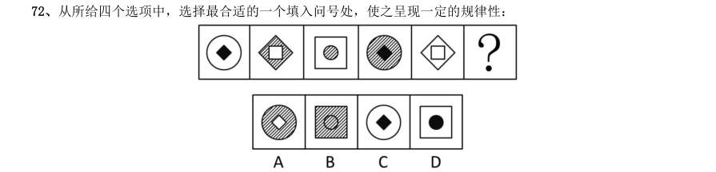

> （本题为图形题，选项为图片，见原卷）

**答案：B**

### 【2016 湖北省考·第 73 题】HB-2016-ty-X073　图形推理｜分组分类

把下面的六个图形分为两类,使每一类图形都有各自的共同特征或规律,分类正确的一项是:

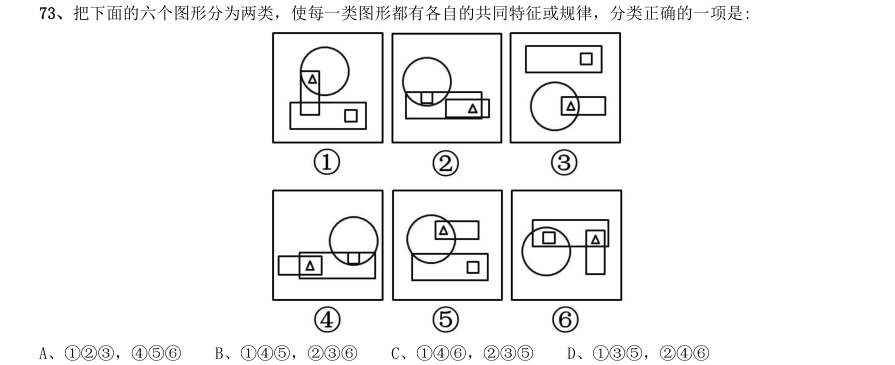

- **A.** 123,456
- **B.** 145,236
- **C.** 146,235
- **D.** 135,246

**答案：D**

### 【2016 湖北省考·第 74 题】HB-2016-ty-X074　图形推理｜数量规律

从所给四个选项中,选择最合适的一个填入问号处,使之呈现一定的规律性:

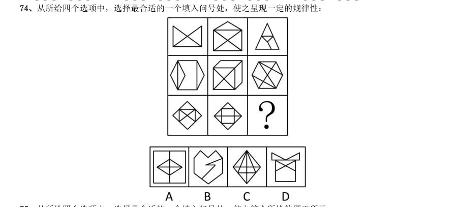

> （本题为图形题，选项为图片，见原卷）

**答案：该题答案缺失，见原卷**

### 【2016 湖北省考·第 75 题】HB-2016-ty-X075　图形推理｜数量规律

从所给四个选项中,选择最合适的一个填入问号处,使之符合所给的题干所示:

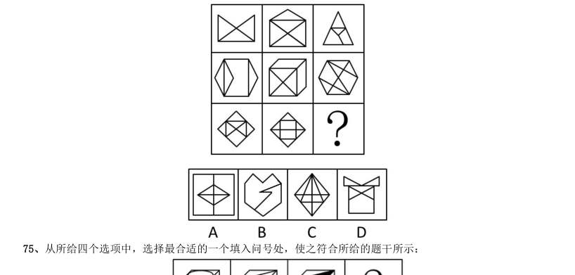

> （本题为图形题，选项为图片，见原卷）

**答案：C**

### 【2016 广东省考（乡镇）·第 31 题】GD-2016-xz-X031　图形推理｜图形推理（待细分）

判断。

> （本题为图形题，选项为图片，见原卷）

**答案：该题答案缺失，见原卷**

### 【2016 广东省考（乡镇）·第 32 题】GD-2016-xz-X032　图形推理｜图形推理（待细分）

（本题题干为图形/公式，文字层无题干，图见原卷）

> （本题为图形题，选项为图片，见原卷）

**答案：该题答案缺失，见原卷**

### 【2016 广东省考（乡镇）·第 33 题】GD-2016-xz-X033　图形推理｜图形推理（待细分）

（本题题干为图形/公式，文字层无题干，图见原卷）

> （本题为图形题，选项为图片，见原卷）

**答案：该题答案缺失，见原卷**

### 【2016 广东省考（乡镇）·第 34 题】GD-2016-xz-X034　图形推理｜图形推理（待细分）

（本题题干为图形/公式，文字层无题干，图见原卷）

> （本题为图形题，选项为图片，见原卷）

**答案：该题答案缺失，见原卷**

### 【2016 广东省考（乡镇）·第 35 题】GD-2016-xz-X035　图形推理｜图形推理（待细分）

（本题题干为图形/公式，文字层无题干，图见原卷）

> （本题为图形题，选项为图片，见原卷）

**答案：该题答案缺失，见原卷**

### 【2016 广东省考（乡镇）·第 36 题】GD-2016-xz-X036　图形推理｜图形推理（待细分）

（本题题干为图形/公式，文字层无题干，图见原卷）

> （本题为图形题，选项为图片，见原卷）

**答案：该题答案缺失，见原卷**

### 【2016 广东省考（乡镇）·第 37 题】GD-2016-xz-X037　图形推理｜图形推理（待细分）

（本题题干为图形/公式，文字层无题干，图见原卷）

> （本题为图形题，选项为图片，见原卷）

**答案：该题答案缺失，见原卷**

### 【2016 广东省考（乡镇）·第 38 题】GD-2016-xz-X038　图形推理｜图形推理（待细分）

（本题题干为图形/公式，文字层无题干，图见原卷）

> （本题为图形题，选项为图片，见原卷）

**答案：该题答案缺失，见原卷**

### 【2016 广东省考（乡镇）·第 39 题】GD-2016-xz-X039　图形推理｜图形推理（待细分）

（本题题干为图形/公式，文字层无题干，图见原卷）

> （本题为图形题，选项为图片，见原卷）

**答案：该题答案缺失，见原卷**

### 【2016 广东省考（乡镇）·第 40 题】GD-2016-xz-X040　图形推理｜图形推理（待细分）

（本题题干为图形/公式，文字层无题干，图见原卷）

> （本题为图形题，选项为图片，见原卷）

**答案：该题答案缺失，见原卷**

### 【2016 广东省考（县级）·第 51 题】GD-2016-xj-X051　图形推理｜图形推理（待细分）

（本题题干为图形/公式，文字层无题干，图见原卷）

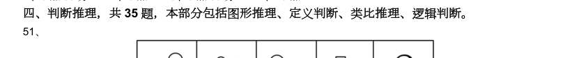

> （本题为图形题，选项为图片，见原卷）

**答案：该题答案缺失，见原卷**

### 【2016 广东省考（县级）·第 52 题】GD-2016-xj-X052　图形推理｜图形推理（待细分）

（本题题干为图形/公式，文字层无题干，图见原卷）

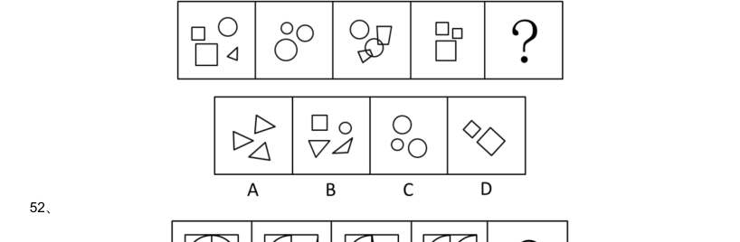

> （本题为图形题，选项为图片，见原卷）

**答案：该题答案缺失，见原卷**

### 【2016 广东省考（县级）·第 53 题】GD-2016-xj-X053　图形推理｜图形推理（待细分）

（本题题干为图形/公式，文字层无题干，图见原卷）

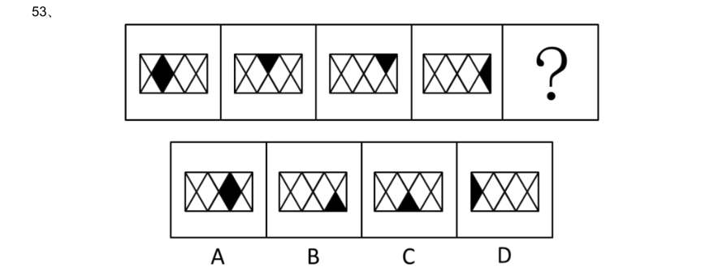

> （本题为图形题，选项为图片，见原卷）

**答案：该题答案缺失，见原卷**

### 【2016 广东省考（县级）·第 54 题】GD-2016-xj-X054　图形推理｜图形推理（待细分）

（本题题干为图形/公式，文字层无题干，图见原卷）

> （本题为图形题，选项为图片，见原卷）

**答案：该题答案缺失，见原卷**

### 【2016 广东省考（县级）·第 55 题】GD-2016-xj-X055　图形推理｜图形推理（待细分）

（本题题干为图形/公式，文字层无题干，图见原卷）

> （本题为图形题，选项为图片，见原卷）

**答案：该题答案缺失，见原卷**

### 【2016 广东省考（县级）·第 56 题】GD-2016-xj-X056　图形推理｜图形推理（待细分）

（本题题干为图形/公式，文字层无题干，图见原卷）

> （本题为图形题，选项为图片，见原卷）

**答案：该题答案缺失，见原卷**

### 【2016 广东省考（县级）·第 57 题】GD-2016-xj-X057　图形推理｜图形推理（待细分）

（本题题干为图形/公式，文字层无题干，图见原卷）

> （本题为图形题，选项为图片，见原卷）

**答案：该题答案缺失，见原卷**

### 【2016 广东省考（县级）·第 58 题】GD-2016-xj-X058　图形推理｜图形推理（待细分）

（本题题干为图形/公式，文字层无题干，图见原卷）

> （本题为图形题，选项为图片，见原卷）

**答案：该题答案缺失，见原卷**

### 【2016 广东省考（县级）·第 59 题】GD-2016-xj-X059　图形推理｜图形推理（待细分）

（本题题干为图形/公式，文字层无题干，图见原卷）

> （本题为图形题，选项为图片，见原卷）

**答案：该题答案缺失，见原卷**

### 【2016 广东省考（县级）·第 60 题】GD-2016-xj-X060　图形推理｜图形推理（待细分）

（本题题干为图形/公式，文字层无题干，图见原卷）

> （本题为图形题，选项为图片，见原卷）

**答案：该题答案缺失，见原卷**

### 【2016 国考（副省级）·第 76 题】GK-2016-fs-X076　图形推理｜数量规律
> 材料：判断。…

从所给四个选项中,选择最合适的一个填入问号处,使之呈现一定规律性:

> （本题为图形题，选项为图片，见原卷）

**答案：该题答案缺失，见原卷**

### 【2016 国考（副省级）·第 78 题】GK-2016-fs-X078　图形推理｜折纸盒

左边给定的是纸盒的外表面,下列哪一项能由它折叠而成?

> （本题为图形题，选项为图片，见原卷）

**答案：该题答案缺失，见原卷**

### 【2016 国考（副省级）·第 79 题】GK-2016-fs-X079　图形推理｜折纸盒

从所给四个选项中,选择最合适的一个填入问号处,使之呈现一定的规律性:

> （本题为图形题，选项为图片，见原卷）

**答案：B**

### 【2016 国考（副省级）·第 80 题】GK-2016-fs-X080　图形推理｜立体拼合

1、2、3、4为四个多面体零件,问A B C D 四个多面体零件中的哪一个与1、2、3、4中 的任一个都不能组成长方体?

> （本题为图形题，选项为图片，见原卷）

**答案：D**

### 【2016 国考（副省级）·第 81 题】GK-2016-fs-X081　图形推理｜分组分类

把下面的六个图形分为两类,使每一类图形都有各自的共同特征或规律,分类正确的一项是:

- **A.** 134,256
- **B.** 146,235
- **C.** 124,356
- **D.** 136,245

**答案：A**

### 【2016 国考（副省级）·第 82 题】GK-2016-fs-X082　图形推理｜分组分类

把下面的六个图形分为两类,使每一类图形都有各自的共同特征或规律,分类正确的一项是:

- **A.** 124,356
- **B.** 125,346
- **C.** 134,256
- **D.** 136,245

**答案：D**

### 【2016 国考（副省级）·第 83 题】GK-2016-fs-X083　图形推理｜分组分类

把下面的六个图形分为两类,使每一类图形都有各自的共同特征或规律,分类正确的一项是:

- **A.** 124,356
- **B.** 136,245
- **C.** 135,246
- **D.** 156,234

**答案：A**

### 【2016 国考（副省级）·第 84 题】GK-2016-fs-X084　图形推理｜分组分类

把下面的六个图形分为两类,使每一类图形都有各自的共同特征或规律,分类正确的一项是:

- **A.** 146,235
- **B.** 135,246
- **C.** 125,346
- **D.** 124,356

**答案：D**

### 【2016 国考（副省级）·第 85 题】GK-2016-fs-X085　图形推理｜分组分类

把下面的六个图形分为两类,使每一类图形都有各自的共同特征或规律,分类正确的一项是:

- **A.** 146,235
- **B.** 135,246
- **C.** 124,356
- **D.** 123,456

**答案：D**

### 【2016 国考（地市级）·第 71 题】GK-2016-ds-X071　图形推理｜数量规律

从所给四个选项中,选择最合适的一个填入问号处,使之呈现一定规律性:

> （本题为图形题，选项为图片，见原卷）

**答案：B**

### 【2016 国考（地市级）·第 72 题】GK-2016-ds-X072　图形推理｜属性规律

从所给四个选项中,选择最合适的一个填入问号处,使之呈现一定的规律性:

> （本题为图形题，选项为图片，见原卷）

**答案：B**

### 【2016 国考（地市级）·第 73 题】GK-2016-ds-X073　图形推理｜立体图形

1、2、3、4为四个多面体零件,问

> （本题为图形题，选项为图片，见原卷）

**答案：D**

### 【2016 国考（地市级）·第 74 题】GK-2016-ds-X074　图形推理｜截面

左图是给定的立方图形,将其从任一面剖开,下面哪一项可能是该立方体的截面?

> （本题为图形题，选项为图片，见原卷）

**答案：A**

### 【2016 国考（地市级）·第 75 题】GK-2016-ds-X075　图形推理｜折纸盒

左边给定的是纸盒的外表面,下列哪一项能由它折叠而成?

> （本题为图形题，选项为图片，见原卷）

**答案：B**

### 【2016 国考（地市级）·第 76 题】GK-2016-ds-X076　图形推理｜分组分类

把下面的六个图形分为两类,使每一类图形都有各自的共同特征或规律,分类正确的一项是:

- **A.** 124,356
- **B.** 125,346
- **C.** 134,256
- **D.** 136,245

**答案：D**

### 【2016 国考（地市级）·第 77 题】GK-2016-ds-X077　图形推理｜分组分类

把下面的六个图形分为两类,使每一类图形都有各自的共同特征或规律,分类正确的一项是:

- **A.** 146,235
- **B.** 135,246
- **C.** 124,356
- **D.** 123,456

**答案：D**

### 【2016 国考（地市级）·第 78 题】GK-2016-ds-X078　图形推理｜分组分类

把下面的六个图形分为两类,使每一类图形都有各自的共同特征或规律,分类正确的一项是:

- **A.** 134,256
- **B.** 146,235
- **C.** 124,356
- **D.** 136,245

**答案：A**

### 【2016 国考（地市级）·第 79 题】GK-2016-ds-X079　图形推理｜分组分类

把下面的六个图形分为两类,使每一类图形都有各自的共同特征或规律,分类正确的一项是:

- **A.** 124,356
- **B.** 136,245
- **C.** 135,246
- **D.** 156,234

**答案：A**

### 【2016 国考（地市级）·第 80 题】GK-2016-ds-X080　图形推理｜分组分类

把下面的六个图形分为两类,使每一类图形都有各自的共同特征或规律,分类正确的一项是:

- **A.** 146,235
- **B.** 135,246
- **C.** 125,346
- **D.** 124,356

**答案：D**

### 【2015 湖北省考·第 70 题】HB-2015-ty-X070　图形推理｜数量规律

从所给四个选项中,选择最合适的一个填入问号处,使之呈现一定的规律性:

> （本题为图形题，选项为图片，见原卷）

**答案：D**

### 【2015 湖北省考·第 71 题】HB-2015-ty-X071　图形推理｜样式规律

从所给四个选项中,选择最合适的一个填入问号处,使之呈现一定的规律性:

> （本题为图形题，选项为图片，见原卷）

**答案：A**

### 【2015 湖北省考·第 72 题】HB-2015-ty-X072　图形推理｜分组分类

将下面的六个图形分成两类,使每一类图形都有各自的共同特征或规律,分类正确的一项是:

- **A.** 126;345
- **B.** 145;236
- **C.** 125;346
- **D.** 123;456

**答案：该题答案缺失，见原卷**

### 【2015 湖北省考·第 73 题】HB-2015-ty-X073　图形推理｜分组分类

把下面的六个图形分为两类,使每一类图形都有各自的共同特征或规律,分类正确的一项是:

- **A.** 123,456
- **B.** 145,236
- **C.** 156,234
- **D.** 146,235

**答案：D**

### 【2015 湖北省考·第 74 题】HB-2015-ty-X074　图形推理｜位置规律

从所给四个选项中,选择最合适的一个填入问号处,使之呈现一定的规律性:

> （本题为图形题，选项为图片，见原卷）

**答案：C**

### 【2015 湖北省考·第 75 题】HB-2015-ty-X075　图形推理｜样式规律

请从所给的四个选项中,选择最合适的一项填在问号处,使之呈现一定的规律性:

> （本题为图形题，选项为图片，见原卷）

**答案：B**

### 【2015 湖北省考·第 76 题】HB-2015-ty-X076　图形推理｜折纸盒

左边给定的是纸盒的外表面,下列哪一项能由它折叠而成:

> （本题为图形题，选项为图片，见原卷）

**答案：D**

### 【2015 广东省考（乡镇）·第 36 题】GD-2015-xz-X036　图形推理｜图形推理（待细分）
> 材料：推理、逻辑判断。…

从所给的四个选项中选,择最合适的一个填入问号处,使之呈现一定的规律性:

> （本题为图形题，选项为图片，见原卷）

**答案：该题答案缺失，见原卷**

### 【2015 广东省考（乡镇）·第 37 题】GD-2015-xz-X037　图形推理｜图形推理（待细分）

从所给的四个选项中,选择最合适的一个填在问号处,使之呈现一定的规律性:

> （本题为图形题，选项为图片，见原卷）

**答案：该题答案缺失，见原卷**

### 【2015 广东省考（乡镇）·第 38 题】GD-2015-xz-X038　图形推理｜图形推理（待细分）

从所给的四个选项中,选择最合适的一个填入问号处,使之呈现一定的规律性: 38、从所给的四个选项中,选择最合适的一个填入问号处,使之呈现一定的规律性:

> （本题为图形题，选项为图片，见原卷）

**答案：该题答案缺失，见原卷**

### 【2015 广东省考（乡镇）·第 39 题】GD-2015-xz-X039　图形推理｜图形推理（待细分）

（本题题干为图形/公式，文字层无题干，图见原卷）

> （本题为图形题，选项为图片，见原卷）

**答案：该题答案缺失，见原卷**

### 【2015 广东省考（乡镇）·第 40 题】GD-2015-xz-X040　图形推理｜图形推理（待细分）

从所给的四个选项中,选择最合适的一个填入问号处,使之呈现一定的规律性:

> （本题为图形题，选项为图片，见原卷）

**答案：该题答案缺失，见原卷**

### 【2015 广东省考（乡镇）·第 41 题】GD-2015-xz-X041　图形推理｜图形推理（待细分）

从所给的四个选项中,选择最合适的一个填入问号处,使之呈现一定的规律性:

> （本题为图形题，选项为图片，见原卷）

**答案：该题答案缺失，见原卷**

### 【2015 广东省考（乡镇）·第 42 题】GD-2015-xz-X042　图形推理｜图形推理（待细分）

从所给的四个选项中,选择最合适的一个填入问号处,使之呈现一定的规律性:

> （本题为图形题，选项为图片，见原卷）

**答案：该题答案缺失，见原卷**

### 【2015 广东省考（乡镇）·第 43 题】GD-2015-xz-X043　图形推理｜图形推理（待细分）

从所给的四个选项中,选择最合适的一个填入问号处,使之呈现一定的规律性:

> （本题为图形题，选项为图片，见原卷）

**答案：该题答案缺失，见原卷**

### 【2015 广东省考（乡镇）·第 44 题】GD-2015-xz-X044　图形推理｜图形推理（待细分）

请从所给的四个选项中,选择最合适的一项填在问号处,使之呈现一定的规律性:

> （本题为图形题，选项为图片，见原卷）

**答案：该题答案缺失，见原卷**

### 【2015 广东省考（乡镇）·第 45 题】GD-2015-xz-X045　图形推理｜图形推理（待细分）

从所给的四个选项中,选择最合适的一个填入问号处,使之呈现一定的规律性:

> （本题为图形题，选项为图片，见原卷）

**答案：该题答案缺失，见原卷**

### 【2015 广东省考（县级）·第 36 题】GD-2015-xj-X036　图形推理｜图形推理（待细分）
> 材料：逻辑判断。…

从所给的四个选项中,选择最合适的一个填入问号处,使之呈现一定的规律性:

> （本题为图形题，选项为图片，见原卷）

**答案：该题答案缺失，见原卷**

### 【2015 广东省考（县级）·第 37 题】GD-2015-xj-X037　图形推理｜图形推理（待细分）

从所给的四个选项中,选择最合适的一个填入问号处,使之呈现一定的规律性:

> （本题为图形题，选项为图片，见原卷）

**答案：该题答案缺失，见原卷**

### 【2015 广东省考（县级）·第 38 题】GD-2015-xj-X038　图形推理｜图形推理（待细分）

从所给的四个选项中,选择最合适的一个填入问号处,使之呈现一定的规律性:

> （本题为图形题，选项为图片，见原卷）

**答案：该题答案缺失，见原卷**

### 【2015 广东省考（县级）·第 39 题】GD-2015-xj-X039　图形推理｜图形推理（待细分）

请从所给的四个选项中,选择最合适的一项填在问号处,使之呈现一定的规律性:

> （本题为图形题，选项为图片，见原卷）

**答案：该题答案缺失，见原卷**

### 【2015 广东省考（县级）·第 40 题】GD-2015-xj-X040　图形推理｜图形推理（待细分）

从所给的四个选项中,选择最合适的一个填入问号处,使之呈现一定的规律性:

> （本题为图形题，选项为图片，见原卷）

**答案：该题答案缺失，见原卷**

### 【2015 广东省考（县级）·第 41 题】GD-2015-xj-X041　图形推理｜图形推理（待细分）

从所给的四个选项中,选择最合适的一个填入问号处,使之呈现一定的规律性:

> （本题为图形题，选项为图片，见原卷）

**答案：该题答案缺失，见原卷**

### 【2015 广东省考（县级）·第 42 题】GD-2015-xj-X042　图形推理｜图形推理（待细分）

从所给的四个选项中,选择最合适的一个填入问号处,使之呈现一定的规律性:

> （本题为图形题，选项为图片，见原卷）

**答案：该题答案缺失，见原卷**

### 【2015 广东省考（县级）·第 43 题】GD-2015-xj-X043　图形推理｜图形推理（待细分）

从所给的四个选项中,选择最合适的一个填入问号处,使之呈现一定的规律性:

> （本题为图形题，选项为图片，见原卷）

**答案：该题答案缺失，见原卷**

### 【2015 广东省考（县级）·第 44 题】GD-2015-xj-X044　图形推理｜图形推理（待细分）

从所给的四个选项中,选择最合适的一个填入问号处,使之呈现一定的规律性:

> （本题为图形题，选项为图片，见原卷）

**答案：该题答案缺失，见原卷**

### 【2015 广东省考（县级）·第 45 题】GD-2015-xj-X045　图形推理｜图形推理（待细分）

从所给的四个选项中选,择最合适的一个填入问号处,使之呈现一定的规律性:

> （本题为图形题，选项为图片，见原卷）

**答案：该题答案缺失，见原卷**

### 【2015 国考（副省级）·第 76 题】GK-2015-fs-X076　图形推理｜位置规律

从所给四个选项中,选择最合适的一个填入问号处,使之呈现一定规律性:

> （本题为图形题，选项为图片，见原卷）

**答案：D**

### 【2015 国考（副省级）·第 77 题】GK-2015-fs-X077　图形推理｜立体拼合

从所给四个选项中,选择最合适的一个填入问号处,使之呈现一定规律性:

> （本题为图形题，选项为图片，见原卷）

**答案：B**

### 【2015 国考（副省级）·第 78 题】GK-2015-fs-X078　图形推理｜位置规律

从所给四个选项中,选择最合适的一个填入问号处,使之呈现一定规律性:

> （本题为图形题，选项为图片，见原卷）

**答案：D**

### 【2015 国考（副省级）·第 79 题】GK-2015-fs-X079　图形推理｜折纸盒

左边给的是纸盒的外表面,下列哪一项能由它折叠而成?

> （本题为图形题，选项为图片，见原卷）

**答案：A**

### 【2015 国考（副省级）·第 80 题】GK-2015-fs-X080　图形推理｜截面

一正方体如下图所示切掉了上半部分。现在从任意面剖开,下面哪一项不可能是该多面体的截面?

> （本题为图形题，选项为图片，见原卷）

**答案：C**

### 【2015 国考（副省级）·第 81 题】GK-2015-fs-X081　图形推理｜分组分类

把下面的六个图形分为两类,使每一类图形都有各自的共同特征或规律,分类正确的一项是:

- **A.** 126,345
- **B.** 145,236
- **C.** 125,346
- **D.** 123,456

**答案：B**

### 【2015 国考（副省级）·第 82 题】GK-2015-fs-X082　图形推理｜分组分类

把下面的六个图形分为两类,使每一类图形都有各自的共同特征或规律,分类正确的一项是:

- **A.** 134,256
- **B.** 126,345
- **C.** 135,246
- **D.** 156,234

**答案：A**

### 【2015 国考（副省级）·第 83 题】GK-2015-fs-X083　图形推理｜分组分类

把下面的六个图形分为两类,使每一类图形都有各自的共同特征或规律,分类正确的一项是:

- **A.** 123,456
- **B.** 135,246
- **C.** 126,345
- **D.** 146,235

**答案：C**

### 【2015 国考（副省级）·第 84 题】GK-2015-fs-X084　图形推理｜分组分类

把下面的六个图形分为两类,使每一类图形都有各自的共同特征或规律,分类正确的一项是:

- **A.** 156,234
- **B.** 135,246
- **C.** 123,456
- **D.** 125,346

**答案：D**

### 【2015 国考（副省级）·第 85 题】GK-2015-fs-X085　图形推理｜分组分类

把下面的六个图形分为两类,使每一类图形都有各自的共同特征或规律,分类正确的一项是:

- **A.** 124,356
- **B.** 134,256
- **C.** 146,235
- **D.** 156,234

**答案：B**

### 【2015 国考（副省级）·第 92 题】GK-2015-fs-X092　图形推理｜图形推理（待细分）

瓿是古代的一种盛酒器和盛水器,亦可用于盛酱。流行于商代至战国。圆体,敛口无颈,广肩,大腹,圈足, 带盖,亦有方形瓿。根据上述描述下列器具中是瓿的是:

> （本题为图形题，选项为图片，见原卷）

**答案：B**

### 【2015 国考（地市级）·第 71 题】GK-2015-ds-X071　图形推理｜位置规律

从所给四个选项中,选择最合适的一个填入问号处,使之呈现一定规律性:

> （本题为图形题，选项为图片，见原卷）

**答案：D**

### 【2015 国考（地市级）·第 72 题】GK-2015-ds-X072　图形推理｜立体拼合

从所给四个选项中,选择最合适的一个填入问号处,使之呈现一定规律性:

> （本题为图形题，选项为图片，见原卷）

**答案：B**

### 【2015 国考（地市级）·第 73 题】GK-2015-ds-X073　图形推理｜位置规律

从所给四个选项中,选择最合适的一个填入问号处,使之呈现一定规律性:

> （本题为图形题，选项为图片，见原卷）

**答案：D**

### 【2015 国考（地市级）·第 74 题】GK-2015-ds-X074　图形推理｜折纸盒

左边给的是纸盒的外表面,下列哪一项能由它折叠而成?

> （本题为图形题，选项为图片，见原卷）

**答案：A**

### 【2015 国考（地市级）·第 75 题】GK-2015-ds-X075　图形推理｜截面

一正方体如下图所示切掉了上半部分。现在从任意面剖开,下面哪一项不可能是该多面体的截面?

> （本题为图形题，选项为图片，见原卷）

**答案：C**

### 【2015 国考（地市级）·第 76 题】GK-2015-ds-X076　图形推理｜分组分类

把下面的六个图形分为两类,使每一类图形都有各自的共同特征或规律,分类正确的一项是:

- **A.** 126,345
- **B.** 145,236
- **C.** 125,346
- **D.** 123,456

**答案：B**

### 【2015 国考（地市级）·第 77 题】GK-2015-ds-X077　图形推理｜分组分类

把下面的六个图形分为两类,使每一类图形都有各自的共同特征或规律,分类正确的一项是:

- **A.** 134,256
- **B.** 126,345
- **C.** 135,246
- **D.** 156,234

**答案：A**

### 【2015 国考（地市级）·第 78 题】GK-2015-ds-X078　图形推理｜分组分类

把下面的六个图形分为两类,使每一类图形都有各自的共同特征或规律,分类正确的一项是:

- **A.** 123,456
- **B.** 135,246
- **C.** 126,345
- **D.** 146,235

**答案：C**

### 【2015 国考（地市级）·第 79 题】GK-2015-ds-X079　图形推理｜分组分类

把下面的六个图形分为两类,使每一类图形都有各自的共同特征或规律,分类正确的一项是:

- **A.** 156,234
- **B.** 135,246
- **C.** 123,456
- **D.** 125,346

**答案：D**

### 【2015 国考（地市级）·第 80 题】GK-2015-ds-X080　图形推理｜分组分类

把下面的六个图形分为两类,使每一类图形都有各自的共同特征或规律,分类正确的一项是:

- **A.** 124,356
- **B.** 134,256
- **C.** 146,235
- **D.** 156,234

**答案：B**

### 【2014 湖北省考·第 71 题】HB-2014-ty-X071　图形推理｜分组分类

把下面的六个图形分成两类,使每一类图形都有各自的共同特征或规律,分类正确的一项是:

- **A.** 123,456
- **B.** 135,246
- **C.** 146,235
- **D.** 156,234

**答案：A**

### 【2014 湖北省考·第 72 题】HB-2014-ty-X072　图形推理｜折纸盒

如用白、灰、黑三种颜色的油漆为正方体盒子的6 个面上色,且两个相对面上的颜色都一样,以下哪一个不 可能是该盒子外表图的展开图:

> （本题为图形题，选项为图片，见原卷）

**答案：C**

### 【2014 湖北省考·第 73 题】HB-2014-ty-X073　图形推理｜折纸盒

左边给定的是纸盒外表面的展开图,右边哪一项能由它折叠而成?请把它找出来:

> （本题为图形题，选项为图片，见原卷）

**答案：A**

### 【2014 湖北省考·第 74 题】HB-2014-ty-X074　图形推理｜属性规律

从所给的四个选项中,选择最合适的一个填入问号处,使之呈现一定的规律性:

> （本题为图形题，选项为图片，见原卷）

**答案：D**

### 【2014 湖北省考·第 75 题】HB-2014-ty-X075　图形推理｜截面

下列的立体图形是立方体中挖出一个圆锥台孔后形成的,如果从任一面剖开,以下哪一个不可能是该立体图 形的截面:

> （本题为图形题，选项为图片，见原卷）

**答案：C**

### 【2014 湖北省考·第 76 题】HB-2014-ty-X076　图形推理｜数量规律

从所给的四个选项中,选择最合适的一个填入问号处,使之呈现一定的规律性:

> （本题为图形题，选项为图片，见原卷）

**答案：A**

### 【2014 湖北省考·第 77 题】HB-2014-ty-X077　图形推理｜位置规律

请从所给的四个选项中,选择最合适的一项填在问号处,使之呈现一定的规律性。

> （本题为图形题，选项为图片，见原卷）

**答案：D**

### 【2014 湖北省考·第 102 题】HB-2014-ty-X102　图形推理｜图形推理（待细分）

R 医院连续五年在C 市举办的“我最满意的医院”调查中高居榜首,该医院负责人表示,这是由于该医院 提供了比其他医院更加优质的导诊服务。以下哪项为真,最能支持该医院负责人的观点: A C 市各大医院都在导诊服务中投入了大量精力,力图提高导诊服务质量 B C 市“我最满意的医院”调查已开展20 年,高居榜首的均是公立医院 C C 市共有200 多家医院,并非所有的医院都参与了此次调查 D、与R 医院医疗水平相当,但导诊服务不佳的医院排名均不如R 医院

> （本题为图形题，选项为图片，见原卷）

**答案：D**

### 【2014 广东省考（乡镇）·第 76 题】GD-2014-xz-X076　图形推理｜图形推理（待细分）

从所给的四个选项中,选择最合适的一个填入问号处,使之呈现一定的规律性:

> （本题为图形题，选项为图片，见原卷）

**答案：该题答案缺失，见原卷**

### 【2014 广东省考（乡镇）·第 77 题】GD-2014-xz-X077　图形推理｜图形推理（待细分）

从所给的四个选项中,选择最合适的一个填入问号处,使之呈现一定的规律性:

> （本题为图形题，选项为图片，见原卷）

**答案：该题答案缺失，见原卷**

### 【2014 广东省考（乡镇）·第 78 题】GD-2014-xz-X078　图形推理｜图形推理（待细分）

从所给的四个选项中,选择最合适的一个填入问号处,使之呈现一定的规律性:

> （本题为图形题，选项为图片，见原卷）

**答案：该题答案缺失，见原卷**

### 【2014 广东省考（乡镇）·第 79 题】GD-2014-xz-X079　图形推理｜图形推理（待细分）

从所给四个选项中,选择最合适的一个填入问号处,使之呈现一定规律性:

> （本题为图形题，选项为图片，见原卷）

**答案：该题答案缺失，见原卷**

### 【2014 广东省考（乡镇）·第 80 题】GD-2014-xz-X080　图形推理｜图形推理（待细分）

从所给的四个选项中,选择最合适的一个填入问号处,使之呈现一定的规律性:

> （本题为图形题，选项为图片，见原卷）

**答案：该题答案缺失，见原卷**

### 【2014 广东省考（县级）·第 56 题】GD-2014-xj-X056　图形推理｜图形推理（待细分）

从所给四个选项中,选择最合适的一个填入问号处,使之呈现一定规律性:

> （本题为图形题，选项为图片，见原卷）

**答案：该题答案缺失，见原卷**

### 【2014 广东省考（县级）·第 57 题】GD-2014-xj-X057　图形推理｜图形推理（待细分）

从所给四个选项中,选择最合适的一个填入问号处,使之呈现一定规律性:

> （本题为图形题，选项为图片，见原卷）

**答案：该题答案缺失，见原卷**

### 【2014 广东省考（县级）·第 58 题】GD-2014-xj-X058　图形推理｜图形推理（待细分）

从所给四个选项中,选择最合适的一个填入问号处,使之呈现一定规律性:

> （本题为图形题，选项为图片，见原卷）

**答案：该题答案缺失，见原卷**

### 【2014 广东省考（县级）·第 59 题】GD-2014-xj-X059　图形推理｜图形推理（待细分）

从所给四个选项中,选择最合适的一个填入问号处,使之呈现一定规律性:

> （本题为图形题，选项为图片，见原卷）

**答案：该题答案缺失，见原卷**

### 【2014 广东省考（县级）·第 60 题】GD-2014-xj-X060　图形推理｜图形推理（待细分）

从所给四个选项中,选择最合适的一个填入问号处,使之呈现一定规律性:

> （本题为图形题，选项为图片，见原卷）

**答案：该题答案缺失，见原卷**

### 【2014 广东省考（县级）·第 61 题】GD-2014-xj-X061　图形推理｜图形推理（待细分）

从所给四个选项中,选择最合适的一个填入问号处,使之呈现一定规律性:

> （本题为图形题，选项为图片，见原卷）

**答案：该题答案缺失，见原卷**

### 【2014 广东省考（县级）·第 62 题】GD-2014-xj-X062　图形推理｜图形推理（待细分）

从所给四个选项中,选择最合适的一个填入问号处,使之呈现一定规律性:

> （本题为图形题，选项为图片，见原卷）

**答案：该题答案缺失，见原卷**

### 【2014 广东省考（县级）·第 63 题】GD-2014-xj-X063　图形推理｜数量规律

把给定图形中的元素重组可以得到的是:

> （本题为图形题，选项为图片，见原卷）

**答案：该题答案缺失，见原卷**

### 【2014 广东省考（县级）·第 64 题】GD-2014-xj-X064　图形推理｜图形推理（待细分）

从所给四个选项中,选择最合适的一个填入问号处,使之呈现一定规律性:

> （本题为图形题，选项为图片，见原卷）

**答案：该题答案缺失，见原卷**

### 【2014 广东省考（县级）·第 65 题】GD-2014-xj-X065　图形推理｜图形推理（待细分）

从所给四个选项中,选择最合适的一个填入问号处,使之呈现一定规律性:

> （本题为图形题，选项为图片，见原卷）

**答案：该题答案缺失，见原卷**

### 【2014 国考·第 76 题】GK-2014-ty-X076　图形推理｜数量规律

从所给的四个选项中,选择最合适的一个填入问号处,使之呈现一定的规律性:

> （本题为图形题，选项为图片，见原卷）

**答案：C**

### 【2014 国考·第 77 题】GK-2014-ty-X077　图形推理｜位置规律

从所给的四个选项中,选择最合适的一个填入问号处,使之呈现一定的规律性:

> （本题为图形题，选项为图片，见原卷）

**答案：D**

### 【2014 国考·第 78 题】GK-2014-ty-X078　图形推理｜三视图

从所给的四个选项中,选择最合适的一个填入问号处,使之呈现一定的规律性:

> （本题为图形题，选项为图片，见原卷）

**答案：D**

### 【2014 国考·第 79 题】GK-2014-ty-X079　图形推理｜位置规律

从所给的四个选项中,选择最合适的一个填入问号处,使之呈现一定的规律性:

> （本题为图形题，选项为图片，见原卷）

**答案：A**

### 【2014 国考·第 80 题】GK-2014-ty-X080　图形推理｜立体拼合

下图中的立体图形1是由立体图形2、3和4组合而成,下列哪一项能够填入问号处:

> （本题为图形题，选项为图片，见原卷）

**答案：B**

### 【2014 国考·第 81 题】GK-2014-ty-X081　图形推理｜分组分类

把下面的六个图形分为两类,使每一类图形都有各自的共同特征或规律,分类正确的一项是:

- **A.** 134,256
- **B.** 135,246
- **C.** 126,345
- **D.** 146,235

**答案：B**

### 【2014 国考·第 82 题】GK-2014-ty-X082　图形推理｜分组分类

把下面的六个图形分为两类,使每一类图形都有各自的共同特征或规律,分类正确的一项是:

- **A.** 146,235
- **B.** 123,456
- **C.** 136,245
- **D.** 156,234

**答案：A**

### 【2014 国考·第 83 题】GK-2014-ty-X083　图形推理｜分组分类

把下面的六个图形分为两类,使每一类图形都有各自的共同特征或规律,分类正确的一项是:

- **A.** 126,345
- **B.** 136,245
- **C.** 145,236
- **D.** 134,256

**答案：B**

### 【2014 国考·第 84 题】GK-2014-ty-X084　图形推理｜分组分类

把下面的六个图形分为两类,使每一类图形都有各自的共同特征或规律,分类正确的一项是:

- **A.** 135,246
- **B.** 125,346
- **C.** 145,236
- **D.** 134,256

**答案：C**

### 【2014 国考·第 85 题】GK-2014-ty-X085　图形推理｜分组分类

把下面的六个图形分为两类,使每一类图形都有各自的共同特征或规律,分类正确的一项是:

- **A.** 135,246
- **B.** 136,245
- **C.** 134,256
- **D.** 145,236

**答案：B**

### 【2013 湖北省考·第 91 题】HB-2013-ty-X091　图形推理｜数量规律

请从所给的四个选项中,选择最合适的一个填入问号处,使之呈现一定的规律性:

> （本题为图形题，选项为图片，见原卷）

**答案：D**

### 【2013 湖北省考·第 92 题】HB-2013-ty-X092　图形推理｜数量规律

从所给的四个选项中,选择最合适的一个填入问号处,使之呈现一定的规律性:

> （本题为图形题，选项为图片，见原卷）

**答案：A**

### 【2013 湖北省考·第 93 题】HB-2013-ty-X093　图形推理｜属性规律

从所给的四个选项中,选择最合适的一个填入问号处,使之呈现一定的规律性:

> （本题为图形题，选项为图片，见原卷）

**答案：A**

### 【2013 湖北省考·第 94 题】HB-2013-ty-X094　图形推理｜数量规律

从所给的四个选项中,选择最合适的一个填入问号处,使之呈现一定的规律性:

> （本题为图形题，选项为图片，见原卷）

**答案：B**

### 【2013 湖北省考·第 95 题】HB-2013-ty-X095　图形推理｜样式规律

从所给的四个选项中,选择最合适的一个填入问号处,使之呈现一定的规律性:

> （本题为图形题，选项为图片，见原卷）

**答案：A**

### 【2013 湖北省考·第 96 题】HB-2013-ty-X096　图形推理｜数量规律

从所给的四个选项中,选择最合适的一个填入问号处,使之呈现一定的规律性:

> （本题为图形题，选项为图片，见原卷）

**答案：B**

### 【2013 湖北省考·第 97 题】HB-2013-ty-X097　图形推理｜立体图形

左边为立方体的外表面,右边哪个立方体可以由它折成?

> （本题为图形题，选项为图片，见原卷）

**答案：A**

### 【2013 湖北省考·第 98 题】HB-2013-ty-X098　图形推理｜立体图形

以下为立方体的外表面,下列哪个立方体可以由此折成:

> （本题为图形题，选项为图片，见原卷）

**答案：A**

### 【2013 湖北省考·第 134 题】HB-2013-ty-X134　图形推理｜位置规律
> 材料：传播媒介拥有不可抵抗的强大力量,它们所传递的信息在受传者身上就像子弹击中身体、药剂注入皮肤一 样,受众完全处于被动的地位,消极地等待和接受媒介所灌输的各种思想、感情、知识,受众的性格差异对大众 传媒提供的信息产生的反应可以忽略不计。 如果以下各项为真,最能削弱上述观点的是: A、人受到某种特定刺激就必然引起某种特定反应B、坚持读者需求导向并不能为受众创造最大利益 C、社会对电视节目庸俗化倾向普遍存在担忧心理D、取消电影分级制度未影响其观众的数量和构成 分析、比较、计算和判断处…

全国完工出口船舶规模4305 万载重吨,占全国造船总量的 ;新承接出口船舶订单规模2162 万载重吨,占 新接订单的 ;手持出口船舶订单规模13863 万载重吨,占全部手持订单的 。 9 月当月,我国船舶行业仅承接船舶订单规模94 万载重吨,是2009 年6 月以来月度成交的最低值。截至9 月底,全国约有 的船厂没有接到订单,部分企业明年上半年可能陷入开工任务不足的困境,一些小船厂已开 始停产、转产。

> （本题为图形题，选项为图片，见原卷）

**答案：C**

### 【2013 广东省考（一卷）·第 66 题】GD-2013-1-X066　图形推理｜图形推理（待细分）

A、A B B C C D D

> （本题为图形题，选项为图片，见原卷）

**答案：该题答案缺失，见原卷**

### 【2013 广东省考（一卷）·第 67 题】GD-2013-1-X067　图形推理｜图形推理（待细分）

A、A B B C C D D

> （本题为图形题，选项为图片，见原卷）

**答案：该题答案缺失，见原卷**

### 【2013 广东省考（一卷）·第 68 题】GD-2013-1-X068　图形推理｜图形推理（待细分）

A、A B B C C D D

> （本题为图形题，选项为图片，见原卷）

**答案：该题答案缺失，见原卷**

### 【2013 广东省考（一卷）·第 69 题】GD-2013-1-X069　图形推理｜图形推理（待细分）

A、A B B C C D D

> （本题为图形题，选项为图片，见原卷）

**答案：该题答案缺失，见原卷**

### 【2013 广东省考（一卷）·第 70 题】GD-2013-1-X070　图形推理｜图形推理（待细分）

A、A B B C C D D

> （本题为图形题，选项为图片，见原卷）

**答案：该题答案缺失，见原卷**

### 【2013 广东省考（一卷）·第 71 题】GD-2013-1-X071　图形推理｜图形推理（待细分）

请从所给的四个选项中,选择最合适的一项填在问号处,使之呈现一定的规律性。 A、A B B C C D D

> （本题为图形题，选项为图片，见原卷）

**答案：该题答案缺失，见原卷**

### 【2013 广东省考（一卷）·第 72 题】GD-2013-1-X072　图形推理｜图形推理（待细分）

A、A B B C C D D

> （本题为图形题，选项为图片，见原卷）

**答案：该题答案缺失，见原卷**

### 【2013 广东省考（一卷）·第 73 题】GD-2013-1-X073　图形推理｜图形推理（待细分）

A、A B B C C D D

> （本题为图形题，选项为图片，见原卷）

**答案：该题答案缺失，见原卷**

### 【2013 广东省考（一卷）·第 74 题】GD-2013-1-X074　图形推理｜图形推理（待细分）

A、A B B C C D D

> （本题为图形题，选项为图片，见原卷）

**答案：该题答案缺失，见原卷**

### 【2013 广东省考（一卷）·第 75 题】GD-2013-1-X075　图形推理｜图形推理（待细分）

A、A B B C C D D

> （本题为图形题，选项为图片，见原卷）

**答案：该题答案缺失，见原卷**

### 【2013 广东省考（三卷）·第 66 题】GD-2013-3-X066　图形推理｜图形推理（待细分）

（本题题干为图形/公式，文字层无题干，图见原卷）

> （本题为图形题，选项为图片，见原卷）

**答案：该题答案缺失，见原卷**

### 【2013 广东省考（三卷）·第 67 题】GD-2013-3-X067　图形推理｜图形推理（待细分）

（本题题干为图形/公式，文字层无题干，图见原卷）

> （本题为图形题，选项为图片，见原卷）

**答案：该题答案缺失，见原卷**

### 【2013 广东省考（三卷）·第 68 题】GD-2013-3-X068　图形推理｜图形推理（待细分）

（本题题干为图形/公式，文字层无题干，图见原卷）

> （本题为图形题，选项为图片，见原卷）

**答案：该题答案缺失，见原卷**

### 【2013 广东省考（三卷）·第 69 题】GD-2013-3-X069　图形推理｜图形推理（待细分）

（本题题干为图形/公式，文字层无题干，图见原卷）

> （本题为图形题，选项为图片，见原卷）

**答案：该题答案缺失，见原卷**

### 【2013 广东省考（三卷）·第 70 题】GD-2013-3-X070　图形推理｜图形推理（待细分）

（本题题干为图形/公式，文字层无题干，图见原卷）

> （本题为图形题，选项为图片，见原卷）

**答案：该题答案缺失，见原卷**

### 【2013 广东省考（三卷）·第 71 题】GD-2013-3-X071　图形推理｜图形推理（待细分）

（本题题干为图形/公式，文字层无题干，图见原卷）

> （本题为图形题，选项为图片，见原卷）

**答案：该题答案缺失，见原卷**

### 【2013 广东省考（三卷）·第 72 题】GD-2013-3-X072　图形推理｜图形推理（待细分）

（本题题干为图形/公式，文字层无题干，图见原卷）

> （本题为图形题，选项为图片，见原卷）

**答案：该题答案缺失，见原卷**

### 【2013 广东省考（三卷）·第 73 题】GD-2013-3-X073　图形推理｜图形推理（待细分）

（本题题干为图形/公式，文字层无题干，图见原卷）

> （本题为图形题，选项为图片，见原卷）

**答案：该题答案缺失，见原卷**

### 【2013 广东省考（三卷）·第 74 题】GD-2013-3-X074　图形推理｜图形推理（待细分）

请从所给的四个选项中,选择最合适的一项填在问号处,使之呈现一定的规律性。

> （本题为图形题，选项为图片，见原卷）

**答案：该题答案缺失，见原卷**

### 【2013 广东省考（三卷）·第 75 题】GD-2013-3-X075　图形推理｜图形推理（待细分）

（本题题干为图形/公式，文字层无题干，图见原卷）

> （本题为图形题，选项为图片，见原卷）

**答案：该题答案缺失，见原卷**

### 【2013 国考·第 76 题】GK-2013-ty-X076　图形推理｜数量规律

从所给的四个选项中,选择最合适的一个填入问号处,使之呈现一定的规律性:

> （本题为图形题，选项为图片，见原卷）

**答案：C**

### 【2013 国考·第 77 题】GK-2013-ty-X077　图形推理｜样式规律

从所给的四个选项中,选择最合适的一个填入问号处,使之呈现一定的规律性:

> （本题为图形题，选项为图片，见原卷）

**答案：A**

### 【2013 国考·第 78 题】GK-2013-ty-X078　图形推理｜位置规律

从所给的四个选项中,选择最合适的一个填入问号处,使之呈现一定的规律性:

> （本题为图形题，选项为图片，见原卷）

**答案：B**

### 【2013 国考·第 79 题】GK-2013-ty-X079　图形推理｜截面

一立方体如图所示从中挖掉一个圆锥体,然后从任意面剖开,下面哪一项不可能是该立方体的截面:

> （本题为图形题，选项为图片，见原卷）

**答案：A**

### 【2013 国考·第 80 题】GK-2013-ty-X080　图形推理｜折纸盒

左边给定的是纸盒的外表面,下面哪一项能由它折叠而成:

> （本题为图形题，选项为图片，见原卷）

**答案：C**

### 【2013 国考·第 81 题】GK-2013-ty-X081　图形推理｜分组分类

把下面的六个图形分为两类,使每一类图形都有各自的共同特征或规律,分类正确的一项是:

- **A.** 146,235
- **B.** 145,236
- **C.** 125,346
- **D.** 136,245

**答案：B**

### 【2013 国考·第 82 题】GK-2013-ty-X082　图形推理｜分组分类

把下面的六个图形分为两类,使每一类图形都有各自的共同特征或规律,分类正确的一项是:

- **A.** 135,246
- **B.** 146,235
- **C.** 134,256
- **D.** 125,346

**答案：C**

### 【2013 国考·第 83 题】GK-2013-ty-X083　图形推理｜分组分类

把下面的六个图形分为两类,使每一类图形都有各自的共同特征或规律,分类正确的一项是:

- **A.** 156,234
- **B.** 134,256
- **C.** 124,356
- **D.** 125,346

**答案：B**

### 【2013 国考·第 84 题】GK-2013-ty-X084　图形推理｜分组分类

把下面的六个图形分为两类,使每一类图形都有各自的共同特征或规律,分类正确的一项是:

- **A.** 136,245
- **B.** 125,346
- **C.** 126,345
- **D.** 145,236

**答案：D**

### 【2013 国考·第 85 题】GK-2013-ty-X085　图形推理｜分组分类

把下面的六个图形分为两类,使每一类图形都有各自的共同特征或规律,分类正确的一项是:

- **A.** 124,356
- **B.** 123,456
- **C.** 136,245
- **D.** 135,246

**答案：C**

### 【2012 湖北省考·第 66 题】HB-2012-ty-X066　图形推理｜位置规律

从所给四个选项中,选择最合适的一个填入问号处,使之呈现一定的规律性:

> （本题为图形题，选项为图片，见原卷）

**答案：B**

### 【2012 湖北省考·第 67 题】HB-2012-ty-X067　图形推理｜样式规律

从所给四个选项中,选择最合适的一个填入问号处,使之呈现一定的规律性:

> （本题为图形题，选项为图片，见原卷）

**答案：D**

### 【2012 湖北省考·第 68 题】HB-2012-ty-X068　图形推理｜图形推理（待细分）

从所给四个选项中,选择最合适的一个填入问号处,使之呈现一定的规律性:

> （本题为图形题，选项为图片，见原卷）

**答案：A**

### 【2012 湖北省考·第 69 题】HB-2012-ty-X069　图形推理｜数量规律

从所给四个选项中,选择最合适的一个填入问号处,使之呈现一定的规律性:

> （本题为图形题，选项为图片，见原卷）

**答案：C**

### 【2012 湖北省考·第 70 题】HB-2012-ty-X070　图形推理｜折纸盒

左边给定的是纸盒的外表面,下面哪一项是由它折叠而成:

> （本题为图形题，选项为图片，见原卷）

**答案：D**

### 【2012 广东省考·第 66 题】GD-2012-ty-X066　图形推理｜图形推理（待细分）

从所给的四个选项中,选择最合适的一个填入问号处,使之呈现一定的规律性:

> （本题为图形题，选项为图片，见原卷）

**答案：该题答案缺失，见原卷**

### 【2012 广东省考·第 67 题】GD-2012-ty-X067　图形推理｜图形推理（待细分）

从所给的四个选项中,选择最合适的一个填入问号处,使之呈现一定的规律性:

> （本题为图形题，选项为图片，见原卷）

**答案：该题答案缺失，见原卷**

### 【2012 广东省考·第 68 题】GD-2012-ty-X068　图形推理｜图形推理（待细分）

从所给的四个选项中,选择最合适的一个填入问号处,使之呈现一定的规律性:

> （本题为图形题，选项为图片，见原卷）

**答案：该题答案缺失，见原卷**

### 【2012 广东省考·第 69 题】GD-2012-ty-X069　图形推理｜图形推理（待细分）

从所给的四个选项中,选择最合适的一个填入问号处,使之呈现一定的规律性:

> （本题为图形题，选项为图片，见原卷）

**答案：该题答案缺失，见原卷**

### 【2012 广东省考·第 70 题】GD-2012-ty-X070　图形推理｜图形推理（待细分）

从所给的四个选项中,选择最合适的一个填入问号处,使之呈现一定的规律性:

> （本题为图形题，选项为图片，见原卷）

**答案：该题答案缺失，见原卷**

### 【2012 广东省考·第 71 题】GD-2012-ty-X071　图形推理｜图形推理（待细分）

从所给的四个选项中,选择最合适的一个填入问号处,使之呈现一定的规律性:

> （本题为图形题，选项为图片，见原卷）

**答案：该题答案缺失，见原卷**

### 【2012 广东省考·第 72 题】GD-2012-ty-X072　图形推理｜图形推理（待细分）

从所给的四个选项中,选择最合适的一个填入问号处,使之呈现一定的规律性:

> （本题为图形题，选项为图片，见原卷）

**答案：该题答案缺失，见原卷**

### 【2012 广东省考·第 73 题】GD-2012-ty-X073　图形推理｜图形推理（待细分）

从所给的四个选项中,选择最合适的一个填入问号处,使之呈现一定的规律性:

> （本题为图形题，选项为图片，见原卷）

**答案：该题答案缺失，见原卷**

### 【2012 广东省考·第 74 题】GD-2012-ty-X074　图形推理｜图形推理（待细分）

从所给的四个选项中,选择最合适的一个填入问号处,使之呈现一定的规律性:

> （本题为图形题，选项为图片，见原卷）

**答案：该题答案缺失，见原卷**

### 【2012 广东省考·第 75 题】GD-2012-ty-X075　图形推理｜图形推理（待细分）

从所给的四个选项中,选择最合适的一个填入问号处,使之呈现一定的规律性:

> （本题为图形题，选项为图片，见原卷）

**答案：该题答案缺失，见原卷**

### 【2012 国考·第 81 题】GK-2012-ty-X081　图形推理｜数量规律

从所给的四个选项中,选择最合适的一个填入问号处,使之呈现一定的规律性:

> （本题为图形题，选项为图片，见原卷）

**答案：D**

### 【2012 国考·第 82 题】GK-2012-ty-X082　图形推理｜位置规律

从所给的四个选项中,选择最合适的一个填入问号处,使之呈现一定的规律性:

> （本题为图形题，选项为图片，见原卷）

**答案：C**

### 【2012 国考·第 83 题】GK-2012-ty-X083　图形推理｜数量规律

从所给的四个选项中,选择最合适的一个填入问号处,使之呈现一定的规律性:

> （本题为图形题，选项为图片，见原卷）

**答案：D**

### 【2012 国考·第 84 题】GK-2012-ty-X084　图形推理｜数量规律

从所给的四个选项中,选择最合适的一个填入问号处,使之呈现一定的规律性:

> （本题为图形题，选项为图片，见原卷）

**答案：B**

### 【2012 国考·第 85 题】GK-2012-ty-X085　图形推理｜折纸盒

左边给定的是纸盒的外表面,下面哪一项能由它折叠而成:

> （本题为图形题，选项为图片，见原卷）

**答案：A**

### 【2012 国考·第 86 题】GK-2012-ty-X086　图形推理｜分组分类

把下面的六个图形分为两类,使每一类都有各自共同的特征和规律,分类正确的一项是:

- **A.** 126,345
- **B.** 135,246
- **C.** 124,356
- **D.** 134,256

**答案：D**

### 【2012 国考·第 87 题】GK-2012-ty-X087　图形推理｜分组分类

把下面的六个图形分为两类,使每一类都有各自共同的特征和规律,分类正确的一项是:

- **A.** 134,256
- **B.** 136,245
- **C.** 146,235
- **D.** 135,246

**答案：C**

### 【2012 国考·第 88 题】GK-2012-ty-X088　图形推理｜分组分类

把下面的六个图形分为两类,使每一类都有各自共同的特征和规律,分类正确的一项是:

- **A.** 156,234
- **B.** 135,246
- **C.** 123,456
- **D.** 126,345

**答案：B**

### 【2012 国考·第 89 题】GK-2012-ty-X089　图形推理｜分组分类

把下面的六个图形分为两类,使每一类都有各自共同的特征和规律,分类正确的一项是:

- **A.** 123,456
- **B.** 156,234
- **C.** 124,356
- **D.** 146,235

**答案：C**

### 【2012 国考·第 90 题】GK-2012-ty-X090　图形推理｜分组分类

把下面的六组图形分为两类,使每一类图形都有各自的共同特征后规律,分类正确的一项是:

- **A.** 146,235
- **B.** 136,245
- **C.** 134,256
- **D.** 124,356

**答案：A**

### 【2011 湖北省考·第 51 题】HB-2011-ty-X051　图形推理｜数量规律

从所给的四个选项中,选择最合适的一个填入问号处,使之呈现一定的规律性。

> （本题为图形题，选项为图片，见原卷）

**答案：A**

### 【2011 湖北省考·第 52 题】HB-2011-ty-X052　图形推理｜样式规律

从所给的四个选项中,选择最合适的一个填入问号处,使之呈现一定的规律性。

> （本题为图形题，选项为图片，见原卷）

**答案：A**

### 【2011 湖北省考·第 53 题】HB-2011-ty-X053　图形推理｜位置规律

从所给的四个选项中,选择最合适的一个填入问号处,使之呈现一定的规律性。

> （本题为图形题，选项为图片，见原卷）

**答案：C**

### 【2011 湖北省考·第 54 题】HB-2011-ty-X054　图形推理｜数量规律

从所给的四个选项中,选择最合适的一个填入问号处,使之呈现一定的规律性。

> （本题为图形题，选项为图片，见原卷）

**答案：D**

### 【2011 湖北省考·第 55 题】HB-2011-ty-X055　图形推理｜数量规律

请从所给的四个选项中,选择最合适的一个填入问号处,使之呈现一定的规律性。

> （本题为图形题，选项为图片，见原卷）

**答案：D**

### 【2011 湖北省考·第 56 题】HB-2011-ty-X056　图形推理｜立体拼合

从所给的四个选项中,选择最合适的一个填入问号处,使之呈现一定的规律性。

> （本题为图形题，选项为图片，见原卷）

**答案：A**

### 【2011 湖北省考·第 57 题】HB-2011-ty-X057　图形推理｜位置规律

请从所给的四个选项中,选择最合适的一项填在问号处,使之呈现一定的规律性。

> （本题为图形题，选项为图片，见原卷）

**答案：A**

### 【2011 湖北省考·第 58 题】HB-2011-ty-X058　图形推理｜属性规律

从所给的四个选项中,选择最合适的一个填入问号处,使之呈现一定的规律性。

> （本题为图形题，选项为图片，见原卷）

**答案：D**

### 【2011 湖北省考·第 59 题】HB-2011-ty-X059　图形推理｜折纸盒

左边给定的是纸盒外表面的展开图,右边哪一项能由它折叠而成?请把它找出来:

> （本题为图形题，选项为图片，见原卷）

**答案：C**

### 【2011 湖北省考·第 60 题】HB-2011-ty-X060　图形推理｜数量规律

从所给的四个选项中,选择最合适的一个填入问号处,使之呈现一定的规律性。

> （本题为图形题，选项为图片，见原卷）

**答案：D**

### 【2011 广东省考·第 46 题】GD-2011-ty-X046　图形推理｜图形推理（待细分）

请从所给的四个选项中,选择最合适的一项填在问号处,使之呈现一定的规律性。

> （本题为图形题，选项为图片，见原卷）

**答案：该题答案缺失，见原卷**

### 【2011 广东省考·第 47 题】GD-2011-ty-X047　图形推理｜图形推理（待细分）

请从所给的四个选项中,选择最合适的一项填在问号处,使之呈现一定的规律性。

> （本题为图形题，选项为图片，见原卷）

**答案：该题答案缺失，见原卷**

### 【2011 广东省考·第 48 题】GD-2011-ty-X048　图形推理｜图形推理（待细分）

请从所给的四个选项中,选择最合适的一项填在问号处,使之呈现一定的规律性。

> （本题为图形题，选项为图片，见原卷）

**答案：该题答案缺失，见原卷**

### 【2011 广东省考·第 49 题】GD-2011-ty-X049　图形推理｜图形推理（待细分）

请从所给的四个选项中,选择最合适的一项填在问号处,使之呈现一定的规律性。

> （本题为图形题，选项为图片，见原卷）

**答案：该题答案缺失，见原卷**

### 【2011 广东省考·第 50 题】GD-2011-ty-X050　图形推理｜图形推理（待细分）

请从所给的四个选项中,选择最合适的一项填在问号处,使之呈现一定的规律性。

> （本题为图形题，选项为图片，见原卷）

**答案：该题答案缺失，见原卷**

### 【2011 广东省考·第 51 题】GD-2011-ty-X051　图形推理｜图形推理（待细分）

请从所给的四个选项中,选择最合适的一项填在问号处,使之呈现一定的规律性。

> （本题为图形题，选项为图片，见原卷）

**答案：该题答案缺失，见原卷**

### 【2011 广东省考·第 52 题】GD-2011-ty-X052　图形推理｜图形推理（待细分）

请从所给的四个选项中,选择最合适的一项填在问号处,使之呈现一定的规律性。

> （本题为图形题，选项为图片，见原卷）

**答案：该题答案缺失，见原卷**

### 【2011 广东省考·第 53 题】GD-2011-ty-X053　图形推理｜图形推理（待细分）

请从所给的四个选项中,选择最合适的一项填在问号处,使之呈现一定的规律性。

> （本题为图形题，选项为图片，见原卷）

**答案：该题答案缺失，见原卷**

### 【2011 广东省考·第 54 题】GD-2011-ty-X054　图形推理｜图形推理（待细分）

请从所给的四个选项中,选择最合适的一项填在问号处,使之呈现一定的规律性。

> （本题为图形题，选项为图片，见原卷）

**答案：该题答案缺失，见原卷**

### 【2011 广东省考·第 55 题】GD-2011-ty-X055　图形推理｜图形推理（待细分）

请从所给的四个选项中,选择最合适的一项填在问号处,使之呈现一定的规律性。

> （本题为图形题，选项为图片，见原卷）

**答案：该题答案缺失，见原卷**

### 【2011 国考·第 81 题】GK-2011-ty-X081　图形推理｜位置规律

从所给的四个选项中,选择最合适的一个填入问号处,使之呈现一定的规律性:

> （本题为图形题，选项为图片，见原卷）

**答案：C**

### 【2011 国考·第 82 题】GK-2011-ty-X082　图形推理｜折纸盒

左边给定的是纸盒外表面的展开图,右边哪一项能由它折叠而成?请把它找出来:

> （本题为图形题，选项为图片，见原卷）

**答案：D**

### 【2011 国考·第 83 题】GK-2011-ty-X083　图形推理｜数量规律

从所给的四个选项中,选择最合适的一个填入问号处,使之呈现一定的规律性:

> （本题为图形题，选项为图片，见原卷）

**答案：A**

### 【2011 国考·第 84 题】GK-2011-ty-X084　图形推理｜样式规律

从所给的四个选项中,选择最合适的一个填入问号处,使之呈现一定的规律性:

> （本题为图形题，选项为图片，见原卷）

**答案：B**

### 【2011 国考·第 85 题】GK-2011-ty-X085　图形推理｜数量规律

从所给的四个选项中,选择最合适的一个填入问号处,使之呈现一定的规律性:

> （本题为图形题，选项为图片，见原卷）

**答案：C**

### 【2011 国考·第 86 题】GK-2011-ty-X086　图形推理｜分组分类

把下面的六个图形分为两类,使每一类图形都有各自的共同特征或规律,分类正确的一项是:

- **A.** 134,256
- **B.** 156,234
- **C.** 126,345
- **D.** 124,356

**答案：B**

### 【2011 国考·第 87 题】GK-2011-ty-X087　图形推理｜分组分类

把下面的六个图形分为两类,使每一类图形都有各自的共同特征或规律,分类正确的一项是:

- **A.** 125,346
- **B.** 146,235
- **C.** 134,256
- **D.** 135,246

**答案：B**

### 【2011 国考·第 88 题】GK-2011-ty-X088　图形推理｜分组分类

把下面的六个图形分为两类,使每一类图形都有各自的共同特征或规律,分类正确的一项是:

- **A.** 136,245
- **B.** 135,246
- **C.** 134,256
- **D.** 156,234

**答案：C**

### 【2011 国考·第 89 题】GK-2011-ty-X089　图形推理｜分组分类

把下面的六个图形分为两类,使每一类图形都有各自的共同特征或规律,分类正确的一项是:

- **A.** 126,345
- **B.** 123,456
- **C.** 145,236
- **D.** 146,235

**答案：D**

### 【2011 国考·第 90 题】GK-2011-ty-X090　图形推理｜分组分类

把下面的六个图形分为两类,使每一类图形都有各自的共同特征或规律,分类正确的一项是:

- **A.** 136,245
- **B.** 125,346
- **C.** 134,256
- **D.** 145,236

**答案：A**

### 【2010 湖北省考·第 61 题】HB-2010-ty-X061　图形推理｜属性规律

从四个选项选择最合适的一个填入问号处,使之呈现一定的规律性。

> （本题为图形题，选项为图片，见原卷）

**答案：C**

### 【2010 湖北省考·第 62 题】HB-2010-ty-X062　图形推理｜属性规律

从四个选项选择最合适的一个填入问号处,使之呈现一定的规律性。

> （本题为图形题，选项为图片，见原卷）

**答案：D**

### 【2010 湖北省考·第 63 题】HB-2010-ty-X063　图形推理｜位置规律

从四个选项选择最合适的一个填入问号处,使之呈现一定的规律性。

> （本题为图形题，选项为图片，见原卷）

**答案：A**

### 【2010 湖北省考·第 64 题】HB-2010-ty-X064　图形推理｜属性规律

从四个选项选择最合适的一个填入问号处,使之呈现一定的规律性。

> （本题为图形题，选项为图片，见原卷）

**答案：A**

### 【2010 湖北省考·第 65 题】HB-2010-ty-X065　图形推理｜样式规律

从四个选项选择最合适的一个填入问号处,使之呈现一定的规律性。

> （本题为图形题，选项为图片，见原卷）

**答案：C**

### 【2010 湖北省考·第 66 题】HB-2010-ty-X066　图形推理｜样式规律

从四个选项选择最合适的一个填入问号处,使之呈现一定的规律性。

> （本题为图形题，选项为图片，见原卷）

**答案：D**

### 【2010 湖北省考·第 67 题】HB-2010-ty-X067　图形推理｜数量规律

从四个选项选择最合适的一个填入问号处,使之呈现一定的规律性。

> （本题为图形题，选项为图片，见原卷）

**答案：C**

### 【2010 湖北省考·第 68 题】HB-2010-ty-X068　图形推理｜折纸盒

给定纸盒外表面,下面哪个图形可以和题中图形折成同样的盒子。

> （本题为图形题，选项为图片，见原卷）

**答案：B**

### 【2010 湖北省考·第 69 题】HB-2010-ty-X069　图形推理｜折纸盒

给定纸盒外表面,下面哪一个图形是由他折成的:

> （本题为图形题，选项为图片，见原卷）

**答案：A**

### 【2010 湖北省考·第 70 题】HB-2010-ty-X070　图形推理｜三视图

下面左视图和主视图正确的是:

> （本题为图形题，选项为图片，见原卷）

**答案：B**

### 【2010 湖北省考·第 77 题】HB-2010-ty-X077　图形推理｜图形推理（待细分）

收入分配:基尼系数 A、食品支出:恩格尔系数 B CPI:消费者价格指数 C、环境保护:幸福指数 D、香港:恒生指数

> （本题为图形题，选项为图片，见原卷）

**答案：A**

### 【2010 广东省考·第 51 题】GD-2010-ty-X051　图形推理｜图形推理（待细分）

从所给的四个选项中,选择最合适的一个填入问号处,使之呈现一定的规律性

> （本题为图形题，选项为图片，见原卷）

**答案：该题答案缺失，见原卷**

### 【2010 广东省考·第 52 题】GD-2010-ty-X052　图形推理｜图形推理（待细分）

从所给的四个选项中,选择最合适的一个填入问号处,使之呈现一定的规律性

> （本题为图形题，选项为图片，见原卷）

**答案：该题答案缺失，见原卷**

### 【2010 广东省考·第 53 题】GD-2010-ty-X053　图形推理｜图形推理（待细分）

从所给的四个选项中,选择最合适的一个填入问号处,使之呈现一定的规律性

> （本题为图形题，选项为图片，见原卷）

**答案：该题答案缺失，见原卷**

### 【2010 广东省考·第 54 题】GD-2010-ty-X054　图形推理｜图形推理（待细分）

从所给的四个选项中,选择最合适的一个填入问号处,使之呈现一定的规律性

> （本题为图形题，选项为图片，见原卷）

**答案：该题答案缺失，见原卷**

### 【2010 广东省考·第 55 题】GD-2010-ty-X055　图形推理｜图形推理（待细分）

从所给的四个选项中,选择最合适的一个填入问号处,使之呈现一定的规律性

> （本题为图形题，选项为图片，见原卷）

**答案：该题答案缺失，见原卷**

### 【2010 广东省考·第 56 题】GD-2010-ty-X056　图形推理｜图形推理（待细分）

从所给的四个选项中,选择最合适的一个填入问号处,使之呈现一定的规律性

> （本题为图形题，选项为图片，见原卷）

**答案：该题答案缺失，见原卷**

### 【2010 广东省考·第 57 题】GD-2010-ty-X057　图形推理｜图形推理（待细分）

从所给的四个选项中,选择最合适的一个填入问号处,使之呈现一定的规律性

> （本题为图形题，选项为图片，见原卷）

**答案：该题答案缺失，见原卷**

### 【2010 广东省考·第 58 题】GD-2010-ty-X058　图形推理｜图形推理（待细分）

从所给的四个选项中,选择最合适的一个填入问号处,使之呈现一定的规律性

> （本题为图形题，选项为图片，见原卷）

**答案：该题答案缺失，见原卷**

### 【2010 广东省考·第 59 题】GD-2010-ty-X059　图形推理｜图形推理（待细分）

从所给的四个选项中,选择最合适的一个填入问号处,使之呈现一定的规律性

> （本题为图形题，选项为图片，见原卷）

**答案：该题答案缺失，见原卷**

### 【2010 广东省考·第 60 题】GD-2010-ty-X060　图形推理｜图形推理（待细分）

从所给的四个选项中,选择最合适的一个填入问号处,使之呈现一定的规律性

> （本题为图形题，选项为图片，见原卷）

**答案：该题答案缺失，见原卷**

### 【2010 国考·第 56 题】GK-2010-ty-X056　图形推理｜图形推理（待细分）

从所给的四个选项中,选择最合适的一个填入问号处,使之呈现一定的规律性:

> （本题为图形题，选项为图片，见原卷）

**答案：该题答案缺失，见原卷**

### 【2010 国考·第 57 题】GK-2010-ty-X057　图形推理｜图形推理（待细分）

请从所给的四个选项中,选择最合适的一个填入问号处,使之呈现一定的规律性:

> （本题为图形题，选项为图片，见原卷）

**答案：该题答案缺失，见原卷**

### 【2010 国考·第 58 题】GK-2010-ty-X058　图形推理｜图形推理（待细分）

请从所给的四个选项中,选择最合适的一个填入问号处,使之呈现一定的规律性:

> （本题为图形题，选项为图片，见原卷）

**答案：该题答案缺失，见原卷**

### 【2010 国考·第 59 题】GK-2010-ty-X059　图形推理｜图形推理（待细分）

请从所给的四个选项中,选择最合适的一个填入问号处,使之呈现一定的规律性:

> （本题为图形题，选项为图片，见原卷）

**答案：该题答案缺失，见原卷**

### 【2010 国考·第 60 题】GK-2010-ty-X060　图形推理｜图形推理（待细分）

从所给的四个选项中,选择最合适的一个填入问号处,使之呈现一定的规律性:

> （本题为图形题，选项为图片，见原卷）

**答案：该题答案缺失，见原卷**

### 【2010 国考·第 61 题】GK-2010-ty-X061　图形推理｜图形推理（待细分）

从所给的四个选项中,选择最合适的一个填入问号处,使之呈现一定的规律性:

> （本题为图形题，选项为图片，见原卷）

**答案：该题答案缺失，见原卷**

### 【2010 国考·第 62 题】GK-2010-ty-X062　图形推理｜图形推理（待细分）

从所给的四个选项中,选择最合适的一个填入问号处,使之呈现一定的规律性:

> （本题为图形题，选项为图片，见原卷）

**答案：该题答案缺失，见原卷**

### 【2010 国考·第 63 题】GK-2010-ty-X063　图形推理｜图形推理（待细分）

从所给的四个选项中,选择最合适的一个填入问号处,使之呈现一定的规律性:

> （本题为图形题，选项为图片，见原卷）

**答案：该题答案缺失，见原卷**

### 【2010 国考·第 64 题】GK-2010-ty-X064　图形推理｜折纸盒

左边给定的是纸盒的外表面,下面哪一项能由它折叠而成:

> （本题为图形题，选项为图片，见原卷）

**答案：该题答案缺失，见原卷**

### 【2010 国考·第 65 题】GK-2010-ty-X065　图形推理｜折纸盒

左边给定的是纸盒的外表面,下面哪一项能由它折叠而成:

> （本题为图形题，选项为图片，见原卷）

**答案：该题答案缺失，见原卷**
