# 判断推理 · 图形推理 · 2020 年代真题

> 所属考点：[PD-TX](../PD-TX-图形推理.md)　｜　本片 276 题

> 本片子考点：分组分类 59　属性规律 38　图形推理（待细分） 37　立体拼合 30　位置规律 29　折纸盒 23　样式规律 15　三视图 14

### 【2026 国考（副省级）·第 84 题】GK-2026-fs-X084　图形推理｜位置规律

从所给的四个选项中,选择最合适的一个填入问号处,使之呈现一定的规律性:

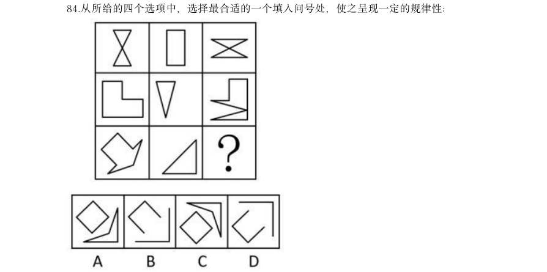

> （本题为图形题，选项为图片，见原卷）

**答案：C**

### 【2026 国考（副省级）·第 85 题】GK-2026-fs-X085　图形推理｜属性规律

从所给的四个选项中,选择最合适的一个填入问号处,使之呈现一定的规律性:

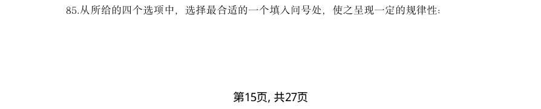

> （本题为图形题，选项为图片，见原卷）

**答案：B**

### 【2026 国考（副省级）·第 86 题】GK-2026-fs-X086　图形推理｜三视图

左边为由15 个白色正方体和3 个黑色正方体组合而成的多面体俯视图和左视图,其正视图 可能是:

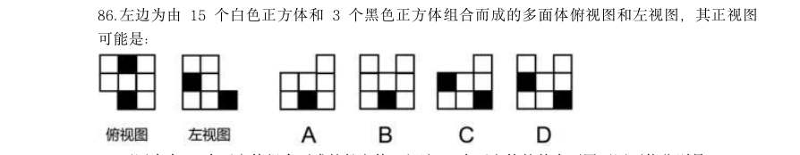

> （本题为图形题，选项为图片，见原卷）

**答案：B**

### 【2026 国考（副省级）·第 87 题】GK-2026-fs-X087　图形推理｜折纸盒

下图为由2 个正方体组合而成的长方体,问这2 个正方体的外表面展开图可能分别是:

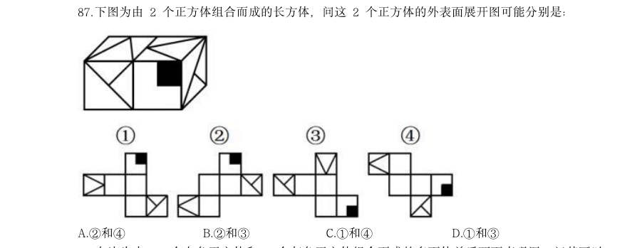

- **A.** 2和4
- **B.** 2和3
- **C.** 1和4
- **D.** 1和3

**答案：D**

### 【2026 国考（副省级）·第 88 题】GK-2026-fs-X088　图形推理｜立体拼合

左边为由12 个白色正方体和3 个灰色正方体组合而成的多面体前后两面直观图,问其可以 由除哪项外的三个多面体组合而成?

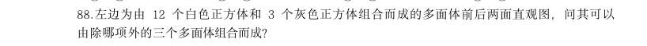

> （本题为图形题，选项为图片，见原卷）

**答案：B**

### 【2026 国考（副省级）·第 89 题】GK-2026-fs-X089　图形推理｜分组分类

把下面的六个图形分为两类,使每一类图形都有各自的共同特征或规律,分类正确的一项是:

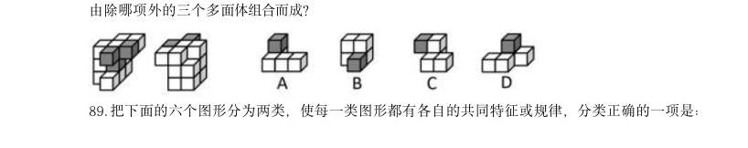

- **A.** 126,345
- **B.** 124,356
- **C.** 156,234
- **D.** 146,235

**答案：B**

### 【2026 国考（副省级）·第 90 题】GK-2026-fs-X090　图形推理｜分组分类

把下面的六个图形分为两类,使每一类图形都有各自的共同特征或规律,分类正确的一项是:

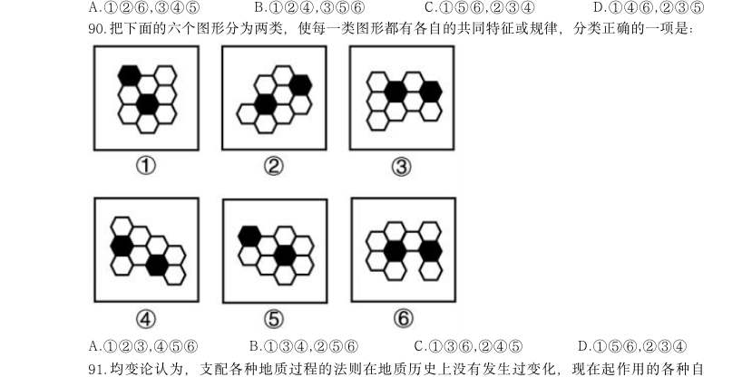

- **A.** 123,456
- **B.** 134,256
- **C.** 136,245
- **D.** 156,234

**答案：C**

### 【2026 国考（地市级）·第 77 题】GK-2026-ds-X077　图形推理｜属性规律

从所给的四个选项中,选择最合适的一个填入问号处,使之呈现一定的规律性:

> （本题为图形题，选项为图片，见原卷）

**答案：D**

### 【2026 国考（地市级）·第 78 题】GK-2026-ds-X078　图形推理｜属性规律

从所给的四个选项中,选择最合适的一个填入问号处,使之呈现一定的规律性:

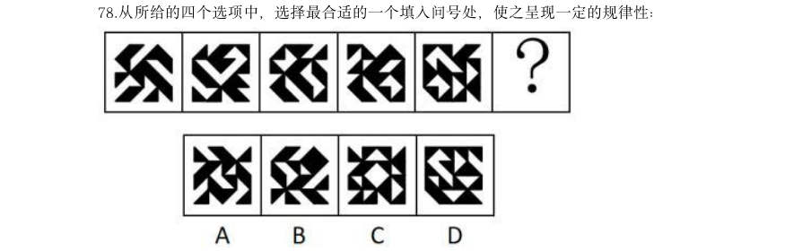

> （本题为图形题，选项为图片，见原卷）

**答案：D**

### 【2026 国考（地市级）·第 79 题】GK-2026-ds-X079　图形推理｜位置规律

从所给的四个选项中,选择最合适的一个填入问号处,使之呈现一定的规律性:

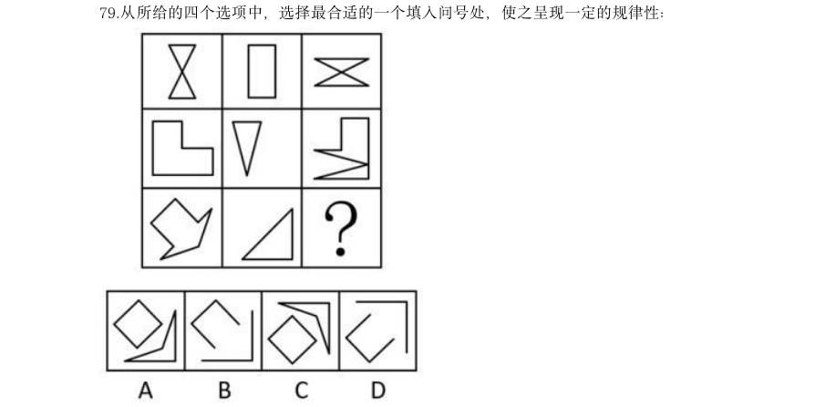

> （本题为图形题，选项为图片，见原卷）

**答案：C**

### 【2026 国考（地市级）·第 80 题】GK-2026-ds-X080　图形推理｜三视图

左边为由15 个白色正方体和3 个黑色正方体组合而成的多面体俯视图和左视图,其正视图 可能是:

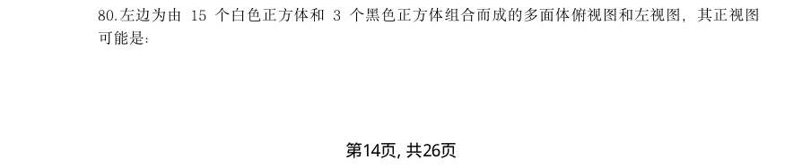

> （本题为图形题，选项为图片，见原卷）

**答案：B**

### 【2026 国考（地市级）·第 81 题】GK-2026-ds-X081　图形推理｜折纸盒

左边为给定的正方体纸盒的外表面展开图,由2 个该正方体纸盒组合而成的长方体可能是:

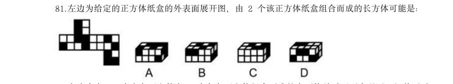

> （本题为图形题，选项为图片，见原卷）

**答案：A**

### 【2026 国考（地市级）·第 82 题】GK-2026-ds-X082　图形推理｜立体拼合

左边为由12 个白色正方体和3 个灰色正方体组合而成的多面体前后两面直观图,问其可以 由除哪项外的三个多面体组合而成?

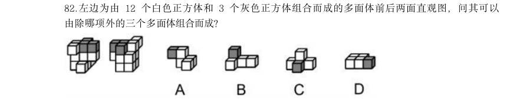

> （本题为图形题，选项为图片，见原卷）

**答案：C**

### 【2026 国考（地市级）·第 83 题】GK-2026-ds-X083　图形推理｜分组分类

把下面的六个图形分为两类,使每一类图形都有各自的共同特征或规律,分类正确的一项是:

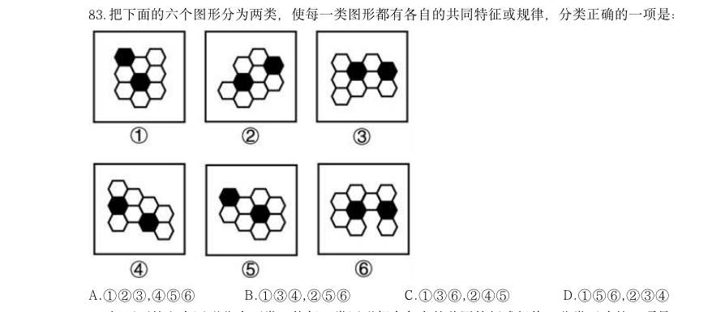

- **A.** 123,456
- **B.** 134,256
- **C.** 136,245
- **D.** 156,234

**答案：C**

### 【2026 国考（地市级）·第 84 题】GK-2026-ds-X084　图形推理｜分组分类

把下面的六个图形分为两类,使每一类图形都有各自的共同特征或规律,分类正确的一项是:

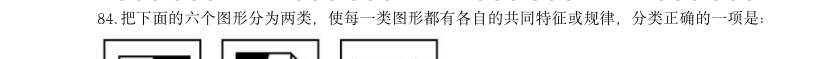

- **A.** 126,345
- **B.** 124,356
- **C.** 156,234
- **D.** 146,235

**答案：B**

### 【2026 国考（地市级）·第 85 题】GK-2026-ds-X085　图形推理｜分组分类

把下面6 个图形分为两类,使每一类图形都有各自的共同特征或规律,分类正确的一项是:

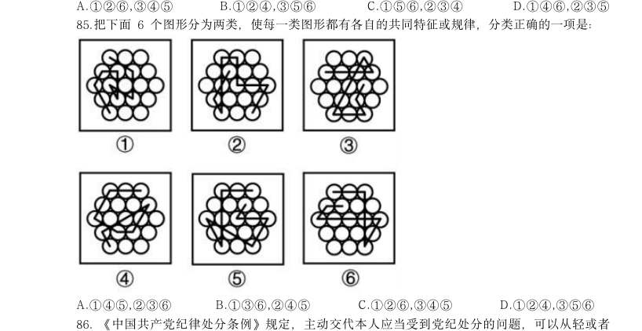

- **A.** 145,236
- **B.** 136,245
- **C.** 126,345
- **D.** 124,356

**答案：A**

### 【2026 国考（地市级）·第 96 题】GK-2026-ds-X096　图形推理｜数量规律

与“经年:积岁”在逻辑关系上最相近的是: 本 B.秘方:偏方 C.仲夏:夏季 D.黎民:百姓

> （本题为图形题，选项为图片，见原卷）

**答案：D**

### 【2026 国考（行政执法）·第 76 题】GK-2026-zf-X076　图形推理｜属性规律
> 材料：项中选出一个最恰当的答案.…

从所给的四个选项中,选择最合适的一个填入问号处,使之呈现一定的规律性:

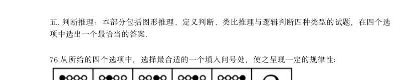

> （本题为图形题，选项为图片，见原卷）

**答案：D**

### 【2026 国考（行政执法）·第 77 题】GK-2026-zf-X077　图形推理｜位置规律

从所给的四个选项中,选择最合适的一个填入问号处,使之呈现一定的规律性:

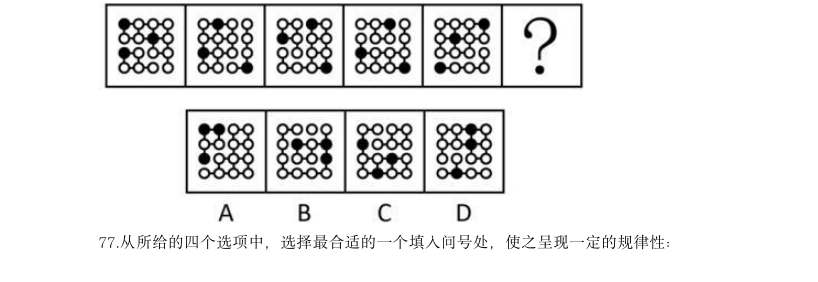

> （本题为图形题，选项为图片，见原卷）

**答案：A**

### 【2026 国考（行政执法）·第 78 题】GK-2026-zf-X078　图形推理｜属性规律

从所给的四个选项中,选择最合适的一个填入问号处,使之呈现一定的规律性:

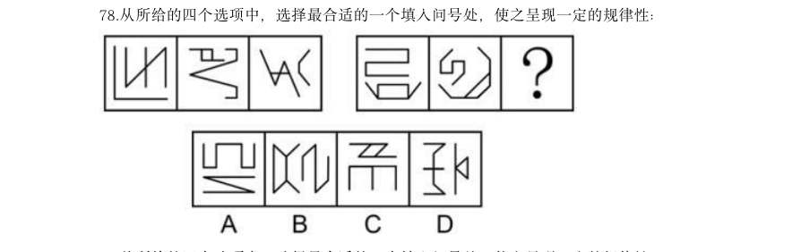

> （本题为图形题，选项为图片，见原卷）

**答案：B**

### 【2026 国考（行政执法）·第 79 题】GK-2026-zf-X079　图形推理｜样式规律

从所给的四个选项中,选择最合适的一个填入问号处,使之呈现一定的规律性:

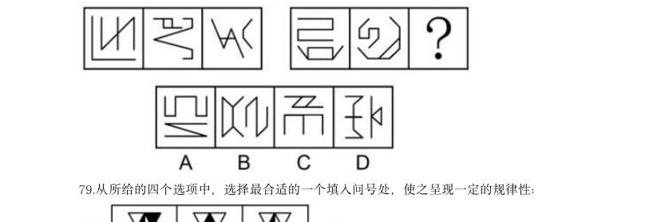

> （本题为图形题，选项为图片，见原卷）

**答案：C**

### 【2026 国考（行政执法）·第 80 题】GK-2026-zf-X080　图形推理｜截面

左边为给定的多面体,现用经P、Q、R 三点的平面对其进行切割,切面为:

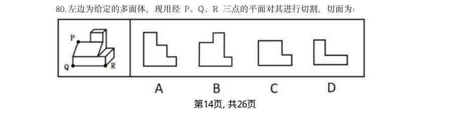

> （本题为图形题，选项为图片，见原卷）

**答案：B**

### 【2026 国考（行政执法）·第 81 题】GK-2026-zf-X081　图形推理｜折纸盒

下图为由2 个正方体组合而成的长方体,问这2 个正方体的外表面展开图可能分别是:

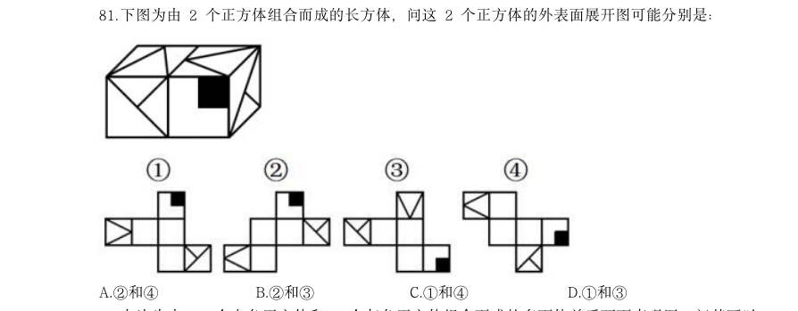

- **A.** 2和4
- **B.** 2和3
- **C.** 1和4
- **D.** 1和3

**答案：D**

### 【2026 国考（行政执法）·第 82 题】GK-2026-zf-X082　图形推理｜立体拼合

左边为由12 个白色正方体和3 个灰色正方体组合而成的多面体前后两面直观图,问其可以 由除哪项外的三个多面体组合而成?

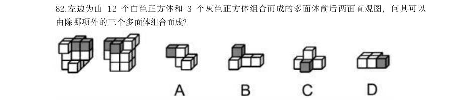

> （本题为图形题，选项为图片，见原卷）

**答案：C**

### 【2026 国考（行政执法）·第 83 题】GK-2026-zf-X083　图形推理｜分组分类

把下面的六个图形分为两类,使每一类图形都有各自的共同特征或规律,分类正确的一项是:

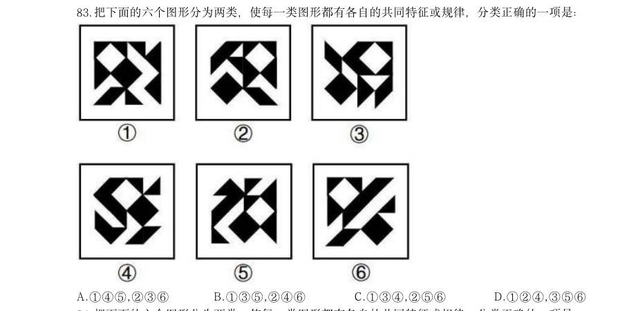

- **A.** 145,236
- **B.** 135,246
- **C.** 134,256
- **D.** 124,356

**答案：A**

### 【2026 国考（行政执法）·第 84 题】GK-2026-zf-X084　图形推理｜分组分类

把下面的六个图形分为两类,使每一类图形都有各自的共同特征或规律,分类正确的一项是:

- **A.** 126,345
- **B.** 124,356
- **C.** 156,234
- **D.** 146,235

**答案：B**

### 【2026 国考（行政执法）·第 85 题】GK-2026-zf-X085　图形推理｜分组分类

把下面6 个图形分为两类,使每一类图形都有各自的共同特征或规律,分类正确的一项是:

- **A.** 145,236
- **B.** 136,245
- **C.** 126,345
- **D.** 124,356

**答案：A**

### 【2025 湖北省考·第 71 题】HB-2025-ty-X071　图形推理｜分组分类

把下面的六个图形分为两类,使每一类图形都有各自的共同特征或规律,分类正确的一项是:

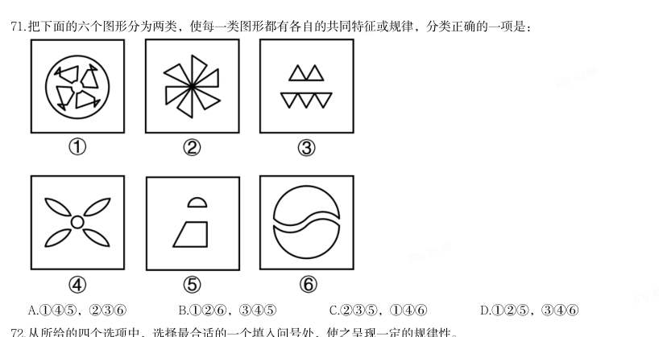

- **A.** 145,236
- **B.** 126,345
- **C.** 235,146
- **D.** 125,346

**答案：A**

### 【2025 湖北省考·第 72 题】HB-2025-ty-X072　图形推理｜图形推理（待细分）

从所给的四个选项中,选择最合适的一个填入问号处,使之呈现一定的规律性。

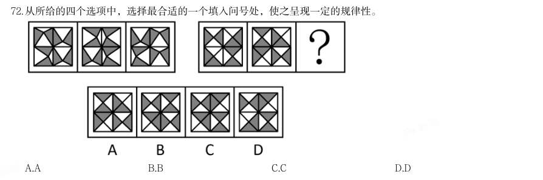

> （本题为图形题，选项为图片，见原卷）

**答案：C**

### 【2025 湖北省考·第 73 题】HB-2025-ty-X073　图形推理｜分组分类

把下面的六个图形分为两类,使每一类图形都有各自的共同特征或规律,分类正确的一项是:

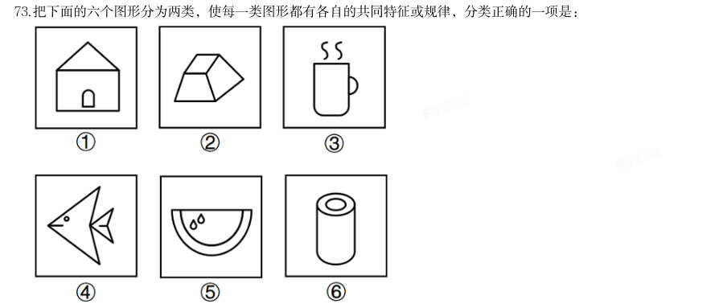

- **A.** 134,256
- **B.** 126,345
- **C.** 135,246
- **D.** 146,235

**答案：B**

### 【2025 湖北省考·第 74 题】HB-2025-ty-X074　图形推理｜图形推理（待细分）

从所给的四个选项中,选择最合适的一个填入问号处,使之呈现一定的规律性。

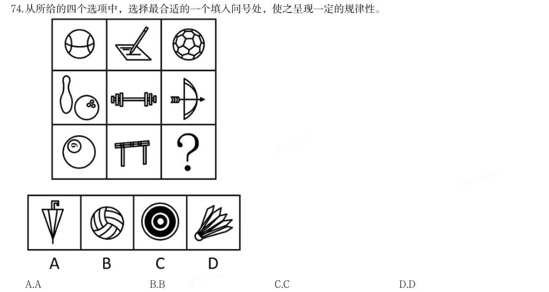

> （本题为图形题，选项为图片，见原卷）

**答案：D**

### 【2025 湖北省考·第 75 题】HB-2025-ty-X075　图形推理｜立体拼合

下图左侧给定的是3×3的正方体被分解后的多面体,切去的部分可以由给定的1、2和3三个多面体组合而 成。以下哪项能填入问号处?

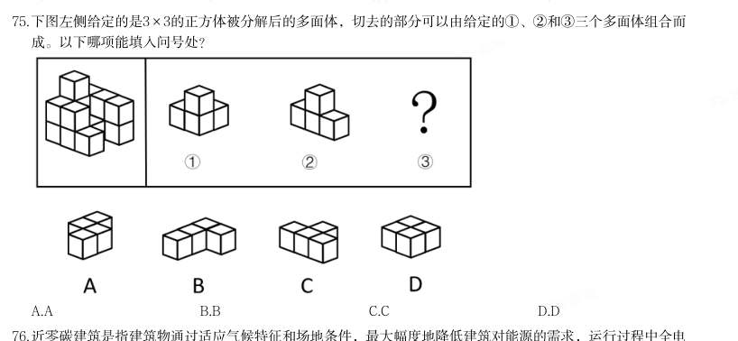

> （本题为图形题，选项为图片，见原卷）

**答案：D**

### 【2025 广东省考·第 46 题】GD-2025-ty-X046　图形推理｜三视图

如图所示,四棱锥的底面为矩阵,其中一条棱垂直于底面,那么该四棱锥的俯视图最有可能是( )。

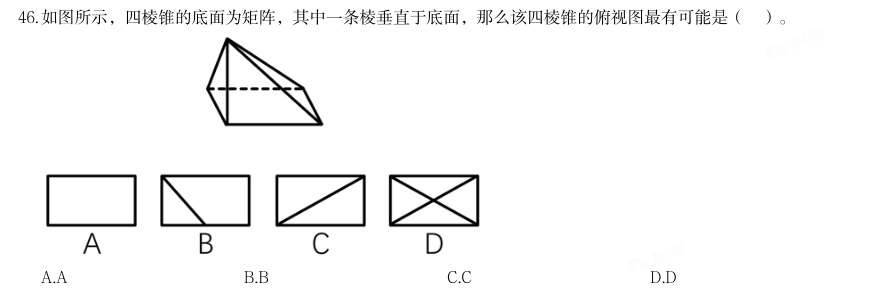

> （本题为图形题，选项为图片，见原卷）

**答案：C**

### 【2025 广东省考·第 47 题】GD-2025-ty-X047　图形推理｜图形推理（待细分）
> 材料：下列选项中最符合所给图形规律的是( )。…

下列选项中最符合所给图形规律的是( )。

> （本题为图形题，选项为图片，见原卷）

**答案：D**

### 【2025 广东省考·第 48 题】GD-2025-ty-X048　图形推理｜图形推理（待细分）

下列选项中最符合所给图形规律的是( )。

> （本题为图形题，选项为图片，见原卷）

**答案：D**

### 【2025 广东省考·第 49 题】GD-2025-ty-X049　图形推理｜图形推理（待细分）

从所给的四个选项中,选择最合适的一个填在问号处,使之呈现一定的规律性( )。

> （本题为图形题，选项为图片，见原卷）

**答案：A**

### 【2025 广东省考·第 50 题】GD-2025-ty-X050　图形推理｜立体图形

下列选项中,最有可能与所给的两个不规则立体图形形成正方体的是( )。

> （本题为图形题，选项为图片，见原卷）

**答案：B**

### 【2025 国考（副省级）·第 81 题】GK-2025-fs-X081　图形推理｜位置规律

个最恰当的答案。 从所给的四个选项中,选择最合适的一个填入问号处,使之呈现一定的规律性:

> （本题为图形题，选项为图片，见原卷）

**答案：D**

### 【2025 国考（副省级）·第 82 题】GK-2025-fs-X082　图形推理｜属性规律

从所给的四个选项中,选择最合适的一项填入问号处,使之呈现一定的规律性:

> （本题为图形题，选项为图片，见原卷）

**答案：B**

### 【2025 国考（副省级）·第 83 题】GK-2025-fs-X083　图形推理｜属性规律

从所给的四个选项中,选择最合适的一个填入问号处,使之呈现一定的规律性:

> （本题为图形题，选项为图片，见原卷）

**答案：D**

### 【2025 国考（副省级）·第 84 题】GK-2025-fs-X084　图形推理｜位置规律

从所给的四个选项中,选择最合适的一个填入问号处,使之呈现一定的规律性:

> （本题为图形题，选项为图片，见原卷）

**答案：A**

### 【2025 国考（副省级）·第 85 题】GK-2025-fs-X085　图形推理｜立体拼合

左边为15个白色和3个灰色正方体组合而成多面体的正、反两面直观图,其可以由1、2和3三个多面体组合 而成,问哪一项能填入问号处?

> （本题为图形题，选项为图片，见原卷）

**答案：B**

### 【2025 国考（副省级）·第 86 题】GK-2025-fs-X086　图形推理｜折纸盒

下图为4个黑色、8个白色正方体粘接成的长方体,问哪一项可能是其正确的外表面展开图?

> （本题为图形题，选项为图片，见原卷）

**答案：D**

### 【2025 国考（副省级）·第 87 题】GK-2025-fs-X087　图形推理｜截面

左边为给定的多面体,现用经P、Q、R三个顶点的平面对其进行切割,问哪个选项是其切面?

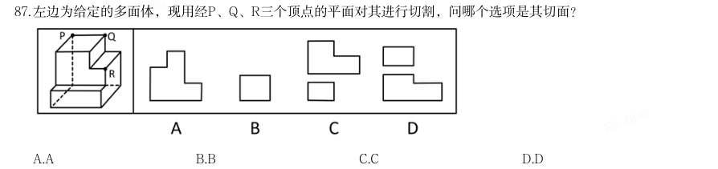

> （本题为图形题，选项为图片，见原卷）

**答案：B**

### 【2025 国考（副省级）·第 88 题】GK-2025-fs-X088　图形推理｜分组分类

把下面的六个图形分为两类,使每一类图形都有各自的共同特征或规律,分类正确的一项是:

- **A.** 124,356
- **B.** 135,246
- **C.** 134,256
- **D.** 136,245

**答案：C**

### 【2025 国考（副省级）·第 89 题】GK-2025-fs-X089　图形推理｜分组分类

把下面的六个图形分为两类,使每一类图形都有各自的共同特征或规律,分类正确的一项是:

- **A.** 123,456
- **B.** 156,234
- **C.** 124,356
- **D.** 135,246

**答案：C**

### 【2025 国考（副省级）·第 90 题】GK-2025-fs-X090　图形推理｜分组分类

把下面的六个图形分为两类,使每一类图形都有各自的共同特征或规律,分类正确的一项是:

- **A.** 124,356
- **B.** 134,256
- **C.** 125,346
- **D.** 145,236

**答案：B**

### 【2025 国考（地市级）·第 76 题】GK-2025-ds-X076　图形推理｜属性规律

个最恰当的答案。 从所给的四个选项中,选择最合适的一个填入问号处,使之呈现一定的规律性:

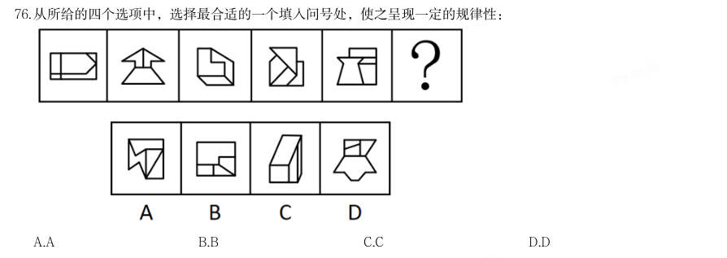

> （本题为图形题，选项为图片，见原卷）

**答案：D**

### 【2025 国考（地市级）·第 77 题】GK-2025-ds-X077　图形推理｜位置规律

从所给的四个选项中,选择最合适的一个填入问号处,使之呈现一定的规律性:

> （本题为图形题，选项为图片，见原卷）

**答案：D**

### 【2025 国考（地市级）·第 78 题】GK-2025-ds-X078　图形推理｜位置规律

从所给的四个选项中,选择最合适的一个填入问号处,使之呈现一定的规律性:

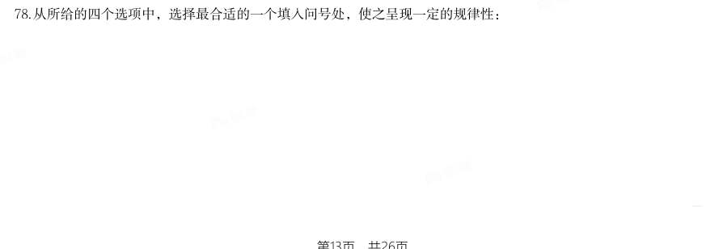

> （本题为图形题，选项为图片，见原卷）

**答案：C**

### 【2025 国考（地市级）·第 79 题】GK-2025-ds-X079　图形推理｜属性规律

从所给的四个选项中,选择最合适的一个填入问号处,使之呈现一定的规律性:

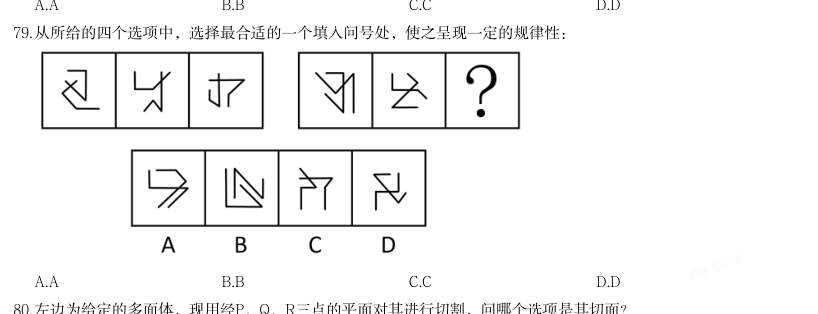

> （本题为图形题，选项为图片，见原卷）

**答案：D**

### 【2025 国考（地市级）·第 80 题】GK-2025-ds-X080　图形推理｜截面

左边为给定的多面体,现用经P、Q、R三点的平面对其进行切割,问哪个选项是其切面?

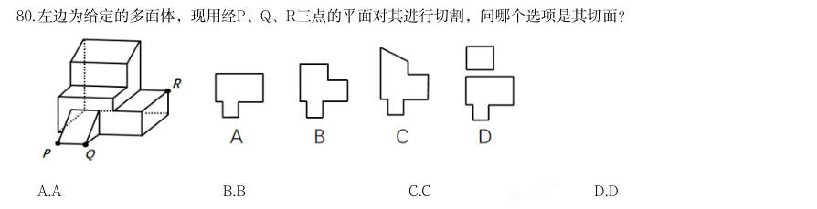

> （本题为图形题，选项为图片，见原卷）

**答案：A**

### 【2025 国考（地市级）·第 81 题】GK-2025-ds-X081　图形推理｜折纸盒

下图为4个黑色、8个白色正方体粘接成的长方体,问哪一项可能是其正确的外表面展开图?

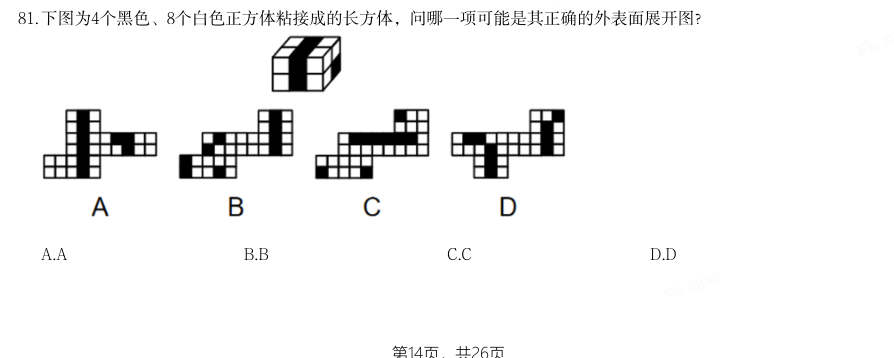

> （本题为图形题，选项为图片，见原卷）

**答案：D**

### 【2025 国考（地市级）·第 82 题】GK-2025-ds-X082　图形推理｜立体拼合

左边为15个白色和3个灰色正方体组合而成多面体的正、反两面直观图,其可以由1、2和3三个多面体组合 而成,问哪一项能填入问号处?

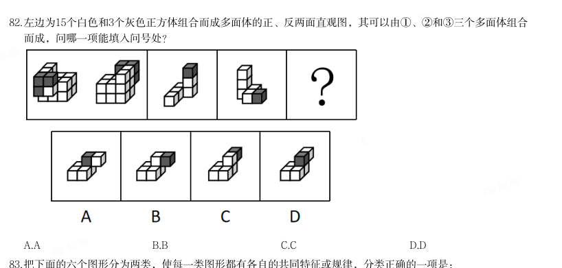

> （本题为图形题，选项为图片，见原卷）

**答案：B**

### 【2025 国考（地市级）·第 83 题】GK-2025-ds-X083　图形推理｜分组分类

把下面的六个图形分为两类,使每一类图形都有各自的共同特征或规律,分类正确的一项是:

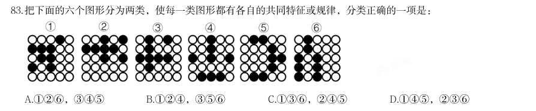

- **A.** 126,345
- **B.** 124,356
- **C.** 136,245
- **D.** 145,236

**答案：B**

### 【2025 国考（地市级）·第 84 题】GK-2025-ds-X084　图形推理｜分组分类

把下面的六个图形分为两类,使每一类图形都有各自的共同特征或规律,分类正确的一项是:

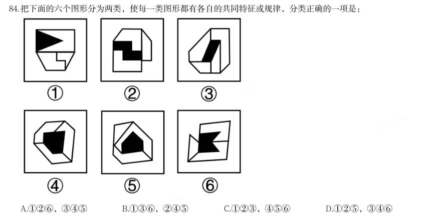

- **A.** 126,345
- **B.** 136,245
- **C.** 123,456
- **D.** 125,346

**答案：A**

### 【2025 国考（地市级）·第 85 题】GK-2025-ds-X085　图形推理｜分组分类

把下面的六个图形分为两类,使每一类图形都有各自的共同特征或规律,分类正确的一项是:

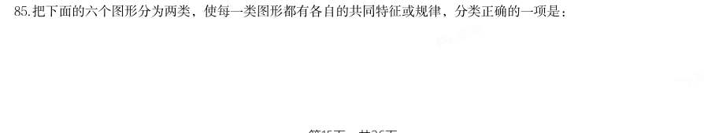

- **A.** 126,345
- **B.** 134,256
- **C.** 135,246
- **D.** 146,235

**答案：B**

### 【2025 国考（行政执法）·第 76 题】GK-2025-zf-X076　图形推理｜属性规律

个最恰当的答案。 从所给的四个选项中,选择最合适的一个填入问号处,使之呈现一定的规律性:

> （本题为图形题，选项为图片，见原卷）

**答案：D**

### 【2025 国考（行政执法）·第 77 题】GK-2025-zf-X077　图形推理｜位置规律

从所给的四个选项中,选择最合适的一个填入问号处,使之呈现一定的规律性:

> （本题为图形题，选项为图片，见原卷）

**答案：C**

### 【2025 国考（行政执法）·第 78 题】GK-2025-zf-X078　图形推理｜属性规律

从所给的四个选项中,选择最合适的一项填入问号处,使之呈现一定的规律性:

> （本题为图形题，选项为图片，见原卷）

**答案：B**

### 【2025 国考（行政执法）·第 79 题】GK-2025-zf-X079　图形推理｜位置规律

从所给的四个选项中,选择最合适的一个填入问号处,使之呈现一定的规律性:

> （本题为图形题，选项为图片，见原卷）

**答案：A**

### 【2025 国考（行政执法）·第 81 题】GK-2025-zf-X081　图形推理｜立体拼合

以下为4个由若干棱长为1的正方体拼成的多面体,将它们在3×3×4空间内进行拼接,不可能拼成以下四个选 项中的哪一个多面体?

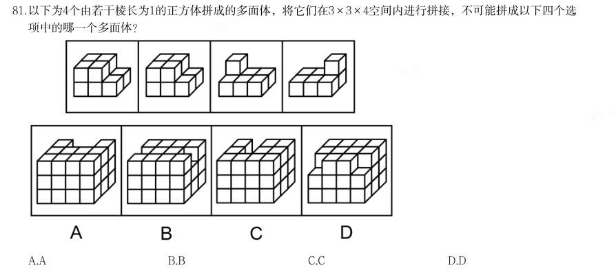

> （本题为图形题，选项为图片，见原卷）

**答案：C**

### 【2025 国考（行政执法）·第 82 题】GK-2025-zf-X082　图形推理｜折纸盒

以下除哪项外,都是同一正方体纸盒的外表面展开图?

> （本题为图形题，选项为图片，见原卷）

**答案：D**

### 【2025 国考（行政执法）·第 83 题】GK-2025-zf-X083　图形推理｜分组分类

把下面的六个图形分为两类,使每一类图形都有各自的共同特征或规律,分类正确的一项是:

- **A.** 124,356
- **B.** 135,246
- **C.** 134,256
- **D.** 136,245

**答案：C**

### 【2025 国考（行政执法）·第 84 题】GK-2025-zf-X084　图形推理｜分组分类

把下面的六个图形分为两类,使每一类图形都有各自的共同特征或规律,分类正确的一项是:

- **A.** 123,456
- **B.** 156,234
- **C.** 124,356
- **D.** 135,246

**答案：C**

### 【2025 国考（行政执法）·第 85 题】GK-2025-zf-X085　图形推理｜分组分类

把下面的六个图形分为两类,使每一类图形都有各自的共同特征或规律,分类正确的一项是:

- **A.** 126,345
- **B.** 134,256
- **C.** 135,246
- **D.** 146,235

**答案：B**

### 【2024 湖北省考·第 71 题】HB-2024-ty-X071　图形推理｜分组分类

个最恰当的答案。 把下面的六个图形分为两类,使每一类图形都有各自的共同特征或规律,分类正确的一项是:

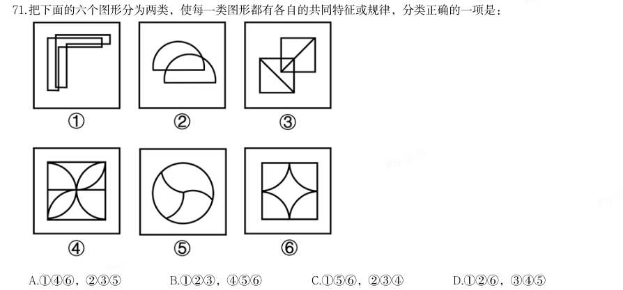

- **A.** 146,235
- **B.** 123,456
- **C.** 156,234
- **D.** 126,345

**答案：D**

### 【2024 湖北省考·第 72 题】HB-2024-ty-X072　图形推理｜分组分类

把下面的六个图形分为两类,使每一类图形都有各自的共同特征或规律,分类正确的一项是:

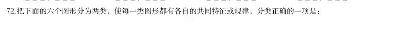

- **A.** 146,235
- **B.** 123,456
- **C.** 156,234
- **D.** 135,246

**答案：C**

### 【2024 湖北省考·第 73 题】HB-2024-ty-X073　图形推理｜三视图

左边为给定的立体图形,从任一角度观看,下面哪项不是该多面体的视图?

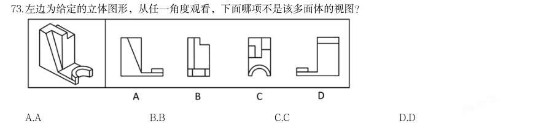

> （本题为图形题，选项为图片，见原卷）

**答案：C**

### 【2024 湖北省考·第 74 题】HB-2024-ty-X074　图形推理｜图形推理（待细分）

从所给四个选项中,选择最合适的一个填入问号处,使之呈现一定的规律性。

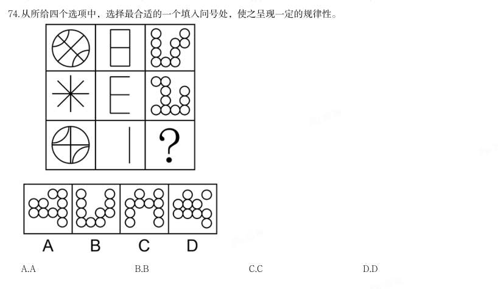

> （本题为图形题，选项为图片，见原卷）

**答案：D**

### 【2024 湖北省考·第 75 题】HB-2024-ty-X075　图形推理｜折纸盒

下列两图分别是从正面和后面观察某个多面体所得的立体图形,下列哪项是其正确的外表面展开图?

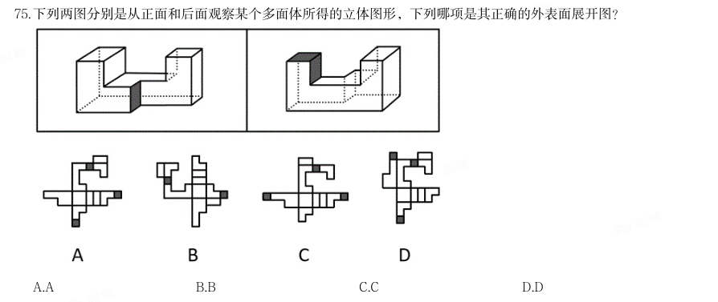

> （本题为图形题，选项为图片，见原卷）

**答案：A**

### 【2024 广东省考·第 46 题】GD-2024-ty-X046　图形推理｜图形推理（待细分）

答案。 下列选项中最符合所给图形规律的是( )。

> （本题为图形题，选项为图片，见原卷）

**答案：B**

### 【2024 广东省考·第 47 题】GD-2024-ty-X047　图形推理｜图形推理（待细分）

下列选项中最符合所给图形规律的是( )。

> （本题为图形题，选项为图片，见原卷）

**答案：C**

### 【2024 广东省考·第 48 题】GD-2024-ty-X048　图形推理｜折纸盒

如图所示,正方形卡片沿对角线折叠两次后得到一个三角形,沿着虚线裁剪后,再展开卡片,则展开的图形最 有可能是( )。

> （本题为图形题，选项为图片，见原卷）

**答案：A**

### 【2024 广东省考·第 49 题】GD-2024-ty-X049　图形推理｜三视图

下图为给定的立体图形,从任一角度看,下列选项最不可能是该立体图形视图的是( )。

> （本题为图形题，选项为图片，见原卷）

**答案：C**

### 【2024 广东省考·第 50 题】GD-2024-ty-X050　图形推理｜立体拼合

下列立体图形,最不可能由两个左侧立体图形拼接成的是( )。

> （本题为图形题，选项为图片，见原卷）

**答案：D**

### 【2024 国考（副省级）·第 76 题】GK-2024-fs-X076　图形推理｜属性规律

从所给的四个选项中,选择最合适的一项填入问号处,使之呈现一定的规律性:

> （本题为图形题，选项为图片，见原卷）

**答案：D**

### 【2024 国考（副省级）·第 77 题】GK-2024-fs-X077　图形推理｜位置规律

从所给的四个选项中,选择最合适的一个填入问号处,使之呈现一定的规律性:

> （本题为图形题，选项为图片，见原卷）

**答案：A**

### 【2024 国考（副省级）·第 78 题】GK-2024-fs-X078　图形推理｜属性规律

从所给的四个选项中,选择最合适的一个填入问号处,使之呈现一定的规律性:

> （本题为图形题，选项为图片，见原卷）

**答案：C**

### 【2024 国考（副省级）·第 79 题】GK-2024-fs-X079　图形推理｜样式规律

从所给的四个选项中,选择最合适的一项填入问号处,使之呈现一定的规律性:

> （本题为图形题，选项为图片，见原卷）

**答案：B**

### 【2024 国考（副省级）·第 80 题】GK-2024-fs-X080　图形推理｜折纸盒

左图为8个白色正方体和4个灰色正方体粘接而成的长方体,问以下哪一个可能是其外表面展开图?

> （本题为图形题，选项为图片，见原卷）

**答案：D**

### 【2024 国考（副省级）·第 81 题】GK-2024-fs-X081　图形推理｜立体拼合

上图为13个白色正方体和5个灰色正方体组合而成的多面体,现用经

> （本题为图形题，选项为图片，见原卷）

**答案：B**

### 【2024 国考（副省级）·第 82 题】GK-2024-fs-X082　图形推理｜立体拼合

左图为15个白色正方体和3个灰色正方体组合而成的多面体,其可以由1、2、3三个多面体组合而成,问哪 项能填入问号处?

> （本题为图形题，选项为图片，见原卷）

**答案：A**

### 【2024 国考（副省级）·第 83 题】GK-2024-fs-X083　图形推理｜分组分类

把下面六个图形分为两类,使每一类图形都有各自的共同特征或规律,分类正确的一项是:

- **A.** 126,345
- **B.** 134,256
- **C.** 136,245
- **D.** 135,246

**答案：C**

### 【2024 国考（副省级）·第 84 题】GK-2024-fs-X084　图形推理｜分组分类

把下面六个图形分为两类,使每一类图形都有各自的共同特征或规律,分类正确的一项是:

- **A.** 145,236
- **B.** 134,256
- **C.** 156,234
- **D.** 126,345

**答案：C**

### 【2024 国考（副省级）·第 85 题】GK-2024-fs-X085　图形推理｜分组分类

把下面的六个图形分为两类,使每一类图形都有各自的共同特征或规律,分类正确的一项是:

- **A.** 126,345
- **B.** 146,235
- **C.** 135,246
- **D.** 123,456

**答案：D**

### 【2024 国考（地市级）·第 71 题】GK-2024-ds-X071　图形推理｜数量规律

从所给的四个选项中,选择最合适的一个填入问号处,使之呈现一定的规律性:

> （本题为图形题，选项为图片，见原卷）

**答案：C**

### 【2024 国考（地市级）·第 72 题】GK-2024-ds-X072　图形推理｜属性规律

从所给的四个选项中,选择最合适的一项填入问号处,使之呈现一定的规律性:

> （本题为图形题，选项为图片，见原卷）

**答案：B**

### 【2024 国考（地市级）·第 73 题】GK-2024-ds-X073　图形推理｜属性规律

从所给的四个选项中,选择最合适的一项填入问号处,使之呈现一定的规律性:

> （本题为图形题，选项为图片，见原卷）

**答案：D**

### 【2024 国考（地市级）·第 74 题】GK-2024-ds-X074　图形推理｜位置规律

从所给的四个选项中,选择最合适的一项填入问号处,使之呈现一定的规律性:

> （本题为图形题，选项为图片，见原卷）

**答案：B**

### 【2024 国考（地市级）·第 75 题】GK-2024-ds-X075　图形推理｜立体拼合

左图为13个白色正方体和5个灰色正方体组合而成的多面体,现用经

> （本题为图形题，选项为图片，见原卷）

**答案：B**

### 【2024 国考（地市级）·第 76 题】GK-2024-ds-X076　图形推理｜立体拼合

左图为15个白色正方体和3个灰色正方体组合而成的多面体,其可以由1、2、3三个多面体组合而成,问哪 项能填入问号处?

> （本题为图形题，选项为图片，见原卷）

**答案：A**

### 【2024 国考（地市级）·第 77 题】GK-2024-ds-X077　图形推理｜折纸盒

左图为8个白色正方体和4个黑色正方体粘接而成的长方体,问以下哪一个不可能是其外表面展开图?

> （本题为图形题，选项为图片，见原卷）

**答案：D**

### 【2024 国考（地市级）·第 78 题】GK-2024-ds-X078　图形推理｜分组分类

把下面六个图形分为两类,使每一类图形都有各自的共同特征或规律,分类正确的一项是:

- **A.** 126,345
- **B.** 134,256
- **C.** 136,245
- **D.** 135,246

**答案：C**

### 【2024 国考（地市级）·第 79 题】GK-2024-ds-X079　图形推理｜分组分类

把下面六个图形分为两类,使每一类图形都有各自的共同特征或规律,分类正确的一项是:

- **A.** 145,236
- **B.** 134,256
- **C.** 156,234
- **D.** 126,345

**答案：C**

### 【2024 国考（地市级）·第 80 题】GK-2024-ds-X080　图形推理｜分组分类

把下面的六个图形分为两类,使每一类图形都有各自的共同特征或规律,分类正确的一项是:

- **A.** 126,345
- **B.** 146,235
- **C.** 135,246
- **D.** 123,456

**答案：D**

### 【2024 国考（行政执法）·第 71 题】GK-2024-zf-X071　图形推理｜数量规律

从所给的四个选项中,选择最合适的一项填入问号处,使之呈现一定的规律性:

> （本题为图形题，选项为图片，见原卷）

**答案：C**

### 【2024 国考（行政执法）·第 72 题】GK-2024-zf-X072　图形推理｜属性规律

从所给的四个选项中,选择最合适的一项填入问号处,使之呈现一定的规律性:

> （本题为图形题，选项为图片，见原卷）

**答案：D**

### 【2024 国考（行政执法）·第 73 题】GK-2024-zf-X073　图形推理｜属性规律

从所给的四个选项中,选择最合适的一项填入问号处,使之呈现一定的规律性:

> （本题为图形题，选项为图片，见原卷）

**答案：A**

### 【2024 国考（行政执法）·第 74 题】GK-2024-zf-X074　图形推理｜样式规律

从所给的四个选项中,选择最合适的一项填入问号处,使之呈现一定的规律性:

> （本题为图形题，选项为图片，见原卷）

**答案：B**

### 【2024 国考（行政执法）·第 75 题】GK-2024-zf-X075　图形推理｜立体拼合

左图为15个白色正方体和3个灰色正方体组合而成的多面体,其可以由1、2和3三个多面体组合而成,问哪 项能填入问号处?

> （本题为图形题，选项为图片，见原卷）

**答案：A**

### 【2024 国考（行政执法）·第 76 题】GK-2024-zf-X076　图形推理｜折纸盒

左图为8个白色正方体和4个黑色正方体粘接而成的长方体,问以下哪一个不可能是其外表面展开图?

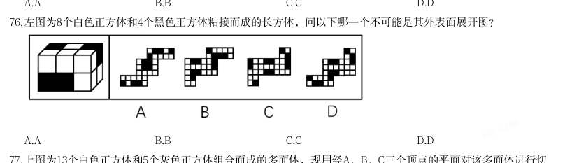

> （本题为图形题，选项为图片，见原卷）

**答案：D**

### 【2024 国考（行政执法）·第 77 题】GK-2024-zf-X077　图形推理｜立体拼合

上图为13个白色正方体和5个灰色正方体组合而成的多面体,现用经

> （本题为图形题，选项为图片，见原卷）

**答案：B**

### 【2024 国考（行政执法）·第 78 题】GK-2024-zf-X078　图形推理｜分组分类

把下面六个图形分为两类,使每一类图形都有各自的共同特征或规律,分类正确的一项是:

- **A.** 145,236
- **B.** 134,256
- **C.** 156,234
- **D.** 126,345

**答案：C**

### 【2024 国考（行政执法）·第 79 题】GK-2024-zf-X079　图形推理｜分组分类

把下面的六个图形分为两类,使每一类图形都有各自的共同特征或规律,分类正确的一项是:

- **A.** 146,235
- **B.** 156,234
- **C.** 126,345
- **D.** 136,245

**答案：A**

### 【2024 国考（行政执法）·第 80 题】GK-2024-zf-X080　图形推理｜分组分类

把下面的六个图形分为两类,使每一类图形都有各自的共同特征或规律,分类正确的一项是:

- **A.** 126,345
- **B.** 146,235
- **C.** 135,246
- **D.** 123,456

**答案：D**

### 【2023 湖北省考·第 71 题】HB-2023-ty-X071　图形推理｜分组分类

把下面的六个图形分为两类,使每一类图形都有各自的共同特征或规律,分类正确的一 项是:

- **A.** 123,456
- **B.** 136,245
- **C.** 134,256
- **D.** 145,236

**答案：B**

### 【2023 湖北省考·第 72 题】HB-2023-ty-X072　图形推理｜分组分类

把下面的六个图形分为两类,使每一类图形都有各自的共同特征或规律,分类正确的一 项是:

- **A.** 123,456
- **B.** 125,346
- **C.** 134,256
- **D.** 145,236

**答案：C**

### 【2023 湖北省考·第 73 题】HB-2023-ty-X073　图形推理｜分组分类

把下面的六个图形分为两类,使每一类图形都有各自的共同特征或规律,分类正确的一 项是:

- **A.** 124,356
- **B.** 136,245
- **C.** 145,236
- **D.** 156,234

**答案：C**

### 【2023 湖北省考·第 74 题】HB-2023-ty-X074　图形推理｜三视图

下方为某一立体图形的侧视图、正视图和顶视图,请从下列选项中选出与之符合的一项:

> （本题为图形题，选项为图片，见原卷）

**答案：C**

### 【2023 湖北省考·第 75 题】HB-2023-ty-X075　图形推理｜图形推理（待细分）

从所给四个选项中,选择最合适的一个填入问号处,使之呈现一定的规律性:

> （本题为图形题，选项为图片，见原卷）

**答案：C**

### 【2023 广东省考（乡镇）·第 46 题】GD-2023-xz-X046　图形推理｜立体拼合

以下选项能与左侧图形组成一个完整圆形的是:

> （本题为图形题，选项为图片，见原卷）

**答案：A**

### 【2023 广东省考（乡镇）·第 47 题】GD-2023-xz-X047　图形推理｜折纸盒

以下平面图形最可能折叠成左图所示立方体的是:

> （本题为图形题，选项为图片，见原卷）

**答案：B**

### 【2023 广东省考（乡镇）·第 48 题】GD-2023-xz-X048　图形推理｜立体图形

下到选项最可能与左侧立体图形是同一物体的是:

> （本题为图形题，选项为图片，见原卷）

**答案：B**

### 【2023 广东省考（乡镇）·第 50 题】GD-2023-xz-X050　图形推理｜位置规律

从所给的四个选项中,选择最合适的一个填入问号处,使之呈现一定的规律性:

> （本题为图形题，选项为图片，见原卷）

**答案：C**

### 【2023 广东省考（乡镇）·第 51 题】GD-2023-xz-X051　图形推理｜属性规律

下列选项最符合所给图形规律的是:

> （本题为图形题，选项为图片，见原卷）

**答案：B**

### 【2023 广东省考（乡镇）·第 52 题】GD-2023-xz-X052　图形推理｜样式规律

下列选项最符合所给图形规律的是:

> （本题为图形题，选项为图片，见原卷）

**答案：A**

### 【2023 广东省考（乡镇）·第 53 题】GD-2023-xz-X053　图形推理｜属性规律

下列选项最符合所给图形规律的是:

> （本题为图形题，选项为图片，见原卷）

**答案：D**

### 【2023 广东省考（乡镇）·第 54 题】GD-2023-xz-X054　图形推理｜位置规律

下列选项最符合所给图形规律的是:

> （本题为图形题，选项为图片，见原卷）

**答案：C**

### 【2023 广东省考（县级）·第 41 题】GD-2023-xj-X041　图形推理｜折纸盒

以下平面图形最可能折叠成左图所示立方体的是:

> （本题为图形题，选项为图片，见原卷）

**答案：B**

### 【2023 广东省考（县级）·第 42 题】GD-2023-xj-X042　图形推理｜立体拼合

下列选项中,能与所给图形组合成立方体的是( )。

> （本题为图形题，选项为图片，见原卷）

**答案：C**

### 【2023 广东省考（县级）·第 43 题】GD-2023-xj-X043　图形推理｜立体图形

下到选项最可能与左侧立体图形是同一物体的是:

> （本题为图形题，选项为图片，见原卷）

**答案：B**

### 【2023 广东省考（县级）·第 44 题】GD-2023-xj-X044　图形推理｜立体图形

左侧立体图形仅有图中所示的一个正方形面为黑色,则下列选项最不可能由三个左侧图 形构成的是( )。

> （本题为图形题，选项为图片，见原卷）

**答案：D**

### 【2023 广东省考（县级）·第 45 题】GD-2023-xj-X045　图形推理｜立体图形

将两个左侧立体图形放置在桌面上,则某人从桌子正前方看到的图形轮廓最不可能是 ( )。

> （本题为图形题，选项为图片，见原卷）

**答案：A**

### 【2023 广东省考（县级）·第 46 题】GD-2023-xj-X046　图形推理｜属性规律

下列选项最符合所给图形规律的是:

> （本题为图形题，选项为图片，见原卷）

**答案：D**

### 【2023 广东省考（县级）·第 47 题】GD-2023-xj-X047　图形推理｜样式规律

下列选项最符合所给图形规律的是:

> （本题为图形题，选项为图片，见原卷）

**答案：A**

### 【2023 广东省考（县级）·第 48 题】GD-2023-xj-X048　图形推理｜属性规律

下列选项最符合所给图形规律的是:

> （本题为图形题，选项为图片，见原卷）

**答案：D**

### 【2023 广东省考（县级）·第 49 题】GD-2023-xj-X049　图形推理｜位置规律

下列选项最符合所给图形规律的是:

> （本题为图形题，选项为图片，见原卷）

**答案：C**

### 【2023 国考（行政执法）·第 71 题】GK-2023-zf-X071　图形推理｜数量规律

从所给的四个选项中,选择最合适的一个填入问号处,使之呈现一定的规律性:

> （本题为图形题，选项为图片，见原卷）

**答案：C**

### 【2023 国考（行政执法）·第 72 题】GK-2023-zf-X072　图形推理｜分组分类

从所给的四个选项中,选择最合适的一个填入问号处,使之呈现一定的规律性:

> （本题为图形题，选项为图片，见原卷）

**答案：D**

### 【2023 国考（行政执法）·第 73 题】GK-2023-zf-X073　图形推理｜位置规律

从所给的四个选项中,选择最合适的一个填入问号处,使之呈现一定的规律性:

> （本题为图形题，选项为图片，见原卷）

**答案：暂缺**

### 【2023 国考（行政执法）·第 74 题】GK-2023-zf-X074　图形推理｜样式规律

从所给的四个选项中,选择最合适的一个填入问号处,使之呈现一定的规律性:

> （本题为图形题，选项为图片，见原卷）

**答案：A**

### 【2023 国考（行政执法）·第 76 题】GK-2023-zf-X076　图形推理｜三视图

左图为给定的立体图形,从任一角度观看,下面哪项不可能是该立体图形的视图?

> （本题为图形题，选项为图片，见原卷）

**答案：C**

### 【2023 国考（行政执法）·第 78 题】GK-2023-zf-X078　图形推理｜分组分类

把下面六个图形分为两类,使每一类图形都有各自的共同特征或规律,分类正确的一项是:

- **A.** 125,346
- **B.** 124,356
- **C.** 145,236
- **D.** 135,246

**答案：C**

### 【2023 国考（行政执法）·第 79 题】GK-2023-zf-X079　图形推理｜分组分类

把下面的六个图形分为两类,使每一类图形都有各自的共同特征或规律,分类正确的一项是:

- **A.** 135,246
- **B.** 146,235
- **C.** 134,256
- **D.** 124,356

**答案：D**

### 【2023 国考（行政执法）·第 80 题】GK-2023-zf-X080　图形推理｜分组分类

把下面的六个图形分为两类,使每一类图形都有各自的共同特征或规律,分类正确的一项是:

- **A.** 134,256
- **B.** 124,356
- **C.** 126,345
- **D.** 156,234

**答案：B**

### 【2022 广东省考（乡镇）·第 46 题】GD-2022-xz-X046　图形推理｜三视图

如图是一物体某两个角度的视图,则该物体最可能是:

> （本题为图形题，选项为图片，见原卷）

**答案：B**

### 【2022 广东省考（乡镇）·第 47 题】GD-2022-xz-X047　图形推理｜位置规律

下列选项中最符合所给图形规律的是:

> （本题为图形题，选项为图片，见原卷）

**答案：D**

### 【2022 广东省考（乡镇）·第 48 题】GD-2022-xz-X048　图形推理｜立体拼合

下列选项中最符合所给图形规律的是:

> （本题为图形题，选项为图片，见原卷）

**答案：A**

### 【2022 广东省考（乡镇）·第 49 题】GD-2022-xz-X049　图形推理｜位置规律

如图所给的3 个立方体为同一立方体,若不考虑立方体表面数字的大小、方向,下列选项中,最有可能是 该立方体的是:

> （本题为图形题，选项为图片，见原卷）

**答案：C**

### 【2022 广东省考（乡镇）·第 50 题】GD-2022-xz-X050　图形推理｜折纸盒

如图是某立方体的平面展开图,则该立方体最可能是:

> （本题为图形题，选项为图片，见原卷）

**答案：D**

### 【2022 广东省考（乡镇）·第 51 题】GD-2022-xz-X051　图形推理｜属性规律

从所给的四个选项中,选择最合适的一个填入问号处,使之呈现一定的规律性:

> （本题为图形题，选项为图片，见原卷）

**答案：D**

### 【2022 广东省考（乡镇）·第 52 题】GD-2022-xz-X052　图形推理｜属性规律

从所给的四个选项中,选择最合适的一个填入问号处,使之呈现一定的规律性:

> （本题为图形题，选项为图片，见原卷）

**答案：D**

### 【2022 广东省考（乡镇）·第 53 题】GD-2022-xz-X053　图形推理｜位置规律

从所给的四个选项中,选择最合适的一个填入问号处,使之呈现一定的规律性:

> （本题为图形题，选项为图片，见原卷）

**答案：B**

### 【2022 广东省考（乡镇）·第 54 题】GD-2022-xz-X054　图形推理｜样式规律

下列选项中最符合所给图形规律的是:

> （本题为图形题，选项为图片，见原卷）

**答案：B**

### 【2022 广东省考（乡镇）·第 55 题】GD-2022-xz-X055　图形推理｜位置规律

下列选项中最符合所给图形规律的是:

> （本题为图形题，选项为图片，见原卷）

**答案：A**

### 【2022 广东省考（乡镇）·第 72 题】GD-2022-xz-X072　图形推理｜图形推理（待细分）

将如图所示卡片面向平面镜时,则该卡片在平面镜中的成像最可能是:

> （本题为图形题，选项为图片，见原卷）

**答案：B**

### 【2022 广东省考（县级）·第 42 题】GD-2022-xj-X042　图形推理｜属性规律

下列选项中最符合所给图形规律的是:

> （本题为图形题，选项为图片，见原卷）

**答案：D**

### 【2022 广东省考（县级）·第 43 题】GD-2022-xj-X043　图形推理｜折纸盒

如图是某立方体的平面展开图,则该立方体最可能是:

> （本题为图形题，选项为图片，见原卷）

**答案：D**

### 【2022 广东省考（县级）·第 44 题】GD-2022-xj-X044　图形推理｜三视图

如图是一个物体某两个角度的视图,则该图形最有可能是:

> （本题为图形题，选项为图片，见原卷）

**答案：B**

### 【2022 广东省考（县级）·第 45 题】GD-2022-xj-X045　图形推理｜位置规律

下列选项中最符合所给图形规律的是:

> （本题为图形题，选项为图片，见原卷）

**答案：D**

### 【2022 广东省考（县级）·第 46 题】GD-2022-xj-X046　图形推理｜样式规律

从所给的四个选项中,选择最合适的一个填入问号处,使之呈现一定的规律性:

> （本题为图形题，选项为图片，见原卷）

**答案：C**

### 【2022 广东省考（县级）·第 47 题】GD-2022-xj-X047　图形推理｜属性规律

从所给的四个选项中,选择最合适的一个填入问号处,使之呈现一定的规律性:

> （本题为图形题，选项为图片，见原卷）

**答案：D**

### 【2022 广东省考（县级）·第 48 题】GD-2022-xj-X048　图形推理｜立体拼合

下列选项中最符合所给图形规律的是:

> （本题为图形题，选项为图片，见原卷）

**答案：A**

### 【2022 广东省考（县级）·第 49 题】GD-2022-xj-X049　图形推理｜位置规律

下列选项中最符合所给图形规律的是:

> （本题为图形题，选项为图片，见原卷）

**答案：A**

### 【2022 广东省考（县级）·第 50 题】GD-2022-xj-X050　图形推理｜属性规律

从所给的四个选项中,选择最合适的一个填入问号处,使之呈现一定的规律性:

> （本题为图形题，选项为图片，见原卷）

**答案：D**

### 【2022 广东省考（县级）·第 77 题】GD-2022-xj-X077　图形推理｜位置规律

镜子前面放有一个圆球。如图是某人站在镜子前从某个角度看到的圆球和其镜像位置关系示意图,则此人 在镜子前所站的位置及视角最可能是:

> （本题为图形题，选项为图片，见原卷）

**答案：D**

### 【2022 国考（副省级）·第 76 题】GK-2022-fs-X076　图形推理｜数量规律

(单选题)从所给的四个选项中,选择最合适的一个填入问号处,使之呈现一定的规律性:

- **A.** 如上图所示
- **B.** 如上图所示
- **C.** 如上图所示
- **D.** 如上图所示

**答案：C**

### 【2022 国考（副省级）·第 77 题】GK-2022-fs-X077　图形推理｜样式规律

(单选题)从所给的四个选项中,选择最合适的一个填入问号处,使之呈现一定的规律性:

- **A.** 如上图所示
- **B.** 如上图所示
- **C.** 如上图所示
- **D.** 如上图所示

**答案：D**

### 【2022 国考（副省级）·第 78 题】GK-2022-fs-X078　图形推理｜数量规律

(单选题)从所给的四个选项中,选择最合适的一个填入问号处,使之呈现一定的规律性:

- **A.** 如上图所示
- **B.** 如上图所示
- **C.** 如上图所示
- **D.** 如上图所示

**答案：B**

### 【2022 国考（副省级）·第 79 题】GK-2022-fs-X079　图形推理｜位置规律

(单选题)从所给的四个选项中,选择最合适的一个填入问号处,使之呈现一定的规律性:

- **A.** 如上图所示
- **B.** 如上图所示
- **C.** 如上图所示
- **D.** 如上图所示

**答案：A**

### 【2022 国考（副省级）·第 81 题】GK-2022-fs-X081　图形推理｜截面

(单选题)左图是给定的空心立体图形,将其从任一面剖开,以下哪项可能是该立体图形的截面?

- **A.** 如上图所示
- **B.** 如上图所示
- **C.** 如上图所示
- **D.** 如上图所示

**答案：B**

### 【2022 国考（副省级）·第 82 题】GK-2022-fs-X082　图形推理｜立体拼合

(单选题)左图给定的是由相同正方体堆叠而成的多面体,该多面体可以由1、2和3三个多面体组 合而成,以下哪项能填入问号处?

- **A.** 如上图所示
- **B.** 如上图所示
- **C.** 如上图所示
- **D.** 如上图所示

**答案：D**

### 【2022 国考（副省级）·第 83 题】GK-2022-fs-X083　图形推理｜分组分类

(单选题)把下面的六个图形分为两类,使每一类图形都有各自的共同特征或规律,分类正确的一项 是:

- **A.** 123,456
- **B.** 145,236
- **C.** 124,356
- **D.** 136,245

**答案：D**

### 【2022 国考（副省级）·第 84 题】GK-2022-fs-X084　图形推理｜分组分类

(单选题)把下面的六个图形分为两类,使每一类图形都有各自的共同特征或规律,分类正确的一项 是:

- **A.** 156,234
- **B.** 124,356
- **C.** 125,346
- **D.** 134,256

**答案：C**

### 【2022 国考（副省级）·第 85 题】GK-2022-fs-X085　图形推理｜分组分类

(单选题)把下面的六个图形分为两类,使每一类图形都有各自的共同特征或规律,分类正确的一 项是:

- **A.** 125,346
- **B.** 123,456
- **C.** 136,245
- **D.** 145,236

**答案：D**

### 【2022 国考（地市级）·第 71 题】GK-2022-ds-X071　图形推理｜样式规律

从所给的四个选项中,选择最合适的一个填入问号处,使之呈现一定的规律性:

- **A.** 如上图所示
- **B.** 如上图所示
- **C.** 如上图所示
- **D.** 如上图所示

**答案：B**

### 【2022 国考（地市级）·第 72 题】GK-2022-ds-X072　图形推理｜属性规律

从所给的四个选项中,选择最合适的一个填入问号处,使之呈现一定的规律性:

- **A.** 如上图所示
- **B.** 如上图所示
- **C.** 如上图所示
- **D.** 如上图所示

**答案：D**

### 【2022 国考（地市级）·第 73 题】GK-2022-ds-X073　图形推理｜数量规律

从所给的四个选项中,选择最合适的一个填入问号处,使之呈现一定的规律性:

- **A.** 如上图所示
- **B.** 如上图所示
- **C.** 如上图所示
- **D.** 如上图所示

**答案：B**

### 【2022 国考（地市级）·第 74 题】GK-2022-ds-X074　图形推理｜位置规律

从所给的四个选项中,选择最合适的一个填入问号处,使之呈现一定的规律性

- **A.** 如上图所示
- **B.** 如上图所示
- **C.** 如上图所示
- **D.** 如上图所示

**答案：A**

### 【2022 国考（地市级）·第 75 题】GK-2022-ds-X075　图形推理｜截面

左图是给定的空心立体图形,将其从任一面剖开,以下哪项可能是该立体图形的截面?

- **A.** 如上图所示
- **B.** 如上图所示
- **C.** 如上图所示
- **D.** 如上图所示

**答案：B**

### 【2022 国考（地市级）·第 76 题】GK-2022-ds-X076　图形推理｜折纸盒

下列纸盒的外表面展开图中,哪项折叠成的纸盒和其他三个不一样?

- **A.** 如上图所示
- **B.** 如上图所示
- **C.** 如上图所示
- **D.** 如上图所示

**答案：C**

### 【2022 国考（地市级）·第 77 题】GK-2022-ds-X077　图形推理｜立体拼合

左图给定的是由相同正方体堆叠而成的多面体,该多面体可以由1、2和3三个多面体组合 而成,以下哪项能填入问号处?

- **A.** 如上图所示
- **B.** 如上图所示
- **C.** 如上图所示
- **D.** 如上图所示

**答案：D**

### 【2022 国考（地市级）·第 78 题】GK-2022-ds-X078　图形推理｜分组分类

把下面的六个图形分为两类,使每一类图形都有各自的共同特征或规律,分类正确的一项是:

- **A.** 145,236
- **B.** 135,246
- **C.** 126,345
- **D.** 124,356

**答案：A**

### 【2022 国考（地市级）·第 79 题】GK-2022-ds-X079　图形推理｜分组分类

把下面的六个图形分为两类,使每一类图形都有各自的共同特征或规律,分类正确的一项是:

- **A.** 156,234
- **B.** 124,356
- **C.** 125,346
- **D.** 134,256

**答案：C**

### 【2022 国考（地市级）·第 80 题】GK-2022-ds-X080　图形推理｜分组分类

把下面的六个图形分为两类,使每一类图形都有各自的共同特征或规律,分类正确的一项是:

- **A.** 123,456
- **B.** 145,236
- **C.** 124,356
- **D.** 136,245

**答案：D**

### 【2022 国考（行政执法）·第 71 题】GK-2022-zf-X071　图形推理｜属性规律

(单选题)从所给的四个选项中,选择最合适的一个填入问号处,使之呈现一定的规律性:

- **A.** 如上图所示
- **B.** 如上图所示
- **C.** 如上图所示
- **D.** 如上图所示

**答案：D**

### 【2022 国考（行政执法）·第 72 题】GK-2022-zf-X072　图形推理｜数量规律

(单选题)从所给的四个选项中,选择最合适的一个填入问号处,使之呈现一定的规律性:

- **A.** 如上图所示
- **B.** 如上图所示
- **C.** 如上图所示
- **D.** 如上图所示

**答案：C**

### 【2022 国考（行政执法）·第 73 题】GK-2022-zf-X073　图形推理｜样式规律

(单选题)从所给的四个选项中,选择最合适的一个填入问号处,使之呈现一定的规律性:

- **A.** 如上图所示
- **B.** 如上图所示
- **C.** 如上图所示
- **D.** 如上图所示

**答案：D**

### 【2022 国考（行政执法）·第 74 题】GK-2022-zf-X074　图形推理｜样式规律

(单选题)从所给的四个选项中,选择最合适的一个填入问号处,使之呈现一定的规律性

- **A.** 如上图所示
- **B.** 如上图所示
- **C.** 如上图所示
- **D.** 如上图所示

**答案：C**

### 【2022 国考（行政执法）·第 75 题】GK-2022-zf-X075　图形推理｜折纸盒

(单选题)下列纸盒的外表面展开图中,哪项折叠成的纸盒和其他三个不一样?

- **A.** 如上图所示
- **B.** 如上图所示
- **C.** 如上图所示
- **D.** 如上图所示

**答案：C**

### 【2022 国考（行政执法）·第 76 题】GK-2022-zf-X076　图形推理｜截面

(单选题)左图是给定的立体图形,将其从任一面剖开,以下哪项可能是该立体图形的截面?

- **A.** 如上图所示
- **B.** 如上图所示
- **C.** 如上图所示
- **D.** 如上图所示

**答案：C**

### 【2022 国考（行政执法）·第 77 题】GK-2022-zf-X077　图形推理｜立体拼合

(单选题)左图给定的是由相同正方体堆叠而成的多面体,该多面体可以由1、2和3三个多面体组 合而成,以下哪项能填入问号处?

- **A.** 如上图所示
- **B.** 如上图所示
- **C.** 如上图所示
- **D.** 如上图所示

**答案：D**

### 【2022 国考（行政执法）·第 78 题】GK-2022-zf-X078　图形推理｜分组分类

(单选题)把下面的六个图形分为两类,使每一类图形都有各自的共同特征或规律,分类正确的一项 是:

- **A.** 156,234
- **B.** 124,356
- **C.** 125,346
- **D.** 134,256

**答案：C**

### 【2022 国考（行政执法）·第 79 题】GK-2022-zf-X079　图形推理｜分组分类

(单选题)把下面的六个图形分为两类,使每一类图形都有各自的共同特征或规律,分类正确的一 项是:

- **A.** 125,346
- **B.** 123,456
- **C.** 136,245
- **D.** 145,236

**答案：D**

### 【2022 国考（行政执法）·第 80 题】GK-2022-zf-X080　图形推理｜分组分类

(单选题)把下面的六个图形分为两类,使每一类图形都有各自的共同特征或规律,分类正确的一项 是:

- **A.** 145,236
- **B.** 135,246
- **C.** 126,345
- **D.** 124,356

**答案：A**

### 【2021 广东省考（乡镇）·第 46 题】GD-2021-xz-X046　图形推理｜图形推理（待细分）

下列选项中最符合所给图形规律的是:

> （本题为图形题，选项为图片，见原卷）

**答案：暂缺**

### 【2021 广东省考（乡镇）·第 47 题】GD-2021-xz-X047　图形推理｜图形推理（待细分）

下列选项中最符合所给图形图形规律的是:

> （本题为图形题，选项为图片，见原卷）

**答案：暂缺**

### 【2021 广东省考（乡镇）·第 48 题】GD-2021-xz-X048　图形推理｜图形推理（待细分）

下列选项中最符合所给图形规律的是:

> （本题为图形题，选项为图片，见原卷）

**答案：暂缺**

### 【2021 广东省考（乡镇）·第 49 题】GD-2021-xz-X049　图形推理｜图形推理（待细分）

下列选项中最符合所给图形规律的是:

> （本题为图形题，选项为图片，见原卷）

**答案：暂缺**

### 【2021 广东省考（乡镇）·第 50 题】GD-2021-xz-X050　图形推理｜图形推理（待细分）

下列选项中最符合所给图形规律的是:

> （本题为图形题，选项为图片，见原卷）

**答案：暂缺**

### 【2021 广东省考（乡镇）·第 51 题】GD-2021-xz-X051　图形推理｜三视图

如图所示是一个圆台,则下列选项不可能属于该圆台视图的是:

> （本题为图形题，选项为图片，见原卷）

**答案：暂缺**

### 【2021 广东省考（乡镇）·第 53 题】GD-2021-xz-X053　图形推理｜立体图形

下列选项中,能够折成如图所示立方体的是( )。

> （本题为图形题，选项为图片，见原卷）

**答案：暂缺**

### 【2021 广东省考（乡镇）·第 54 题】GD-2021-xz-X054　图形推理｜立体图形

下列选项中,与所给的立体图形不可能是同一图形的是:

> （本题为图形题，选项为图片，见原卷）

**答案：暂缺**

### 【2021 广东省考（乡镇）·第 55 题】GD-2021-xz-X055　图形推理｜三视图

下方分别是一个由长方体堆积而成的立体图形和该立体图形的左视图、后视图,那么该立体图形的俯视图是 ( )。

> （本题为图形题，选项为图片，见原卷）

**答案：暂缺**

### 【2021 广东省考（乡镇）·第 74 题】GD-2021-xz-X074　图形推理｜图形推理（待细分）

如图所示,高尔夫在力的作用下从水平地面的M 点飞到N 点。忽略高尔夫在飞行过程中的空气阻力,下列选 项能正确表示高尔夫从M 点到达N 点前的动能关系的是( )

> （本题为图形题，选项为图片，见原卷）

**答案：暂缺**

### 【2021 广东省考（乡镇）·第 82 题】GD-2021-xz-X082　图形推理｜图形推理（待细分）

X 染色体显性遗传病是由于位于X 染色体上的显性致病基因引起的疾病,则以下遗传图谱中,最有可能显示 X 染色体显性遗传病的是( )

> （本题为图形题，选项为图片，见原卷）

**答案：暂缺**

### 【2021 广东省考（乡镇）·第 84 题】GD-2021-xz-X084　图形推理｜图形推理（待细分）

如图所示的电路中,当电路中的开关闭合时,电路中的小灯泡都能正常发光的是( )。

> （本题为图形题，选项为图片，见原卷）

**答案：暂缺**

### 【2021 国考（副省级）·第 76 题】GK-2021-fs-X076　图形推理｜图形推理（待细分）

从所给的四个选项中,选择最合适的一个填入问号处,使之呈现一定的规律性:

> （本题为图形题，选项为图片，见原卷）

**答案：暂缺**

### 【2021 国考（副省级）·第 77 题】GK-2021-fs-X077　图形推理｜图形推理（待细分）

从所给的四个选项中,选择最合适的一个填入问号处,使之呈现一定的规律性:

> （本题为图形题，选项为图片，见原卷）

**答案：暂缺**

### 【2021 国考（副省级）·第 78 题】GK-2021-fs-X078　图形推理｜图形推理（待细分）

从所给的四个选项中,选择最合适的一个填入问号处,使之呈现一定的规律性:

> （本题为图形题，选项为图片，见原卷）

**答案：暂缺**

### 【2021 国考（副省级）·第 79 题】GK-2021-fs-X079　图形推理｜图形推理（待细分）

从所给的四个选项中,选择最合适的一个填入问号处,使之呈现一定的规律性:

> （本题为图形题，选项为图片，见原卷）

**答案：暂缺**

### 【2021 国考（副省级）·第 80 题】GK-2021-fs-X080　图形推理｜折纸盒

左图给定的是正方体纸盒,下面哪项可能是其正确的外表面展开图?

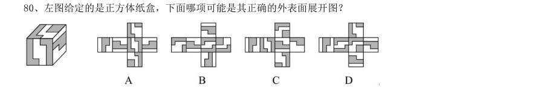

> （本题为图形题，选项为图片，见原卷）

**答案：暂缺**

### 【2021 国考（副省级）·第 81 题】GK-2021-fs-X081　图形推理｜截面

左图给定的是由18 个相同大小的正方体组合成的多面体,这个多面体可以切割为3 个完全相同的小多面体, 问切成的小多面体是:

> （本题为图形题，选项为图片，见原卷）

**答案：暂缺**

### 【2021 国考（副省级）·第 83 题】GK-2021-fs-X083　图形推理｜分组分类

把下面的六个图形分为两类,使每一类图形都有各自的共同特征或规律,分类正确的一项是:

- **A.** 123,456
- **B.** 124,356
- **C.** 134,256
- **D.** 135,246

**答案：暂缺**

### 【2021 国考（副省级）·第 84 题】GK-2021-fs-X084　图形推理｜分组分类

把下面的六个图形分为两类,使每一类图形都有各自的共同特征或规律,分类正确的一项是:

- **A.** 124,356
- **B.** 135,246
- **C.** 136,245
- **D.** 156,234

**答案：暂缺**

### 【2021 国考（副省级）·第 85 题】GK-2021-fs-X085　图形推理｜分组分类

把下面的六个图形分为两类,使每一类图形都有各自的共同特征或规律,分类正确的一项是:

- **A.** 134,256
- **B.** 135,246
- **C.** 126,345
- **D.** 146,235

**答案：暂缺**

### 【2021 国考（副省级）·第 99 题】GK-2021-fs-X099　图形推理｜立体图形

立体化战争∶数字化战争

- **A.** 民主型管理∶专制型管理
- **B.** 防风林∶观赏树木
- **C.** 有氧运动∶医疗瘦身
- **D.** 绩效奖励∶物质奖励

**答案：暂缺**

### 【2021 国考（地市级）·第 71 题】GK-2021-ds-X071　图形推理｜属性规律

从所给的四个选项中,选择最合适的一个填入问号处,使之呈现一定的规律性:

> （本题为图形题，选项为图片，见原卷）

**答案：A**

### 【2021 国考（地市级）·第 72 题】GK-2021-ds-X072　图形推理｜属性规律

从所给的四个选项中,选择最合适的一个填入问号处,使之呈现一定的规律性:

> （本题为图形题，选项为图片，见原卷）

**答案：C**

### 【2021 国考（地市级）·第 73 题】GK-2021-ds-X073　图形推理｜属性规律

从所给的四个选项中,选择最合适的一个填入问号处,使之呈现一定的规律性:

> （本题为图形题，选项为图片，见原卷）

**答案：A**

### 【2021 国考（地市级）·第 74 题】GK-2021-ds-X074　图形推理｜样式规律

从所给的四个选项中,选择最合适的一个填入问号处,使之呈现一定的规律性:

> （本题为图形题，选项为图片，见原卷）

**答案：D**

### 【2021 国考（地市级）·第 75 题】GK-2021-ds-X075　图形推理｜折纸盒

左图给定的是正方体纸盒,下面哪项可能是其正确的外表面展开图?

> （本题为图形题，选项为图片，见原卷）

**答案：A**

### 【2021 国考（地市级）·第 76 题】GK-2021-ds-X076　图形推理｜三视图

左图为给定的多面体,从任一角度观看,下面哪项可能是该多面体的视图?

> （本题为图形题，选项为图片，见原卷）

**答案：B**

### 【2021 国考（地市级）·第 77 题】GK-2021-ds-X077　图形推理｜立体拼合

左图给定的是由相同正方体堆叠而成的多面体的正视图和后视图。该多面体可以由1、2和3三个多面体组 合而成,问以下哪一项能填入问号处?

> （本题为图形题，选项为图片，见原卷）

**答案：C**

### 【2021 国考（地市级）·第 78 题】GK-2021-ds-X078　图形推理｜分组分类

把下面的六个图形分为两类,使每一类图形都有各自的共同特征或规律,分类正确的一项是:

- **A.** 123,456
- **B.** 124,356
- **C.** 134,256
- **D.** 135,246

**答案：C**

### 【2021 国考（地市级）·第 79 题】GK-2021-ds-X079　图形推理｜分组分类

把下面的六个图形分为两类,使每一类图形都有各自的共同特征或规律,分类正确的一项是:

- **A.** 124,356
- **B.** 135,246
- **C.** 136,245
- **D.** 156,234

**答案：D**

### 【2021 国考（地市级）·第 80 题】GK-2021-ds-X080　图形推理｜分组分类

把下面的六个图形分为两类,使每一类图形都有各自的共同特征或规律,分类正确的一项是:

- **A.** 134,256
- **B.** 135,246
- **C.** 126,345
- **D.** 146,235

**答案：C**

### 【2021 国考（地市级）·第 94 题】GK-2021-ds-X094　图形推理｜立体图形

立体化战争∶数字化战争

- **A.** 民主型管理∶专制型管理
- **B.** 防风林∶观赏树木
- **C.** 有氧运动∶医疗瘦身
- **D.** 绩效奖励∶物质奖励

**答案：D**

### 【2020 湖北省考·第 71 题】HB-2020-ty-X071　图形推理｜属性规律

从所给的四个选项中,选择最合适 的一个填入问号处,使之呈现一定的规律性:

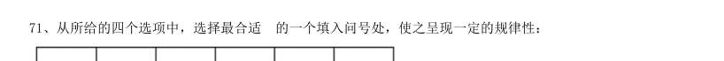

> （本题为图形题，选项为图片，见原卷）

**答案：C**

### 【2020 湖北省考·第 72 题】HB-2020-ty-X072　图形推理｜属性规律

从所给的四个选项中,选择最合适 的一个填入问号处,使之呈现一定的规律性:

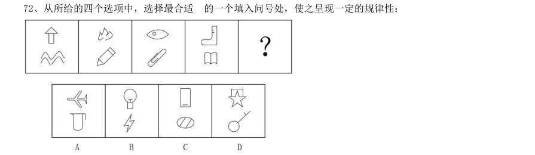

> （本题为图形题，选项为图片，见原卷）

**答案：D**

### 【2020 湖北省考·第 73 题】HB-2020-ty-X073　图形推理｜分组分类

把下面六个图形分为两类,使每一类图形都有各自的共同特征或规律,分类正确的一项是:

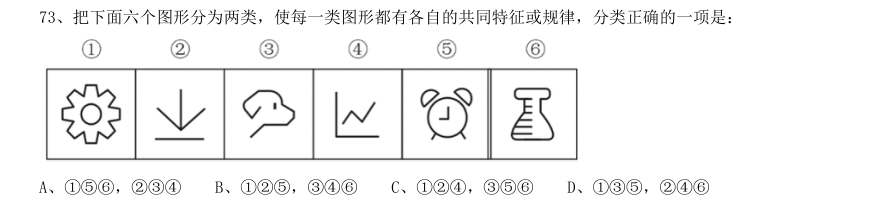

- **A.** 156,234
- **B.** 125,346
- **C.** 124,356
- **D.** 135,246

**答案：A**

### 【2020 湖北省考·第 74 题】HB-2020-ty-X074　图形推理｜位置规律

从所给的四个选项中,选择最合适的一个填入问号处,使之呈现一定的规律性:

> （本题为图形题，选项为图片，见原卷）

**答案：C**

### 【2020 湖北省考·第 75 题】HB-2020-ty-X075　图形推理｜立体拼合

正方体被切除部分后的造型如下图所示,其被切去部分的造型是:

> （本题为图形题，选项为图片，见原卷）

**答案：C**

### 【2020 广东省考（乡镇）·第 46 题】GD-2020-xz-X046　图形推理｜图形推理（待细分）
> 材料：A、20 B、25 C、30 D、40…

下列选项中最符合所给图形规律的是( )。

> （本题为图形题，选项为图片，见原卷）

**答案：暂缺**

### 【2020 广东省考（乡镇）·第 47 题】GD-2020-xz-X047　图形推理｜图形推理（待细分）

下列选项中最符合所给图形规律的是( )。

> （本题为图形题，选项为图片，见原卷）

**答案：暂缺**

### 【2020 广东省考（乡镇）·第 48 题】GD-2020-xz-X048　图形推理｜图形推理（待细分）

下列选项中最符合所给图形规律的是( )。

> （本题为图形题，选项为图片，见原卷）

**答案：暂缺**

### 【2020 广东省考（乡镇）·第 49 题】GD-2020-xz-X049　图形推理｜图形推理（待细分）

下列选项中最符合所给图形规律的是( )。

> （本题为图形题，选项为图片，见原卷）

**答案：暂缺**

### 【2020 广东省考（乡镇）·第 50 题】GD-2020-xz-X050　图形推理｜图形推理（待细分）

下列选项中最符合所给图形规律的是( )。

> （本题为图形题，选项为图片，见原卷）

**答案：暂缺**

### 【2020 广东省考（乡镇）·第 52 题】GD-2020-xz-X052　图形推理｜立体图形

下列选项中,不能在裁剪或覆盖后折成如图所示立方体的是( )。

> （本题为图形题，选项为图片，见原卷）

**答案：暂缺**

### 【2020 广东省考（乡镇）·第 53 题】GD-2020-xz-X053　图形推理｜立体拼合

下列选项中,能与所给图形组合成立方体的是( )。

> （本题为图形题，选项为图片，见原卷）

**答案：暂缺**

### 【2020 广东省考（乡镇）·第 54 题】GD-2020-xz-X054　图形推理｜立体拼合

使用所给的四个图形能够组合成( )。

- **A.** 矩形
- **B.** 三角形
- **C.** 等腰梯形
- **D.** 直角梯形

**答案：暂缺**

### 【2020 广东省考（乡镇）·第 55 题】GD-2020-xz-X055　图形推理｜图形推理（待细分）

下列4 张纸条,沿折痕能够折出如图所示图形的是( )。

- **A.** 如上图所示
- **B.** 如上图所示
- **C.** 如上图所示
- **D.** 如上图所示

**答案：暂缺**

### 【2020 广东省考（乡镇）·第 75 题】GD-2020-xz-X075　图形推理｜图形推理（待细分）

一般而言,在北半球地转偏向力会使风向右偏离其原始的路线。图中显示的是位于北半球的甲地的等压线 分布情况,则甲地的风向最可能是( )。

> （本题为图形题，选项为图片，见原卷）

**答案：暂缺**

### 【2020 广东省考（乡镇）·第 76 题】GD-2020-xz-X076　图形推理｜图形推理（待细分）

夏季,从冰箱内拿出一个装有冰块的杯子,则在杯内物体变为常温的过程中,杯壁温度随着时间变化的图 像最有可能接近( )。

> （本题为图形题，选项为图片，见原卷）

**答案：暂缺**

### 【2020 广东省考（乡镇）·第 78 题】GD-2020-xz-X078　图形推理｜数量规律

如果将等量的氧气和氮气混合,注入一个密闭容器,则静置较长一段时间后,容器内氧元素(用O 代表) 和氮元素(用N 代表)的分布最可能接近( )。

> （本题为图形题，选项为图片，见原卷）

**答案：暂缺**

### 【2020 广东省考（县级）·第 41 题】GD-2020-xj-X041　图形推理｜立体图形

下列选项中,不能在裁剪或覆盖后折成如图所示立方体的是( )。

> （本题为图形题，选项为图片，见原卷）

**答案：暂缺**

### 【2020 广东省考（县级）·第 42 题】GD-2020-xj-X042　图形推理｜图形推理（待细分）

下列选项中最符合所给图形规律的是( )。

> （本题为图形题，选项为图片，见原卷）

**答案：暂缺**

### 【2020 广东省考（县级）·第 43 题】GD-2020-xj-X043　图形推理｜立体拼合

下列选项中,能与所给图形组合成立方体的是( )。

> （本题为图形题，选项为图片，见原卷）

**答案：暂缺**

### 【2020 广东省考（县级）·第 44 题】GD-2020-xj-X044　图形推理｜立体拼合

使用所给的四个图形能够组合成( )。

- **A.** 矩形
- **B.** 三角形
- **C.** 等腰梯形
- **D.** 直角梯形

**答案：暂缺**

### 【2020 广东省考（县级）·第 45 题】GD-2020-xj-X045　图形推理｜图形推理（待细分）

下列4 张纸条,沿折痕能够折出如图所示图形的是( )。

> （本题为图形题，选项为图片，见原卷）

**答案：暂缺**

### 【2020 广东省考（县级）·第 46 题】GD-2020-xj-X046　图形推理｜图形推理（待细分）

下列选项中最符合所给图形规律的是( )。

> （本题为图形题，选项为图片，见原卷）

**答案：暂缺**

### 【2020 广东省考（县级）·第 47 题】GD-2020-xj-X047　图形推理｜图形推理（待细分）

下列选项中最符合所给图形规律的是( )。

> （本题为图形题，选项为图片，见原卷）

**答案：暂缺**

### 【2020 广东省考（县级）·第 48 题】GD-2020-xj-X048　图形推理｜图形推理（待细分）

下列选项中最符合所给图形规律的是( )。

> （本题为图形题，选项为图片，见原卷）

**答案：暂缺**

### 【2020 广东省考（县级）·第 49 题】GD-2020-xj-X049　图形推理｜三视图

下列的三个视图是观察某一多面体得到的,则该立体图形不可能是( )。

> （本题为图形题，选项为图片，见原卷）

**答案：暂缺**

### 【2020 广东省考（县级）·第 50 题】GD-2020-xj-X050　图形推理｜图形推理（待细分）

下列选项中最符合所给图形规律的是( )。

> （本题为图形题，选项为图片，见原卷）

**答案：暂缺**

### 【2020 广东省考（县级）·第 84 题】GD-2020-xj-X084　图形推理｜图形推理（待细分）

如图所示是一辆公交车在平直道路上行驶的位移(s)-时间(t)图像,则下列选项中最能准确反映公 交车速度(v)-时间(t)图像的是( )。

> （本题为图形题，选项为图片，见原卷）

**答案：暂缺**

### 【2020 广东省考（思维能力测验）·第 61 题】GD-2020-sw-X061　图形推理｜位置规律

下图问号处最适合填入的一项是( )。

> （本题为图形题，选项为图片，见原卷）

**答案：B**

### 【2020 广东省考（思维能力测验）·第 62 题】GD-2020-sw-X062　图形推理｜属性规律

下图问号处最适合填入的一项是( )。

> （本题为图形题，选项为图片，见原卷）

**答案：C**

### 【2020 广东省考（思维能力测验）·第 63 题】GD-2020-sw-X063　图形推理｜位置规律

下图问号处最适合填入的一项是( )。

> （本题为图形题，选项为图片，见原卷）

**答案：A**

### 【2020 广东省考（思维能力测验）·第 64 题】GD-2020-sw-X064　图形推理｜立体拼合

下列选项中,能由所给的图形组成的是( )。

> （本题为图形题，选项为图片，见原卷）

**答案：C**

### 【2020 广东省考（思维能力测验）·第 65 题】GD-2020-sw-X065　图形推理｜截面

下图是由两个相同的三棱锥组合而成的物体。下列选项中,不可能从该物体的切面观察到的图形是。

> （本题为图形题，选项为图片，见原卷）

**答案：C**

### 【2020 广东省考（思维能力测验）·第 66 题】GD-2020-sw-X066　图形推理｜立体图形

下列选项中,与所给的立体图形不同的是( )。

> （本题为图形题，选项为图片，见原卷）

**答案：B**

### 【2020 广东省考（思维能力测验）·第 67 题】GD-2020-sw-X067　图形推理｜折纸盒

以下选项均是由四个三角形和三个正方形组成,无法折叠成左图所示立体图形的是( )。

> （本题为图形题，选项为图片，见原卷）

**答案：B**

### 【2020 广东省考（思维能力测验）·第 69 题】GD-2020-sw-X069　图形推理｜三视图

以下两个图形是从正面和斜45°观察某物体所得的图形,则选项中最符合这一物体俯视图的是( )。

> （本题为图形题，选项为图片，见原卷）

**答案：A**

### 【2020 广东省考（思维能力测验）·第 70 题】GD-2020-sw-X070　图形推理｜折纸盒

下列4 张纸条中,沿折痕能够折出如图所示图形的是( )。

> （本题为图形题，选项为图片，见原卷）

**答案：D**

### 【2020 国考（地市级）·第 71 题】GK-2020-ds-X071　图形推理｜属性规律

从所给的四个选项中,选择最合适的一个填入问号处,使之呈现一定的规律性:

> （本题为图形题，选项为图片，见原卷）

**答案：C**

### 【2020 国考（地市级）·第 72 题】GK-2020-ds-X072　图形推理｜位置规律

从所给的四个选项中,选择最合适的一个填入问号处,使之呈现一定的规律性:

> （本题为图形题，选项为图片，见原卷）

**答案：A**

### 【2020 国考（地市级）·第 73 题】GK-2020-ds-X073　图形推理｜属性规律

从所给的四个选项中,选择最合适的一个填入问号处,使之呈现一定的规律性:

> （本题为图形题，选项为图片，见原卷）

**答案：D**

### 【2020 国考（地市级）·第 74 题】GK-2020-ds-X074　图形推理｜折纸盒

下图为给定的多面体及其外表面展开图,问字母

- **A.** 1-C,2-A,3-B,4-D
- **B.** 1-A,2-C,3-B,4-D
- **C.** 1-A,2-C,3-D,4-B
- **D.** 1-C,2-A,3-D,4-B

**答案：A**

### 【2020 国考（地市级）·第 75 题】GK-2020-ds-X075　图形推理｜样式规律

从所给的四个选项中,选择最合适的一个填入问号处,使之呈现一定的规律性:

> （本题为图形题，选项为图片，见原卷）

**答案：C**

### 【2020 国考（地市级）·第 76 题】GK-2020-ds-X076　图形推理｜立体拼合

左图给定的是由相同正方体堆叠而成多面体的正视图和后视图。该多面体可以由1、2和3三个多面体组合 而成,问以下哪一项能填入问号处?

> （本题为图形题，选项为图片，见原卷）

**答案：B**

### 【2020 国考（地市级）·第 77 题】GK-2020-ds-X077　图形推理｜截面

左图是给定的多面体,将其从任一面剖开,下面哪一项不可能是该多面体的截面?

> （本题为图形题，选项为图片，见原卷）

**答案：D**

### 【2020 国考（地市级）·第 78 题】GK-2020-ds-X078　图形推理｜分组分类

把下面的六个图形分为两类,使每一类图形都有各自的共同特征或规律,分类正确的一项是:

- **A.** 134,256
- **B.** 126,345
- **C.** 145,236
- **D.** 146,235

**答案：C**

### 【2020 国考（地市级）·第 79 题】GK-2020-ds-X079　图形推理｜分组分类

把下面的六个图形分为两类,使每一类图形都有各自的共同特征或规律, 分类正确的一项是:

- **A.** 146,235
- **B.** 135,246
- **C.** 126,345
- **D.** 134,256

**答案：A**

### 【2020 国考（地市级）·第 80 题】GK-2020-ds-X080　图形推理｜分组分类

把下面的六个图形分为两类,使每一类图形都有各自的共同特征或规律, 分类正确的一项是:

- **A.** 123,456
- **B.** 134,256
- **C.** 135,246
- **D.** 125,346

**答案：B**

### 【2020 国考（省级）·第 76 题】GK-2020-sj-X076　图形推理｜属性规律

从所给的四个选项中,选择最合适的一个填入问号处,使之呈现一定的规律性:

> （本题为图形题，选项为图片，见原卷）

**答案：B**

### 【2020 国考（省级）·第 77 题】GK-2020-sj-X077　图形推理｜位置规律

从所给的四个选项中,选择最合适的一个填入问号处,使之呈现一定的规律性:

> （本题为图形题，选项为图片，见原卷）

**答案：A**

### 【2020 国考（省级）·第 78 题】GK-2020-sj-X078　图形推理｜属性规律

从所给的四个选项中,选择最合适的一个填入问号处,使之呈现一定的规律性:

> （本题为图形题，选项为图片，见原卷）

**答案：D**

### 【2020 国考（省级）·第 79 题】GK-2020-sj-X079　图形推理｜样式规律

从所给的四个选项中,选择最合适的一个填入问号处,使之呈现一定的规律性:

> （本题为图形题，选项为图片，见原卷）

**答案：C**

### 【2020 国考（省级）·第 80 题】GK-2020-sj-X080　图形推理｜折纸盒

下图为给定的多面体及其外表面展开图,问字母A B C D 和数字1、2、3、4 代表的棱的对应关系 为:

- **A.** 1-D,2-A,3-C,4-B
- **B.** 1-C,2-A,3-D,4-B
- **C.** 1-D,2-B,3-C,4-A
- **D.** 1-C,2-B,3-D,4-A

**答案：C**

### 【2020 国考（省级）·第 81 题】GK-2020-sj-X081　图形推理｜立体拼合

左图给定的是由相同正方体堆叠而成多面体的正视图和后视图。该多面体可以由1、2和3三个多面体组合 而成,问以下哪一项能填入问号处?

> （本题为图形题，选项为图片，见原卷）

**答案：D**

### 【2020 国考（省级）·第 82 题】GK-2020-sj-X082　图形推理｜截面

左图为给定的立体图形,将其从任一面剖开,以下哪个不可能是该立体图形的截面?

> （本题为图形题，选项为图片，见原卷）

**答案：B**

### 【2020 国考（省级）·第 83 题】GK-2020-sj-X083　图形推理｜分组分类

把下面的六个图形分为两类,使每一类图形都有各自的共同特征或规律, 分类正确的一项是:

- **A.** 146,235
- **B.** 135,246
- **C.** 126,345
- **D.** 134,256

**答案：A**

### 【2020 国考（省级）·第 84 题】GK-2020-sj-X084　图形推理｜分组分类

把下面的六个图形分为两类,使每一类图形都有各自的共同特征或规律,分类正确的一项是:

- **A.** 134,256
- **B.** 126,345
- **C.** 145,236
- **D.** 146,235

**答案：C**

### 【2020 国考（省级）·第 85 题】GK-2020-sj-X085　图形推理｜分组分类

把下面的六个图形分为两类,使每一类图形都有各自的共同特征或规律, 分类正确的一项是:

- **A.** 123,456
- **B.** 134,256
- **C.** 135,246
- **D.** 125,346

**答案：B**
