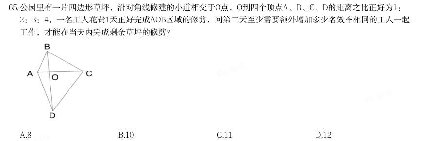

# 数量关系 · 工程问题 · 2020 年代真题

> 所属考点：[SL-GC](../SL-GC-工程问题.md)　｜　本片 8 题

> 本片子考点：工程问题（综合） 5　给定效率型 3

### 【2023 国考（行政执法）·第 65 题】GK-2023-zf-X065　工程问题｜给定效率型

公园里有一片四边形草坪,沿对角线修建的小道相交于O点,O到四个顶点

- **A.** 8
- **B.** 10
- **C.** 11
- **D.** 12

**答案：B**

### 【2022 广东省考（县级）·第 38 题】GD-2022-xj-X038　工程问题｜工程问题（综合）

为鼓励员工阅读,某单位与购书中心合作,员工购书时,享受原价的7 折优惠,且打折后每本书还可叠加 使用单位提供的5 元补贴券。员工小陈买了5 本书,且每本书折后价均超过5 元,扣除补贴后自己只花了48.5 元, 则这些书的原价一共为( )元。

- **A.** 75
- **B.** 85
- **C.** 95
- **D.** 105

**答案：D**

### 【2022 国考（副省级）·第 72 题】GK-2022-fs-X072　工程问题｜工程问题（综合）

(单选题)为降低碳排放,企业对生产设备进行改造,改造后日产量下降了10%,但每件产品的能耗 成本下降了50%,其他成本和出厂价不变的情况下每天的利润提高10%。已知单件利润=出厂价-能耗成本 -其他成本,且改造前产品的出厂价是单件利润的3 倍,则改造前能耗成本为其他成本的:

- **A.** 不到1/4
- **B.** 1/4~1/3 之间
- **C.** 1/3~1/2 之间
- **D.** 超过1/2

**答案：B**

### 【2022 国考（副省级）·第 74 题】GK-2022-fs-X074　工程问题｜给定效率型

(单选题)甲和乙两条效率相同的生产线从早上不同时间开始生产同一种产品,到中午12:00 时分别 正好生产了x 件和y 件。已知乙生产x 件时,甲生产了54 件;甲生产y 件时,乙生产了1.5x 件。如乙从 9:00 开始生产且12:00 后两条生产线仍保持原有速度,问两条生产线生产的产品总量达到500 件是在 什么时候?

- **A.** 16:30 之前
- **B.** 16:30~17:00 之间
- **C.** 17:00~17:30 之间
- **D.** 17:30 之后

**答案：D**

### 【2021 广东省考（乡镇）·第 36 题】GD-2021-xz-X036　工程问题｜工程问题（综合）

在某大型医院的建设过程中,施工单位调配了吊机、挖掘机和推土机共120 台工程设备进场施工。其中,推 土机数量是吊机的3 倍,挖掘机数量是吊机的4 倍,则吊机有( )台。

- **A.** 18
- **B.** 15
- **C.** 12
- **D.** 10

**答案：该题答案缺失，见原卷**

### 【2021 国考（地市级）·第 70 题】GK-2021-ds-X070　工程问题｜工程问题（综合）

某工厂在做好防疫工作的前提下全面复工复产,复工后第1 天的产能即恢复到停工前日产能的60%,复工后 每生产4 天,日产能都会比前4 天的水平提高1000 件/日。已知复工80 天后,总产量相当于停工前88 天的产量, 问复工后的总产量达到100 万件是在复工后的第几天?

- **A.** 54
- **B.** 56
- **C.** 58
- **D.** 60

**答案：B**

### 【2020 广东省考（思维能力测验）·第 74 题】GD-2020-sw-X074　工程问题｜工程问题（综合）

某工程队进行电线安装,第一天用去电线总长度的1/4,第二天用去余下长度的一半后,还剩下24 米,则这捆电线原本长度为( )米。

- **A.** 58
- **B.** 64
- **C.** 72
- **D.** 96

**答案：B**

### 【2020 国考（地市级）·第 69 题】GK-2020-ds-X069　工程问题｜给定效率型

甲、乙两条生产线生产A 和B 两种产品。其中甲生产线生产A、B 产品的效率分别是乙生产线的2 倍和3 倍。 现有2 种产品各X 件的生产任务,企业安排甲和乙生产线合作尽快完成任务,最终甲总共生产了1.5X 件产品。 问乙在单位时间内生产A 的件数是生产B 件数的多少倍?

- **A.** 3/4
- **B.** 3/5
- **C.** 4/3
- **D.** 5/3

**答案：A**
