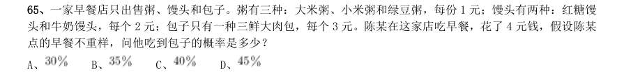
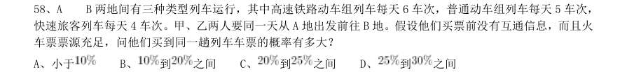
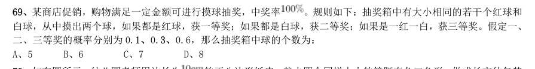
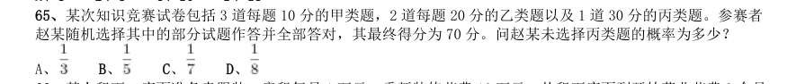
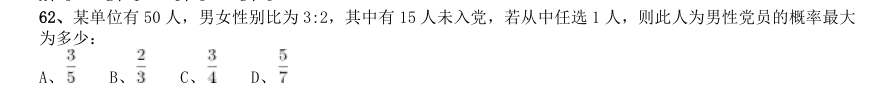
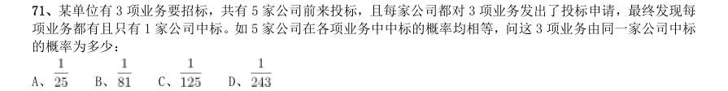
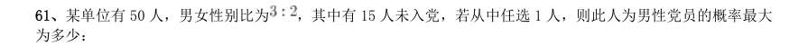
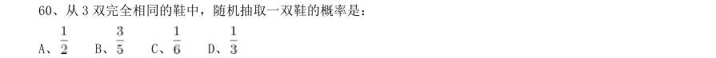

# 数量关系 · 概率问题 · 2010 年代真题

> 所属考点：[SL-GL](../SL-GL-概率问题.md)　｜　本片 26 题

> 本片子考点：摸球与抽取 21　比赛与赛制 3　概率问题（综合） 2

### 2019 湖北·统一卷　第 61 题　（摸球与抽取）

幼儿园老师设计了一个摸彩球游戏,在一个不透明的盒子里混放着红、黄两种颜色的小球,它们除了颜色不 同,形状、大小均一致。已知随机摸取一个小球,摸到红球的概率为三分之一。如果从中先取出3 红7 黄共10 个小球,再随机摸取一个小球,此时摸到红球的概率变为五分之二,那么原来盒中共有红球多少个?

- **A.** 5
- **B.** 10
- **C.** 15
- **D.** 20

**答案：A**

### 2019 湖北·统一卷　第 65 题　（摸球与抽取）

一家早餐店只出售粥、馒头和包子。粥有三种:大米粥、小米粥和绿豆粥,每份1 元;馒头有两种:红糖馒 头和牛奶馒头,每个2 元;包子只有一种三鲜大肉包,每个3 元。陈某在这家店吃早餐,花了4 元钱,假设陈某 点的早餐不重样,问他吃到包子的概率是多少?

- **A.** 
- **B.** 
- **C.** 
- **D.** 

**答案：A**

### 2019 湖北·统一卷　第 66 题　（摸球与抽取）

甲乙两人相约骑共享单车运动健身。停车点现有9 辆单车,分属3 个品牌,各有2、3、4 辆。假如两人选择 每一辆单车的概率相同,两人选到同一品牌单车的概率约为:

- **A.** 
- **B.** 
- **C.** 
- **D.** 

**答案：C**

### 2019 湖北·选调　第 89 题　（摸球与抽取）

甲超市某次抽奖活动仅限于情侣参加。活动规则如下:白、蓝、红三色小球分别有4 个、3 个和2 个,情侣 两人先后从9 个小球中拿1 个(每次取出小球后不放回),都拿白球为三等奖,都拿到蓝球为二等奖,都拿到红 球为一等奖,其他情形不获奖。则每对情侣一次参加活动中奖的概率为:

- **A.** 5/18
- **B.** 1/3
- **C.** 7/18
- **D.** 11/36

**答案：A**

### 2019 国考·地市级　第 63 题　（摸球与抽取）

小张和小王在同一个学校读研究生,每天早上从宿舍到学校有6:40、7:00、7:20 和7:40 发车的4 班校车。 某星期周一到周三,小张和小王都坐班车去学校,且每个人在3 天中乘坐的班车发车时间都不同。问这3 天小张 和小王每天都乘坐同一趟班车的概率在:

- **A.** 3%以下
- **B.** 3%~4%之间
- **C.** 4%~5%之间
- **D.** 5%以上

**答案：C**

### 2019 国考·地市级　第 65 题　（比赛与赛制）

甲和乙进行5 局3 胜的乒乓球比赛,甲每局获胜的概率是乙每局获胜概率的1.5 倍。问以下哪种情况发生的 概率最大?

- **A.** 比赛在3 局内结束
- **B.** 乙连胜3 局获胜
- **C.** 甲获胜且两人均无连胜
- **D.** 乙用4 局获胜

**答案：A**

### 2018 湖北·统一卷　第 58 题　（摸球与抽取）

A B 两地间有三种类型列车运行,其中高速铁路动车组列车每天6 车次,普通动车组列车每天5 车次, 快速旅客列车每天4 车次。甲、乙两人要同一天从A 地出发前往B 地。假设他们买票前没有互通信息,而且火 车票票源充足,问他们买到同一趟列车车票的概率有多大?

- **A.** 小于
- **B.** 到之间
- **C.** 到之间
- **D.** 

**答案：A**

### 2018 国考·副省级　第 64 题　（摸球与抽取）

某单位的会议室有5 排共40 个座位,每排座位数相同。小张和小李随机入座,则他们坐在同一排的概率:

- **A.** 不高于15%
- **B.** 高于15%但低于20%
- **C.** 正好为20%
- **D.** 高于20%

**答案：B**

### 2018 国考·地市级　第 62 题　（摸球与抽取）

某单位的会议室有5 排共40 个座位,每排座位数相同。小张和小李随机入座,则他们坐在同一排的概率:

- **A.** 不高于
- **B.** 高于但低于
- **C.** 正好为
- **D.** 高于

**答案：B**

### 2017 湖北·统一卷　第 69 题　（摸球与抽取）

某商店促销,购物满足一定金额可进行摸球抽奖,中奖率 。规则如下:抽奖箱中有大小相同的若干个红球和 白球,从中摸出两个球,如果都是红球,获一等奖;如果都是白球,获二等奖;如果是一红一白,获三等奖。假定一、 二、三等奖的概率分别为0.1、0.3、0.6,那么抽奖箱中球的个数为:

- **A.** 5
- **B.** 6
- **C.** 7
- **D.** 8

**答案：A**

### 2017 国考·副省级　第 65 题　（摸球与抽取）

某次知识竞赛试卷包括3 道每题10 分的甲类题,2 道每题20 分的乙类题以及1 道30 分的丙类题。参赛者 赵某随机选择其中的部分试题作答并全部答对,其最终得分为70 分。问赵某未选择丙类题的概率为多少?

- **A.** 
- **B.** 
- **C.** 
- **D.** 

**答案：D**

### 2017 国考·副省级　第 70 题　（摸球与抽取）

某集团企业5 个分公司分别派出1 人去集团总部参加培训,培训后再将5 人随机分配到这5 个分公司,每个 分公司只分配1 人。问5 个参加培训的人中,有且仅有1 人在培训后返回原分公司的概率:

- **A.** 低于20%
- **B.** 在20%~30%之间
- **C.** 在30%~35%之间
- **D.** 大于35%

**答案：D**

### 2016 广东·县级　第 45 题　（摸球与抽取）

一个木制正方体在表面涂上颜色,将它的每条棱三等分,然后从等分点将正方体展开,得到27 个小正方 体,将这些小正方体充分混合后,装入一个口袋,从这个口袋中随机取出两个小正方体,其中一个正方体只有 一个面涂有颜色,另一个至少有2 个面涂有颜色的概率约为( )

- **A.** 0.05
- **B.** 0.17
- **C.** 0.34
- **D.** 0.67

**答案：暂缺**

### 2016 国考·副省级　第 74 题　（摸球与抽取）

某单位原有几十名职员,其中有14 名女性。当两名女职员调出该单位后,女职员比重下降了3 个百分点。现 在该单位需要随机选派两名职员参加培训,问选派的两人都是女职员的概率在以下哪个范围内?

- **A.** 小于1%
- **B.** 1%~4%
- **C.** 4%~7%
- **D.** 7%~10%

**答案：C**

### 2015 湖北·统一卷　第 60 题　（摸球与抽取）

掷两个骰子,掷出的点数之和为奇数的概率为P1,掷出的点数之和为偶数的概率为P2,问P1 和P2 的大小 关系?

- **A.** P1=P2
- **B.** P1>P2
- **C.** P1<P2
- **D.** 无法确定

**答案：A**

### 2015 湖北·统一卷　第 62 题　（摸球与抽取）

某单位共有四个科室,第一科室20 人,第二科室21 人,第三科室25 人,第四科室34 人,随机抽取一人到 外地考察学习,抽到第一科室的概率是多少?

- **A.** 0.3
- **B.** 0.25
- **C.** 0.2
- **D.** 0.15

**答案：C**

### 2015 湖北·统一卷　第 69 题　（比赛与赛制）

某场羽毛球单打比赛采取三局两胜制。假设甲选手在每局都有80%的概率赢乙选手,那么这场单打比赛甲有 多大的概率战胜乙选手?

- **A.** 0.768
- **B.** 0.800
- **C.** 0.896
- **D.** 0.924

**答案：C**

### 2015 国考·副省级　第 62 题　（摸球与抽取）

某单位有50 人,男女性别比为3:2,其中有15 人未入党,若从中任选1 人,则此人为男性党员的概率最大 为多少:

- **A.** 
- **B.** 
- **C.** 
- **D.** 

**答案：A**

### 2015 国考·副省级　第 71 题　（摸球与抽取）

某单位有3 项业务要招标,共有5 家公司前来投标,且每家公司都对3 项业务发出了投标申请,最终发现每 项业务都有且只有1 家公司中标。如5 家公司在各项业务中中标的概率均相等,问这3 项业务由同一家公司中标 的概率为多少:

- **A.** 
- **B.** 
- **C.** 
- **D.** 

**答案：A**

### 2015 国考·地市级　第 61 题　（摸球与抽取）

某单位有50 人,男女性别比为 ,其中有15 人未入党,若从中任选1 人,则此人为男性党员的概率最大 为多少:

- **A.** 
- **B.** 
- **C.** 
- **D.** 

**答案：A**

### 2014 广东·乡镇　第 65 题　（概率问题（综合））

某市组织技术人员到外地培训学习,需要先乘车再乘船才能到达目的地。要保证每个人都有座位,需要每 辆有60 个座位的大巴至少4 辆,需要定员为70 人的船至少3 条。到达目的地之后,对技术人员进行分组培训, 结果发现,分的组数跟每组的人数恰好相等。则参加这次培训学习的技术人员共有( )名。

- **A.** 169
- **B.** 181
- **C.** 196
- **D.** 225

**答案：暂缺**

### 2014 国考·统一卷　第 72 题　（概率问题（综合））

某羽毛球赛共有23 支队伍报名参赛,赛事安排23 支队伍抽签两两争夺下一轮的出线权,没有抽到对手的队 伍轮空,直接进入下一轮。那么,本次羽毛球赛最后共会遇到多少次轮空的情况:

- **A.** 1
- **B.** 2
- **C.** 3
- **D.** 4

**答案：B**

### 2013 湖北·统一卷　第 80 题　（摸球与抽取）

某次投资活动中在三个箱子中均放有红、黄、绿、蓝、紫、橙、白、黑8 种颜色的球各一个。奖励规则如下: 从三个箱子分别摸出一个球,摸出的3 个球均为红球得一等奖,摸出的3 个球至少有一个绿球得二等奖,摸出的 3 个球均为彩色球(黑、白除外)得三等奖,那么不中奖的概率是:

- **A.** 0 至25%之间
- **B.** 25 至50%之间
- **C.** 50 至75%之间
- **D.** 75 至100%之间

**答案：B**

### 2013 国考·统一卷　第 64 题　（比赛与赛制）

甲和乙进行打靶比赛,各打两发子弹,中靶数量多的人获胜。甲每发子弹中靶的概率是60%,而乙每发子弹 中靶的概率是30%。则比赛中乙战胜甲的可能性为:

- **A.** 小于5%
- **B.** 在5%~10%之间
- **C.** 在10%~15%之间
- **D.** 大于15%

**答案：C**

### 2012 湖北·统一卷　第 60 题　（摸球与抽取）

从3 双完全相同的鞋中,随机抽取一双鞋的概率是:

- **A.** 
- **B.** 
- **C.** 
- **D.** 

**答案：B**

### 2011 湖北·统一卷　第 44 题　（摸球与抽取）

小王开车上班需经过4 个交通路口,假设经过每个路口遇到红灯的概率分别为0.1,0.2,0.25,0.4,他 上班经过4 个路口至少有一处遇到绿灯的概率是:

- **A.** 0.988
- **B.** 0.899
- **C.** 0.989
- **D.** 0.998

**答案：D**
