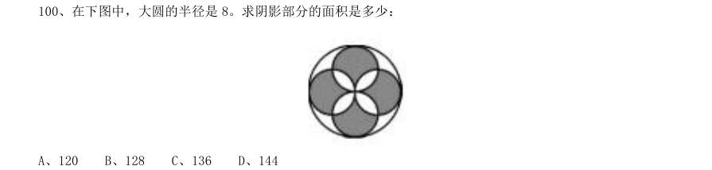
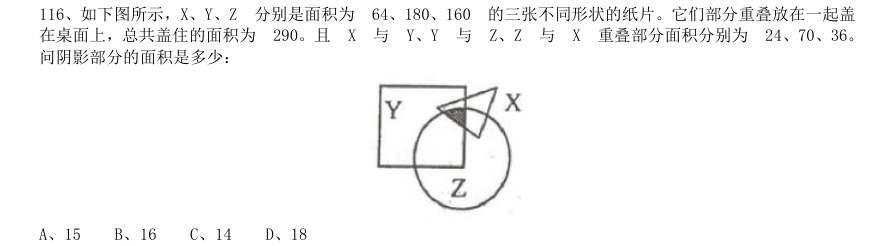
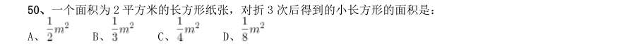
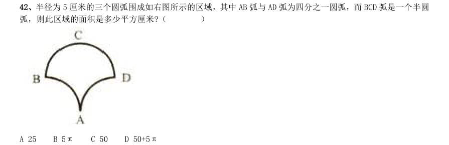
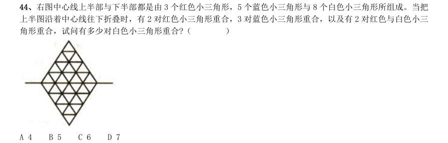
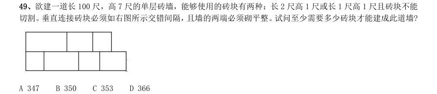
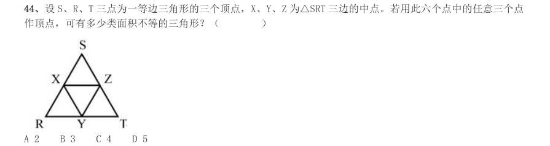
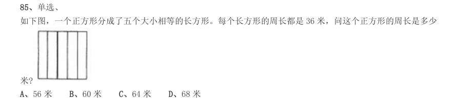

# 数量关系 · 几何问题 · 2000 年代真题

> 所属考点：[SL-JH](../SL-JH-几何问题.md)　｜　本片 24 题

### 2009 湖北·统一卷　第 100 题　（平面几何）

在下图中,大圆的半径是8。求阴影部分的面积是多少:

- **A.** 120
- **B.** 128
- **C.** 136
- **D.** 144

**答案：B**

### 2009 国考·统一卷　第 112 题　（平面几何）

甲买了 支签字笔、7 支圆珠笔和 支铅笔,共花了 元,乙买了 支同样的签字笔、10 支 圆珠笔和 支铅笔,共花了 元。如果同样的签字笔、圆珠笔、铅笔各买一支,共用多少钱:

- **A.** 21 元
- **B.** 11 元
- **C.** 10 元
- **D.** 17 元

**答案：C**

### 2009 国考·统一卷　第 116 题　（平面几何）

如下图所示,X、Y、Z 分别是面积为 64、180、160 的三张不同形状的纸片。它们部分重叠放在一起盖 在桌面上,总共盖住的面积为 290。且 X 与 Y、Y 与 Z、Z 与 X 重叠部分面积分别为 24、70、36。 问阴影部分的面积是多少:

- **A.** 15
- **B.** 16
- **C.** 14
- **D.** 18

**答案：B**

### 2008 广东·统一卷　第 11 题　（立体几何）

若一个边长为20 厘米的正方体表面上挖一个边长为10 厘米的正方体洞,问大正方体的面积增加了多少?

> （本题为图形题，选项为图片，见原卷）

**答案：暂缺**

### 2008 国考·统一卷　第 49 题　（立体几何）

相同表面积的四面体,六面体,正十二面体以及正二十面体,其中体积最大的是:

- **A.** 四面体
- **B.** 六面体
- **C.** 正十二面体
- **D.** 正二十面体

**答案：D**

### 2008 国考·统一卷　第 50 题　（平面几何）

一个面积为2 平方米的长方形纸张,对折3 次后得到的小长方形的面积是:

- **A.** 
- **B.** 
- **C.** 
- **D.** 

**答案：C**

### 2007 广东·统一卷　第 6 题　（立体几何）
> 材料：时间再返回来做。…

地球表面的陆地面积和海洋面积之比是29:71,其中陆地的四分之三在北半球,那么南、北半球海洋面 积之比是( )。

- **A.** 284:29
- **B.** 113:55
- **C.** 371:313
- **D.** 171:113

**答案：暂缺**

### 2007 广东·统一卷　第 8 题　（立体几何）

一个长方体的长、宽、高恰好是三个连续的自然数,并且它的体积数值等于它的所有棱长之和的2 倍, 那么这个长方体的表面积是( )。

- **A.** 74
- **B.** 148
- **C.** 150 D154

**答案：暂缺**

### 2007 国考·统一卷　第 47 题　（立体几何）

现有边长1 米的一个木质正方体,已知将其放入水里,将有0.6 米浸入水中。如果将其分割成边长0.25 米 的小正方体,并将所有的小正方体都放入水中,直接和水接触的表面积总量为:

- **A.** 3.4 平方米
- **B.** 9.6 平方米
- **C.** 13.6 平方米
- **D.** 16 平方米

**答案：C**

### 2007 国考·统一卷　第 56 题　（平面几何）

甲、乙两个容器均有50 厘米深,底面积之比为5:4,甲容器水深9 厘米,乙容器水深5 厘米,再往两个容 器各注入同样多的水,直到水深相等,这时两容器的水深是:

- **A.** 20 厘米
- **B.** 25 厘米
- **C.** 30 厘米
- **D.** 35 厘米

**答案：B**

### 2006 广东·统一卷　第 12 题　（平面几何）

园林工人要在周长300米的圆形花坛边等距离栽树。他们先沿着花坛的边每隔3米挖一 个坑,当挖完30 个坑时,突然接到通知:改为每隔5米栽一棵树。这样,他们还要挖多少个坑才能完成任务?( )

- **A.** 43个
- **B.** 53个
- **C.** 54个
- **D.** 60个

**答案：暂缺**

### 2005 国考·统一卷　第 44 题　（平面几何）

小红把平时节省下来的全部五分硬币先围成一个正三角形,正好用完,后来又改围成一个正方形, 也正好用完。如果正方形的每条边比三角形的每条边少用5 枚硬币,则小红所有五分硬币的总价值 是( )。

- **A.** 1 元
- **B.** 2 元
- **C.** 3 元
- **D.** 4 元

**答案：C**

### 2004 广东·统一卷　第 7 题　（平面几何）

在圆形跑道上正在进行长跑比赛。某位运动员发现在他前面有7 个人在跑,而在他后面也有7 个人在跑,问现在跑道上一共有多少名运动员在比赛?

- **A.** 7 人
- **B.** 8 人
- **C.** 14 人
- **D.** 15 人

**答案：暂缺**

### 2004 国考·A卷　第 42 题　（平面几何）

半径为5 厘米的三个圆弧围成如右图所示的区域,其中AB 弧与AD 弧为四分之一圆弧,而BCD 弧是一个半圆 弧,则此区域的面积是多少平方厘米?( )

- **A.** 25
- **B.** 5π
- **C.** 50
- **D.** 50+5π

**答案：C**

### 2004 国考·A卷　第 43 题　（立体几何）

一个边长为8 的正立方体,由若干个边长为l 的正立方体组成,现在要将大立方体表面涂漆,请问一共有多 少个小立方体被涂上了颜色?( )

- **A.** 296
- **B.** 324
- **C.** 328
- **D.** 384

**答案：A**

### 2004 国考·A卷　第 44 题　（平面几何）

右图中心线上半部与下半部都是由3 个红色小三角形,5 个蓝色小三角形与8 个白色小三角形所组成。当把 上半图沿着中心线往下折叠时,有2 对红色小三角形重合,3 对蓝色小三角形重合,以及有2 对红色与白色小三 角形重合,试问有多少对白色小三角形重合?( )

- **A.** 4
- **B.** 5
- **C.** 6
- **D.** 7

**答案：B**

### 2004 国考·A卷　第 49 题　（几何问题（综合））

欲建一道长100 尺,高7 尺的单层砖墙,能够使用的砖块有两种:长2 尺高1 尺或长1 尺高1 尺且砖块不能 切割。垂直连接砖块必须如右图所示交错间隔,且墙的两端必须砌平整。试问至少需要多少砖块才能建成此道墙?

- **A.** 347
- **B.** 350
- **C.** 353
- **D.** 366

**答案：C**

### 2004 国考·B卷　第 38 题　（立体几何）

设有边长为2 的正立方体。假定在它顶上的面再粘上一个边长为1 的正方体。试问新立方体的表面积比原立 方体的表面积增加的百分比最接近于下面哪一个数?( )

- **A.** 10
- **B.** 15
- **C.** 17
- **D.** 21

**答案：暂缺**

### 2004 国考·B卷　第 44 题　（平面几何）

设S、R、T 三点为一等边三角形的三个顶点,X、Y、Z 为△SRT 三边的中点。若用此六个点中的任意三个点 作顶点,可有多少类面积不等的三角形?( )

- **A.** 2
- **B.** 3
- **C.** 4
- **D.** 5

**答案：B**

### 2003 国考·B卷　第 12 题　（立体几何）

一家冷饮店,过去用圆柱形的纸杯子装汽水,每杯卖2 元钱,一天能卖100 杯。现在改用 同样底面积和高度的圆锥形纸杯子装,每杯只卖1 元钱。如果该店每天卖汽水的总量不变,那么现 在每天的销售额是过去的多少?( )。

- **A.** 50%
- **B.** 100%
- **C.** 150%
- **D.** 200%

**答案：暂缺**

### 2003 国考·B卷　第 15 题　（立体几何）

一个长方体形状的盒子长、宽、高分别为20 厘米、8 厘米和2 厘米,现在要用一张纸将其 六个面完全包裹起来,要求从纸上剪下的部分不得用作贴补,请问这张纸的大小可能是下列哪一 个?( )。

- **A.** 长25 厘米、宽17 厘米
- **B.** 长26 厘米、宽14 厘米
- **C.** 长24 厘米、宽21 厘米
- **D.** 长24 厘米、宽14 厘米

**答案：暂缺**

### 2002 国考·A卷　第 82 题　（平面几何）

单选、 一个正方形的边长增加20%后,它的面积增加百分之几?

- **A.** 36%
- **B.** 40%
- **C.** 44%
- **D.** 48%

**答案：C**

### 2002 国考·A卷　第 85 题　（平面几何）

单选、 如下图,一个正方形分成了五个大小相等的长方形。每个长方形的周长都是36 米,问这个正方形的周长是多少 米?

- **A.** 56 米
- **B.** 60 米
- **C.** 64 米
- **D.** 68 米

**答案：B**

### 2002 国考·B卷　第 89 题　（平面几何）

单选、 一个长方形,它的周长是32 米,长是宽的3 倍,问这个长方形的面积是多少()

- **A.** 64 平方米
- **B.** 56 平方米
- **C.** 52 平方米
- **D.** 48 平方米

**答案：暂缺**
