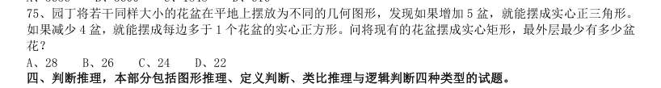

# 数量关系 · 几何问题 · 2010 年代真题

> 所属考点：[SL-JH](../SL-JH-几何问题.md)　｜　本片 34 题

### 2019 湖北·选调　第 90 题　（平面几何）

有一块三角形菜地 如下图,现计划将其分为四块区域种植不同蔬菜,如果BE=3EC,AF=2EF,三角形BEF 和三角形AFC 的面积之差为10 平方米,则三角形ABC 的面积为:

- **A.** 100 平方米
- **B.** 120 平方米
- **C.** 140 平方米
- **D.** 150 平方米

**答案：B**

### 2019 广东·县级　第 30 题　（平面几何）

某小区规划建设一块边长为10 米的正方形绿地。如图所示,以绿地的2 个顶点为圆心,边长为半径分别作 扇形,把绿地划分为不同的区域。小区现准备在图中阴影部分种植杜鹃,则杜鹃种植面积为( )平方米。

- **A.** 
- **B.** 
- **C.** 
- **D.** 

**答案：暂缺**

### 2019 国考·省级　第 75 题　（平面几何）

园丁将若干同样大小的花盆在平地上摆放为不同的几何图形,发现如果增加5 盆,就能摆成实心正三角形。 如果减少4 盆,就能摆成每边多于1 个花盆的实心正方形。问将现有的花盆摆成实心矩形,最外层最少有多少盆 花?

> （本题为图形题，选项为图片，见原卷）

**答案：D**

### 2018 湖北·统一卷　第 62 题　（平面几何）

装修工人小郑用相同的长方形瓷砖装饰正方形墙面,每10 块瓷砖组成一个如右图所示的图案。小郑用这 个图案恰好铺满该墙面,那么,他最少用了多少块瓷砖?

- **A.** 250
- **B.** 300
- **C.** 400
- **D.** 450

**答案：B**

### 2018 湖北·统一卷　第 63 题　（立体几何）

小庄要制作一个工业模具。他在一个边长4 厘米的正方体上表面正中心位置向下挖掉一个直径2 厘米、高 2 厘米的圆柱体,接着再向下挖掉一个直径1 厘米、高1 厘米的小圆柱体(如右图所示)。那么,该模具的表 面积约为多少平方厘米?

- **A.** 82.8
- **B.** 108.6
- **C.** 111.7
- **D.** 114.8

**答案：C**

### 2018 湖北·统一卷　第 66 题　（平面几何）

某水渠长100 米,截面为等腰梯形,其中渠面宽2 米,渠底宽1 米,渠深2 米。因突降暴雨,水深由1 米 涨至1.8 米。则水渠水量增加了:

- **A.** 112 立方米
- **B.** 136 立方米
- **C.** 272 立方米
- **D.** 324 立方米

**答案：B**

### 2018 湖北·统一卷　第 70 题　（立体几何）

某村民要在屋顶建造一个长方体无盖贮水池,如果池底每平方米的造价为150 元,池壁每平方米的造价为 120 元,那么要造一个深为3 米容积为48 立方米的无盖贮水池最低造价是多少元?

- **A.** 6460
- **B.** 7200
- **C.** 8160
- **D.** 9600

**答案：C**

### 2018 广东·统一卷　第 24 题　（相似与比例）

一个箱子的底部由5 块正方形纸板ABCDE 和1 块长方形纸板F 拼接而成(如图所示),已知A B 两块纸板的面积比是1:16,假设A 纸板的边长为2 厘米,则该箱子底部的面积为( )平方厘米。

- **A.** 200
- **B.** 320
- **C.** 360
- **D.** 420

**答案：暂缺**

### 2018 广东·统一卷　第 28 题　（平面几何）

某公园有一个周长为1 千米的长方形花坛,计划在其周围每隔100 米放置一个垃圾桶。现已将所需 垃圾桶全部放在其中一个放置点(如图所示),接下来要用手推车将垃圾桶运到每一个放置点。假如该手推车 每次最多能运3 个垃圾桶,则将垃圾桶运到最后一个放置点时手推车行程最少为( )米。

- **A.** 1600
- **B.** 1800
- **C.** 1900
- **D.** 2200

**答案：暂缺**

### 2018 国考·副省级　第 65 题　（平面几何）

将一块长24 厘米、宽16 厘米的木板分割成一个正方形和两个相同的圆形,其余部分弃去不用。在弃去不用 的部分面积最小的情况下,圆的半径为多少厘米?

- **A.** 
- **B.** 
- **C.** 8
- **D.** 4

**答案：D**

### 2017 湖北·统一卷　第 56 题　（相似与比例）

某单位准备扩建一矩形花圃,若将矩形花圃的长和宽各增加4 米,则新矩形花圃的面积比原来的面积增加了40 平方米。那么,原矩形花圃的周长是多少?

- **A.** 12 米
- **B.** 24 米
- **C.** 32 米
- **D.** 40 米

**答案：A**

### 2017 湖北·统一卷　第 59 题　（立体几何）

妈妈为了给过生日的小东一个惊喜,在一底面半径为20cm、高为60cm 的圆锥形生日帽内藏了一个圆柱形礼物盒。 为了不让小东事先发现礼物盒,该礼物盒的侧面积最大为多少?

- **A.** 
- **B.** 
- **C.** 
- **D.** 

**答案：A**

### 2017 湖北·统一卷　第 70 题　（立体几何）

如右图所示,幼儿园老师用边长为 的正八边形纸皮,裁去四个同样大小的等腰直角三角形,做成长方体包装 盒。如果用该包装盒存放体积为 的立方体积木(不得凸出包装盒外沿),那么,这个盒子最多可以放入多少块积 木?

- **A.** 75
- **B.** 80
- **C.** 85
- **D.** 90

**答案：A**

### 2017 广东·统一卷　第 21 题　（平面几何）

如图所示,公园有一块四边形的草坪,由四块三角形的小草坪组成。已知四边形草坪的面积为480 平方 米,其中两个小三角形草坪的面积分别为70 平方米和90 平方米,则四块三角形小草坪中最大的一块面积为 多少平方米?

- **A.** 120
- **B.** 150
- **C.** 180
- **D.** 210

**答案：暂缺**

### 2017 广东·统一卷　第 30 题　（平面几何）

施工队给一个周长为40 米的圆形花坛安装护栏。刚开始,每隔1 米挖一个洞用于埋栏杆。后来发现洞的 间隔太远,决定改为每隔0.8 米挖一个洞。那么,至少需要再挖几个洞?

- **A.** 39
- **B.** 40
- **C.** 41
- **D.** 42

**答案：暂缺**

### 2017 国考·副省级　第 69 题　（平面几何）

一块种植花卉的矩形土地如图所示,AD 边长是AB 的2 倍,E 是CD 的中点,甲、乙、丙、丁、戊区域分别种 植白花、红花、黄花、紫花、白花。问种植白花的面积占矩形土地面积的:

- **A.** 
- **B.** 
- **C.** 
- **D.** 

**答案：C**

### 2017 国考·副省级　第 74 题　（立体几何）

将一个棱长为整数的正方体零件切掉一个角,截面是面积为 的三角形,问其棱长最小为多少?

> （本题为图形题，选项为图片，见原卷）

**答案：A**

### 2017 国考·副省级　第 75 题　（平面几何）

某次军事演习中,一架无人机停在空中对三个地面目标点进行侦察。已知三个目标点在地面上的连线为直角 三角形,两个点之间的最远距离为600 米。问无人机与三个点同时保持500 米距离时,其飞行高度为多少米?

- **A.** 500
- **B.** 600
- **C.** 300
- **D.** 400

**答案：D**

### 2016 湖北·统一卷　第 62 题　（平面几何）

老王围着边长为50 米的正六边形的草地跑步,他从某个角点出发,跑了500 米之后,与出发点相距有多远?

- **A.** 
- **B.** 
- **C.** 
- **D.** 

**答案：B**

### 2016 湖北·统一卷　第 69 题　（平面几何）

如下图,正方形ABCD 边长为10 厘米,一只小蚂蚁E 从A 点出发匀速移动,沿边AB,BC,CD 前往D 点。问哪 个图形能反映三角形AED 的面积与时间的关系?

> （本题为图形题，选项为图片，见原卷）

**答案：A**

### 2016 国考·副省级　第 75 题　（立体几何）

将一个8 厘米×8 厘米×1 厘米的白色长方体木块的外表面涂上黑色颜料,然后将其切成64 个棱长1 厘米的 小正方体,再用这些小正方体堆成棱长4 厘米的大正方体,且使黑色的面向外露的面积要尽量大,问大正方体的 表面上有多少平方厘米是黑色的?( )

- **A.** 84
- **B.** 88
- **C.** 92
- **D.** 96

**答案：B**

### 2015 国考·副省级　第 69 题　（平面几何）

现要在一块长25 公里、宽8 公里的长方形区域内设置哨塔,每个哨塔的监视半径为5 公里。如果要求整个 区域内的每个角落都能被监视到,则至少需要设置多少个哨塔:

- **A.** 7
- **B.** 6
- **C.** 5
- **D.** 4

**答案：C**

### 2015 国考·副省级　第 74 题　（立体几何）

某学校准备重新粉刷升国旗的旗台,该旗台由两个正方体上下叠加而成,边长分别为1 米和2 米,问需要粉 刷的面积为:

- **A.** 30 平方米
- **B.** 29 平方米
- **C.** 26 平方米
- **D.** 24 平方米

**答案：D**

### 2014 湖北·统一卷　第 61 题　（平面几何）

一菱形土地面积为 平方公里,菱形的最小角为 。如果将这一菱形土地向外扩张变为一正方形土地,问 正方形土地边长最小为多少公里?

- **A.** √2
- **B.** √3
- **C.** √6
- **D.** 2√6

**答案：B**

### 2014 湖北·统一卷　第 67 题　（平面几何）

一个圆形的草地中央有一个与之同心的圆形花坛,在花坛圆周和草地圆周上各有3 个不同的点,安放了洒水 的喷头。现用直管将这些喷头连上,要求任意两个喷头都能被一根水管连通,问最少需要几根水管(1 根水管上 可以连接多个喷头):

- **A.** 5
- **B.** 8
- **C.** 20
- **D.** 30

**答案：B**

### 2013 湖北·统一卷　第 85 题　（立体几何）

连接正方体每个面的中心构成一个正八面体(如下图所示)。已知正方体的边长为6 厘米,则正八面体的体 积为多少立方厘米:

- **A.** 
- **B.** 
- **C.** 36
- **D.** 72

**答案：C**

### 2013 广东·三卷　第 15 题　（立体几何）

有一批商品需要装箱运输。商品每件均为10 厘米*40 厘米*80 厘米的长方体。包装箱为 边长为1.2 米的立方体,一个包装箱最多能装多少件商品?

- **A.** 54
- **B.** 53
- **C.** 52
- **D.** 51、二、言语理解,共30 题,参考时限30 分钟,

**答案：暂缺**

### 2012 湖北·统一卷　第 52 题　（立体几何）

某公司要在长、宽、高分别为50 米、40 米、30 米的长方体建筑的表面架设专用电路管道连接建筑物内最 远两点,预设的最短管道长度介于:

- **A.** 70—80 米之间
- **B.** 60—70 米之间
- **C.** 90—100 米之间
- **D.** 80—90 米之间

**答案：D**

### 2012 湖北·统一卷　第 56 题　（立体几何）

3 颗气象卫星与地心距离相等,并可同时覆盖全球地表,现假设地球半径为R,则3 颗卫星距地球最短距 离为:

- **A.** R
- **B.** 2R
- **C.** R/2
- **D.** 2R/3

**答案：A**

### 2012 广东·统一卷　第 10 题　（平面几何）

有绿、白两种颜色且尺寸相同的正方形瓷砖共400 块,将这些瓷砖铺在一块正方形的地面上:最外 面的一周用绿色瓷砖铺,从外往里数的第二周用白色瓷砖铺,第三周用绿色瓷砖,第四周用白色瓷砖......这 样依次交替铺下去,恰好将所有瓷砖用完。这块正方形地面上的绿色瓷砖共有多少块:

- **A.** 180
- **B.** 196
- **C.** 210
- **D.** 220

**答案：暂缺**

### 2012 国考·统一卷　第 75 题　（平面几何）

为了浇灌一个半径为10 米的花坛,园艺师要在花坛里布置若干个旋转喷头,但库房里只有浇灌半径为5 米 的喷头,问花坛里至少要布置几个这样的喷头才能保证每个角落都能浇灌到:

- **A.** 4
- **B.** 7
- **C.** 6
- **D.** 9

**答案：B**

### 2012 国考·统一卷　第 80 题　（立体几何）

连接正方体每个面的中心构成一个正八面体(如下图所示)。己知正方体的边长为6 厘米,问正八面体的体积 为多少立方厘米:

- **A.** 182
- **B.** 242
- **C.** 36
- **D.** 72

**答案：C**

### 2011 湖北·统一卷　第 45 题　（平面几何）

把一个正四面体的每个表面都分成9 个相同的等边三角形,用任意颜色给这些小三角形上色,要求有公共 边的小三角形颜色不同,问最多有多少个小三角形颜色相同:

- **A.** 15
- **B.** 12
- **C.** 16
- **D.** 18

**答案：A**

### 2011 国考·统一卷　第 75 题　（平面几何）

用一个平面将一个边长为1 的正四面体切分为两个完全相同的部分,则切面的最大面积为:

- **A.** 
- **B.** 
- **C.** 
- **D.** 

**答案：B**
