# 数量关系 · 几何问题 · 2020 年代真题

> 所属考点：[SL-JH](../SL-JH-几何问题.md)　｜　本片 23 题

> 本片子考点：平面几何 12　立体几何 10　相似与比例 1

### 2025 国考·副省级　第 80 题　（立体几何）

一个容器的下部分为高12厘米的倒立圆锥体,上部分为圆柱体,且圆锥和圆柱的底面半径相等。现匀速向容器 中注入水,1分钟后液面高6厘米,又过30分钟后注满。问整个容器的高度为多少厘米?

- **A.** 22
- **B.** 22.5
- **C.** 23
- **D.** 23.5

**答案：D**

### 2025 国考·行政执法　第 75 题　（立体几何）

一个长方体零件最大面的面积是最小面的3倍,次大面的面积是最大、最小面面积平均值的 。问该零件最小 面的长是其宽的多少倍?

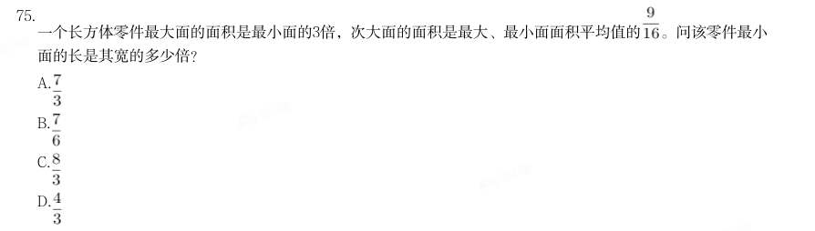

- **A.** 
- **B.** 
- **C.** 
- **D.** 

**答案：C**

### 2024 湖北·统一卷　第 68 题　（平面几何）

某单面圆形交通禁停标志牌如图所示,标志牌直径为60cm,牌中各处红色区域宽度均为5cm,某工厂承接30个 该种标志牌的喷绘业务,已知每个标志牌的蓝色区域喷绘价格是112.5元,红蓝区域喷绘单价相同(价格仅按面 积计算),那么30个标志牌喷绘共需:

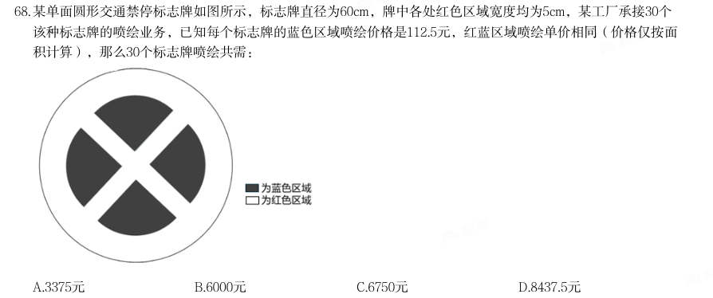

- **A.** 3375元
- **B.** 6000元
- **C.** 6750元
- **D.** 8437.5元

**答案：C**

### 2024 湖北·统一卷　第 69 题　（平面几何）

莱洛三角形是以等边三角形三个顶点为圆心,边长为半径,在顶点的对边画弧所得的封闭图形,这种形状的钻 头可钻出四角为圆弧的正方形的孔洞(如左下图所示)。现将某莱洛三角形钻头所钻孔洞近似为正方形,测得 该正方形孔洞截面积为 (如右下图所示),则该钻头的截面积为:

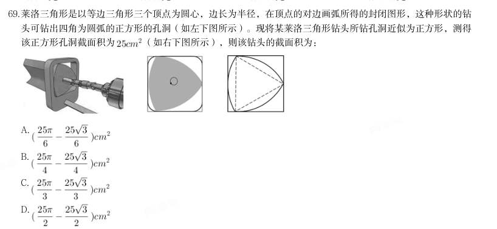

> （本题为图形题，选项为图片，见原卷）

**答案：D**

### 2024 国考·副省级　第 70 题　（平面几何）

某公园内的道路如下图所示,其中AB、BC分别为正南北向和正东西向道路,AB、AC分别长100米和200米。且 BCD为正三角形,如要用直线道路连接AD,则该道路的长度为多少米?

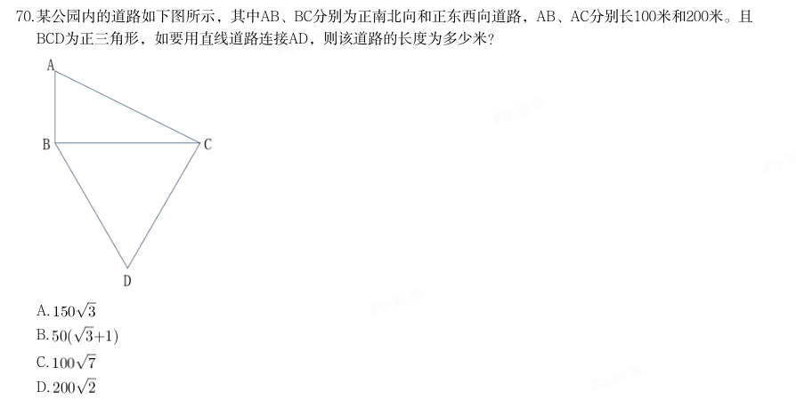

- **A.** 
- **B.** 
- **C.** 
- **D.** 

**答案：C**

### 2024 国考·副省级　第 71 题　（相似与比例）

设计师将一个正方形的大厅分给如下图所示的几个区域,已知所有的三角形都是等腰直角三角形,梯形都是等 腰梯形,且所有三角形和梯形面积均相等。在三角形的区域铺设地砖,在中间的正方形区域铺设木地板。问地 砖和木地板的面积比是多少?

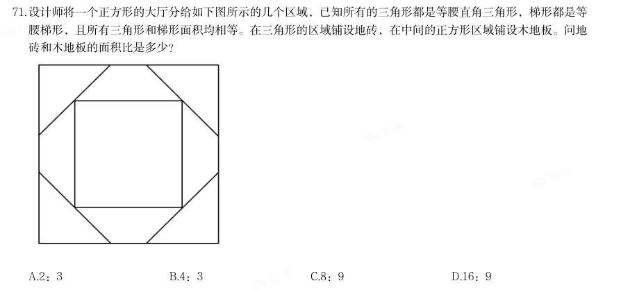

- **A.** 2:3
- **B.** 4:3
- **C.** 8:9
- **D.** 16:9

**答案：C**

### 2024 国考·行政执法　第 66 题　（平面几何）

甲、乙两个联络站相距10千米。一条道路与甲、乙联络站连线相平行,且与两联络站连线的垂直距离为12千 米。现需紧邻该道路建一个工作站,问工作站距离甲、乙联络站距离之和最小为多少千米?

- **A.** 20
- **B.** 22
- **C.** 24
- **D.** 26

**答案：D**

### 2023 国考·行政执法　第 62 题　（平面几何）

在一块正方形土地中,画一条经过某个顶点的规划线,将其分割为三角形和梯形两块土地,且梯形土地的面积 正好是三角形土地的2倍。问三角形和梯形土地的周长之比是多少?

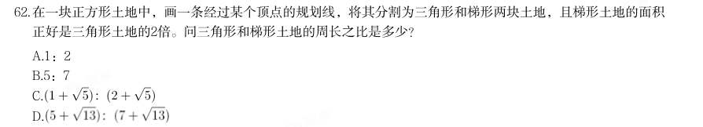

- **A.** 1:2
- **B.** 5:7
- **C.** 
- **D.** 

**答案：D**

### 2023 国考·行政执法　第 70 题　（立体几何）

一个圆柱体零件A和一个圆锥体零件B分别用甲、乙两种合金铸造而成。A的底面半径和高相同,B的底面半径 是高的2倍,两个零件的高相同,质量也相同。问甲合金的密度是乙合金的多少倍?

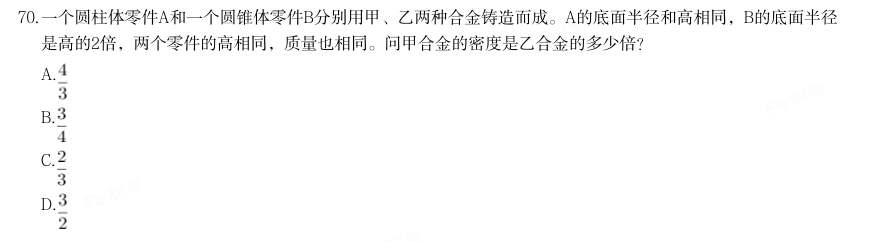

- **A.** 
- **B.** 
- **C.** 
- **D.** 

**答案：A**

### 2022 广东·乡镇　第 39 题　（平面几何）

如图阴影部分是一块由8 块相同的正方形草皮围成的草坪。已知草坪的外圈均铺有一圈小石子带,小石子 带的总长度是48 米,则该草坪的面积为( )平方米。

- **A.** 48
- **B.** 72
- **C.** 81
- **D.** 96

**答案：B**

### 2022 广东·乡镇　第 43 题　（平面几何）

有一个长方形花坛,长为10 米,宽为8 米。现要在花坛四周安装栅栏,要求4 个顶点处各插一根木桩, 除顶点处的木桩外,每边还要插若干木桩,且每两根木桩间的距离至少为3 米,则最多可以插( )根木桩。

- **A.** 10
- **B.** 12
- **C.** 14
- **D.** 16

**答案：A**

### 2022 广东·乡镇　第 45 题　（立体几何）

桶中装有一定量的液体,液体体积为桶容量的40%,现向桶中继续加入16 升同一液体后,液体体积为原来 的1.5 倍,则该桶的容量为( )升。

- **A.** 20
- **B.** 40
- **C.** 60
- **D.** 80

**答案：D**

### 2022 国考·副省级　第 73 题　（立体几何）

(单选题)一个圆柱体零件的高为1,其圆形底面上的内接正方形边长正好也为1。现将该圆柱体零件 切割4 次,得到棱长为1 的正方体,则切去部分的总面积为:

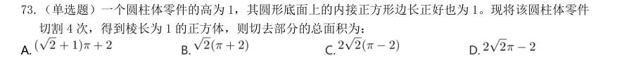

- **A.** 
- **B.** 
- **C.** 
- **D.** 

**答案：A**

### 2022 国考·地市级　第 67 题　（立体几何）

一个圆柱体零件的高为1,其圆形底面上的内接正方形边长正好也为1。现将该圆柱体零件 切割4 次,得到棱长为1 的正方体,则切去部分的总面积为:

> （本题为图形题，选项为图片，见原卷）

**答案：A**

### 2021 广东·乡镇　第 45 题　（平面几何）

如图所示,周长为24 米的平行四边形绿化地被划分为三块区域,两边为三角形的花坛,中间为矩形的草地。 已知a、b、c 长度之比为4∶2∶ ,则矩形草地的面积为( )平方米。

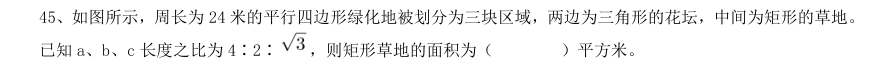

- **A.** 6
- **B.** 6
- **C.** 12
- **D.** 12

**答案：暂缺**

### 2021 国考·副省级　第 74 题　（立体几何）

一个人工湖的湖面上有一个露出水面3 米的圆锥体人工景观(底面朝下)。如人工湖水深减少20%,则该 景观露出水面部分的体积将增加61/64。问原来的人工湖水深为多少米?

- **A.** 3.5
- **B.** 3.75
- **C.** 4.25
- **D.** 4.5

**答案：暂缺**

### 2021 国考·地市级　第 69 题　（平面几何）

在一块下图所示的梯形土地中种植某种产量为1.2 千克/平方米的作物。已知该梯形的高为100 米,ABC、BCD 和CDE 为正三角形,且BAF 和DEG 的角度都是90 度,问该土地的总产量为多少吨?

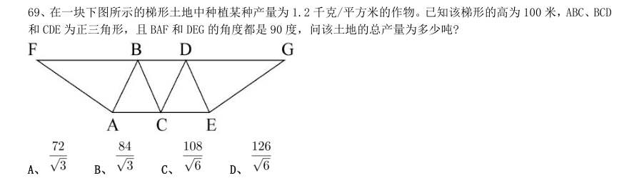

- **A.** 
- **B.** 
- **C.** 
- **D.** 

**答案：B**

### 2020 湖北·统一卷　第 58 题　（平面几何）

某社区拟对一块梯形活动场地进行扩建,经测算,如果将梯形的上底边增加1 米,下底边增加1 米,则面积 将扩大10 平方米;如果将梯形的上底边增加1 倍,下底边增加1 米,则面积将扩大55 平方米;如果将上底边增 加1 米,下底边增加1 倍,则面积将扩大105 平方米。现拟将梯形的上底边增加1 倍还多2 米,下底边增加3 倍 还多4 米,则面积将扩大多少?

- **A.** 280 平方米
- **B.** 380 平方米
- **C.** 420 平方米
- **D.** 480 平方米

**答案：B**

### 2020 湖北·统一卷　第 66 题　（立体几何）

在屋内墙角处堆放稻谷(如图,谷堆为一个圆锥的四分之一),谷堆底部的弧长为6 米,高为2 米,经过一 夜发现谷堆在重力作用下底部的弧长变为8 米,若谷堆的谷量不变那么此时谷堆的高为:

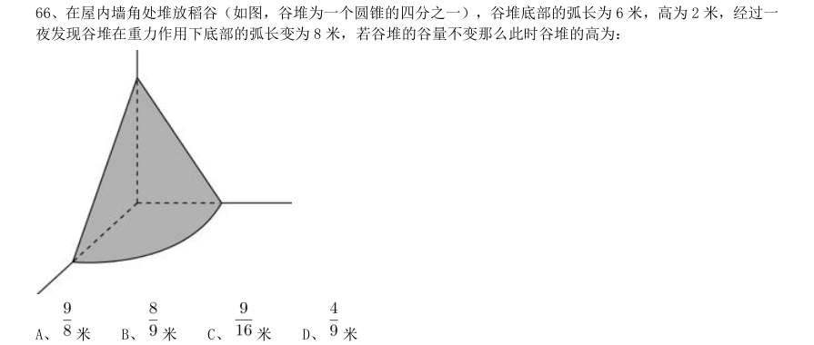

- **A.** 米
- **B.** 米
- **C.** 米
- **D.** 

**答案：A**

### 2020 湖北·统一卷　第 68 题　（平面几何）

村民陶某承包一块长方形种植地,他将地分割成如图所示的4 个小长方形,在

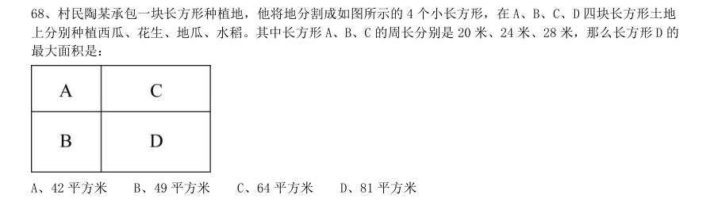

- **A.** 42 平方米
- **B.** 49 平方米
- **C.** 64 平方米
- **D.** 81 平方米

**答案：C**

### 2020 湖北·统一卷　第 70 题　（立体几何）

野外生存需要用一个简易的圆锥型过滤器(如下图所示)装满溪水进行过滤。过滤器的底面直径为20 厘米, 高为6 厘米。问全部过滤完毕后,在不考虑损耗的情况下,可使底面半径为5 厘米,高为15 厘米圆柱型容器的 水面高度达到:

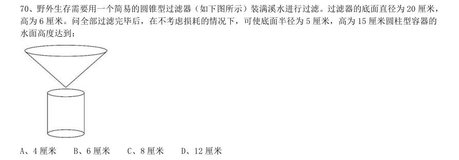

- **A.** 4 厘米
- **B.** 6 厘米
- **C.** 8 厘米
- **D.** 12 厘米

**答案：C**

### 2020 国考·省级　第 66 题　（平面几何）

将一个圆盘形零件匀速向下浸入水中。问以下哪个坐标图能准确反映浸入深度AO 及圆盘与水面的接触部位 长度CD 之间的关系?

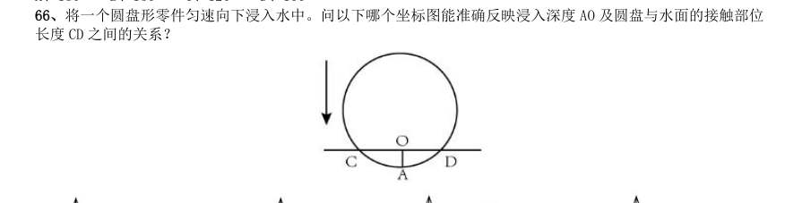

> （本题为图形题，选项为图片，见原卷）

**答案：A**

### 2020 国考·省级　第 75 题　（立体几何）

一个无盖长方体饮料盒如下图所示,其底面为正方形,高为23 厘米。若插入一根足够细的不可弯折的吸管 与底部接触,已知插入饮料盒内的吸管长度最大为27 厘米,问饮料盒底面边长为多少厘米?

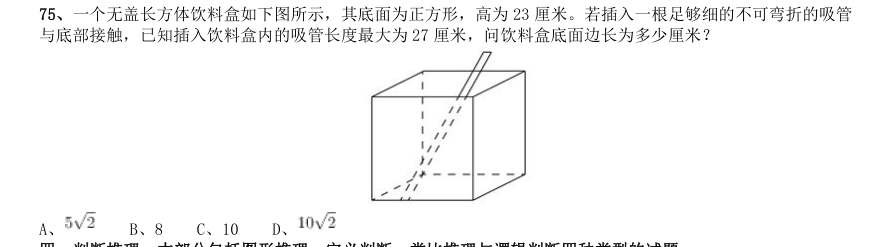

- **A.** 
- **B.** 8
- **C.** 10
- **D.** 

**答案：C**
