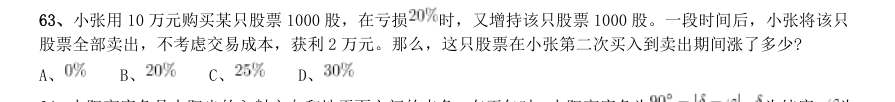
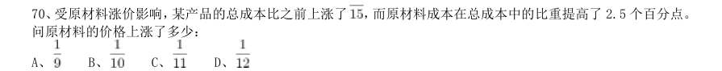

# 数量关系 · 利润问题 · 2010 年代真题

> 所属考点：[SL-LR](../SL-LR-利润问题.md)　｜　本片 20 题

> 本片子考点：基础利润 16　利润问题（综合） 2　折扣与促销 2

### 【2019 湖北省考·第 63 题】HB-2019-ty-X063　利润问题｜基础利润

小张用10 万元购买某只股票1000 股,在亏损 时,又增持该只股票1000 股。一段时间后,小张将该只 股票全部卖出,不考虑交易成本,获利2 万元。那么,这只股票在小张第二次买入到卖出期间涨了多少?

- **A.** 
- **B.** 
- **C.** 
- **D.** 

**答案：C**

### 【2019 广东省考（思维能力测验）·第 58 题】GD-2019-sw-X058　利润问题｜基础利润

某件商品如果打九折销售,利润将减少一半;如果打八五折销售,利润将减少22.5 元。如果按原价销 售,这件商品的利润是()元。

- **A.** 15
- **B.** 22.5
- **C.** 30
- **D.** 45

**答案：C**

### 【2019 国考（地市级）·第 62 题】GK-2019-ds-X062　利润问题｜基础利润

从A 市到B 市的机票如果打6 折,包含接送机出租车交通费90 元、机票税费60 元在内的总乘机成本是机票 打4 折时总乘机成本的1.4 倍。问从A 市到B 市的全价机票价格(不含税费)为多少元?

- **A.** 1200
- **B.** 1250
- **C.** 1500
- **D.** 1600

**答案：C**

### 【2018 湖北省考·第 57 题】HB-2018-ty-X057　利润问题｜利润问题（综合）

某苗木公司准备出售一批苗木,如果每株以4 元出售,可卖出20 万株,若苗木单价每提高0.4 元,就会 少卖10000 株。问在最佳定价的情况下,该公司最大收入是多少万元?

- **A.** 60
- **B.** 80
- **C.** 90
- **D.** 100

**答案：C**

### 【2018 国考（副省级）·第 61 题】GK-2018-fs-X061　利润问题｜基础利润

甲商店购入400 件同款夏装。7 月以进价的1.6 倍出售,共售出200 件;8 月以进价的1.3 倍出售,共售出 100 件;9 月以进价的0.7 倍将剩余的100 件全部售出,总共获利15000 元。问这批夏装的单件进价为多少元?

- **A.** 125
- **B.** 144
- **C.** 100
- **D.** 120

**答案：A**

### 【2018 国考（副省级）·第 69 题】GK-2018-fs-X069　利润问题｜基础利润

枣园每年产枣2500 公斤,每公斤固定盈利18 元。为了提高土地利用率,现决定明年在枣树下种植紫薯(产 量最大为10000 公斤),每公斤固定盈利3 元。当紫薯产量大于400 公斤时,其产量每增加n 公斤将导致枣的产 量下降0.2n 公斤。问该枣园明年最多可能盈利多少元?

- **A.** 46176
- **B.** 46200
- **C.** 46260
- **D.** 46380

**答案：B**

### 【2018 国考（副省级）·第 72 题】GK-2018-fs-X072　利润问题｜基础利润

某公司A 商品利润为定价的30%,前年销量为10 万个;B 商品利润为定价的40%,前年销量为4 万个。去年 公司将A B 商品捆绑销售,售价为前年两种商品定价之和的90%,共卖出8 万套,总利润比前年增加了20%。 如两种商品去年的成本与前年相同,则前年A 商品的定价为B 商品定价的:

- **A.** 24%
- **B.** 25%
- **C.** 30%
- **D.** 36%

**答案：A**

### 【2017 国考（副省级）·第 61 题】GK-2017-fs-X061　利润问题｜基础利润

面包房购买一包售价为15 元/千克的白糖,取其中的一部分加水溶解形成浓度为20%的糖水12 千克,然后 将剩余的白糖全部加入后溶解,糖水浓度变为25%,问购买白糖花了多少元钱?

- **A.** 45
- **B.** 48
- **C.** 36
- **D.** 42

**答案：B**

### 【2017 国考（副省级）·第 64 题】GK-2017-fs-X064　利润问题｜利润问题（综合）

某超市购入每瓶200 毫升和500 毫升两种规格的沐浴露各若干箱,200 毫升沐浴露每箱20 瓶,500 毫升沐浴 露每箱12 瓶。定价分别为14 元/瓶和25 元/瓶。货品卖完后,发现两种规格沐浴露的销售收入相同,那么这批 沐浴露中,200 毫升的最少有几箱?

- **A.** 3
- **B.** 8
- **C.** 10
- **D.** 15

**答案：D**

### 【2017 国考（副省级）·第 66 题】GK-2017-fs-X066　利润问题｜基础利润

某人租下一店面准备卖服装,房租每月1 万元,重新装修花费10 万元。从租下店面到开始营业花费3 个月 时间。开始营业后第一个月,扣除所有费用后的纯利润为3 万元。如每月纯利润都比上月增加2000 元而成本不 变,问该店在租下店面后第几个月内收回投资?

- **A.** 7
- **B.** 8
- **C.** 9
- **D.** 10

**答案：A**

### 【2013 湖北省考·第 90 题】HB-2013-ty-X090　利润问题｜基础利润

某产品售价为67.1 元,在采用新技术生产节约10%成本之后,售价不变,利润可比原来翻一番。则该产品 最初的成本为多少元:

- **A.** 51.2
- **B.** 54.9
- **C.** 61
- **D.** 62.5

**答案：C**

### 【2013 广东省考（一卷）·第 10 题】GD-2013-1-X010　利润问题｜基础利润

某服装店三月份男装和女装的总销售额为8000 元,已知三月份女装销售了50 件,每件售价100 元,则三 月份男装销售额为多少元:

- **A.** 1000
- **B.** 2000
- **C.** 3000
- **D.** 4000

**答案：暂缺**

### 【2013 广东省考（一卷）·第 15 题】GD-2013-1-X015　利润问题｜基础利润

某单位举办活动,需要制作8 米长的横幅20 条。用来制作横幅的原料有两种,一种每卷10 米,售价10 元;另一种每卷25 米,售价23 元。如果每卷原料截断后无法拼接,则该单位购买横幅原料最少需要花费多少 元:

- **A.** 146
- **B.** 158
- **C.** 161
- **D.** 200、二、言语理解,共30 题,参考时限30 分钟,本部分包

**答案：暂缺**

### 【2013 广东省考（三卷）·第 10 题】GD-2013-3-X010　利润问题｜基础利润

一厂家生产销售某新型节能产品。产品生产成本是168 元,销售定价为238 元。一位买 家向该厂家预订了120 件产品,并提出产品销售价每降低2 元,就多订购8 件。则该厂家在这笔 交易中能获得的最大利润是多少元?

- **A.** 17920
- **B.** 13920
- **C.** 10000
- **D.** 8400

**答案：暂缺**

### 【2013 国考·第 66 题】GK-2013-ty-X066　利润问题｜基础利润

某种汉堡包每个成本4.5 元,售价10.5 元。当天卖不完的汉堡包即不再出售,在过去十天里,餐厅每天都 会准备200 个汉堡包,其中有六天正好卖完,四天各剩余25 个。问这十天该餐厅卖汉堡包共赚了多少元?

- **A.** 10850
- **B.** 10950
- **C.** 11050
- **D.** 11350

**答案：B**

### 【2012 湖北省考·第 62 题】HB-2012-ty-X062　利润问题｜基础利润

某网店以高于进价10%的定价销售T 恤,在售出2/3 后,以定价的8 折将余下的T 恤全部售出,该网店预 计盈利为成本的:

- **A.** 3.2%
- **B.** 不赚也不亏
- **C.** 1.6%
- **D.** 2.7%

**答案：D**

### 【2011 国考·第 70 题】GK-2011-ty-X070　利润问题｜基础利润

受原材料涨价影响,某产品的总成本比之前上涨了 ,而原材料成本在总成本中的比重提高了2.5 个百分点。 问原材料的价格上涨了多少:

- **A.** 
- **B.** 
- **C.** 
- **D.** 

**答案：A**

### 【2011 国考·第 71 题】GK-2011-ty-X071　利润问题｜折扣与促销

某商店花10000 元进了一批商品,按期望获得相当于进价25%的利润来定价,结果只销售了商品总量的30%。 为尽快完成资金周转,商店决定打折销售,这样卖完全部商品后,亏本1000 元。 问商店是按定价打几折销售的:

- **A.** 九折
- **B.** 七五折
- **C.** 六折
- **D.** 四八折

**答案：C**

### 【2010 广东省考·第 11 题】GD-2010-ty-X011　利润问题｜折扣与促销

小张到文具店采购办公用品,买了红黑两种笔共66 支。红笔定价为5 元,黑笔的定价为9 元,由 于买的数量较多,商店给与优惠,红笔打八五折,黑笔打八折,最后支付的金额比核定价少18%,那么他买 了红笔:

- **A.** 36 支
- **B.** 34 支
- **C.** 32 支
- **D.** 30 支

**答案：暂缺**

### 【2010 国考·第 51 题】GK-2010-ty-X051　利润问题｜基础利润

一商品的进价比上月低了5%,但超市仍按上月售价销售,其利润率提高了6 个百分点,则超市上月销售该 商品的利润率为:

- **A.** 12%
- **B.** 13%
- **C.** 14%
- **D.** 15%

**答案：C**
