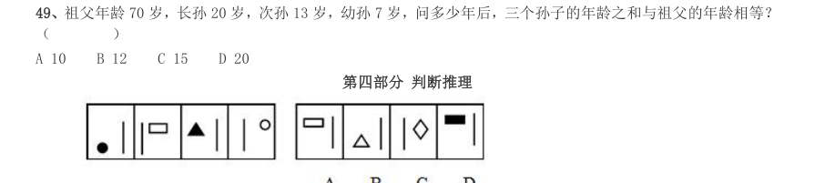

# 数量关系 · 年龄问题 · 2000 年代真题

> 所属考点：[SL-NL](../SL-NL-年龄问题.md)　｜　本片 8 题

### 2009 湖北·统一卷　第 93 题　（年龄差不变）

赵先生34 岁,钱女士30 岁,一天,他们碰上了赵先生的三个邻居,钱女士问起了他们的年龄,赵先生说: 他们三人的年龄各不相同,三人的年龄之积是2450,三人的年龄之和是我俩年龄之和。问三个邻居中年龄最 大的是多少岁:

- **A.** 42
- **B.** 45
- **C.** 49
- **D.** 50

**答案：C**

### 2009 广东·统一卷　第 8 题　（年龄和与倍数）

甲、乙、丙、丁四人,其中每三个人的岁数之和分别是55、58、62、65。这四个人中年龄最 小的是:

- **A.** 7 岁
- **B.** 10 岁
- **C.** 15 岁
- **D.** 18 岁

**答案：暂缺**

### 2009 广东·统一卷　第 14 题　（年龄和与倍数）

父亲与两个儿子的年龄和为84 岁,12 年后父亲的年龄等于两个儿子的年龄之和,请问父亲 现在多少岁:

- **A.** 24
- **B.** 36
- **C.** 48
- **D.** 60

**答案：暂缺**

### 2008 广东·统一卷　第 9 题　（年龄和与倍数）

两年前甲的年龄是乙的两倍,五年前乙的年龄是丙的三分之一,丙今年11 岁,问今年甲多少岁?

- **A.** 12
- **B.** 10
- **C.** 7
- **D.** 5

**答案：暂缺**

### 2004 国考·B卷　第 49 题　（年龄和与倍数）

祖父年龄70 岁,长孙20 岁,次孙13 岁,幼孙7 岁,问多少年后,三个孙子的年龄之和与祖父的年龄相等? ( )

- **A.** 10
- **B.** 12
- **C.** 15
- **D.** 20

**答案：C**

### 2002 国考·A卷　第 76 题　（年龄和与倍数）

单选、 1998 年,甲的年龄是乙的年龄的4 倍。2002 年,甲的年龄是乙的年龄的3 倍。问甲、乙二人2000 年的年龄分别 是多少岁?

- **A.** 34 岁,12 岁
- **B.** 32 岁,8 岁
- **C.** 36 岁,12 岁
- **D.** 34 岁,10 岁

**答案：D**

### 2000 国考·统一卷　第 31 题　（年龄和与倍数）

今年父亲年龄是儿子年龄的10 倍,6 年后父亲年龄是儿子年龄的4 倍,则今年父亲、儿子的年龄分别是( )。

- **A.** 60 岁,6 岁
- **B.** 50 岁,5 岁
- **C.** 40 岁,4 岁
- **D.** 30 岁,3 岁

**答案：暂缺**

### 2000 国考·统一卷　第 33 题　（年龄问题（综合））

某机关共有干部、职工350 人,其中55 岁以上共有70 人。现拟进行机构改革,总体规模压缩为180 人,并 规定55 岁以上的人裁减比例为70%。请问55 岁以下的人裁减比例约是多少?( )。

- **A.** 51%
- **B.** 43%
- **C.** 40%
- **D.** 34%

**答案：暂缺**
