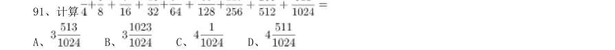
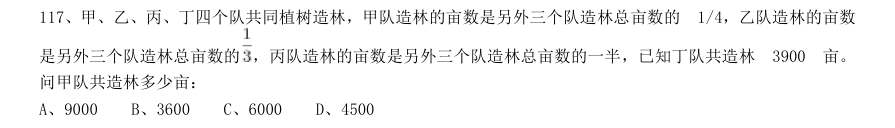
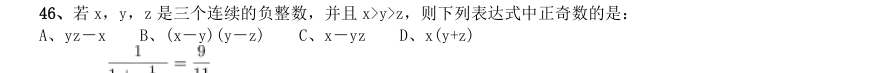
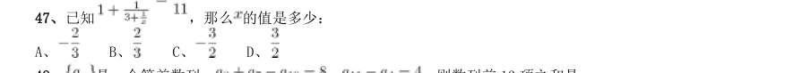
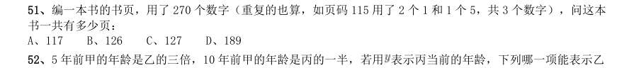
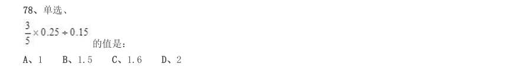

# 数量关系 · 其他数量关系 · 2000 年代真题

> 所属考点：[SL-OT](../SL-OT-其他数量关系.md)　｜　本片 140 题

> 本片子考点：和差倍比 58　其他数量关系（综合） 46　基础计算 18　方程与不定方程 13　日期与钟表 5

### 【2009 湖北省考·第 91 题】HB-2009-ty-X091　其他数量关系｜基础计算

计算

- **A.** 
- **B.** 
- **C.** 
- **D.** 

**答案：C**

### 【2009 湖北省考·第 92 题】HB-2009-ty-X092　其他数量关系｜基础计算

任意取一个大于50 的自然数,如果它是偶数,就除以2;如果它是奇数,就将它乘3 之后再加1。这样反 复运算,最终结果是多少:

- **A.** 0
- **B.** 1
- **C.** 2
- **D.** 3

**答案：B**

### 【2009 湖北省考·第 97 题】HB-2009-ty-X097　其他数量关系｜和差倍比

甲乙两个工厂的平均技术人员比例为45%,其中甲厂的人数比乙厂多12.5%,技术人员的人数比乙厂的多 25%,非技术人员人数比乙厂多6 人。甲乙两厂共有多少人:

- **A.** 680
- **B.** 840
- **C.** 960
- **D.** 1020

**答案：A**

### 【2009 广东省考·第 5 题】GD-2009-ty-X005　其他数量关系｜其他数量关系（综合）

（本题题干为图形/公式，文字层无题干，图见原卷）

- **A.** 1
- **B.** 16
- **C.** 36
- **D.** 49

**答案：该题答案缺失，见原卷**

### 【2009 广东省考·第 10 题】GD-2009-ty-X010　其他数量关系｜和差倍比

地上放着一个每一面上都有一个数的六面体箱子,对面两个数的和均为27,甲能看到顶面和 两个侧面,这三个面上的数字之和是35;乙能看到顶面和另外两个侧面,且这三个面上的数字和 为47。箱子贴地一面的数字是:

- **A.** 14
- **B.** 13
- **C.** 12
- **D.** 11

**答案：该题答案缺失，见原卷**

### 【2009 广东省考·第 11 题】GD-2009-ty-X011　其他数量关系｜其他数量关系（综合）

市场上买2 斤榴莲的价钱可以买6 斤苹果,买6 斤橙子的价钱可以买3 斤榴莲。买苹果、橙 子、菠萝各1 斤的价钱可以买1 斤榴莲。买1 斤榴莲的价钱可以买菠萝:

- **A.** 2 斤
- **B.** 3 斤
- **C.** 5 斤
- **D.** 6 斤

**答案：该题答案缺失，见原卷**

### 【2009 广东省考·第 15 题】GD-2009-ty-X015　其他数量关系｜和差倍比

教室里有若干学生,走了10 名女生后,男生人数是女生的2 倍,又走了9 名男生后,女生 人数是男生的5 倍,问最初教室里有多少人:

- **A.** 15
- **B.** 20
- **C.** 25
- **D.** 30、二、言语理解,共30 题,参考时限30 分钟,本部

**答案：该题答案缺失，见原卷**

### 【2009 广东省考·第 16 题】GD-2009-ty-X016　其他数量关系｜其他数量关系（综合）
> 材料：答案。…

他并不富裕,但还 照顾比他自己更穷的亲戚。

- **A.** 救济
- **B.** 周济
- **C.** 周恤
- **D.** 赞助

**答案：该题答案缺失，见原卷**

### 【2009 广东省考·第 17 题】GD-2009-ty-X017　其他数量关系｜和差倍比

人生是一个容器,可这个容器的容量实在是非常 。愁苦和畏惧多了,欢乐与 就 少了。

- **A.** 庞大 胆量
- **B.** 可观 轻松
- **C.** 有限 勇气
- **D.** 莫测 勇敢

**答案：该题答案缺失，见原卷**

### 【2009 广东省考·第 19 题】GD-2009-ty-X019　其他数量关系｜和差倍比

煤炭与石油、天然气相比价格低廉,以同等发热量计算,目前石油价格是煤炭的5 倍,天然 气价格是煤炭的3 倍,所以,在石油价格居高不下的背景下,煤炭价格必然 。

- **A.** 水涨船高
- **B.** 相形见绌
- **C.** 如影随形
- **D.** 随波逐流

**答案：该题答案缺失，见原卷**

### 【2009 广东省考·第 20 题】GD-2009-ty-X020　其他数量关系｜其他数量关系（综合）

构成中华文明的各支源流各有其成长、壮大、迁徙、融合的历史。把各支主要源流的历史给 予相对充分的阐发,更能表现中华民族万流入海的历史 。

- **A.** 事实
- **B.** 潮流
- **C.** 趋势
- **D.** 进程

**答案：该题答案缺失，见原卷**

### 【2009 广东省考·第 21 题】GD-2009-ty-X021　其他数量关系｜其他数量关系（综合）

“进去,只留下脚印;出来,只带走照片”,这句话看似简单,但却包含了一个重要的道理, 它直观地提示我们,依托生态发展旅游,必须 自然规律, 保护生态环境。

- **A.** 遵循 注重
- **B.** 遵照 强调
- **C.** 遵守 注意
- **D.** 尊重 重点

**答案：该题答案缺失，见原卷**

### 【2009 广东省考·第 22 题】GD-2009-ty-X022　其他数量关系｜和差倍比

风水在古代其实包含有很深的科学成分,“依山而建,傍水而居”、“面南背北,坐北朝南” 几千年流传下来,若非其有着极强的 价值,到今天也不至于被建筑商和民间如此 。

- **A.** 实用 推崇
- **B.** 应用 尊宠
- **C.** 科学 重视
- **D.** 美学 提倡

**答案：该题答案缺失，见原卷**

### 【2009 广东省考·第 23 题】GD-2009-ty-X023　其他数量关系｜和差倍比

文化经典,是一个民族文化 的集中体现。经过千百年的 ,文化经典世代相传而 广受赞誉,足以说明其深厚的价值和无可替代的作用。

- **A.** 精要 积淀
- **B.** 精髓 锤炼
- **C.** 精要 历练
- **D.** 精髓 沉淀

**答案：该题答案缺失，见原卷**

### 【2009 广东省考·第 24 题】GD-2009-ty-X024　其他数量关系｜和差倍比

现在的标准化考试几乎都变成了考试组织方和应考方斗智斗勇的博弈游戏。考试的主办方 用一个个小陷阱 考生做错,考生则尽可能地搜集陷阱模式,境界是眼睛一扫题目,就 知道对方腰里别的是什么暗器。

- **A.** 千方百计 引诱
- **B.** 处心积虑 希望
- **C.** 费尽心机 导致
- **D.** 殚精竭虑 迫使

**答案：该题答案缺失，见原卷**

### 【2009 广东省考·第 25 题】GD-2009-ty-X025　其他数量关系｜其他数量关系（综合）

在许多犹太人家里,当小孩稍微懂事时,大人就会翻开一本书,涂一点蜂蜜在上面,叫小孩 子去舔,其用意 :读书是 的。

- **A.** 显而易见 快乐
- **B.** 毋庸置疑 幸福
- **C.** 不言自明 纯真
- **D.** 不言而喻 甜蜜

**答案：该题答案缺失，见原卷**

### 【2009 广东省考·第 36 题】GD-2009-ty-X036　其他数量关系｜和差倍比

知识的本质是发现,只有在自由的环境中,人们才会有更多发现的可能。因此,知识分子在 本质上也不是熟知现成结论的人,知识分子要发掘未知事物,提示假相背后的真相。教育的目的, 就是培养学生发现和创造知识的能力,教育如果停留在向学生强行灌输标准答案和“真理”上, 根本就是反教育的。 这段话的主题是:

- **A.** 知识的本质
- **B.** 知识分子的本质
- **C.** 创造力的培养
- **D.** 教育的目的

**答案：该题答案缺失，见原卷**

### 【2009 广东省考·第 41 题】GD-2009-ty-X041　其他数量关系｜其他数量关系（综合）

就目前房地产市场成交量增加的现象,有分析认为,中国地产引擎可能重新启动。果真如此 的话,这将在外需出现困境的背景下引领中国经济走出低谷。对比1986 年日本的情况,如果政 府引导得当,中国经济将可能因为地产业的重新启动而率先走出困局。当然,基于美国当年的经 验,经济重新启动可能是一个相对漫长的过程。 根据上述文字,下列表述正确的一项是:

- **A.** 成交量的提升给地产市场甚至中国经济带来了回暖希望
- **B.** 随着地产业的重新启动和振兴,中国经济将率先走出低谷
- **C.** 地产业能否重新成为国民经济的支柱,取决于政府的引导
- **D.** 如果地产业能重新启动,中国经济走出困境则需较长时间

**答案：该题答案缺失，见原卷**

### 【2009 广东省考·第 44 题】GD-2009-ty-X044　其他数量关系｜其他数量关系（综合）

春天的气息唤醒了慵懒的细胞,满目的烂漫引导我们向往着花开四季,锦绣的人生与桃花 的惊艳给了我们感官与精神的双重慰藉。我想,也许每个人的内心深处都保留着这么一丝天马行 空的浪漫,每个女人都曾经将自己化身为那个自由的洛丽塔女孩,家是我们思想的延伸,装点其 中便有了主人思维的精髓,内心的渴望。在这里,我们有了这样的“艳遇”。 如果上述文字是一断广告语,那么它最适合于:

- **A.** 花卉展销
- **B.** 家俱推介
- **C.** 房屋销售
- **D.** 旅游宣传

**答案：该题答案缺失，见原卷**

### 【2009 国考·第 106 题】GK-2009-ty-X106　其他数量关系｜和差倍比

当第29 届奥运会于北京时间2008 年8 月8 日20 时正式开幕时,全世界和北京同一天的国家占:

- **A.** 全部
- **B.** 1/2
- **C.** 1/2 以上
- **D.** 1/2 以下

**答案：A**

### 【2009 国考·第 109 题】GK-2009-ty-X109　其他数量关系｜和差倍比

已知甲、乙两人共有 本书,其中甲的书有 13% 是专业书,乙的书有 12.5% 是专业书,问甲有 多少本非专业书:

- **A.** 75
- **B.** 87
- **C.** 174
- **D.** 67

**答案：B**

### 【2009 国考·第 110 题】GK-2009-ty-X110　其他数量关系｜方程与不定方程

一条隧道,甲单独挖要 天完成,乙单独挖要 天完成。如果甲先挖 天,然后乙接替甲 挖 天,再有甲接替乙挖 天......,两人如此交替工作,那么,挖完这条隧道共用多少天:

- **A.** 14
- **B.** 16
- **C.** 15
- **D.** 13

**答案：A**

### 【2009 国考·第 111 题】GK-2009-ty-X111　其他数量关系｜和差倍比

甲、乙两人卖数量相同的萝卜,甲打算卖 元 个,乙打算卖 元 个。如果甲乙两人一起 按 元 个的价格卖掉全部的萝卜,总收入会比预想的少 元钱。 问两人共有多少个萝卜:

- **A.** 420
- **B.** 120
- **C.** 360
- **D.** 240

**答案：D**

### 【2009 国考·第 114 题】GK-2009-ty-X114　其他数量关系｜和差倍比

某公司甲、乙两个营业部共有 人,其中 人为男性。已知甲营业部的男女比例为 5:3,乙营业 部的男女比例为 2:1。 问甲营业部有多少名女职员:

- **A.** 18
- **B.** 16
- **C.** 12
- **D.** 9

**答案：C**

### 【2009 国考·第 117 题】GK-2009-ty-X117　其他数量关系｜和差倍比

甲、乙、丙、丁四个队共同植树造林,甲队造林的亩数是另外三个队造林总亩数的 1/4,乙队造林的亩数 是另外三个队造林总亩数的 ,丙队造林的亩数是另外三个队造林总亩数的一半,已知丁队共造林 亩。 问甲队共造林多少亩:

- **A.** 9000
- **B.** 3600
- **C.** 6000
- **D.** 4500

**答案：B**

### 【2009 国考·第 119 题】GK-2009-ty-X119　其他数量关系｜和差倍比

一个水库在年降水量不变的情况下,能够维持全市 万人20 年的用水量,在该市新迁入 万人 之后,该水库只够维持 年的用水量,市政府号召节约用水,希望能将水库的使用寿命提高到 年。 那么,该市市民平均需要节约多少比例的水才能实现政府制定的目标:

- **A.** 2/5
- **B.** 2/7
- **C.** 1/3
- **D.** 1/4

**答案：A**

### 【2009 国考·第 120 题】GK-2009-ty-X120　其他数量关系｜基础计算

某校按字母 A 到 Z 的顺序给班级编号,按班级编号加 01、02、03......,给每位学生按顺序定学号, 若 A~K 班级人数从 人起每班递增 名,之后每班按编号顺序递减 名,则第 名学生的 学号是多少:

- **A.** M12
- **B.** N11
- **C.** N10
- **D.** M13

**答案：D**

### 【2008 湖北省考·第 31 题】HB-2008-ty-X031　其他数量关系｜和差倍比
> 材料：(共20 题,参考时限20 分钟) 本部分包括两种类型的试题: 个供选择的选项中选出你认为最合理的一项,来填补空缺项。…

2,8,20,38,62,

- **A.** 100
- **B.** 92
- **C.** 93
- **D.** 72

**答案：该题答案缺失，见原卷**

### 【2008 湖北省考·第 32 题】HB-2008-ty-X032　其他数量关系｜和差倍比

2,7,13,20,25,31,

- **A.** 35
- **B.** 36
- **C.** 37
- **D.** 38

**答案：该题答案缺失，见原卷**

### 【2008 湖北省考·第 33 题】HB-2008-ty-X033　其他数量关系｜和差倍比

0,3,8,15,24,

- **A.** 33
- **B.** 35
- **C.** 48
- **D.** 49

**答案：该题答案缺失，见原卷**

### 【2008 湖北省考·第 34 题】HB-2008-ty-X034　其他数量关系｜和差倍比

1/2,1,4/3,19/12,

- **A.** 133/60
- **B.** 137/60
- **C.** 107/60
- **D.** 147/60

**答案：该题答案缺失，见原卷**

### 【2008 湖北省考·第 35 题】HB-2008-ty-X035　其他数量关系｜其他数量关系（综合）

1,2,4,4,1,

- **A.** 16
- **B.** 17
- **C.** 1/32
- **D.** 1/16

**答案：该题答案缺失，见原卷**

### 【2008 湖北省考·第 36 题】HB-2008-ty-X036　其他数量关系｜和差倍比

6,4,12,8,18,16,

- **A.** 24.18
- **B.** 20.32
- **C.** 24.32
- **D.** 18.64

**答案：C**

### 【2008 湖北省考·第 37 题】HB-2008-ty-X037　其他数量关系｜其他数量关系（综合）

8,18,181,11811,

- **A.** 11181
- **B.** 11118
- **C.** 118111
- **D.** 111811

**答案：该题答案缺失，见原卷**

### 【2008 湖北省考·第 38 题】HB-2008-ty-X038　其他数量关系｜和差倍比

3,6,5,10,9,16,15,

- **A.** 24
- **B.** 17
- **C.** 23
- **D.** 25

**答案：A**

### 【2008 湖北省考·第 39 题】HB-2008-ty-X039　其他数量关系｜和差倍比

2,7,22,67,

- **A.** 198
- **B.** 176
- **C.** 230
- **D.** 202

**答案：D**

### 【2008 湖北省考·第 40 题】HB-2008-ty-X040　其他数量关系｜和差倍比

15,7,12,6,9,5,

- **A.** 6.4
- **B.** 14.11
- **C.** 6.5
- **D.** 14.10

**答案：A**

### 【2008 湖北省考·第 41 题】HB-2008-ty-X041　其他数量关系｜其他数量关系（综合）
> 材料：求解决问题的捷径。…

如果每500 米远架一根电线杆,则30 公里需要架设多少根电线杆?

- **A.** 31
- **B.** 30
- **C.** 61
- **D.** 60

**答案：C**

### 【2008 湖北省考·第 43 题】HB-2008-ty-X043　其他数量关系｜日期与钟表

从4 时到5 时,钟的时针与分针可成直线的机会有多少次?

- **A.** 1 次
- **B.** 2 次
- **C.** 3 次
- **D.** 4 次

**答案：B**

### 【2008 湖北省考·第 44 题】HB-2008-ty-X044　其他数量关系｜方程与不定方程

一个植树小组植树,如果每人栽6 棵,还剩14 棵;如果每人栽7 棵,就缺4 棵。这个植树小组一共要栽 多少棵树?

- **A.** 19
- **B.** 59
- **C.** 18
- **D.** 122

**答案：D**

### 【2008 湖北省考·第 45 题】HB-2008-ty-X045　其他数量关系｜基础计算

90 张多米诺骨牌整齐地排成一列,依顺序编号1、2、3、......90。第一次拿走所有奇数位置上的骨牌,第 二次再从剩余骨牌中拿走所有奇数位置上的骨牌,依此类推,请问最后剩下的一张骨牌的编号是多少?

- **A.** 32
- **B.** 64
- **C.** 88
- **D.** 16

**答案：B**

### 【2008 湖北省考·第 47 题】HB-2008-ty-X047　其他数量关系｜方程与不定方程

青年义务服务队甲队原有35 人,乙队原有176 人,因任务需要,甲队人力应加强,现从预备队调来2 人, 再从乙队支援多少人后,甲队人数刚好是乙队人数的一半?

- **A.** 35
- **B.** 34
- **C.** 33
- **D.** 88

**答案：B**

### 【2008 湖北省考·第 48 题】HB-2008-ty-X048　其他数量关系｜和差倍比

某服装厂要生产一批某种型号的学生服,已知每3 米长的某种面料可做上衣2 件。或做裤子3 条,计划用 300 米长的这种布料生产学生服,应用多少米布料产生上衣,才能恰好配套?

- **A.** 120
- **B.** 150
- **C.** 180
- **D.** 210

**答案：C**

### 【2008 湖北省考·第 49 题】HB-2008-ty-X049　其他数量关系｜基础计算

一只小鸟离开在树枝上的鸟巢,向北飞了20 米,之后又向东飞了20 米,然后又向上飞了20 米。最后, 它沿着到鸟巢的直线飞回了家。请问小鸟飞行的总长度与下列哪个最接近?

- **A.** 34 米
- **B.** 80 米
- **C.** 94 米
- **D.** 100 米

**答案：该题答案缺失，见原卷**

### 【2008 湖北省考·第 50 题】HB-2008-ty-X050　其他数量关系｜日期与钟表

纽约时间是香港时间减13 小时,你与一位在香港的朋友约定,香港时间6 月1 日晚上8 时与他通电话, 那么在纽约你应几月几日几时给他打了电话?

- **A.** 6 月1 日上午7 时
- **B.** 5 月31 日上午7 时
- **C.** 6 月2 日上午9 时
- **D.** 6 月2 日上午7 时

**答案：A**

### 【2008 广东省考·第 7 题】GD-2008-ty-X007　其他数量关系｜和差倍比

某人工作一年的报酬是18000 元和一台全自动洗衣机,他干了7 个月,得到9500 和一台全自动洗衣机,问这台 洗衣机值多少元?

- **A.** 8500 元
- **B.** 2400 元
- **C.** 2000 元
- **D.** 1700 元

**答案：该题答案缺失，见原卷**

### 【2008 广东省考·第 8 题】GD-2008-ty-X008　其他数量关系｜基础计算

22008+32008 的个位数是几?

- **A.** 3
- **B.** 5
- **C.** 7
- **D.** 9

**答案：该题答案缺失，见原卷**

### 【2008 广东省考·第 10 题】GD-2008-ty-X010　其他数量关系｜其他数量关系（综合）

要折叠一批纸飞机.若甲单独折叠要半个小时完成,乙单独折叠需要45 分钟完成,若两人一起折叠,需要多少 分钟完成?

- **A.** 10
- **B.** 15
- **C.** 16
- **D.** 18

**答案：该题答案缺失，见原卷**

### 【2008 广东省考·第 14 题】GD-2008-ty-X014　其他数量关系｜其他数量关系（综合）

某单位有60 名运动员参加运动会开幕式,他们着装白色或黑色上衣,黑色或蓝色裤子。其中有12 人穿白上 衣蓝裤子,有34 人穿黑裤子,29 人穿黑上衣,那么穿黑上衣黑裤子的有多少人?

- **A.** 12
- **B.** 14
- **C.** 15
- **D.** 19

**答案：该题答案缺失，见原卷**

### 【2008 广东省考·第 15 题】GD-2008-ty-X015　其他数量关系｜和差倍比

某年级有4 个班,不算甲班其余三个班的总人数有131 人,不算丁班其余三个班的总人数是134 人;乙、 丙两班的总人数比甲、丁两班的总人数少1 人,问这四个班共有多少人?

- **A.** 177
- **B.** 176
- **C.** 266
- **D.** 265

**答案：该题答案缺失，见原卷**

### 【2008 国考·第 42 题】GK-2008-ty-X042　其他数量关系｜和差倍比

（本题题干为图形/公式，文字层无题干，图见原卷）

- **A.** 12
- **B.** 14
- **C.** 16
- **D.** 20

**答案：C**

### 【2008 国考·第 46 题】GK-2008-ty-X046　其他数量关系｜其他数量关系（综合）

若x,y,z 是三个连续的负整数,并且x>y>z,则下列表达式中正奇数的是:

- **A.** yz-x
- **B.** (x-y)(y-z)
- **C.** x-yz
- **D.** x(y+z)

**答案：B**

### 【2008 国考·第 47 题】GK-2008-ty-X047　其他数量关系｜其他数量关系（综合）

已知 ,那么 的值是多少:

- **A.** 
- **B.** 
- **C.** 
- **D.** 

**答案：B**

### 【2008 国考·第 51 题】GK-2008-ty-X051　其他数量关系｜和差倍比

编一本书的书页,用了270 个数字(重复的也算,如页码115 用了2 个1 和1 个5,共3 个数字),问这本 书一共有多少页:

- **A.** 117
- **B.** 126
- **C.** 127
- **D.** 189

**答案：B**

### 【2008 国考·第 53 题】GK-2008-ty-X053　其他数量关系｜和差倍比
> 材料：表示丙当前的年龄,下列哪一项能表示乙 的当前年龄: A、 B、 C、 D、…

为节约用水,某市决定用水收费实行超额超收,标准用水量以内每吨2.5 元,超过标准的部分加倍收费。某 用户某月用水15 吨,交水费62.5 元,若该用户下个月用水12 吨,则应交水费多少钱:

- **A.** 42.5 元
- **B.** 47.5 元
- **C.** 50 元
- **D.** 55 元

**答案：B**

### 【2008 国考·第 54 题】GK-2008-ty-X054　其他数量关系｜和差倍比

某零件加工厂按照工人完成的合格零件和不合格零件支付工资,工人每做出一个合格零件能得到工资10 元, 每做一个不合格零件将被扣除5 元,已知某人一天共做了12 个零件,得工资90 元,那么他在这一天做了多少个 不合格零件:

- **A.** 2
- **B.** 3
- **C.** 4
- **D.** 6

**答案：A**

### 【2008 国考·第 55 题】GK-2008-ty-X055　其他数量关系｜和差倍比

小华在练习自然数求和,从1 开始,数着数着他发现自己重复数了一个数。在这种情况下,他将所数的全部 数求平均,结果为7.4,请问他重复的那个数是:

- **A.** 2
- **B.** 6
- **C.** 8
- **D.** 10

**答案：B**

### 【2008 国考·第 60 题】GK-2008-ty-X060　其他数量关系｜方程与不定方程

甲、乙、丙三种货物,如果购买甲3 件、乙7 件、丙1 件需花3.15 元,如果购买甲4 件、乙10 件、丙1 件 需花4.2 元,那么购买甲、乙、丙各1 件需花多少钱:

- **A.** 1.05
- **B.** 1.4
- **C.** 1.85
- **D.** 2.1

**答案：A**

### 【2007 广东省考·第 9 题】GD-2007-ty-X009　其他数量关系｜和差倍比

甲、乙、丙、丁四人共同做一批纸盒,甲做的纸盒数是另外三人做的总和的一半,乙做的纸盒数是另外 三人做的总和的1/3,丙做的纸盒数是另外三人做的总和的1/4,丁一共做了l69 个,则甲一共做了( )纸 盒。

- **A.** 780 个
- **B.** 450 个
- **C.** 390 个
- **D.** 260 个

**答案：该题答案缺失，见原卷**

### 【2007 广东省考·第 13 题】GD-2007-ty-X013　其他数量关系｜其他数量关系（综合）

科学家对平海岛屿进行调查,他们先捕获30 只麻雀进行标记,后放飞,再捕捉50 只,其中有标记的有 lo 只,则这一岛屿上的麻雀大约有( )。

- **A.** 150 只
- **B.** 300 只
- **C.** 500 只
- **D.** 1500 只

**答案：该题答案缺失，见原卷**

### 【2007 国考·第 46 题】GK-2007-ty-X046　其他数量关系｜和差倍比

某高校2006 年度毕业学生7650 名,比上年度增长2%,其中本科生毕业数量比上年度减少2%,而研究生毕 业数量比上年度增加10%,那么,这所高校今年毕业的本科生有:

- **A.** 3920 人
- **B.** 4410 人
- **C.** 4900 人
- **D.** 5490 人

**答案：C**

### 【2007 国考·第 50 题】GK-2007-ty-X050　其他数量关系｜和差倍比

小明和小强参加同一次考试,如果小明答对的题目占题目总数的3/4,小强答对了27 道题,他们两人都答 对的题目占题目总数的2/3,那么两人都没有答对的题目共有:

- **A.** 3 道
- **B.** 4 道
- **C.** 5 道
- **D.** 6 道

**答案：D**

### 【2007 国考·第 51 题】GK-2007-ty-X051　其他数量关系｜和差倍比

学校举办一次中国象棋比赛,有10 名同学参加,比赛采用单循环赛制,每名同学都要与其他9 名同学比赛 一局。比赛规则,每局棋胜者得2 分,负者得0 分,平局两人各得1 分。比赛结束后,10 名同学的得分各不相 同,已知:(1)比赛第一名与第二名都是一局都没有输过;(2)前两名的得分总和比第三名多20 分;(3)第 四名的得分与最后四名的得分和相等。 那么,排名第五名的同学的得分是:

- **A.** 8 分
- **B.** 9 分
- **C.** 10 分
- **D.** 11 分

**答案：D**

### 【2007 国考·第 52 题】GK-2007-ty-X052　其他数量关系｜和差倍比

某班男生比女生人数多80%,一次考试后,全班平均成级为75 分,而女生的平均分比男生的平均分高20%, 则此班女生的平均分是:

- **A.** 84 分
- **B.** 85 分
- **C.** 86 分
- **D.** 87 分

**答案：A**

### 【2007 国考·第 55 题】GK-2007-ty-X055　其他数量关系｜其他数量关系（综合）

一名外国游客到北京旅游,他要么上午出去游玩,下午在旅馆休息,要么上午休息,下午出去游玩,而下雨 天他只能一天都待在屋里。期间,不下雨的天数是12 天,他上午待在旅馆的天数为8 天,下午待在旅馆的天数 为12 天,他在北京共待了多少天:

- **A.** 16 天
- **B.** 20 天
- **C.** 22 天
- **D.** 24 天

**答案：A**

### 【2007 国考·第 58 题】GK-2007-ty-X058　其他数量关系｜方程与不定方程

共有20 个玩具交给小王手工制作完成。规定,制作的玩具每合格一个得5 元,不合格一个扣2 元,未完成 的不得不扣。最后小王共收到56 元,那么他制作的玩具中,不合格的共有多少个:

- **A.** 2
- **B.** 3
- **C.** 5
- **D.** 7

**答案：A**

### 【2007 国考·第 60 题】GK-2007-ty-X060　其他数量关系｜和差倍比

有一食品店某天购进了6 箱食品,分别装着饼干和面包,重量分别为8、9、16、20、22、27 千克。该店当 天只卖出1 箱面包,在剩下的5 箱中饼干的重量是面包的两倍,则当天食品店购进了多少千克面包:

- **A.** 44
- **B.** 45
- **C.** 50
- **D.** 52

**答案：D**

### 【2006 广东省考·第 13 题】GD-2006-ty-X013　其他数量关系｜其他数量关系（综合）

某市居民生活用电每月标准用电量的基本价格为每度0.60元,若每日用电量超过标准用电量,超出部分 按基本价格的80%收费,某户九月份用电100度,共交电费57.6元,则该市每月标准用电量为( )。

- **A.** 60度
- **B.** 70度
- **C.** 80度
- **D.** 90度

**答案：该题答案缺失，见原卷**

### 【2006 国考·第 31 题】GK-2006-ty-X031　其他数量关系｜和差倍比
> 材料：数量关系(共20 题,参考时限20 分钟) 本部分包括两种类型的试题: 一、数学推理。共5 题。给你一个数列,但其中缺少一项,要求你仔细观察数列的排列规律, 然后从四个供选择的选项中选择你认为最合理的一项,来填补空缺项,使之符合原数列的排列规 律。…

102, 96, 108, 84, 132,( )。

- **A.** 36
- **B.** 64
- **C.** 70
- **D.** 72

**答案：A**

### 【2006 国考·第 32 题】GK-2006-ty-X032　其他数量关系｜其他数量关系（综合）

1, 32, 81, 64, 25, ( ),1。

- **A.** 5
- **B.** 6
- **C.** 10
- **D.** 12

**答案：B**

### 【2006 国考·第 33 题】GK-2006-ty-X033　其他数量关系｜其他数量关系（综合）

-2,-8,0,64,( )。

- **A.** –64
- **B.** 128
- **C.** 156
- **D.** 250

**答案：D**

### 【2006 国考·第 34 题】GK-2006-ty-X034　其他数量关系｜其他数量关系（综合）

2,3,13,175,( )。

- **A.** 30625
- **B.** 30651
- **C.** 30759
- **D.** 30952

**答案：B**

### 【2006 国考·第 35 题】GK-2006-ty-X035　其他数量关系｜其他数量关系（综合）

3,7,16,107,( )。

- **A.** 1707
- **B.** 1704
- **C.** 1086
- **D.** 1072

**答案：A**

### 【2006 国考·第 37 题】GK-2006-ty-X037　其他数量关系｜和差倍比

一块试验田,以前这块地所种植的是普通水稻。现在将该试验田的1/3 种上超级水稻,收割时 发现该试验田水稻总产量是以前总产量的1.5 倍。如果普通水稻的产量不变,则超级水稻的平 均产量与普通水稻的平均产量之比是( )。

- **A.** 5∶2
- **B.** 4∶3
- **C.** 3∶1
- **D.** 2∶1

**答案：A**

### 【2006 国考·第 41 题】GK-2006-ty-X041　其他数量关系｜方程与不定方程

某市居民生活用电每月标准用电量的基本价格为每度0.50 元,若每月用电量超过标准用电量, 超出部分按其基本价格的80%收费,某户九月份用电84 度,共交电费39.6 元,则该市每月 标准用电量为( )。

- **A.** 60 度
- **B.** 65 度
- **C.** 70 度
- **D.** 75 度

**答案：A**

### 【2006 国考·第 42 题】GK-2006-ty-X042　其他数量关系｜方程与不定方程

现有50 名学生都做物理、化学实验,如果物理实验做正确的有40 人,化学实验做正确的有 31 人,两种实验都做错的有4 人,则两种实验都做对的有( )。

- **A.** 27 人
- **B.** 25 人
- **C.** 19 人
- **D.** 10

**答案：B**

### 【2006 国考·第 44 题】GK-2006-ty-X044　其他数量关系｜和差倍比

一个五位数,左边三位数是右边两位数的5 倍,如果把右边的两位数移到前面,则所得新的五 位数要比原来的五位数的2 倍还多75,则原来的五位数是( )。

- **A.** 12525
- **B.** 13527
- **C.** 17535
- **D.** 22545

**答案：A**

### 【2006 国考·第 45 题】GK-2006-ty-X045　其他数量关系｜日期与钟表

从12 时到13 时,钟的时针与分针可成直角的机会有( )。

- **A.** 1 次
- **B.** 2 次
- **C.** 3 次
- **D.** 4 次

**答案：B**

### 【2006 国考·第 46 题】GK-2006-ty-X046　其他数量关系｜其他数量关系（综合）

四人进行篮球传接球练习,要求每人接球后再传给别人。开始由甲发球,并作为第一次传球, 若第五次传球后,球又回到甲手中,则共有传球方式( )。

- **A.** 60 种
- **B.** 65 种
- **C.** 70 种
- **D.** 75 种

**答案：A**

### 【2006 国考·第 47 题】GK-2006-ty-X047　其他数量关系｜和差倍比

为了把2008 年北京奥运办成绿色奥运,全国各地都在加强环保,植树造林。某单位计划在通 往两个比赛场馆的两条路的(不相交)两旁栽上树,现运回一批树苗,已知一条路的长度是 另一条路长度的两倍还多6000 米,若每隔4 米栽一棵,则少2754 棵;若每隔5 米栽一棵, 则多396 棵,则共有树苗( )。

- **A.** 8500 棵
- **B.** 12500 棵
- **C.** 12596 棵
- **D.** 13000 棵

**答案：D**

### 【2006 国考·第 49 题】GK-2006-ty-X049　其他数量关系｜其他数量关系（综合）

某原料供应商对购买其原料的顾客实行如下优惠措施:1一次购买金额不超过1 万元,不予 优惠;2一次购买金额超过1 万元,但不超过3 万元,给九折优惠;3一次购买金额超过3 万元,其中3 万元九折优惠,超过3 万元部分八折优惠。某厂因库容原因,第一次在该供应 商处购买原料付款7800 元,第二次购买付款26100 元,如果他一次购买同样数量的原料,可 以少付( )。

- **A.** 1460 元
- **B.** 1540 元
- **C.** 3780 元
- **D.** 4360 元

**答案：A**

### 【2006 国考·第 50 题】GK-2006-ty-X050　其他数量关系｜和差倍比

一个三位数除以9 余7,除以5 余2,除以4 余3,这样的三位数共有( )。

- **A.** 5 个
- **B.** 6 个
- **C.** 7 个
- **D.** 8 个

**答案：A**

### 【2005 广东省考·第 6 题】GD-2005-ty-X006　其他数量关系｜和差倍比
> 材料：找解决问题的捷径。…

甲、乙两个厂生产同一种玩具,甲厂生产的玩具数量每个月保持不变,乙厂生产的玩具数量每个月增加 一倍,已知一月份甲、乙两个厂生产的玩具总数是98 件,二月份甲、乙两个厂生产的玩具总数是106 件。 那么乙厂生产的玩具数量第一次超过甲厂生产的玩具数量是在几月份?

- **A.** 3 月
- **B.** 4 月
- **C.** 5 月
- **D.** 7 月

**答案：该题答案缺失，见原卷**

### 【2005 广东省考·第 7 题】GD-2005-ty-X007　其他数量关系｜其他数量关系（综合）

三筐苹果共重120 斤,如果从第一筐中取出15 斤放入第二筐,从第二筐中取出8 斤放入 第三筐,从第三筐中取出2 斤放入第一筐,这时三筐苹果的重量相等,问原来第二筐中有 苹果多少斤?

- **A.** 33 斤
- **B.** 34 斤
- **C.** 40 斤
- **D.** 53 斤

**答案：该题答案缺失，见原卷**

### 【2005 广东省考·第 8 题】GD-2005-ty-X008　其他数量关系｜其他数量关系（综合）

某班有50 名学生,在第一次测验中有26 人得满分,在第二次测验中有21 人得满分。如 果两次测验中都没有得满分的学生有17 人,那么两次测验中都获得满分的人数是多少?

- **A.** 13 人
- **B.** 14 人
- **C.** 17 人
- **D.** 20 人

**答案：该题答案缺失，见原卷**

### 【2005 广东省考·第 10 题】GD-2005-ty-X010　其他数量关系｜其他数量关系（综合）

有37 名红军战士渡河,现仅有一只小船,每次只能载5 人,需要几次才能渡完?

- **A.** 7 次
- **B.** 8 次
- **C.** 9 次
- **D.** 10 次

**答案：该题答案缺失，见原卷**

### 【2005 广东省考·第 11 题】GD-2005-ty-X011　其他数量关系｜其他数量关系（综合）

甲、乙、丙、丁四人为地震灾区捐款,甲捐款数是另外三人捐款总数的一半,乙捐款数是另外三人捐款 总数的1/3,丙捐款数是另外三人捐款总数的1/4,丁捐款169 元。问四人一共捐了多少钱?

- **A.** 780 元
- **B.** 890 元
- **C.** 1183 元
- **D.** 2083 元

**答案：该题答案缺失，见原卷**

### 【2005 国考·第 37 题】GK-2005-ty-X037　其他数量关系｜其他数量关系（综合）

(8.4×2.5+9.7)÷(1.05÷1.5+8.4÷0.28)的值为( )。

- **A.** 1
- **B.** 1.5
- **C.** 2
- **D.** 2.5

**答案：A**

### 【2005 国考·第 38 题】GK-2005-ty-X038　其他数量关系｜基础计算

19991998 的末位数字是( )。

- **A.** 1
- **B.** 3
- **C.** 7
- **D.** 9

**答案：A**

### 【2005 国考·第 40 题】GK-2005-ty-X040　其他数量关系｜方程与不定方程

某市现有70 万人口,如果5 年后城镇人口增加4%,农村人口增加5.4%,则全市人口将增加4.8%, 那么这个市现有城镇人口( )。

- **A.** 30 万
- **B.** 31.2 万
- **C.** 40 万
- **D.** 41.6 万

**答案：A**

### 【2005 国考·第 41 题】GK-2005-ty-X041　其他数量关系｜日期与钟表

2003 年7 月1 日是星期二,那么2005 年7 月1 日是( )。

- **A.** 星期三
- **B.** 星期四
- **C.** 星期五
- **D.** 星期六

**答案：C**

### 【2005 国考·第 46 题】GK-2005-ty-X046　其他数量关系｜和差倍比

一个快钟每小时比标准时间快1 分钟,一个慢钟每小时比标准时间慢3 分钟。如将两个钟同时调到 标准时间,结果在24 小时内,快钟显示10 点整时,慢钟恰好显示9 点整。则此时的标准时间是( )。

- **A.** 9 点15 分
- **B.** 9 点30 分
- **C.** 9 点35 分
- **D.** 9 点45 分

**答案：D**

### 【2005 国考·第 48 题】GK-2005-ty-X048　其他数量关系｜和差倍比

从1,2,3,4,5,6,7,8,9 中任意选出三个数,使它们的和为偶数,则共有( )种不同的 选法。

- **A.** 40
- **B.** 41
- **C.** 44
- **D.** 46

**答案：C**

### 【2005 国考·第 50 题】GK-2005-ty-X050　其他数量关系｜和差倍比

在一次国际会议上,人们发现与会代表中有10 人是东欧人,有6 人是亚太地区的,会说汉语的有6 人。欧美地区的代表占了与会代表总数的23 以上,而东欧代表占了欧美代表的23 以上。由此可见, 与会代表人数可能是( )。

- **A.** 22 人
- **B.** 21 人
- **C.** 19 人
- **D.** 18 人

**答案：C**

### 【2004 广东省考·第 6 题】GD-2004-ty-X006　其他数量关系｜基础计算
> 材料：时不做,待有时间再返回来解决它。…

计算19961997×19971996-19961996×19971997 的值是( )。

- **A.** 0
- **B.** 1
- **C.** 10 000
- **D.** 100

**答案：该题答案缺失，见原卷**

### 【2004 广东省考·第 9 题】GD-2004-ty-X009　其他数量关系｜和差倍比

某次考试,赵、钱、孙、李四人的成绩统计如下:赵、钱、孙的平均分为91 分,钱、孙、李 的平均分是89 分,赵、李的平均分是95 分,那么赵得了多少分?

- **A.** 85
- **B.** 94
- **C.** 97
- **D.** 98

**答案：该题答案缺失，见原卷**

### 【2004 广东省考·第 11 题】GD-2004-ty-X011　其他数量关系｜其他数量关系（综合）

小刚从A 点开始向前走10 米,然后向右转60 度,他再向前走10 米,向右转60 度。他继续 这样的走法,最后回到A 点。问:小刚总共走了多少米?

- **A.** 40
- **B.** 50
- **C.** 60
- **D.** 70

**答案：该题答案缺失，见原卷**

### 【2004 广东省考·第 13 题】GD-2004-ty-X013　其他数量关系｜其他数量关系（综合）

有一个人对他的妻子说,如果将来他们有一个儿子,他的儿子就分得他的遗产的2/3,妻子 得1/3;如果将来生一个女儿,则他的女儿得1/3,妻子得2/3。现在他的妻子生下一个儿子一个 女儿,遗产应该怎样分配?

- **A.** 女儿得1/4
- **B.** 儿子得4/7
- **C.** 妻子得3/8
- **D.** 女儿得1/3

**答案：该题答案缺失，见原卷**

### 【2004 广东省考·第 14 题】GD-2004-ty-X014　其他数量关系｜基础计算

小刚家住的那条街的门牌号是从1 开始挨着编下去的,除小刚家外,其余各家门牌号加起来 恰好等于10000。问小刚家的门牌号是多少?

- **A.** 11
- **B.** 22
- **C.** 33
- **D.** 141

**答案：该题答案缺失，见原卷**

### 【2004 国考（A卷）·第 37 题】GK-2004-a-X037　其他数量关系｜其他数量关系（综合）

0.0495×2500+49.5×2.4+51×4.95 的值是( )。

- **A.** 4.95
- **B.** 49.5
- **C.** 495
- **D.** 4950

**答案：C**

### 【2004 国考（A卷）·第 38 题】GK-2004-a-X038　其他数量关系｜基础计算

2002×20032003-2003×20022002 的值是( )。 A -60 C 60 D 80

> （本题为图形题，选项为图片，见原卷）

**答案：B**

### 【2004 国考（A卷）·第 39 题】GK-2004-a-X039　其他数量关系｜基础计算

99+1919+9999 的个位数字是( )。

- **A.** 1
- **B.** 2
- **C.** 3
- **D.** 7

**答案：D**

### 【2004 国考（A卷）·第 45 题】GK-2004-a-X045　其他数量关系｜和差倍比

父亲把所有财物平均分成若干份后全部分给儿子们,其规则是长子拿一份财物和剩下的1/10,次子拿两份 财物和剩下的1/10,三儿子拿三份财物和剩下的1/10,以此类推,结果所有儿子拿到的财物都一样多,请问父 亲一共有几个儿子?( )

- **A.** 6
- **B.** 8
- **C.** 9
- **D.** 10

**答案：C**

### 【2004 国考（A卷）·第 47 题】GK-2004-a-X047　其他数量关系｜其他数量关系（综合）

某大学某班学生总数为32 人,在第一次考试中有26 人及格,在第二次考试中有24 人及格,若两次考试中, 都没有及格的有4 人,那么两次考试都及格的人数是( )。

- **A.** 22
- **B.** 18
- **C.** 28
- **D.** 26

**答案：A**

### 【2004 国考（B卷）·第 35 题】GK-2004-b-X035　其他数量关系｜基础计算

2002×20032003-2003×20022002 的值是( )。 A C 60 D 80

> （本题为图形题，选项为图片，见原卷）

**答案：B**

### 【2004 国考（B卷）·第 36 题】GK-2004-b-X036　其他数量关系｜基础计算

1994×2002-1993×2003 的值是( )。

- **A.** 9
- **B.** 19
- **C.** 29
- **D.** 39

**答案：A**

### 【2004 国考（B卷）·第 41 题】GK-2004-b-X041　其他数量关系｜方程与不定方程

养鱼塘里养了一批鱼,第一次捕上来200 尾,做好标记后放回鱼塘,数日后再捕上100 尾,发现有标记的鱼 为5 尾,问鱼塘里大约有多少尾鱼?( )

- **A.** 200
- **B.** 4000
- **C.** 5000
- **D.** 6000

**答案：C**

### 【2004 国考（B卷）·第 46 题】GK-2004-b-X046　其他数量关系｜和差倍比

商品A 比商品B 贵30 元,商品A 涨价50%后,其价格是商品B 的3 倍,则商品A 的价格为( )。

- **A.** 30 元
- **B.** 40 元
- **C.** 50 元
- **D.** 60 元

**答案：D**

### 【2003 国考（A卷）·第 7 题】GK-2003-a-X007　其他数量关系｜和差倍比

某服装厂生产出来的一批衬衫中大号和小号各占一半。其中25%是白色的,75%是蓝色的。如果这批衬衫 总共有100 件,其中大号白色衬衫有10 件,问小号蓝色衬衫有多少件?( )。

- **A.** 15
- **B.** 25
- **C.** 35
- **D.** 40

**答案：C**

### 【2003 国考（A卷）·第 8 题】GK-2003-a-X008　其他数量关系｜其他数量关系（综合）

某剧场共有100 个座位,如果当票价为10 元时,票能售完,当票价超过10 元时,每升高2 元,就会少卖出 5 张票。那么当总的售票收入为1 360 元时,票价为多少?( )。

- **A.** 12 元
- **B.** 14 元
- **C.** 16 元
- **D.** 18 元

**答案：C**

### 【2003 国考（A卷）·第 9 题】GK-2003-a-X009　其他数量关系｜和差倍比

2001 年,某公司所销售的计算机台数比上一年度上升了20%,而每台的价格比上一年度下降了20%。如果 2001 年该公司的计算机销售额为3 000 万元,那么2000 年的计算机销售额大约是多少?( )。

- **A.** 2 900 万元
- **B.** 3 000 万元
- **C.** 3 100 万元
- **D.** 3 300 万元

**答案：A**

### 【2003 国考（A卷）·第 10 题】GK-2003-a-X010　其他数量关系｜其他数量关系（综合）

赛马场的跑马道600 米长,现有甲、乙、丙三匹马,甲1 分钟跑2 圈,乙1 分钟跑3 圈,丙1 分钟跑4 圈。 如果这三匹马并排在起跑线上,同时往一个方向跑,请问经过几分钟,这三匹马自出发后第一次并排在起 跑线上?( )。

- **A.** 1/2
- **B.** 1
- **C.** 6
- **D.** 12

**答案：B**

### 【2003 国考（A卷）·第 11 题】GK-2003-a-X011　其他数量关系｜其他数量关系（综合）

一种挥发性药水,原来有一整瓶,第二天挥发后变为原来的1/2;第三天变为第二天的2/3;第四天变为第 三天的3/4,请问第几天时药水还剩下1/30 瓶?(

> （本题为图形题，选项为图片，见原卷）

**答案：C**

### 【2003 国考（A卷）·第 15 题】GK-2003-a-X015　其他数量关系｜和差倍比

假设地球是一个正球形,它的赤道长4 万千米。现在用一根比赤道长10 米的绳子围绕赤道一周,假 设在各处绳子离地面的距离都是相同的,请问绳子距离地面大约有多高?( )。

- **A.** 1.6 毫米
- **B.** 3.2 毫米
- **C.** 1.6 米
- **D.** 3.2 米

**答案：C**

### 【2003 国考（B卷）·第 6 题】GK-2003-b-X006　其他数量关系｜和差倍比

一张考试卷共有10 道题,后面的每一道题的分值都比其前面一道题多2 分。如果这张考卷 的满分为100 分,那么第八道题的分值应为多少?( )。

- **A.** 9
- **B.** 14
- **C.** 15
- **D.** 16

**答案：该题答案缺失，见原卷**

### 【2003 国考（B卷）·第 8 题】GK-2003-b-X008　其他数量关系｜和差倍比

100 张多米诺骨牌整齐地排成一列,依顺序编号为1、2、3......99、100。第一次拿走所有奇 数位置上的骨牌,第二次再从剩余骨牌中拿走所有奇数位置上的骨牌,依此类推。请问最后剩下的 一张骨牌的编号是多少?( )。

- **A.** 32
- **B.** 64
- **C.** 88
- **D.** 96

**答案：该题答案缺失，见原卷**

### 【2003 国考（B卷）·第 10 题】GK-2003-b-X010　其他数量关系｜和差倍比

某中介服务机构根据服务项目所涉及的金额按一定比例收取服务费,具体标准如下:1 万 元(含)以下收取50 元;1 万元以上,5 万元(含)以下的部分收取3%;5 万元以上,10 万元(含)以下 的部分收取2%。(如,某一服务项目所涉及金额为5 万元时,应收取服务费1 250 元。)现有一服 务项目所涉及金额为10 万元,那么,所收取的服务费应为( )。

- **A.** 2 250 元
- **B.** 2 500 元
- **C.** 2 750 元
- **D.** 3 000 元

**答案：该题答案缺失，见原卷**

### 【2003 国考（B卷）·第 11 题】GK-2003-b-X011　其他数量关系｜方程与不定方程

一个浴缸放满水需要30 分钟,排光一浴缸水需要50 分钟,假如忘记关上出水口,将这个 浴缸放满水需要多少分钟?( )。

- **A.** 65
- **B.** 75
- **C.** 85
- **D.** 95

**答案：该题答案缺失，见原卷**

### 【2002 国考（A卷）·第 78 题】GK-2002-a-X078　其他数量关系｜基础计算

单选、 的值是:

- **A.** 1
- **B.** 1.5
- **C.** 1.6
- **D.** 2

**答案：A**

### 【2002 国考（A卷）·第 79 题】GK-2002-a-X079　其他数量关系｜其他数量关系（综合）

单选、 某学校学生排成一个方阵,最外层的人数是60 人,问这个方阵共有学生多少人?

- **A.** 256 人
- **B.** 250 人
- **C.** 225 人
- **D.** 196 人

**答案：A**

### 【2002 国考（A卷）·第 80 题】GK-2002-a-X080　其他数量关系｜方程与不定方程

单选、 一根长18 米的钢筋被锯成两段。短的一段是长的一段的4/5,问短的一段有多少米长?

- **A.** 7.5 米
- **B.** 8 米
- **C.** 8.5 米
- **D.** 9 米

**答案：B**

### 【2002 国考（A卷）·第 81 题】GK-2002-a-X081　其他数量关系｜基础计算

单选、 1.12+1.22+1.32+1.42 的值是:

- **A.** 5.04
- **B.** 5.49
- **C.** 6.06
- **D.** 6.3

**答案：D**

### 【2002 国考（A卷）·第 83 题】GK-2002-a-X083　其他数量关系｜基础计算

单选、 一块三角地,在三个边上植树,三个边的长度分别为156 米、186 米、234 米,树与树之间的距离均为6 米,三 个角上都必须栽一棵树,问共需植树多少棵?

- **A.** 90 棵
- **B.** 93 棵
- **C.** 96 棵
- **D.** 99 棵

**答案：C**

### 【2002 国考（B卷）·第 80 题】GK-2002-b-X080　其他数量关系｜其他数量关系（综合）

单选、 -2,1,7,16,(),43

- **A.** 25
- **B.** 28
- **C.** 31
- **D.** 35

**答案：该题答案缺失，见原卷**

### 【2002 国考（B卷）·第 83 题】GK-2002-b-X083　其他数量关系｜其他数量关系（综合）
> 材料：把一个边长为4 厘米的正方形铁丝框制成两个等周长的圆形铁丝框,铁丝的总长不变,则每个圆铁丝框的面积为 () A、16π B、8π C、 D、…

单选、 若干学生住若干房间,如果每间住4 人则有20 人没地方住,如果每间住8 人则有一间只有4 人住,问共有多少 名学生()

- **A.** 30 人
- **B.** 34 人
- **C.** 40 人
- **D.** 44 人

**答案：该题答案缺失，见原卷**

### 【2002 国考（B卷）·第 86 题】GK-2002-b-X086　其他数量关系｜其他数量关系（综合）

单选、 一居民楼内只能允许同时使用6 台空调。现有8 户人家各安装了一台空调,问在一天(24 小时)内平均每户最 多可使用空调()小时?

- **A.** 16 小时
- **B.** 18 小时
- **C.** 20 小时
- **D.** 22 小时

**答案：该题答案缺失，见原卷**

### 【2002 国考（B卷）·第 90 题】GK-2002-b-X090　其他数量关系｜其他数量关系（综合）

单选、 1.12+1.22+1.32+1.42 的值是:

- **A.** 5.04
- **B.** 5.49
- **C.** 6.06
- **D.** 6.3

**答案：该题答案缺失，见原卷**

### 【2002 国考（B卷）·第 91 题】GK-2002-b-X091　其他数量关系｜和差倍比

单选、 两个运输队,第一队有320 人,第二队有280 人,现因任务变动,要求第二队的人数是第一队人数的2 倍,须从 第一队抽调多少人到第二队()

- **A.** 80 人
- **B.** 100 人
- **C.** 120 人
- **D.** 140 人

**答案：该题答案缺失，见原卷**

### 【2002 国考（B卷）·第 92 题】GK-2002-b-X092　其他数量关系｜其他数量关系（综合）

单选、 铺设一条自来水管道,甲队单独铺设需8 天可以完成,而乙队每天可铺设50 米。如果甲、乙两队同时铺设,4 天可完成全长的2/3,问这条管道全长是多少米()

- **A.** 1000 米
- **B.** 1100 米
- **C.** 1200 米
- **D.** 1300 米

**答案：该题答案缺失，见原卷**

### 【2001 国考·第 46 题】GK-2001-ty-X046　其他数量关系｜和差倍比

1 235×6 788 与1 234×6 789 的差值是( )。

- **A.** 5 444
- **B.** 5 454
- **C.** 5 544
- **D.** 5 554

**答案：D**

### 【2001 国考·第 48 题】GK-2001-ty-X048　其他数量关系｜其他数量关系（综合）

某市一条大街长7 200 米,从起点到终点共设有9 个车站,那么每两个车站之间的平均距离是( )。

- **A.** 780 米
- **B.** 800 米
- **C.** 850 米
- **D.** 900 米

**答案：D**

### 【2001 国考·第 49 题】GK-2001-ty-X049　其他数量关系｜其他数量关系（综合）

飞行员前4 分钟用半速飞行,后4 分钟用全速飞行,在8 分钟内一共飞行了72 千米,则飞机全速飞行的时 速是( )。

- **A.** 360 千米
- **B.** 540 千米
- **C.** 720 千米
- **D.** 840 千米

**答案：C**

### 【2001 国考·第 50 题】GK-2001-ty-X050　其他数量关系｜其他数量关系（综合）

某单位召开一次会议,会期10 天。后来由于议程增加,会期延长3 天,费用超过了预算,仅食宿费用一项 就超过预算20%,用了6 000 元。已知食宿费预算占总预算的25%,那么总预算费用是( )。

- **A.** 18 000 元
- **B.** 20 000 元
- **C.** 25 000 元
- **D.** 30 000 元

**答案：B**

### 【2001 国考·第 52 题】GK-2001-ty-X052　其他数量关系｜和差倍比

某企业1999 年产值的20%相当于1998 年产值的25%,那么1999 年的产值与1998 年的产值相比( )。

- **A.** 降低了5%
- **B.** 提高了5%
- **C.** 提高了20%
- **D.** 提高了25%

**答案：D**

### 【2001 国考·第 53 题】GK-2001-ty-X053　其他数量关系｜方程与不定方程

一个游泳池,甲管放满水需6 小时,甲、乙两管同时放水,放满水需4 小时。如果只用乙管放水,则放满 水需( )。

- **A.** 8 小时
- **B.** 10 小时
- **C.** 12 小时
- **D.** 14 小时

**答案：C**

### 【2000 国考·第 26 题】GK-2000-ty-X026　其他数量关系｜其他数量关系（综合）

大于4/5 且小于5/6 的数是( )。

- **A.** 6/7
- **B.** 21/30
- **C.** 49/60
- **D.** 47/61

**答案：该题答案缺失，见原卷**

### 【2000 国考·第 28 题】GK-2000-ty-X028　其他数量关系｜基础计算

1988 1989+1989 1988 的个位数是( )。

- **A.** 9
- **B.** 7
- **C.** 5
- **D.** 3

**答案：该题答案缺失，见原卷**

### 【2000 国考·第 29 题】GK-2000-ty-X029　其他数量关系｜方程与不定方程

一块金与银的合金重250 克,放在水中减轻16 克。现知金在水中重量减轻1/19,银在水中重量减轻1/10, 则这块合金中金、银各占的克数为( )。

- **A.** 100 克,150 克
- **B.** 150 克,100 克
- **C.** 170 克,80 克
- **D.** 190 克,60 克

**答案：该题答案缺失，见原卷**

### 【2000 国考·第 30 题】GK-2000-ty-X030　其他数量关系｜日期与钟表

某时刻钟表时针在10 点到11 点之间,此时刻再过6 分钟后分针和此时刻3 分钟前的时针正好方向相反且在 一条直线上,则此时刻为( )。

- **A.** 10 点15 分
- **B.** 10 点19 分
- **C.** 10 点20 分
- **D.** 10 点25 分

**答案：该题答案缺失，见原卷**

### 【2000 国考·第 34 题】GK-2000-ty-X034　其他数量关系｜基础计算

某储户于1999 年1 月1 日存入银行60 000 元,年利率为2.00%,存款到期日即2000 年1 月1 日将存款全 部取出,国家规定凡1999 年11 月1 日后孳生的利息收入应缴纳利息税,税率为20%,则该储户实际提取本 金合计为( )。

- **A.** 61 200 元
- **B.** 61 160 元
- **C.** 61 000 元
- **D.** 60 040 元

**答案：该题答案缺失，见原卷**
