# 数量关系 · 其他数量关系 · 2010 年代真题

> 所属考点：[SL-OT](../SL-OT-其他数量关系.md)　｜　本片 168 题

> 本片子考点：和差倍比 70　其他数量关系（综合） 56　方程与不定方程 36　基础计算 4　日期与钟表 2

### 2019 湖北·统一卷　第 56 题　（和差倍比）

一工厂生产的某规格齿轮的齿数是一个三位数的质数(除了1 和它本身之外,不能被其他整数整除的正整数), 其个、十、百位数字各不相同且均为质数。若将该齿数的百位数字与个位数字对调,所得新的三位数比该齿数大 495,则该齿数的十位数字为:

- **A.** 7
- **B.** 5
- **C.** 3
- **D.** 2

**答案：B**

### 2019 湖北·统一卷　第 58 题　（和差倍比）

某楼盘的地下停车位,第一次开盘时平均价格为15 万元/个;第二次开盘时,车位的销售量增加了一倍、销 售额增加了 。那么,第二次开盘的车位平均价格为:

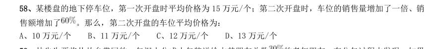

- **A.** 10 万元/个
- **B.** 11 万元/个
- **C.** 12 万元/个
- **D.** 13 万元/个

**答案：C**

### 2019 湖北·统一卷　第 59 题　（方程与不定方程）

林先生要将从故乡带回的一包泥土分成小包装送给占其朋友总数 的老年朋友。在分包过程中发现,如果 每包200 克,则少500 克;如果每包150 克,则多250 克。那么,林先生的朋友共有多少人?

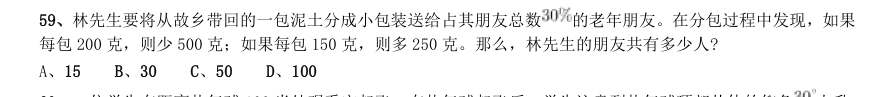

- **A.** 15
- **B.** 30
- **C.** 50
- **D.** 100

**答案：C**

### 2019 湖北·统一卷　第 64 题　（和差倍比）

太阳高度角是太阳光的入射方向和地平面之间的夹角。在正午时,太阳高度角为 , 为纬度, 为 太阳赤纬。已知小陈的身高为180 厘米,他所在地的纬度为 ,当日太阳赤纬为 。那么,在正午时他的影子 长度约为:

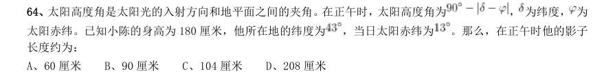

- **A.** 60 厘米
- **B.** 90 厘米
- **C.** 104 厘米
- **D.** 208 厘米

**答案：C**

### 2019 湖北·统一卷　第 67 题　（和差倍比）

小张、小李和小王三人以擂台形式打乒乓球,每局2 人对打,输的人下一局轮空。半天下来,小张共打了6 局,小王共打了9 局,而小李轮空了4 局。那么,小李一共打了多少局?

- **A.** 5 局
- **B.** 7 局
- **C.** 9 局
- **D.** 11 局

**答案：B**

### 2019 湖北·选调　第 86 题　（其他数量关系（综合））

某商店以5 元/斤的价格购入一批蔬菜,上午以8 元/斤的价格卖出总进货量的60%,中午以上午售出价的8 折卖出总进货量的20%,下午以中午售出价的一半卖出剩余货量的一半,最后获利210 元。则该商店一共购入多 少斤蔬菜?

- **A.** 140
- **B.** 150
- **C.** 160
- **D.** 180

**答案：B**

### 2019 湖北·选调　第 88 题　（和差倍比）

某足球比赛售出40 元、80 元、120 元门票共2000 张,其中80 元的门票数是120 元的门票数的2 倍,比赛 门票收入共12 万元。则40 元门票售出多少张?

- **A.** 1000
- **B.** 1150
- **C.** 1200
- **D.** 1250

**答案：D**

### 2019 湖北·选调　第 95 题　（和差倍比）

甲、乙、丙三人分别骑自行车同时同地沿同一公路追赶前面的骑车人丁。甲、乙、丙分别用了6 分钟、10 分钟、15 分钟追赶上丁。已知甲每分钟行0.4 千米,乙每分钟行0.3 千米,则丙每分钟行多少千米?

- **A.** 0.24
- **B.** 0.25
- **C.** 0.26
- **D.** 0.27

**答案：B**

### 2019 广东·乡镇　第 22 题　（和差倍比）

某办公室有大、中、小三种型号的文件袋共200 个,已知大号文件袋数量是中号文件袋的2 倍,小号文件袋的 数量为50 个,那么大号文件袋有( )个。

- **A.** 50
- **B.** 60
- **C.** 80
- **D.** 100

**答案：暂缺**

### 2019 广东·县级　第 25 题　（和差倍比）

某企业销售洗碗机,第一季度平均每个月销售800 台,上半年平均每个月销售850 台。如果4 月份和6 月 份的销售总量是5 月份的2 倍,那么该企业5 月份的洗碗机销售量为( )台。

- **A.** 800
- **B.** 900
- **C.** 1000
- **D.** 1100

**答案：暂缺**

### 2019 国考·地市级　第 68 题　（和差倍比）

甲和乙两条自动化生产线同时生产相同的产品,甲生产线单位时间的产量是乙生产线的5 倍,甲生产线每工 作1 小时就需要花3 小时时间停机冷却而乙生产线可以不间断生产。问以下哪个坐标图能准确表示甲、乙生产线 产量之差(纵轴L)与总生产时间(横轴T)之间的关系?

- **A.** 
- **B.** 
- **C.** 
- **D.** 

**答案：A**

### 2019 国考·省级　第 70 题　（和差倍比）

甲、乙两辆卡车运输一批货物,其中甲车每次能运输35 箱货物。甲车先满载运输2 次后,乙车加入并与甲 车共同满载运输10 次完成任务,此时乙车比甲车多运输10 箱货物。问如果乙车单独执行整个运输任务且每次都 尽量装满,最后一次运多少箱货物?

- **A.** 10
- **B.** 30
- **C.** 33
- **D.** 36

**答案：C**

### 2018 湖北·统一卷　第 64 题　（方程与不定方程）

某银行推出3 年期和5 年期的两种理财产品A 和B。小王分别购买这两种产品各1 万元,结果发现,按单 利计算(即利息不产生收益),B 产品平均年收益率比A 产品多2 个百分点,期满后,B 产品总收益是A 产品 的2.5 倍。那么,小王各花1 万元购买A B 两种产品的平均年收益分别是:

- **A.** 700 元和900 元
- **B.** 600 元和900 元
- **C.** 500 元和700 元
- **D.** 400 元和600 元

**答案：D**

### 2018 湖北·统一卷　第 67 题　（方程与不定方程）

某社团组织周末自驾游,集合后发现小王和小李未到。由于每辆小车限坐5 人,按照现有车辆恰有1 人坐 不上车。为难之际,小王和小李分别开车赶到,于是所有人都坐上车,且每辆车人数均相同。那么,参加本次 自驾游的小车数为:

- **A.** 9
- **B.** 8
- **C.** 7
- **D.** 6

**答案：C**

### 2018 国考·副省级　第 63 题　（和差倍比）

企业某次培训的员工中有369 名来自A 部门,412 名来自B 部门。现分批对所有人进行培训,要求每批人数 相同且批次尽可能少。如果有且仅有一批培训对象同时包含来自A 和B 部门的员工,那么该批中有多少人来自B 部门?

- **A.** 14
- **B.** 32
- **C.** 57
- **D.** 65

**答案：C**

### 2018 国考·副省级　第 75 题　（和差倍比）

某公司按1:3:4 的比例订购了一批红色、蓝色、黑色的签字笔,实际使用时发现三种颜色的笔消耗比例为 1:4:5。当某种颜色的签字笔用完时,发现另两种颜色的签字笔共剩下100 盒。此时又购进三种颜色签字笔总共 900 盒,从而使三种颜色的签字笔可以同时用完。问新购进黑色签字笔多少盒?

- **A.** 450
- **B.** 425
- **C.** 500
- **D.** 475

**答案：A**

### 2017 湖北·统一卷　第 67 题　（和差倍比）

某公司销售部拟派3 名销售主管和6 名销售人员前往3 座城市进行市场调研,每座城市派销售主管1 名,销售人 员2 名。那么,不同的人员派遣方案有:

- **A.** 540 种
- **B.** 1080 种
- **C.** 1620 种
- **D.** 3240 种

**答案：A**

### 2017 湖北·统一卷　第 68 题　（和差倍比）

如下图所示,某条河流一侧有A B 两家工厂,与河岸的距离分别为4km 和5km,且A 与B 的直线距离为11km。 为了处理这两家工厂的污水,需要在距离河岸1km 处建造一个污水处理厂,分别铺设排污管道连接A B 两家工厂。 假定河岸是一条直线,则排污管道总长最短是:

- **A.** 12km
- **B.** 13km
- **C.** 14km
- **D.** 15km

**答案：B**

### 2017 广东·统一卷　第 22 题　（其他数量关系（综合））

小王到某单位办事,只有一个窗口在办理业务,小王排在第6 位,第一位客户开始办理业务的时间为 9:02。假如每单业务的办理时间为6 分钟,而且排在小王前面的人不会提前离开。那么小王在什么时候可以 开始办理业务?

- **A.** 9:32
- **B.** 9:38
- **C.** 9:45
- **D.** 9:52

**答案：暂缺**

### 2017 广东·统一卷　第 23 题　（其他数量关系（综合））

现有一批零件,甲师傅单独加工需要4 小时,乙师傅单独加工需要6 小时。两人一起加工这批零件的 需要多少个小时?

- **A.** 0.6
- **B.** 1
- **C.** 1.2
- **D.** 1.5

**答案：暂缺**

### 2017 广东·统一卷　第 25 题　（其他数量关系（综合））

在公司年会表演中,有甲、乙、丙、丁四个部门的员工参演。已知甲、乙两部门共有16 名员工参演,乙、 丙两部门共有20 名员工参演,丙、丁两部门共有34 名员工参演。且各部门参演人数从少到多的顺序为: 。由此可知,丁部门有多少人参演?

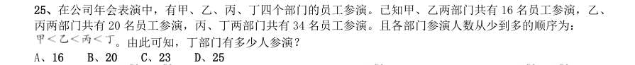

- **A.** 16
- **B.** 20
- **C.** 23
- **D.** 25

**答案：暂缺**

### 2017 广东·统一卷　第 29 题　（和差倍比）

单位工会组织拔河比赛,每支参赛队都由3 名男职工和3 名女职工组成。假设比赛时要求3 名男职工的 站位不能全部连在一起,则每支队伍有几种不同的站位方式?

- **A.** 432
- **B.** 504
- **C.** 576
- **D.** 720

**答案：暂缺**

### 2017 国考·副省级　第 63 题　（其他数量关系（综合））

为维护办公环境,某办公室四人在工作日每天轮流打扫卫生,每周一打扫卫生的人给植物浇水。7 月5 日周 五轮到小玲打扫卫生,下一次小玲给植物浇水是哪天?

- **A.** 7 月15 日
- **B.** 7 月22 日
- **C.** 7 月29 日
- **D.** 8 月5 日

**答案：C**

### 2017 国考·副省级　第 71 题　（和差倍比）

某商铺甲乙两组员工利用包装礼品的边角料制作一批花朵装饰门店。甲组单独制作需要10 小时,乙组单独 制作需要15 小时,现两组一起做,期间乙组休息了1 小时40 分,完成时甲组比乙组多做300 朵。问这批花有多 少朵?

- **A.** 600
- **B.** 900
- **C.** 1350
- **D.** 1500

**答案：B**

### 2016 湖北·统一卷　第 59 题　（和差倍比）

某地居民用水价格分二级阶梯,户年用水量在0~180(含)吨的水价5 元/吨;180 吨以上的水价7 元/吨。 户内人口在5 人以上的,每多1 人,阶梯水量标准增加30 吨。老张家5 人,老李家6 人,去年用水量都是210 吨。问老李家的人均水费比老张家少多少元?

- **A.** 12
- **B.** 35
- **C.** 47
- **D.** 60

**答案：C**

### 2016 湖北·统一卷　第 60 题　（方程与不定方程）

某企业原有职工110 人,其中技术人员是非技术人员的10 倍,今年招聘后,两类人员的人数之比未变,且 现有职工中技术人员比非技术人员多153 人。问今年新招非技术人员多少名?

- **A.** 9
- **B.** 8
- **C.** 7
- **D.** 10

**答案：C**

### 2016 湖北·统一卷　第 63 题　（和差倍比）

A B 两辆列车早上8 点同时从甲地出发驶向乙地,途中A B 两列车分别停了10 分钟和20 分钟,最后

- **A.** 车于早上9 点50 分,B 车于早上10 点到达目的地。问两车平均速度之比为多少?
- **B.** 3:4
- **C.** 5:6
- **D.** 9:11

**答案：A**

### 2016 湖北·统一卷　第 64 题　（其他数量关系（综合））

某种商品原价25 元,每半天可销售20 个。现知道每降价1 元,销量即增加5 个。某日上午将该商品打八折, 下午在上午价格的基础上再打八折出售,问其全天销售额为多少元?

- **A.** 1760
- **B.** 1940
- **C.** 2160
- **D.** 2560

**答案：B**

### 2016 湖北·统一卷　第 65 题　（和差倍比）

某高校艺术学院分音乐系和美术系两个系别,已知学院男生人数占人数的30%,且音乐系男女生人数之比 为1:3,美术系男女生人数之比为2:3,问音乐系和美术系的总人数之比为多少?

- **A.** 5:2
- **B.** 5:1
- **C.** 3:1
- **D.** 2:1

**答案：D**

### 2016 湖北·统一卷　第 66 题　（方程与不定方程）

木匠加工2 张桌子和4 张凳子共需要10 个小时,加工4 张桌子和8 张椅子需要22 个小时。问如果他加工桌 子、凳子和椅子各10 张,共需要多少小时?

- **A.** 47.5
- **B.** 50
- **C.** 52.5
- **D.** 55

**答案：C**

### 2016 湖北·统一卷　第 70 题　（日期与钟表）

社长、主编和副主编三人 轮流主持每周一的编辑部发稿会。某年(非闰年)1 月6 日的发稿会由社长主持,问当年副主编第12 次主持发 稿会是在哪一天?

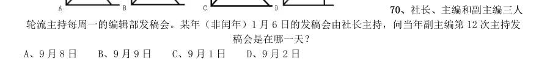

- **A.** 9 月8 日
- **B.** 9 月9 日
- **C.** 9 月1 日
- **D.** 9 月2 日

**答案：A**

### 2016 广东·乡镇　第 20 题　（其他数量关系（综合））

（本题题干为图形/公式，文字层无题干，图见原卷）

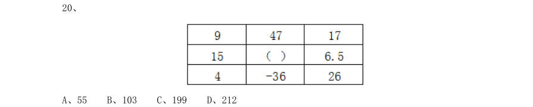

- **A.** 55
- **B.** 103
- **C.** 199
- **D.** 212

**答案：暂缺**

### 2016 广东·县级　第 40 题　（其他数量关系（综合））

（本题题干为图形/公式，文字层无题干，图见原卷）

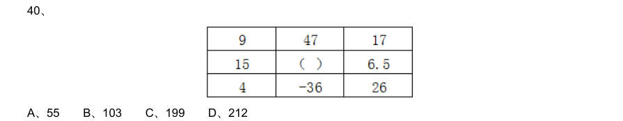

- **A.** 55
- **B.** 103
- **C.** 199
- **D.** 212

**答案：暂缺**

### 2016 国考·副省级　第 61 题　（和差倍比）

某单位组建兴趣小组,每人选择―项参加。羽毛球组人数是乒乓球组人数的2 倍,足球组人数是篮球组人数 的3 倍,乒乓球组人数的4 倍与其他3 个组人数的和相等。则羽毛球组人数等于:

- **A.** 足球组人数与篮球组人数之和
- **B.** 乒乓球组人数与足球组人数之和
- **C.** 足球组人数的1.5 倍
- **D.** 篮球组人数的3 倍

**答案：A**

### 2016 国考·副省级　第 64 题　（和差倍比）
> 材料：飞机还有九折票和五折票两种选择。每位旅客的机票总费用除机票价格之外,还包括170 元的税费。则购买九折 票的乘客与购买全价票的乘客人数相比为( )。 A、两者一样多 B、买九折票的多1 人 C、买全价票的多2 人 D、买九折票的多4 人…

某电器工作功耗为370 瓦,待机状态下功耗为37 瓦,该电器周一从9:30 到17:00 处于工作状态,其余时间 断电。周二从9:00 到24:00 处于待机状态,其余时间断电。问其周―的耗电量是周二的多少倍?

- **A.** 10
- **B.** 6
- **C.** 8
- **D.** 5

**答案：D**

### 2016 国考·副省级　第 65 题　（方程与不定方程）

某浇水装置可根据天气阴晴调节浇水量,晴天浇水量为阴雨天的2.5 倍。灌满该装置的水箱后,在连续晴天 的情况下可为植物自动浇水18 天。小李6 月1 日0:00 灌满水箱后,7 月1 日0:00 正好用完。问6 月有多少 个阴雨天?

- **A.** 10
- **B.** 16
- **C.** 18
- **D.** 20

**答案：D**

### 2016 国考·副省级　第 69 题　（其他数量关系（综合））

为加强机关文化建设,某市直属机关在系统内举办演讲比赛,3 个部门分别派出3、2、4 名选手参加比赛, 要求每个部门的参赛选手比赛顺序必须相连,问不同参赛顺序的种数在以下哪个范围之内?

- **A.** 小于1000
- **B.** 1000~5000
- **C.** 5001~20000
- **D.** 大于20000

**答案：B**

### 2016 国考·副省级　第 72 题　（和差倍比）

某集团有A 和B 两个公司,A 公司全年的销售任务是B 公司的1.2 倍。前三季度B 公司的销售业绩是A 公司 的1.2 倍,如果照前三季度的平均销售业绩,B 公司到年底正好能完成销售任务。问如果A 公司希望完成全年的 销售任务,第四季度的销售业绩需要达到前三季度平均销售业绩的多少倍?

- **A.** 1.44
- **B.** 2.4
- **C.** 2.76
- **D.** 3.88

**答案：C**

### 2016 国考·地市级　第 67 题　（其他数量关系（综合））

为加强机关文化建设,某市直属机关在系统内举办演讲比赛,3 个部门分别派出3 4 名选手参加比 赛,要求每个部门的参赛选手比赛顺序必须相连,问不同参赛顺序的种数在以下哪个范围之内?

- **A.** 小于1000
- **B.** 1000~5000
- **C.** 5001~20000
- **D.** 大于20000

**答案：B**

### 2015 湖北·统一卷　第 57 题　（方程与不定方程）

野生动物保护机构考查某圈养动物的状态,在n(n 为正整数)天中观察到:(1)有7 个不活跃日(一天中有出 现不活跃的情况); (2)有5 个下午活跃; (3)有6 个上午活跃;(4)当下午不活跃时,上午必活跃。则n 等于:

- **A.** 7
- **B.** 8
- **C.** 9
- **D.** 10

**答案：C**

### 2015 湖北·统一卷　第 63 题　（和差倍比）

随着台湾自由行的开放,农村农民生活质量的提高,某一农村的农民自发组织若干同村农民到台湾旅行,其 旅行费用包括,个人办理赴台手续费,在台旅行的车费平均每人503 元,飞机票平均每人1998 元,其它费用平 均每人1199 元。已知这次旅行的总费用是92000 元,总的平均费用是4600 元。问赴台的总人数和个人办理赴台 手续费分别是多少?

- **A.** 20 人,700 元
- **B.** 21 人,650 元
- **C.** 20 人,900 元
- **D.** 22 人,850 元

**答案：C**

### 2015 湖北·统一卷　第 66 题　（方程与不定方程）

一只挂钟的秒针长30 厘米,分针长20 厘米,当秒针的顶点走过的弧长约为9.42 米时,分针的顶点走过的 弧长约为多少厘米?

- **A.** 6.98
- **B.** 10.47
- **C.** 15.70
- **D.** 23.55

**答案：B**

### 2015 湖北·统一卷　第 67 题　（其他数量关系（综合））

某果农要用绳子捆扎甘蔗,有三种规格的绳子可供使用:长绳子1 米,每根能捆7 根甘蔗;中等长度绳子 0.6 米,每根能捆5 根甘蔗;短绳子0.3 米,每根能捆3 根甘蔗。果农最后捆扎好了23 根甘蔗,则果农总共最 少使用多少米的绳子?

- **A.** 2.1 米
- **B.** 2.4 米
- **C.** 2.7 米
- **D.** 2.9 米

**答案：B**

### 2015 广东·乡镇　第 21 题　（其他数量关系（综合））

19、38、57、76、95、

- **A.** 114
- **B.** 133
- **C.** 171
- **D.** 190

**答案：暂缺**

### 2015 广东·乡镇　第 22 题　（其他数量关系（综合））

2、4、16、96、768、

- **A.** 864
- **B.** 3072
- **C.** 7680
- **D.** 9216

**答案：暂缺**

### 2015 广东·乡镇　第 23 题　（其他数量关系（综合））

11、22、13、26、15、30、17、

- **A.** 32
- **B.** 34
- **C.** 36
- **D.** 38

**答案：暂缺**

### 2015 广东·乡镇　第 24 题　（其他数量关系（综合））

、 、 、 、

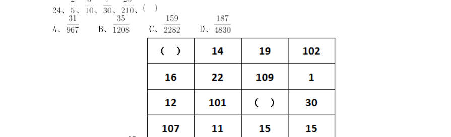

> （本题为图形题，选项为图片，见原卷）

**答案：暂缺**

### 2015 广东·乡镇　第 25 题　（其他数量关系（综合））

（本题题干为图形/公式，文字层无题干，图见原卷）

- **A.** 11 7
- **B.** 13 5
- **C.** 17 9
- **D.** 21 3

**答案：暂缺**

### 2015 广东·乡镇　第 26 题　（和差倍比）

甲、乙两个仓库共有货物102 吨。如果从甲仓库调出3 吨到乙仓库,那么甲仓库的货物正好 是乙仓库的2 倍。则甲仓库原有货物多少吨:

- **A.** 31
- **B.** 37
- **C.** 70
- **D.** 71

**答案：暂缺**

### 2015 广东·乡镇　第 27 题　（其他数量关系（综合））

某车队运输一批蔬菜。如果每辆汽车运3500 千克。那么还剩下5000 千克;如果每辆汽车运 送4000 千克,那么还剩500 千克,则该车队有多少辆汽车:

- **A.** 8
- **B.** 9
- **C.** 10
- **D.** 11

**答案：暂缺**

### 2015 广东·乡镇　第 28 题　（其他数量关系（综合））

某村过年有分肉的习俗。将160 斤肉分给村里的110 户家庭,贫困家庭每户分得3 斤肉,其 他家庭每户分得1 斤肉。那么该村的贫困家庭有多少户:

- **A.** 16
- **B.** 20
- **C.** 22
- **D.** 25

**答案：暂缺**

### 2015 广东·乡镇　第 30 题　（和差倍比）

某乡镇举行运动会,共有长跑、跳远和短跑三个项目。参加长跑的有49 人,参加跳远的有36 人,参加短跑的有28 人,其中只参加两个项目的有13 人,参加全部项目的有9 人。那么参加该次运 动会的总人数为多少:

- **A.** 75
- **B.** 82
- **C.** 88
- **D.** 95

**答案：暂缺**

### 2015 广东·乡镇　第 33 题　（其他数量关系（综合））

小李有一部手机,手机充满电后,可供通话6 小时或者供待机210 小时。某天,小李乘坐火 车,上车时手机处于满电状态,而当他下车时手机电量刚好耗尽。如果小李在火车上的通话时长相当 于他乘坐火车时长的一半,其余时间手机均为待机状态,那么他乘坐火车的时长是:

- **A.** 9 小时10 分
- **B.** 9 小时30 分
- **C.** 10 小时20 分
- **D.** 11 小时40 分

**答案：暂缺**

### 2015 广东·乡镇　第 34 题　（和差倍比）

某次考试中,成绩不超过30 分的有153 名考生,平均分为24 分;成绩不低于80 分的有59 名考生,平均分为92 分;成绩超过30 分的平均分为62 分;成绩低于80 分的平均分为54 分。那么参 加这次考试的考生共有多少人:

- **A.** 795
- **B.** 875
- **C.** 1007
- **D.** 1264

**答案：暂缺**

### 2015 广东·乡镇　第 35 题　（和差倍比）

有两箱数量相同的文件需要整理。小张单独整理好一箱文件要用4.5 小时,小钱要用9 小时, 小周要用3 小时。小周和小张一起整理第一箱文件,小钱同时开始整理第二箱文件。一段时间后,小 周又转去和小钱一起整理第二箱文件,最后两箱文件同时整理完毕。则小周和小张、小钱一起整理文 件的时间分别是:

- **A.** 1 小时,2 小时
- **B.** 1.5 小时,1.5 小时
- **C.** 2 小时,1 小时
- **D.** 1.2 小时,1.8 小时

**答案：暂缺**

### 2015 广东·县级　第 21 题　（其他数量关系（综合））

3、10、31、94、

- **A.** 125
- **B.** 188
- **C.** 283
- **D.** 2914

**答案：暂缺**

### 2015 广东·县级　第 22 题　（其他数量关系（综合））

2、10、30、68、130、

- **A.** 222
- **B.** 272
- **C.** 300
- **D.** 390

**答案：暂缺**

### 2015 广东·县级　第 23 题　（其他数量关系（综合））

19、18、26、24、33、30、40、

- **A.** 32
- **B.** 34
- **C.** 36
- **D.** 38

**答案：暂缺**

### 2015 广东·县级　第 24 题　（其他数量关系（综合））

、 、 、 、

> （本题为图形题，选项为图片，见原卷）

**答案：暂缺**

### 2015 广东·县级　第 25 题　（其他数量关系（综合））

（本题题干为图形/公式，文字层无题干，图见原卷）

- **A.** 11 7
- **B.** 13 5
- **C.** 17 9
- **D.** 21 3

**答案：暂缺**

### 2015 广东·县级　第 30 题　（其他数量关系（综合））

小吴到商店买布。有两种同样长的布料,小吴买了第一种布料25 米,买了第二种布料12 米。小吴买 完后,第一种布料剩下的长度是第二种布料剩下的长度的一半。那么这两种布料原来共有多少米:

- **A.** 26
- **B.** 38
- **C.** 72
- **D.** 76

**答案：暂缺**

### 2015 国考·副省级　第 63 题　（和差倍比）

某技校安排本届所有毕业生分别去甲、乙、丙三个不同的工厂实习。去甲厂实习的毕业生占毕业生总数的 32%,去乙厂实习的毕业生比甲厂少6 人,且占毕业生总数的24%。问去丙厂实习的人数比去甲厂实习的人数:

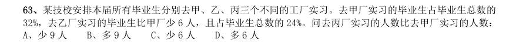

- **A.** 少9 人
- **B.** 多9 人
- **C.** 少6 人
- **D.** 多6 人

**答案：B**

### 2015 国考·副省级　第 64 题　（方程与不定方程）

甲、乙、丙、丁四人共同投资一个项目,已知甲的投资额比乙、丙二人的投资额之和高20%,丙的投资额是 丁的60%,总投资额比项目的资金需求高1/3。后来丁因故临时撤资,剩下三人的投资额之和比项目的资金需求 低1/12。则乙的投资额是项目资金需求的:

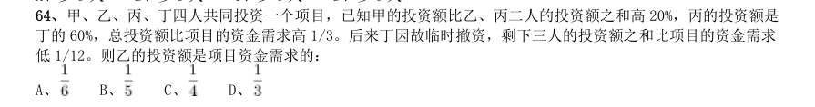

- **A.** 
- **B.** 
- **C.** 
- **D.** 

**答案：A**

### 2015 国考·副省级　第 67 题　（其他数量关系（综合））

餐厅需要使用9 升食用油,现在库房里库存有15 桶5 升装的,3 桶2 升装的,8 桶1 升装的。问库房有多少 种发货方式,能保证正好发出餐厅需要的9 升食用油:

- **A.** 4
- **B.** 5
- **C.** 6
- **D.** 7

**答案：C**

### 2015 国考·副省级　第 72 题　（和差倍比）

网管员小刘负责甲、乙、丙三个机房的巡检工作,甲、乙和丙机房分别需要每隔2 天、4 天和7 天巡检一次。 3 月1 日,小刘巡检了三个机房,问他在整个3 月有几天不用做机房的巡检工作:

- **A.** 12
- **B.** 13
- **C.** 14
- **D.** 15

**答案：C**

### 2015 国考·地市级　第 62 题　（和差倍比）

某技校安排本届所有毕业生分别去甲、乙、丙三个不同的工厂实习。去甲厂实习的毕业生占毕业生总数的 , 去乙厂实习的毕业生比甲厂少6 人,且占毕业生总数的 。问去丙厂实习的人数比去甲厂实习的人数:

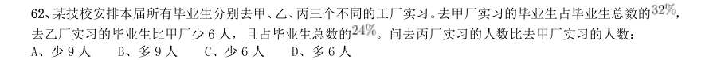

- **A.** 少9 人
- **B.** 多9 人
- **C.** 少6 人
- **D.** 多6 人

**答案：B**

### 2015 国考·地市级　第 70 题　（方程与不定方程）

甲、乙、丙、丁四人共同投资一个项目,已知甲的投资额比乙、丙二人的投资额之和高 ,丙的投资额是 丁的 ,总投资额比项目的资金需求高 。后来丁因故临时撤资,剩下三人的投资额之和比项目的资金需求低 。 则乙的投资额是项目资金需求的:

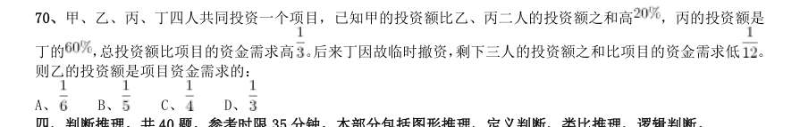

- **A.** 
- **B.** 
- **C.** 
- **D.** 

**答案：A**

### 2014 湖北·统一卷　第 56 题　（方程与不定方程）

某单位组织参加理论学习的党员和入党积极分子进行分组讨论,如果每组分配7 名党员和3 名入党积极分子, 则还剩下4 名党员未安排;如果每组分配5 名党员和2 名入党积极分子,则还剩下2 名党员未安排,问参加理论 学习的党员比入党积极分子多多少人?

- **A.** 16
- **B.** 20
- **C.** 24
- **D.** 28

**答案：B**

### 2014 湖北·统一卷　第 57 题　（方程与不定方程）

某单位利用业余时间举行了3 次义务劳动,总计有112 人次参加。在参加义务劳动的人中,只参加1 次、参 加2 次和3 次全部参加的人数之比为5:4:1。 问该单位共有多少人参加了义务劳动?

- **A.** 70
- **B.** 80
- **C.** 85
- **D.** 102

**答案：A**

### 2014 湖北·统一卷　第 62 题　（方程与不定方程）

从A 市到B 市的航班每周一、二、三、五各发一班。某年2 月最后一天是星期三。问当年从A 市到B 市的最 后一次航班是星期几出发的?

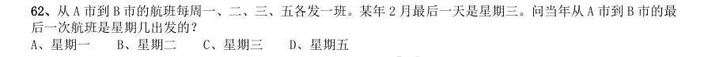

- **A.** 星期一
- **B.** 星期二
- **C.** 星期三
- **D.** 星期五

**答案：A**

### 2014 湖北·统一卷　第 64 题　（方程与不定方程）

某有色金属公司四种主要有色金属总产量的 为铝, 为铜,镍的产量是铜和铝产量之和的 ,而铅的产量 比铝多600 吨。问该公司镍的产量为多少吨?

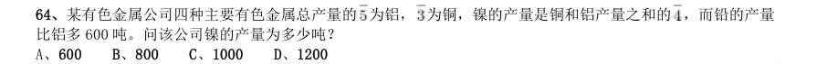

- **A.** 600
- **B.** 800
- **C.** 1000
- **D.** 1200

**答案：A**

### 2014 湖北·统一卷　第 65 题　（方程与不定方程）

药厂使用电动研磨器将一批晒干的中药磨成药粉。厂长决定从上午10 点开始,增加若干台手工研磨器进行 辅助作业。他估算如果增加2 台,可在晚上8 点完成,如果增加8 台,可在下午6 点完成。问如果希望在下午3 点完成,需要增加多少台手工研磨器?

- **A.** 20
- **B.** 24
- **C.** 26
- **D.** 32

**答案：C**

### 2014 湖北·统一卷　第 70 题　（和差倍比）

一间房屋的长、宽、高分别是6 米、4 米和3 米。施工队员在房屋内表面上画一条封闭的线,其所画的线正 好在一个平面上且该平面正好将房屋的空间分割为两个形状大小完全相同的部分。问其所画的线可能的最长距离 和最短距离之间的差是多少米?

- **A.** 6
- **B.** 6(√5-1)
- **C.** 8
- **D.** 4(√13-2)

**答案：C**

### 2014 广东·乡镇　第 60 题　（其他数量关系（综合））

（本题题干为图形/公式，文字层无题干，图见原卷）

- **A.** 10
- **B.** 9
- **C.** 8
- **D.** 7

**答案：暂缺**

### 2014 广东·县级　第 46 题　（其他数量关系（综合））

办公室工作人员使用红、蓝两种颜色的文件袋装29 份相同的文件。每个红色文件袋可以装7 份文件,每 个蓝色文件袋可以装4 份文件。要使每个文件袋都恰好装满,需要红色、蓝色文件袋的数量分别为( )个。

- **A.** 1、6
- **B.** 2、4
- **C.** 3、2
- **D.** 4、1

**答案：暂缺**

### 2014 广东·县级　第 47 题　（其他数量关系（综合））

一些员工在某工厂车间工作,如果有4 名女员工离开车间,在剩余的员工中,女员工人数占九分之五,如 果有4 名男员工离开车间,在剩余的员工中,男员工人数占三分之一。原来在车间工作的员工共有( )名。

- **A.** 36
- **B.** 40
- **C.** 48
- **D.** 72

**答案：暂缺**

### 2014 广东·县级　第 49 题　（其他数量关系（综合））

为丰富职工业余文化生活,某单位组织了合唱、象棋、羽毛球三项活动。在该单位的所有职工中,参加合 唱活动有189 人,参加象棋活动有152 人,参加羽毛球活动有135 人,参加两种活动的有130 人,参加三种活 动的有69 人,不参加任何一种活动的有44 人。该单位的职工人数为:

- **A.** 233
- **B.** 252
- **C.** 321
- **D.** 520

**答案：暂缺**

### 2014 广东·县级　第 50 题　（其他数量关系（综合））

在环保知识竞赛中,男选手的平均得分为80 分,女选手的平均得分为65 分,全部选手的平均得分为72 分。已知全部选手人数在35 到50 之间,则全部选手人数为:

- **A.** 48
- **B.** 45
- **C.** 43
- **D.** 40

**答案：暂缺**

### 2014 广东·县级　第 52 题　（和差倍比）

一名顾客购买两件均低于100 元的商品,售货员在收款时错将其中一件商品标价的个位数和十位数弄反了, 该顾客因此少付了27 元。被弄错价格的这件商品的标价不可能是( )元。

- **A.** 42
- **B.** 63
- **C.** 85
- **D.** 96

**答案：暂缺**

### 2014 广东·县级　第 53 题　（其他数量关系（综合））

某地民政部门对当地民间组织进行摸底调查,发现40%的民间组织有25 人以上规模,20 个民间组织有50 人以上规模,80%的民间组织不足50 人,人员规模在25 人以上但不足50 人的民间组织数量有( )个。

- **A.** 20
- **B.** 40
- **C.** 60
- **D.** 80

**答案：暂缺**

### 2014 广东·县级　第 54 题　（其他数量关系（综合））

在某公司年终晚会上,所有员工分组表演节目。如果按7 男5 女搭配分组,则只剩下8 名男员工;如果按 9 男5 女搭配分组,只剩下40 名女员工。该公司员工总数为:

- **A.** 446
- **B.** 488
- **C.** 508
- **D.** 576

**答案：暂缺**

### 2014 国考·统一卷　第 62 题　（方程与不定方程）
> 材料：61、30 个人围坐在一起轮流表演节目。他们按顺序从1 到3 依次不重复地报数,数到3 的人出来表演节目,并 且表演过的人不再参加报数,那么在仅剩一个人没表演过节目的时候,共报数多少人数: A、87 B、117 C、57 D、77…

老王两年前投资的一套艺术品市价上涨了50%,为尽快出手,老王将该艺术品按市价的八折出售,扣除成交 价5%的交易费用后,发现与买进时相比赚了7 万元。 问老王买进该艺术品花了多少万元:

- **A.** 84
- **B.** 42
- **C.** 100
- **D.** 50

**答案：D**

### 2014 国考·统一卷　第 63 题　（基础计算）

搬运工负重徒步上楼,刚开始保持匀速,用了30 秒爬了两层楼(中间不休息),之后每多爬一层多花5 秒, 多休息10 秒,那么他爬到七楼一共用了多少秒:

- **A.** 220
- **B.** 240
- **C.** 180
- **D.** 200

**答案：D**

### 2014 国考·统一卷　第 66 题　（方程与不定方程）

某单位原有45 名职工,从下级单位调入5 名党员职工后,该单位的党员人数占总人数的比重上升了6 个百 分点。如果该单位又有2 名职工入党,那么该单位现在的党员人数占总人数的比重为多少:

- **A.** 50%
- **B.** 40%
- **C.** 70%
- **D.** 60%

**答案：A**

### 2014 国考·统一卷　第 67 题　（方程与不定方程）

工厂组织职工参加周末公益活动,有80%的职工报名参加,报名参加周六活动的人数与报名参加周日活动的 人数比为2:1,两天的活动都报名参加的为只报名参加周日活动的人数的50%,问未报名参加活动的人数是只报 名参加周六活动的人数的:

- **A.** 20%
- **B.** 30%
- **C.** 40%
- **D.** 50%

**答案：C**

### 2014 国考·统一卷　第 70 题　（其他数量关系（综合））

8 位大学生打算合资创业,在筹资阶段,有2 名同学决定考研而退出,使得剩余同学每人需要再多筹资1 万 元;等到去注册时,又有2 名同学因找到合适工作而退出,那么剩下的同学每人又得再多筹资几万元:

- **A.** 3
- **B.** 4
- **C.** 1
- **D.** 2

**答案：D**

### 2014 国考·统一卷　第 73 题　（和差倍比）

小王、小李、小张和小周4 人共为某希望小学捐赠了25 个书包,按照数量多少的顺序分别是小王、小李、 小张、小周。已知小王捐赠的书包数量是小李和小张捐赠书包的数量之和;小李捐赠的书包数量是小张和小周捐 赠的书包数量之和。问小王捐赠了多少个书包:

- **A.** 9
- **B.** 10
- **C.** 11
- **D.** 12

**答案：C**

### 2014 国考·统一卷　第 74 题　（方程与不定方程）

两同学须托运行李。托运收费标准为10 公斤以下6 元/公斤,超出10 公斤部分每公斤收费标准略低一些。 已知甲、乙两人托运费分别为109.5 元、78 元,甲的行李比乙的重了50%。那么,超出10 公斤部分每公斤收费 标准比10 公斤以内的低了多少元:

- **A.** 1.5
- **B.** 2.5
- **C.** 3. 5
- **D.** 4 .5

**答案：A**

### 2013 湖北·统一卷　第 76 题　（其他数量关系（综合））

某商场开展购物优惠活动:一次购买300 元及以下的商品九折优惠;一次购买300 元以上的商品,其中300 元九折优惠,超过的部分八折优惠。小王购物第一次付款144 元,第二次又付款310 元。如果他一次购买并付款, 可以节省多少元?

- **A.** 16
- **B.** 22.4
- **C.** 30.6
- **D.** 48

**答案：A**

### 2013 湖北·统一卷　第 78 题　（方程与不定方程）

某三年制普通初中连续六年在校生人数为 、 、 、 、 、 ,假设该校所有学生都能顺利毕业,那么 前三年的入学学生总数与后三年的入学学生总数之差为:

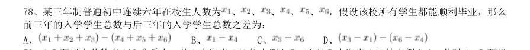

- **A.** 
- **B.** 
- **C.** 
- **D.** 

**答案：C**

### 2013 湖北·统一卷　第 79 题　（方程与不定方程）

A B 两桶中共装有108 公斤水。从A 中取出1/4 的水倒入B,再从B 中取出1/4 的水倒入A,此时

> （本题为图形题，选项为图片，见原卷）

**答案：D**

### 2013 湖北·统一卷　第 81 题　（方程与不定方程）

某单位今年一月份购买5 包A4 纸、6 包B5 纸,购买A4 纸的钱比B5 纸少5 元;第一季度该单位共购买A4 纸15 包 B5 纸12 包,共花费510 元。 那么每包B5 纸的价格比A4 纸便宜:

- **A.** 1.5 元
- **B.** 2.0 元
- **C.** 2.5 元
- **D.** 3.0 元

**答案：C**

### 2013 湖北·统一卷　第 82 题　（和差倍比）

一个班有50 名学生,他们的名字都是由2 个字或3 个字组成的。将他们平均分为两组之后,两组的学生名 字字数之差为10。 此时两组学生中名字字数为2 的学生数量之差为:

- **A.** 5
- **B.** 8
- **C.** 10
- **D.** 12

**答案：C**

### 2013 湖北·统一卷　第 88 题　（其他数量关系（综合））

出租车队去机场接某会议的参与者,如果每车坐3 名参与者,则需另外安排一辆大巴送走余下的50 人,如 每车坐4 名参与者,则最后正好多出3 辆空车。 则该车队有多少辆出租车?

- **A.** 50
- **B.** 55
- **C.** 60
- **D.** 62

**答案：D**

### 2013 广东·一卷　第 8 题　（和差倍比）

师傅每小时加工25 个零件,徒弟每小时加工20 个零件,按每天工作8 小时计算,师傅一天加工的零件比 徒弟多几个:

- **A.** 10
- **B.** 20
- **C.** 40
- **D.** 80

**答案：暂缺**

### 2013 广东·一卷　第 9 题　（和差倍比）

某企业有员工500 人,其中60%的员工是男性,则该企业男员工比女员工多多少人:

- **A.** 100
- **B.** 200
- **C.** 300
- **D.** 400

**答案：暂缺**

### 2013 广东·一卷　第 11 题　（其他数量关系（综合））

某烟农晾晒一批重量为500 斤的烟叶,晾晒期间有3 天阴天,其余时间天气晴好,最后收获干烟叶约187 斤。已知晴天时烟叶每天较前一天减重20%,阴天时每天较前一天减重10%。 则这批烟叶一共晾晒了多少天:

- **A.** 5
- **B.** 6
- **C.** 7
- **D.** 8

**答案：暂缺**

### 2013 广东·一卷　第 12 题　（和差倍比）

有两堆材料需要搬运。工人先搬了第一堆材料的一半,然后分出3/5 的人手去搬第二堆材料,其余工人继 续搬第一堆。当第二堆材料刚好搬完时,第一堆材料还剩下10%没搬。 则第二堆材料的数量比第一堆少多少:

- **A.** 40%
- **B.** 50%
- **C.** 55%
- **D.** 60%

**答案：暂缺**

### 2013 广东·一卷　第 13 题　（和差倍比）

.某村村民经过集体投票民主选举村干部,5 位村干部候选人中得票最高者将当选。经统计,本次选举有效 选票一共395 票,且当选者的得票数比其他4 位候选人的平均得票数要多60 票,则这名当选者一共获得多少 票:

- **A.** 62
- **B.** 67
- **C.** 122
- **D.** 127

**答案：暂缺**

### 2013 广东·一卷　第 31 题　（和差倍比）

自来水从水源地流入千家万户,要经过源水、净水、输水、用水4 个环节。目前我国城镇供水总体安全, 但仍面临不同程度的安全隐患。相关数据显示,中国城市供水管网老旧、漏损率超标严重,年漏损水达60 亿立 方米,同时造成水质在输送过程中下降。以屋顶水箱和地下水池为主的城市二次供水设施管理不到位,部分设 施不能及时清洗消毒,导致水质合格率降低。有的质量较差的自来水管材,使用寿命不超过3 年,如果施工质 量再不达标,无疑是雪上加霜。 这段文字意在说明:

- **A.** 城镇自来水供给存在安全隐患
- **B.** 管网老化是影响水质的主要原因
- **C.** 自来水供给缺乏有力的监管
- **D.** 必须从4 个环节上遏制水污染

**答案：暂缺**

### 2013 广东·一卷　第 35 题　（和差倍比）

在北京工作且与用人单位建立劳动关系的150 多万农民工,将享受与北京市城镇职工相同的医保待遇。这 意味着,北京市将打破参保人员的身份、地域界限,把农民工纳入北京城镇职工基本医疗保险制度体系。根据 这一政策,这部分农民工将按照城镇职工缴费标准收费,和城镇职工享受相同医疗待遇,实现缴费办法、建立 个人账户、医保待遇、持卡就医等方面的“四个统一”。 这段文字旨在说明:

- **A.** 在北京工作的农民工有机会享受与城镇职工相同的医疗待遇
- **B.** 在北京参加医保的农民工个人所缴纳的费用可能比以前更多
- **C.** 在北京工作的农民工可按照城镇职工缴费标准缴纳医保费用
- **D.** 北京已经很好的解决了农民工的社会保障问题

**答案：暂缺**

### 2013 广东·一卷　第 45 题　（其他数量关系（综合））

中国的科技进步举世瞩目。2010 年中国科技人力资源总量居世界第一位,国际科技论文数量居世界第二位, 发明专利授权量居世界第三位......但调查显示,我国人才资本对经济增长的贡献率远远低于西方国家,而关键 技术的对外依存度明显高于西方国家。 这段文字主要想传递的信息是:

- **A.** 缺乏关键核心技术的支持已成为科技发展的瓶颈
- **B.** 中国科技发展的自主创新能力不强,研究基础薄弱
- **C.** 中国的科技实力发展迅猛,取得了许多重大成果
- **D.** 中国已成为科技大国,但仍与发达国家存在较大差距

**答案：暂缺**

### 2013 广东·三卷　第 6 题　（和差倍比）

师傅每小时加工25 个零件,徒弟每小时加工20 个零件,按每天工作8 小时进行计算, 师傅一天加工的零件比徒弟多几个?

- **A.** 10
- **B.** 20
- **C.** 40
- **D.** 80

**答案：暂缺**

### 2013 广东·三卷　第 8 题　（其他数量关系（综合））

小陈家住在5 楼,他每天上下楼各一次,共需走120 级楼梯。后来小陈家搬到同一栋楼 的8 楼,如果每层楼的楼梯级数相同,则他搬家后每天上下楼一次共需走楼梯多少级?

- **A.** 168
- **B.** 192
- **C.** 210
- **D.** 240

**答案：暂缺**

### 2013 广东·三卷　第 11 题　（其他数量关系（综合））

某礼堂的观众座椅共96 张,分东、南、西三个区域摆放。现从东区搬出与南区同样多 的座椅放到南区,再从南区搬出与西区同样多的座椅放到西区,最后从西区搬出与东区剩下的座 椅数量相同的座椅放到东区,这时三个区域的座椅数量相同。则最初南区的座椅有多少张?

- **A.** 24
- **B.** 28
- **C.** 32
- **D.** 36

**答案：暂缺**

### 2013 广东·三卷　第 12 题　（日期与钟表）

有一部96 集的电视纪录片从星期三开始在电视台播出。正常情况下,星期二到星期五 每天播出1 集,星期六、星期天每天播出两集,星期一停播。播完35 集后,由于电视台要连续 3 天播出专题报道,该纪录片暂时停播,待专题报道结束后继续按常规播放。那么该纪录片最后 一集将在星期几播出?

- **A.** 星期二
- **B.** 星期五
- **C.** 星期六
- **D.** 星期日

**答案：暂缺**

### 2013 广东·三卷　第 13 题　（方程与不定方程）

某市居民用电实行分段式收费,以人为单位设定了相同的基准用电度数,家庭人均用电 量超过基准用电度数的部分按照基准电费的两倍收取电费。某月,A 家庭5 口人用电250 度,电 费175 元;B 家庭3 口人用电320 度,电费275 元。该市居民每人的基准用电为多少度?

- **A.** 50
- **B.** 35
- **C.** 30
- **D.** 25

**答案：暂缺**

### 2013 广东·三卷　第 16 题　（和差倍比）
> 材料：恰当的答案。…

要加快新型产业布局,就需要进一步结合广东资源和经济发展的现状,以科技创新去 ____产业新优势。 填入画横线部分最恰当的一项是:

- **A.** 构造
- **B.** 构建
- **C.** 建筑
- **D.** 建造

**答案：暂缺**

### 2013 广东·三卷　第 17 题　（和差倍比）

创新型人才的一个突出特点,就是不简单____既成的事实,不____于固定的想法,具有 求异思维和批判精神。 依次填入画横线部分最恰当的一项是:

- **A.** 认同 拘泥
- **B.** 认同 局限
- **C.** 认可 拘泥
- **D.** 认可 局限

**答案：暂缺**

### 2013 广东·三卷　第 18 题　（其他数量关系（综合））

我国许多传统的老字号药店,____在最困难的情况下,也在千方百计地保证药品的 ____。 依次填入画横线部分最恰当的一项是:

- **A.** 即使 质量
- **B.** 即使 性能
- **C.** 纵使 性质
- **D.** 尽管 功效

**答案：暂缺**

### 2013 广东·三卷　第 19 题　（和差倍比）

暴雨暴露了城市公共管理和应急机制中的____,更____了市政规划建设中的硬伤。 依次填入画横线部分最恰当的一项是:

- **A.** 隐患 显现
- **B.** 软肋 凸显
- **C.** 顽疾 揭示
- **D.** 漏洞 呈现

**答案：暂缺**

### 2013 广东·三卷　第 21 题　（其他数量关系（综合））

竞争性选拔是____选人视野、打破论资排辈,让优秀年轻干部____的“绿色通道”,也 是公信度高、为干部群众普遍认同的选拔方式。 依次填入画横线部分最恰当的一项是:

- **A.** 开拓 脱胎换骨
- **B.** 开拓 脱颖而出
- **C.** 拓宽 脱颖而出
- **D.** 拓宽 脱胎换骨

**答案：暂缺**

### 2013 广东·三卷　第 22 题　（和差倍比）

跟纸质出版界相比,网络文章发表之前无须经过身份验证、资格审查和学术评议等程序, 这样就难免造成____、____的局面。 依次填入画横线部分最恰当的一项是:

- **A.** 鱼目混珠 杂乱无章
- **B.** 鱼龙混杂 杂乱无章
- **C.** 鱼龙混杂 泥沙俱下
- **D.** 鱼目混珠 泥沙俱下

**答案：暂缺**

### 2013 广东·三卷　第 23 题　（其他数量关系（综合））

只有____勤俭节约,____铺张浪费之歪风____,才能有效净化我们的社会风气,培育健 康向上的文明风尚。 依次填入画横线部分最恰当的一项是:

- **A.** 厉行 提防 漫延
- **B.** 力行 防止 漫延
- **C.** 力行 防备 蔓延
- **D.** 厉行 防范 蔓延

**答案：暂缺**

### 2013 广东·三卷　第 24 题　（方程与不定方程）

____生态文明是由人的问题引起的,____最终指向人的生存和发展,____,要建设生态 文明,就必须对人自身的观念、行为作出深刻的检视。 依次填入画横线部分最恰当的一项是:

- **A.** 因为 甚至 所以
- **B.** 虽然 并且 但是
- **C.** 由于 甚至 因此
- **D.** 既然 并且 那么

**答案：暂缺**

### 2013 广东·三卷　第 35 题　（方程与不定方程）

很多经济学家统计,印度因为人口的快速增长而前景光明,因为它将逐步收获“人口红 利”。未来十年,印度的就业人口将增长26%。这些年轻劳动力将显著降低人口的抚养比,从而 提高储蓄率,促进投资,推动经济发展。但年轻人口转化为劳动力的前提在于一个国家的教育设 施是否完备,能否提供足够的培训。印度欠缺的也正在于此,研究显示,尽管每年新增劳动人口 1280 万。但印度每年仅能培训310 万人,只是新增人口1/4,剩下的3/4 反而成为社会发展的负 担。 作者通过这段文字意在说明:

- **A.** “人口红利”能推动经济起飞
- **B.** 出生率对国家经济发展影响巨大
- **C.** 高出生率有助于推动经济发展
- **D.** 教育资源欠缺阻碍经济发展

**答案：暂缺**

### 2013 广东·三卷　第 39 题　（和差倍比）

2012 年8 月,有“史上最严限抗令”之称的《抗菌药物临床应用管理办法》正式实施。 根据《办法》,抗菌药物将依据安全性、疗效、细菌耐药性、价格等因素,被分为非限制使用级、 限制使用级和特殊使用级三个级别。医疗机构和医疗人员应严格掌握使用抗菌药物预防感染的指 征。违规使用抗菌药物的医师,将被警告、限制处方权、吊销执业证书,甚至追究刑事责任。 通过上述文字可以得知:

- **A.** 抗菌药物滥用将得到有效遏制
- **B.** 我国抗菌药物滥用现象严重
- **C.** 医疗人员将会谨慎使用抗菌药物
- **D.** 主管部门向抗菌药物滥用宣战

**答案：暂缺**

### 2013 广东·三卷　第 42 题　（和差倍比）

近日,我国2000 吨地沟油加工成的生物煤油被荷兰航空公司买走的报道震撼了国民: 地沟油还有这么高端的用途!原来,经过特殊技术加工后的地沟油可以作为一种生物煤油来替代 传统的柴油和汽油,用于航空飞行。事实上,不只是荷兰,欧美很多国家近些年来都在寻找妥善 处理餐厨余油的办法。通过严格的国家立法和执法、先进的技术投入以及人们日益提高的环保意 识和健康觉悟,餐厨余油经过回收、加工后流进了工矿、发电厂,甚至是家庭的汽车油箱,成为 真正的可再生清洁能源,继续造福人类。 如果这是一篇文章的引言,这篇文章的内容最有可能是:

- **A.** 世界各国都致力于研究地沟油的回收利用
- **B.** 设立完整的处理地沟油的方法以造福民生
- **C.** 地沟油已经成为真正的可再生清洁能源
- **D.** 我国餐厨余油的加工生产前景广阔

**答案：暂缺**

### 2013 广东·三卷　第 45 题　（和差倍比）

优抚安置工作要充分体现党、政府和人民对革命功臣的关爱。优抚安置的服务对象种类 多,老龄化突出,服务对象有优抚和安置两大部分,共5 类27 种。优抚安置的工作环节和服务 保障流程复杂。比如接收安置一名重点对象,需经过审定安置计划、落实住房建购经费、下达安 置计划、办理移交手续等十几个环节。接收下来后还要负责落实政治待遇、生活待遇、医疗保障 等服务管理内容几十项。 这段话主要说明:

- **A.** 优抚安置工作政治性强,政策保障要求高
- **B.** 优抚安置工作相关性强,协调沟通任务重
- **C.** 优抚安置工作特殊性强,服务保障难度大
- **D.** 优抚安置工作矛盾性强,形势任务适应难

**答案：暂缺**

### 2013 国考·统一卷　第 62 题　（方程与不定方程）

阳光下,电线杆的影子投射在墙面及地面上,其中墙面部分的高度为1 米,地面部分的长度为7 米。甲身高 1.8 米,同一时刻在地面形成的影子长0.9 米。则该电线杆的高度为:

- **A.** 12 米
- **B.** 14 米
- **C.** 15 米
- **D.** 16 米

**答案：C**

### 2013 国考·统一卷　第 63 题　（方程与不定方程）

某汽车厂生产甲、乙、丙三种车型,其中乙型产量的3 倍与丙型产量的6 倍之和等于甲型产量的4 倍,甲型 产量与乙型的2 倍之和等于丙型产量的7 倍。则甲、乙、丙三型产量之比为:

- **A.** 5:4:3
- **B.** 4:3:2
- **C.** 4:2:1
- **D.** 3:2:1

**答案：D**

### 2013 国考·统一卷　第 67 题　（方程与不定方程）

某人银行账户今年底余额减去1500 元后,正好比去年底余额减少了25%,去年底余额比前年余额的120%少 2000 元,则此人银行账户今年底余额一定比前年底余额:

- **A.** 多1000 元
- **B.** 少1000 元
- **C.** 多10%
- **D.** 少10%

**答案：D**

### 2013 国考·统一卷　第 69 题　（其他数量关系（综合））

根据国务院办公厅部分节假日安排的通知,某年8 月份有22 个工作日,那么当年的8 月1 日可能是:

- **A.** 周一或周三
- **B.** 周三或周日
- **C.** 周一或周四
- **D.** 周四或周日

**答案：D**

### 2013 国考·统一卷　第 73 题　（和差倍比）

小王参加了五门百分制的测验,每门成绩都是整数,其中语文94 分,数学的得分最高,外语的得分等于语 文和物理的平均分,物理的得分等于五门的平均分,化学的得分比外语多2 分,并且是五门中第二高的得分,问 小王的物理考了多少分?

- **A.** 94
- **B.** 95
- **C.** 96
- **D.** 97

**答案：C**

### 2013 国考·统一卷　第 74 题　（和差倍比）

两个派出所某月内共受理案件160 起,其中甲派出所受理的案件中有17%是刑事案件,乙派出所受理的案件 中有20%是刑事案件,问乙派出所在这个月中共受理多少起非刑事案件?

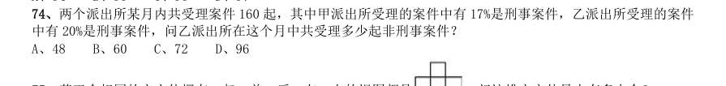

- **A.** 48
- **B.** 60
- **C.** 72
- **D.** 96

**答案：A**

### 2012 湖北·统一卷　第 57 题　（其他数量关系（综合））

用直线切割一个有限平面,后一条直线与此前每条直线都要产生新的交点,第1 条直线将平面分成2 块, 第2 条直线将平面分成4 块。第3 条直线将平面分成7 块,按此规律将平面分为22 块需:

- **A.** 7 条直线
- **B.** 8 条直线
- **C.** 9 条直线
- **D.** 6 条直线

**答案：D**

### 2012 湖北·统一卷　第 58 题　（基础计算）

某停车场按以下方法收费:每4 小时收5 元,不足4 小时按5 元收取,每晚超过零时加收5 元,并且每天 早上8 点开始重新计时,某天下午15 时小王将车停入停车场,取车时缴纳停车费65 元,小王停车时间t 的范 围是:

- **A.** 41<t≤44 小时
- **B.** 44<t≤48 小时
- **C.** 32<t≤36 小时
- **D.** 37<t≤41 小时

**答案：D**

### 2012 湖北·统一卷　第 61 题　（和差倍比）

某公司三名销售人员2011 年的销售业绩如下:甲的销售额是乙和丙销售额的1.5 倍,甲和乙的销售是丙 的销售额的5 倍,已知乙的销售额是56 万元,问甲的销售额是:

- **A.** 140 万元
- **B.** 144 万元
- **C.** 98 万元
- **D.** 112 万元

**答案：B**

### 2012 湖北·统一卷　第 63 题　（其他数量关系（综合））

小王周末组织朋友自助游,费用均摊,结账时,如果每人付450 元,则多出100 元;如果小王的朋友每人 付430 元,小王自己要多付60 元才刚好,这次活动人均费用是:

- **A.** 437.5 元
- **B.** 438.0 元
- **C.** 432.5 元
- **D.** 435.0 元

**答案：A**

### 2012 湖北·统一卷　第 64 题　（和差倍比）

甲工人每小时可加工A 零件3 个或B 零件6 个,乙工人每小时可加工A 零件2 个或B 零件7 个。甲、乙两 工人一天8 小时共加工零件59 个,甲、乙加工A 零件分别用时为x 小时、y 小时,且x、y 皆为整数,两名工 人一天加工的零件总数相差:

- **A.** 6 个
- **B.** 7 个
- **C.** 4 个
- **D.** 5 个

**答案：B**

### 2012 广东·统一卷　第 5 题　（其他数量关系（综合））

（本题题干为图形/公式，文字层无题干，图见原卷）

- **A.** 12
- **B.** 13
- **C.** 14
- **D.** 15

**答案：暂缺**

### 2012 广东·统一卷　第 6 题　（和差倍比）

某企业为全体员工定制工作服,请服装公司的裁缝量体裁衣。裁缝每小时为52 名男员工和35 名女员 工量尺寸。几小时后,刚好量完所有女员工的尺寸,这时还有24 名男员工没量。若男员工与女员工的人数比 为11:7 ,则该企业共有多少名员工:

- **A.** 720
- **B.** 810
- **C.** 900
- **D.** 1080

**答案：暂缺**

### 2012 广东·统一卷　第 8 题　（和差倍比）

甲公司的一分厂制造了10 台机床,二分厂制造了8 台。乙公司向甲公司购买6 台机床,丙公司向甲 公司购买12 台机床。每台机床的运费因运输距离的不同而有差异,具体情况如下表所示。乙、丙两公司购买 机床的运费总和最低为多少元:

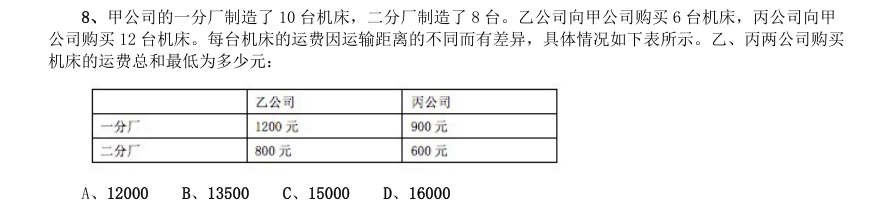

- **A.** 12000
- **B.** 13500
- **C.** 15000
- **D.** 16000

**答案：暂缺**

### 2012 广东·统一卷　第 14 题　（和差倍比）

某公司举办年终晚宴,每桌安排7 名普通员工与3 名管理人员,到最后2 桌时,由于管理人员已经 安排完毕,便全部安排了普通员工,结果还是差2 人才刚坐满,已知该公司普通员工数是管理人员的3 倍, 则该公司有管理人员多少名:

- **A.** 24
- **B.** 27
- **C.** 33
- **D.** 36

**答案：暂缺**

### 2012 广东·统一卷　第 15 题　（和差倍比）

某天,林伯的水果摊三种水果的价格分别为:苹果6 元/斤,芒果5 元/斤,香蕉3 元/斤。当天,苹 果与芒果的销售量之比为4:3,芒果与香蕉的销售量之比为2:11,卖香蕉比卖苹果多收入102 元,林伯这 天共销售三种水果多少斤:

- **A.** 75
- **B.** 94
- **C.** 141
- **D.** 165、

**答案：暂缺**

### 2012 国考·统一卷　第 67 题　（其他数量关系（综合））

甲乙二人协商共同投资,甲从乙处取了15000 元,并以两人名义进行了25000 元的投资,但由于决策失误, 只收回10000 元。甲由于过失在己,愿意主动承担2/3 的损失。问收回的投资中,乙将分得多少钱:

- **A.** 10000 元
- **B.** 9000 元
- **C.** 6000 元
- **D.** 5000 元

**答案：A**

### 2012 国考·统一卷　第 68 题　（方程与不定方程）

某儿童艺术培训中心有5 名钢琴教师和6 名拉丁舞教师,培训中心将所有的钢琴学员和拉丁舞学员共76 人 分别平均地分给各个老师带领,刚好能够分完,且每位老师所带的学生数量都是质数。后来由于学生人数减少, 培训中心只保留了4 名钢琴教师和3 名拉丁舞教师,但每名教师所带的学生数量不变,那么目前培训中心还剩下 学员多少人:

- **A.** 36
- **B.** 37
- **C.** 39
- **D.** 41

**答案：D**

### 2012 国考·统一卷　第 71 题　（其他数量关系（综合））

2010 年某种货物的进口价格是15 元/公斤,2011 年该货物的进口量增加了一半,进口金额增加了20%。问 2011 年该货物的进口价格是多少元/公斤:

- **A.** 10
- **B.** 12
- **C.** 18
- **D.** 24

**答案：B**

### 2012 国考·统一卷　第 72 题　（其他数量关系（综合））

三位专家为10 幅作品投票,每位专家分别都投出了5 票,并且每幅作品都有专家投票。如果三位专家都投 票的作品列为A 等,两位专家投票的列为B 等,仅有一位专家投票的作品列为C 等,则下列说法正确的是:

- **A.** A 等和B 等共6 幅
- **B.** B 等和C 等共7 幅
- **C.** A 等最多有5 幅
- **D.** A 等比C 等少5 幅

**答案：D**

### 2012 国考·统一卷　第 73 题　（方程与不定方程）

某市气象局观测发现,今年第一、二季度本市降水量分别比去年同期增加了11%和9%,而两个季度降水量 的绝对增量刚好相同。那么今年上半年该市降水量同比增长多少:

- **A.** 9.5%
- **B.** 10%
- **C.** 9.9%
- **D.** 10.5%

**答案：C**

### 2012 国考·统一卷　第 76 题　（和差倍比）

超市将99 个苹果装进两种包装盒,大包装盒每个装12 个苹果,小包装盒每个装5 个苹果,共用了十多个盒 子刚好装完。问两种包装盒相差多少个:

- **A.** 3
- **B.** 4
- **C.** 7
- **D.** 13

**答案：D**

### 2011 湖北·统一卷　第 43 题　（方程与不定方程）

某单位招录了10 名新员工,按其应聘成绩排名1 到10,并用10 个连续的四位自然数依次作为他们的工 号,凑巧的是每个人的工号都能被他们的成绩排名整除,问排名第三的员工工号所有数字之和是多少:

- **A.** 12
- **B.** 9
- **C.** 15
- **D.** 18

**答案：A**

### 2011 湖北·统一卷　第 49 题　（和差倍比）

有甲、乙、丙三辆公交车于上午8:00 同时从公交总站出发,三辆车再次回到公交总站所用的时间分别为 40 分钟、25 分钟和50 分钟,假设这三辆公交车中途不休息,请问它们下次同时到达公交总站将会是几点:

- **A.** 11 点整
- **B.** 11 点20 分
- **C.** 11 点40 分
- **D.** 12 点整

**答案：B**

### 2011 湖北·统一卷　第 50 题　（和差倍比）

一条路上依次有A B C 三个站点,加油站M 恰好位于A C 的中点,加油站N 恰好位于B C 的 中点,若想知道M 和N 两个加油站之间的距离,只需知道哪两点之间的距离: A B 和C B C 和N C、A 和M D、A 和B

> （本题为图形题，选项为图片，见原卷）

**答案：D**

### 2011 广东·统一卷　第 5 题　（其他数量关系（综合））

（本题题干为图形/公式，文字层无题干，图见原卷）

- **A.** 3
- **B.** 5
- **C.** 8
- **D.** 10

**答案：暂缺**

### 2011 广东·统一卷　第 7 题　（和差倍比）

一个图书馆里有科技书和文学书两种类型,首先拿走25 本科技书,剩下的文学书占剩下书的4/7, 又拿走42 本文学书,剩下的科技书占所剩书的5/7,问:最开始文学书占总共书的几分之几:

- **A.** 3/7
- **B.** 6/13
- **C.** 1/3
- **D.** 2/7

**答案：暂缺**

### 2011 广东·统一卷　第 8 题　（其他数量关系（综合））

三位运动员跨台阶,台阶总数在100-150 级之间,第一位运动员每次跨3 级台阶,最后一步还剩2 级 台阶。第二位运动员每次跨4 级台阶,最后一步还剩3 级台阶。第三位运动员每次跨5 级台阶,最后一步还 剩4 级台阶。则这些台阶总共有多少级:

- **A.** 119
- **B.** 121
- **C.** 129
- **D.** 131

**答案：暂缺**

### 2011 广东·统一卷　第 9 题　（其他数量关系（综合））

两人参加竞赛,甲做错了总数的1/3,乙做错了6 道题,两人都做错了总数的1/5,两人都做对的题 有多少道?

- **A.** 5
- **B.** 6
- **C.** 7
- **D.** 8

**答案：暂缺**

### 2011 国考·统一卷　第 69 题　（和差倍比）

某公司去年有员工830 人,今年男员工人数比去年减少6%,女员工人数比去年增加5%,员工总数比去年增 加3 人。 问今年男员工有多少人:

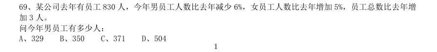

- **A.** 329
- **B.** 350
- **C.** 371
- **D.** 504

**答案：A**

### 2011 国考·统一卷　第 73 题　（和差倍比）

小赵,小钱,小孙一起打羽毛球,每局两人比赛 ,另一人休息,三人约定每一局的输方下一局休息,结束 时算了一下,小赵休息了2 局,小钱共打了8 局,小孙共打了5 局,则参加第9 局比赛的是:

- **A.** 小钱和小孙
- **B.** 小赵和小钱
- **C.** 小赵和小孙
- **D.** 以上皆有可能

**答案：B**

### 2011 国考·统一卷　第 77 题　（和差倍比）

同时打开游泳池的A B 两个进水管,加满水需1 小时30 分钟,且A 管比B 管多进水180 立方米。若单独 打开A 管,加满水需2 小时40 分钟,则B 管每分钟进水多少立方米:

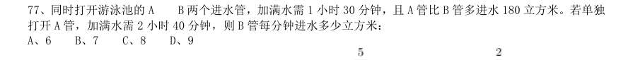

- **A.** 6
- **B.** 7
- **C.** 8
- **D.** 9

**答案：B**

### 2011 国考·统一卷　第 78 题　（和差倍比）

某城市共有A、B、C、D、E 五个区,A 区人口是全市人口的 ,B 区人口是A 区人口的 ,C 区人口是D 区和 E 区人口总数的 ,A 区比C 区多3 万人。全市共有多少万人:

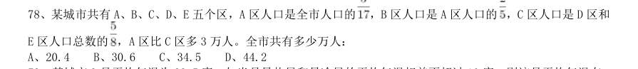

- **A.** 20.4
- **B.** 30.6
- **C.** 34.5
- **D.** 44.2

**答案：D**

### 2011 国考·统一卷　第 80 题　（方程与不定方程）

一个班的学生排队,如果排成3 人一排的队列,则比2 人一排的队列少8 排;如果排成4 人一排的队列,则 比3 人一排的队列少5 排,这个班的学生如果按5 人一排来排队的话,队列有多少排:

- **A.** 9
- **B.** 10
- **C.** 11
- **D.** 12

**答案：C**

### 2010 湖北·统一卷　第 45 题　（和差倍比）

（本题题干为图形/公式，文字层无题干，图见原卷）

- **A.** 97
- **B.** 114
- **C.** 126
- **D.** 147

**答案：D**

### 2010 湖北·统一卷　第 46 题　（方程与不定方程）

建造一个容积为16 立方米,深为4 米的立方体无盖水池,如果池底和池壁的造价分别为每平方米160 元和每 平方米100 元,那么该水池的最低造价是多少元:

- **A.** 3980
- **B.** 3560
- **C.** 3270
- **D.** 3840

**答案：D**

### 2010 湖北·统一卷　第 49 题　（方程与不定方程）

足球比赛的计分规则是:胜一场得 分,平一场得 分,负一场得 分,如果某国家足球队共打 了 场比赛,其中负 场,共得 分,那么这个队胜了多少场:

- **A.** 8
- **B.** 10
- **C.** 12
- **D.** 9

**答案：D**

### 2010 湖北·统一卷　第 51 题　（方程与不定方程）

有一项工作任务,小明先做 小时,小方接着做 小时可以完成,小明先做 小时,小方接着 做 小时也可以完成,如果小明先做 小时后再让小方接着做,那么小方可以完成工作还需要几个小时:

- **A.** 8
- **B.** 10
- **C.** 11
- **D.** 12

**答案：D**

### 2010 湖北·统一卷　第 52 题　（方程与不定方程）

去超市购买商品,如果购买 件甲商品,5 件乙商品和 件丙商品一共需要 元。如果购 买 件甲商品,7 件乙商品和 件丙商品一共需要 元。若甲、乙、丙三种商品各买 件,共需 要多少钱:

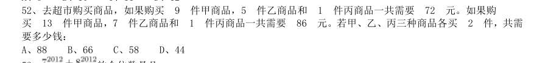

- **A.** 88
- **B.** 66
- **C.** 58
- **D.** 44

**答案：A**

### 2010 湖北·统一卷　第 53 题　（基础计算）

的个位数是几:

- **A.** 3
- **B.** 5
- **C.** 7
- **D.** 9

**答案：C**

### 2010 湖北·统一卷　第 54 题　（和差倍比）

三位数的自然数 N 满足:除以 余 3,除以 余 3,除以 也余 3,则符合条件的自然 数 N 有几个:

- **A.** 8
- **B.** 9
- **C.** 15
- **D.** 16

**答案：C**

### 2010 湖北·统一卷　第 56 题　（其他数量关系（综合））

有一条新修的道路,现在需要在该道路的两边植树,已知路长为 米,如果每隔 米植一棵树,那 么一共需要植多少棵树:

- **A.** 1646
- **B.** 1648
- **C.** 1686
- **D.** 1628

**答案：C**

### 2010 湖北·统一卷　第 58 题　（和差倍比）

甲家庭和乙家庭共有图书 册,甲家庭的图书数量是乙家庭的 倍,甲家庭和乙家庭各有图书多少 册:

- **A.** 2596,649
- **B.** 2425,820
- **C.** 2620,625
- **D.** 2530,715

**答案：A**

### 2010 广东·统一卷　第 5 题　（和差倍比）

有一些信件,把它们平均分成三份后还剩2 封,将其中两份平均三等分还多出2 封,问这些信件至 少有多少封:

- **A.** 20
- **B.** 26
- **C.** 23
- **D.** 29

**答案：暂缺**

### 2010 广东·统一卷　第 6 题　（和差倍比）

报社将一定的奖金分发给征文活动获奖者,其中一等奖学金是二等的2 倍,二等奖学金是三等的 1.5 倍,如果一、二、三等奖学金各评选两人,那么一等奖获得者将得2400 元奖金;如果一等奖只评选一 人,二、三等奖各评选两人,那么一等奖的奖金是:

- **A.** 2800 元
- **B.** 3000 元
- **C.** 3300 元
- **D.** 4500 元

**答案：暂缺**

### 2010 国考·统一卷　第 47 题　（和差倍比）

某高校对一些学生进行问卷调查。在接受调查的学生中,准备参加注册会计师考试的有63 人,准备参加英 语六级考试的有89 人,准备参加计算机考试的有47 人,三种考试都准备参加的有24 人,准备选择两种考试都 参加的有46 人,不参加其中任何一种考试的有15 人。问接受调查的学生共有多少人:

- **A.** 120
- **B.** 144
- **C.** 177
- **D.** 192

**答案：A**

### 2010 国考·统一卷　第 48 题　（基础计算）

某地劳动部门租用甲、乙两个教室开展农村实用人才培训。两教室均有5 排座位,甲教室每排可坐10 人, 乙教室每排可坐9 人。两教室当月共举办该培训27 次,每次培训均座无虚席,当月培训1290 人次。 问甲教室当月共举办了多少次这项培训:

- **A.** 8
- **B.** 10
- **C.** 12
- **D.** 15

**答案：D**

### 2010 国考·统一卷　第 50 题　（其他数量关系（综合））

一公司销售部有4 名区域销售经理,每人负责的区域数相同,每个区域都正好有两名销售经理负责,而任意 两名销售经理负责的区域只有1 个相同。 问这4 名销售经理总共负责多少个区域的业务:

- **A.** 12
- **B.** 8
- **C.** 6
- **D.** 4

**答案：C**

### 2010 国考·统一卷　第 55 题　（其他数量关系（综合））

某机关20 人参加百分制的普法考试,及格线为60 分,20 人的平均成绩为88 分,及格率为95%。所有人得 分均为整数,且彼此得分不同。问成绩排名第十的人最低考了多少分:

- **A.** 88
- **B.** 89
- **C.** 90
- **D.** 91

**答案：暂缺**
