# 数量关系 · 其他数量关系 · 2020 年代真题

> 所属考点：[SL-OT](../SL-OT-其他数量关系.md)　｜　本片 68 题

> 本片子考点：和差倍比 25　方程与不定方程 21　其他数量关系（综合） 19　基础计算 2　日期与钟表 1

### 2025 国考·副省级　第 67 题　（方程与不定方程）

某企业今年3月节电量是1月的1.2倍、2月的1.5倍,已知2月节电量比1月少4万度,问今年一季度企业节电量为 多少万度?

- **A.** 48
- **B.** 52
- **C.** 56
- **D.** 60

**答案：D**

### 2025 国考·副省级　第 75 题　（日期与钟表）

某门店星期一至星期五的日营业额均为1万元,星期六和星期日的日营业额均为2万元。某月1-16日的总营业额 为22万元,问该月8日为:

- **A.** 星期三
- **B.** 星期四
- **C.** 星期五
- **D.** 星期六

**答案：D**

### 2025 国考·地市级　第 67 题　（和差倍比）

甲、乙、丙、丁四个部门共有210名员工,且甲部门员工数比丁部门多10人。现乙部门调动20名员工到丙部门 且其剩余员工并入丁部门后,甲、丙、丁三个部门的员工数之比为3:3:4。问原乙部门有多少名员工?

- **A.** 41
- **B.** 46
- **C.** 51
- **D.** 56

**答案：C**

### 2025 国考·地市级　第 68 题　（和差倍比）

化工商店出售200千克某种试剂,前60千克打2折出售,之后60千克打5折出售,剩余部分原价出售。以下坐标 图中,最能准确反映该试剂销量和销售收入之间关系的是:

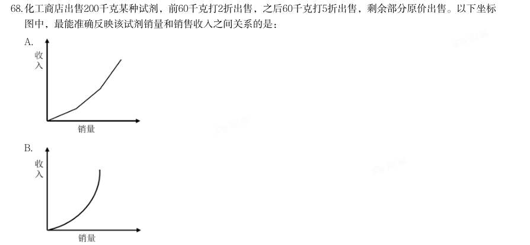

- **A.** 
- **B.** 
- **C.** 
- **D.** 

**答案：A**

### 2025 国考·行政执法　第 71 题　（其他数量关系（综合））

小张每周一到周四夜跑,周五到周日休息,已知某年2月他夜跑17次,3月夜跑19次,问4月他夜跑多少次?

- **A.** 16
- **B.** 17
- **C.** 18
- **D.** 19

**答案：A**

### 2024 湖北·统一卷　第 56 题　（方程与不定方程）

某单位为解决职工暑期“带娃难”的问题,开设了暑托班。开班时男孩与女孩的比例为3:4,后来有2个男 孩、1个女孩退出暑托班,此时男孩与女孩的比例为2:3。那么开班时女孩有多少人?

- **A.** 10
- **B.** 12
- **C.** 14
- **D.** 16

**答案：D**

### 2024 湖北·统一卷　第 57 题　（其他数量关系（综合））

某农产品基地对外供应一批农副产品。假设这批农副产品每天都有定量的自然损耗,如果提货方每天运走1.5吨 产品,则50天运完;如果提货方每天运走2吨产品,则40天运完。那么这批农副产品有多少吨?

- **A.** 75
- **B.** 80
- **C.** 100
- **D.** 110

**答案：C**

### 2024 湖北·统一卷　第 58 题　（和差倍比）

大学生创业主要集中在高科技、智力服务、连锁加盟和自媒体运营四个领域。某学院今年选择创业的大学毕业 生不到50人,其中选择智力服务领域、连锁加盟领域和自媒体运营领域的分别占 , 和 。那么该学院今年 选择高科技领域创业的大学毕业生有多少人?

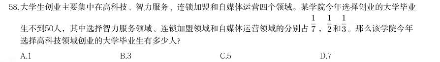

- **A.** 1
- **B.** 3
- **C.** 5
- **D.** 7

**答案：A**

### 2024 湖北·统一卷　第 62 题　（其他数量关系（综合））

某旅游公司定制甲、乙两种纪念品,第一次共定制50个。试销后根据反馈,第二次定制两种纪念品共70个,其 中乙纪念品个数是第一次的 。已知甲纪念品单价为15元,第一次定制花费1150元,那么第二次定制花费多少 元?

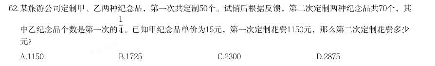

- **A.** 1150
- **B.** 1725
- **C.** 2300
- **D.** 2875

**答案：A**

### 2024 广东·统一卷　第 31 题　（其他数量关系（综合））

数字数阵(三行三列,中间一格为问号):4 9 5;6 ? 8;2 5 3

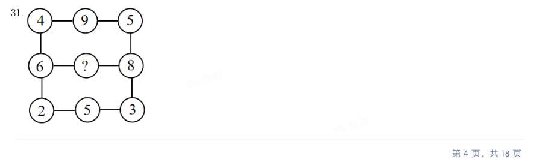

- **A.** 13
- **B.** 14
- **C.** 15
- **D.** 16

**答案：B**

### 2024 国考·副省级　第 62 题　（和差倍比）

甲、乙、丙和丁四个汽车租赁公司可用汽车数量比为5:4:3:2,现甲公司调度4辆汽车到丙公司,丁公司调 度1辆汽车到乙公司后,丁公司可用汽车数量正好是丙公司的60%。问此时甲公司的可用汽车数量比乙公司:

- **A.** 少22辆
- **B.** 多22辆
- **C.** 少12辆
- **D.** 多12辆

**答案：D**

### 2024 国考·副省级　第 63 题　（和差倍比）

市政部门采购了一批灯带用于美化夜景,有30灯珠/条的M型和60灯珠/条的N型两种规格,单价分别是20元/条和 30元/条。已知所采购M型灯带的总灯珠数量是N型的2倍,M型灯带的总价比N型多3万元,问共采购灯带多少 条?

- **A.** 2400
- **B.** 2700
- **C.** 3000
- **D.** 3300

**答案：C**

### 2024 国考·副省级　第 64 题　（方程与不定方程）

某企业去年全年收入1200万元,支出960万元。今年上半年和下半年,企业支出比去年同期分别减少20%和 15%,且全年收入与去年相同,总体盈余(收入-支出)比去年增加172万元。问今年上半年支出比下半年:

- **A.** 少160万元
- **B.** 多160万元
- **C.** 少108万元
- **D.** 多108万元

**答案：D**

### 2024 国考·副省级　第 67 题　（方程与不定方程）

甲、乙、丙三种农产品价格分别为30元/包、24元/包和20元/包。某日销售三种农产品共240包,总销售额为6000 元,已知甲的销售量是乙的2倍,问丙销售了多少包?

- **A.** 90
- **B.** 75
- **C.** 60
- **D.** 45

**答案：A**

### 2024 国考·副省级　第 73 题　（和差倍比）

某高校外国语学院中,会俄语的学生都会英语,其中一半还会法语;会英语的学生中有一半会法语;这三种语 言都会的学生有50人,只会其中两种语言的有100人,只会其中一种语言的有150人。问会法语的学生有多少 人?

- **A.** 100
- **B.** 200
- **C.** 50
- **D.** 150

**答案：B**

### 2024 国考·副省级　第 75 题　（和差倍比）

小张每周二、周五和周日固定参加骑行社团活动。某年9月和10月,小张分别参加了13次和14次活动。问当年 他最后一次参加活动是在哪一天?

- **A.** 12月31日
- **B.** 12月30日
- **C.** 12月29日
- **D.** 12月28日

**答案：A**

### 2024 国考·地市级　第 62 题　（和差倍比）

某企业招聘笔试参考人员均来自甲、乙、丙三所高校。笔试结束后,在进入面试的100人中,来自甲高校人员 占比从笔试时的50%下降至当前的40%,乙高校人员占比下降了15个百分点,丙高校的有50人。问笔试时来自 甲、乙、丙三所高校的人员比例是多少?

- **A.** 2:1:1
- **B.** 2:3:2
- **C.** 3:1:2
- **D.** 3:2:1

**答案：A**

### 2024 国考·地市级　第 70 题　（和差倍比）

某小区内部的道路如下图所示,道路转弯处的 、 、 均 为直角, 。 已知AB、CD、EA的长 度分别为40米、50米、60米,问整圈道路的总长度在以下哪个范围内?

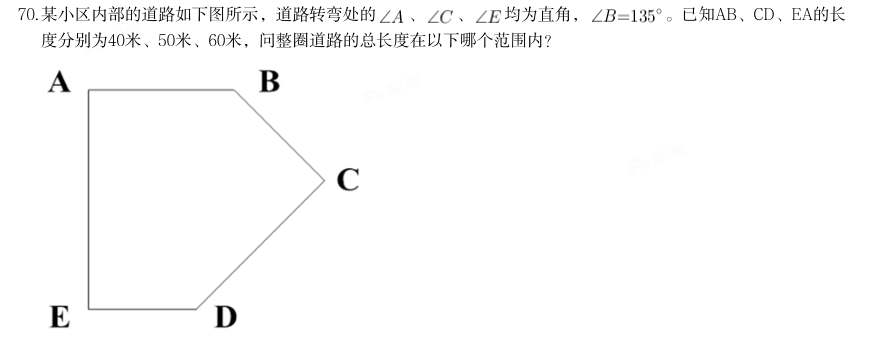

- **A.** 在200~210米之间
- **B.** 在210~220米之间
- **C.** 不到200米
- **D.** 超过220米

**答案：B**

### 2023 国考·行政执法　第 69 题　（方程与不定方程）

甲、乙、丙三家科技企业2021年的收入之和比2020年提升了20%。其中甲企业的收入上升了400万元,乙企业的 收入下降了100万元且是甲企业收入的一半,丙企业的收入上升了30%且其2020年的收入与甲、乙两企业同年收 入之和相同。问2020年甲企业的收入比乙企业高多少万元?

- **A.** 900
- **B.** 1100
- **C.** 400
- **D.** 600

**答案：D**

### 2022 广东·乡镇　第 33 题　（和差倍比）

（本题题干为图形/公式，文字层无题干，图见原卷）

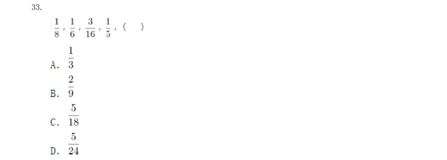

> （本题为图形题，选项为图片，见原卷）

**答案：D**

### 2022 广东·乡镇　第 35 题　（和差倍比）

123,465,987,( ),456,897,231,645,789

- **A.** 312
- **B.** 578
- **C.** 684
- **D.** 738

**答案：A**

### 2022 广东·乡镇　第 38 题　（其他数量关系（综合））

小王将新买的时钟调准使用,60 天后,时钟走慢了5 分钟。那么,该时钟平均每天走慢( )秒。

- **A.** 5
- **B.** 10
- **C.** 15
- **D.** 20

**答案：A**

### 2022 广东·乡镇　第 40 题　（其他数量关系（综合））

小陈计划在一定时间内完成法律常识题库中的所有练习题。如果每天做50 道题,那么最后2 天每天要做 85 道题才能完成,如果每天做55 道题,恰好可以提前1 天完成,则该题库共有( )道题。

- **A.** 1215
- **B.** 1250
- **C.** 1320
- **D.** 1375

**答案：C**

### 2022 广东·乡镇　第 44 题　（和差倍比）

某防疫工作机构有检验人员和其他工作人员共55 人,将检验人员平均分成若干个小组开展工作。近期, 该机构补充了20 位工作人员,其中,检验人员增加了2 组,每组人数不变,其他工作人员增加了30%,则该机构 原有检验人员共( )组。

- **A.** 4
- **B.** 5
- **C.** 6
- **D.** 7

**答案：B**

### 2022 广东·县级　第 28 题　（和差倍比）

（本题题干为图形/公式，文字层无题干，图见原卷）

- **A.** 62
- **B.** 64
- **C.** 66
- **D.** 68

**答案：C**

### 2022 广东·县级　第 30 题　（和差倍比）

1,0,1,5,4,5,9,( )?

- **A.** 8
- **B.** 9
- **C.** 10
- **D.** 11

**答案：A**

### 2022 广东·县级　第 37 题　（方程与不定方程）

甲、乙两人计划分装会议材料,9 点多先后开始工作,且两人每分钟完成分装的份数相同。9 点38 分时, 甲完成的份数是乙的4 倍,9 点53 分时,甲完成的份数是乙的1.5 倍。那么,甲比乙早( )分钟开始工作。

- **A.** 4
- **B.** 6
- **C.** 8
- **D.** 9

**答案：D**

### 2022 广东·县级　第 39 题　（其他数量关系（综合））

楼道上方有一盏灯,小刘径直走向这盏灯。一开始, 他发现自己影子的长度为3.2 米,前进1 米后,发现 影子缩短为1.6 米。已知小刘身高为1.6 米,则这盏灯的高度约为( )米。

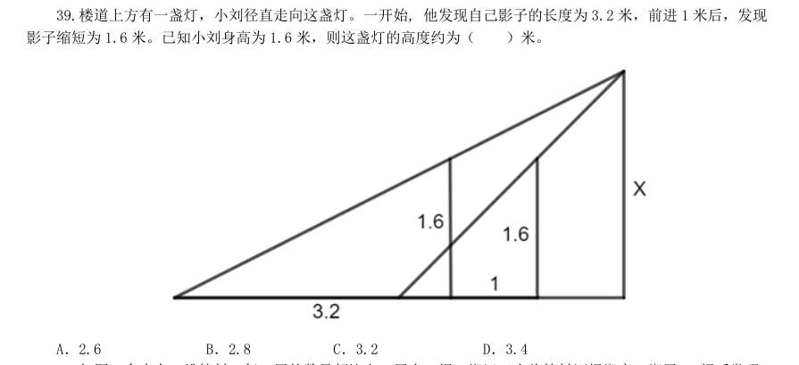

- **A.** 2.6
- **B.** 2.8
- **C.** 3.2
- **D.** 3.4

**答案：A**

### 2022 广东·县级　第 40 题　（和差倍比）

如图,仓库有一堆管材,每一层的数量都比上一层多1 根。搬运工人将管材逐根搬离,搬了99 根后发现, 管材堆少了3 层,且剩余每层的管材数量都减少了3 根。如果这堆管材刚好还剩10 层,则剩下的管材共有( )根。

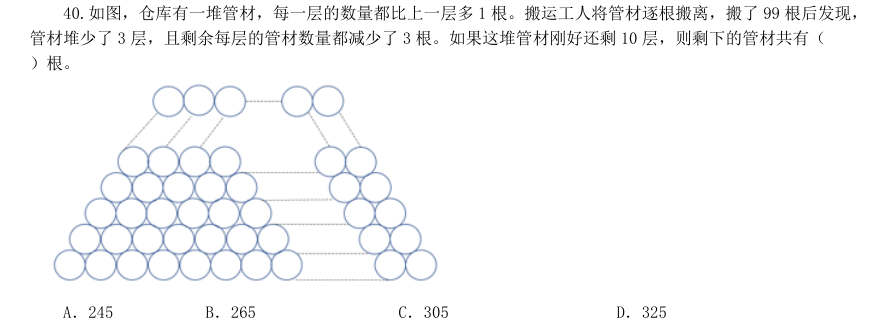

- **A.** 245
- **B.** 265
- **C.** 305
- **D.** 325

**答案：B**

### 2022 国考·副省级　第 61 题　（方程与不定方程）

(单选题)某企业职工筹款给甲村学龄儿童购买学习用具,如按100 元/人的标准执行则资金剩余 550 元,如按120 元/人的标准执行则还需筹集630 元。现额外筹集2510 元,且最终按80 元/人的标准, 正好能给甲、乙两村的学龄儿童购买学习用具。问乙村学龄儿童有多少人?

- **A.** 50
- **B.** 53
- **C.** 56
- **D.** 59

**答案：B**

### 2022 国考·副省级　第 62 题　（方程与不定方程）

(单选题)甲、乙、丙、丁、戊5 名职工参加党史知识测验,每人得分均不相同。甲和乙的平均分比丙 多2 分,丁和戊的平均分比丁多5 分,甲、乙的平均分比丙、丁、戊的平均分多3 分。问丙、丁、戊三人 得分的排序为:

- **A.** 丙>丁>戊
- **B.** 丙>戊>丁
- **C.** 丁>丙>戊
- **D.** 戊>丙>丁

**答案：D**

### 2022 国考·副省级　第 63 题　（方程与不定方程）

(单选题)企业列出500 万元设备采购预算,如用于购买x 台进口设备,最后剩余20 万元。经董事会研 究后,决定购买质量更高的同类国产设备,单价仅为进口设备的75%。当前预算可购买x+3 台,最后剩余 5 万元。问国产设备的单价在以下哪个范围内?

- **A.** 不到30 万元/台
- **B.** 30—40 万元/台之间
- **C.** 40—50 万元/台之间
- **D.** 50 万元/台以上

**答案：C**

### 2022 国考·副省级　第 64 题　（方程与不定方程）

(单选题)甲和乙两个乡村图书室共有5000 本藏书,其中甲图书室的藏书比乙图书室多3x 本,现从甲 图书室中取出150 本书放入乙图书室后,甲图书室的藏书仍比乙图书室多2x 本,问甲图书室原有图书多 少本?

- **A.** 2500
- **B.** 2750
- **C.** 2950
- **D.** 3500

**答案：C**

### 2022 国考·副省级　第 66 题　（和差倍比）

(单选题)高校某专业70 多名毕业生中,有96%在毕业后去西部省区支援国家建设。其中去偏远中小学 支教的毕业生占该专业毕业生总数的20%,比任职大学生村官的毕业生少2 人,比在西部地区参军入伍的 毕业生多1 人,其余的毕业生选择去国有企业西部边远岗位工作。问去国有企业西部边远岗位工作的毕 业生有多少人?

- **A.** 32
- **B.** 29
- **C.** 26
- **D.** 23

**答案：C**

### 2022 国考·副省级　第 69 题　（和差倍比）

(单选题)某县通过发展旅游业来实现乡村振兴,引进了甲、乙、丙、丁、戊和己6 名专家。其中甲、 乙、丙是环境保护专家,丁、戊、己是旅游行业专家,甲、丁、戊熟悉社交媒体宣传。现要将6 名专家 平均分成2 个小组,每个小组都要有环境保护专家、旅游行业专家和熟悉社交媒体宣传的人,问有多少 种不同的分组方式?

- **A.** 12
- **B.** 24
- **C.** 4
- **D.** 8

**答案：D**

### 2022 国考·副省级　第 70 题　（方程与不定方程）

(单选题)某水果种植特色镇创办水果加工厂,从去年年初开始通过电商平台销售桃汁、橙汁两种产 品。从去年2 月开始,每个月桃汁的销量都比上个月多5000 盒,橙汁的销量都比上个月多2000 盒。已知 去年第一季度桃汁的总销量比橙汁少4.5 万盒,则去年桃汁的销量比橙汁:

- **A.** 多不到5 万盒
- **B.** 少不到5 万盒
- **C.** 多5 万盒以上
- **D.** 少5 万盒以上

**答案：B**

### 2022 国考·副省级　第 71 题　（方程与不定方程）

(单选题)救灾部门紧急运送两批大米分给受灾群众,已知甲村人数是丙村的2 倍,如果买两批大米都 给甲村,每人正好能分24 斤;如果第一批大米分给乙村,每人正好能分12 斤,第二批大米分给甲、乙、 丙三个村,每人正好能分4 斤。为尽量保障受灾群众的基本需求,现决定另运送一批面粉分给甲村,并 将两批大米都分给乙、丙两村,问乙、丙两村平均每人分到的大米重量在以下哪个范围内?

- **A.** 不到14 斤
- **B.** 14—15 斤之间
- **C.** 15—16 斤之间
- **D.** 16 斤以上

**答案：B**

### 2022 国考·地市级　第 62 题　（方程与不定方程）

企业列出500 万元设备采购预算,如用于购买x 台进口设备,最后剩余20 万元。经董事会 研究后,决定购买质量更高的同类国产设备,单价仅为进口设备的75%。当前预算可购买x+3 台,最 后剩余5 万元。问国产设备的单价在以下哪个范围内?

- **A.** 不到30 万元/台
- **B.** 30—40 万元/台之间
- **C.** 40—50 万元/台之间
- **D.** 50 万元/台以上

**答案：C**

### 2022 国考·地市级　第 64 题　（方程与不定方程）

张和李2 名社区工作者上门统计某小区内住户的新冠疫苗接种情况,两人各负责1 栋住宅楼, 每访问1 户居民均需要5 分钟。李因处理公文比张晚出发一段时间。已知14:00 时两人共访问63 户, 15:00 时张访问的户数是李的2 倍。问李访问完50 户居民是在什么时候?

- **A.** 16:30
- **B.** 16:45
- **C.** 17:00
- **D.** 17:15

**答案：B**

### 2022 国考·地市级　第 66 题　（方程与不定方程）

某水果种植特色镇创办水果加工厂,从去年年初开始通过电商平台销售桃汁、橙汁两种产品。 从去年2 月开始,每个月桃汁的销量都比上个月多5000 盒,橙汁的销量都比上个月多2000 盒。已知 去年第一季度桃汁的总销量比橙汁少4.5 万盒,则去年桃汁的销量比橙汁:

- **A.** 多不到5 万盒
- **B.** 少不到5 万盒
- **C.** 多5 万盒以上
- **D.** 少5 万盒以上

**答案：B**

### 2022 国考·地市级　第 69 题　（和差倍比）

高校某专业70 多名毕业生中,有96%在毕业后去西部省区支援国家建设。其中去偏远中小 学支教的毕业生占该专业毕业生总数的20%,比任职大学生村官的毕业生少2 人,比在西部地区参军 入伍的毕业生多1 人,其余的毕业生选择去国有企业西部边远岗位工作。问去国有企业西部边远岗位 工作的毕业生有多少人?

- **A.** 32
- **B.** 29
- **C.** 26
- **D.** 23

**答案：C**

### 2022 国考·行政执法　第 62 题　（方程与不定方程）

(单选题)张和李2 名社区工作者上门统计某小区内住户的新冠疫苗接种情况,两人各负责1 栋住宅 楼,每访问1 户居民均需要5 分钟。李因处理公文比张晚出发一段时间。已知14:00 时两人共访问63 户,15:00 时张访问的户数是李的2 倍。问李访问完50 户居民是在什么时候?

- **A.** 16:30
- **B.** 16:45
- **C.** 17:00
- **D.** 17:15

**答案：B**

### 2021 广东·乡镇　第 39 题　（其他数量关系（综合））

上午7 点,A、B 市干部同时乘车前往省城参观学习,汽车时速均为每小时80 公里。但由于突发状况,B 市 干部在路上停留了2 个小时。最终,A 市干部于当天上午9 点到达省城;B 市干部于当天下午3 点到达。则如果 从A 市出发,途经省城到达B 市,总路程为( )公里。

- **A.** 720
- **B.** 640
- **C.** 320
- **D.** 280

**答案：暂缺**

### 2021 广东·乡镇　第 40 题　（其他数量关系（综合））

一条长20 厘米的纸带,先从左端开始涂上4 厘米红色,之后每间隔4 厘米再涂4 厘米红色;再从右端开始 涂上5 厘米绿色,之后每间隔5 厘米再涂5 厘米绿色,则红绿色重叠的部分共有( )段。

- **A.** 4
- **B.** 3
- **C.** 2
- **D.** 1

**答案：暂缺**

### 2021 广东·乡镇　第 41 题　（其他数量关系（综合））

某货运公司承运一批工艺品,每件运费20 元。如果运输途中出现破损,那么每件破损的工艺品不仅收不到 运费,还要赔偿30 元。运输完成后发现,工艺品的破损率为6.4%,最终货运公司收到了16800 元运费,则运输 途中破损的工艺品有( )件。

- **A.** 64
- **B.** 96
- **C.** 128
- **D.** 156

**答案：暂缺**

### 2021 广东·乡镇　第 42 题　（其他数量关系（综合））

某学校组织学生外出学农。如果每间宿舍住6 名学生,就会缺7 张床位,如果每间宿舍住8 名学生,就会空 出3 张床位,则这批学生一共有( )人。

- **A.** 50
- **B.** 45
- **C.** 43
- **D.** 37

**答案：暂缺**

### 2021 广东·乡镇　第 43 题　（和差倍比）

县公安局计划举办篮球比赛,6 支报名参赛的队伍将平均分为上午组和下午组进行小组赛。其中甲队与乙队 来自同部门,不能分在同一组,则分组情况共有( )种可能。

- **A.** 6
- **B.** 8
- **C.** 10
- **D.** 12

**答案：暂缺**

### 2021 广东·乡镇　第 44 题　（和差倍比）

某县政府组织干部职工开展党建知识竞赛,其中甲、乙两镇参赛人数之比为4∶3,甲镇有8 人、乙镇有24 人没有参加竞赛。已知甲、乙两镇干部职工人数之比为5∶6,则乙镇的干部职工比甲镇多( )人。

- **A.** 8
- **B.** 7
- **C.** 6
- **D.** 5

**答案：暂缺**

### 2021 国考·副省级　第 72 题　（和差倍比）

某单位为定点帮扶村捐建一个乡村图书馆。已知完工时基建支出为总预算的40%,图书购买支出比基建支出 低25%,比信息化支出高25%,其他支出之和为4.5 万元,最终项目的总支出比总预算结余了3000 元。已知图书 来源为购买和捐赠,平均每购买1 本图书的支出为25 元,且购买的图书比接受外来捐赠的图书多20%。问该乡 村图书馆最终拥有的图书数量在以下哪个范围内?

- **A.** 不到1.1 万本
- **B.** 1.1~1.4 万本之间
- **C.** 1.4~1.7 万本之间
- **D.** 超过1.7 万本

**答案：暂缺**

### 2021 国考·副省级　第 75 题　（其他数量关系（综合））

某商业街复工复产之后,向消费者发放满50 元减10 元、满100 元减30 元的电子优惠券各若干张,并规定 消费者在商户处完成交易并核销电子优惠券后,商户可以免除等同于核销优惠券减免金额75%的店面租金。促 销期内,商户共核销优惠券15.6 万张,通过核销优惠券方式减免租金219 万元。问该次促销中,消费者实际支 付金额可能的最低值在以下哪个范围内?

- **A.** 不到750 万元
- **B.** 750~800 万元之间
- **C.** 800~850 万元之间
- **D.** 超过850 万元

**答案：暂缺**

### 2021 国考·地市级　第 63 题　（方程与不定方程）

甲、乙两个单位周末分别安排60%和75%的职工下沉社区帮助困难群众,其中甲单位派出的职工比乙单位少 3 人。后两单位又在剩下的职工中,分别抽调40%和75%的职工,共计24 人参加周末的业务培训。问甲单位职工 人数比乙单位:

- **A.** 少3 人
- **B.** 少11 人
- **C.** 多3 人
- **D.** 多11 人

**答案：D**

### 2021 国考·地市级　第 65 题　（方程与不定方程）

某县通过网络直播帮助本地农民销售农副产品,总共直播6 次,其中第2 次直播销售额比第1 次高40%,比 第3 次低12.5%,直播3 次后电视台报道了这一新闻,此后销量大幅提升,后3 次直播总销售额是前3 次总销售 额的3 倍。其中第5 次直播销售额相当于6 次直播总销售额的25%,且比第4 次直播高10%,比第6 次直播少16 万元,问第6 次直播的销售额比第3 次直播高:

- **A.** 不到100 万元
- **B.** 100~120 万元之间
- **C.** 120~140 万元之间
- **D.** 140 万元以上

**答案：C**

### 2020 湖北·统一卷　第 56 题　（其他数量关系（综合））

某公司现有6 箱不同的水果,安排三个配送员送到

- **A.** 60 种
- **B.** 180 种
- **C.** 360 种
- **D.** 420 种

**答案：C**

### 2020 湖北·统一卷　第 57 题　（和差倍比）

某学习平台的学习内容由观看视频、阅读文章、收藏分享、论坛交流、考试答题五个部分组成。某学员要先 后学完这五个部分,若观看视频和阅读文章不能连续进行,该学员学习顺序的选择有:

- **A.** 24 种
- **B.** 72 种
- **C.** 96 种
- **D.** 120 种

**答案：B**

### 2020 湖北·统一卷　第 60 题　（方程与不定方程）

甲、乙、丙三人去超市买了100 元的商品,如果甲付钱,那么甲剩下的钱是乙、丙两人钱数之和的 ;如 果乙付钱,则乙剩下的钱是甲、丙两人钱数之和的 ;如果丙付钱,丙用他的会员卡可享受9 折优惠,结果丙 剩下的钱是甲、乙两人钱数之和的 ;那么,甲、乙、丙三人开始时一共带了多少钱?

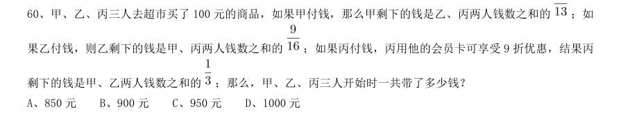

- **A.** 850 元
- **B.** 900 元
- **C.** 950 元
- **D.** 1000 元

**答案：A**

### 2020 湖北·统一卷　第 65 题　（方程与不定方程）

小王在荡秋千,当秋千摆角为30°时,它摆到最高位置与最低位置的高度差为0.45 米。小王为寻求更大的 刺激感,将秋千摆角增加15°,则秋千能摆到的最高位置约上升了多少米?( , )

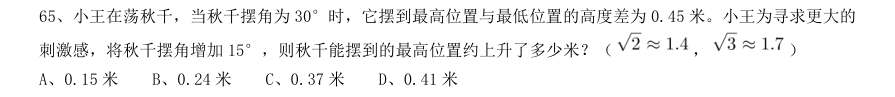

- **A.** 0.15 米
- **B.** 0.24 米
- **C.** 0.37 米
- **D.** 0.41 米

**答案：D**

### 2020 湖北·统一卷　第 69 题　（和差倍比）

甲乙丙丁四人通过手机的位置共享,发现乙在甲正南方向2 公里处,丙在乙北偏西60°方向2 公里处,丁 在甲北偏西75°方向。若丁与甲、丙的距离相等,则该距离为:

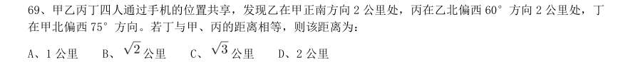

- **A.** 1 公里
- **B.** 公里
- **C.** 公里
- **D.** 2 公里

**答案：B**

### 2020 广东·乡镇　第 35 题　（其他数量关系（综合））

（本题题干为图形/公式，文字层无题干，图见原卷）

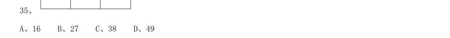

- **A.** 16
- **B.** 27
- **C.** 38
- **D.** 49

**答案：暂缺**

### 2020 广东·乡镇　第 39 题　（其他数量关系（综合））

某单位的两个部门计划订阅报纸。每个部门需要在指定的5 种报纸中选择其中的3 种,且这两个部门在选 择时应做好沟通,做到5 种报纸都有部门订阅,则订阅报纸的方案共有( )种。

- **A.** 20
- **B.** 30
- **C.** 60
- **D.** 100

**答案：暂缺**

### 2020 广东·乡镇　第 41 题　（和差倍比）

某企业四月的营业额比三月的营业额多三分之一,五月的营业额比四月多三分之一,则三月的营业额比五 月的营业额少:

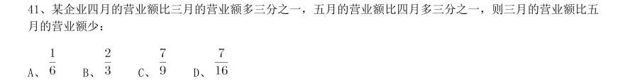

- **A.** 
- **B.** 
- **C.** 
- **D.** 

**答案：暂缺**

### 2020 广东·乡镇　第 42 题　（其他数量关系（综合））

三个书架共放有60 本书,如果从第一个书架取出10 本书放入第二个书架,再从第二个书架取出5 本书放 入第三个书架,则此时三个书架的书就会一样多。那么第二个书架最初存放了( )本书。

- **A.** 15
- **B.** 20
- **C.** 25
- **D.** 30

**答案：暂缺**

### 2020 广东·乡镇　第 44 题　（其他数量关系（综合））

某部门正在准备会议材料,共有153 份相同的文件,需要装到大小两种文件袋里送至会场,大的每个能装 24 份文件,小的每个能装15 份文件。如果要使每个文件袋都正好装满,则需要大文件袋( )个。

- **A.** 2
- **B.** 3
- **C.** 5
- **D.** 7

**答案：暂缺**

### 2020 广东·县级　第 30 题　（其他数量关系（综合））

（本题题干为图形/公式，文字层无题干，图见原卷）

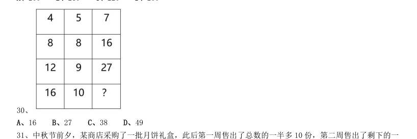

- **A.** 16
- **B.** 27
- **C.** 38
- **D.** 49

**答案：暂缺**

### 2020 广东·县级　第 31 题　（其他数量关系（综合））

中秋节前夕,某商店采购了一批月饼礼盒,此后第一周售出了总数的一半多10 份,第二周售出了剩下的一 半多5 份,若此时还剩下20 份月饼礼盒,则商品最初采购了( )份月饼礼盒。

- **A.** 60
- **B.** 80
- **C.** 100
- **D.** 120

**答案：暂缺**

### 2020 广东·县级　第 33 题　（和差倍比）

某单位后勤部门采购了一批大米,并将其平均分给了甲、乙两个饭堂。5 周后,甲饭堂只剩余大米7 千克; 又过了1 周,乙饭堂也只剩余大米6 干克,已知甲乙饭堂的就餐人数固定,前往甲饭堂就餐的人数比乙饭堂多1 人。如果每人每周消耗大米1 千克,则这批大米共有( )千克。

- **A.** 72
- **B.** 84
- **C.** 96
- **D.** 108

**答案：暂缺**

### 2020 广东·县级　第 34 题　（基础计算）

某政务服务大厅开始办理业务前,已经有部分人在排队等候领取证书,且每分钟新增的人数一样多。从开始 办理业务到排队等候的人全部领到证书,若同时开5 个发证窗口就需要1 个小时,若同时开6 个发证窗口就需要 40 分钟。按照每个窗口给每个人发证需要1 分钟计算,如果想要在20 分钟内将排队等候的人的证书全部发完, 则需同时开( )个发证窗口。

- **A.** 7
- **B.** 8
- **C.** 9
- **D.** 10

**答案：暂缺**

### 2020 广东·思维能力测验　第 85 题　（基础计算）

100,7,14,( ),100,5,20,0,100,3,33,1

- **A.** 1
- **B.** 2
- **C.** 3
- **D.** 4、

**答案：B**

### 2020 国考·省级　第 62 题　（方程与不定方程）

高架桥12:00~14:00 每分钟车流量比9:00~11:00 少20%,9:00~11:00、12:00~14:00、17:00~ 19:00 三个时间段的平均每分钟车流量比9:00~11:00 多10%。问17:00~19:00 每分钟的车流量比9:00~ 11:00 多:

- **A.** 40%
- **B.** 50%
- **C.** 20%
- **D.** 30%

**答案：B**
