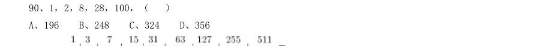
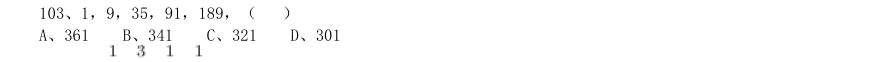
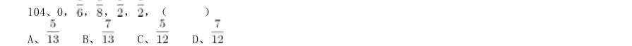
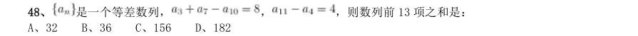
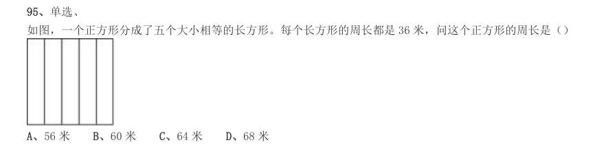

# 数量关系 · 数字推理 · 2000 年代真题

> 所属考点：[SL-SZ](../SL-SZ-数字推理.md)　｜　本片 100 题

> 本片子考点：数字推理（待细分） 35　递推数列 23　幂次数列 17　多级数列 11　分数数列 10　多重数列 4

### 【2009 湖北省考·第 86 题】HB-2009-ty-X086　数字推理｜数字推理（待细分）

5,12,21,34,53,80,( )

- **A.** 115
- **B.** 117
- **C.** 119
- **D.** 121

**答案：B**

### 【2009 湖北省考·第 87 题】HB-2009-ty-X087　数字推理｜多级数列

1,4,11,30,85,( )

- **A.** 248
- **B.** 250
- **C.** 256
- **D.** 260

**答案：A**

### 【2009 湖北省考·第 88 题】HB-2009-ty-X088　数字推理｜多重数列

187,259,448,583,754,( )

- **A.** 847
- **B.** 862
- **C.** 915
- **D.** 944

**答案：B**

### 【2009 湖北省考·第 89 题】HB-2009-ty-X089　数字推理｜递推数列

2,2,0,7,9,9,( )

- **A.** 13
- **B.** 15
- **C.** 18
- **D.** 20

**答案：C**

### 【2009 湖北省考·第 90 题】HB-2009-ty-X090　数字推理｜幂次数列

1,2,8,28,100,( )

- **A.** 196
- **B.** 248
- **C.** 324
- **D.** 356

**答案：D**

### 【2009 广东省考·第 1 题】GD-2009-ty-X001　数字推理｜递推数列

1, 2, 0, 3, -1, 4, ( )

- **A.** -2
- **B.** 0
- **C.** 5
- **D.** 6

**答案：暂缺**

### 【2009 广东省考·第 2 题】GD-2009-ty-X002　数字推理｜数字推理（待细分）

168,183,195,210,( )

- **A.** 213
- **B.** 222
- **C.** 223
- **D.** 225

**答案：暂缺**

### 【2009 广东省考·第 3 题】GD-2009-ty-X003　数字推理｜递推数列

38, 24, 62, 12, 74, 28,( )

- **A.** 74
- **B.** 75
- **C.** 80
- **D.** 102

**答案：暂缺**

### 【2009 广东省考·第 4 题】GD-2009-ty-X004　数字推理｜数字推理（待细分）

4, 5, 8, 10, 16, 19, 32,( )

- **A.** 35
- **B.** 36
- **C.** 37
- **D.** 38

**答案：暂缺**

### 【2009 国考·第 101 题】GK-2009-ty-X101　数字推理｜数字推理（待细分）

5,12,21,34,53,80,( )

- **A.** 121
- **B.** 115
- **C.** 119
- **D.** 117

**答案：D**

### 【2009 国考·第 102 题】GK-2009-ty-X102　数字推理｜数字推理（待细分）

7,7,9,17,43,( )

- **A.** 119
- **B.** 117
- **C.** 123
- **D.** 121

**答案：C**

### 【2009 国考·第 103 题】GK-2009-ty-X103　数字推理｜数字推理（待细分）

1,9,35,91,189,( )

- **A.** 361
- **B.** 341
- **C.** 321
- **D.** 301

**答案：B**

### 【2009 国考·第 104 题】GK-2009-ty-X104　数字推理｜分数数列

0, , , , ,( )

> （本题为图形题，选项为图片，见原卷）

**答案：C**

### 【2009 国考·第 105 题】GK-2009-ty-X105　数字推理｜数字推理（待细分）

153,179,227,321,533,( )

- **A.** 789
- **B.** 919
- **C.** 1229
- **D.** 1079

**答案：D**

### 【2008 广东省考·第 1 题】GD-2008-ty-X001　数字推理｜数字推理（待细分）
> 材料：(共15 题,参考时限15 分钟) 本部分包括两种类型的试题: 排列规律,然后从四个供选择的选项中选出你认为最合理的一项,来填补空缺项。…

1,2,6,16,44,( )

- **A.** 66
- **B.** 84
- **C.** 88
- **D.** 120

**答案：暂缺**

### 【2008 广东省考·第 2 题】GD-2008-ty-X002　数字推理｜递推数列

2,3,6,8,8,4,( )

- **A.** 2
- **B.** 3
- **C.** 4
- **D.** 5

**答案：暂缺**

### 【2008 广东省考·第 3 题】GD-2008-ty-X003　数字推理｜幂次数列

2,1,5,7,17,( )

- **A.** 26
- **B.** 31
- **C.** 32
- **D.** 37

**答案：暂缺**

### 【2008 广东省考·第 4 题】GD-2008-ty-X004　数字推理｜分数数列

1/36, 1/5, 1,3,4,( )

- **A.** 1
- **B.** 5
- **C.** 6
- **D.** 8

**答案：暂缺**

### 【2008 广东省考·第 5 题】GD-2008-ty-X005　数字推理｜数字推理（待细分）

( )

- **A.** 5
- **B.** 17
- **C.** 19
- **D.** 47

**答案：暂缺**

### 【2008 国考·第 41 题】GK-2008-ty-X041　数字推理｜数字推理（待细分）
> 材料：内聚力 敷衍…

157,65,27,11,5,( )

- **A.** 4
- **B.** 3
- **C.** 2
- **D.** 1

**答案：D**

### 【2008 国考·第 43 题】GK-2008-ty-X043　数字推理｜分数数列

1,2/3,5/8,13/21,( )

- **A.** 21/33
- **B.** 35/64
- **C.** 41/70
- **D.** 34/55

**答案：D**

### 【2008 国考·第 44 题】GK-2008-ty-X044　数字推理｜数字推理（待细分）

67,54,46,35,29,( )

- **A.** 13
- **B.** 15
- **C.** 18
- **D.** 20

**答案：D**

### 【2008 国考·第 45 题】GK-2008-ty-X045　数字推理｜幂次数列

14,20,54,76,( )

- **A.** 104
- **B.** 116
- **C.** 126
- **D.** 144

**答案：C**

### 【2008 国考·第 48 题】GK-2008-ty-X048　数字推理｜多级数列

是一个等差数列, , ,则数列前13 项之和是:

- **A.** 32
- **B.** 36
- **C.** 156
- **D.** 182

**答案：C**

### 【2007 广东省考·第 1 题】GD-2007-ty-X001　数字推理｜递推数列
> 材料：本题共包括两种类型的题目:…

一2,0,1,1,( )

- **A.** 一l
- **B.** 0
- **C.** 1
- **D.** 2

**答案：暂缺**

### 【2007 广东省考·第 2 题】GD-2007-ty-X002　数字推理｜数字推理（待细分）

0,0,1,5,23,( )

- **A.** 119
- **B.** 79
- **C.** 63
- **D.** 47

**答案：暂缺**

### 【2007 广东省考·第 3 题】GD-2007-ty-X003　数字推理｜幂次数列

3,2,11,14,( )

- **A.** 17
- **B.** 19
- **C.** 24
- **D.** 27

**答案：暂缺**

### 【2007 广东省考·第 4 题】GD-2007-ty-X004　数字推理｜递推数列

1,2,2,3,4,( )

- **A.** 3
- **B.** 7
- **C.** 8
- **D.** 9

**答案：暂缺**

### 【2007 广东省考·第 5 题】GD-2007-ty-X005　数字推理｜数字推理（待细分）

227,238,251,259,( )

- **A.** 263
- **B.** 273
- **C.** 275
- **D.** 299

**答案：暂缺**

### 【2007 国考·第 41 题】GK-2007-ty-X041　数字推理｜幂次数列

2,12,36,80,()

- **A.** 100
- **B.** 125
- **C.** 150
- **D.** 175

**答案：C**

### 【2007 国考·第 42 题】GK-2007-ty-X042　数字推理｜递推数列

1,3,4,1,9,()

- **A.** 5
- **B.** 11
- **C.** 14
- **D.** 64

**答案：D**

### 【2007 国考·第 43 题】GK-2007-ty-X043　数字推理｜幂次数列

0,9,26,65,124,()

- **A.** 165
- **B.** 193
- **C.** 217
- **D.** 239

**答案：C**

### 【2007 国考·第 44 题】GK-2007-ty-X044　数字推理｜多级数列

0,4,16,40,80,()

- **A.** 160
- **B.** 128
- **C.** 136
- **D.** 140

**答案：D**

### 【2007 国考·第 45 题】GK-2007-ty-X045　数字推理｜幂次数列

0,2,10,30,()

- **A.** 68
- **B.** 74
- **C.** 60
- **D.** 70

**答案：A**

### 【2006 广东省考·第 1 题】GD-2006-ty-X001　数字推理｜分数数列
> 材料：(共15题,参考时间15分钟) 本部分包括两种类型的题目…

3/15,1/3,3/7,1/2,( )。

- **A.** 5/8
- **B.** 4/9
- **C.** 15/27
- **D.** -3

**答案：暂缺**

### 【2006 广东省考·第 2 题】GD-2006-ty-X002　数字推理｜数字推理（待细分）

-8,15,39,65,94,128,170,( )。

- **A.** 180
- **B.** 210
- **C.** 225
- **D.** 256

**答案：暂缺**

### 【2006 广东省考·第 3 题】GD-2006-ty-X003　数字推理｜数字推理（待细分）

1269,999,900,330,( ) 。

- **A.** 190
- **B.** 270
- **C.** 299
- **D.** 1900

**答案：暂缺**

### 【2006 广东省考·第 4 题】GD-2006-ty-X004　数字推理｜数字推理（待细分）

1,32,81,64,25,( )。

- **A.** 6
- **B.** 10
- **C.** 16
- **D.** 21

**答案：暂缺**

### 【2006 广东省考·第 5 题】GD-2006-ty-X005　数字推理｜递推数列

1,2,2,3,4,5 ,( )。

- **A.** 4
- **B.** 5
- **C.** 6
- **D.** 7

**答案：暂缺**

### 【2006 广东省考·第 6 题】GD-2006-ty-X006　数字推理｜数字推理（待细分）
> 材料：找问题的途径。…

1992是24个连续偶数的和,问这24个连续偶数中最大的一个是几? ( )

- **A.** 84
- **B.** 106
- **C.** 108
- **D.** 130

**答案：暂缺**

### 【2005 广东省考·第 1 题】GD-2005-ty-X001　数字推理｜数字推理（待细分）
> 材料：(共15 题,参考时限15 分钟) 本部分包括两种类型的试题: 排列规律,然后从四个供选择的选项中选出你认为最合理的一项,来填补空缺项。…

4 5 7 11 19 ( )

- **A.** 27
- **B.** 31
- **C.** 35
- **D.** 41

**答案：暂缺**

### 【2005 广东省考·第 2 题】GD-2005-ty-X002　数字推理｜分数数列

8/9 —2/3 1/2 —3/8 ( )

- **A.** 9/32
- **B.** 5/72
- **C.** 8/32
- **D.** 9/23

**答案：暂缺**

### 【2005 广东省考·第 3 题】GD-2005-ty-X003　数字推理｜数字推理（待细分）

0 6 24 60 120 ( )

- **A.** 180
- **B.** 210
- **C.** 220
- **D.** 240

**答案：暂缺**

### 【2005 广东省考·第 4 题】GD-2005-ty-X004　数字推理｜递推数列

1 1 —1 —5 ( )

- **A.** 一1
- **B.** 一5
- **C.** 一9
- **D.** 一11

**答案：暂缺**

### 【2005 广东省考·第 5 题】GD-2005-ty-X005　数字推理｜递推数列

4 4 2 —2 ( )

- **A.** 一2
- **B.** 一4
- **C.** 一8
- **D.** 一16

**答案：暂缺**

### 【2005 国考·第 26 题】GK-2005-ty-X026　数字推理｜递推数列
> 材料：数量关系(共25 题,参考时限25 分钟) 本部分包括两种类型的试题: 后从四个供选择的选项中选择你认为最合理的一项,来填补空缺项,使之符合原数列的排列规律。…

2,4,12,48,( )。

- **A.** 96
- **B.** 120
- **C.** 240
- **D.** 480

**答案：C**

### 【2005 国考·第 27 题】GK-2005-ty-X027　数字推理｜递推数列

1,1,2,6,( )。

- **A.** 21
- **B.** 22
- **C.** 23
- **D.** 24

**答案：D**

### 【2005 国考·第 28 题】GK-2005-ty-X028　数字推理｜多重数列

1,3,3,5,7,9,13,15,( ),( )。

- **A.** 19,21
- **B.** 19,23
- **C.** 21,23
- **D.** 27,30

**答案：C**

### 【2005 国考·第 29 题】GK-2005-ty-X029　数字推理｜幂次数列

1,2,5,14,( )。

- **A.** 31
- **B.** 41
- **C.** 51
- **D.** 61

**答案：B**

### 【2005 国考·第 30 题】GK-2005-ty-X030　数字推理｜递推数列

0,1,1,2,4,7,13,( )。

- **A.** 22
- **B.** 23
- **C.** 24
- **D.** 25

**答案：C**

### 【2005 国考·第 31 题】GK-2005-ty-X031　数字推理｜幂次数列

1,4,16,49,121,( )。

- **A.** 256
- **B.** 225
- **C.** 196
- **D.** 169

**答案：A**

### 【2005 国考·第 32 题】GK-2005-ty-X032　数字推理｜幂次数列

2,3,10,15,26,( )。

- **A.** 29
- **B.** 32
- **C.** 35
- **D.** 37

**答案：C**

### 【2005 国考·第 33 题】GK-2005-ty-X033　数字推理｜多级数列

1,10,31,70,133,( )。

- **A.** 136
- **B.** 186
- **C.** 226
- **D.** 256

**答案：C**

### 【2005 国考·第 34 题】GK-2005-ty-X034　数字推理｜递推数列

1,2,3,7,46,( )。

- **A.** 2109
- **B.** 1289
- **C.** 322
- **D.** 147

**答案：A**

### 【2005 国考·第 35 题】GK-2005-ty-X035　数字推理｜多级数列

0,1,3,8,22,63,( )。

- **A.** 163
- **B.** 174
- **C.** 185
- **D.** 196

**答案：C**

### 【2005 国考·第 49 题】GK-2005-ty-X049　数字推理｜数字推理（待细分）

甲对乙说:当我的岁数是你现在岁数时,你才4 岁。乙对甲说:当我的岁数到你现在岁数时,你将 有67 岁。甲乙现在各有( )。

- **A.** 45 岁,26 岁
- **B.** 46 岁,25 岁
- **C.** 47 岁,24 岁
- **D.** 48 岁,23 岁

**答案：B**

### 【2004 广东省考·第 1 题】GD-2004-ty-X001　数字推理｜数字推理（待细分）
> 材料：(共15 题,参考时限15 分钟) 本部分包括两种类型的试题: 观察数列的排列规律,然后从四个供选择的选项中选出你认为最合理的一项来填补空缺项。…

-1 0 27 ( )

- **A.** 64
- **B.** 91
- **C.** 256
- **D.** 512

**答案：暂缺**

### 【2004 广东省考·第 2 题】GD-2004-ty-X002　数字推理｜数字推理（待细分）

1 2 0 3 -1 ( )

- **A.** 5
- **B.** 4
- **C.** 3
- **D.** -2

**答案：暂缺**

### 【2004 广东省考·第 3 题】GD-2004-ty-X003　数字推理｜数字推理（待细分）

7 8 9 14 16 18 21 24 ( )

- **A.** 35
- **B.** 32
- **C.** 28
- **D.** 27

**答案：暂缺**

### 【2004 广东省考·第 4 题】GD-2004-ty-X004　数字推理｜数字推理（待细分）

0 0 1 4 ( ) 26

- **A.** 7
- **B.** 9
- **C.** 11
- **D.** 13

**答案：暂缺**

### 【2004 广东省考·第 5 题】GD-2004-ty-X005　数字推理｜数字推理（待细分）

3 -1 5 1 ( )

- **A.** 3
- **B.** 7
- **C.** 25
- **D.** 64

**答案：暂缺**

### 【2004 国考（A卷）·第 40 题】GK-2004-a-X040　数字推理｜数字推理（待细分）

南岗中学每一位校长都是任职一届,一届任期三年,那么在8 年期间南岗中学最多可能有几位校长? ( )

- **A.** 2
- **B.** 3
- **C.** 4
- **D.** 5

**答案：C**

### 【2004 国考（A卷）·第 46 题】GK-2004-a-X046　数字推理｜分数数列

半径为1 厘米的小圆在半径为5 厘米的固定的大圆外滚动一周,小圆滚了几圈?( )

- **A.** 4
- **B.** 5
- **C.** 6
- **D.** 7

**答案：C**

### 【2004 国考（A卷）·第 50 题】GK-2004-a-X050　数字推理｜幂次数列

整数64 具有可被它的个位数字所整除的性质。试问在10 和50 之间有多少个整数具有这种性质?( )

- **A.** 15
- **B.** 16
- **C.** 17
- **D.** 18

**答案：C**

### 【2004 国考（B卷）·第 43 题】GK-2004-b-X043　数字推理｜数字推理（待细分）

把4 个不同的球放入4 个不同的盒子中,每个盒子最多放一个球,有多少种放法?( )

- **A.** 24
- **B.** 4
- **C.** 12
- **D.** 10

**答案：A**

### 【2004 国考（B卷）·第 47 题】GK-2004-b-X047　数字推理｜数字推理（待细分）

有红、黄、蓝、白珠子各10 粒,装在一只袋子里,为了保证摸出的珠子有两粒颜色相同,应至少摸出几粒? ( )

- **A.** 3
- **B.** 4
- **C.** 5
- **D.** 6

**答案：C**

### 【2003 国考（A卷）·第 1 题】GK-2003-a-X001　数字推理｜数字推理（待细分）
> 材料：数量关系(共15 题,参考时限15 分钟) 本部分包括两种类型的试题: 中选择你认为最合理的一项,来填补空缺项,使之符合原数列的排列规律。…

1,4,8,13,16,20,( )。

- **A.** 20
- **B.** 25
- **C.** 27
- **D.** 28

**答案：B**

### 【2003 国考（A卷）·第 2 题】GK-2003-a-X002　数字推理｜幂次数列

1,3,7,15,31,( )。

- **A.** 61
- **B.** 62
- **C.** 63
- **D.** 64

**答案：C**

### 【2003 国考（A卷）·第 3 题】GK-2003-a-X003　数字推理｜幂次数列

1,4,27,( ),3125。

- **A.** 70
- **B.** 184
- **C.** 256
- **D.** 351

**答案：C**

### 【2003 国考（A卷）·第 4 题】GK-2003-a-X004　数字推理｜幂次数列

( ),36,19,10,5,2。

- **A.** 77
- **B.** 69
- **C.** 54
- **D.** 48

**答案：B**

### 【2003 国考（A卷）·第 5 题】GK-2003-a-X005　数字推理｜分数数列

2/3,1/2,2/5,1/3,2/7,( )。

- **A.** 1/4
- **B.** 1/6
- **C.** 2/11
- **D.** 2/9

**答案：A**

### 【2003 国考（B卷）·第 1 题】GK-2003-b-X001　数字推理｜分数数列
> 材料：2003 年中央、国家机关公务员录用考试《行政职业能力测验(B 类)》试卷 数量关系(共15 题,参考时限20 分钟)…

133/57, 119/51, 91/39, 49/21, ( ), 7/3。

- **A.** 28/12
- **B.** 21/14
- **C.** 28/9
- **D.** 31/15

**答案：A**

### 【2003 国考（B卷）·第 2 题】GK-2003-b-X002　数字推理｜递推数列

1, 1, 2, 6, 24, ( )。

- **A.** 48
- **B.** 96
- **C.** 120
- **D.** 144

**答案：C**

### 【2003 国考（B卷）·第 3 题】GK-2003-b-X003　数字推理｜递推数列

1, 3, 3, 9, ( ), 243。

- **A.** 12
- **B.** 27
- **C.** 124
- **D.** 169

**答案：B**

### 【2003 国考（B卷）·第 4 题】GK-2003-b-X004　数字推理｜幂次数列

1, 2, 6, 15, 31, ( )。

- **A.** 53
- **B.** 56
- **C.** 62
- **D.** 87

**答案：B**

### 【2003 国考（B卷）·第 5 题】GK-2003-b-X005　数字推理｜分数数列

5/7, 7/12, 12/19, 19/31, ( )。

- **A.** 31/49
- **B.** 1/39
- **C.** 31/50
- **D.** 50/31

**答案：C**

### 【2002 国考（A卷）·第 72 题】GK-2002-a-X072　数字推理｜多级数列
> 材料：71:单选、 2,6,12,20,30,( ) A、38 B、42 C、48 D、56…

单选、 20,22,25,30,37,( )

- **A.** 39
- **B.** 45
- **C.** 48
- **D.** 51

**答案：C**

### 【2002 国考（A卷）·第 73 题】GK-2002-a-X073　数字推理｜多级数列

单选、 2,5,11,20,32,( )

- **A.** 43
- **B.** 45
- **C.** 47
- **D.** 49

**答案：C**

### 【2002 国考（A卷）·第 74 题】GK-2002-a-X074　数字推理｜递推数列

单选、 1,3,4,7,11,( )

- **A.** 14
- **B.** 16
- **C.** 18
- **D.** 20

**答案：C**

### 【2002 国考（A卷）·第 75 题】GK-2002-a-X075　数字推理｜多重数列

单选、 34,36,35,35,( ),34,37,( )

- **A.** 36,33
- **B.** 33,36
- **C.** 37,34
- **D.** 34,37

**答案：A**

### 【2002 国考（B卷）·第 77 题】GK-2002-b-X077　数字推理｜递推数列
> 材料：76:单选、 4,5,7,11,19,() A、27 B、31 C、35 D、41…

单选、 3,4,7,16,()

- **A.** 23
- **B.** 27
- **C.** 39
- **D.** 43

**答案：暂缺**

### 【2002 国考（B卷）·第 78 题】GK-2002-b-X078　数字推理｜多级数列

单选、 32,27,23,20,18,()

- **A.** 14
- **B.** 15
- **C.** 16
- **D.** 17

**答案：暂缺**

### 【2002 国考（B卷）·第 79 题】GK-2002-b-X079　数字推理｜递推数列

单选、 25,15,10,5,5,()

- **A.** 10
- **B.** 5
- **D.** -5

**答案：暂缺**

### 【2002 国考（B卷）·第 81 题】GK-2002-b-X081　数字推理｜数字推理（待细分）

单选、 甲、乙、丙三人买书共花费96 元钱,已知丙比甲多花16 元,乙比甲多花8 元,则甲、乙、丙三人花的钱的比是 ()

- **A.** 3:5:4
- **B.** 4:5:6
- **C.** 2:3:4
- **D.** 3:4:5

**答案：暂缺**

### 【2002 国考（B卷）·第 84 题】GK-2002-b-X084　数字推理｜数字推理（待细分）

单选、 12.5×0.76×0.4×8×2.5 的值是()

- **A.** 7.6
- **B.** 8
- **C.** 76
- **D.** 80

**答案：暂缺**

### 【2002 国考（B卷）·第 85 题】GK-2002-b-X085　数字推理｜幂次数列

单选、 3×999+8×99+4×9+8+7 的值是()

- **A.** 3840
- **B.** 3855
- **C.** 3866
- **D.** 3877

**答案：暂缺**

### 【2002 国考（B卷）·第 87 题】GK-2002-b-X087　数字推理｜数字推理（待细分）

单选、 三角形的内角和为180 度,问六边形的内角和是多少度()

- **A.** 720 度
- **B.** 600 度
- **C.** 480 度
- **D.** 360 度

**答案：暂缺**

### 【2002 国考（B卷）·第 88 题】GK-2002-b-X088　数字推理｜数字推理（待细分）

单选、 百货商场折价出售一商品,以八折出售的价格比原价少15 元,问该商品的原价是多少元()

- **A.** 65 元
- **B.** 70 元
- **C.** 75 元
- **D.** 80 元

**答案：暂缺**

### 【2002 国考（B卷）·第 93 题】GK-2002-b-X093　数字推理｜数字推理（待细分）

单选、 某学校学生排成一个方阵,最外层的人数是60 人,问这个方阵共有学生多少人()

- **A.** 272 人
- **B.** 256 人
- **C.** 240 人
- **D.** 225 人

**答案：暂缺**

### 【2002 国考（B卷）·第 95 题】GK-2002-b-X095　数字推理｜数字推理（待细分）

单选、 如图,一个正方形分成了五个大小相等的长方形。每个长方形的周长都是36 米,问这个正方形的周长是()

- **A.** 56 米
- **B.** 60 米
- **C.** 64 米
- **D.** 68 米

**答案：暂缺**

### 【2001 国考·第 41 题】GK-2001-ty-X041　数字推理｜多级数列
> 材料：(共15 题,参考时限10 分钟) 本部分包括两种类型试题。 认为最合理的一项来填补空缺项。…

12,13,15,18,22,( )。

- **A.** 25
- **B.** 27
- **C.** 30
- **D.** 34

**答案：B**

### 【2001 国考·第 42 题】GK-2001-ty-X042　数字推理｜多级数列

6,24,60,132,( )。

- **A.** 140
- **B.** 210
- **C.** 212
- **D.** 276

**答案：D**

### 【2001 国考·第 43 题】GK-2001-ty-X043　数字推理｜多级数列

6,18,( ),78,126。

- **A.** 40
- **B.** 42
- **C.** 44
- **D.** 46

**答案：B**

### 【2001 国考·第 44 题】GK-2001-ty-X044　数字推理｜多重数列

3,15,7,12,11,9,15,( )。

- **A.** 6
- **B.** 8
- **C.** 18
- **D.** 19

**答案：A**

### 【2001 国考·第 45 题】GK-2001-ty-X045　数字推理｜幂次数列

0,9,26,65,124,( )。

- **A.** 186
- **B.** 215
- **C.** 216
- **D.** 217

**答案：D**

### 【2000 国考·第 21 题】GK-2000-ty-X021　数字推理｜递推数列
> 材料：(共15 题,参考时限10 分钟) 本部分包括两类型的试题: 选择你认为最合理的一项来填补空缺项。…

2,1,4,3,( ),5。

- **A.** 1
- **B.** 2
- **C.** 3
- **D.** 6

**答案：D**

### 【2000 国考·第 22 题】GK-2000-ty-X022　数字推理｜递推数列

22,35,56,90,( ),234。

- **A.** 162
- **B.** 156
- **C.** 148
- **D.** 145

**答案：暂缺**

### 【2000 国考·第 23 题】GK-2000-ty-X023　数字推理｜递推数列

1,2,2,4,( ),32。

- **A.** 4
- **B.** 6
- **C.** 8
- **D.** 16

**答案：C**

### 【2000 国考·第 24 题】GK-2000-ty-X024　数字推理｜递推数列

-2,-1,1,5,( ),29。

- **A.** 17
- **B.** 15
- **C.** 13
- **D.** 11

**答案：C**

### 【2000 国考·第 25 题】GK-2000-ty-X025　数字推理｜分数数列

1,8,9,4,( ),1/6。

- **A.** 3
- **B.** 2
- **C.** 1
- **D.** 1/3

**答案：C**
