# 数量关系 · 数字推理 · 2010 年代真题

> 所属考点：[SL-SZ](../SL-SZ-数字推理.md)　｜　本片 120 题

> 本片子考点：数字推理（待细分） 61　多级数列 19　递推数列 16　幂次数列 16　分数数列 5　多重数列 3

### 【2019 广东省考（乡镇）·第 11 题】GD-2019-xz-X011　数字推理｜多级数列
> 材料：要求你迅速、准确地计算出答案。…

4 7 10 13 ( )

- **A.** 15
- **B.** 16
- **C.** 17
- **D.** 18

**答案：暂缺**

### 【2019 广东省考（乡镇）·第 12 题】GD-2019-xz-X012　数字推理｜数字推理（待细分）

5 9 17 33 ( )

- **A.** 35
- **B.** 45
- **C.** 65
- **D.** 85

**答案：暂缺**

### 【2019 广东省考（乡镇）·第 13 题】GD-2019-xz-X013　数字推理｜数字推理（待细分）

5 15 45 135 ( )

- **A.** 185
- **B.** 225
- **C.** 355
- **D.** 405

**答案：暂缺**

### 【2019 广东省考（乡镇）·第 14 题】GD-2019-xz-X014　数字推理｜数字推理（待细分）

64 32 16 8 ( )

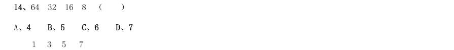

- **A.** 4
- **B.** 5
- **C.** 6
- **D.** 7

**答案：暂缺**

### 【2019 广东省考（乡镇）·第 15 题】GD-2019-xz-X015　数字推理｜数字推理（待细分）

( )

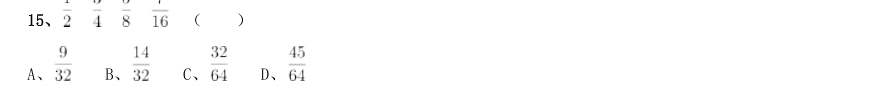

> （本题为图形题，选项为图片，见原卷）

**答案：暂缺**

### 【2019 广东省考（乡镇）·第 16 题】GD-2019-xz-X016　数字推理｜数字推理（待细分）

乡镇干部小李今天有3 项不同的工作要完成,则他今天完成工作的顺序共有( )种。

- **A.** 3
- **B.** 4
- **C.** 5
- **D.** 6

**答案：暂缺**

### 【2019 广东省考（乡镇）·第 17 题】GD-2019-xz-X017　数字推理｜数字推理（待细分）

某机构计划在一块边长为18 米的正方形空地开展活动,需要在空地四边每隔2 米插上一面彩旗,若该空地的 四个角都需要插上彩旗,那么一共需要( )面彩旗。

- **A.** 32
- **B.** 36
- **C.** 44
- **D.** 48

**答案：暂缺**

### 【2019 广东省考（乡镇）·第 18 题】GD-2019-xz-X018　数字推理｜数字推理（待细分）

在一次知识竞赛中,甲、乙两单位平均分为85 分,甲单位得分比乙单位高10 分,则乙单位得分为( )分。

- **A.** 88
- **B.** 85
- **C.** 80
- **D.** 75

**答案：暂缺**

### 【2019 广东省考（乡镇）·第 19 题】GD-2019-xz-X019　数字推理｜递推数列

某文印室有30 袋A4 纸和20 袋B3 纸。由于工作需要,该文印室每天都会用掉6 袋A4 纸和2 袋B3 纸,则三天 后文印室的B3 纸比A4 纸多( )袋。

- **A.** 1
- **B.** 2
- **C.** 3
- **D.** 4

**答案：暂缺**

### 【2019 广东省考（乡镇）·第 20 题】GD-2019-xz-X020　数字推理｜数字推理（待细分）

某单位男女干部人数相等,男干部中 有基层工作经历,女干部中 有基层工作经历。则在该单位全体干 部中,有基层工作经历的占( )。

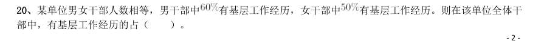

- **A.** 
- **B.** 
- **C.** 
- **D.** 

**答案：暂缺**

### 【2019 广东省考（乡镇）·第 21 题】GD-2019-xz-X021　数字推理｜数字推理（待细分）

某商场为了提高销量,以七五折销售笔记本电脑,打折后销售3600 元。则该笔记本原价为每台( )元。

- **A.** 4200
- **B.** 4500
- **C.** 4800
- **D.** 5100

**答案：暂缺**

### 【2019 广东省考（乡镇）·第 23 题】GD-2019-xz-X023　数字推理｜数字推理（待细分）

甲乙两人绕着周长为600 米的环形跑道跑步,他们从相同的起点同时同向起跑。已知甲的速度为每秒4 米,乙 的速度为每秒3 米,则当甲第一次回到起点时,乙距离起点还有( )米。

- **A.** 100
- **B.** 150
- **C.** 200
- **D.** 250

**答案：暂缺**

### 【2019 广东省考（乡镇）·第 24 题】GD-2019-xz-X024　数字推理｜数字推理（待细分）

小王距离单位1.2 公里,每天步行上班。速度为每分钟100 米,则他上班需要花( )分钟。

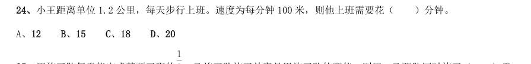

- **A.** 12
- **B.** 15
- **C.** 18
- **D.** 20

**答案：暂缺**

### 【2019 广东省考（县级）·第 16 题】GD-2019-xj-X016　数字推理｜数字推理（待细分）
> 材料：文字,要求你迅速、准确地计算出答案。…

120 60 20 5 ( )

- **A.** 1
- **B.** 2
- **C.** 3
- **D.** 4

**答案：暂缺**

### 【2019 广东省考（县级）·第 17 题】GD-2019-xj-X017　数字推理｜递推数列

2 9 11 20 31 ( )

- **A.** 39
- **B.** 43
- **C.** 47
- **D.** 51

**答案：暂缺**

### 【2019 广东省考（县级）·第 18 题】GD-2019-xj-X018　数字推理｜多级数列

24 32 41 51 62 ( )

- **A.** 72
- **B.** 74
- **C.** 76
- **D.** 78

**答案：暂缺**

### 【2019 广东省考（县级）·第 19 题】GD-2019-xj-X019　数字推理｜递推数列

1 1 2 6 24 ( )

- **A.** 86
- **B.** 112
- **C.** 120
- **D.** 144

**答案：暂缺**

### 【2019 广东省考（县级）·第 20 题】GD-2019-xj-X020　数字推理｜数字推理（待细分）

( )

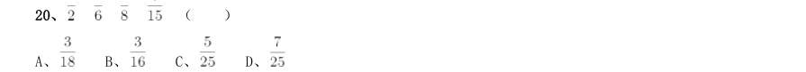

> （本题为图形题，选项为图片，见原卷）

**答案：暂缺**

### 【2019 广东省考（县级）·第 24 题】GD-2019-xj-X024　数字推理｜数字推理（待细分）

甲、乙、丙三人加工一种零件,三人每小时一共可以加工70 个零件。如果甲乙两人每小时加工的零件数之 比为2:3,乙丙两人每小时加工的零件数之比为4:5,则丙每小时比甲多加工( )个零件。

- **A.** 8
- **B.** 10
- **C.** 14
- **D.** 16

**答案：暂缺**

### 【2019 广东省考（县级）·第 26 题】GD-2019-xj-X026　数字推理｜递推数列

某物业公司规定,小区大门每2 天清洁一次,消防设施每3 天检查一次,绿化植物每5 天养护一次,如果 上述3 项工作刚好都在本周四完成了,那么下一次3 项工作刚好同一天完成是在( )。

- **A.** 星期一
- **B.** 星期二
- **C.** 星期六
- **D.** 星期日

**答案：暂缺**

### 【2019 广东省考（县级）·第 29 题】GD-2019-xj-X029　数字推理｜数字推理（待细分）

小李今天上午有a、b、c、d 这4 项工作要完成,下午有e、f、g 这3 项工作要完成,每半天内各项工作的 顺序可以随意调整,则他今天有( )种完成工作的顺序。

- **A.** 30
- **B.** 60
- **C.** 72
- **D.** 144

**答案：暂缺**

### 【2019 广东省考（思维能力测验）·第 61 题】GD-2019-sw-X061　数字推理｜多级数列

34,32,28,22,14,()

- **A.** 3
- **B.** 4
- **C.** 8
- **D.** 12

**答案：B**

### 【2019 广东省考（思维能力测验）·第 62 题】GD-2019-sw-X062　数字推理｜多级数列

30,14,6,2,0,()

- **A.** 6
- **B.** 2
- **C.** -1
- **D.** -4

**答案：C**

### 【2019 广东省考（思维能力测验）·第 63 题】GD-2019-sw-X063　数字推理｜多级数列

26,20,15,11,8,()

- **A.** 3
- **B.** 5
- **C.** 6
- **D.** 7

**答案：C**

### 【2019 广东省考（思维能力测验）·第 64 题】GD-2019-sw-X064　数字推理｜多级数列

3,7,15,31,()

- **A.** 63
- **B.** 52
- **C.** 46
- **D.** 40

**答案：A**

### 【2019 广东省考（思维能力测验）·第 65 题】GD-2019-sw-X065　数字推理｜多级数列

5,10,17,26,()

- **A.** 30
- **B.** 32
- **C.** 36
- **D.** 37

**答案：D**

### 【2019 广东省考（思维能力测验）·第 68 题】GD-2019-sw-X068　数字推理｜递推数列
> 材料：A、4 B、5 C、8 D、10…

5,8,13,21,34,()

- **A.** 43
- **B.** 48
- **C.** 50
- **D.** 55

**答案：D**

### 【2018 广东省考·第 16 题】GD-2018-ty-X016　数字推理｜数字推理（待细分）

31 29 28 26 25 23 ( )

- **A.** 22
- **B.** 24
- **C.** 35
- **D.** 38

**答案：暂缺**

### 【2018 广东省考·第 17 题】GD-2018-ty-X017　数字推理｜多级数列

3 5 17 39 71 ( )

- **A.** 107
- **B.** 113
- **C.** 121
- **D.** 135

**答案：暂缺**

### 【2018 广东省考·第 18 题】GD-2018-ty-X018　数字推理｜幂次数列

0.5 3 8 18 38 ( )

- **A.** 75
- **B.** 78
- **C.** 82
- **D.** 85

**答案：暂缺**

### 【2018 广东省考·第 19 题】GD-2018-ty-X019　数字推理｜幂次数列

1 2 5 26 ( )

- **A.** 377
- **B.** 477
- **C.** 577
- **D.** 677

**答案：暂缺**

### 【2018 广东省考·第 20 题】GD-2018-ty-X020　数字推理｜数字推理（待细分）

14 28 56 112 ( )

- **A.** 155
- **B.** 186
- **C.** 224
- **D.** 320

**答案：暂缺**

### 【2018 广东省考·第 21 题】GD-2018-ty-X021　数字推理｜数字推理（待细分）

工厂的两个车间共同组装6300 辆自行车。如果先由一号车间组装8 天,再由二号车间组装3 天, 刚好可以完成任务;如果先由二号车间组装6 天,再由一号车间组装6 天,也刚好可以完成任务。则一号车 间每天比二号车间多组装( )辆自行车。

- **A.** 210
- **B.** 180
- **C.** 150
- **D.** 130

**答案：暂缺**

### 【2018 广东省考·第 23 题】GD-2018-ty-X023　数字推理｜数字推理（待细分）

某市服务行业举行业务技能大赛,其中东区参赛人数占总人数的 ,西区参赛人数占总人数的 , 南区参赛人数占总人数的 ,其余的是北区的参赛人员。结果东区参赛人数的 获奖,西区参赛人数的 获 奖,南区参赛人数的 获奖。已知参赛总人数超过100 人,不到200 人,则参赛总人数为( )。

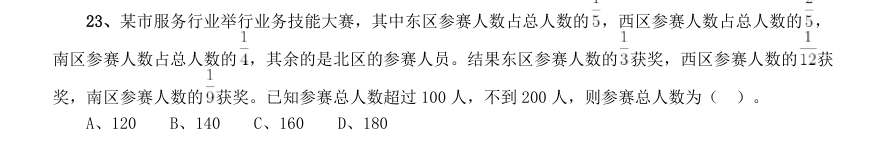

- **A.** 120
- **B.** 140
- **C.** 160
- **D.** 180

**答案：暂缺**

### 【2018 广东省考·第 25 题】GD-2018-ty-X025　数字推理｜数字推理（待细分）

工厂要对一台已经拆成6 个部件的机器进行清洗,并重新组装。清洗6 个部件的时间分别为10 分 钟、15 分钟、21 分钟、8 分钟、5 分钟、26 分钟,重新组装需要15 分钟。假设清洗每一个部件或重新组装 时都需要甲乙两人合作才能完成,报酬标准为每人每小时150 元(不足一小时按一小时计),则工厂需要支 付给甲乙两人共( )元。

- **A.** 300
- **B.** 600
- **C.** 900
- **D.** 1200

**答案：暂缺**

### 【2018 广东省考·第 26 题】GD-2018-ty-X026　数字推理｜幂次数列

有一条长100 厘米的纸带,从一端开始,先涂一段红色,长度为4 厘米;再涂一段白色,长度为4 厘米。按此规律重复操作,直到颜色涂满整条纸带。则涂红色的部分共有( )段。

- **A.** 10
- **B.** 13
- **C.** 15
- **D.** 25

**答案：暂缺**

### 【2018 广东省考·第 27 题】GD-2018-ty-X027　数字推理｜数字推理（待细分）

某软件公司对旗下甲、乙、丙、丁四款手机软件进行使用情况调查,在接受调查的1000 人中,有 的人使用过甲软件,有 的人使用过乙软件,有 的人使用过丙软件,有 的人使用过丁软件。 那么,在这1000 人中,使用过全部四款手机软件的至少有( )人。

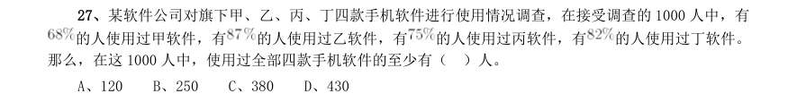

- **A.** 120
- **B.** 250
- **C.** 380
- **D.** 430

**答案：暂缺**

### 【2018 广东省考·第 29 题】GD-2018-ty-X029　数字推理｜数字推理（待细分）

某条道路一侧共有20 盏路灯。为了节约用电,计划只打开其中的10 盏。但为了不影响行路安全, 要求相邻的两盏路灯中至少有一盏是打开的,则共有( )种开灯方案。

- **A.** 2
- **B.** 6
- **C.** 11
- **D.** 13

**答案：暂缺**

### 【2018 广东省考·第 30 题】GD-2018-ty-X030　数字推理｜幂次数列

一项足球比赛共有8 支队伍参加,每两支队伍之间需要踢两场比赛,获胜得3 分,打平得1 分,落 败不得分。在该项足球比赛中,获得第一名的队伍积分最多可能比第二名多( )分。

- **A.** 40
- **B.** 30
- **C.** 20
- **D.** 10

**答案：暂缺**

### 【2017 广东省考·第 16 题】GD-2017-ty-X016　数字推理｜数字推理（待细分）

7 14 28 56 ( )

- **A.** 110
- **B.** 112
- **C.** 114
- **D.** 119

**答案：暂缺**

### 【2017 广东省考·第 17 题】GD-2017-ty-X017　数字推理｜多级数列

1 7 17 31 49 ( )

- **A.** 65
- **B.** 67
- **C.** 69
- **D.** 71

**答案：暂缺**

### 【2017 广东省考·第 18 题】GD-2017-ty-X018　数字推理｜多级数列

4 9 16 25 ( )

- **A.** 36
- **B.** 49
- **C.** 64
- **D.** 76

**答案：暂缺**

### 【2017 广东省考·第 19 题】GD-2017-ty-X019　数字推理｜数字推理（待细分）

1 2 6 16 44 120 ( )

- **A.** 164
- **B.** 176
- **C.** 240
- **D.** 328

**答案：暂缺**

### 【2017 广东省考·第 20 题】GD-2017-ty-X020　数字推理｜数字推理（待细分）

325 118 721 604 ( )

- **A.** 911
- **B.** 541
- **C.** 431
- **D.** 242

**答案：暂缺**

### 【2016 广东省考（乡镇）·第 16 题】GD-2016-xz-X016　数字推理｜递推数列

-1 3 -3 5 -5 7 ( )

- **A.** 7
- **B.** 8
- **C.** -7
- **D.** -8

**答案：暂缺**

### 【2016 广东省考（乡镇）·第 17 题】GD-2016-xz-X017　数字推理｜多级数列

13 26 39 52 ( )

- **A.** 55
- **B.** 65
- **C.** 75
- **D.** 85

**答案：暂缺**

### 【2016 广东省考（乡镇）·第 18 题】GD-2016-xz-X018　数字推理｜递推数列

1 2 3 10 39 ( )

- **A.** 157
- **B.** 257
- **C.** 390
- **D.** 490

**答案：暂缺**

### 【2016 广东省考（乡镇）·第 19 题】GD-2016-xz-X019　数字推理｜多级数列

12.7 20.9 31.1 43.3 ( )

- **A.** 55.5
- **B.** 57.5
- **C.** 57.7
- **D.** 59.7

**答案：暂缺**

### 【2016 广东省考（乡镇）·第 21 题】GD-2016-xz-X021　数字推理｜数字推理（待细分）

甲乙丙三人参加一项测试,三人的平均分为80,甲乙两人的平均分为75,乙丙两人的平均分 为80,那么甲丙两人的平均分为( )。

- **A.** 70
- **B.** 75
- **C.** 80
- **D.** 85

**答案：暂缺**

### 【2016 广东省考（乡镇）·第 22 题】GD-2016-xz-X022　数字推理｜数字推理（待细分）

一批零件若交由赵师傅单独加工,需要10 天完成;若交由孙师傅单独加工,需要15 天完成。 两位师傅一起加工这批零件,需要( ) 天完成。

- **A.** 5
- **B.** 6
- **C.** 7
- **D.** 8

**答案：暂缺**

### 【2016 广东省考（乡镇）·第 23 题】GD-2016-xz-X023　数字推理｜数字推理（待细分）

两辆汽车同时从两地相向开出,甲车每小时行驶60 千米,乙车每小时行驶48 千米,两车在 离两地中点48 千米处相遇。则两地相距( )千米。

- **A.** 192
- **B.** 224
- **C.** 416
- **D.** 864

**答案：暂缺**

### 【2016 广东省考（乡镇）·第 24 题】GD-2016-xz-X024　数字推理｜数字推理（待细分）

修建一条铁路,如果每4 米铺设5 根枕木,共需5000 根;如果每5 米铺设6 根枕木,一共要 用( )根。

- **A.** 3600
- **B.** 4200
- **C.** 4800
- **D.** 7500

**答案：暂缺**

### 【2016 广东省考（乡镇）·第 25 题】GD-2016-xz-X025　数字推理｜分数数列

某单位2014 年年终评比中,良好等级的人数占总人数3/5。2015 年年终评比又多了60 人被 评为良好等级,此时该等级的人数占总人数9/11。如果在这两年间该单位的人员没有变化,则该单位 共有( )人。

- **A.** 120
- **B.** 275
- **C.** 330
- **D.** 800

**答案：暂缺**

### 【2016 广东省考（乡镇）·第 26 题】GD-2016-xz-X026　数字推理｜递推数列

某服装店有一批衬衣共76 件,分别卖给了33 位顾客,每位顾客最多买了3 件。衬衣定价为 100 元,买1 件按原价,买2 件总价打九折,买3 件总价打八折。最后卖完这批衬衣共收入6460 元, 则买了3 件的顾客有( )位。

- **A.** 4
- **B.** 8
- **C.** 14
- **D.** 15

**答案：暂缺**

### 【2016 广东省考（乡镇）·第 28 题】GD-2016-xz-X028　数字推理｜数字推理（待细分）

小王早上看到挂钟显示8 点多,急忙赶往公司上班。但是到了公司却发现时间和自己出门看 到的挂钟时间一样,才明白是自己出门前误把挂钟的时针看成分针、分针看成时针。已知小王平时上 班路程不超过1.5 小时,今天上班他花费了( )。

- **A.** 48 分钟
- **B.** 55 分钟
- **C.** 1 小时
- **D.** 1 小时3 分钟

**答案：暂缺**

### 【2016 广东省考（乡镇）·第 29 题】GD-2016-xz-X029　数字推理｜数字推理（待细分）

某羽毛球赛共有23 支队伍报名参赛,赛事安排23 支队伍抽签两两争夺下一轮的出线权,没 有抽到对手的队伍轮空,直接进入下一轮。那么,本次羽毛球赛一共会出现( )次轮空的情况。

- **A.** 2
- **B.** 3
- **C.** 4
- **D.** 5

**答案：暂缺**

### 【2016 广东省考（乡镇）·第 30 题】GD-2016-xz-X030　数字推理｜分数数列

甲乙两人需托运行李。托运收费标准为10kg 以下6 元/kg,超出10kg 部分每公斤收费标准略 低一些。已知甲乙两人托运费分别为109.5 元、78 元,甲的行李比乙重了50%。那么,超出10kg 部分 每公斤收费标准比10kg 以内的低了( )元。

- **A.** 1.5
- **B.** 2.5
- **C.** 3.5
- **D.** 4.5

**答案：暂缺**

### 【2016 广东省考（县级）·第 36 题】GD-2016-xj-X036　数字推理｜多级数列

5,13,25,41( )

- **A.** 57
- **B.** 59
- **C.** 61
- **D.** 3

**答案：暂缺**

### 【2016 广东省考（县级）·第 37 题】GD-2016-xj-X037　数字推理｜数字推理（待细分）

8,14,16,21,24,28( )

- **A.** 35
- **B.** 34
- **C.** 33
- **D.** 32

**答案：暂缺**

### 【2016 广东省考（县级）·第 38 题】GD-2016-xj-X038　数字推理｜递推数列

1 2 3 10 39 ( )

- **A.** 157
- **B.** 257
- **C.** 390
- **D.** 490

**答案：暂缺**

### 【2016 广东省考（县级）·第 39 题】GD-2016-xj-X039　数字推理｜多级数列

12.7 20.9 31.1 43.3 ( )

- **A.** 55.5
- **B.** 57.5
- **C.** 57.7
- **D.** 59.7

**答案：暂缺**

### 【2016 广东省考（县级）·第 41 题】GD-2016-xj-X041　数字推理｜数字推理（待细分）

一批零件如果全部都交由甲厂加工,正好在计划时间完成,如果全部交由乙厂加工,要超过计划时间5 天 才能完成,如果甲乙两厂合作加工3 天,再由乙厂单独加工,正好也是在计划时间完成,则加工完这批零件计 划时间是( )

- **A.** 5
- **B.** 7
- **C.** 7.5
- **D.** 8.5

**答案：暂缺**

### 【2016 广东省考（县级）·第 44 题】GD-2016-xj-X044　数字推理｜分数数列

某单位租赁了两辆同样的大巴车运送员工外出活动,从出发地到目的地的车程是2 个小时,两车以相同速 度同时出发,但甲车刚出发10 分钟即发生故障,只能以原速的1/3 匀速较慢行驶,乙车将本车员工送到目的地 后,原路返回与甲车相遇,载上甲车员工驶往目的地,当所有员工到达目的地时,在途用时总计为( )(上 下车时间不计)

- **A.** 3 小时50 分钟
- **B.** 4 小时
- **C.** 4 小时20 分钟
- **D.** 4 小时40 分钟

**答案：暂缺**

### 【2016 广东省考（县级）·第 46 题】GD-2016-xj-X046　数字推理｜幂次数列

大型体育竞赛开幕式需要列队,共10 排。导演安排演员总数的一半多一个在第一排,安排剩下演员人数 的一半多一个在第2 排........依次类推。如果在第10 排恰好将演员排完,那么参与排队列的演员共有( )名。

- **A.** 2000
- **B.** 2008
- **C.** 2012
- **D.** 2046

**答案：暂缺**

### 【2016 广东省考（县级）·第 50 题】GD-2016-xj-X050　数字推理｜数字推理（待细分）

甲乙两地位于不同时区,小张早上10 点从甲地乘飞机到乙地,到达的时间为当地时间早上十点,第二天 下午4 点30 分从乙地飞回甲地,到达的时间为当地时间22 点30 分。如果两次飞行时间相同。那么,当甲地 时间为中午12 点时,乙地时间为( )。

- **A.** 8 点30 分
- **B.** 9 点
- **C.** 9 点30 分
- **D.** 10 点

**答案：暂缺**

### 【2015 广东省考（乡镇）·第 29 题】GD-2015-xz-X029　数字推理｜数字推理（待细分）

在一次抽奖活动中,要把18 个奖品分成数量不等的4 份各自放进不同的抽奖箱。则一个抽奖 箱最多可以放()个奖品。

- **A.** 6
- **B.** 8
- **C.** 12
- **D.** 15

**答案：暂缺**

### 【2015 广东省考（县级）·第 26 题】GD-2015-xj-X026　数字推理｜数字推理（待细分）

阅览室有100 本杂志,小赵借阅过其中75 本,小王借阅过70 本,小刘借阅过60 本,则三人共同借 阅过的杂志最少有()本。

- **A.** 5
- **B.** 10
- **C.** 15
- **D.** 30

**答案：暂缺**

### 【2015 广东省考（县级）·第 28 题】GD-2015-xj-X028　数字推理｜数字推理（待细分）

水果店一天卖出每千克为10 元,12 元,16 元的3 种水果共100 千克,共收入1316 元。已知售出的 每千克12 元和每千克16 元的水果共收入1016 元,那么每千克10 元的水果售出了()千克。

- **A.** 26
- **B.** 30
- **C.** 34
- **D.** 38

**答案：暂缺**

### 【2014 广东省考（乡镇）·第 56 题】GD-2014-xz-X056　数字推理｜多级数列

11,18,25,32,( )

- **A.** 34
- **B.** 37
- **C.** 39
- **D.** 41

**答案：暂缺**

### 【2014 广东省考（乡镇）·第 57 题】GD-2014-xz-X057　数字推理｜数字推理（待细分）

4,12,36,108,( )

- **A.** 223
- **B.** 257
- **C.** 315
- **D.** 324

**答案：暂缺**

### 【2014 广东省考（乡镇）·第 58 题】GD-2014-xz-X058　数字推理｜递推数列

10,5,15,20,35,( )

- **A.** 50
- **B.** 55
- **C.** 65
- **D.** 70

**答案：暂缺**

### 【2014 广东省考（乡镇）·第 59 题】GD-2014-xz-X059　数字推理｜数字推理（待细分）

90,45,15,3.75,( )

- **A.** 0.25
- **B.** 0.5
- **C.** 0.75
- **D.** 1

**答案：暂缺**

### 【2014 广东省考（县级）·第 41 题】GD-2014-xj-X041　数字推理｜数字推理（待细分）

2187,729,243,81,27,( )

- **A.** 3
- **B.** 6
- **C.** 9
- **D.** 12

**答案：暂缺**

### 【2014 广东省考（县级）·第 42 题】GD-2014-xj-X042　数字推理｜递推数列

4,6,10,18,34,66,( )

- **A.** 82
- **B.** 98
- **C.** 114
- **D.** 130

**答案：暂缺**

### 【2014 广东省考（县级）·第 43 题】GD-2014-xj-X043　数字推理｜数字推理（待细分）

768,199,827,69,904,( )

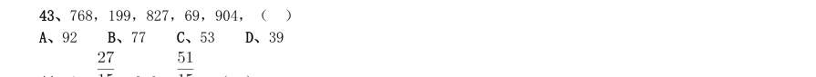

- **A.** 92
- **B.** 77
- **C.** 53
- **D.** 39

**答案：暂缺**

### 【2014 广东省考（县级）·第 44 题】GD-2014-xj-X044　数字推理｜数字推理（待细分）

1, ,2.6, ,( )

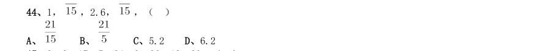

- **A.** 
- **B.** 
- **C.** 5.2
- **D.** 6.2

**答案：暂缺**

### 【2014 广东省考（县级）·第 45 题】GD-2014-xj-X045　数字推理｜幂次数列

8,3,17,5,24,9,26,18,30,( )

- **A.** 22
- **B.** 25
- **C.** 33
- **D.** 36

**答案：暂缺**

### 【2013 广东省考（一卷）·第 1 题】GD-2013-1-X001　数字推理｜数字推理（待细分）

160,80,40,20,( )

- **A.** 4
- **B.** 6
- **C.** 8
- **D.** 10

**答案：暂缺**

### 【2013 广东省考（一卷）·第 2 题】GD-2013-1-X002　数字推理｜多级数列

6,14,22,( ),38,46

- **A.** 30
- **B.** 32
- **C.** 34
- **D.** 36

**答案：暂缺**

### 【2013 广东省考（一卷）·第 3 题】GD-2013-1-X003　数字推理｜幂次数列

1.8,3.6,7.2,14.4,( ),57.6

- **A.** 18.4
- **B.** 22.6
- **C.** 28.8
- **D.** 34.4

**答案：暂缺**

### 【2013 广东省考（一卷）·第 4 题】GD-2013-1-X004　数字推理｜多级数列

300,290,281,273,( ),260

- **A.** 270
- **B.** 266
- **C.** 264
- **D.** 262

**答案：暂缺**

### 【2013 广东省考（一卷）·第 5 题】GD-2013-1-X005　数字推理｜递推数列

2,3,7,10,19,26,45,60,( )

- **A.** 99
- **B.** 105
- **C.** 113
- **D.** 127

**答案：暂缺**

### 【2013 广东省考（一卷）·第 6 题】GD-2013-1-X006　数字推理｜数字推理（待细分）

一款手机打七折后价格为1050 元,则该手机原价为( )元。

- **A.** 1100
- **B.** 1400
- **C.** 1500
- **D.** 2100

**答案：暂缺**

### 【2013 广东省考（一卷）·第 16 题】GD-2013-1-X016　数字推理｜数字推理（待细分）

要加快新型产业布局,就需要进一步结合广东资源和经济发展的现状,以科技创新去( )产业新优势。

- **A.** 构造
- **B.** 构建
- **C.** 建筑
- **D.** 建造

**答案：暂缺**

### 【2013 广东省考（一卷）·第 17 题】GD-2013-1-X017　数字推理｜数字推理（待细分）

随着时间的推移,新一代农民开始( )自己的打工生涯,并希望能融入城市,走出农民工这个身份模糊 的地带。

- **A.** 计划
- **B.** 谋划
- **C.** 策划
- **D.** 规划

**答案：暂缺**

### 【2013 广东省考（一卷）·第 18 题】GD-2013-1-X018　数字推理｜数字推理（待细分）

进一步( )地域特色,进行特色打造和品位提升是名镇名村创建工作的目的之一。

- **A.** 挖掘
- **B.** 探索
- **C.** 发掘
- **D.** 摸索

**答案：暂缺**

### 【2013 广东省考（一卷）·第 19 题】GD-2013-1-X019　数字推理｜数字推理（待细分）

随着社会老龄化进入了第一高峰期,广大老年人精神文化生活方面的需求也进一步( )出来。

- **A.** 体现
- **B.** 呈现
- **C.** 表现
- **D.** 凸显

**答案：暂缺**

### 【2013 广东省考（一卷）·第 20 题】GD-2013-1-X020　数字推理｜数字推理（待细分）

从成长经历来看,新生代农民工没有经历过父辈那样从农村到城市的变化过程,与城市同龄人更为( )。

- **A.** 趋同
- **B.** 相同
- **C.** 雷同
- **D.** 同步

**答案：暂缺**

### 【2013 广东省考（一卷）·第 21 题】GD-2013-1-X021　数字推理｜数字推理（待细分）

保障粮食安全,确保主要农产品基本供给,是保持国民经济健康持续稳定( )的战略需要。

- **A.** 运转
- **B.** 运作
- **C.** 运营
- **D.** 运行

**答案：暂缺**

### 【2013 广东省考（一卷）·第 22 题】GD-2013-1-X022　数字推理｜数字推理（待细分）

幸福村居是以村民主观幸福感为建设指向,以( )村民对村居生活满意度为目标,根据目前农村生产力 发展水平,统筹规划,整合资源,全面建设“宜居、宜业、生态、文明、和谐、平安”的社会主义新农村。

- **A.** 解决
- **B.** 提高
- **C.** 缓解
- **D.** 促进

**答案：暂缺**

### 【2013 广东省考（一卷）·第 23 题】GD-2013-1-X023　数字推理｜数字推理（待细分）

农民工就业难题的破解是一个长期过程,不可能( ),需要政府、企业、社会组织以及农民工自己协同 作战。

- **A.** 轻而易举
- **B.** 易如反掌
- **C.** 一蹴而就
- **D.** 唾手可得

**答案：暂缺**

### 【2013 广东省考（一卷）·第 24 题】GD-2013-1-X024　数字推理｜数字推理（待细分）

对于身在大学校园的学子特别是来自农村的学子,他们( )城乡之间的巨大差异、区域之间不同乡村的 鲜明对比,能深刻感受家乡亟须改变和发展的紧迫性。

- **A.** 耳闻目睹
- **B.** 耳濡目染
- **C.** 潜移默化
- **D.** 言之凿凿

**答案：暂缺**

### 【2013 广东省考（一卷）·第 25 题】GD-2013-1-X025　数字推理｜多重数列

一线农技人员是“三农”战线上( )的群体,或从事农业技术推广,或参与作物、畜禽的疫病防治,或指 导农民种菜养鸡......他们长期( )基层,工作艰辛而琐碎。

- **A.** 不可或缺 扎根
- **B.** 举足轻重 留守
- **C.** 无足轻重 驻守
- **D.** 不可多得 扎堆

**答案：暂缺**

### 【2013 广东省考（三卷）·第 1 题】GD-2013-3-X001　数字推理｜幂次数列

1.8,3.6,7.2,14.4,( ),57.6

- **A.** 18.4
- **B.** 22.6
- **C.** 28.8
- **D.** 34.4

**答案：暂缺**

### 【2013 广东省考（三卷）·第 2 题】GD-2013-3-X002　数字推理｜幂次数列

3,7,9,14,27,28,81,( )

- **A.** 132
- **B.** 108
- **C.** 83
- **D.** 56

**答案：暂缺**

### 【2013 广东省考（三卷）·第 3 题】GD-2013-3-X003　数字推理｜多级数列

6,14,22,( ),38,46

- **A.** 30
- **B.** 32
- **C.** 34
- **D.** 36

**答案：暂缺**

### 【2013 广东省考（三卷）·第 4 题】GD-2013-3-X004　数字推理｜分数数列

1,5/6,7/10,3/5,8/15,( )

- **A.** 1/5
- **B.** 1/4
- **C.** 1/3
- **D.** 1/2

**答案：暂缺**

### 【2013 广东省考（三卷）·第 5 题】GD-2013-3-X005　数字推理｜数字推理（待细分）

24,35,55,57,( )

- **A.** 64
- **B.** 68
- **C.** 75
- **D.** 79

**答案：暂缺**

### 【2012 广东省考·第 1 题】GD-2012-ty-X001　数字推理｜数字推理（待细分）

0,1,3,9,33,( )

- **A.** 147
- **B.** 150
- **C.** 153
- **D.** 156

**答案：暂缺**

### 【2012 广东省考·第 2 题】GD-2012-ty-X002　数字推理｜多重数列

12,9,18,33,96,21,( ),( )

- **A.** 39,3
- **B.** 12,24
- **C.** 26,27
- **D.** 36,51

**答案：暂缺**

### 【2012 广东省考·第 3 题】GD-2012-ty-X003　数字推理｜数字推理（待细分）

3672,5458,9016,7450,( )

- **A.** 3578
- **B.** 6473
- **C.** 9894
- **D.** 4785

**答案：暂缺**

### 【2012 广东省考·第 4 题】GD-2012-ty-X004　数字推理｜数字推理（待细分）

2,2,8,-1,-2,5,1,1,2,-1,1,( )

- **A.** -2
- **B.** -1
- **C.** 1
- **D.** 2

**答案：暂缺**

### 【2012 国考·第 78 题】GK-2012-ty-X078　数字推理｜多级数列

某成衣厂对9 名缝纫工进行技术评比,9 名工人的得分正好成等差数列,9 人的平均得分是86 分,前5 名工 人的得分之和是460 分,那么前7 名工人的得分之和是多少:

- **A.** 602
- **B.** 623
- **C.** 627
- **D.** 631

**答案：B**

### 【2011 广东省考·第 1 题】GD-2011-ty-X001　数字推理｜数字推理（待细分）

( )。

- **A.** 
- **B.** 28
- **C.** 
- **D.** 35

**答案：暂缺**

### 【2011 广东省考·第 2 题】GD-2011-ty-X002　数字推理｜幂次数列

3,5,5,6,6.5,( )。

- **A.** 6.25
- **B.** 6.5
- **C.** 7.25
- **D.** 7.5

**答案：暂缺**

### 【2011 广东省考·第 3 题】GD-2011-ty-X003　数字推理｜数字推理（待细分）

30,15,1002,57,( )。

- **A.** 78
- **B.** 77
- **C.** 68
- **D.** 67

**答案：暂缺**

### 【2011 广东省考·第 4 题】GD-2011-ty-X004　数字推理｜幂次数列

1,9,7,4,8,5,( ),11。

- **A.** 3
- **B.** 4
- **C.** 5
- **D.** 6

**答案：暂缺**

### 【2010 湖北省考·第 41 题】HB-2010-ty-X041　数字推理｜递推数列

1,8,28,80,208,( )

- **A.** 468
- **B.** 498
- **C.** 508
- **D.** 512

**答案：D**

### 【2010 湖北省考·第 42 题】HB-2010-ty-X042　数字推理｜幂次数列

6,7,18,23,( ),47

- **A.** 25
- **B.** 38
- **C.** 40
- **D.** 50

**答案：B**

### 【2010 湖北省考·第 43 题】HB-2010-ty-X043　数字推理｜幂次数列

1,10,26,75,196,( )

- **A.** 380
- **B.** 425
- **C.** 520
- **D.** 612

**答案：C**

### 【2010 湖北省考·第 44 题】HB-2010-ty-X044　数字推理｜幂次数列

123,139,177,261,463,( )

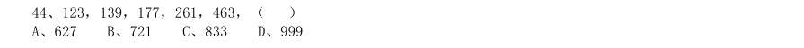

- **A.** 627
- **B.** 721
- **C.** 833
- **D.** 999

**答案：D**

### 【2010 广东省考·第 1 题】GD-2010-ty-X001　数字推理｜数字推理（待细分）

, , , ,( )。

> （本题为图形题，选项为图片，见原卷）

**答案：暂缺**

### 【2010 广东省考·第 2 题】GD-2010-ty-X002　数字推理｜递推数列

3,4,12,18,44,( )。

- **A.** 44
- **B.** 56
- **C.** 78
- **D.** 79

**答案：暂缺**

### 【2010 广东省考·第 3 题】GD-2010-ty-X003　数字推理｜幂次数列

4,5,15,6,7,35,8,9,( )。

- **A.** 27
- **B.** 15
- **C.** 72
- **D.** 63

**答案：暂缺**

### 【2010 广东省考·第 4 题】GD-2010-ty-X004　数字推理｜数字推理（待细分）

1526,4769,2154,5397,( )。

- **A.** 2317
- **B.** 1545
- **C.** 1469
- **D.** 5213

**答案：暂缺**

### 【2010 国考·第 41 题】GK-2010-ty-X041　数字推理｜多重数列

1,6,20,56,144,( )

- **A.** 256
- **B.** 244
- **C.** 352
- **D.** 384

**答案：C**

### 【2010 国考·第 42 题】GK-2010-ty-X042　数字推理｜递推数列

1,2,6,15,40,104,()

- **A.** 273
- **B.** 329
- **C.** 185
- **D.** 225

**答案：A**

### 【2010 国考·第 43 题】GK-2010-ty-X043　数字推理｜幂次数列

3,2,11,14,( ),34

- **A.** 18
- **B.** 21
- **C.** 24
- **D.** 27

**答案：D**

### 【2010 国考·第 44 题】GK-2010-ty-X044　数字推理｜递推数列

2,3,7,16,65,321,( )

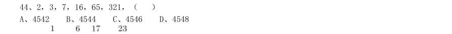

- **A.** 4542
- **B.** 4544
- **C.** 4546
- **D.** 4548

**答案：C**

### 【2010 国考·第 45 题】GK-2010-ty-X045　数字推理｜分数数列

1, , , , ,( )

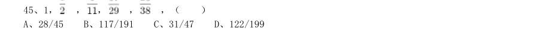

- **A.** 28/45
- **B.** 117/191
- **C.** 31/47
- **D.** 122/199

**答案：D**
