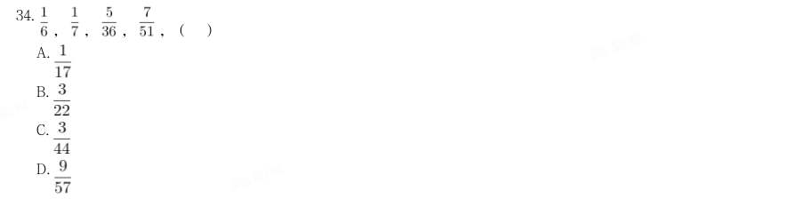
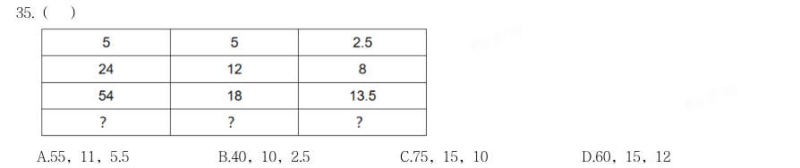
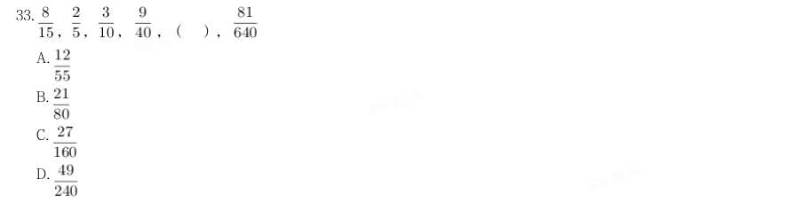
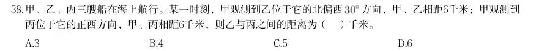
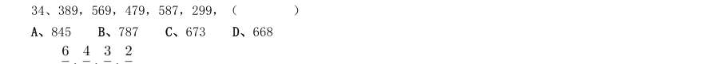
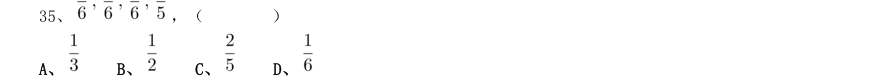

# 数量关系 · 数字推理 · 2020 年代真题

> 所属考点：[SL-SZ](../SL-SZ-数字推理.md)　｜　本片 49 题

### 2025 广东·统一卷　第 33 题　（数字推理（综合））

1,4,27,16,125,36,( )

- **A.** 271
- **B.** 512
- **C.** 400
- **D.** 343

**答案：A**

### 2025 广东·统一卷　第 34 题　（数字推理（综合））

, , , ,( )

- **A.** 
- **B.** 
- **C.** 
- **D.** 

**答案：D**

### 2025 广东·统一卷　第 35 题　（数字推理（综合））

( )

- **A.** 55,11,5.5
- **B.** 40,10,2.5
- **C.** 75,15,10
- **D.** 60,15,12

**答案：A**

### 2025 广东·统一卷　第 36 题　（数字推理（综合））

箱子里装有红、蓝、绿、白、黑五种颜色的小球各20个。如果从箱子里取出若干个小球,且确保其中有10个小 球颜色相同,则至少要取出( )个小球。

- **A.** 56
- **B.** 51
- **C.** 50
- **D.** 46

**答案：C**

### 2025 广东·统一卷　第 37 题　（数字推理（综合））

某服务大厅设有若干个服务窗口,其中1个是快捷服务窗口,某日服务窗口的平均业务量为29单,其中快捷服 务窗口的业务量为41单,其余窗口的平均业务量为28单,则服务大厅共有( )个窗口。

- **A.** 13
- **B.** 14
- **C.** 15
- **D.** 16

**答案：D**

### 2025 广东·统一卷　第 38 题　（数字推理（综合））

父子两人在百米赛道上匀速跑步,两人从赛道起点同时出发,父亲跑到终点时,儿子距离终点还有40米,若父 亲立即折返跑向赛道起点,则两人相遇时,儿子距离终点还有( )米。

- **A.** 35
- **B.** 30
- **C.** 25
- **D.** 15

**答案：D**

### 2025 广东·统一卷　第 40 题　（数字推理（综合））

某单位计划在一块直角三角形的绿地周边栽种树木,先在3个顶点各栽种1棵,再从顶点开始每隔4米栽种1棵, 如果两条直角边(包含顶点)分别栽种4棵和5棵,则该绿地周边一共栽种了( )棵树。

- **A.** 12
- **B.** 13
- **C.** 14
- **D.** 15

**答案：C**

### 2024 广东·统一卷　第 32 题　（数字推理（综合））

1,11,23,33,45,55,67,( )

- **A.** 66
- **B.** 70
- **C.** 73
- **D.** 77

**答案：D**

### 2024 广东·统一卷　第 33 题　（数字推理（综合））

, , , ,( ),

- **A.** 
- **B.** 
- **C.** 
- **D.** 

**答案：D**

### 2024 广东·统一卷　第 34 题　（数字推理（综合））

21.98,18.77,17.49,14.55,( )

- **A.** 12.26
- **B.** 13.66
- **C.** 14.26
- **D.** 15.66

**答案：C**

### 2024 广东·统一卷　第 35 题　（数字推理（综合））

5,-7,16,-50,202,( )

- **A.** 1012
- **B.** -1012
- **C.** 1122
- **D.** -1122

**答案：A**

### 2024 广东·统一卷　第 36 题　（数字推理（综合））

档案室需要整理300份档案,要求每天整理的档案数量相同,且规定了完成的期限。如果要提前一天完成,那 么每天需要多整理10份档案。则规定的期限为( )天。

- **A.** 6
- **B.** 7
- **C.** 8
- **D.** 9

**答案：C**

### 2024 广东·统一卷　第 37 题　（数字推理（综合））

某家政公司承诺以低于市场价20%的价格为小区业主提供服务。如果有业主向该公司支付了服务费4000元,则 与市场价相比优惠了( )元。

- **A.** 400
- **B.** 600
- **C.** 800
- **D.** 1000

**答案：B**

### 2024 广东·统一卷　第 38 题　（数字推理（综合））

甲、乙、丙三艘船在海上航行。某一时刻,甲观测到乙位于它的北偏西 方向,甲、乙相距6千米;甲观测到 丙位于它的正西方向,甲、丙相距6千米,则乙与丙之间的距离为( )千米。

- **A.** 3
- **B.** 4
- **C.** 5
- **D.** 6

**答案：A**

### 2024 广东·统一卷　第 39 题　（数字推理（综合））

某企业在展销会上销售甲、乙两种产品。已知甲产品的库存比乙产品多100件,展销会结束后,甲产品全部售 完,乙产品售出库存的60%,两种产品共售出1260件,则甲、乙两种产品原有总库存( )件。

- **A.** 1450
- **B.** 1500
- **C.** 1550
- **D.** 1600

**答案：B**

### 2024 广东·统一卷　第 40 题　（数字推理（综合））

只有在星期六,小王才会去图书馆。如果某年3月小王一共有5天去过图书馆,则当年4月1日可能是( )。

- **A.** 星期二
- **B.** 星期三
- **C.** 星期五
- **D.** 星期六

**答案：B**

### 2024 广东·统一卷　第 41 题　（数字推理（综合））

某高校中文系计划从3名男生和3名女生中选派4名学生参加暑期支教活动。如果选派的女生不少于2名,则选派 方案共有( )种。

- **A.** 4
- **B.** 8
- **C.** 12
- **D.** 16

**答案：B**

### 2024 广东·统一卷　第 42 题　（数字推理（综合））

甲、乙、丙3人参加专业测试,考试包含10道题,答对每题得10分,不答或答错不得分。已知每道题3人中至少 有2人答对,没有人得100分且任意2人总分都不相同。则最多有( )道题3人都答对。

- **A.** 3
- **B.** 4
- **C.** 5
- **D.** 6

**答案：C**

### 2024 广东·统一卷　第 43 题　（数字推理（综合））

某个障碍跑项目需要在100米长的跑道上布置障碍(起点和终点均不布置)。如果从起点开始,每隔4米布置一 个甲障碍,每隔6米布置一个乙障碍,甲、乙障碍的重合点则不布置甲障碍。则跑道上总共布置( )个甲障 碍。

- **A.** 16
- **B.** 17
- **C.** 24
- **D.** 25

**答案：A**

### 2024 广东·统一卷　第 44 题　（数字推理（综合））

小李从山脚开始登顶,匀速走了1小时后到达一个凉亭,并在凉亭休息了半小时。继续走500米后,恰好完成登 顶路程的一半。从山顶沿原路匀速返回时,他走了1小时又到了这个凉亭,继续走半小时回到了山脚。则登顶 路程为( )米。

- **A.** 2000
- **B.** 3000
- **C.** 3600
- **D.** 4000

**答案：C**

### 2024 广东·统一卷　第 45 题　（数字推理（综合））

某社区计划组织志愿者为社区内的独居老人提供服务。按已有志愿者的数量,如果每位志愿者服务10位老人, 则有5位老人无人提供服务;如果增加2位志愿者,则每位志愿者最多服务8位老人就能为所有老人提供服务。 那么该社区最多有( )位独居老人。

- **A.** 50
- **B.** 55
- **C.** 60
- **D.** 65

**答案：D**

### 2023 广东·乡镇　第 32 题　（递推与多级数列）

35,71,53,17,62,( )

- **A.** 24
- **B.** 26
- **C.** 36
- **D.** 38

**答案：B**

### 2023 广东·乡镇　第 34 题　（数字推理（综合））

10,3,13,1,14,2,16,5,( )

- **A.** 18
- **B.** 19
- **C.** 20
- **D.** 21

**答案：D**

### 2023 广东·县级　第 26 题　（数字推理（综合））

10,3,13,1,14,2,16,9,( )

- **A.** 23
- **B.** 24
- **C.** 25
- **D.** 26

**答案：C**

### 2022 广东·乡镇　第 31 题　（等差数列）

17,27,39,( )

- **A.** 51
- **B.** 53
- **C.** 56
- **D.** 59

**答案：B**

### 2022 广东·乡镇　第 32 题　（递推与多级数列）

11,14,26,44,65,( )

- **A.** 80
- **B.** 83
- **C.** 86
- **D.** 89

**答案：C**

### 2022 广东·乡镇　第 34 题　（递推与多级数列）

6,12,19,32,52,( )

- **A.** 84
- **B.** 85
- **C.** 86
- **D.** 87

**答案：B**

### 2022 广东·县级　第 26 题　（递推与多级数列）

11,14,26,44,65,( )

- **A.** 80
- **B.** 83
- **C.** 86
- **D.** 89

**答案：C**

### 2022 广东·县级　第 27 题　（等比数列）

22,42,44,84,88,168,( ),( )

- **A.** 176,336
- **B.** 236,352
- **C.** 264,386
- **D.** 312,412

**答案：A**

### 2022 广东·县级　第 29 题　（递推与多级数列）

12,25,310,417,( )

- **A.** 521
- **B.** 526
- **C.** 632
- **D.** 647

**答案：B**

### 2021 广东·乡镇　第 31 题　（数字推理（综合））

23,24,22,25,21,26,( ),( )

- **A.** 19
- **B.** 20
- **C.** 26
- **D.** 32

**答案：暂缺**

### 2021 广东·乡镇　第 32 题　（数字推理（综合））

3,9,18,30,45,( )

- **A.** 69
- **B.** 66
- **C.** 63
- **D.** 60

**答案：暂缺**

### 2021 广东·乡镇　第 33 题　（数字推理（综合））

11,44,99,176,( )

- **A.** 275
- **B.** 265
- **C.** 260
- **D.** 255

**答案：暂缺**

### 2021 广东·乡镇　第 34 题　（数字推理（综合））

389,569,479,587,299,( )

- **A.** 845
- **B.** 787
- **C.** 673
- **D.** 668

**答案：暂缺**

### 2021 广东·乡镇　第 35 题　（数字推理（综合））

,( )

- **A.** 
- **B.** 
- **C.** 
- **D.** 

**答案：暂缺**

### 2020 广东·乡镇　第 31 题　（数字推理（综合））

5 13 25 41 ( )

- **A.** 52
- **B.** 55
- **C.** 58
- **D.** 61

**答案：暂缺**

### 2020 广东·乡镇　第 32 题　（数字推理（综合））

23 34 58 93 152 ( )

- **A.** 176
- **B.** 206
- **C.** 246
- **D.** 296

**答案：暂缺**

### 2020 广东·乡镇　第 33 题　（数字推理（综合））

9.19 4.27 5.35 2.43 ( )

- **A.** 3.51
- **B.** 5.51
- **C.** 5.60
- **D.** 8.60

**答案：暂缺**

### 2020 广东·乡镇　第 34 题　（数字推理（综合））

0 6 24 60 120 ( )

- **A.** 200
- **B.** 210
- **C.** 220
- **D.** 230

**答案：暂缺**

### 2020 广东·县级　第 26 题　（数字推理（综合））

2,12,30,56,90,( )

- **A.** 132
- **B.** 138
- **C.** 144
- **D.** 150

**答案：暂缺**

### 2020 广东·县级　第 27 题　（数字推理（综合））

23 ( )

- **A.** 176
- **B.** 206
- **C.** 246
- **D.** 296

**答案：暂缺**

### 2020 广东·县级　第 28 题　（数字推理（综合））

9.19 4.27 5.35 2.43 ( )

- **A.** 3.51
- **B.** 5.51
- **C.** 5.60
- **D.** 8.60

**答案：暂缺**

### 2020 广东·县级　第 29 题　（数字推理（综合））

0 ( )

- **A.** 200
- **B.** 210
- **C.** 220
- **D.** 230

**答案：暂缺**

### 2020 广东·思维能力测验　第 81 题　（等比数列）

3,4,6,10,18,( )

- **A.** 28
- **B.** 32
- **C.** 34
- **D.** 40

**答案：C**

### 2020 广东·思维能力测验　第 82 题　（等差数列）

87,86,84,79,69,52,( )

- **A.** 24
- **B.** 25
- **C.** 26
- **D.** 27

**答案：C**

### 2020 广东·思维能力测验　第 84 题　（等差数列）

607,819,10211,12313,( )

- **A.** 13414
- **B.** 14415
- **C.** 14514
- **D.** 15415

**答案：B**

### 2020 广东·思维能力测验　第 87 题　（等差数列）

100,82,66,52,( )

- **A.** 40
- **B.** 36
- **C.** 32
- **D.** 26

**答案：A**

### 2020 广东·思维能力测验　第 88 题　（等差数列）

521,232,172,422,( )

- **A.** 158
- **B.** 233
- **C.** 397
- **D.** 406

**答案：B**

### 2020 广东·思维能力测验　第 89 题　（等差数列）

6,20,42,72,( )

- **A.** 90
- **B.** 100
- **C.** 110
- **D.** 120

**答案：C**
