# 数量关系 · 行程问题 · 2010 年代真题

> 所属考点：[SL-XC](../SL-XC-行程问题.md)　｜　本片 45 题

> 本片子考点：基础行程 14　相遇追及 14　环形与往返 12　等距离平均速度 3　流水行船 2

### 2019 湖北·统一卷　第 60 题　（基础行程）

一位学生在距离热气球100 米处观看它起飞。在热气球起飞后,学生注意到热气球顶部从他的仰角 上升 到 ,再从 上升到 的位置分别用了11 秒和17 秒。则前后两段时间热气球平均上升速度的比值约为:

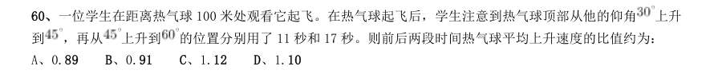

- **A.** 0.89
- **B.** 0.91
- **C.** 1.12
- **D.** 1.10

**答案：A**

### 2019 湖北·统一卷　第 62 题　（基础行程）

甲、乙两部参加军事演习。甲部从大本营以60 千米/小时的速度往西行进,乙部晚半小时由大本营往东行进, 速度比甲部慢。两部同时接到军令紧急集合,集合地位于大本营正北某处。此时两部所在位置与集合地恰好构成 有一角为30 度的直角三角形。若两部同时调整方向往集合地行军,且保持速度不变,则可同时到达集合地。问 集合地与大本营的距离约为多少千米?

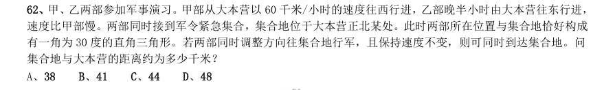

- **A.** 38
- **B.** 41
- **C.** 44
- **D.** 48

**答案：B**

### 2019 湖北·统一卷　第 70 题　（相遇追及）

小林在距家1.5 公里的工厂上班。一天,小林出发10 分钟后,父亲老林发现小林的手机没带,立即追出去, 并在距离工厂500 米的地方追上了他。如果老林追赶的速度比小林快6 公里/小时,那么,下列关于小林速度 , 求值所列方程正确的是:

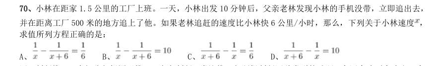

- **A.** 
- **B.** 
- **C.** 
- **D.** 

**答案：A**

### 2019 国考·地市级　第 64 题　（相遇追及）

甲车上午8 点从A 地出发匀速开往B 地,出发30 分钟后乙车从A 地出发以甲车2 倍的速度前往B 地,并在 距离B 地10 千米时追上甲车。如乙车9 点10 分到达B 地,问甲车的速度为多少千米/小时?

- **A.** 30
- **B.** 36
- **C.** 45
- **D.** 60

**答案：A**

### 2019 国考·省级　第 61 题　（基础行程）

一个圆形的人工湖,直径为50 公里,某游船从码头甲出发,匀速直线行驶30 公里到码头乙停留36 分钟, 然后到与码头甲直线距离为50 公里的码头丙,共用时2 小时。问该游船从码头甲直线行驶到码头丙需用多少时 间?

- **A.** 50 分钟
- **B.** 1 小时
- **C.** 1 小时20 分
- **D.** 1 小时30 分

**答案：B**

### 2018 湖北·统一卷　第 56 题　（相遇追及）

甲、乙、丙、丁四人同时同地出发,绕一椭圆形环湖栈道行走。甲顺时针行走,其余三人逆时针行走。已 知乙的行走速度为60 米/分钟,丙的速度为48 米/分钟。甲在出发6、7、8 分钟时分别与乙、丙、丁三人相遇, 求丁的行走速度是多少?

- **A.** 31 米/分钟
- **B.** 36 米/分钟
- **C.** 39 米/分钟
- **D.** 42 米/分钟

**答案：C**

### 2018 湖北·统一卷　第 60 题　（基础行程）

一直升机在海上救援行动中搜索到遇险者方位后通知快艇,快艇立即朝遇险者直线驶去。此时,直升机距 离海平面的垂直高度200 米,从机上看,遇险者在正南方向,俯角(朝下看时视线与水平面的夹角)为 , 快艇在正东方向,俯角为 。若忽略当时风向、潮流等其它因素,且假定遇险者位置不变,则快艇以60 千米 /小时的速度匀速前进需要多长时间才能到达遇险者的位置?

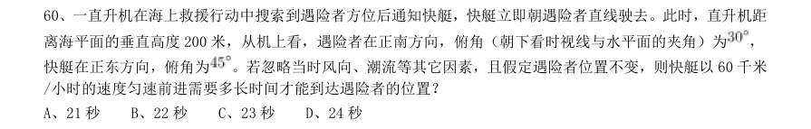

- **A.** 21 秒
- **B.** 22 秒
- **C.** 23 秒
- **D.** 24 秒

**答案：D**

### 2018 广东·统一卷　第 22 题　（相遇追及）

一列货运火车和一列客运火车同向匀速行驶,货车的速度为72 千米/时,客车的速度为108 千米/ 时。已知货车的长度是客车的1.5 倍,两列火车由车尾平齐到车头平齐共用了20 秒,则客运火车长( ) 米。

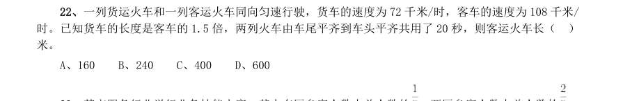

- **A.** 160
- **B.** 240
- **C.** 400
- **D.** 600

**答案：暂缺**

### 2018 国考·副省级　第 62 题　（等距离平均速度）

一辆汽车第一天行驶了5 个小时,第二天行驶了600 公里,第三天比第一天少行驶200 公里,三天共行驶了 18 个小时。已知第一天的平均速度与三天全程的平均速度相同,问三天共行驶了多少公里?

- **A.** 800
- **B.** 900
- **C.** 1000
- **D.** 1100

**答案：B**

### 2018 国考·副省级　第 71 题　（相遇追及）

一艘非法渔船作业时发现其正右方有海上执法船,于是沿下图所示方向左转30°后,立即以15 节(1 节=1 海里/小时)的速度逃跑,同时执法船沿某一直线方向匀速追赶,并正好在某一点追上。已知渔船在被追上前逃 跑的距离刚好与其发现执法船时与执法船的距离相同,问执法船的速度为多少节?

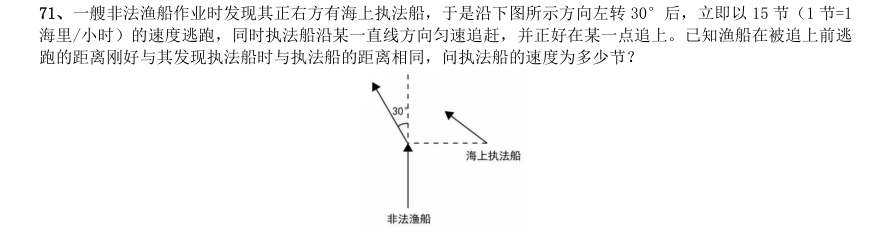

- **A.** 20
- **B.** 30
- **C.** 
- **D.** 

**答案：D**

### 2017 湖北·统一卷　第 57 题　（等距离平均速度）

某地举办铁人三项比赛,全程为51.5 千米,游泳、自行车、长跑的路程之比为 。小陈在这三个项目花 费的时间之比为 ,比赛中他长跑的平均速度是15 千米/小时,且两次换项共耗时4 分钟,那么他完成比赛共 耗时多少?

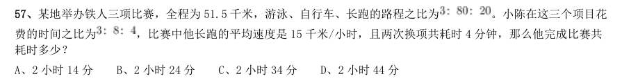

- **A.** 2 小时14 分
- **B.** 2 小时24 分
- **C.** 2 小时34 分
- **D.** 2 小时44 分

**答案：C**

### 2017 湖北·统一卷　第 58 题　（相遇追及）

小张家距离工厂15 千米,乘坐班车20 分钟可到工厂。一天,他错过班车,改乘出租车上班。出租车出发时间比 班车晚4 分钟,送小张到工厂后出租车马上原路返回,在距离工厂1.875 千米处与班车相遇。如果班车和出租车都是 匀速运动且不计上下车时间,那么小张比班车早多少分钟到达工厂?

- **A.** 3
- **B.** 4
- **C.** 5
- **D.** 6

**答案：B**

### 2017 湖北·统一卷　第 62 题　（环形与往返）

某机场一条自动人行道长42m,运行速度0.75 。小王在自动人行道的起始点将一件包裹通过自动人行道传递 给位于终点位置的小明。小明为了节省时间,在包裹开始传递时,沿自动人行道逆行领取包裹并返回。假定小明的步 行速度是1 ,则小明拿到包裹并回到自动人行道终点共需要的时间是:

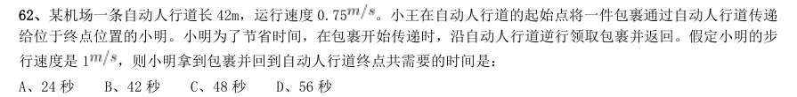

- **A.** 24 秒
- **B.** 42 秒
- **C.** 48 秒
- **D.** 56 秒

**答案：C**

### 2017 湖北·统一卷　第 63 题　（相遇追及）

如右图所示,甲和乙在面积为54π的半圆形游泳池内游泳,他们分别从位置A 和B 同时出发,沿直线同时游到位 置C。若甲的速度为乙的2 倍,则原来甲、乙两人相距:

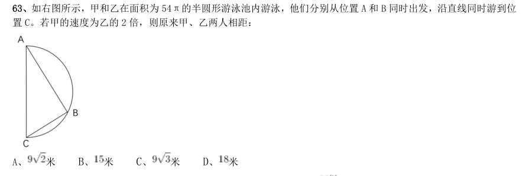

- **A.** 米
- **B.** 米
- **C.** 米
- **D.** 

**答案：D**

### 2017 广东·统一卷　第 24 题　（相遇追及）

老林和小陈绕着周长为720 米的小花园匀速散步,小陈比老林速度快。若两人同时从某一起点同向出发, 则每隔18 分钟相遇一次;若两人同时从某一起点相反方向出发,则每隔6 分钟相遇一次。由此可知,小陈绕 小花园散步一圈需要多少分钟?

- **A.** 6
- **B.** 9
- **C.** 15
- **D.** 18

**答案：暂缺**

### 2017 广东·统一卷　第 28 题　（基础行程）

有两支蜡烛,粗细不同,长度相等,粗蜡烛燃尽需要2 小时,细蜡烛燃尽需要1 小时。一天晚上停电, 同时点燃了这两支蜡烛,若干分钟后来电了,将两支蜡烛同时熄灭,此时,粗蜡烛的长度是细蜡烛的2 倍。 假如蜡油的燃烧速度(单位时间的蜡油燃量)恒定,则停电时长为多少分钟?

- **A.** 30
- **B.** 35
- **C.** 40
- **D.** 45

**答案：暂缺**

### 2017 国考·副省级　第 73 题　（基础行程）

一正三角形小路如右图所示,甲乙两人从A 点同时出发,朝不同方向沿小路散步,已知甲的速度是乙的2 倍。 问以下哪个坐标图能准确描述两人之间的直线距离与时间的关系(横轴为时间,纵轴为直线距离)?

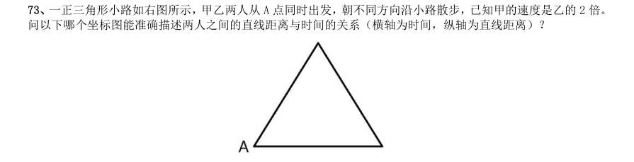

> （本题为图形题，选项为图片，见原卷）

**答案：D**

### 2016 湖北·统一卷　第 57 题　（环形与往返）

一环形跑道上画了100 个标记点,已知相邻任意两个标记点之间的跑道距离相等。某人在环形跑道上跑了半 圈,问他最多能经过几个标记点?

- **A.** 49
- **B.** 51
- **C.** 50
- **D.** 100

**答案：B**

### 2016 湖北·统一卷　第 68 题　（基础行程）

某商店10 月1 日开业后,每天的营业额均以100 元的速度上涨,已知该月15 号这一天的营业额为5000 元, 问该商店10 月份的总营业额为多少元?

- **A.** 163100
- **B.** 158100
- **C.** 155000
- **D.** 150000

**答案：B**

### 2016 国考·副省级　第 67 题　（环形与往返）

A 地到B 地的道路是下坡路。小周早上6:00 从A 地出发匀速骑车前往B 地,7:00 时到达两地正中间的C 地。 到达B 地后,小周立即匀速骑车返回,在10:00 时又途经C 地。此后小周的速度在此前速度的基础上增加1 米/ 秒。最后在11:30 回到A 地。问A B 两地间的距离在以下哪个范围内?

> （本题为图形题，选项为图片，见原卷）

**答案：A**

### 2015 湖北·统一卷　第 58 题　（相遇追及）

在一次航海模型展示活动中,甲乙两款模型在长100 米的水池两边同时开始相向匀速航行,甲款模型航行 100 米要72 秒,乙款模型航行100 米要60 秒,若调头转身时间略去不计,在12 分钟内甲乙两款模型相遇次数 是:

- **A.** 9
- **B.** 10
- **C.** 11
- **D.** 12

**答案：C**

### 2015 湖北·统一卷　第 61 题　（基础行程）

为了国防需要,A 基地要运载1480 吨的战备物资到1100 千米外的B 基地。现在A 基地只有一架“运9”大 型运输机和一列“货运列车”,“运9”速度550 千米每小时,载重能力为20 吨,“货运列车”速度100 千米 每小时,运输能力为600 吨,那么这批战备物资到达B 基地的最短时间为:

- **A.** 53 小时
- **B.** 54 小时
- **C.** 55 小时
- **D.** 56 小时

**答案：B**

### 2015 湖北·统一卷　第 64 题　（环形与往返）

每年三月某单位都要组织员工去A B 两地参加植树活动,已知去A 地每人往返车费20 元,人均植树5 棵, 去B 地每人往返车费30 元,人均植树3 棵,设到A 地有员工x 人,A B 两地共植树y 棵,y 与x 之间满足 ,若往返车费总和不超过3000 元时,那么,最多可植树多少棵?

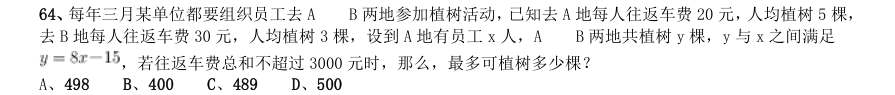

- **A.** 498
- **B.** 400
- **C.** 489
- **D.** 500

**答案：C**

### 2015 广东·乡镇　第 31 题　（基础行程）

一个人骑车去工厂上班。他从家出发,用30 分钟骑行一半的路程后,他加快了速度,以每分 钟比原来快50 米的速度,又骑行了10 分钟。这时发现距离工厂还有2 千米。那么他从家到工厂之间 的距离为多少千米:

- **A.** 6
- **B.** 7.5
- **C.** 8
- **D.** 8.5

**答案：暂缺**

### 2015 广东·乡镇　第 32 题　（环形与往返）

在400 米的环形跑道上每隔16 米插一面彩旗。现在要增加一些彩旗,并且保持每两面相邻彩 旗的距离相等,起点的一面彩旗不动,重新插完后发现共有5 面彩旗没有移动,则现在彩旗间的间隔 最大可达到()米。

- **A.** 15
- **B.** 12
- **C.** 10
- **D.** 5

**答案：暂缺**

### 2015 国考·副省级　第 70 题　（环形与往返）

甲、乙两名运动员在400 米的环形跑道上练习跑步,甲出发1 分钟后乙同向出发,乙出发2 分钟后第一次追 上甲,又过了8 分钟,乙第二次追上甲,此时乙比甲多跑了250 米,问两人出发地相隔多少米:

- **A.** 200
- **B.** 150
- **C.** 100
- **D.** 50

**答案：B**

### 2015 国考·副省级　第 75 题　（环形与往返）

某学校组织学生春游,往返目的地时租用可乘坐10 名乘客的面包车,每辆面包车往返的租金为250 元。此 外,每名学生的景点门票和午餐费用为40 元,如果求尽可能少租车,则以下哪个图形最能反映平均每名学生的 春游费用支出与参加人数之间的关系:

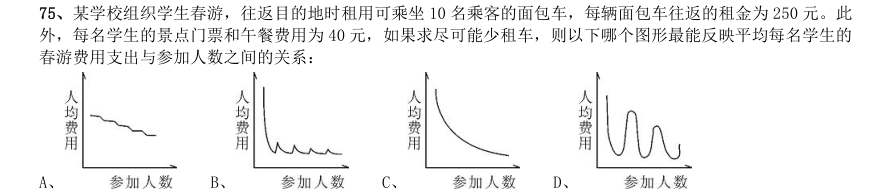

> （本题为图形题，选项为图片，见原卷）

**答案：B**

### 2014 湖北·统一卷　第 58 题　（环形与往返）

环形跑道长400 米,老张、小王、小刘从同一地点同向出发,围绕跑道分别慢走、跑步和骑自行车。已知三 人的速度分别是1 米/秒、3 米/秒和6 米/秒,问小王第3 次超越老张时,小刘已经超越了小王多少次?

- **A.** 3
- **B.** 4
- **C.** 5
- **D.** 6

**答案：B**

### 2014 湖北·统一卷　第 63 题　（基础行程）

甲乙两辆车从A 地驶往90 公里外的B 地,两车的速度比为 ,甲车于上午10 点半出发,乙车于10 点40 分出发,最终乙车比甲车早2 分钟到达B 地。问两车的时速相差多少千米/小时?

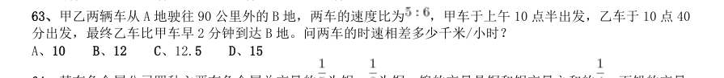

- **A.** 10
- **B.** 12
- **C.** 12.5
- **D.** 15

**答案：D**

### 2014 广东·县级　第 48 题　（相遇追及）

一辆客车与一辆货车从东、西两个车站同时出发匀速相向而行,客车和货车的行驶速度之比为4..3。两 车相遇后,客车的行驶速度减少10%,货车的行驶速度增加20%,当客车到达西车站时,货车距离东车站还有 17 公里。东、西两个车站的距离是( )公里。

- **A.** 59.5
- **B.** 77
- **C.** 119
- **D.** 154

**答案：暂缺**

### 2013 湖北·统一卷　第 84 题　（环形与往返）

小张、小王二人同时从甲地出发,驾车匀速在甲乙两地之间往返行驶。小张的车速比小王快,两人出发后第 一次和第二次相遇都在同一地点,那么小张的车速是小王的多少倍:

- **A.** 1.5
- **B.** 2
- **C.** 2.5
- **D.** 3

**答案：B**

### 2013 国考·统一卷　第 70 题　（基础行程）

某河段中的沉积河沙可供80 人连续开采6 个月或60 人连续开采10 个月。如果要保证该河段河沙不被开采 枯竭,问最多可供多少人进行连续不间断的开采?(假定该河段河沙沉积的速度相对稳定)

- **A.** 25
- **B.** 30
- **C.** 35
- **D.** 40

**答案：B**

### 2013 国考·统一卷　第 71 题　（相遇追及）

公路上有三辆同向行驶的汽车,其中甲车的时速为63 公里,乙、丙两车的时速均为60 公里,但由于水箱故 障,丙车每连续行驶30 分钟后必须停车2 分钟。早上10 点,三车到达同一位置,问1 小时后,甲、丙两车最多 相距多少公里?

- **A.** 5
- **B.** 7
- **C.** 9
- **D.** 11

**答案：B**

### 2012 湖北·统一卷　第 55 题　（等距离平均速度）

四名运动员参加 米接力,他们100 米速度分别为 、 、 、 ,不考虑其他影响因素,他们跑400 米全程的平均速度为:

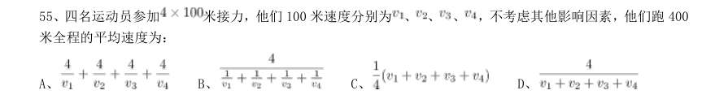

- **A.** 
- **B.** 
- **C.** 
- **D.** 

**答案：B**

### 2012 广东·统一卷　第 9 题　（相遇追及）

甲、乙二人在环湖小路上匀速步行,且绕行方向不变。19 时,甲从A 点、乙从B 点同时出发相向而 行。19 时25 分,两人相遇;19 时45 分,甲到达B 点;20 时5 分,两人再次相遇。乙环湖一周需要多少分 钟:

- **A.** 72
- **B.** 81
- **C.** 90
- **D.** 100

**答案：暂缺**

### 2012 广东·统一卷　第 13 题　（基础行程）

一列火车出发1 小时后因故障停车0.5 小时,然后以原速度的 行使,到达目的地晚点1.5 小时, 若出发1 小时后又行驶120 公里再停车0.5 小时,然后同样以原速度的 行驶,则到达目的地晚点1 小时, 从起点到目的地的距离为:

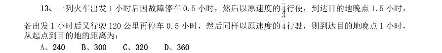

- **A.** 240
- **B.** 300
- **C.** 320
- **D.** 360

**答案：暂缺**

### 2012 国考·统一卷　第 69 题　（流水行船）

一只装有动力桨的船,其单靠人工划船顺流而下的速度是水速的3 倍。现该船靠人工划动从A 地顺流到达B 地,原路返回时只开足动力桨行驶,用时比来时少2/5。问船在静水中开足动力桨行驶的速度是人工划船速度的 多少倍:

- **A.** 2
- **B.** 3
- **C.** 4
- **D.** 5

**答案：B**

### 2012 国考·统一卷　第 74 题　（相遇追及）

甲乙两人计划从A 地步行去B 地,乙早上7:00 出发,匀速步行前往,甲因事耽搁,9:00 才出发。为了 追上乙,甲决定跑步前进,跑步的速度是乙步行速度的2. 5 倍,但每跑半小时都需要休息半小时,那么甲什么 时候才能追上乙:

- **A.** 10:20
- **B.** 12:10
- **C.** 14:30
- **D.** 16:10

**答案：C**

### 2011 湖北·统一卷　第 47 题　（环形与往返）
> 材料：问最重的箱子重量最多是多少公斤: A、500/23 B、200/11 C、20 D、25…

一条环形赛道前半段为上坡,后段为下坡,上坡和下坡的长度相等,两辆车同时从赛道起点出发同向行驶, 其中A 车上、下坡时速相等,而B 车上坡时速比A 车慢20%,下坡时速比A 车快20%,问A 车跑到第几圈时两 车再次齐头并进:

- **A.** 23
- **B.** 22
- **C.** 24
- **D.** 25

**答案：D**

### 2011 广东·统一卷　第 6 题　（基础行程）

一个人从家到公司,当他走到路程的一半的时候,速度下降了10%,问:他走完全程所用时间的前半 段和后半段所走的路程比是:

- **A.** 10∶9
- **B.** 21∶19
- **C.** 11∶9
- **D.** 22∶18

**答案：暂缺**

### 2011 国考·统一卷　第 66 题　（基础行程）

小王步行的速度比跑步慢50%,跑步的速度比骑车慢50%。如果他骑车从A 城去B 城,再步行返回A 城共需 要2 小时。 问小王跑步从A 城到B 城需要多少分钟:

- **A.** 45
- **B.** 48
- **C.** 56
- **D.** 60

**答案：B**

### 2011 国考·统一卷　第 68 题　（环形与往返）

甲、乙两人在长30 米的泳池内游泳,甲每分钟游37.5 米,乙每分钟游52.5 米,两人同时分别从泳池的两 端出发,触壁后原路返回,如是往返。如果不计转向的时间,则从出发开始计算的1 分50 秒内两人共相遇了多 少次:

- **A.** 2
- **B.** 3
- **C.** 4
- **D.** 5

**答案：B**

### 2010 湖北·统一卷　第 47 题　（环形与往返）

有 名学生需要到河对岸去参观明清时期的古民居。现只有一条船,每条船最多载 人(其中 人 划船),往返一次需要 分钟,如果早晨 点钟准时开始渡河,到 点 分时,至少还有多少人在 等待渡河:

- **A.** 10
- **B.** 15
- **C.** 20
- **D.** 25

**答案：B**

### 2010 湖北·统一卷　第 55 题　（相遇追及）

老张和老王两个人在周长为 米的圆形池塘边散步。老张每分钟走 米,老王每分钟走 米。 现在两个人从同一点反方向行走,那么出发后多少分钟他们第二次相遇:

- **A.** 16
- **B.** 32
- **C.** 25
- **D.** 20

**答案：B**

### 2010 国考·统一卷　第 54 题　（流水行船）

某旅游部门规划一条从甲景点到乙景点的旅游线路,经测试,旅游船从甲到乙顺水匀速行驶需3 小时;从乙 返回甲逆水匀速行驶需4 小时,假设水流速度恒定,甲乙之间的距离为y 公里,旅游船在静水中匀速行驶y 公里 需 小时,则 满足的方程为:

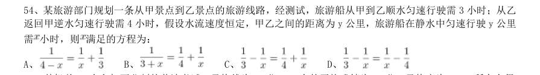

- **A.** 
- **B.** 
- **C.** 
- **D.** 

**答案：D**
