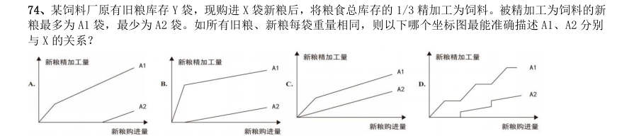
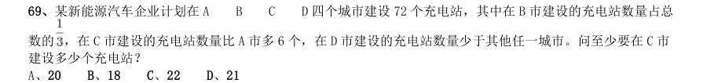
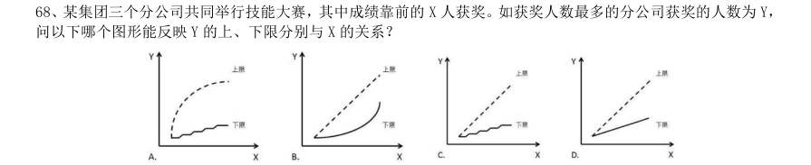
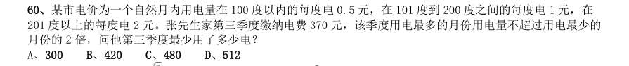
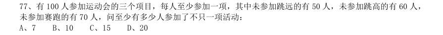
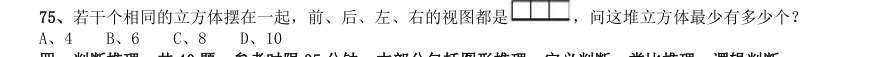
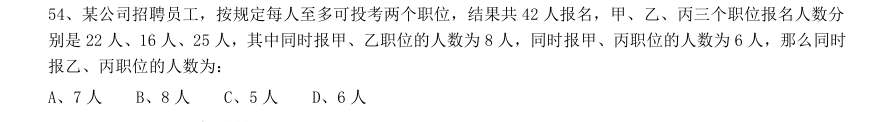
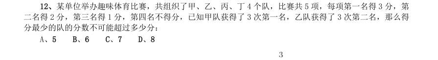

# 数量关系 · 最值问题 · 2010 年代真题

> 所属考点：[SL-ZZ](../SL-ZZ-最值问题.md)　｜　本片 49 题

### 2019 湖北·统一卷　第 69 题　（最值优化）

某次田径运动会中,选手参加各单项比赛计入所在团体总分的规则为:一等奖得9 分,二等奖得5 分,三等 奖得2 分。甲队共有10 位选手参赛,均获奖。现知甲队最后总分为61 分,问该队最多有几位选手获得一等奖?

- **A.** 3
- **B.** 4
- **C.** 5
- **D.** 6

**答案：C**

### 2019 湖北·选调　第 87 题　（最值问题（综合））

甲乙两仓库分别有粮食45 吨和122 吨,现甲仓库第一天运入3 吨,往后每天运入的吨数比前一天多2 吨, 乙仓库每天运出2 吨,则至少多少天后甲仓库的粮食比乙仓库多?

- **A.** 6
- **B.** 7
- **C.** 8
- **D.** 9

**答案：C**

### 2019 湖北·选调　第 91 题　（最值优化）

某商场会员全年购买该商场商品可享8 折优惠,近日该商场举行店庆优惠活动。全场商品满199 元减50 元, 满399 元减100 元,满599 元减200 元,会员优惠和店庆优惠每次只能享受一项。活动期间会员小兴分三次购买 了价值260 元、480 元、640 元商品各一件,则小兴最少需支付:

- **A.** 1024 元
- **B.** 1026 元
- **C.** 1028 元
- **D.** 1030 元

**答案：C**

### 2019 湖北·选调　第 92 题　（最值优化）

某工厂加工零件,每个零件有正反两面,每台机床每次能同时加工两个零件,每次只能加工零件的一面,加 工一次需要1.5 分钟,则每台机床加工9 个零件最少需要多少时间?

- **A.** 13.5 分钟
- **B.** 14 分钟
- **C.** 14.5 分钟
- **D.** 15 分钟

**答案：A**

### 2019 广东·县级　第 22 题　（多集合最值）

办公室有一些黑色和红色的签字笔,最近由于工作需要,每周都会用掉6 支黑色签字笔和3 支红色签字笔。 3 周后整理剩余物资时发现,剩下的红色签字笔的数量是黑色签字笔的2 倍。则办公室原有签字笔至少( )支。

- **A.** 27
- **B.** 28
- **C.** 29
- **D.** 30

**答案：暂缺**

### 2019 国考·地市级　第 61 题　（最值优化）

有100 名员工去年和今年均参加考核,考核结果分为优、良、中、差四个等次。今年考核结果为优的人数是 去年的1.2 倍,今年考核结果为良及以下的人员占比比去年低15 个百分点。问两年考核结果均为优的人数至少 为多少人?

- **A.** 55
- **B.** 65
- **C.** 75
- **D.** 85

**答案：B**

### 2019 国考·地市级　第 70 题　（多集合最值）

花圃自动浇水装置的规则设置如下: 1每次浇水在中午12:00~12:30 之间进行; 2在上次浇水结束后,如连续3 日中午12:00 气温超过30 摄氏度,则在连续第3 个气温超过30 摄氏度的日子中 午12:00 开始浇水; 3如在上次浇水开始120 小时后仍不满足条件2,则立刻浇水。 已知6 月30 日12:00~12:30 该花圃第一次自动浇水,7 月份该花圃共自动浇水8 次,问7 月至少有几天中午12:00 的气温超过30 摄氏度?

- **A.** 18
- **B.** 20
- **C.** 12
- **D.** 15

**答案：D**

### 2019 国考·省级　第 66 题　（最值优化）

A 和B 两家企业2018 年共申请专利300 多项,其中A 企业申请的专利中27%是发明专利,B 企业申请的专利 中,发明专利和非发明专利之比为8:13。已知B 企业申请的专利数量少于A 企业,但申请的发明专利数量多于A 企业。问两家企业总计最少申请非发明专利多少项?

> （本题为图形题，选项为图片，见原卷）

**答案：C**

### 2018 湖北·统一卷　第 59 题　（最值问题（综合））
> 材料：之间…

某公司新近录用五名应聘人员,将分别安排到产品开发、管理、销售和售后服务这四个部门工作,每个部 门至少一人。若其中有两人只能从事销售或售后服务两个部门的工作,其余三人均能从事四个部门的工作,则 不同的选派方案共有:

- **A.** 12 种
- **B.** 18 种
- **C.** 36 种
- **D.** 48 种

**答案：D**

### 2018 湖北·统一卷　第 69 题　（最值优化）

一个班级组织跑步比赛,共设100 米、200 米、400 米三个项目。班级有50 人,报名参加100 米比赛的有 27 人,参加200 米比赛的有25 人,参加400 米比赛的有21 人。如果每人最多只能报名参加2 项比赛,那么 该班最多有多少人未报名参赛?

- **A.** 11
- **B.** 12
- **C.** 13
- **D.** 14

**答案：C**

### 2018 国考·副省级　第 73 题　（最值优化）

某新能源汽车企业计划在A、B、C、D 四个城市建设72 个充电站,其中在B 市建设的充电站数量占总数的 1/3,在C 市建设的充电站数量比A 市多6 个,在D 市建设的充电站数量少于其他任一城市。问至少要在C 市建 设多少个充电站?

- **A.** 20
- **B.** 18
- **C.** 22
- **D.** 21

**答案：D**

### 2018 国考·副省级　第 74 题　（最值优化）

某饲料厂原有旧粮库存Y 袋,现购进X 袋新粮后,将粮食总库存的1/3 精加工为饲料。被精加工为饲料的新 粮最多为A1 袋,最少为A2 袋。如所有旧粮、新粮每袋重量相同,则以下哪个坐标图最能准确描述A1、A2 分别 与X 的关系?

> （本题为图形题，选项为图片，见原卷）

**答案：A**

### 2018 国考·地市级　第 69 题　（最值优化）

某新能源汽车企业计划在A B C D 四个城市建设72 个充电站,其中在B 市建设的充电站数量占总 数的 ,在C 市建设的充电站数量比A 市多6 个,在D 市建设的充电站数量少于其他任一城市。问至少要在C 市 建设多少个充电站?

- **A.** 20
- **B.** 18
- **C.** 22
- **D.** 21

**答案：D**

### 2017 国考·副省级　第 67 题　（最值优化）

某抗洪指挥部的所有人员中,有2/3 的人在前线指挥抢险。由于汛情紧急,又增派6 人前往,此时在前线指 挥抢险的人数占总人数的75%。如该抗洪指挥部需要保留至少10%的人员在应急指挥中心,那么最多还能再增派 多少人去前线?

- **A.** 8
- **B.** 9
- **C.** 10
- **D.** 11

**答案：C**

### 2017 国考·副省级　第 68 题　（最值优化）

小张需要在5 个长度分别为15 秒、53 秒、22 秒、47 秒和23 秒的视频片段中选取若干个,合成为一个长度 在80~90 秒之间的宣传视频。如果每个片段均需完整使用且最多使用一次,并且片段间没有空闲时段,问他按 照要求可能做出多少个不同的视频?

- **A.** 12
- **B.** 6
- **C.** 24
- **D.** 18

**答案：A**

### 2016 湖北·统一卷　第 56 题　（最值优化）

某餐厅设有可坐12 人和可坐10 人两种规格的餐桌共28 张,最多可容纳332 人同时就餐,问该餐厅有几张 10 人桌?

- **A.** 2
- **B.** 4
- **C.** 6
- **D.** 8

**答案：A**

### 2016 广东·乡镇　第 27 题　（最值优化）

园林工人用一辆汽车将20 棵行道树运往1 公里的地方开始种植。在1 公里处种第一棵,以后 往更远处每隔50 米种一棵,该辆汽车每次最多能运三棵树。当园林工人完成任务时,这辆汽车行程最 短是( )米。

- **A.** 20800
- **B.** 20900
- **C.** 21000
- **D.** 21100

**答案：暂缺**

### 2016 国考·副省级　第 62 题　（最值优化）

某新建小区计划在小区主干道两侧种植银杏树和梧桐树绿化环境,一侧每隔3 棵银杏树种一棵梧桐树,另一 侧每隔4 棵梧桐树种1 棵银杏树,最终两侧各种植了35 棵树,问最多栽种了多少棵银杏树?

- **A.** 33
- **B.** 34
- **C.** 36
- **D.** 37

**答案：B**

### 2016 国考·副省级　第 66 题　（最值优化）

某政府机关内甲、乙两部门通过门户网站定期向社会发布消息,甲部门每隔两天、乙部门每隔3 天有―个发 布日,节假日无休。问甲、乙两部门在一个自然月内最多有几天同时为发布日?

- **A.** 5
- **B.** 2
- **C.** 6
- **D.** 3

**答案：D**

### 2016 国考·副省级　第 68 题　（最值优化）

某集团三个分公司共同举行技能大赛,其中成绩靠前的X 人获奖。如获奖人数最多的分公司获奖的人数为Y, 问以下哪个图形能反映Y 的上、下限分别与X 的关系?

> （本题为图形题，选项为图片，见原卷）

**答案：C**

### 2016 国考·副省级　第 70 题　（最值优化）

李主任在早上8 点30 分上班之后参加了一个会议,会议开始时发现其手表的时针和分针呈120 度角,而上 午会议结束时发现手表的时针和分针呈180 度角。问在该会议举行的过程中,李主任的手表时针与分针呈90 度 角的情况最多可能出现几次?

- **A.** 4
- **B.** 5
- **C.** 6
- **D.** 7

**答案：A**

### 2015 湖北·统一卷　第 56 题　（最值优化）

设有编号为1 到10 的10 张背面向上的纸牌,现有10 名游戏者,第1 名游戏者将所有编号是1 的倍数的纸 牌翻成另一面向上的状态,接着第2 名游戏者将所有编号是2 的倍数的纸牌翻成另一面向上的状态,......,第n 名(n≤10)游戏者,将所有编号是n 的倍数的纸牌翻成另一面向上的状态,如此下去,当第10 名游戏者翻完纸 牌后,那些纸牌正面向上的最大编号与最小编号的差是:

- **A.** 2
- **B.** 4
- **C.** 6
- **D.** 8

**答案：D**

### 2015 湖北·统一卷　第 65 题　（最值优化）

有135 人参加某单位的招聘,31 人有英语证书和普通话证书,37 人有英语证书和计算机证书,16 人有普通 话证书和计算机证书,其中一部分人有三种证书,而一部分人则只有一种证书。该单位要求必须至少有两种上述 证书的应聘者才有资格参加面试。问至少有多少人不能参加面试?

- **A.** 50
- **B.** 51
- **C.** 52
- **D.** 53

**答案：D**

### 2014 湖北·统一卷　第 60 题　（最值优化）

某市电价为一个自然月内用电量在100 度以内的每度电0.5 元,在101 度到200 度之间的每度电1 元,在 201 度以上的每度电2 元。张先生家第三季度缴纳电费370 元,该季度用电最多的月份用电量不超过用电最少的 月份的2 倍,问他第三季度最少用了多少电?

- **A.** 300
- **B.** 420
- **C.** 480
- **D.** 512

**答案：C**

### 2014 湖北·统一卷　第 66 题　（最值优化）

某工厂有100 名工人报名参加了4 项专业技能课程中的一项或多项,已知A 课程与B 课程不能同时报名。如 果按照报名参加的课程对工人进行分组,将报名参加的课程完全一样的工人分到同一组中,则人数最多的组最少 有多少人?

- **A.** 7
- **B.** 8
- **C.** 9
- **D.** 10

**答案：D**

### 2014 广东·县级　第 55 题　（最值优化）

小王和小刘手工制作一种工艺品,每件工艺品由一个甲部件和一个乙部件组成,小王每天可以制作150 个 甲部件,或者制作75 个乙部件;小刘每天可以制作60 个甲部件,或者制作24 个乙部件。现两人一起制作工 艺品,10 天时间最多可以制作该工艺品( )件。

- **A.** 660
- **B.** 675
- **C.** 700
- **D.** 900

**答案：暂缺**

### 2014 国考·统一卷　第 69 题　（最值优化）

某单位某月1—12 日安排甲、乙、丙三个人值夜班,每人值班4 天。三人各自值班期数字之和相等。已知甲 头两天值夜班,乙9、10 日值夜班,问丙在自己第一天与最后一天值夜班之间,最多有几天不用值夜班:

- **A.** 6
- **B.** 4
- **C.** 2
- **D.** 0

**答案：D**

### 2013 湖北·统一卷　第 77 题　（最值优化）

有100 人参加运动会的三个项目,每人至少参加一项,其中未参加跳远的有50 人,未参加跳高的有60 人, 未参加赛跑的有70 人,问至少有多少人参加了不只一项活动:

- **A.** 7
- **B.** 10
- **C.** 15
- **D.** 20

**答案：B**

### 2013 湖北·统一卷　第 83 题　（最值问题（综合））

某种密码锁的界面是一组汉字键,只有不重复并且不遗憾地依次按下界面上的汉字才能打开,其中只有一种 顺序是正确的。要使得每次对密码锁进行破解的成功率在万分之一以下,则密码锁的界面至少要设置多少个汉字 键?

- **A.** 5
- **B.** 6
- **C.** 7
- **D.** 8

**答案：D**

### 2013 湖北·统一卷　第 86 题　（最值优化）

60 名员工投票从甲、乙、丙三人中评选最佳员工,选举时每人只能投票选举一人,得票最多的人当选。开 票中途累计,前30 张选票中,甲得15 票,乙得10 票,丙得5 票。在尚未统计的选票中,甲至少再得多少票就 一定当选:

- **A.** 15
- **B.** 13
- **C.** 10
- **D.** 8

**答案：B**

### 2013 广东·一卷　第 7 题　（最值优化）

某企业组织80 名员工一起去划船,每条船乘客定员12 人,则该企业最少需要租船多少条:

- **A.** 7
- **B.** 8
- **C.** 9
- **D.** 10

**答案：暂缺**

### 2013 广东·一卷　第 37 题　（最值优化）

能源同时也是一个关乎妇女切身利益的问题。不可持续能源会对人类健康造成伤害,而其中最大部分受害 者是妇女。每年全球有将近200 万人因暴露在危险的煮食、取暖和照明环境下吸入有害烟尘而死亡,而其中85%是 死于相关癌症、呼吸道感染和肺病的妇孺,另有几百万人因此罹患相关疾病。 对这段文字理解最准确的是:

- **A.** 能源会对人类健康尤其是妇女的健康造成伤害
- **B.** 不可持续能源对人类的危害主要体现在妇女群体
- **C.** 基于不可持续能源对人类的伤害,发展可持续能源很必要
- **D.** 全球85%的妇孺死于癌症、呼吸道感染和肺病

**答案：暂缺**

### 2013 广东·三卷　第 7 题　（最值优化）

某企业组织80 名员工一起去划船,每条船乘客定员12 人,则该企业最少要租船多少条?

- **A.** 10
- **B.** 9
- **C.** 8
- **D.** 7

**答案：暂缺**

### 2013 国考·统一卷　第 61 题　（多集合最值）

某单位2011 年招聘了65 名毕业生,拟分配到该单位的7 个不同部门,假设行政部门分得的毕业生人数比其 他部门都多,问行政部门分得的毕业生人数至少为多少名:

- **A.** 10
- **B.** 11
- **C.** 12
- **D.** 13

**答案：B**

### 2013 国考·统一卷　第 65 题　（多集合最值）

某单位组织党员参加党史、党风廉政建设,科学发展观和业务能力四项培训,要求每名党员参加且只参加其 中的两项。无论如何安排,都有至少5 名党员参加的培训完全相同,问该单位至少有多少名党员?

- **A.** 17
- **B.** 21
- **C.** 25
- **D.** 29

**答案：C**

### 2013 国考·统一卷　第 72 题　（最值优化）

某市园林部门计划对市区内30 处绿化带进行补栽,每处绿化带补栽方案可从甲、乙两种方案中任选其中一 方案进行。甲方案补栽阔叶树80 株、针叶树40 株;乙方案补栽阔叶树50 株、针叶树90 株。现有阔叶树苗2070 株、针叶树苗1800 株,为最大限度利用这批树苗,甲、乙两种方案应各选:

- **A.** 甲方案18 个、乙方案12 个
- **B.** 甲方案17 个、乙方案13 个
- **C.** 甲方案20 个、乙方案10 个
- **D.** 甲方案19 个、乙方案11 个

**答案：A**

### 2013 国考·统一卷　第 75 题　（最值优化）

若干个相同的立方体摆在一起,前、后、左、右的视图都是 ,问这堆立方体最少有多少个?

- **A.** 4
- **B.** 6
- **C.** 8
- **D.** 10

**答案：A**

### 2012 湖北·统一卷　第 54 题　（最值优化）
> 材料：A、10 瓶 B、11 瓶 C、8 瓶 D、9 瓶…

某公司招聘员工,按规定每人至多可投考两个职位,结果共42 人报名,甲、乙、丙三个职位报名人数分 别是22 人、16 人、25 人,其中同时报甲、乙职位的人数为8 人,同时报甲、丙职位的人数为6 人,那么同时 报乙、丙职位的人数为:

- **A.** 7 人
- **B.** 8 人
- **C.** 5 人
- **D.** 6 人

**答案：A**

### 2012 广东·统一卷　第 7 题　（最值优化）

某市举办经济建设成就展,计划在六月上旬组织5 个单位参观,其中一个单位由于人数较多,需要连 续参观2 天,其他4 个单位只需参观1 天。若每天最多只能安排一个单位参观,则参观的时间安排共有多少 种:

- **A.** 630
- **B.** 700
- **C.** 15120
- **D.** 16800

**答案：暂缺**

### 2012 广东·统一卷　第 12 题　（最值优化）

某单位举办趣味体育比赛,共组织了甲、乙、丙、丁4 个队,比赛共5 项,每项第一名得3 分,第 二名得2 分,第三名得1 分,第四名不得分,已知甲队获得了3 次第一名,乙队获得了3 次第二名,那么得 分最少的队的分数不可能超过多少分:

- **A.** 5
- **B.** 6
- **C.** 7
- **D.** 8

**答案：暂缺**

### 2012 国考·统一卷　第 66 题　（最值优化）

有300 名求职者参加高端人才专场招聘会,其中软件设计类、市场营销类、财务管理类和人力资源管理类分 别有100、80、70 和50 人。问至少有多少人找到工作,才能保证一定有70 名找到工作的人专业相同:

- **A.** 71
- **B.** 119
- **C.** 258
- **D.** 277

**答案：C**

### 2011 湖北·统一卷　第 42 题　（最值优化）

某单位招待所有若干间房间,现在安排一支考察队的队员住宿,若每间住3 人则有2 人无房可住;若每间 住4 人,则有一间房间不空也不满,则该招待所的房间最多有:

- **A.** 4 间
- **B.** 5 间
- **C.** 6 间
- **D.** 7 间

**答案：B**

### 2011 湖北·统一卷　第 48 题　（最值问题（综合））

某公司要买100 本便签纸和100 支胶棒,附近有两家超市。A 超市的便签纸0.8 元一本,胶棒2 元一支且 买2 送1。B 超市的便签纸1 元一本且买3 送1,胶棒1.5 元一支,如果公司采购员要在这两家超市买这些物 品,他至少要花多少元钱:

- **A.** 183.5
- **B.** 208.5
- **C.** 225
- **D.** 230

**答案：B**

### 2011 广东·统一卷　第 10 题　（最值优化）

一个产品生产线分为a、b、c 三段,每个人每小时分别完成10、5、6 件,现在总人数为71 人,要 使得完成的件数最多,71 人的安排分别是:

- **A.** 14∶28∶29
- **B.** 15∶31∶25
- **C.** 16∶32∶23
- **D.** 17∶33∶21

**答案：暂缺**

### 2011 国考·统一卷　第 79 题　（最值优化）

某城市9 月平均气温为28.5 度,如当月最热日和最冷日的平均气温相差不超过10 度,则该月平均气温在 30 度及以上的日子最多有多少天:

- **A.** 24
- **B.** 25
- **C.** 26
- **D.** 27

**答案：B**

### 2010 湖北·统一卷　第 48 题　（最值优化）

参加某部门招聘考试的共有 人,考试内容共有 道题。1 至 道题分别有 人,88 人, 人,76 人,72 人和 人答对,如果答对 道题或 道以上的人员能通过考试,那么至少有多 少人能通过考试:

- **A.** 50
- **B.** 61
- **C.** 75
- **D.** 80

**答案：B**

### 2010 湖北·统一卷　第 59 题　（最值问题（综合））

有一只青蛙在井底,每天上爬 米,又下滑 米,这口井深 米,这只青蛙爬出井口至少需要多 少天:

- **A.** 2
- **B.** 3
- **C.** 4
- **D.** 5

**答案：C**

### 2010 国考·统一卷　第 49 题　（最值优化）

某城市居民用水价格为:每户每月不超过5 吨的部分按4 元/吨收取,超过5 吨不超过10 吨的部分按6 元/ 吨收取,超过10 吨的部分按8 元/吨收取。某户居民两个月共交水费108 元,则该户居民这两个月用水总量最多 为多少吨:

- **A.** 21
- **B.** 24
- **C.** 17.25
- **D.** 21.33

**答案：A**

### 2010 国考·统一卷　第 53 题　（最值优化）

科考队员在冰面上钻孔获取样本,测量不同空心之间的距离,获得的部分数据分别为1 米、3 米、6 米、12 米、24 米、48 米。问科考队员至少钻了多少个孔:

- **A.** 4
- **B.** 5
- **C.** 6
- **D.** 7

**答案：D**
