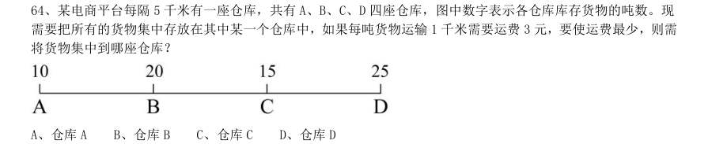

# 数量关系 · 最值问题 · 2020 年代真题

> 所属考点：[SL-ZZ](../SL-ZZ-最值问题.md)　｜　本片 10 题

> 本片子考点：最值优化 10

### 2021 国考·地市级　第 62 题　（最值优化）

社区工作人员小张连续4 天为独居老人采买生活必需品。已知前三天共采买65 次,其中第二天采买次数比 第一天多50%,第三天采买次数比前两天采买次数的和少15 次,第四天采买次数比第一天的2 倍少5 次。问这4 天中,小张为独居老人采买次数最多和最少的日子,单日采买次数相差多少次?

- **A.** 9
- **B.** 10
- **C.** 11
- **D.** 12

**答案：C**

### 2021 国考·地市级　第 66 题　（最值优化）

某村居民整体进行搬迁移民,现安排载客(不含司机)20 人/辆的中巴车和30 人/辆的大巴车运载所有村民 到搬迁地实地考察。如安排12 辆中巴车,则大巴车需要18 辆,且除一辆大巴车载6 人以外,其他车全部载满。 现本着安排车辆数最少的原则派车,问最少要安排多少辆大巴车?

- **A.** 20
- **B.** 22
- **C.** 24
- **D.** 26

**答案：C**

### 2021 国考·地市级　第 67 题　（最值优化）

某地调派96 人分赴车站、机场、超市和学校四个人流密集的区域进行卫生安全检查,其中公共卫生专业人 员有62 人。已知派往机场的人员是四个区域中最多的,派往车站和超市的人员中,专业人员分别占64%和65%, 派往学校的人员中,非专业人员比专业人员少30%,问派往机场的人员中,专业人员的占比在四个区域中排名:

- **A.** 第1
- **B.** 第2
- **C.** 第3
- **D.** 第4

**答案：A**

### 2020 湖北·统一卷　第 62 题　（最值优化）

某城市一条道路上有4 个十字路口,每个十字路口至少有一名交通协管员,现将8 个协管员名额分配到这4 个路口,则每个路口协管员名额的分配方案有:

- **A.** 35 种
- **B.** 70 种
- **C.** 96 种
- **D.** 114 种

**答案：A**

### 2020 湖北·统一卷　第 63 题　（最值优化）

某篮球队共有九人,分三组举行三人制篮球赛,他们的球衣号码分别是从1 号到9 号,分组后发现三组的球 衣号码之和不同,且最大和是最小和的两倍。则各组号码之和不可能是下列哪个数?

- **A.** 10
- **B.** 11
- **C.** 12
- **D.** 13

**答案：D**

### 2020 湖北·统一卷　第 64 题　（最值优化）

某电商平台每隔5 千米有一座仓库,共有

- **A.** 仓库A
- **B.** 仓库B
- **C.** 仓库C
- **D.** 仓库D

**答案：C**

### 2020 广东·乡镇　第 36 题　（最值优化）

甲、乙两地稻谷同时成熟,分别需要15 台和13 台大型收割机进行收割,计划从丙、丁两地分别调配20 台 和8 台收割机进行支援。若从丙地调配一台收割机到甲、乙两地分别需要油费40 元、50 元;从丁地到甲、乙 两地分别需要50 元、30 元,则完成所有的收割机调配至少需要油费( )元。

- **A.** 1000
- **B.** 1090
- **C.** 1180
- **D.** 1270

**答案：暂缺**

### 2020 国考·地市级　第 66 题　（最值优化）

某种产品每箱48 个。小李制作这种产品,第1 天制作了1 个,以后每天都比前一天多制作1 个。X 天后总 共制作了整数箱产品。问X 的最小值在以下哪个范围内?

- **A.** 在41~60 之间
- **B.** 超过60
- **C.** 不到20
- **D.** 在20~40 之间

**答案：D**

### 2020 国考·地市级　第 67 题　（最值优化）

从一个装有水的水池中向外排水,规定每周二、四、六每天排出剩余水量的1/3,其余日期每天排出剩余水 量的1/2。如此连续操作6 天后,水池中剩余相当于总容量1/72 的水。问最开始时水池中的水量最多相当于总 容量的:

- **A.** 1/4
- **B.** 3/8
- **C.** 1/2
- **D.** 5/8

**答案：C**

### 2020 国考·地市级　第 68 题　（最值优化）

某单位从理工大学、政法大学和财经大学总计招聘应届毕业生三百多人。其中从理工大学招聘人数是政法大 学和财经大学之和的80%,从政法大学招聘的人数比财经大学多60%。问该单位至少再多招聘多少人,就能将从 这三所大学招聘的应届生平均分配到7 个部门?

- **A.** 6
- **B.** 5
- **C.** 4
- **D.** 3

**答案：A**
