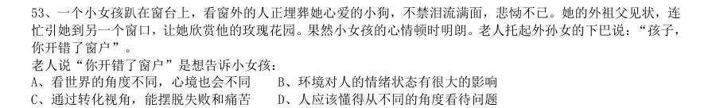
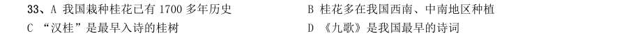

# 言语理解 · 逻辑填空 · 2000 年代真题

> 所属考点：[YY-LJTK](../YY-LJTK-逻辑填空.md)　｜　本片 216 题

### 2009 湖北·统一卷　第 21 题　（一空）

人生是一个容器,可这个容器的容量实在是非常 。愁苦和畏惧多了,欢乐与 就少了。 填入划横线部分最恰当的一项是:

- **A.** 庞大胆量
- **B.** 可观轻松
- **C.** 有限勇气
- **D.** 莫测勇敢

**答案：C**

### 2009 湖北·统一卷　第 22 题　（成语辨析）

煤炭与石油、天然气相比价格低廉,以同等发热量计算,目前石油价格是煤炭的5 倍,天然气价格是煤炭 的3 倍,所以,在石油价格居高不下的背景下,煤炭价格必然 。 填入划横线部分最恰当的一项是:

- **A.** 水涨船高
- **B.** 相形见绌
- **C.** 如影随形
- **D.** 随波逐流

**答案：A**

### 2009 湖北·统一卷　第 23 题　（一空）

“笼屉”作为寻常百姓家必备的炊具,从来没有登上过大雅之堂。据说最 的待遇是在旧社会 曾用笼屉作为饭店门口的幌子,食客们只要一看到门口悬挂的笼屉层数,就知道饭店的档次。 填入划横线部分最恰当的一项是:

- **A.** 优厚
- **B.** 体面
- **C.** 优惠
- **D.** 特殊

**答案：B**

### 2009 湖北·统一卷　第 24 题　（一空）

循环经济实质上是一种自觉的经济形态,需要公共部门、经济主体和金融界的三方转变观念,共 同 ,在全社会形成发展循环经济的良好 。 填入划横线部分最恰当的一项是:

- **A.** 营建环境
- **B.** 努力氛围
- **C.** 营造局面
- **D.** 建造局势

**答案：C**

### 2009 湖北·统一卷　第 25 题　（成语辨析）

体操是一个结合了杂技和舞蹈的体育运动。它的魅力,在于那种刀锋上的平衡与美感,在于每一秒都让 人 。运动员在空中翻腾的时候,即使不在现场的观众,也会不由自主地屏住呼吸,直到运动员稳稳 落地。 填人划横线部分最恰当的一项是:

- **A.** 心旷神怡
- **B.** 赏心悦目
- **C.** 战战兢兢
- **D.** 如痴如醉

**答案：C**

### 2009 湖北·统一卷　第 26 题　（一空）

好莱坞商业大片宣传的是一种普世价值,它往往故事简单, 的道理也很浅显,这一点常常为西方 的知识分子所 。但不可否认的是,正是这种浅显的东西,往往才可能被普遍的大众接受。 填入划横线部分最恰当的一项是:

- **A.** 蕴含不屑
- **B.** 包含轻视
- **C.** 渗透鄙夷
- **D.** 传达唾弃

**答案：A**

### 2009 湖北·统一卷　第 27 题　（成语辨析）

对于如何维持在孩子面前的权威性有很多不同观点,这使得父母有点儿 。 填入划横线部分最恰当的一项是:

- **A.** 独断专行
- **B.** 不知所措
- **C.** 无所适从
- **D.** 顾此失彼

**答案：C**

### 2009 湖北·统一卷　第 28 题　（一空）

究竟国家与个人对个人的医疗健康应分别承担多大比例,是一个 选择问题,而不是政府可以任 意决定的事项。要让民众有机会参与这一重大财政决策。透过人大的审议机制,将自己的意愿 到 长期的财政安排中。 填入划横线部分最恰当的一项是:

- **A.** 公共体现
- **B.** 公众融合
- **C.** 大众反映
- **D.** 集体表达

**答案：A**

### 2009 湖北·统一卷　第 29 题　（一空）

构成中华文明的各支源流各有其成长、壮大、迁徙、融合的历史。把各支主要源流的历史给予相对充分的 阐发,更能表现中华民族万流入海的历史 。 填入划横线部分最恰当的一项是:

- **A.** 事实
- **B.** 潮流
- **C.** 趋势
- **D.** 进程

**答案：C**

### 2009 湖北·统一卷　第 30 题　（一空）

《权谋书》成书于汉成帝鸿嘉四年,是刘向在校书的过程中 而成的。他编辑此书的目的也是有感于 当时社会风俗的奢靡荒淫,礼教零落,用历史上古圣先贤的事迹和流传下来的格言警句来引起皇帝的 。 填入划横线部分最恰当的一项是:

- **A.** 整理兴趣
- **B.** 总结反思
- **C.** 编写警戒
- **D.** 分析警惕

**答案：C**

### 2009 湖北·统一卷　第 40 题　（一空）

经济学家曾打过一个有趣的比方:股市就像一杯啤酒,如果没有一点泡沫,说明它不新鲜(没有活力);可 如果泡沫太多,啤酒就少了。事实也是如此,一个繁荣的市场自然交易活跃,当然也就不可避免地会存在一些 投机现象,但是如果投机盛行,成为市场的“规律”,那么这个市场一定要出问题。因为说到底, 。 填入划线部分最恰当的一项是:

- **A.** 啤酒的总量是有限的
- **B.** 理性抑制了泡沫的产生
- **C.** 泡沫是由执著的投机者造成的
- **D.** 支撑市场的是“啤酒”而非“泡沫”

**答案：D**

### 2009 湖北·统一卷　第 42 题　（逻辑填空（综合））

外资银行进入新兴市场国家,新兴市场国家银行业的各主体为了维持自身的生存,会尽可能争取较大的市 场份额,充分拓展自身竞争优势,努力向客户提供质优价廉的金融产品和金融服务,这个过程必然带动银行业 微观效率的提升。 “这个过程”指的是:

- **A.** 外资银行进入新兴市场国家的过程
- **B.** 新兴市场国家银行业发展的过程
- **C.** 外资银行提供优质服务的过程
- **D.** 新兴市场国家银行业扩大市场份额的过程

**答案：A**

### 2009 广东·统一卷　第 31 题　（逻辑填空（综合））

山水园林城市目前来讲是人类理想的居住环境。为什么山水这么重要呢?因为人的本性里面 有对自然亲和的一面。人本来来自于自然,本来就是动物,天然地具有自然性。我们长期居住在 钢筋水泥里面,就好像孩子失去了母亲,一旦回归了自然,我们就得到了心里的安慰,就好像孩 子找到了母亲一样。 根据上述文字,山水园林城市目前之所以是人类理想的居住环境,是因为:

- **A.** 人类依恋母亲的自然属性
- **B.** 人类依赖自然的动物属性
- **C.** 城市居民对乡村生活的怀念
- **D.** 城市居民对自然生活的向往

**答案：暂缺**

### 2009 广东·统一卷　第 33 题　（逻辑填空（综合））

要让人民更多地了解司法,参与司法,不仅要让人民知道实体的结论,而且要让人民知道程 序并参与到程序中来,形成实体性的结论。让权力在阳光下运行,要求司法权对自我进行约束和 限制,更要求公民参与意识、参与行为如同阳光一样令滥用的权力无处容身。 根据上述文字,人民参与司法,关键是:

- **A.** 要增强公民参与司法的意识
- **B.** 要让人民知道实体的结论
- **C.** 要让人民知道司法程序并参与其中
- **D.** 要加强司法权的自我约束和限制

**答案：暂缺**

### 2009 国考·统一卷　第 26 题　（成语辨析）
> 材料：项中选出一个最恰当的答案。…

一方水土养一方人,一方人筑一方城,边地城市风貌的千姿百态,原本就是 的事情。 填入划横线部分最恰当的一项是:

- **A.** 水到渠成
- **B.** 司空见惯
- **C.** 顺其自然
- **D.** 顺理成章

**答案：D**

### 2009 国考·统一卷　第 27 题　（成语辨析）

很多大学生希望毕业后找到一份工作,稳步发展,可是也有许多人不愿 ,他们有相对稳定的 家庭背景,有工作能力,却在寻找生活的另一种可能性。 填入划横线部分最恰当的一项是:

- **A.** 按部就班
- **B.** 墨守成规
- **C.** 人云亦云
- **D.** 步入后尘

**答案：A**

### 2009 国考·统一卷　第 28 题　（成语辨析）

柏克和阿伦特等思想家把博爱和同情视为感伤主义,是滥情、不理智的表现,认为结果会 , 达不到改善弱智境遇的效果。贫困等问题的解决还是要靠政治,而非部分人的善心。 填入划横线部分最恰当的一项是:

- **A.** 适得其反
- **B.** 事与愿违
- **C.** 南辕北辙
- **D.** 雪上加霜

**答案：B**

### 2009 国考·统一卷　第 29 题　（一空）

我从不怀疑“城市车”概念的 性,因为这是全世界都需要的东西:干净、简洁、低能源消耗。 我们不是在 让“城市车”概念成真,而是必须让它实现。 填入划横线部分最恰当的一项是:

- **A.** 超前梦想
- **B.** 可行尝试
- **C.** 实用期待
- **D.** 科学努力

**答案：B**

### 2009 国考·统一卷　第 30 题　（成语辨析）

互联网并非 ,整齐划一的技术革命的产物,而是在各种混乱、争论和复杂的利益纠葛中发展 成今天的规模和影响力,正是一个个小的草根网络,最终汇集成一个 的大潮流。 填入划横线部分最恰当的一项是:

- **A.** 一呼百应铺天盖地
- **B.** 自上而下不可逆转
- **C.** 有条不紊举世瞩目
- **D.** 运筹帷幄波涛汹涌

**答案：B**

### 2009 国考·统一卷　第 31 题　（一空）

如果我们继续让市场决定命运,让政府在稀缺石油和食品上互相 ,资源将会成为全球经济增 长的瓶颈,但如果世界各国在研究、开发以及传播节能技术和可再生能源上进行 ,快速的经济增 长就有可能成为现实。 填入划横线部分最恰当的一项是:

- **A.** 争夺支持
- **B.** 制约分工
- **C.** 竞争合作
- **D.** 抵制改革

**答案：C**

### 2009 国考·统一卷　第 32 题　（一空）

实践表明, 良善的制度设计,住房保障已不再是政府的财政包袱,相反,它还是经济增长 的 。住房保障本身已表现出一种强大可持续的生命力,并成为能够产生稳定回报的投资品。 填入划横线部分最恰当的一项是:

- **A.** 基于机遇
- **B.** 出于动力
- **C.** 由于前提
- **D.** 鉴于表现

**答案：A**

### 2009 国考·统一卷　第 33 题　（成语辨析）

作家、出版社、图书零售商依然依靠传统的纸质书利润分成系统获取各自最主要的收入,网络盗版被视 为 这一系列利益的首害。2000 年曾 于电子出版的许多出版社后来都放缓了推出电子化新 书的脚步,主要原因便是担心这样会加快网络盗版的速度,减少图书的销售量。 填入划横线部分最恰当的一项是:

- **A.** 冲击争先恐后
- **B.** 侵蚀跃跃欲试
- **C.** 破坏摩拳擦掌
- **D.** 分割踌躇满志

**答案：B**

### 2009 国考·统一卷　第 34 题　（成语辨析）

什么是人才,可谓 ,在全球化和信息化时代,人才应该具备的几点基本素质倒是 的,很多大 企业认为,引领未来企业发展的,也是企业最缺乏的人才必须具备三大条件:领导才能、谈判能力和全球思维。 填入划横线部分最恰当的一项是:

- **A.** 众说纷纭统一
- **B.** 莫衷一是固定
- **C.** 见仁见智共通
- **D.** 因人而异公认

**答案：C**

### 2009 国考·统一卷　第 35 题　（一空）

托马斯·弗里德曼认为获取信息的 性改变了人类的思考方式,就好像计算器发明后计算好的人不再 占明显优势,记忆力好也不再作为评判人聪明的 标准。 填入划横线部分最恰当的一项是:

- **A.** 便捷必然
- **B.** 公平客观
- **C.** 对称绝对
- **D.** 广泛首要

**答案：A**

### 2009 国考·统一卷　第 36 题　（成语辨析）

看过许多名人访谈,他们无不谈到过去某段时期的迷茫与困惑,低调与失败。彼时,如果他们向命运低头, 他们就是失败者。只有冷静下来,摆正心态,才有 、赢取辉煌的可能,可见,平日的积累与锻炼固然重 要,但关键时刻的 与爆发力却能成就一个真正的王者。 填入划横线部分最恰当的一项是:

- **A.** 背水一战表现
- **B.** 反败为胜勇气
- **C.** 逆水行舟速度
- **D.** 反戈一击突破

**答案：B**

### 2009 国考·统一卷　第 37 题　（一空）

城市的 化发展使城市的文化个性正在逐渐消解,并失去城市的文化竞争能力,每个城市都试图以摩天 大楼林立、水泥立交纵横作为现代化城市的 ,但不容忽视的问题是,城市的文化品格和文化生态也正在 悄然消解。 填入划横线部分最恰当的一项是:

- **A.** 单一目标
- **B.** 机械符号
- **C.** 模式标志
- **D.** 无序要素

**答案：C**

### 2009 国考·统一卷　第 38 题　（成语辨析）

判断一家公司是否具有成长性,这家公司的产品或服务有没有市场 至关重要。有些公司可能有几年时 间保持了较快的增长,但是如果所从事的行业空间有限,就注定了高增长只是 。 填入划横线部分最恰当的一项是:

- **A.** 份额过眼云烟
- **B.** 需求无源之水
- **C.** 前景空中楼阁
- **D.** 潜力昙花一现

**答案：D**

### 2009 国考·统一卷　第 39 题　（成语辨析）

今天的汉语变化之快,已经是字典的改版 的了,而所有的这些背后,是一个 的社会。 填入划横线部分最恰当的一项是:

- **A.** 鞭长莫及纷繁复杂
- **B.** 望尘莫及日新月异
- **C.** 难以企及欣欣向荣
- **D.** 措手不及瞬息万变

**答案：B**

### 2009 国考·统一卷　第 40 题　（一空）

在消费品领域,人们的审美观、价值观是非常 的,什么是高雅的什么是大众的,人们在不同 的时代、不同的情境下,会有不同的理解。如果让西方饮茶习惯去 茶饮料领域,他们不习惯的绿 茶就永远出不了顶级品牌。 填入划横线部分最恰当的一项是:

- **A.** 时尚改变
- **B.** 灵活占领
- **C.** 主观主导
- **D.** 多元适应

**答案：C**

### 2009 国考·统一卷　第 41 题　（一空）

如今每年出版的长篇小说已经超过千部,但与这种发展相 的还有人们“力作乏陈”的呼喊声。在我看 来,中国文学目前的整个发展缺乏一种 性,对诺贝尔奖的看重,可能缘于一种在茫然中寻找航向的期待。 填入划横线部分最恰当的一项是:

- **A.** 矛盾独立
- **B.** 始终超越
- **C.** 冲突规划
- **D.** 伴随

**答案：D**

### 2009 国考·统一卷　第 42 题　（成语辨析）

也许是看到了“群体智慧”所爆发的惊人力量,很多风险投资开始重新 “人”的作用。与 的 新搜索技术相比,他们更愿意将赌注押在混合型搜索引擎的研发上,即利用人的智慧弥补机器算法的不足。这种 搜索引擎有一个 的名字:社会型搜索。 填入划横线部分最恰当的一项是:

- **A.** 关注天花乱坠动听
- **B.** 重视层出不穷奇特
- **C.** 估量眼花缭乱时髦
- **D.** 考虑

**答案：C**

### 2009 国考·统一卷　第 43 题　（一空）
> 材料：贴切…

就如同那些古典爱好者批驳ipod 播放器在玷污耳朵一样,喜欢闻书香的人更 。太多人无法想象没有 书架的家居环境,无法接受电子文字 纸质书籍所拥有的心理感情空间,尽管他们都 电子纸张是一 场未来十年注定将要发生的大趋势。 填入划横线部分最恰当的一项是:

- **A.** 挑剔代替承认
- **B.** 偏执挤占明白
- **C.** 保守填充认为
- **D.** 高雅侵占觉得

**答案：B**

### 2009 国考·统一卷　第 44 题　（一空）

在上世纪90 年代之前,中国的粮食进口量从没有 供应量的5%,但是,随着畜牧业的发展,特别 是工厂式畜牧业的 ,商品饲料的需求量大为增加,这样状况会 中国粮食自给的基础政策。 填入划横线部分最恰当的一项是:

- **A.** 达到兴盛动摇
- **B.** 低于扩大冲击
- **C.** 超过兴起挑战
- **D.** 大于扩充违反

**答案：C**

### 2009 国考·统一卷　第 45 题　（成语辨析）

历史是前进的历史,历史是革命的历史、辉煌的历史、悲哀的历史。人们总会在 之后,认认 真真地 历史的是非功过。然而,无论什么样的历史,什么样时段的历史,当它面对一个人的时候, 总是会毫不留情地 他的灵魂。 填入划横线部分最恰当的一项是:

- **A.** 事过境迁评价拷问
- **B.** 尘埃落定回顾净化
- **C.** 痛定思痛检验感化
- **D.** 物是人非反省触动

**答案：A**

### 2009 国考·统一卷　第 53 题　（逻辑填空（综合））

一个小女孩趴在窗台上,看窗外的人正埋葬她心爱的小狗,不禁泪流满面,悲恸不已。她的外祖父见状,连 忙引她到另一个窗口,让她欣赏他的玫瑰花园。果然小女孩的心情顿时明朗。老人托起外孙女的下巴说:“孩子, 你开错了窗户”。 老人说“你开错了窗户”是想告诉小女孩:

- **A.** 看世界的角度不同,心境也会不同
- **B.** 环境对人的情绪状态有很大的影响
- **C.** 通过转化视角,能摆脱失败和痛苦
- **D.** 人应该懂得从不同的角度看待问题

**答案：D**

### 2008 湖北·统一卷　第 1 题　（逻辑填空（综合））
> 材料：2008 年湖北省公务员录用考试行政职业能力测验试题 (共30 题,参考时限25 分钟) 本部分包括两种类型的试题:…

听了他的解释,疑团打消了,心里( )多了。

- **A.** 酣畅
- **B.** 欢畅
- **C.** 宽畅
- **D.** 痛畅

**答案：C**

### 2008 湖北·统一卷　第 2 题　（逻辑填空（综合））

即席发言,要力求说到点子上,( )地表明自己的看法,褒贬( ),毫不含糊。

- **A.** 直截了当得体
- **B.** 旗帜鲜明得体
- **C.** 直截了当分明
- **D.** 旗帜鲜明

**答案：D**

### 2008 湖北·统一卷　第 3 题　（逻辑填空（综合））

正确认识人类精神生产与经济活动( )政治现象之间的关系,( )认识到思想文化的进步对人类历史发 展产生的不可忽略的巨大影响。

- **A.** 及其从而
- **B.** 及从而
- **C.** 及其进而
- **D.** 及

**答案：D**

### 2008 湖北·统一卷　第 4 题　（逻辑填空（综合））

( )你孜孜不倦地追求生活的真善美,终有一天会得到生活的( )评价。

- **A.** 只有公平
- **B.** 只要公正
- **C.** 只管公证
- **D.** 如果

**答案：B**

### 2008 湖北·统一卷　第 5 题　（逻辑填空（综合））

针对这一情况,我处已经采取了( ),任何单位和个人不得( )进入办公大楼。

- **A.** 办法擅自
- **B.** 措施擅自
- **C.** 办法私自
- **D.** 措施

**答案：暂缺**

### 2008 湖北·统一卷　第 6 题　（逻辑填空（综合））

瑞士的钟表做得非常( ),每颗螺丝,每一个齿轮都有非常( )的加工程序。

- **A.** 精美严厉
- **B.** 精致严密
- **C.** 精细严格
- **D.** 精巧

**答案：暂缺**

### 2008 湖北·统一卷　第 7 题　（逻辑填空（综合））

口头的承诺并不具备法律上的( ),而只是一种良心的自我( )。

- **A.** 效应制约
- **B.** 效力制约
- **C.** 效应约束
- **D.** 效力

**答案：D**

### 2008 湖北·统一卷　第 8 题　（逻辑填空（综合））

从心理学的角度来说,( )地表达自己想法的人更加具有领导者的( )。

- **A.** 无所顾忌气质
- **B.** 肆无忌惮潜质
- **C.** 无所顾忌潜质
- **D.** 肆无忌惮

**答案：C**

### 2008 湖北·统一卷　第 9 题　（逻辑填空（综合））

一个八岁的小孩子( )能够把《论语》背下来,这真是一件啧啧( )事情。

- **A.** 竟然称道
- **B.** 竟然称奇
- **C.** 居然称道
- **D.** 居然

**答案：D**

### 2008 湖北·统一卷　第 10 题　（逻辑填空（综合））

北京奥运会组委会( )从2004 年开始将先后( )新的会徽和吉祥物标示。

- **A.** 公布起用
- **B.** 宣布启用
- **C.** 公布启用
- **D.** 宣布

**答案：B**

### 2008 湖北·统一卷　第 13 题　（一空）

中国现代化国际关系研究院印度问题专家傅小强表示,中印巴的三角关系一直是中印关系中一个第三方因 素,印度也看到中国对南亚国家关系的发展是齐头并进的,中国不会因为发展与印度的关系而破坏与巴基期 坦的紧密关系,也不会因为与巴基斯坦的长期友好关系而使与印度的关系裹足不前。所以一两年,印度对中 国以及中印关系的看法 。 填入横线上最恰当的是:

- **A.** 越来越明媚
- **B.** 越来越开放
- **C.** 越来越现实
- **D.** 越来越重视

**答案：C**

### 2008 湖北·统一卷　第 15 题　（逻辑填空（综合））

聪明的投资者总是在保守的投资和高风险、高回报的投资之间平衡他们的资产。 根据这句话,下列哪种说明是正确的?

- **A.** 聪明的投资者优先考虑保守的投资
- **B.** 聪明的投资者追求高回报,但尽量避免高风险的投资
- **C.** 聪明的投资者不一定能够获得高回报
- **D.** 在保守的投资和高风险、高回报的投资间平衡资产的人不是聪明的投资者

**答案：C**

### 2008 湖北·统一卷　第 22 题　（逻辑填空（综合））

他们终生面壁苦读,是为了破书,不作书呆子。 这句话中“破书”的意思是:

- **A.** 把书读残破
- **B.** 打倒书中的观点
- **C.** 质疑权威
- **D.** 吸收书本内容的精髓

**答案：D**

### 2008 湖北·统一卷　第 26 题　（逻辑填空（综合））

一位擅长政治新闻报道的美国记者曾说:“只要给我足够的资金,我能使一块砖头当选为州长”。 对其理解不正确的一项是:

- **A.** 说明美国的政治是有钱人的游戏
- **B.** 对广告在美国政治中所起作用的嘲讽
- **C.** 说明广告拥有巨大的社会影响力
- **D.** 说明在美国只要拥有足够的资金就可以当选为州长

**答案：C**

### 2008 湖北·统一卷　第 28 题　（逻辑填空（综合））

所有的事物都有其相对的一面。而且许多都是显而易见的;白天相对于黑夜,炎热相对于寒冷,高相对于 矮,自由相对于监禁,爱相对于恨,以及诸如此类的东西。要了解一个事物的本质,通过测验其相反的事物, 总会有所帮助。 下列说法中没有体现出上面认识的是:

- **A.** 监狱中的囚犯渴望自由
- **B.** 跟姚明走在一起产生渺小之感
- **C.** 挣扎在海中的人感觉口渴
- **D.** 雪灾来临时怀念一家人围炉夜话的温暖

**答案：C**

### 2008 国考·统一卷　第 16 题　（逻辑填空（综合））

华盛顿国立气象研究所的墙上有这么一句话:“当我们做对了,没有人会记得;当我们做错了,没有人会忘 记。” 气象研究所的墙上写这句话的目的是:

- **A.** 希望人们多理解气象工作的困难和苦衷
- **B.** 督促员工致力于杜绝工作中的任何差错
- **C.** 劝勉员工甘于默默无闻、不计个人名利
- **D.** 突出气象研究工作本身所具有的特殊性

**答案：B**

### 2008 国考·统一卷　第 21 题　（成语辨析）

建设资源节约型、环境友好型社会要注意______,目前要着重解决影响社会经济发展,特别是严重危害人民 群众健康的水污染、空气污染加剧问题。 填入画横线部分最恰当的一项是:

- **A.** 可持续性
- **B.** 轻重缓急
- **C.** 孰轻孰重
- **D.** 先后次序

**答案：B**

### 2008 国考·统一卷　第 22 题　（成语辨析）

对一篇规范的论文,因版面限制而去砍综述、删注释,实在是 的不智之举。 填入画横线部分最恰当的一项是:

- **A.** 削足适履
- **B.** 扬汤止沸
- **C.** 矫枉过正
- **D.** 舍本逐末

**答案：A**

### 2008 国考·统一卷　第 23 题　（一空）

中华民族一直以其强烈的责任意识享誉世界,在建立市场经济体制的新的历史时期,尤其需要 人 们的责任意识,这既是构建社会主义和谐社会的必然 ,也是时代的呼唤。 填入画横线部分最恰当的一项是:

- **A.** 增强要求
- **B.** 提高结果
- **C.** 加强需要
- **D.** 提升

**答案：A**

### 2008 国考·统一卷　第 24 题　（一空）

中国古代数学家对“一次同余论”的研究有 的独创性和继承性,“大衍求一术”在世界数学史 上的崇高地位是不容 的。正因为这样,在西方数学史著作中,一直公正地称求解一次同余组的剩余 定理为“中国剩余定理”。 填入画横线部分最恰当的一项是:

- **A.** 完全否定
- **B.** 明确忽视
- **C.** 绝对动摇
- **D.** 明显

**答案：D**

### 2008 国考·统一卷　第 25 题　（成语辨析）

随着广播、电视和报纸等大众传媒进人千家万户、覆盖城乡,其对社会舆论的影响力 扩大,越 来越成为广大群众的主要信息来源,在很大程度上 着社会舆论。 填入画横线部分最恰当的一项是:

- **A.** 日益影响
- **B.** 逐步控制
- **C.** 渐渐干扰
- **D.** 不断

**答案：D**

### 2008 国考·统一卷　第 26 题　（一空）

近现代西方科学与人文两种文化经历了融合、冲突和消解三个时期,反映到教育理念上也相应地经历了科学 教育与人文教育的相互 、越走越远和共同反思三个阶段。这一历史发展表明,过分强调科学文化和科学教育, 必然导致对人文的 ;而过分强调人文文化和人文教育,也会带来对科学技术的漠视。 填入画横线部分最恰当的一项是:

- **A.** 渗透排挤
- **B.** 结合无视
- **C.** 渗透轻视
- **D.** 结合

**答案：C**

### 2008 国考·统一卷　第 27 题　（一空）

上世纪 年代,赞助商的美元滚滚而来,赛车水平和速度 般地飞跃,同时飞跃的还有车手的 性。 从此,规则制定者的头号任务就是让赛车慢下来。 填入画横线部分最恰当的一项是:

- **A.** 奇迹技术
- **B.** 闪电危险
- **C.** 魔术冒险
- **D.** 戏剧

**答案：B**

### 2008 国考·统一卷　第 28 题　（成语辨析）

企业到底是不是适合开展连锁经营?能不能开展连锁经营?面对这两个问题,一些企业往往 , 发展 时机。 填入画横线部分最恰当的一项是:

- **A.** 无所适从贻误
- **B.** 一筹莫展痛失
- **C.** 举棋不定耽误
- **D.** 优柔寡断

**答案：A**

### 2008 国考·统一卷　第 29 题　（一空）

事实证明:自从资本市场诞生以来,股市从来就不是一个投资场所, 都是投机者在博弈。股票的价格从 来就没有在经济学者理论上的 价格驻足。更多的是在泡沫和负泡沫之间来回奔波。 填入画横线部分最恰当的一项是:

- **A.** 实际稳定
- **B.** 基本均衡
- **C.** 事实稳定
- **D.** 本质

**答案：B**

### 2008 国考·统一卷　第 30 题　（一空）

由于古人视彗星出现为不祥, 对其非常重视,几乎每一次出现都有比较 的记录。 填入画横线部分最恰当的一项是:

- **A.** 因此隐晦
- **B.** 加之准确
- **C.** 故而详细
- **D.** 反而

**答案：C**

### 2008 国考·统一卷　第 31 题　（成语辨析）

一个从小吮吸母文化长大的人一旦来到异国他乡,往往会遭遇“文化冲击”(CultureShock),有人更 地 译为“文化休克”;这种不适应所在地文化、怀念故国文化的现象,就是乡愁。为了排遣深深的乡思、尽快适应 和融人新的环境,大多数人都采取了 的态度。 填入画横线部分最恰当的一项是:

- **A.** 巧妙事在为人
- **B.** 形象兼容并蓄
- **C.** 生动入乡随俗
- **D.** 夸张

**答案：C**

### 2008 国考·统一卷　第 32 题　（一空）

有了国内外巨大的价差,石油企业更愿意将成品油销往海外。同时,国际石油投机商也迅速抓住了这个机会, 以来料加工为 ,将低价成品油大量出口到境外大赚一笔,这样的情况又造成国内成品油供应紧张, 了国 内油品市场。 填入画横线部分最恰当的一项是:

- **A.** 手段影响
- **B.** 掩护扭曲
- **C.** 名义抑制
- **D.** 幌子

**答案：B**

### 2008 国考·统一卷　第 33 题　（一空）

疯狂扩散的蓝藻起初并没有使人们感到 。往年正常情况下,它顶多影响太湖的一些景观,不会带来什么 骚乱。雨季一来,这些小生物会被大量的雨水冲刷稀释,人们会渐渐 它,直到第二年的来临。还有一些农民 把它们捞起来当肥料, 地称之为“海油”。 填人画横线部分最恰当的一项是:

- **A.** 焦虑淡忘亲切
- **B.** 担忧漠视形象
- **C.** 异样适应生动
- **D.** 奇怪

**答案：A**

### 2008 国考·统一卷　第 34 题　（一空）
> 材料：幽默…

在当代,发展的竞争归根到底取决于人口素质。谁人口素质高、人力资本 ,谁就占据先机,谁就会走在 发展的 ;谁人口素质低、人力资本 不够,谁就会丧失发展的机遇,跟不上时代前进的步伐。 填人画横线部分最恰当的一项是:

- **A.** 丰富前沿累积
- **B.** 充足前锋积累
- **C.** 强大前端聚集
- **D.** 雄厚

**答案：D**

### 2008 国考·统一卷　第 35 题　（一空）
> 材料：积聚…

水资源 不是能够无限供给的,可持续发展的 应当是建立污水回收系统,循环利用。多数城市的污水 处理率还较低,污水处理费仅是自来水水费的一半左右,而仅凭 我们就能判断,使污水重新进入城市水源循 环的费用一定比采集清洁水的费用高得多 填人画横线部分最恰当的一项是:

- **A.** 自然目标想象
- **B.** 既然途径观察
- **C.** 显然思路直觉
- **D.** 当然

**答案：C**

### 2008 国考·统一卷　第 36 题　（成语辨析）
> 材料：常识…

在为学(不管学什么)的道路上, 来说,并不存在可以 的“捷径”;但是,我们却 避免或者少 走弯路。这就需要有人给初学者指点门径,告诉他们正确的学习方法和步骤。 填人画横线部分最恰当的一项是:

- **A.** 一般一蹴而就应该
- **B.** 目前一帆风顺

**答案：A**

### 2008 国考·统一卷　第 38 题　（一空）
> 材料：C、总体 平步青云 尽量 D、客观 唾手可得 必须 37、10 年过去了,1997 年泰株大幅贬值诱发的东南亚金融危机给整个地区带来的痛楚和无奈似乎还 。发生 在泰国的危机竟然波及整个东南亚地区,对泰株汇率的“矫正”迅速 为地区金融危机,至今仍让人 。 填入画横线部分最恰当的一项是: A、记忆犹新 蔓延 扼腕叹息 B、恍如昨日 扩展 谈虎色变 C、历历在目 演变 心存余悸 D、历久弥新 衍生 不寒而栗…

不同管理层次、不同岗位上的人员,不管其工作内容有多大的 ,均有其工作的目标和重点。我们必 须 目标,抓住重点,有所取舍,集中 做属于我们该做的事。 填入画横线部分最恰当的一项是:

- **A.** 差距制定物力
- **B.** 差别明确精力
- **C.** 区别实现财力
- **D.** 差异

**答案：B**

### 2008 国考·统一卷　第 39 题　（一空）
> 材料：人力…

在这种人才供需状况下,简单地把市场当时 不了的东西弄到某种库房里暂时存放, 它的上市时间, 显然不是解决问题的办法, 你能把它们在库房里放一辈子。问题的关键其实在于,你得能让这些人在出库时 正好避开供大于求的行业,最好还落在供不应求的行业中。 填入画横线部分最恰当的一项是:

- **A.** 接受预测似乎
- **B.** 容纳改变或许
- **C.** 转化控制既然
- **D.** 消化

**答案：D**

### 2008 国考·统一卷　第 40 题　（成语辨析）
> 材料：除非…

作为一个公司领导,不需要、也不可能事必躬亲,但一定要 ,能够在注重细节当中比他人观察得更细 致、 ,在某一细节的操作上做出榜样,并形成 ,使每个员工都不敢马虎,无法 。只有 这样,企业的工作才能真正做细。 填入画横线部分最恰当的一项是:

- **A.** 明察秋毫周密威慑力搪塞
- **B.** 明辨是非周详使命感推脱
- **C.** 抓大放小透彻好习惯塞责
- **D.** 高瞻远瞩

**答案：A**

### 2007 广东·统一卷　第 16 题　（逻辑填空（综合））
> 材料：本部分包括三种类型的题目: 表达得最准确。…

他急匆匆地赶到图书馆去( )有关笔迹鉴定的材料。

- **A.** 查询
- **B.** 查阅
- **C.** 翻阅
- **D.** 阅读

**答案：暂缺**

### 2007 广东·统一卷　第 17 题　（逻辑填空（综合））

几项调控房价措施相继出台,说明政府( )房价增长过快的态度相当坚定。

- **A.** 控制
- **B.** 抑制
- **C.** 压制
- **D.** 管制

**答案：暂缺**

### 2007 广东·统一卷　第 18 题　（逻辑填空（综合））

奥运会是国际社会普遍( )的重大比赛,对主办城市来说也是一次技术上的考验。

- **A.** 注意
- **B.** 关切
- **C.** 关心
- **D.** 关注

**答案：暂缺**

### 2007 广东·统一卷　第 19 题　（逻辑填空（综合））

国庆节前夕,党和国家领导人在人民大会堂举行盛大宴会,( )各国贵宾。

- **A.** 接待
- **B.** 款待
- **C.** 招待
- **D.** 礼待

**答案：暂缺**

### 2007 广东·统一卷　第 20 题　（逻辑填空（综合））

亚洲金融危机的爆发深刻暴露了亚洲各国在协调经济政策、共同( )危机方面的不足。

- **A.** 抵御
- **B.** 防御
- **C.** 抵挡
- **D.** 防备

**答案：暂缺**

### 2007 广东·统一卷　第 21 题　（逻辑填空（综合））

包括中国人民在内的亚洲各国人民始终反对日本领导人参拜靖国神社,认为日本人的这一举动严重( )了 战争受害国人民的感情。

- **A.** 伤害
- **B.** 损害
- **C.** 危害
- **D.** 祸害

**答案：暂缺**

### 2007 广东·统一卷　第 22 题　（逻辑填空（综合））

美国国家情报局局长上周在一次公开会议上( ),美国年度情报总预算数额为440 亿美元。多年来, 美国政府对这个数字一直采取守口如瓶的态度,外人对此不得而知。

- **A.** 揭露
- **B.** 披露
- **C.** 指出
- **D.** 表示

**答案：暂缺**

### 2007 广东·统一卷　第 24 题　（逻辑填空（综合））

我国人世后,与世贸组织不一致的相关法律法规制度需要( )、修改,同时还要制定一批新的法律法 规。

- **A.** 废止
- **B.** 废除
- **C.** 作废
- **D.** 终止

**答案：暂缺**

### 2007 广东·统一卷　第 25 题　（逻辑填空（综合））

这些私自印制已注册商标以及( )、( )、( )假冒商品的行为均已构成犯罪。

- **A.** 运输销售制作
- **B.** 销售 运输制作
- **C.** 制作 运输 销售
- **D.** 制作 销售 运输

**答案：暂缺**

### 2007 国考·统一卷　第 21 题　（成语辨析）

忠实与通顺,作为翻译的标准,应该是统一的整体,不能把两者割裂开来,与原意 的文字,不 管多么通顺,都称不上是翻译;同样,译文词不达意也起不到翻译的作用。 填入划横线部分最恰当的一项是:

- **A.** 不谋而合
- **B.** 截然相反
- **C.** 如出一辙
- **D.** 大相径庭

**答案：D**

### 2007 国考·统一卷　第 22 题　（一空）

新古典经济学以市场为导向的主张在西方环境政策的形成中起到了重要作用,但其研究方法也受到广泛 的 ,有人认为,完全市场化的环境政策其结果会适得其反,由人类活动引起的环境损害将有增无减。 填入划横线部分最恰当的一项是:

- **A.** 批评
- **B.** 怀疑
- **C.** 关注
- **D.** 批判

**答案：A**

### 2007 国考·统一卷　第 23 题　（一空）

人们一般都认为艺术家是“神经质”的,他们的行为像16 个月大的婴儿,这种观点是 的, 事实上,‘发疯”的艺术家是很 的,我所遇到的许多艺术家都是极具组织头脑、非常成熟的个体。 填入划横线部分最恰当的一项是:

- **A.** 正确普遍
- **B.** 片面稀少
- **C.** 偏颇稀缺
- **D.** 错误少见

**答案：D**

### 2007 国考·统一卷　第 24 题　（一空）

今天的人类居住在一个空间探索和虚拟现实的完全现代化的世界里,但他们的活动和石器时代的 狩猎者的活动基于 的智力本质,例如,在受到威胁时进行对抗的本能,以及交换信息和分享秘密的动 力。 填入划横线部分最恰当的一项是:

- **A.** 其实不同
- **B.** 尽管同样
- **C.** 虽然不同
- **D.** 尽管类似

**答案：B**

### 2007 国考·统一卷　第 25 题　（一空）

当体育界、工业界和其他领域中的一些领导者将他们的成功归因于一种高度 的意识时,一个社 会还是应该更好地为那些即将成为领导者的年轻人灌输一种 的意识。 填入横线部分最恰当的一项是:

- **A.** 竞争合作
- **B.** 大局协作
- **C.** 协作分工
- **D.** 危机团队

**答案：A**

### 2007 国考·统一卷　第 26 题　（一空）

虽然很多员工觉得很难控制工作中的压力,但是至少当他们回家时是 的,然而,随着工作本质 的变化,家也已经不再是曾经的避难所了。 填入横线部分最恰当的一项是:

- **A.** 愉快
- **B.** 清闲
- **C.** 悠闲
- **D.** 轻松

**答案：D**

### 2007 国考·统一卷　第 27 题　（成语辨析）

据说泰山是古代名匠鲁班的弟子,天资聪颖,心灵手巧,干活总是 ,但往往耽误了鲁班的事, 于是惹恼了鲁班,被撵出了“班门”。 填入划横线部分最恰当的一项是:

- **A.** 巧夺天工
- **B.** 别出心裁
- **C.** 尽善尽美
- **D.** 任劳任怨

**答案：B**

### 2007 国考·统一卷　第 28 题　（一空）

节约其实就是这样的 行为,表现在我们的日常生活中,它就是空调开多少度之类的细枝末节的 问题,就是买大排量还是小排量轿车之类的问题,就是是否选择一次性卫生筷之类的问题。 填入划横线部分最恰当的一项是:

- **A.** 简单
- **B.** 琐碎
- **C.** 日常
- **D.** 普通

**答案：B**

### 2007 国考·统一卷　第 29 题　（一空）

在一个如此欧洲化的地方,欧盟宪法理所当然成为了当地的一个焦点话题,令人感到 的是,这里不是 赞成的声音最响亮的地方,而是反对者的天下。 填入划横线部分最恰当的一项是:

- **A.** 遗憾
- **B.** 扫兴
- **C.** 惊奇
- **D.** 意外

**答案：D**

### 2007 国考·统一卷　第 30 题　（成语辨析）

《拾穗者》本来描写的是农村夏收劳动的一个极其 的场面,可是它在当时所产生的艺术效果却 远不是画家所能 的。 填入横线部分最恰当的一项是:

- **A.** 热闹设想
- **B.** 平凡意料
- **C.** 火热控制
- **D.** 忙碌想象

**答案：B**

### 2007 国考·统一卷　第 31 题　（一空）

去世100 年后,挪威最伟大的文学家 是易卜生,他给挪威民族带来的荣誉,比别的任何挪威 人都要多,然而,这个人生前从不 自己是挪威人——他是他自己的祖国和上帝。 填入划横线部分最恰当的一项是:

- **A.** 已经知道
- **B.** 始终认为
- **C.** 依然承认
- **D.** 公认希望

**答案：C**

### 2007 国考·统一卷　第 32 题　（一空）

美元贬值可以有效提高美国企业的国际竞争力,同时打击其他国家对美出口的能力。而促使美元贬值的有效 手段就是推高市场的原油价格,使人们对经济前景持 态度, 美元下跌。 填入划横线部分最恰当的一项是:

- **A.** 悲观带动
- **B.** 观望遏制
- **C.** 怀疑阻止
- **D.** 乐观导致

**答案：A**

### 2007 国考·统一卷　第 33 题　（一空）

钧瓷以其古朴的 ,精湛的 ,复杂的配釉,湖光山色,云霞雾霭,人兽花鸟虫鱼等 等变化无穷的图形色彩和奇妙的韵味,被列为中国宋代“五大名瓷”之首。 填入划线部分最恰当的一项是:

- **A.** 造型技术
- **B.** 外形工艺
- **C.** 外形技术
- **D.** 造型工艺

**答案：D**

### 2007 国考·统一卷　第 34 题　（成语辨析）

在繁忙的工作之余,时常拿起相机,游走于城市的大街小巷,去探寻城市中那些 的古迹和古迹 后面那些有韵味的老故事。 填入横线部分最恰当的一项是:

- **A.** 闻名遐迩
- **B.** 门庭冷落
- **C.** 鲜为人知
- **D.** 人迹罕至

**答案：C**

### 2007 国考·统一卷　第 35 题　（一空）

由于疏于 ,院里的房屋大多十分陈旧,与旁边修建得簇新的正乙祠戏楼相比要 得 多,不过在院中我们依稀还可以看到正乙祠当年的身影。 填入划横线部分最恰当的一项是:

- **A.** 修饰寒酸
- **B.** 修葺逊色
- **C.** 管理破败
- **D.** 维护杂乱

**答案：B**

### 2007 国考·统一卷　第 36 题　（一空）

发展与壮大文化产业,既要盯着市场做文章, 文化生产部门的自我生存能力,最大限度地让文 化产品增值;又不能唯市场是从,一味 市场低层次需求,让那些格调不高的文化产品大行其道。 填入划横线部分最恰当的一项是:

- **A.** 扩大限制
- **B.** 维护满足
- **C.** 提高降低
- **D.** 增强迎合

**答案：D**

### 2007 国考·统一卷　第 37 题　（一空）

人在知觉过程中,不是 地把知觉对象的特点登记下来,而是以过去的知识经验为依据,力求对 知觉对象做出某种解释,使它具有一定的意义。 填入划横线部分最恰当的一项是:

- **A.** 被动
- **B.** 主观
- **C.** 积极
- **D.** 简单

**答案：A**

### 2007 国考·统一卷　第 38 题　（一空）

心理学家发现,手势和话语在交流时具有同样的丰富性,手和嘴 表达着说话人的意思,人们听 故事时,如果在听到声音的同时能够看见讲故事人的手势,他们对故事理解的准确度要比 听到声音 时增加10%。 填入横线部分最恰当的一项是:

- **A.** 分别单纯
- **B.** 共同单纯
- **C.** 独立单独
- **D.** 一致单独

**答案：B**

### 2007 国考·统一卷　第 39 题　（一空）

白话文、英文、德文并不一定代表____,文言文也不一定代表____。在文言文的世界里,我们可以发现太多 批判的精神,太多超越现代的观念,太多先进的思想。 填入横线部分最恰当的一项是:

- **A.** 开放守旧
- **B.** 现代传统
- **C.** 现代落后
- **D.** 高雅庸俗

**答案：C**

### 2007 国考·统一卷　第 40 题　（一空）

法制要产生真正作用,还有赖于权力体系内外均衡力量格局的培育:当具体法规的执行人面对足 以 他的力量时,他必须担心任何微小的违规与失误;而当客观上不存在足以制衡他的力量时,设计 再精密的法规也可能被他任意 、歪曲,甚至视若无物。 填入划横线部分最恰当的一项是:

- **A.** 约束理解
- **B.** 约束解释
- **C.** 监督理解
- **D.** 监督解释

**答案：D**

### 2006 广东·统一卷　第 16 题　（逻辑填空（综合））
> 材料：(共30题,参考时限25分钟) 本部分包括三种类型的题目:…

要进一步采取有力措施,有效( )投资过快的增长势头,保持经济平稳发展。

- **A.** 平衡
- **B.** 保持
- **C.** 遏制
- **D.** 阻止

**答案：暂缺**

### 2006 广东·统一卷　第 18 题　（逻辑填空（综合））

知识( )不能离开能力,同样能力也不能脱离知识。

- **A.** 既然
- **B.** 虽然
- **C.** 即使
- **D.** 固然

**答案：暂缺**

### 2006 广东·统一卷　第 19 题　（逻辑填空（综合））

现在职场上流传着这样一句话:( )最多只管两年,其后关键在于能力。

- **A.** 学历
- **B.** 学力
- **C.** 学识
- **D.** 学问

**答案：暂缺**

### 2006 广东·统一卷　第 20 题　（逻辑填空（综合））

中国致力于建设创新型国家,制定了中长期科学和技术发展( ),提出了未来 15 年科技发展的目 标和任务。

- **A.** 规划
- **B.** 计划
- **C.** 设想
- **D.** 方案

**答案：暂缺**

### 2006 广东·统一卷　第 21 题　（逻辑填空（综合））

这些反映20世纪二三十年代广州风貌的老照片,是他用了近十年的时间千辛万苦才( )到的。

- **A.** 收集
- **B.** 搜集
- **C.** 搜查
- **D.** 搜索

**答案：暂缺**

### 2006 广东·统一卷　第 22 题　（逻辑填空（综合））

领导干部应该深入群众,和群众打一片,真正( )民情。

- **A.** 体察
- **B.** 体恤
- **C.** 体贴
- **D.** 体验

**答案：暂缺**

### 2006 广东·统一卷　第 23 题　（逻辑填空（综合））

由于身体的原因,他不得不( )了这家公司的宴请,虽然他很想去。

- **A.** 推脱
- **B.** 推卸
- **C.** 推托
- **D.** 答应

**答案：暂缺**

### 2006 广东·统一卷　第 24 题　（逻辑填空（综合））

一个人应该从多方面加强自己的道德修养,但首先要做到的是( )端正。

- **A.** 品行
- **B.** 品性
- **C.** 态度
- **D.** 品格

**答案：暂缺**

### 2006 广东·统一卷　第 25 题　（逻辑填空（综合））

回顾几十年的改革( ),他感慨良多。

- **A.** 里程
- **B.** 过程
- **C.** 路程
- **D.** 历程

**答案：暂缺**

### 2006 广东·统一卷　第 34 题　（逻辑填空（综合））

下列没有歧义的一句是( )。

- **A.** 请你告诉小王,我们要学习文件
- **B.** 时间过得真快呀,记得我第一次见你的时候才六岁
- **C.** 躺在床上那么久,他终于想起来了
- **D.** 环保部门责令工厂立即采取隔音措施,将噪音污染降至合格标准

**答案：暂缺**

### 2006 广东·统一卷　第 41 题　（逻辑填空（综合））

文中画线部分“新兴的旅游方式”指的是( )。

- **A.** “五一”黄金周
- **B.** 户外探险旅游
- **C.** 沙漠旅游
- **D.** 离团自行活动游

**答案：暂缺**

### 2006 国考·统一卷　第 6 题　（逻辑填空（综合））

专家认为,如汽车技术行业经长年研发能降低3%的油耗就可算非常显著的研究成果了;但即 使是能降低3%油耗,对现实生活中的消费者来说也不太明显。而且汽车生产厂家在不影响 加速动力性情况下,已经在尽量省油,目前生产的汽车在节油和动力方面效果已达最佳配工 比。根据上文,以下说法正确的是( )。

- **A.** 汽车消费者对是否节约3%汽油不在乎
- **B.** 目前生产的汽车已达最佳制动力效果
- **C.** 无论汽车技术怎么发展,节油效果都不会很显著
- **D.** 在节油和动力的最佳配置比方面再求突破难度很大

**答案：D**

### 2006 国考·统一卷　第 19 题　（一空）

每个人都有命运不公平和身处逆境的时候,这时我们应该相信: 。许多事情刚开始时, 丝毫看不见结果,更谈不上被社会所承认。要想成功就应付诸努力,既不要烦恼,也不要焦 急,踏踏实实地工作就会得到快乐。而一心盯着成功的果实,肯定忍受不了苦干的寂寞,到 头来只会半途而废,甚至一无所获。填入横线上最恰当的是( )。

- **A.** 好事多磨
- **B.** 一分耕耘一分收获
- **C.** 冬天已来临,春天还会远吗
- **D.** 道路是曲折的,前途是光明的

**答案：B**

### 2006 国考·统一卷　第 40 题　（逻辑填空（综合））

有甲、乙两个项目组。乙组任务临时加重时,从甲组抽调了四分之一的组员。此后甲组任务 也有所加重,于是又从乙组调回了重组后乙组人数的十分之一。此时甲组与乙组人数相等。由 此可以得出结论( )。

- **A.** 甲组原有16 人,乙组原有11 人
- **B.** 甲、乙两组原组员人数之比为16∶11
- **C.** 甲组原有11 人,乙组原有16 人
- **D.** 甲、乙两组原组员人数比为11∶16

**答案：B**

### 2005 广东·统一卷　第 16 题　（逻辑填空（综合））
> 材料：(共30 题,参考时限25 分钟) 本部分包括三种类型的题目: 空,使句子的意思表达得最准确。…

处理一个问题,必须把两方面的事实和证据加以详细叙述和比较,才能得到( )的结 果。

- **A.** 完整
- **B.** 完备
- **C.** 完善
- **D.** 完美

**答案：暂缺**

### 2005 广东·统一卷　第 17 题　（逻辑填空（综合））

针对食人鱼非法进入我国的现象,生态专家环保人士呼吁,应尽快从法律层面建立、完善防护外来物种 入侵的生态安全机制,( )我国的生态安全。

- **A.** 维护
- **B.** 保护
- **C.** 保持
- **D.** 维持

**答案：暂缺**

### 2005 广东·统一卷　第 18 题　（逻辑填空（综合））

我国政府规定,自2002 年3 月20 日起,在国内销售转基因食品必须进行( )。

- **A.** 标示
- **B.** 标识
- **C.** 标明
- **D.** 标清

**答案：暂缺**

### 2005 广东·统一卷　第 19 题　（逻辑填空（综合））

高原冻土是青藏铁路施工必须( )的难题,其特殊性和复杂性在世界上独一无二。

- **A.** 面对
- **B.** 面临
- **C.** 攻取
- **D.** 攻克

**答案：暂缺**

### 2005 广东·统一卷　第 20 题　（逻辑填空（综合））

税务部门出售的发票是严格按照国家的政策法规执行,价格由国家物价部门统一 ( )。

- **A.** 确定
- **B.** 商定
- **C.** 规定
- **D.** 核定

**答案：暂缺**

### 2005 广东·统一卷　第 21 题　（逻辑填空（综合））

预算即使制订得再( ),在执行过程中也难免发生变化。

- **A.** 正确
- **B.** 准确
- **C.** 细致
- **D.** 完整

**答案：暂缺**

### 2005 广东·统一卷　第 23 题　（逻辑填空（综合））

培养人才固然重要,但是当务之急是( )现有人才的作用。

- **A.** 重视
- **B.** 挖潜
- **C.** 调动
- **D.** 发挥

**答案：暂缺**

### 2005 广东·统一卷　第 24 题　（逻辑填空（综合））

“据我所知,有关个人所得税的改革方案还在探讨中,目前还没有推出明确的时间表。”一位接近管理层 的税收专家( )。

- **A.** 指出
- **B.** 介绍
- **C.** 披露
- **D.** 透露

**答案：暂缺**

### 2005 广东·统一卷　第 25 题　（逻辑填空（综合））

新上任的检察长衣着( ),其貌不扬,但脸上刚毅的神色给人们留下了深刻的印象。

- **A.** 简陋
- **B.** 简单
- **C.** 俭朴
- **D.** 简朴

**答案：暂缺**

### 2005 广东·统一卷　第 35 题　（逻辑填空（综合））

下列没有歧义的一句是:

- **A.** 请病人在注射室外等候
- **B.** 贪小便宜的人看不起
- **C.** 天色晚了,自行车没修好,修车的急坏了
- **D.** 这个人谁都不认识

**答案：暂缺**

### 2005 广东·统一卷　第 39 题　（逻辑填空（综合））

根据原文,对艾滋病造成贫困人口增加的原因,分析不正确的一项是:

- **A.** 对艾滋病防治力度不够
- **B.** 医药负担深重
- **C.** 家庭劳动力丧失
- **D.** 患者大都生活在农村

**答案：暂缺**

### 2005 国考·统一卷　第 5 题　（逻辑填空（综合））

无论什么文章,一旦选进语文教材,就不再是原来意义上的、独立存在的作品,而是整个教材系统 中一个有机组成部分,是“基本功训练的凭借”。“基本功训练的凭借”是( )。

- **A.** 收入语文教材中的各类作品
- **B.** 那些保持原来意义、独立存在的作品
- **C.** 整个教材系统中的一个有机组成部分
- **D.** 那些不再是原来意义上的、独立存在的作品

**答案：A**

### 2005 国考·统一卷　第 13 题　（逻辑填空（综合））

设立最低工资的初衷是维护低收入的贫穷工人,但到头来这些人却找不到工作。有最低工资的规定, 雇主当然是选聘生产力较高或较“可爱”的了。在美国,最低工资增加了种族歧视——支持这种结 论的研究很多。最低工资制度让一些人找不到工作的原因是( )。

- **A.** 一些雇主有种族歧视
- **B.** 工资太低不能维持生活
- **C.** 没有了报酬上的就业优势
- **D.** 生产力不能满足雇主的要求

**答案：C**

### 2005 国考·统一卷　第 16 题　（逻辑填空（综合））

根据现行的法律、法规,所有与用人单位形成劳动关系的劳动者,不管是签订劳动合同的,还是存 在事实劳动关系的,不管是原有的所谓编内职工,还是所谓的“非正式人员”如农民工、临时工, 都是企业的正式员工,所不同的只是进单位迟早不同或劳动合同长短有别而已。由此可知劳动者之 间没有差别的一方面是( )。

- **A.** 身分
- **B.** 待遇
- **C.** 权利
- **D.** 与企业的关系

**答案：D**

### 2005 国考·统一卷　第 21 题　（逻辑填空（综合））

俄罗斯防病毒软件供应商——卡斯佩尔斯基实验室于6 月15 日宣布,一个名为29a 的国际病毒编 写小组日前制造出了世界上首例可在手机之间传播的病毒。卡斯佩尔斯基实验室说,29a 小组于15 日将这个名叫“卡比尔”的蠕虫病毒的代码发给了一些反病毒厂商,后者确认该病毒具备在手机之 间传播的功能。该段文字作为一则报纸上的新闻,最适合做该段文字题目的是( )。

- **A.** “卡比尔”蠕虫病毒在俄诞生
- **B.** 29a 的国际病毒编写小组的新贡献
- **C.** 世界首例在手机之间传播的病毒诞生
- **D.** 反病毒厂商确认手机之间可传播病毒

**答案：C**

### 2005 国考·统一卷　第 25 题　（逻辑填空（综合））

“人造美女”是最近非常抢眼的一个词。爱美之心人皆有之,丑小鸭变成白天鹅的梦想,通过整形 美容手术就可以在短时间内成为现实,对每一位爱美女性来说,都是一种诱惑。目前,整形美容已 成为诸多爱美女性增加个人靓丽指数的时尚选择。与此同时,也有许多女性为此付出了惨痛的代 价......作为文章的引言,该文章最有可能谈的是( )。

- **A.** 整形美容的方法、原理和效果
- **B.** 整形美容受到众多女性的青睐
- **C.** 整形美容给女性生活带来的变化
- **D.** 失败的整形美容所带来的痛苦

**答案：D**

### 2004 广东·统一卷　第 16 题　（逻辑填空（综合））
> 材料：(共30 题,参考时限25 分钟) 本部分包括三种类型的题目: 句子的意思表达得最准确。…

入世几年来,我国面对的包括反倾销、技术壁垒等方面的贸易摩擦有增无减,形势( ), 影响了我国上百亿美元的出口贸易。

- **A.** 严峻
- **B.** 严厉
- **C.** 严重
- **D.** 严酷

**答案：暂缺**

### 2004 广东·统一卷　第 17 题　（逻辑填空（综合））

在法制社会中,想问题,办事情,都应该以法律为( ),不能随心所欲。

- **A.** 中心
- **B.** 准则
- **C.** 准绳
- **D.** 依据

**答案：暂缺**

### 2004 广东·统一卷　第 18 题　（逻辑填空（综合））

在工作中,我们不论做什么事情,都要有真( )。

- **A.** 才能
- **B.** 知识
- **C.** 功夫
- **D.** 智慧

**答案：暂缺**

### 2004 广东·统一卷　第 19 题　（逻辑填空（综合））

该地区认真( )落实全国农田水利基本建设会议精神,扎实有效地开展农田基本建设。

- **A.** 执行
- **B.** 贯彻
- **C.** 贯穿
- **D.** 抓紧

**答案：暂缺**

### 2004 广东·统一卷　第 20 题　（逻辑填空（综合））

厂长向车间的同志们宣布:“你们提出的改革方案已通过专家鉴定,厂领导( )你们大胆 试验,祝你们成功!”

- **A.** 赞成
- **B.** 赞扬
- **C.** 赞赏
- **D.** 赞美

**答案：暂缺**

### 2004 广东·统一卷　第 21 题　（逻辑填空（综合））

刚一上场,你看他那( )样儿,好像稳拿第一,可是连输了几个球后,( )就有些慌张 了。下半场开始,虽然( )恢复正常了,但最终还是丢了关键的一局,你看他那( ),显得十分 沮丧。

- **A.** 神气、神色、神态、神情
- **B.** 神态、神情、神色、神气
- **C.** 神气、神态、神情、神色
- **D.** 神色、神气、神态、神情

**答案：暂缺**

### 2004 广东·统一卷　第 22 题　（逻辑填空（综合））

这种见不得人的勾当,( )不是一个堂堂发号施令的高级干部所为,然而成克杰却恰恰起 劲地做了。

- **A.** 决然
- **B.** 绝然
- **C.** 诚然
- **D.** 决定

**答案：暂缺**

### 2004 广东·统一卷　第 23 题　（逻辑填空（综合））

我那很沉重的心变得轻松了,身体也似乎( )地说不出的大。

- **A.** 伸展
- **B.** 舒服
- **C.** 舒畅
- **D.** 舒展

**答案：暂缺**

### 2004 广东·统一卷　第 24 题　（逻辑填空（综合））

我在农村( )了我的童年。

- **A.** 度过
- **B.** 渡过
- **C.** 经历
- **D.** 回顾

**答案：暂缺**

### 2004 广东·统一卷　第 25 题　（逻辑填空（综合））

他( )地向职工代表大会提出,行政干部一定要倾听群众的呼声。

- **A.** 慎重
- **B.** 郑重
- **C.** 庄重
- **D.** 严重

**答案：暂缺**

### 2004 广东·统一卷　第 37 题　（逻辑填空（综合））

所谓土地国有化前提下的全面租赁制,是指国家作为全部土地产权的所有者,通过协议将这 些土地的使用权租给各自独立的农业商品生产者进行经营,并由承租者向国家缴纳定量租金的一种土 地经营方式。据此可知,如果实行了土地国有化前提下的全面租赁制,则:

- **A.** 土地将归农业商品生产者所有
- **B.** 农民将成为各自独立的农业商品经营者
- **C.** 土地的所有权与使用权统一归国家所有
- **D.** 土地的经营方式将发生变化

**答案：暂缺**

### 2004 广东·统一卷　第 38 题　（逻辑填空（综合））
> 材料：贯穿于人类社会文明中的精神发展,千姿百态,源远流长。一个民族的精神发展,思想感情,归 根结底是一定物质生活条件的产物,历史的产物。人文精神,也是它们自身形成时所处的那个社会的 产物。[a]每个社会时代都有其相应的人文精神。同一时代的人文精神,也会因具体历史时期和条件的 不同,显出其差别性和具体的特点。 然而,在肯定人文精神源于社会实践的基础上,还必须进而联系到整个精神文化的层面,才能进 一步把握和理解。在一个民族文化的创造、变革与发展中,必然会孕育出体现崇高价值追求、激励人 …

文中第一段所提到的“社会的产物”,实际指的是社会( )的产物。

- **A.** 价值取向
- **B.** 精神文化
- **C.** 一定物质生活条件
- **D.** 创造、变革与发展

**答案：暂缺**

### 2004 广东·统一卷　第 40 题　（逻辑填空（综合））

画线语句中,和全文不和谐的一句是:

- **A.** [a]
- **B.** [b]
- **C.** [c]
- **D.** [d]

**答案：暂缺**

### 2004 广东·统一卷　第 41 题　（一空）

在第三段(甲)处应填入的内容是:

- **A.** 广大劳动人民创造
- **B.** 在一定社会和历史条件下,由各民族优秀文化孕育而成
- **C.** 对于人类的生存发展意义重大
- **D.** 体现崇高价值追求、激励人们前进、支撑文化和社会向前发展

**答案：暂缺**

### 2004 国考·A卷　第 21 题　（逻辑填空（综合））

社会上的各种传言和议论,有的是无中生有,有的是空穴来风,我们要善于思索和分辨。“空穴来风”的意 思是( )。

- **A.** 有洞穴没有风进来,比喻无原由的事
- **B.** 有洞穴就有风进来,比喻事情不是完全没有原由的
- **C.** 好像洞穴中的风一样飘忽不定,一会儿这样一会儿那样
- **D.** 好像洞穴中的一股风,它是朝着某个方向吹去的

**答案：B**

### 2004 国考·A卷　第 23 题　（一空）

放弃了宗教的人,若没有代替宗教的东西,________________________。不过幸好除了宗教还有哲学为人类 提供了获得更高价值的途径——一条比宗教提供的途径更为直接的途径,通过哲学而熟悉的更高价值,比通过宗 教而获得的更高价值,甚至要纯粹得多,因为后者混杂着想象和迷信。填入横线上最恰当的是( )。

- **A.** 便会很自然地去寻找哲学的帮助
- **B.** 只好把自己限于尘世事务而与精神事务绝缘
- **C.** 也不会感到生活有太大的变化
- **D.** 他们照样可以保持内心的平静怡和

**答案：B**

### 2004 国考·A卷　第 24 题　（逻辑填空（综合））

尽管国际上对此存在很多争议,意大利文化部门还是决定用蒸馏水清洗米开朗基罗的旷世杰作——“大卫” 雕像。这项工程的目的之一是除去这座高达4.5 米的雕像上的尘土和油污。佛罗伦萨博物馆的负责人说:“这项 工程并不是为了让雕像变得好看。”意大利文化部长已经排除了干洗的可能性。“国际上对此存在很多争议”的 “此”指的是( )。

- **A.** “大卫”雕像是米开朗基罗的旷世杰作
- **B.** 这项工程是为了让雕像变得更好看
- **C.** 决定用蒸馏水清洗“大卫”雕像
- **D.** 要除去这座高达4.5 米的雕像上的尘土和油污

**答案：C**

### 2004 国考·A卷　第 25 题　（一空）

所谓科学精神,不过是哲学上的多元主义的另一种说法而已。哲学上的多元主义,就是_______________, 否认有什么事物第一原因和宇宙、人类的什么终极目的。填入横线上最恰当的是( )。

- **A.** 否认绝对真理的存在
- **B.** 认为这个世界无须认识
- **C.** 政治上权威主义的根据
- **D.** 一种绝对化的主张

**答案：A**

### 2004 国考·A卷　第 26 题　（逻辑填空（综合））

大袋鼠是一种奇特的动物。它们平时在原野、灌木丛和森林地带活动,靠吃草为生。它们过群居生活,但没 有固定的集群,常因寻找水源和食物而汇集成一个较大的群体。老鹰、蟒蛇和人们都要捕捉袋鼠,然而对袋鼠来 说最大的危害莫过于干旱,幼小的袋鼠会死亡,母大袋鼠会停止孕育。下面说法正确的是( )。

- **A.** 有的大袋鼠单独行动
- **B.** 大袋鼠常聚集在一起寻找水和食物
- **C.** 威胁大袋鼠最严重的是人们的捕捉
- **D.** 遇到干旱,袋鼠都会死亡

**答案：B**

### 2004 国考·A卷　第 30 题　（一空）

生态环境保护与人们的现实经济利益之间往往存在着矛盾。退耕还林、野生动植物保护等方面的政策或措施 从长远来看是符合人类利益的,但常常需要牺牲一部分人的现实利益,________。填入横线部分最恰当的是 ( )。

- **A.** 因此人们应当以生态环境为重
- **B.** 因此人们要有长远的眼光
- **C.** 因此矛盾不可避免
- **D.** 因此人们要有自我牺牲精神

**答案：C**

### 2004 国考·A卷　第 31 题　（逻辑填空（综合））

“你工作多久挣的钱,才够买一个麦当劳的‘巨无霸’?”要是猛然被这样提问,多数人可能会打个愣,因 为不少人通常更习惯另一种算法,即我一个月的工资够买几个“巨无霸”?这两个问题看上去是一回事,但在统 计学意义上却有着明显的差别。前者是以商品来考查劳动力的价值,后者则是( )。

- **A.** 用劳动力来考查商品的价值
- **B.** 用商品的价值来考查劳动力
- **C.** 用收入来衡量购买力的水平
- **D.** 用购买力衡量收入的水平

**答案：D**

### 2004 国考·A卷　第 33 题　（逻辑填空（综合））

（本题题干为图形/公式，文字层无题干，图见原卷）

- **A.** 我国栽种桂花已有1700 多年历史
- **B.** 桂花多在我国西南、中南地区种植
- **C.** “汉桂”是最早入诗的桂树
- **D.** 《九歌》是我国最早的诗词

**答案：B**

### 2004 国考·A卷　第 35 题　（一空）

叶圣陶、郑振铎等都是江浙人,有着江浙知识分子特有的理性和宽容。他们像朱自清一样,都是新文学的热 心鼓吹者,写得一手漂亮的白话散文。他们接受过五四新文化的洗礼, ,无论对 中西之学,都取平和的一视同仁态度。填入横线上最恰当的是( )。

- **A.** 传统文化的根基也很深
- **B.** 大概都不曾出洋留学
- **C.** 都有一般自由知识分子那种精英气概
- **D.** 与土地的关系比较密切

**答案：A**

### 2004 国考·B卷　第 22 题　（逻辑填空（综合））

光滑的皮肤和人造的泳衣哪一个在水中的阻力小?这些泳衣采用了特殊的纤维,接缝都放在身体的背面,使 其不会影响运动员的动作。另外,泳衣的重量和色彩也不容忽视。显然,谁都想穿比对手更轻的泳装,后者则涉 及心理因素及品牌的形象问题。句中的“后者”指( )。

- **A.** 接缝都放在身体的背面
- **B.** 这些泳衣采用了特殊的纤维
- **C.** 泳衣的色彩
- **D.** 泳衣的重量

**答案：C**

### 2004 国考·B卷　第 23 题　（逻辑填空（综合））

每个人睡觉时都要做梦,人在做梦时的睡眠叫有梦睡眠。有梦睡眠时,控制四肢和躯体的神经传导被阻断, 除了脚和手指有知觉外,身体其他部分均处于麻木状态。心跳和呼吸的次数与清醒时差不多,但变得不那么均匀, 体温调节机制受阻,打寒颤和出汗都很难。根据本文,理解准确的是()。

- **A.** 人在做梦时,呼吸和清醒时不完全一样
- **B.** 人在做梦时,心跳和清醒时是相同的
- **C.** 人在做梦时,常常出汗
- **D.** 人在做梦时,全身处于麻木状态

**答案：A**

### 2004 国考·B卷　第 24 题　（一空）

曾任全国政协委员的百岁老人袁晓园说:长寿其实没有任何秘诀,想吃就吃,想睡就睡,顺其自然到百年, 这就是我的养生之道。英国哲学家罗素活了98 岁,从来也不认为长寿有什么秘诀,主张该干什么就干什么,想 吃什么就吃什么,一切顺其自然。人体的差异性很大,健康虽有一定之规,但没有什么一成不变的养生之道和长 寿秘诀。对划横线的文字理解准确的是( )。

- **A.** 作者完全同意袁晓园和罗素的主张
- **B.** 作者有保留地同意袁晓园和罗素的主张
- **C.** 作者不同意袁晓园和罗素的主张
- **D.** 作者批评了袁晓园和罗素的主张

**答案：A**

### 2004 国考·B卷　第 28 题　（逻辑填空（综合））

大袋鼠是一种奇怪的动物。它们平时在原野、灌木丛和森林地带活动,靠吃草为生。它们过群居生活,但没 有固定的集群,常因寻找水源和食物而汇集成一个较大的群体。老鹰、蟒蛇和人们都要捕捉袋鼠,然而对袋鼠来 说最大的危害莫过于干旱,幼小的袋鼠会死亡,母袋鼠会停止孕育。下面说法正确的是( )。

- **A.** 有的大袋鼠单独行动
- **B.** 大袋鼠常聚集在一起寻找水和食物
- **C.** 威胁大袋鼠最严重的是人们的捕捉
- **D.** 遇到干旱,袋鼠都会死亡

**答案：B**

### 2004 国考·B卷　第 30 题　（逻辑填空（综合））

下棋不仅是一种消遣,还能促使人的个性全面和谐地发展。有些人犯了错误不承认,或尽量加以辩解,而下 棋输了就得承认,用心的人还认真分析和总结自己的失误以提高自己的棋艺。有些人性格比较懦弱,下棋使他们 成为坚强的人。下棋一步一步地走和循序渐进的规则又能锻炼人的意志和毅力。对画线部分理解不准确的是 ( )。

- **A.** 有助于清醒地衡量自己的能力
- **B.** 有助于使人的性格坚强
- **C.** 能使人战胜对方
- **D.** 能使人更有毅力

**答案：C**

### 2004 国考·B卷　第 32 题　（逻辑填空（综合））

被法国人称为“地下城市”的巴黎下水道,规模很大,设施先进,巴黎下水道虽名为下水道,但还具有其他 各种功能。下水道底部为水渠,上部有各种管道,管道总长度为2100 公里。现在,下水道像河一样可以行船。 昼夜灯火通明,不失为旅游的好去处。巴黎的地下城,还有许多可以通行汽车的地下街道和巨大的停车场。关于 巴黎下水道,下面说法正确的是( )。

- **A.** 可以在里面坐船旅游
- **B.** 有地下街道和娱乐设施
- **C.** 设施齐全,生活方便
- **D.** 管道纵横,长有千米

**答案：A**

### 2003 国考·A卷　第 81 题　（逻辑填空（综合））
> 材料：言语理解与表达(共30 题,参考时限30 分钟) 每道题包含一段文字(或一个句子),后面是一个不完整的陈述,要求你从四个选项中选出一个来完成陈述。 注意:答案可能是完成对所给文字主要意思的提要,也可能是满足陈述中其他方面的要求,你的选择应与所提 要求最相符合。…

科学家发现大洋底部的裂陷扩展从来没有停止过。这个发现可能会解答一个曾引起人们关注的问题。地球 每天的时间都比前一天延长1/700 秒,即每过一年,一天要延长0.5 秒,据此预测,再过2 亿年,一年将 只有250 天了。对“一个曾引起人们关注的问题”的“解答”,最准确的是( )。

- **A.** 大洋底部裂陷扩展,地球运行时间延长
- **B.** 大洋底部裂陷扩展,地球运行时间缩短
- **C.** 大洋底部裂陷扩展,地球自转速度减慢
- **D.** 大洋底部裂陷扩展,地球自转速度加快

**答案：C**

### 2003 国考·A卷　第 83 题　（一空）

如果我们只把过去的一些文件逐字逐句照抄一通, ,更谈不到正确地解决什么问题。那样即使我 们口头上大讲拥护毛泽东思想,实际上也只能是违反毛泽东思想。 填入横线上最恰当的是( )。

- **A.** 那就连一般问题也解决不了
- **B.** 那就不能解决什么问题
- **C.** 那就不能解决任何问题
- **D.** 那就不是解决问题的办法

**答案：B**

### 2003 国考·A卷　第 84 题　（逻辑填空（综合））

孔子作为儒家的创始人,奠定了儒家理想人格的基本格局。孔子理想人格的基本内容是“礼”和“仁”。 “礼”是外在的行为规范,“仁”是内在的精神原则。 。 B.孔子认为礼和仁是区分庸人与圣贤的根本标志 C.孔子把礼视为立身之本,并用仁来补充规定礼 D.孔子的理想人格就是内仁外礼的“仁—礼”人格

> （本题为图形题，选项为图片，见原卷）

**答案：D**

### 2003 国考·A卷　第 85 题　（一空）

菲尔丁说:“不好的书也像不好的朋友一样,可能会把你戕害。”这话没错。但也不必为此走向极端,夸 大书籍对人的品格的影响。更多的情况是: 。填入横线上最恰当的是( )。

- **A.** 好人读了坏书受害至深,坏人读了好书受益甚微
- **B.** 好人读了好书取其精华,坏人读了坏书取其糟粕
- **C.** 好人读了好书好上加好,坏人读了坏书不可救药
- **D.** 好人读了坏书仍是好人,坏人读了好书仍是坏人

**答案：D**

### 2003 国考·A卷　第 88 题　（逻辑填空（综合））

胚胎组织的免疫系统发育尚不充分,对外界刺激反应较慢,如果将胚胎组织注射到受外伤的成年人体内, 可有效防止伤口疤痕的形成。成年人血小板中的一种生长因子可加快伤口愈合,研制具有抑制这种生长因 子作用的药物,在伤口出现12 小时内,将该药物敷于伤口部位,伤口愈合后亦无疤痕。关于上述两种医疗 措施的表述,最准确的是( )。

- **A.** 其共同作用是使伤口对外界刺激反应较慢
- **B.** 其共同作用是使伤口改变自然愈合的状态
- **C.** 其共同作用是使伤口处血凝速度明显降低
- **D.** 其共同作用是使伤口的愈合过程相对缓慢

**答案：A**

### 2003 国考·A卷　第 95 题　（逻辑填空（综合））

鲁迅满怀悲愤的写道:“不是年青的为年老的写记念,而在这三十年中,却使我目睹许多青年的血,层层 淤积起来,将我埋得不能呼吸,我只能用这样的笔墨,写几句文章,算是从泥土中挖一个小孔,自己延口 残喘,这是怎样的世界呢。” 对上文中“延口残喘”一词的理解,不准确的是( )。

- **A.** 反映鲁迅英勇抗争,一往无前的无私无畏精神
- **B.** 反映鲁迅对只能写文章纪念捐躯青年的无奈
- **C.** 反映鲁迅先生处于极为险恶、压抑的环境之中
- **D.** 反映鲁迅先生悲愤的心情和奋力抗争的精神

**答案：A**

### 2003 国考·A卷　第 97 题　（逻辑填空（综合））

凡能创造美的艺术家,其学习起点必高。如起点甚卑,则易与世俗同流。现代一些老的艺术家,其起步多 在三十年代之初,师承鲁迅现实主义之教,投身中国革命洪流,根底甚厚。其积累之经验,可为后代言传 身教者,当亦不少。不符合本段意思的是( )。

- **A.** 学习的起点高的艺术家,可如鲁迅一样不与世俗同流
- **B.** 学习起点高,可以创造美,并可为后代言传身教
- **C.** 一些老艺术家师承鲁迅,投身革命,可为后代师表
- **D.** 学习起点高低,影响艺术家品格,也影响艺术造诣

**答案：B**

### 2003 国考·A卷　第 99 题　（逻辑填空（综合））
> 材料：科学家利用卫星进行了有关实验:一些星际空间的小分子物质在太阳紫外线照射下生成了氨基酸等大分子。 一些科学家认为彗星在空间运行时会吸附上这些大分子;而且,由于彗星结构松散,其吸附的大分子在紫外线 的照射下更容易产生类生命物质。它们虽具有类似原始生命的结构,但不能自我复制。据此推测:地球生命之 源可能来自40 亿年前坠入地球海洋的一颗或数颗彗星。当时地球大气密度很高,减慢了彗星下坠的速度,使 彗核表面的温度不会过高,从而保护了彗核表面的类生命物质。当彗核坠入海洋后,它们得到了再发…

“它们虽具有类似原始生命的结构”中的“它们”指的是( )。

- **A.** 经紫外线照射的小分子物质
- **B.** 类生命物质
- **C.** 接受紫外线照射过的氨基酸
- **D.** 大分子物质

**答案：B**

### 2003 国考·A卷　第 101 题　（逻辑填空（综合））

文中所说的“更为复杂的系统”的最重要的功能是( )。

- **A.** 能自我复制其中类似原始生命的结构
- **B.** 能让氧气、水等小分子进来,不让氨基酸等出去
- **C.** 能贮存氧气、水和氨基酸等重要物质
- **D.** 能使上百个类生命分子聚合在一起并长时期存在

**答案：B**

### 2003 国考·A卷　第 103 题　（一空）
> 材料：随着网络技术的发展与普及,以及电子信息资源的不断丰富,出现了电子图书馆。人们在探讨图书馆的未 来形式时,还提出诸如数字图书馆、虚拟图书馆、无墙图书馆和全球图书馆等新概念。 狭义的电子图书馆是指使用电子介质(磁盘、光盘等)存贮、检索和传递信息的图书馆;数字图书馆也没有 传统印刷型图书,而是利用纯数字化的信息为读者提供网上服务;虚拟图书馆不是一个独立的实体,只是一种 为用户提供各种入口去获取所需信息的环境,它拥有二维或三维人机界面,并能使用户任意浏览和存取信息。 实际上,这三类图…

对文中画横线句子的意思,陈述最准确的是( )。

- **A.** 指出了电子图书馆出现的时代背景
- **B.** 展示了电子科学技术领域的新成果
- **C.** 交代了电子图书馆出现的科技因素
- **D.** 介绍了电子科学技术的发展与应用

**答案：A**

### 2003 国考·A卷　第 104 题　（逻辑填空（综合））

属于“电子图书馆系统应具备的特征”的是(

> （本题为图形题，选项为图片，见原卷）

**答案：B**

### 2003 国考·A卷　第 107 题　（逻辑填空（综合））
> 材料：西安半坡遗址是新石器时代仰韶文化的典型,以红质黑纹的彩陶为特征。其后的龙山文化,则以坚硬的黑 陶为特征。半坡彩陶上每每有一些类似文字的简单刻画,和器物上花纹判然不同。黑陶上也有这种刻画,但为 数不多。刻画的意义至今虽尚未阐明,但无疑是具有文字性质的符号,如花押或者族徽之类。我国后来的陶器、 铜器或者其他器物,有“物勒工名”的传统。殷代的青铜上就有一些表示族徽的刻画文字,和这些符号极相似。 由后比例前,也就如由黄河下游以溯源于星宿海,彩陶上的那些刻画记号,可以肯定地说就是中国文…

第1 段中“由后比例前”的意思是( )。

- **A.** 根据以前的来类推后来的
- **B.** 由后来的来规范以前的
- **C.** 由以前的来规范后来的
- **D.** 根据后来的来类推以前的

**答案：D**

### 2003 国考·B卷　第 81 题　（一空）
> 材料：(共30 题,参考时限30 分钟)…

作为一条商业通道,“丝绸之路”的作用应主要体现在商业贸易上,可实际上,它的历史 作用却远远超出经济交流的甲。而今天,“丝绸之路”所经地带又重新成了乙的所在。 依次填入甲、乙两处的词语,最恰当的是( )。

- **A.** 界限举世瞩目
- **B.** 界限举足轻重
- **C.** 范畴举足轻重
- **D.** 范畴举世瞩目

**答案：A**

### 2003 国考·B卷　第 82 题　（一空）

所谓中介系统,指主体借以认识客体的各种实体性工具和非实体性工具。客体信息场,主 体的神经系统,某次具体认识中主体所凭借的知识背景,以及认识的( )手段——仪器、电子计算 机等,都是决定着主体认识能力的中介系统。括号中填入词语,最恰当的是( )。

- **A.** 具体
- **B.** 检测
- **C.** 可靠
- **D.** 物化

**答案：A**

### 2003 国考·B卷　第 83 题　（一空）

诗在其所具有的诸般品格中,十分重要的一条,便是对生活的[ 甲]的打量。诗人的目光 仿佛具有[ 乙]的本领,生活中许多琐碎、平淡甚至枯燥的事物,经过它的抚摸,便产生了丰富的 意味。 依次填入甲、乙两处的词语,最恰当的是( )。

- **A.** 别具一格点石成金
- **B.** 别具匠心明察秋毫
- **C.** 别具匠心点石成金
- **D.** 别具一格明察秋毫

**答案：C**

### 2003 国考·B卷　第 84 题　（一空）

“五四”前后西方文化大引进,新的政治、科技词语大量[ 甲]。当前随着改革开放的不 断深入,经济方面的新词语尤为活跃,如“知识经济”、“特区”、“下岗”、“炒鱿鱼”等等。 核裂变之际,各种微粒高速碰撞,便产生新的微粒。语言现象[ 乙]。依次填入甲、乙两处的词语, 最恰当的是( )。

- **A.** 涌现与此雷同
- **B.** 诞生与此雷同
- **C.** 诞生与之类似
- **D.** 涌现与之类似

**答案：D**

### 2003 国考·B卷　第 85 题　（一空）

我学外国文学有这样的经验:往往从笃嗜甲派不了解乙派,到了解乙派而对甲派重新估定 价值。因而我想到,培养文学趣味好比[ 甲],须[ 乙]那些非我所有的,使其终于为我所有。 依次填入甲、乙两处的词语,最恰当的是(

> （本题为图形题，选项为图片，见原卷）

**答案：A**

### 2003 国考·B卷　第 89 题　（逻辑填空（综合））

今年2 月份,科尔尼公司对全球134 家大公司进行调查时,85%的公司表示今年将保持或增 加外国直接投资。在这次调查中,95%的公司决策人表示对目前世界经济的担心甚于去年,但他们 当中2/3 的人表示,外国直接投资将保持去年的水平。本段中的“他们”,指代的是( )。

- **A.** 科尔尼公司的工作人员
- **B.** 调查中85%的公司人员
- **C.** 调查中95%的公司决策人
- **D.** 134 家大公司中的决策人

**答案：C**

### 2003 国考·B卷　第 91 题　（一空）

菲尔丁说:“不好的书也像不好的朋友一样,可能会把你戕害。”这话没错。但也不必为此走 向极端,夸大书籍对人的品格的影响。更多的情况是:________。 填入横线上最恰当的是( )。

- **A.** 好人读了坏书受害至深,坏人读了好书受益其微
- **B.** 好人读了好书取其精华,坏人读了坏书取其糟粕
- **C.** 好人读了好书好上加好,坏人读了坏书不可救药
- **D.** 好人读了坏书仍是好人,坏人读了好

**答案：D**

### 2003 国考·B卷　第 99 题　（逻辑填空（综合））
> 材料：继19 世纪的报刊和20 世纪的广播、电视后,1993 年因特网开始向公众开放,1998 年5 月联 合国新闻委员会正式提出“第四媒体”的概念。在我国,除传统媒体如《人民日报》等纷纷上网 办电子版外,许多网站的新闻味越来越足,第四媒体正在崛起。专家们预言,10 年到20 年内第四 媒体的影响力将可能超过传统媒体。理由是,广播问世38 年拥有5 000 万听众,电视则用了13 年,因特网只用了4 年。 因特网作为一种媒体,优势十分明显:全球一网,信息无限,时效更快;文、图、动画…

对1998 年5 月提出的“第四媒体”的概念,解说最准确的是( )。

- **A.** 多媒体
- **B.** 电子版媒体
- **C.** “我的报纸”
- **D.** 开放的网络

**答案：D**

### 2003 国考·B卷　第 103 题　（逻辑填空（综合））
> 材料：目前生态学家谈论最多的话题是:温室效应将使地球气温急剧上升,造成南北极冰雪融化,沿 海大片土地将被淹没。有人则认为,二氧化碳浓度增加导致气温上升使植物光合作用能力相应提高, 可以促进农业的发展。再者,由于绿色植物反馈调节的影响,结果也绝不会那样严重。 学者们通过精密的实验对以上说法持有如下见解。他们说,按一般理论,大气中二氧化碳含量 的增加,会促进光合作用,植物因此增长加快并净化环境将是情理之中的事。但事实却是:在二 氧化碳富集的环境中,绿色植物光合作用的效率往往在开始时有所…

对文中划线的词语,解释准确的是( )。

- **A.** “温室效应”:指地球气温急剧上升
- **B.** “反馈调节”:指绿色植物的光合作用
- **C.** “以上说法”:指对温室效应危害的异议
- **D.** “他们”:指不同意生态学家的意见的学者

**答案：B**

### 2003 国考·B卷　第 106 题　（一空）

在第三段结尾处的横线上填入最恰当的文字是( )。

- **A.** 当然是比较合理并可以实现的
- **B.** 显然是过于简单而不够客观的
- **C.** 就过于一厢情愿,太没有水平了
- **D.** 虽然有理论依据却令人难以接受

**答案：B**

### 2003 国考·B卷　第 109 题　（逻辑填空（综合））

第二段所说的“相反的作用”,指的是( )。

- **A.** 树木年轮图案纹理的改变
- **B.** 酸雨会刺激树木的生长
- **C.** 根据酸雨发生年份判断树龄
- **D.** 酸雨会加速树木的老化

**答案：B**

### 2002 国考·A卷　第 42 题　（逻辑填空（综合））
> 材料：宽带是传送比特的能力。宽带每秒钟能够传送大量的比特。尽管很多人把宽带比喻成水管的直径,但是这样 容易使人产生误解,因为获取比特与从花园或者消防水管中饮水并不一样。我们没有必要连续获取比特(像喝水 一样),即使我们真的这样,这也未必意味着计算机必须连续接收比特。 数字世界带来的最深刻的变化是最小范围内以及最大范围内给人们提供了异步能力。从最小的方面讲,这种 异步能力能够使我们有效地利用通信频道。比如,交替处理人们的谈话,能够使很多人共享一个频道而对此毫无 察觉。从较大的方面讲,…

单选、 第2 段中“变化”指的是( )。

- **A.** 微观世界和宏观世界发生的变化
- **B.** 有效利用通信频道,实现资源共享
- **C.** 人们的观念和生活方式的彻底改变
- **D.** 从各方面给人们提供异步能力

**答案：D**

### 2002 国考·A卷　第 43 题　（逻辑填空（综合））

单选、 倒数2 段[ ]处恰当的措辞是( )。

- **A.** 未必是好事
- **B.** 不是好事
- **C.** 不可能是好事
- **D.** 可能是好事

**答案：A**

### 2002 国考·A卷　第 47 题　（逻辑填空（综合））
> 材料：这一幕也曾在南联盟上演过。北约轰炸南联盟的时候,愤怒的贝尔格莱德市民砸了五六家麦当劳餐厅的门窗玻璃, 麦当劳不得不闭门歇业。7 月中旬,意大利城市热那亚多家麦当劳快餐店也受到了抗议八国峰会人群的冲击。其 实,麦当劳并无过错。它虽然是美国的牌子,但用的都是[b]的原料,还为成千上万人带来就业机会。但在反美 人士看来,麦当劳代表美国的经济霸权和文化渗透,而反全球化者则把其作为跨国企业统治世界的“代表”。他 们认为,无处不在的汉堡包、可口可乐是经济全球化最鲜明的标志,它们就像一台威…

单选、 [b]恰当的措辞是( )。

- **A.** 本国
- **B.** 美国
- **C.** 原产国
- **D.** 所在国

**答案：D**

### 2002 国考·A卷　第 49 题　（逻辑填空（综合））

单选、 文字中“它们”是指( )。

- **A.** 美国的经济霸权和文化渗透
- **B.** 跨国企业
- **C.** 无处不在的汉堡包、可口可乐
- **D.** 经济全球化

**答案：C**

### 2002 国考·A卷　第 52 题　（逻辑填空（综合））
> 材料：界卫生组织发表的《消除卫生发展的障碍》报告指出,病毒和细菌严重地威胁着各国的稳定和经济发展。目前, 在全球的死亡青年和儿童中,半数上是罹患1诸如艾滋病、疟疾、肺结核、麻疹、腹泄2和肺炎等传染病。仅 1998 年一年,这些疾病在全世界就夺去了1100 万人的生命。以艾滋病为例,自1981 年在美国发现首例艾滋病 以来,艾滋病病毒在全球以惊人的速度蔓沿3,逐渐[ ]成当前迫切需要解决的全球性问题。目前,在所有国 家和地区都能发现艾滋病病毒的感染者,一些国家的成年艾滋病患者已超过其…

单选、 文中[ ]处恰当的措辞是( )。

- **A.** 演变
- **B.** 演进
- **C.** 演绎
- **D.** 演化

**答案：A**

### 2002 国考·A卷　第 53 题　（逻辑填空（综合））

单选、 文中abcd 四个词中不可删的是( )。

- **A.** 曾经
- **B.** 限制
- **C.** 世界
- **D.** 现

**答案：C**

### 2002 国考·A卷　第 57 题　（一空）
> 材料：积极意义,而不合理不合法且过大的收入差距会带来消极影响。现在,有人对收入差距问题产生了一些思想困惑, 有的甚至提出了收入差距的产生和扩大是[b]了积极性,还是[c]了积极性,是改革成功的标志,还是改革失败的 表现,是奔向共同富裕,还是走向“两极分化”等种种疑问。对此,我们必须加以科学分析。我国现阶段的收入 差距现象是在由计划经济向市场经济过渡的过程中出现的,是打破平均主义分配方式、强调市场竞争的必须产物。 [d]是通过诚实劳动和守法经营而产生的收入差距,[e]具有合理合法性;…

单选、 [a]处应填入的词语是( )。

- **A.** 显然的
- **B.** 明确的
- **C.** 明显的
- **D.** 强烈的

**答案：C**

### 2002 国考·A卷　第 58 题　（逻辑填空（综合））

单选、

- **A.** 提高降低
- **B.** 调动抑制
- **C.** 抬高打击
- **D.** 调动

**答案：B**

### 2002 国考·A卷　第 59 题　（逻辑填空（综合））

单选、

- **A.** 只要就
- **B.** 只有才
- **C.** 即使也
- **D.** 因为

**答案：A**

### 2002 国考·A卷　第 62 题　（逻辑填空（综合））
> 材料：[a]。这些学问实际上是说明:我们这个世界, 到底是怎样的一个世界[b]。 从17 世纪的牛顿力学开始,我们研究的是宏观世界。[c]到了20 世纪初,发生了两件事。一是量子力学的 出现。量子力学研究的是比分子更小的东西。量子力学中分子的大小为10 的负8 次方厘米[d]。在这种尺度下, 牛顿力学[ ],要用量子力学。二是广义相对论的诞生。如果范围扩大到比太阳系还要大。如银河系像个大盘 子,直径为10 万光年,对这样大的范围进行研究就要用广义相对论。所以天文学家说,宏观尺度以上…

单选、 文中[ ]处恰当的措辞是( )。

- **A.** 无从下手
- **B.** 无能为力
- **C.** 难以胜任
- **D.** 力不从心

**答案：B**

### 2002 国考·A卷　第 63 题　（逻辑填空（综合））

单选、 “如银河系”的“如”,意思是( )。

- **A.** 如果
- **B.** 假如
- **C.** 例如
- **D.** 比如

**答案：D**

### 2002 国考·A卷　第 67 题　（逻辑填空（综合））
> 材料：输出方购买成熟的技术或设备时,是以向输出方借来的钱,购买输出方的技术或设备,然后用购买的技术或设备 生产产品,在商定的时间内,分期偿还输出方的本金或利息。也可以用双方协商的其他商品偿还,如向输出方购 进开采煤矿的技术或设备,用此技术或设备投产后所生产的煤,偿还输出方的本金或利息。这种方式,对购进方 来说,不需要支付现金,只用部分产品或其他商品偿还债务就可以了;同时,技术进口和产品出口都有一定的保 证。对输出方来说,可签订较长期的贸易协定,保证某些商品的来源,同时又获得一定利息…

单选、 划线的“这种方式”指的是( )。

- **A.** 技术转为商品贸易的一种贸易方式
- **B.** 引进技术设备补偿贸易支付的方式
- **C.** 购进技术和设备生产的产品偿还债务的方式
- **D.** 用双方协商的其他商品偿还债务的方式

**答案：B**

### 2002 国考·A卷　第 68 题　（逻辑填空（综合））

单选、 文末[ ]处恰当的措辞是( )。

- **A.** 不过
- **B.** 而且
- **C.** 因此
- **D.** 其实

**答案：C**

### 2002 国考·A卷　第 69 题　（逻辑填空（综合））

单选、 “补偿贸易方式,对双方是互利的”,这里的“双方”是指( )。

- **A.** 技术进口方和产品出口方
- **B.** 购进方和输出方
- **C.** 生产者一方和销售者一方
- **D.** 银行贷款方和企业借贷方

**答案：B**

### 2002 国考·B卷　第 47 题　（逻辑填空（综合））
> 材料：基因是具有遗传效应的DNA 分子片断,是我们身体的一部分。关于基因是否应该申请专利的问题,不同的人 有不同的回答。 基因是天然的遗传物质,并非人工产物。有关基因的序列和功能的知识都是科学[a],而不是技术[b],按惯 例是不能申请专利的,故“基因专利”既不合理也不合法。严格的说,“专利保护的只是DNA 序列的应用,而不 是序列本身”。 在生物经济时代,基因不是金钱但胜过金钱。洛克菲勒大学有一条肥胖基因,售价高达2000 万美元。由于 经济利益的驱动,已有2000 个“功能已知…

单选、 文中四个加黑字,必须修改的是()

- **A.** 授予
- **B.** 谴责
- **C.** 伦理
- **D.** 必竟

**答案：暂缺**

### 2002 国考·B卷　第 49 题　（逻辑填空（综合））

单选、 不属于人们不得不参加“基因争夺战”的原因是( )

- **A.** 经济利益
- **B.** 基因数量有限
- **C.** 伦理观念
- **D.** 基因专利获得认可

**答案：暂缺**

### 2002 国考·B卷　第 52 题　（逻辑填空（综合））
> 材料：意识、忧患意识、责任意识、慎独意识历来都是很强烈的,经过数千年之[a],形成了一种民族的风骨和气度, 形成了一种民族的自强不息的精神。屈原、司马迁、陶渊明、文天祥这些历史上的文化名人,历来都是我国知识 分子学习和效仿的榜样,是我们民族的精英。“天下兴亡,匹夫有责”,{ }等至理名言,一直流传至今, 脍炙人口,为人们所传颂。今天我们继承与发扬这种文化传统,仍然具有宝贵的现实意义。[b],这也是我们创 建社会主义先进文化的宝贵资源。至于传统文化当中的糟粕,应当加以批评,比如官本位…

单选、 不适合在{ }处引用的是( )

- **A.** 先天下之忧而忧,后天下之乐而乐
- **B.** 宁为玉碎,不为瓦全
- **C.** 君子慎其独
- **D.** 众人皆醉我独醒,众人皆浊我独清

**答案：暂缺**

### 2002 国考·B卷　第 53 题　（逻辑填空（综合））

单选、 [b]处恰当的措辞是( )

- **A.** 无可厚非
- **B.** 不容置喙
- **C.** 不可否认
- **D.** 毋庸讳言

**答案：暂缺**

### 2002 国考·B卷　第 54 题　（逻辑填空（综合））

单选、 在[c]、[d]、[e]处恰当的措辞是( )

- **A.** 等级观念,教条习气,思维方式
- **B.** 教条习气,等级观念,思维方式
- **C.** 思维方式,等级观念,教条习气
- **D.** 等级观念,思维方式,教条习气

**答案：暂缺**

### 2002 国考·B卷　第 55 题　（逻辑填空（综合））

单选、 [f]处恰当的词语是( )

- **A.** 文过饰非
- **B.** 讳疾忌医
- **C.** 掩耳盗铃
- **D.** 巧立名目

**答案：暂缺**

### 2002 国考·B卷　第 57 题　（逻辑填空（综合））
> 材料：事情偏要想法子掩盖,。“巧立名目”意思是指变着法定出一些名目来达到某种不正当的目的。 千百年来,人们裹在梦幻的柔纱里,忘却尘世的喧嚣,单纯的心灵只愿意接受这一个李白:诗仙、醉圣、谪 仙人......不,历史是斑驳的杂色!“安能摧眉折腰事权贵,使我不得开心颜”是______;“生不用封万户侯,但 愿一识韩荆州”是______;“长揖万圣君,还归富春山”是______;“君王赐颜色,声价凌烟虹”是______。既 热中功名,又藐视权位;既超凡,又落俗;既坦荡荡,又常戚戚。这才是一…

单选、 在文中四个加点的词中必须修改的是( )

- **A.** 热中
- **B.** 藐视
- **C.** 落俗
- **D.** 戚戚

**答案：暂缺**

### 2002 国考·B卷　第 58 题　（逻辑填空（综合））

单选、 在[a]、[b]、[c]处恰当的措辞是( )

- **A.** 抗,媚,避
- **B.** 避,媚,抗
- **C.** 避,抗,媚
- **D.** 抗,避,媚

**答案：暂缺**

### 2002 国考·B卷　第 59 题　（逻辑填空（综合））

单选、 在[d]处恰当的措辞是( )

- **A.** 徜徉
- **B.** 徘徊
- **C.** 周旋
- **D.** 出入

**答案：暂缺**

### 2002 国考·B卷　第 60 题　（逻辑填空（综合））

单选、 在[e]处恰当的措辞是( )

- **A.** 从而
- **B.** 因为
- **C.** 于是
- **D.** 其实

**答案：暂缺**

### 2002 国考·B卷　第 62 题　（逻辑填空（综合））
> 材料：么新的《鲁迅传》偏偏[a],至今没有人写出来呢?原因[b]是多方面的。相当重要的一个原因是和我们文学理论 研究的现状有关。在文学理论研究领域,直到目前为止[c]留下许多空白点,而传记文学这一课题[d]始终没有提 到日程上来。 在国外,传记文学早已成为专门名家的学问。[e]所谓“拿破仑学”的专家所写出的充塞各国图书馆的拿破 仑传,[f]以卓别林的传记来说,以我有限的见闻,[g]不下六七种之多。有本人写的自传,也有别人写的转机。 写法不同,各有各的侧面,各有各的角度,很少雷同,各…

单选、 [b]、[c]、[d]处恰当的词语是( )

- **A.** 似乎,恐怕,确实
- **B.** 恐怕,确实,似乎
- **C.** 确实,似乎,恐怕
- **D.** 似乎,确实,恐怕

**答案：暂缺**

### 2002 国考·B卷　第 63 题　（逻辑填空（综合））

单选、 [e]、[f]、[g]处恰当的措辞是( )

- **A.** 无论,还是,就
- **B.** 且不说,仅,就
- **C.** 无论,仅,就
- **D.** 且不说,如果,也

**答案：暂缺**

### 2002 国考·B卷　第 64 题　（逻辑填空（综合））

单选、 [h]、[i]处恰当的措辞是( )

- **A.** 加以总结,加以总结
- **B.** 进行比较研究,加以继承
- **C.** 进行比较研究,加以总结
- **D.** 加以总结,加以继承

**答案：暂缺**

### 2002 国考·B卷　第 67 题　（逻辑填空（综合））
> 材料：道不孤”——人们多以为现代汉语非规范化现象太使人生气,原来“天下乌鸦一般黑”,这[b]的恶魔到处在横 行霸道。 这是英国伦敦一个被称作“保守的思想库”——政策研究中心提出的“警世恒言”!它说,如今的语文教师 已不太看重语法对不对,不太强调要说标准语了。那份研究报告[c]说,在许多名牌大学的应考生中只有少数能 够拼写正确,标点无误,文句符合语法。这个研究机关把这些现象(在我们这里就是写错别字、乱加标点和语句 不通)称之为“语言技能的流失”——这“将[d]到一个民族的未来”。 乍…

单选、 [c]、[d]处恰当的措辞是( )

- **A.** 于是,危害
- **B.** 于是,危及
- **C.** 甚至,危害
- **D.** 甚至,危及

**答案：暂缺**

### 2002 国考·B卷　第 68 题　（逻辑填空（综合））

单选、 [e]、[f]处恰当的措辞是( )

- **A.** 百思不解,入情入理
- **B.** 言过其实,入木三分
- **C.** 危言耸听,耐人寻味
- **D.** 耸人听闻,发人深省

**答案：暂缺**

### 2002 国考·B卷　第 69 题　（逻辑填空（综合））

单选、 [g]、[h]、[i]处恰当的措辞是( )

- **A.** 规范而健康,保守,保守
- **B.** 健康而规范,保守,保守
- **C.** 规范而健康,固守,固守
- **D.** 健康而规范,固守,固守

**答案：暂缺**

### 2002 国考·B卷　第 72 题　（逻辑填空（综合））
> 材料：来表现。 欣赏篆刻作品,首先要看“篆法”。篆法是三法中的基础。历来印章均以篆为宗,故治印章必先精通篆法, 用字要有出处,变化须合六书,切忌生编滥造或任意增减。那些颇有成就的篆刻家,并非都是古文学家,但必须 搞清楚文字的源流、演变的过程。只有这样方能使篆字“丰神流动,[a]”,以达到古人所说的“有轻有重,有 屈有伸,有俯有仰,有去有来,有粗有细,有强有弱,有疏有密”,[b]的境地。 其次是欣赏“章法”。章法是三法中的重点。章法是复杂多变的,只有多看,多摹,多揣摸,日积月累,循 …

单选、 [a]、[b]处恰当的措辞是( )

- **A.** 庄重典雅,出神入化
- **B.** 出神入化,庄重典雅
- **C.** 尽逞其妙,随心所欲
- **D.** 随心所欲,尽逞其妙

**答案：暂缺**

### 2002 国考·B卷　第 73 题　（逻辑填空（综合））

单选、 [c]处恰当的措辞是( )

- **A.** 十分添春色
- **B.** 春色添十分
- **C.** 添十分春色
- **D.** 添春色十分

**答案：暂缺**

### 2002 国考·B卷　第 74 题　（逻辑填空（综合））

单选、 第三段应该删掉的词语是( )

- **A.** 尽管
- **B.** 等
- **C.** 应
- **D.** 或

**答案：暂缺**

### 2002 国考·B卷　第 75 题　（逻辑填空（综合））

单选、 第三段使用有误的词语是( )

- **A.** 循序渐进
- **B.** 准绳
- **C.** 臻
- **D.** 寻

**答案：暂缺**

### 2001 国考·统一卷　第 37 题　（逻辑填空（综合））

许多文人雅士通过为自己的书房命名来言志寄情。梁启超的书房命名为“饮冰室”,语出《庄子·人间世》, 形容内心忧愁焦灼,欲饮冰镇之。 从“饮冰室”的斋名中可以体现出( )。

- **A.** 室主对国家前途的关切和忧虑
- **B.** 室主过人的才华和机敏
- **C.** 室主失望和消极的人生态度
- **D.** 室主对庄周的敬仰之情

**答案：A**
