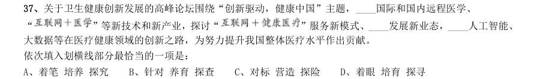
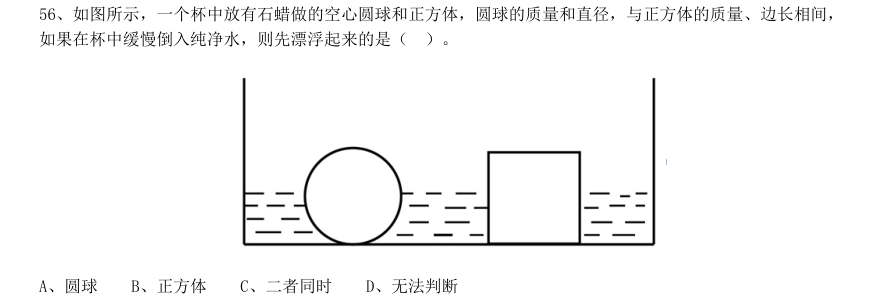
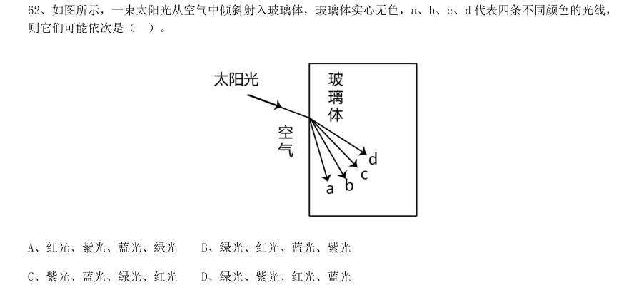
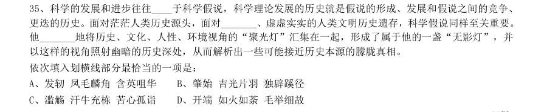
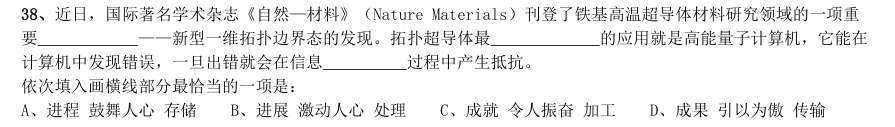
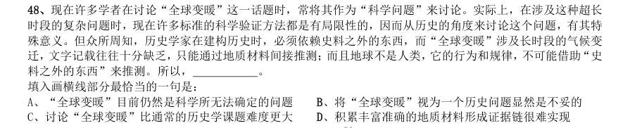
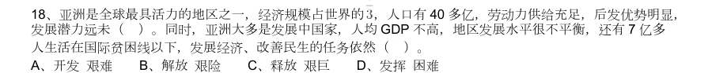

# 言语理解 · 逻辑填空 · 2010 年代真题

> 所属考点：[YY-LJTK](../YY-LJTK-逻辑填空.md)　｜　本片 595 题

### 2019 湖北·统一卷　第 21 题　（一空）
> 材料：答案。…

科学家将松力纤维蛋白原和可吸收材料共混后,采用静电纺技术制成具有超亲水性、类似细胞外基质的生物 复合支架材料。由该材料制成的人工韧带具有良好的组织 和合适的机械强度,植入肌体后,可在逐 层降解的同时进行组织再生,诱导肌体自身组织长入韧带中,逐步演变成自身韧带组织,实现腱骨融合,达到永 久愈合的目的。 填入划横线部分最恰当的一项是:

- **A.** 相容性
- **B.** 自愈性
- **C.** 亲和性
- **D.** 再生性

**答案：A**

### 2019 湖北·统一卷　第 22 题　（一空）

夏季天气炎热,人很容易犯困、无精打采,这时不妨吃几颗葡萄来帮你提神、消除疲乏之意。因为在葡萄中 含有丰富的葡萄糖成分,且很容易被人体吸收利用,从而为大脑供给所需能量,快速恢复大脑活力。同时,葡萄 中还含有较多的氨基酸,能对神经产生良好的____,帮助人体____衰弱的神经,这也是提神醒脑的有效途径。 依次填入划横线部分最恰当的一项是:

- **A.** 刺激调理
- **B.** 应激调节
- **C.** 激变调整
- **D.** 激发调剂

**答案：A**

### 2019 湖北·统一卷　第 23 题　（一空）

纪录片《苏东坡》以苏东坡贬谪黄州四年的生活为横切面, 其一生的心路历程,从文学、艺 术、美食、情感等维度进行透视,多角度地 其生命感悟、精神嬗变和艺术升华的过程,以及对中 国传统文化产生的深远影响。同时,辅之以当今最新的研究成果,再现了一个最丰富、最接近本真的苏东坡形象。 依次填入划横线部分最恰当的一项是:

- **A.** 关照阐释
- **B.** 记载解说
- **C.** 记录阐述
- **D.** 观照解读

**答案：D**

### 2019 湖北·统一卷　第 24 题　（一空）

一个艺术家真正的贡献是艺术语言的创新,如果说审美理想的构建是绘画法度和秩序建立的基石,那么绘画 秩序的建立则是绘画风格成熟的 。风格的形成在于画面所搭建的整体构成必须有 的秩 序和法则。 依次填入划横线部分最恰当的一项是:

- **A.** 途径和谐
- **B.** 标志内在
- **C.** 方向全新
- **D.** 目标稳定

**答案：B**

### 2019 湖北·统一卷　第 25 题　（一空）

没有精神内核的娱乐,即便一时热闹, 流于空虚。网民需要文化产品、需要轻松娱乐,但不 需要无下限、无道德的“秀”。应该肯定的是,依法净网。不只是约谈平台、关停账号,而是持续发力、 治 理。 依次填入划横线部分最恰当的一项:

- **A.** 最终固定化
- **B.** 难免长效化
- **C.** 终归常态化
- **D.** 终将平常化

**答案：C**

### 2019 湖北·统一卷　第 26 题　（一空）

极光多姿多彩,变化万千,任何彩笔都很难绘出那在严寒的两极空气中嬉戏无常、变幻莫测的炫目之光。在 自然界中还没有哪种现象能与之 。极光有时出现时间极短,犹如节日的焰火,在空中闪现一下就消失得 无影无踪;有时却可以在苍穹之中 几个小时;有时像一条彩带,有时像一团火焰,有时像一张五光十色 的巨大银幕,仿佛上映一场球幕电影,给人视觉上极美的享受。 依次填入划横线部分最恰当的一项是:

- **A.** 匹敌延宕
- **B.** 相较迤逦
- **C.** 媲美辉映
- **D.** 抗衡映照

**答案：C**

### 2019 湖北·统一卷　第 27 题　（逻辑填空（综合））

除了口误,笔误同样泄露了潜意识的秘密。短信聊天说到我爸身体不舒服却不去医院检查这一事实时,我想 说“我爸就是太固执了”,但我键入的文字竟是“我爸就是太过分了”。那一刻,我突然呆住了。一词之别,却 暴露出我内心深处的真实情绪。“固执”只是一种较为客观的 ,而“过分”却是饱含着情绪的 。

- **A.** 判断认识
- **B.** 体现流露
- **C.** 显示暗示
- **D.** 描述表达

**答案：D**

### 2019 湖北·统一卷　第 28 题　（一空）

美好的事物人人向往,若是缺少发现的眼睛,它也容易被 。某次儿童画展,一位小朋友的作品 上有一个洞,评委们好奇地问,这是不是一幅破损的作品。小朋友说,这是进入世外桃源的入口。孩子的答案, 耐人寻味。如何 发现美的眼睛,是一个需要全社会去回答的课题。 依次填入划横线部分最恰当的一项是:

- **A.** 蒙蔽擦拭
- **B.** 遮蔽擦亮
- **C.** 掩饰拂拭
- **D.** 遮掩烛照

**答案：B**

### 2019 湖北·统一卷　第 29 题　（一空）

关于科学革命的讨论 于十七世纪。不过,其时革命尚在 地展开,相关讨论的焦点 集中在科学的本性,而未有所谓“科学革命史”的理解。到十九世纪,现代科学的基本模式逐渐定型,一些学者 便回到现代科学的源头做起了编史和整理工作。 依次填入划横线部分最恰当的一项是:

- **A.** 滥觞如火如荼
- **B.** 溯源轰轰烈烈
- **C.** 起源风起云涌
- **D.** 发端方兴未艾

**答案：A**

### 2019 湖北·统一卷　第 30 题　（一空）

城市的文化形象是人们对一个城市的文化 的整体认知与印象,主要来源于城市的发展哲学、城 市精神等构成的理念识别系统,城市各主体的行为方式所构成的行为识别系统以及公共文化空间、文化景观等构 成的视觉识别系统。在新一轮的城市竞争中,城市的文化形象对城市的经济社会发展将起到 的作用。 依次填入划横线部分最恰当的一项是:

- **A.** 观感撼天震地
- **B.** 气质举足轻重
- **C.** 禀赋振聋发聩
- **D.** 特征醍醐灌顶

**答案：B**

### 2019 湖北·统一卷　第 31 题　（一空）

说起乡愁,那是一种 的情怀,住在心中的故乡常常鲜活在那里。故乡是安放你的灵魂、温暖你的 寂冷的地方,是接纳你的疲惫、抚慰你的忧伤的地方。翻开一页页被繁忙弄乱的过往,记忆中的余香总 于 儿时的故乡。 依次填入划横线部分最恰当的一项是:

- **A.** 与生俱来氤氲
- **B.** 难以割舍回荡
- **C.** 刻骨铭心徘徊
- **D.** 永生难忘徜徉

**答案：A**

### 2019 湖北·统一卷　第 32 题　（一空）

古人根据经验编制了许多脍炙人口的农谚,比如“清明前后,种瓜点豆”。不仅是农谚,与二十四节气相关 的诗词歌赋也是 ,比如“蒹葭苍苍,白露为霜”,再比如“清明时节雨纷纷,路上行人欲断魂”。这 些诗词歌赋 ,将二十四节气与天气现象巧妙地结合在一起,具有很好的传播性。 依次填入划横线部分最恰当的一项是:

- **A.** 俯拾皆是沉思翰藻
- **B.** 不胜枚举形神兼备
- **C.** 不计其数文采斐然
- **D.** 举不胜举缀玉联珠

**答案：B**

### 2019 湖北·统一卷　第 33 题　（一空）

打开书本,一股久违了的墨香扑面而来;摩挲纸张,淡淡的凹凸感非常舒服。味觉、视觉、触觉顿时都活泛 起来,连脑细胞也显得格外活跃。读累了,就闭眼歇一歇,顺便回味刚读过的情节,思考作者的 ; 看到精彩的描写和精辟的议论,就反复重读、吟咏再三,读到妙处更是 。 依次填入划横线部分最恰当的一项是:

- **A.** 春秋笔法弹冠相庆
- **B.** 言外之意低头折节
- **C.** 弦外之音额手称庆
- **D.** 微言大义击节赞叹

**答案：D**

### 2019 湖北·统一卷　第 34 题　（一空）

形成有文化特色、有地域特色、可识别的小城镇发展模式,是一个长期的渐进过程。我们应尊重当地实 际, 、远近结合、量力而行,不能盲目 。在模式选择上,可以借鉴国内外小城镇建设的经验, 但更重要的是结合自身实际、体现自身特色。 依次填入划横线部分最恰当的一项是:

- **A.** 循规蹈矩分庭抗礼
- **B.** 按部就班投闲置散
- **C.** 循序渐进贪大求快
- **D.** 按图索骥急于求成

**答案：C**

### 2019 湖北·统一卷　第 35 题　（一空）

一个城市的建设发展,如果说建筑是她的脊梁,环境是她的容貌,那市民的文明素质就是她的 。 而文化作为承载文明的基石,特别是当跨越时空的优秀传统文化理念、价值标准、审美风范被重新 , 转化为现代人们的精神追求和行为养成时,那她 的不仅是一个城市的文明,也增强了作为一名中 国人立足世界的文化底气和骨气。 依次填入划横线部分最恰当的一项是:

- **A.** 佩饰演绎赋予
- **B.** 神采弘扬荡涤
- **C.** 灵魂唤起涵育
- **D.** 冠冕阐释秉承

**答案：C**

### 2019 湖北·统一卷　第 36 题　（一空）

圈椅是明代家具中最为经典的制作。明代圈椅,造型古朴典雅,线条简洁流畅,制作技艺达到了____的境地。 “天圆地方”是中国人文化中____的宇宙观,不但建筑受其影响,也____到了家具的设计之中。 依次填入划横线部分最恰当的一项是:

- **A.** 别有匠心普遍融合
- **B.** 巧夺天工特殊融会
- **C.** 炉火纯青典型融入
- **D.** 入室升堂独特融化

**答案：C**

### 2019 湖北·统一卷　第 37 题　（一空）

关于卫生健康创新发展的高峰论坛围绕“创新驱动,健康中国”主题,____国际和国内远程医学、 “ ”等新技术和新产业,探讨“ ”服务新模式、____发展新业态,____人工智能、 大数据等在医疗健康领域的创新之路,为努力提升我国整体医疗水平作出贡献。 依次填入划横线部分最恰当的一项是:

- **A.** 着笔培养探究
- **B.** 针对养育探查
- **C.** 对标营造探险
- **D.** 着眼培育探寻

**答案：D**

### 2019 湖北·统一卷　第 38 题　（一空）

蚕蛾往往能巧妙避开捕食者,它们利用旋转的后翅来 蝙蝠的声纳系统,从而 捕食 者对捕食目标的定位。但人们对蚕蛾的进化史以及它们后翅多样性形成的原因 科学家对数百个基因 组数据库的后翅形状进化过程进行了研究,发现了不同翅型的进化特征。 依次填入划横线部分最恰当的一项是:

- **A.** 躲避引导一知半解
- **B.** 折射诱导茫然不解
- **C.** 规避引诱不求甚解
- **D.** 反射误导知之甚少

**答案：D**

### 2019 湖北·统一卷　第 39 题　（一空）

敦煌研究院将与外部机构进一步合作,开展敦煌壁画的保护和修复,为这个文化宝藏的永续保存探讨更多可 能性。保护和修复也为了更好地传播,依托数字化,“数字敦煌”资源库在2016 年上线。资源库第一期的30 个 经典石窟,跨越北魏、西魏、北周、隋、唐等多个时期,其中绝大多数石窟都是未对游客开放的,全球网友只需 轻点鼠标,就可以免费360 度漫游洞窟,足不出户便能近距离感受千年的文化。千年敦煌石窟,正借助科技的手 段, ,焕发出新的生命与活力。 填入划横线部分最恰当的一项是:

- **A.** 力求重建用户沉浸式体验
- **B.** 以虚拟世界代替现实场景
- **C.** 突破时间、空间上的限制
- **D.** 促进与传统文化深度融合

**答案：C**

### 2019 湖北·统一卷　第 40 题　（一空）

科学家认为,未来的仿生机器人并非是要完全模仿人类的所有功能,而是模仿某项功能。这些智能机器人有 望成为“超人”,有的具有超强的记忆力,有的具有超强的学习能力,有的听觉功能特强,有的嗅觉功能特 强······, 。 填入划横线部分最恰当的一项是:

- **A.** 智能机器将超越人类
- **B.** 不同功能的智能机器人可以用于不同的领域
- **C.** 但它并不具备人类的情感,也不具备人脑的灵活性
- **D.** 人类受限于缓慢的生物学进化速度,无法与之竞争和对抗

**答案：B**

### 2019 湖北·统一卷　第 41 题　（一空）

将不能量化的诗歌(以及纯文学)评价标准和人工智能的算法标准拼接在一起,本来就是一件不伦不类的事。 人工智能在科学研究、生产劳动等方面的贡献,足以证明其本领之强, 。人类也完全没必要拿自己 的优势去跟人工智能的缺点比较,即使科技再发达,想必在未来很长的一段时间内,诗歌与文学的世界依然是人 类情感和灵魂最佳的栖息地,守卫好我们的心灵家园,依然要靠人类自身的智慧与创造力。 填入划横线部分最恰当的一项是:

- **A.** 却不能弥补人类智慧在诗歌创作上的缺陷
- **B.** 完全可以取代人类智慧自主开展诗歌创作
- **C.** 没必要和人类智慧在诗歌创作上一决高下
- **D.** 毫无疑问将能够实现诗歌评价标准的量化

**答案：C**

### 2019 湖北·统一卷　第 43 题　（一空）

在今天的社会文化实践中,我们更要关注当下的传统文化热是否真正触及了传统文化的人文精神实质,是否 真正提升了人们的精神境界。一般而言,文化的形式要自觉为文化的内容服务,如果忽略了文化的内容,尤其是 忽略了对贯穿其中的人文精神的追求,就必然会走入歧途,背离我们弘扬传统文化的初衷。文化是活的,不能做 简单的固化处理,更不能只注重形式而忽略对其内涵的传承。鉴于此,我们必须 。 填入划横线部分最恰当的一项是:

- **A.** 改变过于强调传统文化的符号性的做法
- **B.** 注意纠正传统文化弘扬中的形式化倾向
- **C.** 以实用心态凸显传统文化的工具性价值
- **D.** 借助现代电子技术手段来弘扬传统文化

**答案：B**

### 2019 湖北·选调　第 71 题　（一空）

近年来,信息技术的发展日新月异,数字化、网络化、智能化成为知识呈现新方式,面对信息技术带来的海 量知识内容与多元知识类型,如何________,撷取最有价值的知识内容与知识类型,成为个体知识学习面临 的新挑战。 填入画横线部分的词语,最恰当的一项是:

- **A.** 兼收并蓄
- **B.** 披沙拣金
- **C.** 扬长避短
- **D.** 薪火相传

**答案：B**

### 2019 湖北·选调　第 72 题　（一空）

随着改革开放的不断深入,老百姓的获得感、幸福感、安全感明显增强。几十年间,老百姓对“安全”的认 知已经发生了深刻的________。如果说几十年前老百姓对“安全”的憧憬是鸡犬相闻、路不拾遗,那么近些年来, 老百姓对“安全”的认知已经有了更进一步的________,既包含良好的乡镇、社区治安环境,更意味着在更为宏 观的风险社会背景下,让制度具有更好的________作用。 填入画横线部分的词语,最恰当的一项是:

- **A.** 变革拓展协调
- **B.** 变化扩大推动
- **C.** 转变延伸庇护
- **D.** 转化

**答案：C**

### 2019 湖北·选调　第 73 题　（一空）
> 材料：支撑…

随着移动互联网时代的到来,各大APP 已经逐渐占据了流量的主要入口,搜索引擎能吸引的流量越来越少; 加之,基于用户兴趣的推荐引擎兴起,让传统搜索引擎几乎________。用户点开推荐引擎,目光就无法移开, ________之高让老牌搜索引擎公司眼热,传统搜索引擎应对的招数就是复制这一模式,让自家搜索优先推荐自家 内容。 填入画横线部分的词语,最恰当的一组是:

- **A.** 难以招架黏性
- **B.** 全盘崩溃效率
- **C.** 不名一钱热度
- **D.** 退无可退

**答案：A**

### 2019 湖北·选调　第 74 题　（一空）

我国建国初期,美术作品中中国画逐渐占据重要地位,题材广泛多样,拓展了中国画的表现领域,出现了一 批直接表现新时代现实生活和精神风貌的国画作品,一扫传统国画的荒寒落寞,表现出________的态势,为国画 艺术最终摆脱传统________奠定了基础。 填入画横线部分的词语,最恰当的一组是:

- **A.** 扶摇直上桎梏
- **B.** 间不容息颓势
- **C.** 蒸蒸日上窠臼
- **D.** 瞬息万变

**答案：C**

### 2019 湖北·选调　第 75 题　（一空）

为了让基层干部敢于担当作为,让他们感到有关心、有支持,上级领导要多一些俯下身子的耐心,少一些高 高在上的盲目指挥;多一些换位思考的理解包容,少一些________的简单问责。在管理干部时,________必不可 少,但要与厚爱有机结合,尤其应当注重厚爱。 填入画横线部分的词语,最恰当的一组是:

- **A.** 不分皂白薄惩
- **B.** 罔顾实际严管
- **C.** 咄咄逼人问责
- **D.** 草草了事

**答案：B**

### 2019 湖北·选调　第 76 题　（一空）

科学管理是认识管理对象的动态过程。管理活动特别是现代管理活动,可以根据具体需要,已有知识的指导、 前人的管理经验和科学的管理预判有序安排。然而,与按既定规程运作的物质生产过程不同,________________, 因而难以完全按预定的目的和计划进行,有其不确定性和强烈的探索性。 填入画横线部分最恰当的一句是:

- **A.** 管理活动面对的经常是极为复杂的管理对象
- **B.** 管理活动则是以精神生产为直接目的的活动
- **C.** 管理活动的具体形式比预想的更加多种多样
- **D.** 管理活动往往需要各级管理者不断推陈出新

**答案：A**

### 2019 湖北·选调　第 83 题　（一空）

仪式感使得某一天与其他日子不同,使某一时刻与其他时刻不同。当下仪式感的缺失似乎成了传统春节年味 儿变淡的根本原因,过年和平时相比不再特殊。但随着社会的发展变化,一些专家认为,________________,家 族的小型化使得人们越来越注重个人权利和感受,这使仪式感越来越在小范围、乃至在个人生活中得以体现。相 应的,过年的仪式感也渐渐从“四世同堂的大家宴”转向“三口之家的小团圆”。 填入画横线部分最恰当的一项是:

- **A.** 仪式感缺失逐渐转向仪式感变迁
- **B.** 仪式感缺失成为突出的家庭问题
- **C.** 仪式感使得年味重新变得浓郁
- **D.** 仪式感使得家庭变得更加团结

**答案：A**

### 2019 广东·乡镇　第 1 题　（逻辑填空（综合））
> 材料：个选项中选出一个最恰当的答案。…

多元的发展机会和自由的成长空间,是时代给予每个追梦人的馈赠;( )每个追梦人在前进道路上迈出的 每一步,( )都在推动时代的进步。

- **A.** 而 也
- **B.** 但 却
- **C.** 如果 就
- **D.** 只有 才

**答案：暂缺**

### 2019 广东·乡镇　第 2 题　（逻辑填空（综合））

只要我们迈出的步伐足够坚实,前进的意志足够( ),奋斗路上的困难终将被克服,前进路上的沟壑终将 被跨越。

- **A.** 强硬
- **B.** 奋勇
- **C.** 坚定
- **D.** 坚硬

**答案：暂缺**

### 2019 广东·乡镇　第 3 题　（逻辑填空（综合））

近年来,各地纷纷大刀阔斧地开展( ),向不担当不作为亮剑。

- **A.** 整理
- **B.** 整治
- **C.** 修理
- **D.** 梳理

**答案：暂缺**

### 2019 广东·乡镇　第 4 题　（逻辑填空（综合））

在落实乡村振兴战略的过程中,一定要科学规划,( ),才能最终实现目标,任何希望( )的想法都 是不切实际的。

- **A.** 循序渐进 一蹴而就
- **B.** 寻根究底 一鼓作气
- **C.** 蔚然成风 一劳永逸
- **D.** 未雨绸缪 一马当先

**答案：暂缺**

### 2019 广东·乡镇　第 5 题　（逻辑填空（综合））

持续深入的人才发展体制机制改革,为( )、( )、( )、( )打牢了坚实基础,有力推进 了新时代中国特色社会主义伟大事业不断夺取新的伟大胜利。

- **A.** 引才 聚才 用才 育才
- **B.** 聚才 用才 育才 引才
- **C.** 用才 育才 引才 聚才
- **D.** 育才 引才 聚才 用才

**答案：暂缺**

### 2019 广东·县级　第 3 题　（逻辑填空（综合））

新的一年,我们将迎来新的历史坐标和奋斗起点,也必将面临一定的挑战。但只要我们迈出的步伐足够( ),前进的意志足够( ),奋斗路上的困难终将被克服,前进路上的沟壑终将被跨越。

- **A.** 坚实 坚定
- **B.** 坚固 坚强
- **C.** 牢靠 强大
- **D.** 牢固 奋勇

**答案：暂缺**

### 2019 广东·县级　第 4 题　（逻辑填空（综合））

从广州南沙到深圳前海、珠海横琴,从香港科技大学(广州)校区合作项目建设,到推进深港青年创新创业、 加速粤澳合作中医药科技产业园建设,聚力打造深度合作发展平台的探索( )。

- **A.** 如履平地
- **B.** 如箭在弦
- **C.** 如愿以偿
- **D.** 如火如荼

**答案：暂缺**

### 2019 广东·县级　第 5 题　（逻辑填空（综合））

中国特色社会主义进入新时代,文艺创作、学术创新拥有无比( )的空间。而高质量的文化( ), 是满足人民美好生活向往的重要组成部分,也是时代发展所需。

- **A.** 浩瀚 需求
- **B.** 悠长 创作
- **C.** 广阔 供给
- **D.** 宽敞 库存

**答案：暂缺**

### 2019 广东·县级　第 7 题　（逻辑填空（综合））

构建人类命运共同体,需要世界各国人民努力建设一个远离( )、普遍安全的世界;一个远离( )、共 同繁荣的世界;一个远离封闭、开放包容的世界。

- **A.** 战乱 争端
- **B.** 战乱 贫困
- **C.** 纷扰 争端
- **D.** 纷扰 贫困

**答案：暂缺**

### 2019 广东·县级　第 8 题　（逻辑填空（综合））

新时代广东发展需要抓住粤港澳大湾区建设的历史( ),同时必须( )供求结构、经济增长内生动 力、生产要素高效便捷流动、生态环境等面临的发展难题。

- **A.** 机遇 破除
- **B.** 机会 破除
- **C.** 机遇 破解
- **D.** 机会 破解

**答案：暂缺**

### 2019 广东·县级　第 9 题　（逻辑填空（综合））

近年来,各地纷纷大刀阔斧地开展( ),向不担当不作为亮剑。

- **A.** 整理
- **B.** 整治
- **C.** 修理
- **D.** 梳理

**答案：暂缺**

### 2019 广东·县级　第 12 题　（一空）

人贵有恒。事实证明,但凡成就一番事业的人,无不是有恒心、有毅力的强者。他们聚焦主要目标,一以 贯之,久久为功,在坚持中集聚力量、成就作为。“当代愚公”李保国三十五年如一日扎根太行山区,用科技 为荒山带来苍翠,用产业为乡亲拔除“穷根”。古人说得好:“锲而舍之,朽木不折;锲而不舍,金石可镂。 ”_______________,一个人将在平凡中书写不凡。 下列句子填入横线处,最恰当的是( )。

- **A.** 改造自我、成就自我,崇德向善、勇毅前行
- **B.** 葆有坚持不懈的精神,蓄积水滴石穿的韧劲
- **C.** 向上向善,将良好的品行、好的习惯贯穿始终
- **D.** 以坚定的决心和意志不断纯洁党性、修身律己

**答案：暂缺**

### 2019 广东·选调　第 38 题　（逻辑填空（综合））

强大的国家必须拥有一支热血满腔,视荣誉为生命的军队。军人之所以视荣誉为生命,源于崇高的使命感, 源于社会的厚植培育。然而,在市场经济条件下,利益杠杆、个人价值在人才流动中的驱动作用更加明显,军 营的吸引力有所下降, 。 以下最适合填在划线处的是( )。

- **A.** 迫切需要提高军人的待遇水平
- **B.** 必须发挥纪律的约束和法制的保障作用
- **C.** 迫切需要在全社会重塑军人职业的荣誉感
- **D.** 必须以强军梦为引领,打造一支热血满腔的军队

**答案：C**

### 2019 广东·选调　第 39 题　（逻辑填空（综合））

艺术是民众创造的,离不开民众的生活。而在民众的社会生活中,经济因素又是一个非常重要的因子。具 体到戏曲而言,它在宋代形成,和当时的演艺市场日益商品化有密切关系。可以说,这是戏曲赖以形成、生存 和发展的重要原因。 最后一句话中的“这”指的是( )。

- **A.** 民众的社会生活
- **B.** 宋代的艺术环境
- **C.** 演艺市场的商品化
- **D.** 戏曲艺术的大众化

**答案：C**

### 2019 广东·选调　第 48 题　（逻辑填空（综合））

由于基层政府普遍人手不足,承担的任务十分繁杂,很难完成上级部门制定的“创新事项”考核。一些地 方为了达成“工作创新”,便忙着到处参观取经,将别人的方案“依葫芦画瓢”盲目照搬过来。殊不知, 。可以想见,这种“创新”会有什么样的结果。 以下最适合填在划线处的是( )。

- **A.** 种瓜得瓜,种豆得豆
- **B.** 橘生淮南为橘,生于淮北则为枳
- **C.** 一方水土养一方人,创新方案亦是如此
- **D.** 这些形形色色的纸面创新往往并不符合实际

**答案：B**

### 2019 广东·选调　第 54 题　（逻辑填空（综合））

我国是一个多煤、少气的国家。进入供暖季以来,国内天然气供应十分紧张。事实上,我国燃煤供暖技术 成熟稳定,通过普及清洁煤技术可以实现煤炭的清洁化利用。改善空气质量,控制散煤是关键。但控制散煤后 选择哪种方式实现清洁供暖,必须 ,统筹规划,稳妥推进。 以下最适合填在划线处的是( )。

- **A.** 建立天然气战略储备制度
- **B.** 推广清洁煤技术,采用成熟稳定的燃煤供暖技术
- **C.** 因地制宜,因时制宜,以保障群众生活供暖为前提
- **D.** 尽可能利用清洁能源,加快提高清洁供暖比重

**答案：C**

### 2019 广东·选调　第 56 题　（逻辑填空（综合））
> 材料：出最合理的1 项。…

如图所示,一个杯中放有石蜡做的空心圆球和正方体,圆球的质量和直径,与正方体的质量、边长相间, 如果在杯中缓慢倒入纯净水,则先漂浮起来的是( )。

- **A.** 圆球
- **B.** 正方体
- **C.** 二者同时
- **D.** 无法判断

**答案：B**

### 2019 广东·选调　第 57 题　（逻辑填空（综合））

已知一个30 度的斜坡,摩擦系数为0.5。甲乙两人一起冲到斜坡上同一位置,甲比乙重。如果没有任何外 力扶持,之后可能发生的情况是( )。

- **A.** 两人均开始下滑,两人下滑速度一样
- **B.** 两人均开始下滑,甲下滑速度比乙快
- **C.** 两人均开始下滑,甲下滑速度比乙慢
- **D.** 两人可以在斜坡上保持静止

**答案：A**

### 2019 广东·选调　第 58 题　（逻辑填空（综合））

某人利用石英砂、活性炭、蓬松棉和纱布制作了一个简易净水器。下列说法正确的是( )。

- **A.** 该净水器可以有效去除重金属元素
- **B.** 该净水器可以将自来水变为纯净水
- **C.** 该净水器可以降低自来水的硬度
- **D.** 蓬松棉应置于离出水口最近的地方

**答案：D**

### 2019 广东·选调　第 59 题　（逻辑填空（综合））

如图所示,电路两端的电压保持不变,当滑动变阻器的滑动触头P 向左移动,电阻变大时,三个灯泡亮度 的变化情况是( )。

- **A.** L1 变亮,L2 变亮,L3 变暗
- **B.** L1 变亮,L2 变暗,L3 变暗
- **C.** L1 变暗,L2 变暗,L3 变暗
- **D.** L1 变暗,L2 变暗,L3 变亮

**答案：B**

### 2019 广东·选调　第 60 题　（逻辑填空（综合））

桌面上有三个相同的烧杯,第一个是空烧杯,第二个烧杯内装有100ml 的水,第三个烧杯内装有200ml 的 水。用玻璃棒敲击烧杯的边沿,发现三个烧杯被敲击的声音都不相同。则下列说法正确的是( )。

- **A.** 敲击第一个烧杯的音调最高
- **B.** 敲击第二个烧杯的音调最高
- **C.** 敲击第三个烧杯的音调最高
- **D.** 敲击三烧杯的音调是一样的

**答案：A**

### 2019 广东·选调　第 61 题　（逻辑填空（综合））

物质的用途与性质密切相关。下列说法正确的是( )。

- **A.** 铝能用作电线,是因为它的化学性质不活泼
- **B.** 液氧可用于火箭发射,是因为氧气具有可燃性
- **C.** 生石灰可作干燥剂,是因为其具有很强的吸附能力
- **D.** 汽油可以去除衣服上的油污,是因为汽油可以溶解油污

**答案：A**

### 2019 广东·选调　第 62 题　（逻辑填空（综合））

如图所示,一束太阳光从空气中倾斜射入玻璃体,玻璃体实心无色,a、b、c、d 代表四条不同颜色的光线, 则它们可能依次是( )。

- **A.** 红光、紫光、蓝光、绿光
- **B.** 绿光、红光、蓝光、紫光
- **C.** 紫光、蓝光、绿光、红光
- **D.** 绿光、紫光、红光、蓝光

**答案：C**

### 2019 广东·选调　第 63 题　（逻辑填空（综合））

如图所示,两根绝缘细线悬挂着带有同种电荷的小球a 和b。因静电力,两根绝缘细线张开,分别与垂直 方向成夹角α 和β,且静止时两球处于同一水平面。如果夹角α 大于夹角β,则下列结论正确的是( )。

- **A.** 小球a 带电荷量比小球b 多
- **B.** 小球b 受到拉力比小球a 小
- **C.** 小球b 的质量比小球a 大
- **D.** 同时剪断两根细线,小球a 先落地

**答案：A**

### 2019 广东·选调　第 65 题　（逻辑填空（综合））

一个小球在竖直平面内的光滑圆环轨道上做圆周运动,小球经过圆环最高点时刚好不脱离圆环。通过最高 点时,小球( )。

- **A.** 没有受到向心力
- **B.** 向心力等于重力
- **C.** 没有向心加速度
- **D.** 线速度为0

**答案：B**

### 2019 国考·地市级　第 21 题　（一空）
> 材料：答案。…

《“健康中国2030”规划纲要》中提出,要努力实现从以治病为中心向以健康为中心转变,从以“治已病” 为中心向以“治未病”为中心转变,从疾病管理向健康管理转变。在这种背景下,中医药 。 填入画横线部分最恰当的一项是:

- **A.** 举足轻重
- **B.** 不可或缺
- **C.** 大有可为
- **D.** 大有裨益

**答案：C**

### 2019 国考·地市级　第 22 题　（一空）

科学精神的核心是求真务实,我们的一切实践都需符合规律、切合实际。规律指引下的世界变动不居,我们 不能 ,应敢于质疑、善于包容、勇于创新。 填入画横线部分最恰当的一项是:

- **A.** 因循守旧
- **B.** 沾沾自喜
- **C.** 妄自菲薄
- **D.** 刚愎自用

**答案：A**

### 2019 国考·地市级　第 23 题　（成语辨析）

阿道司·赫胥黎在《美丽新世界》中描绘了2532 年一个依赖生殖技术的人类社会。在那里,人文跟不上科 技的发展,人类的“拜物教”越来越兴盛:认为医学可以解决一切病痛,科技可以弥补人文的鸿沟。事实上,这 无异于 。 填入画横线部分最恰当的一项是:

- **A.** 饮鸩止渴
- **B.** 缘木求鱼
- **C.** 镜花水月
- **D.** 抱薪救火

**答案：B**

### 2019 国考·地市级　第 24 题　（一空）

新一代信息技术与制造业的深度融合,带来了制造模式、生产组织方式和产业形态的深刻变革,智能制造 也 。智能制造就是把新一代信息技术 于设计、生产、管理、服务等制造活动的各 个环节。 依次填入画横线部分最恰当的一项是:

- **A.** 水到渠成融汇
- **B.** 水涨船高应用
- **C.** 一日千里渗透
- **D.** 应运而生贯穿

**答案：D**

### 2019 国考·地市级　第 25 题　（一空）

近年来,商业赞助越来越多地 体育运动。在体育市场化、职业化 的当下,如 何在追求个人商业价值与体育管理机构利益间取得平衡,是运动员和体育管理机构不能回避的问题。 依次填入画横线部分最恰当的一项是:

- **A.** 觊觎如日中天
- **B.** 追逐高歌猛进
- **C.** 热衷欣欣向荣
- **D.** 垂青方兴未艾

**答案：D**

### 2019 国考·地市级　第 26 题　（一空）

历史是昨天的新闻,新闻是明天的历史。历史与新闻有如隔世兄弟, 。历史作为事实的记载, 往往和文学相互补充,而文学的天赋是想象、虚构和夸张。因此,沾上了文学的历史与新闻就像到了岔路口,不 光是 ,可能还会走向对立。 依次填入画横线部分最恰当的一项是:

- **A.** 情同手足前途未卜
- **B.** 一脉相通分道扬镳
- **C.** 唇齿相依互不相容
- **D.** 休戚与共各行其是

**答案：B**

### 2019 国考·地市级　第 27 题　（一空）

脱贫攻坚必须 ,一步一个脚印,确保各项扶贫政策措施落到实处,积小胜为大胜,最终取得 全面胜利。同时也应加强贫困村基层组织建设,充分调动贫困群众的积极性,提高其参与度、获得感,激励 其 ,激发其脱贫的内生动力与活力。 依次填入画横线部分最恰当的一项是:

- **A.** 未雨绸缪一马当先
- **B.** 一鼓作气奋发图强
- **C.** 循序渐进再接再厉
- **D.** 稳扎稳打自力更生

**答案：D**

### 2019 国考·地市级　第 28 题　（一空）

在人工智能研究热潮中,国内外已形成 的局面,但总体上人工智能还处于发展的初级阶段。人 们对于智能的本质和机理的认识还不够深刻、全面,尚未形成完善的理论体系。如果没有人工智能基础研究的支 撑,应用层面上的技术创新和产业创新都将是 。 依次填入画横线部分最恰当的一项是:

- **A.** 千帆竞发无源之水
- **B.** 百家争鸣昙花一现
- **C.** 龙争虎斗空中楼阁
- **D.** 星火燎原纸上谈兵

**答案：A**

### 2019 国考·地市级　第 29 题　（一空）

近年来因程序违法败诉的行政诉讼案件不少。尽管有前车之鉴,但是依然不乏职能部门 。说到 底,还是“重结果、轻程序”,不把程序当回事,行政行为自然经不起推敲。程序是保证我们有效实现结果的合 理设计,程序正当得不到 ,必然给我们的事业造成损害。 依次填入画横线部分最恰当的一项是:

- **A.** 明知故犯履行
- **B.** 老调重弹落实
- **C.** 重蹈覆辙尊重
- **D.** 以身试法认同

**答案：C**

### 2019 国考·地市级　第 30 题　（成语辨析）

中国的传统文化中,“老”是一个褒义的字眼。一个年轻人处事得当,会被说老练、老成。但是进入互联网 特别是移动互联网时代,这沿袭了数千年的观念,短短数十年 。年龄大、资历老逐渐不再是一 种优势,有时反而成了学习新事物的一种 。 依次填入画横线部分最恰当的一项是:

- **A.** 土崩瓦解羁绊
- **B.** 灰飞烟灭累赘
- **C.** 化为乌有阻力
- **D.** 分崩离析弊端

**答案：A**

### 2019 国考·地市级　第 31 题　（成语辨析）

基层离百姓最近,可以快速反馈百姓的感受和意见,随时进行政策调整,故能“因病施治”;基层直接面对 错综复杂的情况,最了解体制机制改革中的症结和痛点所在,故能“ ”;基层最看重的是实 效, 不得人心、难以持久,故内生的改革措施往往能“药到病除”。 依次填入画横线部分最恰当的一项是:

- **A.** 不药而愈夸夸其谈
- **B.** 对症下药花拳绣腿
- **C.** 一针见血朝令夕改
- **D.** 标本兼治华而不实

**答案：B**

### 2019 国考·地市级　第 32 题　（成语辨析）

中世纪时,人们的消息来源于口口相传,任何目击重要事件发生的人所提供的一手消息都被 ; 书面的解释记录并不足以服人,因为无法对写下这些内容的人反复询问。这就解释了,为什么尽管15 世纪时活 字印刷在古登堡被发明,但报纸行业的发展还是如此 。 依次填入画横线部分最恰当的一项是:

- **A.** 奉为圭臬艰难
- **B.** 照单全收落后
- **C.** 视若珍宝缓慢
- **D.** 大肆渲染迟滞

**答案：C**

### 2019 国考·地市级　第 33 题　（成语辨析）

智慧是哲人对世道人生、天地宇宙的独见独闻或先知先觉,它注定不是 的市井常识,也不是循 规蹈矩的老生常谈。“周虽旧邦,其命维新”,哲学的进步实则是哲人学术与智慧的不断 。 依次填入画横线部分最恰当的一项是:

- **A.** 司空见惯兼收并蓄
- **B.** 人云亦云推陈出新
- **C.** 妇孺皆知精益求精
- **D.** 拾人牙慧融会贯通

**答案：B**

### 2019 国考·地市级　第 34 题　（成语辨析）

在不同的经济增长阶段,经济活动所积累的风险水平和表现程度有所不同,因此金融机构在资源配置上必然 会有不同的表现。一般而言,金融机构习惯享受顺周期的经济上升发展,愿意做 的事;普遍忽视顺 周期的末端风险管理,而一遇经济逆转,常会“雨中收伞”“ ”,一些机构甚至不会再投放资源。 依次填入画横线部分最恰当的一项是:

- **A.** 顺水推舟明哲保身
- **B.** 济困扶危竭泽而渔
- **C.** 因势利导急流勇退
- **D.** 锦上添花釜底抽薪

**答案：D**

### 2019 国考·地市级　第 35 题　（一空）

动漫起初是儿童的天堂。博得孩子们喜爱,通常是一部动漫作品获得成功最重要的 。然而, 随着大众文化的兴起,成人开始进入西方动漫艺术消费的视野,赢得广大成人观众的青睐,越来越为各大动漫公 司所 。事实上,也正由于成人动漫观众的不断增长,十多年来,西方动漫艺术最终摆脱了过去 的 地位,在当代影视艺术中占据重要一席。 依次填入画横线部分最恰当的一项是:

- **A.** 标志重视边缘
- **B.** 指标称赞尴尬
- **C.** 象征追捧附属
- **D.** 标准欢迎弱势

**答案：A**

### 2019 国考·地市级　第 36 题　（一空）

新中国的区域与城市规划始于20 世纪50 年代,目前在空间规划上已初步形成了八个主要 , 按照从小到大的顺序,依次是乡村规划、小城镇规划、城市规划、大都市规划、大都市区规划、大都市圈规划、 城市群规划和湾区规划。但由于缺乏系统的 和深入的研究,很多概念的内涵和边界不够清楚,这 给实际的规划和建设带来诸多的不便和 。 依次填入画横线部分最恰当的一项是:

- **A.** 层次调查阻碍
- **B.** 部分考察负担
- **C.** 层级梳理混乱
- **D.** 维度分析困难

**答案：C**

### 2019 国考·地市级　第 37 题　（成语辨析）

随着汽车电动化的不断发展,国内造车新势力 ,传统车企亦纷纷转战新能源,新能 源汽车领域热点不断。但转型时期谈全面推行纯电动汽车略显 ,具有综合性强、用户接受度高等优 势的混合动力汽车作为过渡性产品 了当前的市场,车主纷纷投向混合动力汽车的怀抱。 依次填入画横线部分最恰当的一项是:

- **A.** 跃跃欲试激进拓展
- **B.** 异军突起超前适应
- **C.** 独占鳌头夸张迎合
- **D.** 风起云涌乐观占领

**答案：B**

### 2019 国考·地市级　第 38 题　（一空）

东北人喜欢的酸菜,四川人喜欢的泡菜,广东人喜欢的梅菜,都是依靠时间“ ”的美食。但在 腌制食品中 存在的亚硝酸盐,是健康的一大威胁。更何况很多中国家庭还特别喜欢自制腌制品, 一旦操作不当就会引发中毒。腌制品和腐败食物,美味和损伤,有时候只是 。 依次填入画横线部分最恰当的一项是:

- **A.** 精雕细琢广泛一墙之隔
- **B.** 点石成金少量一念之差
- **C.** 脱胎换骨普遍一步之遥
- **D.** 改头换面长期一时之选

**答案：C**

### 2019 国考·地市级　第 39 题　（一空）

一种新的意识、新的心智特征、新的生活形态一开始都是以一种不可辨认的方式 ,渐渐地显 露出来,越来越清楚,直到成为我们存在的一部分,进而影响甚至 我们的生活。今天,我们已经 不知不觉地进入了一种现实世界与网络世界 在一起的“后人类时代”,离开手机和电脑的生活已 经变得非常艰难。 依次填入画横线部分最恰当的一项是:

- **A.** 酝酿改变融合
- **B.** 产生扰乱重叠
- **C.** 出现掌控穿插
- **D.** 萌生支配交织

**答案：D**

### 2019 国考·地市级　第 40 题　（成语辨析）

当中原的青铜文化如火如荼之时,面对铜料欠缺的窘境,务实的越人 ,开创了瓷器生产的新纪元。 秦汉时期是中国历史上大动荡大变革的时代,各行各业的面貌都 ,古老越地的陶瓷业也是如此。进 入东汉,过去的原始瓷 退出历史的舞台,一种面貌全新的青瓷在上虞曹娥江中游地区的窑场随之诞生。 依次填入画横线部分最恰当的一项是:

- **A.** 另辟蹊径焕然一新悄然
- **B.** 独具慧眼蒸蒸日上突然
- **C.** 天马行空日新月异黯然
- **D.** 因地制宜朝气蓬勃淡然

**答案：A**

### 2019 国考·地市级　第 47 题　（一空）

人口向城市迁移并不一定会推动经济增长和生产率的提高。如果人口流入城市,却没有优质的就业作为依托, 就会导致城市的贫民窟化。只有经济结构根据经济发展阶段进行转换,经济才会增长,并创造良好的就业机会, 收入才会随之增加,人口才会向城市迁移。所以, 。 填入画线部分最恰当的一句是:

- **A.** 人口向城市迁移是经济发展的必然趋势
- **B.** 人口迁移率是衡量经济发展水平的重要指标
- **C.** 只有调整经济结构,才能增加城市中的就业机会
- **D.** 城镇化其实是经济发展的结果,而非前提

**答案：D**

### 2019 国考·省级　第 52 题　（逻辑填空（综合））

根据所给材料,以下哪一项不是哥伦布时代欧洲人渴求香料的原因?

- **A.** 对天堂的
- **B.** 对理性的诉求
- **C.** 对显赫身份的向往
- **D.** 对延缓衰老的渴望

**答案：B**

### 2019 国考·省级　第 53 题　（逻辑填空（综合））

根据所给材料,以下哪一项是香料失宠的原因之一?

- **A.** 迷恋香料使得整个社会奢靡之风盛行
- **B.** 新的医疗技术颠覆了香料治病的传统
- **C.** 新的烹饪偏好延长了食物的储存时间
- **D.** 香料在基督教中的象征意义逐渐消失

**答案：D**

### 2019 国考·省级　第 54 题　（逻辑填空（综合））

根据所给材料,十六、十七世纪的欧洲生活中最不可能出现的场景是:

- **A.** 厨师用美洲的红辣椒代替胡椒调味
- **B.** 商人通过茶叶贸易获得了大量利润
- **C.** 新的音乐形式成为贵族热衷的话题
- **D.** 城郊的异域风情餐厅开始受人追捧

**答案：A**

### 2019 国考·省级　第 56 题　（逻辑填空（综合））
> 材料：根据所给材料,回答56~60 题: 1注意力不集中是常有之事。如何提高注意力,尽可能长时间保持专注呢? 2耶鲁大学心理学系布朗教授研究发现,人类的注意力非常有限,因而大脑通常过滤掉我们看到的模糊而无 关紧要的东西,留下清晰鲜艳的目标。在很多情况下,人们需要具备长时间注意细节的能力。 3布朗教授一直致力于通过为人们提供快速精准的反馈意见来提高他们的专注力,他的团队以往经常采用功 能性核磁共振成像技术,通过检验血液流进脑细胞的磁场变化实现脑功能成像,给出精确的结构与功能的关系。 …

根据所给材料,功能性核磁共振成像技术能够:

- **A.** 实时成像
- **B.** 检测大脑氧气含量
- **C.** 判断脑区的活跃状况
- **D.** 监测带氧血红素的磁导率

**答案：C**

### 2019 国考·省级　第 57 题　（一空）

依次填入第4段中最合适的词语是:

- **A.** 不足鞭长莫及
- **B.** 局限微乎其微
- **C.** 困难杯水车薪
- **D.** 条件差强人意

**答案：B**

### 2019 国考·省级　第 58 题　（逻辑填空（综合））

在实验中,参与者不可能:

- **A.** 在实验后半段得到的奖励更多
- **B.** 脑区的磁场变化产生较大波动
- **C.** 看到人脸占比达到60%的图像
- **D.** 在图像中观察到河岸边的马群

**答案：D**

### 2019 国考·省级　第 59 题　（逻辑填空（综合））

布朗教授的实验最能够支持下列哪个说法?

- **A.** 反馈机制可以帮助人们集中注意力
- **B.** 场景比人脸通常更容易吸引注意力
- **C.** 注意力在测试中比在生活中更易集中
- **D.** 注意力能使大脑过滤无关紧要的信息

**答案：A**

### 2018 湖北·统一卷　第 21 题　（三空及以上）
> 材料：当的答案。…

泥石流的 依赖于三个危险因素:沉积物中的粘土、大量的水快速涌入以及山区的地势差异。 发生泥石流时,地上的各种大小石头和泥,小到直径只有零点几微米的粘土,大到数十厘米乃至更大的巨型漂 砾,都有可能 在泥石流中“泥沙俱下”。 依次填入划横线部分最恰当的一项是:

- **A.** 诱发裹挟
- **B.** 成因汇集
- **C.** 出现夹杂
- **D.** 引发聚集

**答案：A**

### 2018 湖北·统一卷　第 22 题　（一空）

崇尚和平、和睦、和谐的理念,深深根植于中华民族绵延五千余载的 文明。中国人民从苦 难中走过来,深知和平的珍贵、发展的 ,怕的就是动荡,求的就是稳定,盼的就是天下太平。 依次填入划横线部分最恰当的一项是:

- **A.** 古老意义
- **B.** 悠久价值
- **C.** 辉煌重要
- **D.** 灿烂方向

**答案：B**

### 2018 湖北·统一卷　第 23 题　（一空）

哲学社会科学作为人们认识世界、改造世界的重要 ,历来是推动历史发展和社会进步的重 要力量。纵观人类历史,人类社会每一次重大跃进,人类文明每一次重大发展,都离不开哲学社会科学的知 识 和思想先导。哲学社会科学的发展水平,反映了一个民族的思维能力、精神品格、文明素质, 体现了一个国家的综合国力和国际竞争力。 依次填入划横线部分最恰当的一项是:

- **A.** 指南增进
- **B.** 途径进步
- **C.** 方法积累
- **D.** 工具变革

**答案：D**

### 2018 湖北·统一卷　第 24 题　（一空）

细胞表面的磷脂酰丝氨酸是促进HIV 与细胞融合的重要辅因子,是HIV 入侵细胞过程中的“ ”目标, 若这一目标不存在了,则会影响HIV 的入侵。因此, 外源性磷脂酰丝氨酸,或抑制TMEM16F 蛋白,就会 抑制病毒蛋白的介导融合,从而阻止HIV 对细胞的感染。 依次填入画横线部分最恰当的一项是:

- **A.** 捆绑阻隔
- **B.** 锁定阻拦
- **C.** 绑定阻止
- **D.** 绑架阻断

**答案：D**

### 2018 湖北·统一卷　第 25 题　（一空）

国家主席习近平在G20 汉堡峰会上对全球经济治理的建议极具针对性,加强宏观政策 ,有助于促进 各方 ,避免沟通不畅或是以邻为壑,进而打造开放共赢的合作模式。 依次填入划横线部分最恰当的一项是:

- **A.** 协调互动
- **B.** 调控互通
- **C.** 沟通联动
- **D.** 交流联通

**答案：C**

### 2018 湖北·统一卷　第 26 题　（一空）

家风是具有鲜明特征的家庭文化,良好家风是一个家庭最宝贵的精神财富,也是每个家庭成员形成正确世 界观、人生观、价值观的 。家庭是人生的第一所学校,良好家风是人生幸福生活的“第一组密码”。“积 善之家,必有余庆;积不善之家,必有余殃。”只有守住和 好温暖的家庭,才能有人生的成功。 依次填入划横线部分最恰当的一项是:

- **A.** 基点庇护
- **B.** 基准保护
- **C.** 基础爱护
- **D.** 基石呵护

**答案：D**

### 2018 湖北·统一卷　第 27 题　（一空）

每一项工业遗产都 着城市社会发展的演变规律,实施对工业遗产的发掘保护,开发利用,对 维护城市风貌, 生机特色,克服千城一面现象,具有重要意义。 依次填入划横线部分最恰当的一项是:

- **A.** 凝结保持
- **B.** 凝集保留
- **C.** 凝聚突出
- **D.** 凝滞凸显

**答案：A**

### 2018 湖北·统一卷　第 28 题　（一空）

欧盟委员会发布消息称,回顾全球“金融危机”以来的 ,欧盟采取得当的 ,有效地 控制住了危机的蔓延与发展,从而在最近几年取得了经济持续增长的佳绩。 依次填入划横线部分最恰当的一项是:

- **A.** 历史办法
- **B.** 历程措施
- **C.** 经历手段
- **D.** 经过举措

**答案：B**

### 2018 湖北·统一卷　第 29 题　（一空）

无论是现代游戏,还是传统游戏,都____出了一定的知识、社会和时代特征,同时也____了团结、多样性 和包容的价值。但随着社会变迁和时代发展,很多有价值的传统游戏正在一代又一代的____中逐渐消逝。 依次填入划横线部分最恰当的一项是:

- **A.** 反射传播更新
- **B.** 折射传递更迭
- **C.** 影射传承更替
- **D.** 投射传达更动

**答案：B**

### 2018 湖北·统一卷　第 30 题　（一空）

总的来讲,“社会”在处理与国家的关系过程中强调其自主性的成长与释放,并 了各种形式的 自我保护运动。而且,“社会”也在改变其生存与发展策略,它不仅仅满足在国家为其 的范围 内行动,而且还通过与国家的主动接触与互动, 与政府的相关性,并以协作或合作的方式参与社会 问题的解决。 依次填入划横线部分最恰当的一项是:

- **A.** 展开规定保持
- **B.** 拓展制定保护
- **C.** 开展划定维持
- **D.** 发展制订保障

**答案：A**

### 2018 湖北·统一卷　第 31 题　（一空）

这部著作把对历史文化追索的触角更深入地探触到历史时空的幽微之处,更敏锐地 虽然缥 缈却血脉相连的文化传承,让远逝的鸿影显现出朦胧的真相,使冰冷荒漠的历史有了人性的 。 他将华夏祖先的图腾放置在人类文明进步的历史大背景中予以 ,在历史与现实之间辗转反侧、 抒发见解,带给我们新的思考。 依次填入划横线部分最恰当的一项是:

- **A.** 感知温度观照
- **B.** 揭示弱点洞察
- **C.** 探究纠葛揣度
- **D.** 体悟温暖臆想

**答案：A**

### 2018 湖北·统一卷　第 32 题　（一空）

古代中国数秘术与古希腊数秘术的区别在于,前者侧重解象,后者侧重数术。中国的数秘术后来发展成了 更具意义的宇宙形而上学,与算术渐行渐远, 。 填入划横线部分最恰当的一项是:

- **A.** 南辕北辙
- **B.** 分道扬镳
- **C.** 缘木求鱼
- **D.** 背道而驰

**答案：B**

### 2018 湖北·统一卷　第 33 题　（一空）

中国传统菜肴对于烹调方法极为讲究,而且长期以来,由于物产和风俗的差异,各地的饮食习惯和品味爱 好 , 的烹调技术经过历代人民的创造,形成了丰富多彩的地方菜系。 依次填入划横线部分最恰当的一项是:

- **A.** 迥然不同源远流长
- **B.** 天差地别积厚流光
- **C.** 殊途同归连绵不断
- **D.** 如出一辙博大精深

**答案：A**

### 2018 湖北·统一卷　第 34 题　（一空）

当下,“网红食品”让一些美食爱好者 。然而,朋友圈里的美食宣传往往真假莫辨。“网红食品” 利用朋友圈熟人关系、口碑传播的社交特性推销产品,甚至 营销公众号为其背书。 依次填入划横线部分最恰当的一项是:

- **A.** 接踵而来鼓动
- **B.** 蜂拥而至发起
- **C.** 亦步亦趋策动
- **D.** 趋之若鹜发动

**答案：D**

### 2018 湖北·统一卷　第 35 题　（一空）

科学的发展和进步往往____于科学假说,科学理论发展的历史就是假说的形成、发展和假说之间的竞争、 更迭的历史。面对茫茫人类历史源头,面对_______、虚虚实实的人类文明历史遗存,科学假说同样至关重要。 他_______地将历史、文化、人性、环境视角的“聚光灯”汇集在一起,形成了属于他的一盏“无影灯”,并 以这样的视角照射幽暗的历史深处,从而解析出一些可能接近历史本源的朦胧真相。 依次填入划横线部分最恰当的一项是:

- **A.** 发轫凤毛麟角含英咀华
- **B.** 肇始吉光片羽独辟蹊径
- **C.** 滥觞汗牛充栋苦心孤诣
- **D.** 开端如火如荼毛举细故

**答案：B**

### 2018 湖北·统一卷　第 40 题　（一空）

传统文化、其幽静深邃堪比深深庭院,正是因为有最单纯、最本初的文化热爱,路过之人才愿意叩开门扉, 一探究竟。以或萌或雅的方式吸引人来,只是极为关键的第一步,而最终决定大家能在这庭院之中停留多久的, 还是文化本身的魅力。因此,判断文化创意产品是否成功,一条重要的原则就是看能否将 融 会贯通。 填入划横线部分最恰当的一项是:

- **A.** 幽静深邃的意蕴与单纯本初的文化热爱
- **B.** 传统文化的精神与国际潮流的一般走向
- **C.** 极为关键的萌感与停留心中的高雅文化
- **D.** 吸引人的巧妙形式与留住人的文化内核

**答案：D**

### 2018 湖北·统一卷　第 43 题　（一空）

许多企业正遭遇来自网络罪犯前所未有的攻击。有数据显示,“想哭”病毒仅攻击网络一次,就能造成高 达40 亿美元的损失。网络罪犯擅长兜售自己成功的战略,他们将所谓的勒索软件当成一种服务,其中涉及一 种许可软件,可冻结公司的电脑文件直至对方付款。这些黑客不一定都是自由职业者,事实上,当今绝大多数 灾难性的网络攻击都有某些组织的支持。遭受攻击的企业寻求执法人员帮助存在风险,因为不但企业费时费钱, 而且会增加将敏感信息公之于众的风险。因此, 。 填入划横线部分最恰当的一项是:

- **A.** 政府应该加强监管,帮助企业应对黑客攻击
- **B.** 企业为了减少损失,寻找私人网络安全公司
- **C.** 新的行业应运而生,网络安全成为热门行业
- **D.** 要将黑客绳之以法,减少网络罪犯攻击企业

**答案：C**

### 2018 湖北·统一卷　第 52 题　（一空）

20 世纪30 年代,图灵提出计算机能够思维的观点,主张凡是能够通过“图灵测试”的计算机就能够思维。 所谓“图灵测试”,就是说一个人如果不能判断与之对话的隐藏主体是人还是机器,我们就不得不承认即便是 机器也能思维。“图灵测试”能否判断机器的思维, 。如果将思维定义为计算过程,那么计 算机当然能够思维。这就是著名的“计算机隐喻”,即人是计算机,思维就是计算——这是计算机表征主义的 核心思想。 填入划横线部分最恰当的一项是:

- **A.** 取决于如何定义计算机
- **B.** 取决于思维的活动过程
- **C.** 取决于计算机的功能配备
- **D.** 取决于我们如何定义思维

**答案：D**

### 2018 广东·统一卷　第 1 题　（逻辑填空（综合））

宪法是治国安邦的总( ),是党和人民意志的集中( ),在我们党治国理政活动中具有十分重 要的地位和作用。

- **A.** 规范 呈现
- **B.** 章法 展现
- **C.** 章程 体现
- **D.** 标准 表现

**答案：暂缺**

### 2018 广东·统一卷　第 2 题　（逻辑填空（综合））

党的十八大以来,中国人民的创造精神前所未有地( )出来,推动我国( )向前发展,大踏步 走在世界前列。

- **A.** 迸发 日新月异
- **B.** 激发 气象万千
- **C.** 涌现 千变万化
- **D.** 呈现 一日千里

**答案：暂缺**

### 2018 广东·统一卷　第 3 题　（逻辑填空（综合））

在新时代,我们要大力提升发展质量和效益,坚持质量第一、( )质量变革、( )质量优势、 建设质量强国、( )高质量发展。

- **A.** 发动 增强 追求
- **B.** 提倡 增加 达到
- **C.** 推动 增强 实现
- **D.** 倡导 增加 完成

**答案：暂缺**

### 2018 广东·统一卷　第 4 题　（逻辑填空（综合））

经过五年的不懈努力,群众反映强烈的突出问题得到有效( ),不正之风得以扭转,可以说作风 建设改变了中国,在全面从严治党历史进程中写下了( )的一笔。

- **A.** 遏制 铿锵有力
- **B.** 遏止 入木三分
- **C.** 遏止 掷地有声
- **D.** 遏制 浓墨重彩

**答案：暂缺**

### 2018 广东·统一卷　第 5 题　（逻辑填空（综合））

总理在两会上所作的政府工作报告是一个( )民心、( )民意、体现民情的报告,也是一个增 强信心、鼓舞士气、催人奋进的报告。

- **A.** 代表 反应
- **B.** 表现 反映
- **C.** 表现 反应
- **D.** 代表 反映

**答案：暂缺**

### 2018 广东·统一卷　第 6 题　（逻辑填空（综合））

开展国土绿化行动,既要注重数量,更要注重质量,坚持科学绿化、规划引导、( ),走科学、 生态、借鉴的绿化发展之路,久久为功,善做善成,不断( )森林面积,不断( )森林质量,不断提升 生态系统质量和稳定性。

- **A.** 因地制宜 扩大 提高
- **B.** 因势利导 加大 增强
- **C.** 因地制宜 扩充 强化
- **D.** 因势利导 增加 改善

**答案：暂缺**

### 2018 广东·统一卷　第 8 题　（逻辑填空（综合））

历代仁人志士所处的历史时代不同,但都以自己的行为作出了这样的诠释:“忠”就是( ),在 国家和民族危难之时大义凛然,挺身而出;“忠”就是( ),在是非曲直面前旗帜鲜明,刚直不阿;“忠” 就是( ),在各种诱惑面前心有定力,不为所动。

- **A.** 担当 正直 坚持
- **B.** 勇敢 刚正 坚守
- **C.** 担当 刚正 坚守
- **D.** 勇敢 正直 坚持

**答案：暂缺**

### 2018 广东·统一卷　第 9 题　（逻辑填空（综合））

中国发展到今天,我们( )不需要对西方文明持仰视与全盘肯定的态度,( )对传统文化回归 的呼唤也必须建立在科学理性的基础上,( )不能落入对“己”过于自信与对“他”全然排斥的窠臼。

- **A.** 肯定 但 也
- **B.** 固然 但 而
- **C.** 虽然 而 却
- **D.** 即使 而 又

**答案：暂缺**

### 2018 广东·统一卷　第 10 题　（逻辑填空（综合））

( )的中华民族发展史是中国人民书写的,( )的中华文明是中国人民创造的,( )的中华 民族精神是中国人民培育的,中华民族迎来了从站起来、富起来到强起来的伟大飞跃是中国人民奋斗出来的。

- **A.** 波澜壮阔 博大精深 历久弥新
- **B.** 恢弘壮丽 源远流长 同舟共济
- **C.** 气势磅礴 奔流不息 与时俱进
- **D.** 延绵不断 厚积薄发 奋发有为

**答案：暂缺**

### 2018 广东·统一卷　第 11 题　（一空）

改革开放使我国走向繁荣富强,经济实力、科技实力、国防实力、综合国力快速提升。改革开放之 所以能给我国带来翻天覆地的变化,一个重要原因是 ,主要体现为我们既坚持以经济建设为中心、 把发展作为第一要务,又主动为发展营造安全环境。前者以改革开放解放和发展生产力,提高资源配置效率 和发展水平;后者改变了我们处理自身与外部关系的方式,主动改善和发展与其他国家的关系,积极缓解外 部安全威胁。 填入划线部分的句子,最恰当的是( )。

- **A.** 它推动了经济快速发展和综合国力的提高
- **B.** 它得到了人民群众的衷心拥护和支持
- **C.** 它优化了政策制度体系和施政方式
- **D.** 它带来了重大的理念和战略转变

**答案：暂缺**

### 2018 国考·副省级　第 21 题　（成语辨析）
> 材料：答案。…

如今,一批70 后、80 后甚至更年轻的年画传承人涌现出来。这些年轻人开始有了清醒的文化自觉,对中华 传统文化怀有浓厚的兴趣,怀着敬畏之心钻研,并不 ,急于进入市场大潮,冯骥才称他们为“年画的新 力量”。 填入画横线部分最恰当的一项是:

- **A.** 随波逐流
- **B.** 沽名钓誉
- **C.** 好高骛远
- **D.** 人云亦云

**答案：A**

### 2018 国考·副省级　第 22 题　（一空）

情绪并不是独立存在的,它常常伴随着信息而传播。作为一种态度,情绪不仅能够 人们对所 传播信息的认知,还会在一定程度上指导人们的行为。积极的情绪会促进人们积极地认识世界,消极的情绪则可 能给他人甚至整个社会带来破坏性后果。人在情绪失控时,很容易不顾后果地做出 的举动。 依次填入画横线部分最恰当的一项是:

- **A.** 影响危险
- **B.** 左右出格
- **C.** 干扰反常
- **D.** 支配冲动

**答案：暂缺**

### 2018 国考·副省级　第 23 题　（成语辨析）

在联合国教科文组织通过的《文化多样性宣言》和《保护非物质文化遗产公约》里,文化的多样性都被比喻 成生物的多样性。因为人类的文化创造和遗存就像人类的基因,包含了过去世代累积的信息和发展的可能性。有 些看似 的东西,今天不知道它有什么重要性,但以后可能会影响到人类的发展。 填入画横线部分最恰当的一项是:

- **A.** 司空见惯
- **B.** 转瞬即逝
- **C.** 微不足道
- **D.** 一成不变

**答案：C**

### 2018 国考·副省级　第 24 题　（一空）

历史认识的局限性成就了历史研究的魅力。历史认识有局限性,才需要人们不断拷问、修正和创新。如果研 究者因此而敬畏研究对象,兢兢业业, ,这正是历史研究的幸事。反之,如果把历史认识的局限性作为规 避责任的遁词和主观臆断的托词,人们就会愈发相信历史毫无 可言。 依次填入画横线部分最恰当的一项是:

- **A.** 身体力行科学性
- **B.** 恪尽职守公平性
- **C.** 如履薄冰客观性
- **D.** 谨言慎行系统性

**答案：C**

### 2018 国考·副省级　第 25 题　（成语辨析）

射电天文学的进步把人们的视线引向了宇宙遥远的边缘,那里 了更多有关宇宙起源和演化的关键线索。 天文学家都渴望拥有威力更加强大的射电望远镜,谁拥有了这种望远镜,谁就更有可能站立在现代物理学和天文 学的潮头, ,成为破解宇宙之谜的领军力量。 依次填入画横线部分最恰当的一项是:

- **A.** 暗藏胜券在握
- **B.** 隐藏捷足先登
- **C.** 埋藏首当其冲
- **D.** 潜藏独占鳌头

**答案：暂缺**

### 2018 国考·副省级　第 26 题　（一空）

黄河三角洲是中国大河三角洲中海陆变迁最 的地区,特别是黄河口地区造陆速率之快、尾闾 迁徙之频繁,更为世界罕见。黄河三角洲的 受黄河水沙条件和海洋动力作用的制约,黄河来沙使 海岸堆积向海洋推进,海洋动力作用又使海岸侵蚀向陆地推进。 依次填入画横线部分最恰当的一项是:

- **A.** 壮观形成
- **B.** 复杂形态
- **C.** 剧烈演化
- **D.** 活跃演变

**答案：D**

### 2018 国考·副省级　第 27 题　（一空）

中俄计划携手建设从莫斯科出发,穿越哈萨克斯坦通往北京的欧亚高速运输走廊。新铁路的兴建可能要耗时 八至十年。从工程的规模及价值来看,它堪与苏伊士运河 。后者大幅缩短了通航里程及时间,迅速对全 球贸易产生了 的影响。 依次填入画横线部分最恰当的一项是:

- **A.** 比肩不可估量
- **B.** 媲美旷日持久
- **C.** 争雄超乎预期
- **D.** 匹敌源源不断

**答案：A**

### 2018 国考·副省级　第 28 题　（一空）

就文学创作而言,人工智能未来有可能在编剧或网络文学方面有所 ,毕竟除了一小部分杰出的作品外, 无论剧本创作还是网络文学,都比较依赖标准化的情节与词语搭配。而文学作品的 程度越高,越有可能人 工智能化。 依次填入画横线部分最恰当的一项是:

- **A.** 建树程式化
- **B.** 发展通俗化
- **C.** 贡献规范化
- **D.** 突破模式化

**答案：D**

### 2018 国考·副省级　第 29 题　（一空）

早在上世纪70 年代末,钱学森就曾多次提出:国防科技的发展不能 于“追尾巴”“照镜子”,而 是要 地开拓新领域和新方向。比如英国人针对重机枪机动性差的弱点,发明了坦克,一举撕裂了枪炮林 立的僵持局面。这类非对称式的发展思路有助于打破先进国家的技术垄断,形成后发优势。 依次填入画横线部分最恰当的一项是:

- **A.** 拘泥与众不同
- **B.** 满足独辟蹊径
- **C.** 沉迷标新立异
- **D.** 止步别具匠心

**答案：B**

### 2018 国考·副省级　第 30 题　（一空）

大国兴衰构成了世界历史的重要篇章,许多学者和政治家 探寻其中的逻辑线索,产生了许多著述宏 论。然而,对大国兴衰的原因难有最终答案,这不仅在于问题本身的 ,更是因为世界在变化,不同国 家兴衰的轨迹不可能简单重复。因此,对这一问题的探讨永远不会 。 依次填入画横线部分最恰当的一项是:

- **A.** 殚精竭虑阶段性终结
- **B.** 废寝忘食多样性沉寂
- **C.** 呕心沥血复杂性过时
- **D.** 兢兢业业模糊性停止

**答案：C**

### 2018 国考·副省级　第 31 题　（一空）

一些人对传统文化的理解存在误区,认为凡是老祖宗传下来的文化遗产,就不能有丝毫的改变,必须在当 代 地得到传承。这种认识或许有助于 传统文化的经典性,但这也决定了传统文化只能被小众欣赏。 这名为保护传统,实则 了传统与现实,终将使得传统文化被历史尘埃所湮没。 依次填入画横线部分最恰当的一项是:

- **A.** 一板一眼凸显混淆
- **B.** 原汁原味维护模糊
- **C.** 原封不动保持割裂
- **D.** 一字不差发扬阻断

**答案：C**

### 2018 国考·副省级　第 32 题　（一空）

近年来,西方观众对中国功夫片的套路、动作、术语等已颇为熟悉,中国功夫的神秘感、陌生感在他们眼中 逐渐 ,所以中国功夫片要体现作品的 ,很有难度。当下国产功夫电影在制作和传播方面并 非 ,收获的口碑和奖杯都很难超越传统功夫片。 依次填入画横线部分最恰当的一项是:

- **A.** 淡化独特性高枕无忧
- **B.** 消失差异性一帆风顺
- **C.** 褪去艺术性无懈可击
- **D.** 消逝创新性尽善尽美

**答案：B**

### 2018 国考·副省级　第 33 题　（一空）

一方面,受世界经济 影响,大宗资源产品价格走低,资源型企业纷纷陷入困境,资源型城市财政收 入也急剧下降,无力增加投入;另一方面,随着经济发展进入新常态,大规模经济刺激已经 ,来自中央政 府的强力支持相应减弱,资源型城市债务扩张趋于收紧。资源型城市转型面临的资金约束日益 。 依次填入画横线部分最恰当的一项是:

- **A.** 下行失效紧张
- **B.** 萎缩放缓强化
- **C.** 低迷弱化严重
- **D.** 恶化减退明显

**答案：C**

### 2018 国考·副省级　第 34 题　（一空）

漆画有其他画种达不到的效果,同时也有它的 。它不能像油画、水粉画那样自由地运用冷暖色彩, 不能像素描那样丰富地运用明暗层次,不善于逼真地、 地再现对象。事实上,在似与不似之间表现对象, 才是漆画最 的地方。 依次填入画横线部分最恰当的一项是:

- **A.** 问题出神入化出色
- **B.** 短板惟妙惟肖难得
- **C.** 缺陷面面俱到独到
- **D.** 局限栩栩如生擅长

**答案：D**

### 2018 国考·副省级　第 35 题　（一空）

在执行任务期间,“反潜持续追踪无人艇”一旦发现目标的 ,就会使用声纳系统对目标进行 定 位并跟踪,同时借助传感器技术进行信息 。逼近目标时,无人艇会通过声学图像,确定目标潜艇的型号等 信息,再将数据传输到反潜指挥中心,由中心指派就近的反潜平台赶往目标海域,摧毁敌艇。 依次填入画横线部分最恰当的一项是:

- **A.** 踪迹精确搜集
- **B.** 意图精准汇总
- **C.** 动向主动筛选
- **D.** 线索自动匹配

**答案：A**

### 2018 国考·副省级　第 47 题　（一空）

当我们仔细观察当今世界上的主流火箭时,就会发现它们用的发动机、燃料箱等都是上世纪的产物。比如要 在2018 年首飞的太空发射系统用的是改进过的航天飞机的火箭发动机,燃料箱用的是改进过的航天飞机的外挂 燃料箱,两侧的固体燃料推进器用的也是改进过的航天飞机的固体燃料推进器。 。火箭是非常复杂的东 西,设计并制造火箭需要考虑的因素太多,就连火箭制造商们也只能去选择一些经受过时间考验的产物,从而确 保产品的可靠性。 填入画横线部分最恰当的一句是:

- **A.** 这是因为新技术的推广需要一定的时间
- **B.** 这并不意味着火箭技术没有任何新的进展
- **C.** 事实上,制造火箭的材料并不都是前沿科技产物
- **D.** 也就是说,在火箭这个领域内并不是最新的就是好的

**答案：D**

### 2018 国考·副省级　第 52 题　（一空）

填入第6段中画横线部分最恰当的一句是:

- **A.** 关节的严重变形影响了她们的方位感
- **B.** 两人的小臂上居然没有任何神经知觉
- **C.** 第六感的形成与视觉能力有着很大的关系
- **D.** 两人对自己身体的空间位置没有任何感觉

**答案：D**

### 2018 国考·副省级　第 53 题　（逻辑填空（综合））

根据伯内曼的研究,缺乏第六感的人有可能轻松完成的事情是:

- **A.** 不用看琴键也能弹钢琴
- **B.** 经过练习掌握计算机盲打技术
- **C.** 和正常人一样听到窗外鸟的叫声
- **D.** 闭着眼睛将杯盖扣到手中的水杯上

**答案：C**

### 2018 国考·副省级　第 54 题　（逻辑填空（综合））

下列与PIEZO2 基因有关的说法错误的是:

- **A.** 并非人类特有的基因
- **B.** 在人类群体中有不同的亚型
- **C.** 突变可能导致人体部分骨骼变形
- **D.** 会因胚胎发育过程中受损而出现变异

**答案：A**

### 2018 国考·副省级　第 56 题　（逻辑填空（综合））
> 材料：1此前有一些研究表明,把年轻小鼠的血液注入到老年小鼠体内,可以让老年小鼠返老还童。这给人一种提 示,人类可以通过输入年轻人的血液来实现抗御衰老和延长寿命的愿望。尽管这种抗衰老的方式存在伦理问题, 但在当时被视为一种突破。 2最近又有新的研究表明,这种抗御衰老的方式可能只是梦想,而非理想。 32016 年11 月22 日,加州大学伯克利分校生物工程系副教授伊琳娜·康博伊的研究小组在《自然通讯》 杂志网络版上发表了一项研究,结果显示,“年轻的血液”并不能成为逆转衰老的“有效药物”…

关于康博伊研究小组的实验,下列说法正确的是:

- **A.** 两只小鼠通过外科手术完成了换血实验
- **B.** 新旧血液交换后需要5 天才能充分混合
- **C.** 老年小鼠的肝脏组织发生了年轻化改变
- **D.** 换血实验对于年轻小鼠来说有更大影响

**答案：D**

### 2018 国考·副省级　第 57 题　（一空）

填入第6段画横线部分最恰当的一句是:

- **A.** 年轻血液可以使老年小鼠的大部分组织年轻化
- **B.** 老年小鼠输入年轻血液对逆转衰老没多大作用
- **C.** 输入年轻血液反而会加剧老年小鼠的记忆衰退
- **D.** 老年小鼠的血液质量跟身体再生能力密切相关

**答案：B**

### 2018 国考·副省级　第 58 题　（逻辑填空（综合））

若在实验中观察到下列哪种现象,最能支持第7段中“惊人的结果”?

- **A.** 年轻小鼠大脑海马体中的神经元没有出现再生
- **B.** 年轻小鼠的食量和活动量保持不变
- **C.** 年老小鼠的伤口愈合疤痕更小了一些
- **D.** 年老小鼠肌肉组织有一小部分确实获得了再生能力

**答案：A**

### 2018 国考·副省级　第 59 题　（逻辑填空（综合））

下列哪项不是对康博伊研究小组的实验提出的质疑?

- **A.** 没有明确指出抑制因子的物质成分
- **B.** 两只体重30 克的小鼠交换了150 微升血液
- **C.** 在两只小鼠换血5 天后得出了观察结果
- **D.** 两只小鼠分别相当于人的20 岁和80 岁

**答案：D**

### 2018 国考·地市级　第 21 题　（成语辨析）
> 材料：答案。…

生命在于运动,运动能塑造我们强健的身体,增强抵抗疾病的能力。当然,它对大脑也是有益的。但事实上, 运动应该 ,否则会使人反应迟钝。长时间大强度运动会使脑组织兴奋性降低,会使能源物质ATP(腺嘌 呤核苷三磷酸)耗竭,对大脑机能造成损害。 填入画横线部分最恰当的一项是:

- **A.** 因人而异
- **B.** 张弛有道
- **C.** 适可而止
- **D.** 循序渐进

**答案：C**

### 2018 国考·地市级　第 25 题　（一空）

一项世界规模的宏基因组研究显示,含耐药基因的微生物在自然界中 。这意味着人类有可能回到 没有抗生素的时代,医疗体系中的很大一部分可能会退回到抗生素发明之前的境地,轻微的细菌感染都可能引 起 的后果。 依次填入画横线部分最恰当的一项是:

- **A.** 比比皆是意外
- **B.** 不可胜数可怕
- **C.** 千差万别严重
- **D.** 无处不在致命

**答案：D**

### 2018 国考·地市级　第 30 题　（一空）

开花的塔黄零星分布在空旷的流石滩上,蕈蚊是如何及时发现它们的呢?原来蕈蚊头上的触角就像人类的鼻 子,能感受并 不同的气味。开花的塔黄会挥发20 多种化合物,其中一种不常见的化合物(二甲基丁酸甲酯) 占所有化合物的30%左右。野外诱导试验证实,这种化合物可以 传粉的蕈蚊,为其“导航”。 依次填入画横线部分最恰当的一项是:

- **A.** 记忆引诱
- **B.** 区分吸引
- **C.** 识别刺激
- **D.** 追踪迷惑

**答案：B**

### 2018 国考·地市级　第 31 题　（一空）

秦岭阻挡了中国腹地南北气候的交互,却挡不住秦巴两地行者的脚步。无论是“明修栈道,暗度陈仓”,还 是“一骑红尘妃子笑”,都与一条条秦岭古道 。这些古道就如同一条条经线,沟通了关中与巴蜀,见证了 中国历史的朝代兴替与政经融通, 出不少故事与传说。 依次填入画横线部分最恰当的一项是:

- **A.** 密不可分演绎
- **B.** 交相辉映衍生
- **C.** 休戚与共涌现
- **D.** 相伴相生催生

**答案：A**

### 2018 国考·地市级　第 32 题　（一空）

医疗改革方案将引导医疗机构、医务人员,通过提供更多更好的诊疗服务,获得 的补偿。对于过度治疗 问题,该方案是一种 的做法,它让医生的收入与所开的药物、检查脱钩,让医疗工作者的劳动收 入真正体现在明处。 依次填入画横线部分最恰当的一项是:

- **A.** 合法立竿见影
- **B.** 公正行之有效
- **C.** 适度一劳永逸
- **D.** 合理釜底抽薪

**答案：D**

### 2017 湖北·统一卷　第 21 题　（一空）

在“互联网+”时代,通过教育信息化建设,可以突破 障碍,逐步缩小区域、城乡数字差距,扩大优质 教育资源覆盖面,把优秀的教育资源送到农村去,送到最需要的地方去,让更多的孩子同在蓝天下共享优质教育。 填入画横线部分最恰当的一项是:

- **A.** 文化
- **B.** 思维
- **C.** 认知
- **D.** 空间

**答案：D**

### 2017 湖北·统一卷　第 22 题　（成语辨析）

中国绘画是以庄子哲学为精神宗旨的,其最高境界是在人与对象的双重自然状态下实现物我浑融,《庄子·田子 方》载,宋元君招试画师,应试者皆 ,唯有一后到者,“解衣盘礴赢”,任性自然地投身于画作。宋元 君称此人为“真画者”。所谓“真画者”,指的是突破规范束缚而进入自由率真的创作状态的画家。这是庄子为后世 中国画家塑造的模范。 填入画横线部分最恰当的一项是:

- **A.** 循规蹈矩
- **B.** 墨守成规
- **C.** 按部就班
- **D.** 循规拘礼

**答案：D**

### 2017 湖北·统一卷　第 23 题　（一空）

汛期恶劣的环境,让查找堤坝渗漏部位和渗漏入、出水口变得极为困难。而如能及时对管涌渗漏进行快 速 ,确定其具体位置、形状,采取相应有效措施,就能够 洪灾中可能发生的溃坝风险。 依次填入画横线部分最恰当的一项是:

- **A.** 监测避让
- **B.** 检测规避
- **C.** 防堵回避
- **D.** 封堵避免

**答案：B**

### 2017 湖北·统一卷　第 24 题　（一空）

本地杂草野花由于经历了千百年的自然 ,对当地气候和土质都有极好的适应性,根本不需要过多额外 的养护。而且,与属于外来物种的人工草坪相比,本地杂草野花还有一个 就是生态安全。 依次填入画横线部分最恰当的一项是:

- **A.** 洗礼优点
- **B.** 进化长处
- **C.** 选择优势
- **D.** 淘汰好处

**答案：C**

### 2017 湖北·统一卷　第 25 题　（一空）

在动画片的题材中,童话、神话、民间故事占了很大的比例,就是因为这些题材都是带有浓厚幻想色彩的 故 事,具有鲜明的 、假定与象征的因素,神奇虚幻的故事借助动画的假定性不仅可以得到淋漓尽致的表现, 而且动画艺术的特征也能够得以充分发挥。 依次填入画横线部分最恰当的一项是:

- **A.** 虚构寓意
- **B.** 虚幻含义
- **C.** 虚假含意
- **D.** 虚拟喻义

**答案：A**

### 2017 湖北·统一卷　第 26 题　（一空）

礼仪服饰庄重而 ,自生一种威仪。事实上,这种威仪感,来自礼服各个不同部件背后的渊源和寓意。而 另一方面,如果将礼服层层剥开来看,就是一部 的政治史。 依次填入画横线部分最恰当的一项是:

- **A.** 华美恢弘
- **B.** 艳丽壮阔
- **C.** 美丽宏美
- **D.** 秀美磅礴

**答案：A**

### 2017 湖北·统一卷　第 27 题　（一空）

20 世纪90 年代,有人 传统书信将被新兴的通信方式取代。然而我们惊奇地发现,传统的纸质 书信依然健康发展,与电子通信方式 ,在当下生活中发挥着重要的作用。 依次填入画横线部分最恰当的一项是:

- **A.** 坦言并驾齐驱
- **B.** 预言并行不悖
- **C.** 断言相向而行
- **D.** 妄言背道而驰

**答案：B**

### 2017 湖北·统一卷　第 28 题　（一空）

哲人说:“你的心态就是你真正的主人。”乐观向上、心态阳光,即便一时身处困境,仍有“竹杖芒鞋轻胜马” 的 ,在茫茫暗夜中亦能读出星星指引的方向。相反,悲观低沉、心态消极, 也能感受“夕 阳西下,断肠人在天涯”的悲情,在一杯愁绪中迷失自我。 依次填入画横线部分最恰当的一项是:

- **A.** 坚韧沧海一粟
- **B.** 旷达杯水风波
- **C.** 狂喜瓜田李下
- **D.** 纯真一叶知秋

**答案：B**

### 2017 湖北·统一卷　第 29 题　（一空）

古典农业社会中,人的乡愁和城市没有太大的关系。彼时的乡愁大抵是怀才不遇的流荡,以及战争带来 的 和乡土难返。而现在,大多数“乡愁感慨”是具有城市生活经历的人发出的,他们发愁的是城市“工 作好不好找,房子买不买得起”等等,过去随时可以返回的家乡,正逐渐消失在城市化运动中。因此,他们对乡愁 的 可能完全不是同一个方向,甚至可能是“城愁”。 依次填入画横线部分最恰当的一项是:

- **A.** 背井离乡认同
- **B.** 流离失所认识
- **C.** 民不聊生认可
- **D.** 饥寒交迫认知

**答案：A**

### 2017 湖北·统一卷　第 30 题　（一空）

沿着卢瓦尔河,法国的历史被书写进河谷里 的城堡群中。想要探寻几百年间法国乃至欧洲王官贵胄 间的权利斗争,窥视 的宫廷秘事,就要从走进这一座座城堡开始。 依次填入画横线部分最恰当的一项是:

- **A.** 鳞次栉比不可捉摸
- **B.** 星罗棋布波诡云谲
- **C.** 浩如烟海变幻莫测
- **D.** 不计其数变幻无常

**答案：B**

### 2017 湖北·统一卷　第 31 题　（一空）

2016 年中央电视台春节联欢晚会表演的节目《华阴老腔一声喊》,吸纳了非物质文化遗产元素。它源于生活,既 接地气又创新出彩, 。它的成功,关键在于华阴老腔的魅力,传统音乐元素没有随着岁月流逝而失去光泽, 它在现代音乐的包装下还能 。 依次填入画横线部分最恰当的一项是:

- **A.** 雅俗共赏熠熠生辉
- **B.** 风靡一时赏心悦目
- **C.** 曲高和寡美不胜收
- **D.** 喜闻乐见大放异彩

**答案：A**

### 2017 湖北·统一卷　第 32 题　（一空）

近年来,一些不负责任的网络谣言泛滥成灾,极大地 着社会成本, 着世道人心。 网 络谣言,净化网络环境,已经成为包括广大网民、互联网企业和管理部门等在内的全社会的共识。 依次填入画横线部分最恰当的一项是:

- **A.** 耗费扰乱遏止
- **B.** 消耗损害遏制
- **C.** 耗尽蛊惑禁绝
- **D.** 侵蚀破坏杜绝

**答案：B**

### 2017 湖北·统一卷　第 33 题　（一空）

书法一旦离开了文字所表达的思想内涵和精神境界,就如同艺术只剩下技术而毫无风骨气韵,书法艺术唯有思想 上的 ,文学上的滋润,文化上的 ,心灵上的寄托,才能 出打动人心的魅力。 依次填入画横线部分最恰当的一项是:

- **A.** 高尚传承展现
- **B.** 充沛弘扬展示
- **C.** 充盈传承彰显
- **D.** 高贵弘扬突显

**答案：C**

### 2017 湖北·统一卷　第 34 题　（一空）

“一带一路”的宏伟构想,从历史深处走来,融通古今、连接中外, 和平、发展、合作、共赢的时 代潮流, 丝绸之路沿途各国发展繁荣的梦想, 古老丝绸之路崭新的时代内涵,契合沿线国 家的共同需求,为沿线国家优势互补、开放发展开启了新的机遇之窗。 依次填入画横线部分最恰当的一项是:

- **A.** 追溯实现植入
- **B.** 顺应承载赋予
- **C.** 遵循明晰提出
- **D.** 适应承接蕴蓄

**答案：B**

### 2017 湖北·统一卷　第 35 题　（一空）

语言本身就是人类文化长期 的智慧结晶。一切人类创造的思想文化成果都需要通过语言来深度表达和精 彩 ,如果将文化视为人类精神或思维自觉 的形形色色的神奇“痕迹”,那么,语言就是这种“痕 迹”中最鲜活、最深邃和最久远的核心部分。 依次填入画横线部分最恰当的一项是:

- **A.** 演进描述保存
- **B.** 培育演绎留传
- **C.** 发展诠释存留
- **D.** 积淀阐释遗留

**答案：D**

### 2017 湖北·统一卷　第 36 题　（一空）

所谓类文本,指的是出版物中所有作者文字之外的部分。尽管类文本也是阅读对象,但它们 地成为阅 读的主体,甚至造成了对于文本的阅读 ,实在有 之嫌。 依次填入画横线部分最恰当的一项是:

- **A.** 反客为主困难以一持万
- **B.** 主客颠倒妨碍舍本逐末
- **C.** 太阿倒持艰难轻重倒置
- **D.** 喧宾夺主障碍本末倒置

**答案：D**

### 2017 湖北·统一卷　第 37 题　（成语辨析）

责任心,是创业者 的品质。经常在生活中磨练的人一定碰到过困难与荆棘、遇到过挑战与挫折、感受 过真情与冷暖、领悟过付出与回报,久而久之,人的内心变得坚强,说话做事更有担当,“责任”二字通过潜移默化 的行为训练 创业者的血液里,变成人的气节与气质,形成了独有的 。 依次填入画横线部分最恰当的一项是:

- **A.** 千金难求植入感召力
- **B.** 不可多得渗入亲和力
- **C.** 难能可贵融入竞争力
- **D.** 绝无仅有介入创新力

**答案：C**

### 2017 湖北·统一卷　第 38 题　（一空）

近日,国际著名学术杂志《自然—材料》(Nature Materials)刊登了铁基高温超导体材料研究领域的一项重 要 ——新型一维拓扑边界态的发现。拓扑超导体最 的应用就是高能量子计算机,它能在 计算机中发现错误,一旦出错就会在信息 过程中产生抵抗。 依次填入画横线部分最恰当的一项是:

- **A.** 进程鼓舞人心存储
- **B.** 进展激动人心处理
- **C.** 成就令人振奋加工
- **D.** 成果引以为傲传输

**答案：B**

### 2017 湖北·统一卷　第 42 题　（一空）

大数据时代,正是通过挖掘个人选择偏好、生活轨迹、金融信用等数据,把握社会整体的需要、供给和趋势,进 而更好地造福社会。有了大数据,企业可以据此实现颠覆式创新,创造个性化、定制化的产品。政府部门可以据此提 高治理效能,相关政策可以更好辨证施治。对于个人而言,大数据带来的是更方便、更精准、更有效率。可以 说, ,正在成为现代社会最重要的进步动力之一。 填入画横线部分最恰当的一项是:

- **A.** 大数据使得统计上显著的相关关系越来越多
- **B.** 大数据日益改变着人类日益普及的网络行为
- **C.** 大数据利用信息技术创造持久有力的竞争优势
- **D.** 大数据将信息从知识的载体进化为智慧的源泉

**答案：D**

### 2017 湖北·统一卷　第 46 题　（一空）

科学家们表示,年幼的狨猴会学着在别的狨猴呼喊结束后再发声,这一发现或可帮助我们 。除了人类以 外的灵长类动物都学不会发声,没有模仿所听到的声音的能力——这种能力对于说话来说必不可少。但是狨猴研究者 表示,灵长类动物仍然在以近乎交谈的方式互相呼喊,因为它们会等待别人呼喊结束后再发声——而这种能力经常在 语言进化的讨论中被忽略。如果这种技能是后天习得的,那么它该更接近人类的相当技能,因为婴儿是在和母亲咿咿 呀呀的过程中学会这种技能的。 填入画横线部分最恰当的一项是:

- **A.** 更好的分析人类交往的方式
- **B.** 更好地理解人类语言的起源
- **C.** 更好的解决人类交流的障碍
- **D.** 更好探讨人类文明的起源

**答案：B**

### 2017 广东·统一卷　第 1 题　（一空）

党的十八大以来,中央以猛药去疴、重典治乱的_____,以刮骨疗毒、壮士断腕的_____,不断加大党风廉 政建设和巡视的力度,效果显著。 依次填入画横线部分最恰当的一项是:

- **A.** 意念 底气
- **B.** 恒心 气势
- **C.** 意志 气魄
- **D.** 决心 勇气

**答案：暂缺**

### 2017 广东·统一卷　第 2 题　（一空）

这些亮相于世界互联网大会的中国创新成果,勾勒出未来生活的诱人______,也______着“创新中国”的 蓬勃生机。 依次填入画横线部分最恰当的一项是:

- **A.** 图景 彰显
- **B.** 图画 呈现
- **C.** 画面 凸显
- **D.** 景象 显示

**答案：暂缺**

### 2017 广东·统一卷　第 3 题　（一空）

生活中细小的变化都可能让我们的感觉大不相同,我们要学会欣赏和赞扬,随时_____身边美好的事物, 因为关注美好事物有助于规避不良情绪,同时切记多与乐观豁达、愉快向上的人相处。此外,_____一下日常 生活节奏,也会让你的生活更有活力。 依次填入画横线部分最恰当的一项是:

- **A.** 留意 改善
- **B.** 发现 改变
- **C.** 寻找 调整
- **D.** 发掘 调节

**答案：暂缺**

### 2017 广东·统一卷　第 4 题　（一空）

一个人的成长成才,并不完全由其起点决定,而是看在这个过程之中个人所付出的努力。如果一味 _____“出生在农村,注定样样落后”,不仅是对一些客观事实选择性地无视,而且_____了个人奋斗的价值。 依次填入画横线部分最恰当的一项是:

- **A.** 鼓吹 漠视
- **B.** 宣扬 肯定
- **C.** 渲染 抹杀
- **D.** 鼓励 否定

**答案：暂缺**

### 2017 广东·统一卷　第 5 题　（一空）

中央政令下达后,除了加大督查力度,更需要强化政策信息______,通过各种渠道让政策为民众所熟知, 利用舆论和公众的监督,提高政策执行的______。 依次填入画横线部分最恰当的一项是:

- **A.** 公布 水平
- **B.** 发布 速度
- **C.** 宣传 力度
- **D.** 公开 效率

**答案：暂缺**

### 2017 广东·统一卷　第 6 题　（一空）

冷静观察,直面现实,正视困难,我们的双脚就能站到_______的大地上,拥有牢固的立足点,就能看到 远方的地平线,找到_______的方位感。 依次填入画横线部分最恰当的一项是:

- **A.** 结实 正确
- **B.** 坚韧 精准
- **C.** 坚实 准确
- **D.** 坚硬 精确

**答案：暂缺**

### 2017 广东·统一卷　第 7 题　（一空）

结构性改革是一项长期性任务,需要_______地推进。就当前而言,则需要针对突出问题加以解决。 填入画横线部分最恰当的一项是:

- **A.** 大刀阔斧
- **B.** 持之以恒
- **C.** 贯穿始终
- **D.** 一劳永逸

**答案：暂缺**

### 2017 广东·统一卷　第 8 题　（一空）

利用互联网等信息技术促进留守儿童家庭的亲子交流,不仅有很强的必要性,也具备相当的_______。长 期以来,我国科技和信息工作的推进,已经为______留守儿童难题奠定了良好的软硬件基础。 依次填入画横线部分最恰当的一项是:

- **A.** 合理性 根治
- **B.** 现实性 治理
- **C.** 可行性 缓解
- **D.** 针对性 解决

**答案：暂缺**

### 2017 广东·统一卷　第 9 题　（一空）

实现中华民族伟大复兴的中国梦,不是当代青年_______的额外任务,而是其_______的神圣使命。 依次填入画横线部分最恰当的一项是:

- **A.** 无足轻重 责无旁贷
- **B.** 坚辞不受 当仁不让
- **C.** 理所当然 义无反顾
- **D.** 可有可无 义不容辞

**答案：暂缺**

### 2017 广东·统一卷　第 10 题　（一空）

依次填入下列画横线部分的词语,最恰当的一项是: 1对于民众反映比较集中紧迫的事情, 不当容易引发群体性事件。 2大雾天气致使飞机无法按时起飞, 了我一天的行程。 3央行发布的史上最严新规是为了 日益猖狂的金融犯罪和网络诈骗。

- **A.** 应对 耽误 遏制
- **B.** 治理 耽搁 遏止
- **C.** 操作 耽误 遏止
- **D.** 处置 耽搁 遏制

**答案：暂缺**

### 2017 国考·副省级　第 21 题　（一空）

物理学研究与艺术创作有异曲同工之妙,若是不能_______,就只能千锤百炼,通过成年累月的辛苦工作来 解开暗物质的谜团了。 填入画横线部分最恰当的一项是:

- **A.** 妙手偶得
- **B.** 一蹴而就
- **C.** 守株待兔
- **D.** 灵机一动

**答案：A**

### 2017 国考·副省级　第 22 题　（一空）

在这个万物互通互联的时代,单个企业是无法“ ”的,只有人人安全、合作伙伴都安全、整个环 境都安全,才能最大限度地保障自己的网络安全,这也是网络安全的更高等级——生态安全。 填入画横线部分最恰当的一项是:

- **A.** 明哲保身
- **B.** 自力更生
- **C.** 独善其身
- **D.** 自给自足

**答案：C**

### 2017 国考·副省级　第 23 题　（一空）

卫星轨道数据是一类需要严格保密的数据,卫星所有人将卫星的位置和运行路线视为机密资料。拥有卫星的 那些企业担心泄密会使自己丧失竞争 ,因为把 的定位信息泄露出去,可能会向竞争对手 暴露自己的实力,政府也担心这会危害国家安全。 依次填入画横线部分最恰当的一项是:

- **A.** 筹码详细
- **B.** 能力准确
- **C.** 机遇隐藏
- **D.** 优势确切

**答案：D**

### 2017 国考·副省级　第 24 题　（一空）

各国在对外交往中常常会形成一套相对 的话语体系,特别是拥有自己的核心话语。对外话语不 仅体现一国的外交政策,更 了一国对外沟通的基本态度和价值。 依次填入画横线部分最恰当的一项是:

- **A.** 灵活承载
- **B.** 固定代表
- **C.** 独立说明
- **D.** 集中体现

**答案：B**

### 2017 国考·副省级　第 25 题　（一空）

近年来,多部科幻电影在各大影院热播,黑洞、白洞、虫洞等都是人们 的天文学前沿概念,人类 似乎在不久的将来就可以通过虫洞快速抵达太阳系外的宜居星球。但实际上,近年来星际飞行理论并没有突破性 进展,深空探测在可以预见的将来还只能 于对太阳系内天体的探测。 依次填入画横线部分最恰当的一项是:

- **A.** 如数家珍满足
- **B.** 了如指掌倾向
- **C.** 津津乐道局限
- **D.** 念念不忘受制

**答案：C**

### 2017 国考·副省级　第 26 题　（一空）

家庭是社会的基本单元,家庭功能受损,已经并将继续产生深远后果。规模庞大的留守儿童,是中国独有的 城乡二元体制的产物。解决这一问题_______,且无法毕其功于一役,多项改革不可能_______,但严峻的现实提 醒我们,多层次的行动、全方位的改革必须启动或加速。 依次填入画横线部分最恰当的一项是:

- **A.** 迫在眉睫万无一失
- **B.** 千头万绪立竿见影
- **C.** 千难万险齐头并进
- **D.** 错综复杂避重就轻

**答案：B**

### 2017 国考·副省级　第 27 题　（一空）

对于科学家来说,数学公式可以展现大自然的基本原理,或者将复杂的东西简洁地表达出来,这的确 。 但对普通大众中的一些人而言,公式也可能是令人生畏、晦涩难懂的;然而对另外一些人来说,正是公式 的 使其变得迷人:即使不能理解公式的含义,我们也可以被它打动,因为我们知道,有些公式蕴含着 一些超出我们理解能力的含义。 依次填入画横线部分最恰当的一项是:

- **A.** 妙不可言神秘
- **B.** 独树一帜深奥
- **C.** 无与伦比周密
- **D.** 叹为观止严谨

**答案：A**

### 2017 国考·副省级　第 28 题　（一空）

密码学的历史大致可以追溯到两千年前,相传古罗马名将凯撒为了防止敌方截获情报,便使用密码传送情报。 凯撒的做法很 ,就是为二十几个罗马字母建立一张对应表,如果不知道对应表,即使拿到情报也是 。 依次填入画横线部分最恰当的一项是:

- **A.** 别致前功尽弃
- **B.** 隐蔽枉费心机
- **C.** 简单徒劳无功
- **D.** 精妙无所适从

**答案：C**

### 2017 国考·副省级　第 29 题　（一空）

水污染防治之难,在于水的 。水自源头奔流而下,被沿岸居民、企业反复利用,任何环节疏于治 理,都可能让水变脏。水往低处流的特性,也导致“上游排污,下游遭殃”,上游地区的污水如不加处理直流下 游,下游往往 也难以应对。 依次填入画横线部分最恰当的一项是:

- **A.** 循环性殚精竭虑
- **B.** 地域性一掷千金
- **C.** 流动性竭尽全力
- **D.** 便利性废寝忘食

**答案：C**

### 2017 国考·副省级　第 30 题　（一空）

处在互联网时代,中小型民营书店虽然无法在出版规模、价格、渠道等方面和大型发行集团、出版社、传媒 集团展开竞争,但可以专注于某一特色, ,市场空间小而利润不小。网络的传播与沟通效应、数据平台 的挖掘分析能力,能够帮助独立书店更便捷地触及到读者的思想和需求,并 需求,引导消费。 依次填入画横线部分最恰当的一项是:

- **A.** 发扬光大发现
- **B.** 画龙点睛刺激
- **C.** 锦上添花满足
- **D.** 拾遗补缺创造

**答案：D**

### 2017 国考·副省级　第 31 题　（三空及以上）

未来将会怎样,不可准确预知,但格局和 总有踪迹可循。在信息技术、互联网发展所 的 巨大变革面前,时代和社会呼唤产生一批真正的未来学家,能够站在历史和现实的关口,对信息社会的未来有所 把握,为未来人们的生产和生活、选择和行为提供一些理论上的 。 依次填入画横线部分最恰当的一项是:

- **A.** 轨迹带来解释
- **B.** 方向造成设想
- **C.** 路径导致服务
- **D.** 趋势引发指导

**答案：D**

### 2017 国考·副省级　第 32 题　（一空）

传统曲艺中一两个演员借助简单的手持道具,靠说唱完成一场表演,没有过硬的功夫不行,不会与观 众 更不行。修养高深的曲艺表演者会使用各种手段拉近与观众的情感距离, 引领观众参与 艺术创造。在基本没有舞台布景和“灯服道效”相配合的 表演环境中,曲艺演员要靠自身的表演征服 观众,其难度远远大于其他舞台表演艺术。 依次填入画横线部分最恰当的一项是:

- **A.** 交流主动简约
- **B.** 对话巧妙临时
- **C.** 沟通间接单一
- **D.** 互动快速虚拟

**答案：A**

### 2017 国考·副省级　第 33 题　（成语辨析）

在长期积累中,传统媒体在新闻信息采集、加工和传播方面形成了一套比较 的方法、流程、标准 和机制,虽然有单一乃至僵化的缺陷,但 ,对保证传统媒体的权威性发挥了重要作用。具有高度专业水平 的内容对任何媒体都是 的,这是媒体安身立命之本。 依次填入画横线部分最恰当的一项是:

- **A.** 系统无独有偶求之不得
- **B.** 成熟不可否认不可或缺
- **C.** 普遍显而易见独一无二
- **D.** 先进不言自明至关重要

**答案：B**

### 2017 国考·副省级　第 34 题　（成语辨析）

实际上,靠强制手段和利益驱使评上的“文明城市”,只不过是 罢了。只有每一位市民发自内心 地 “文明城市”理念,从身边点滴小事做起,做文明有礼的城市人,“文明城市”自然 。 依次填入画横线部分最恰当的一项是:

- **A.** 自欺欺人认同水到渠成
- **B.** 沽名钓誉拥护不期而至
- **C.** 装腔作势赞同实至名归
- **D.** 掩耳盗铃维护名副其实

**答案：A**

### 2017 国考·副省级　第 35 题　（成语辨析）

一个拥有工匠精神、推崇工匠精神的国家和民族,必然会少一些浮躁,多一些纯粹;少一些投机取巧,多一 些 ;少一些 ,多一些专注持久;少一些 ,多一些优品精品。 依次填入画横线部分最恰当的一项是:

- **A.** 实事求是好高骛远偷工减料
- **B.** 兢兢业业口是心非花里胡哨
- **C.** 脚踏实地急功近利粗制滥造
- **D.** 稳扎稳打杀鸡取卵敷衍了事

**答案：C**

### 2017 国考·副省级　第 48 题　（一空）

现在许多学者在讨论“全球变暖”这一话题时,常将其作为“科学问题”来讨论。实际上,在涉及这种超长 时段的复杂问题时,现在许多标准的科学验证方法都是有局限性的,因而从历史的角度来讨论这个问题,有其特 殊意义。但众所周知,历史学家在建构历史时,必须依赖史料之外的东西,而“全球变暖”涉及长时段的气候变 迁,文字记载往往十分缺乏,只能通过地质材料间接推测;而且地球不是人类,它的行为和规律,不可能借助“史 料之外的东西”来推测。所以, 。 填入画横线部分最恰当的一句是:

- **A.** “全球变暖”目前仍然是科学所无法确定的问题
- **B.** 将“全球变暖”视为一个历史问题显然是不妥的
- **C.** 讨论“全球变暖”比通常的历史学课题难度更大
- **D.** 积累丰富准确的地质材料形成证据链很难实现

**答案：C**

### 2017 国考·副省级　第 51 题　（一空）
> 材料：根据所给材料,回答51~55 题。 技术为自身的生存和发展而战,并且有着独特的生命周期。我们可以将其划分为以下几个阶段:首先是先 驱阶段。技术的先决条件已经存在,梦想家们可能会考虑把这些元素放在一起。然而即便这些梦想此时已经记录 在案,人们也不会将其视为发明创造,比如达·芬奇曾经绘制过很多有说服力的飞机和汽车图画,但人们并不认 为他是在发明创造。其次是发明阶段。这一阶段在人类文化当中相当有名。此一阶段时间比较短,从某些方面 来看,这就像 。在这个阶段当中,发明家们把科学技术、…

当人们发现这些新技术确实无法改变既有秩序之后,技术的保守派便以此为依据,证明以 前的技术方法确实可以永存。对逐渐老化的技术来说,这通常只是一个短暂的胜利。另一种新技术很快就会出 现,它总能成功地将原有技术逼到过时的舞台上。在生命周期的这个部分,技术在逐渐衰败的状态当中度过了晚 年,它的最初目的和功能现在都被一个更活泼的竞争对手比下去了。这一阶段约占技术整个生命周期的至。最 终,技术成为“老古董”,就像马赫轻便马车、拨弦键琴、机电式计算器一样,不得不黯然离场。 填入文中画横线部分最恰当的一句是:

- **A.** 怀胎数月最终分娩的过程一样
- **B.** 流星划过夜空那样璀璨而耀眼
- **C.** 人类当年在月球上迈出第一步
- **D.** 人类文明酝酿以及发展的过程

**答案：A**

### 2017 国考·副省级　第 53 题　（逻辑填空（综合））

下列哪种现象可能发生在技术发展的“挑战者时期”?

- **A.** 数码相机抢夺胶卷相机的市场
- **B.** 打字机的功能完全被电脑所代替
- **C.** 凡尔纳小说已有对潜艇的构想
- **D.** 人们的日常生活离不开智能手机

**答案：A**

### 2017 国考·副省级　第 54 题　（逻辑填空（综合））

根据文章,下列说法正确的是:

- **A.** 技术的成熟期持续时间较短
- **B.** 关键元素的缺失会导致技术停滞不前
- **C.** “老古董”指技术已臻于完美,无需改进
- **D.** “短暂的胜利”指原有技术的胜利

**答案：D**

### 2017 国考·副省级　第 56 题　（逻辑填空（综合））
> 材料：根据所给材料,回答56~60 题。 我们的生活被各式各样的信息塞满挤爆,常常来不及消化,就被迫接收下一个信息,这导致信息的传递处于 无意识处理的状态,很多问题都来不及深入思考。长期下来,我们的大脑容易被既定的观念限制,看似精明却往 往漏洞百出。商家、推销员、诈骗集团等紧紧抓住这一特点,巧妙操弄生活中的各种信息,制造一个又一个骗局, 我们则比想象中更容易落入圈套,还认为自己做出了正确的决策。骗局的根源之一:其实我们活在大脑创造的 虚拟世界中。当我们在看世界时,我们是真的“直接”…

当我们无法意识到这些庞大的无意识信息处理过程时, 这些会偷偷影响我们行为的因素,就很容易成为被人利用的漏洞。 下面这个段落最适合放在文中哪个位置? 大脑预设人脸一定是凸出来的,不可能是凹进去的。这种类似的预设在“大部分”状态下都是恒定的,因此在演 化过程中,它们已经被写入大脑的默认值之中。在这种情况下,即使科学家制造出脸向内凹的人脸模型,在人类 的视觉与大脑解码系统中,我们看到的人脸模型仍然是凸出的。

- **A.** 1
- **B.** 2
- **C.** 3
- **D.** 4

**答案：C**

### 2017 国考·副省级　第 57 题　（逻辑填空（综合））

关于认知不可穿透性,下列说法正确的是:

- **A.** 与大脑为了求快而建立的快捷计算方式有关
- **B.** 是大脑创造出来的一种知觉假象
- **C.** 发生在大脑中的电生理信号被转化成知觉意识之前
- **D.** 意志力无法穿透的认知对象是相对不重要的信息

**答案：A**

### 2017 国考·副省级　第 58 题　（一空）

填入文中最后一段画横线部分最恰当的一句是:

- **A.** 任何选择都是要付出代价的
- **B.** 大脑的选择往往是无意识的
- **C.** 大脑对重要性的判断可能出错
- **D.** 信息的重要与否可能因时而异

**答案：A**

### 2017 国考·副省级　第 59 题　（逻辑填空（综合））

下列哪组词语能更好地解释为什么大脑容易受骗? 1无意识信息处理 2思考捷径 3意志力薄弱 4信息过载 5知觉假象

- **A.** 234
- **B.** 125
- **C.** 245
- **D.** 134

**答案：B**

### 2017 国考·地市级　第 22 题　（一空）

随着人工智能技术的不断发展,简单重复或危险的作业将由机器执行,低端蓝领、白领阶层可能会被人工智 能 ,未来人工智能对职场很可能产生颠覆性影响。 填入画横线部分最恰当的一项是:

- **A.** 取而代之
- **B.** 越俎代庖
- **C.** 鸠占鹊巢
- **D.** 更弦易辙

**答案：A**

### 2017 国考·地市级　第 33 题　（逻辑填空（综合））

我们今天在市场上所见到的创新,大多数属于 创新的成果。内燃机动力汽车是第二次工业革命的产 物,这一发明出现后,乘用车在基本原理上并没有发生根本性改变,但今天的车与一百年前的已经不可 。 技术进步的推动与客户不断变化的需求,同样是创新的源泉。

- **A.** 渐进同日而语
- **B.** 间接等量齐观
- **C.** 曲线相提并论
- **D.** 二次混为一谈

**答案：A**

### 2017 国考·地市级　第 34 题　（成语辨析）

晚清官员最害怕的就是和洋人直接打交道,他们中的绝大部分人不懂外语,不明世界大势,不知国际公法, 在和洋人打交道时未免 ,进退失据。对于日渐增多的华洋纠纷,他们处理起来更是 ,稍有不 慎,就会招来严重的外交纷争。因此,他们便普遍形成了一种“畏洋如虎”的心态。 依次填入画横线部分最恰当的一项是:

- **A.** 如履薄冰捉襟见肘
- **B.** 瞻前顾后手足无措
- **C.** 左支右绌力不从心
- **D.** 妄自菲薄眼花缭乱

**答案：C**

### 2017 国考·地市级　第 37 题　（逻辑填空（综合））

在过去的半个多世纪里,我们所生活的世界日益 到全球化的浪潮中。社会科学领域里的大多数学者 认为,全球化开始于地理大发现的15 世纪,其间 了几个世界霸权的兴衰,渐次发展到今日的 世 界。

- **A.** 融入度过多维
- **B.** 卷入历经多极
- **C.** 投入见证多边
- **D.** 涌入目睹多元

**答案：B**

### 2017 国考·地市级　第 46 题　（一空）

陨星体冲入地球大气圈的速度各有不同,这取决于 。如果它正对着地球运动,那么冲入的速度 是最大的,可达到每秒70 公里。这种迎面而来的陨星体,即使有几万或几十万吨重,也会在地球大气圈中被完 全破坏。相反,“追赶”地球或被地球“追赶”的陨星体的冲入速度最小,每秒大约11 公里,这种相对“慢” 的陨星体的残体,就能到达地球表面,成为陨石。 填入画横线部分最恰当的一句是:

- **A.** 陨星体在星际空间的运动方向
- **B.** 陨星体的主要组成成份和质量
- **C.** 陨星体与地球大气圈的摩擦面积
- **D.** 陨星体在星际空间中的初始速度

**答案：A**

### 2016 湖北·统一卷　第 21 题　（一空）

科普影评的作者应寻找科学与电影的交汇点,将科普和艺术 ,启迪思想。他们将前沿领域研究 成果,结合电影转化为更轻松易懂的文字,面向更多读者。 填入画横线部分最恰当的一项是:

- **A.** 融会贯通
- **B.** 合二为一
- **C.** 珠联璧合
- **D.** 相提并论

**答案：A**

### 2016 湖北·统一卷　第 22 题　（一空）

古人行文简略,优秀的作品常常“字不虚设”,阅读者决定不予深究的地方,有可能正是作者用心良苦之所 在。因此我们阅读时不宜有所偏,应该像作家写作这些文章时那样“ ”。 填入划横线部分最恰当的一项是:

- **A.** 孜孜不倦
- **B.** 精益求精
- **C.** 字斟句酌
- **D.** 心无旁骛

**答案：C**

### 2016 湖北·统一卷　第 23 题　（一空）

中国互联网发展的过程中,“鼓励原创”的版权意识与互联网的免费共享精神,一直在 中牵绊着 发展,当众多网友对网络“免费午餐”津津乐道时, 损害的却是创造者的创作热情以及出版业的长远发展。 填入画横线部分最恰当的一项是:

- **A.** 逆境
- **B.** 竞争
- **C.** 矛盾
- **D.** 挑战

**答案：C**

### 2016 湖北·统一卷　第 24 题　（一空）

一个人不能失忆,一个国家当然就更不能失忆了,但是因为历史的原因,有时候会有意无意地试图______ 某方面的回忆。对于这种无奈的现实,我们能够理解,但是并不是说就应该支持或者默认这么做。在具备了条件 之后,我们还是应该寻找和______我们的记忆。 依次填入划横线部分最恰当的一项是:

- **A.** 回避恢复
- **B.** 隐藏修复
- **C.** 躲避还原
- **D.** 掩盖复原

**答案：A**

### 2016 湖北·统一卷　第 25 题　（一空）

人类的寿命与基因有关,体内有多个基因 着你的生命长短。研究表明,那些在恶劣环境下控制机 体防御功能的基因,能够显著地改善多种生物的健康状况并且延长其寿命。了解这些基因的运作 ,或 许可以帮助我们找到消除老年疾病、延长人类生命的秘诀。 依次填入画横线部分最恰当的一项是:

- **A.** 操控规律
- **B.** 支配原理
- **C.** 决定机制
- **D.** 主宰流程

**答案：C**

### 2016 湖北·统一卷　第 26 题　（一空）

在西班牙,“慢食”一直是在人们头脑中 的饮食观念。与“慢食”一脉相承的是西班牙人“慢 生活”的态度:大厦电梯里面没有关门按键,大家都是等待电梯门缓缓关上;和午餐相伴的还有午睡,尤其在西 班牙南部最为炎热的地方,小店业主都会在14 点到17 点之间关门,那是他们 的午休时段。 依次填入划横线部分最恰当的一项是:

- **A.** 嗤之以鼻板上钉钉
- **B.** 坚不可摧不可更改
- **C.** 积重难返翘首以待
- **D.** 根深蒂固雷打不动

**答案：D**

### 2016 湖北·统一卷　第 27 题　（一空）

经济全球化促使世界主要国家实力对比关系发生深刻变化,出现强与弱、盛与衰的实力转换,国际角色与位 序的 ,最终会导致国际社会中的权力分配结构产生调整。同时,彼此间的机制化、制度化、常态 化的 与相互协调已经成为处理国家间关系、解决国家间经济利益矛盾的主要方式。 依次填入划横线部分最恰当的一项是:

- **A.** 善变对话
- **B.** 演变商榷
- **C.** 嬗变磋商
- **D.** 变迁协商

**答案：C**

### 2016 湖北·统一卷　第 28 题　（一空）

法治和礼治发生在两种不同的社会 中。这里所谓的礼治也许就是通常所谓的人治,但是礼治一 词不会像人治一词那样容易引起 ,以致有人觉得社会秩序是可以由个人好恶来维持的了。 依次填入划横线部分最恰当的一项是:

- **A.** 形态歧义
- **B.** 模式偏差
- **C.** 情态误解
- **D.** 形势干扰

**答案：C**

### 2016 湖北·统一卷　第 29 题　（一空）

对互联网企业来讲,从用户那里收集到的信息主要包括消费习惯、行为特征、个人数据等。企业可以通过收 集这些信息去开展大数据分析,进一步挖掘用户的潜在消费能力和更 的价值,从而为用户提供更 具 的服务。 依次填入划横线部分最恰当的一项是:

- **A.** 市场化独创性
- **B.** 多元化针对性
- **C.** 智能化实用性
- **D.** 规模化多样性

**答案：B**

### 2016 湖北·统一卷　第 30 题　（成语辨析）

宜居带是指一颗恒星周围一定距离的范围,在这一范围内水可以以液态形式存在。由于液态水被科学家认为 是生命生存_________的元素,因此如果一颗行星恰好落在这一范围内,那么它就被认为有更大的________拥有 生命或至少拥有生命可以生存的环境。 依次填入画横线部分最恰当的一项是:

- **A.** 缺一不可范围
- **B.** 举足轻重条件
- **C.** 至关重要优势
- **D.** 必不可少机会

**答案：D**

### 2016 湖北·统一卷　第 31 题　（成语辨析）

日前,被称为“法国大展”的“名馆名家名作”纪念中法建交50 周年特展在国家博物馆展出。这是一次重 量级的展览,10 幅名作都是从法国各大国立博物馆________的精品之作,_______了法国从文艺复兴到当代的艺 术精华。 依次填入画橫线部分最恰当的一项是:

- **A.** 精挑细选再现
- **B.** 沙里淘金展现
- **C.** 百里挑一融合
- **D.** 优中选优浓缩

**答案：D**

### 2016 湖北·统一卷　第 32 题　（成语辨析）

在这个时代,人与人之间虽然在空间和情感上越来越__________,但是每个人的利益却又________地与他人 的利益和行为紧密地联系在一起。这促成人们主动参与公共事务,呼吁公共利益。 依次填入划横线部分最恰当的一项是:

- **A.** 冷漠无孔不入
- **B.** 疏离前所未有
- **C.** 隔绝迫不得已
- **D.** 封闭始料未及

**答案：B**

### 2016 湖北·统一卷　第 33 题　（一空）

暗物质是最大的谜团之一,不过一旦天文学家接受其存在,很多其他宇宙难题便可 。例如,暗物质 似乎能解释为何银河系的盘状结构边缘存在如此大的扭曲。虽然围绕银河系运行的星系会对银河系产生扰动,但 如果没有暗物质的放大作用,它们微弱的引力效应对银河系也是 。 依次填入划横线部分最恰当的一项是:

- **A.** 举一反三望尘莫及
- **B.** 迎刃而解鞭长莫及
- **C.** 拨云见日爱莫能助
- **D.** 昭然若揭无能为力

**答案：B**

### 2016 湖北·统一卷　第 34 题　（成语辨析）

在人类文明史上,古埃及人和两河流域的苏美尔人,都曾创造过古老的文字。然而,随着时间的流逝,这些 文字早已消亡。时至今日,__________的古老文字,唯有中国人创立的汉字。作为伟大的汉文化的载体和媒介, 汉字依然_______,堪称当今世界上最有生命力的文字之一。 依次填入画橫线部分最恰当的一项是:

- **A.** 硕果仅存长盛不衰
- **B.** 凤毛麟角源远流长
- **C.** 出类拔萃博大精深
- **D.** 鹤立鸡群方兴未艾

**答案：A**

### 2016 湖北·统一卷　第 35 题　（成语辨析）

尽管古人对日食怀有恐惧感,认为日食是“天狗吃太阳”,但是鉴于太阳对于人类的重要作用,人们必须采 取 的措施加以拯救,如用锣鼓和鞭炮的声音来驱赶“恶狗”。尽管现在听起来 ,不过这类故事 却使观赏日食变得神秘而有趣。 依次填入画横线部分最恰当的一项是:

- **A.** 行之有效急于求成
- **B.** 大张旗鼓啼笑皆非
- **C.** 力所能及匪夷所思
- **D.** 恰如其分不可理喻

**答案：C**

### 2016 湖北·统一卷　第 36 题　（成语辨析）

一方面,社会对带薪休假制度热切欢迎,而且对于落实和执行不力可谓________;但另一方面,具体到实际 维权行动中,对不落实带薪休假者,即便在劳动争议案件中,也很少有人提及,因此而直接举报者更是________。 依次填入划横线部分最恰当的一项是:

- **A.** 嗤之以鼻门可罗雀
- **B.** 冷嘲热讽寡不敌众
- **C.** 口诛笔伐寥寥无几
- **D.** 疾言厉色势单力薄

**答案：C**

### 2016 湖北·统一卷　第 37 题　（成语辨析）

天池经历了漫长的无名时期,后来伴随着天池传说的兴起,天池也开始 。谈到天池传说,还有 一个缘由:人们面对神奇的山水之境时,总爱把神灵的光环罩在山水的头上,使山水之景与神灵之气 , 即所谓山不在高,有仙则名。 依次填入划横线部分最恰当的一项是:

- **A.** 声名鹊起相得益彰
- **B.** 门庭若市相映成趣
- **C.** 脱颖而出相濡以沫
- **D.** 广为人知相视莫逆

**答案：A**

### 2016 湖北·统一卷　第 38 题　（一空）

现代传媒尤其是电子传媒有着比传统纸质传媒更宽广的尺度, 更多批判的意识和更多的异端。 无数专家、学者在电子传媒会客厅中针对各种社会现象接受访谈,发表意见,甚至不乏 的声音。分 析之深、论证之严密、言论之犀利,传统媒体均无法 。 依次填入划横线部分最恰当的一项是:

- **A.** 鼓励特立独行相提并论
- **B.** 滋生针锋相对同日而语
- **C.** 允许振聋发聩一目了然
- **D.** 容纳惊世骇俗望其项背

**答案：D**

### 2016 湖北·统一卷　第 39 题　（一空）

从长期看来,人民币国际化并逐步发展成为储备货币 。一方面,中国经济基本面长期向好 的 没有变;另一方面,人民币的币值一直比较稳定,稳中有升,这些都为有强烈“保值增值”需求的 各国央行提供了储备人民币的强大 。 依次填入划横线部分最恰当的一项是:

- **A.** 势如破竹态势动机
- **B.** 势不可挡趋势动力
- **C.** 势在必行势态信心
- **D.** 势如累卵形势信念

**答案：B**

### 2016 湖北·统一卷　第 50 题　（一空）

诗歌的面貌并不完全取决于作者人品的高下,而是与作者的学力素养、心灵的敏感程度有更为直接的关系。 换句话说,_________。典型的例子就是晋代的潘岳,他虽然有“拜路尘”的卑劣行径,但其《闲居赋》一文却 展现了一份清雅独绝的隐逸情怀。 填入划横线部分最恰当的一项是:

- **A.** 一个品格并不高尚的人同样有可能创作出动人的诗篇
- **B.** 人格是否高尚并不是决定作品质量高下的唯一要素
- **C.** 一些杰作的作者反而更擅长掩饰自己的真实品格
- **D.** “知人知面不知心”的情况在创作领域尤为常见

**答案：A**

### 2016 广东·乡镇　第 1 题　（一空）
> 材料：要求,在四个选项中选出一个最恰当的答案。…

干部走进基层,在实践中增长( ),是锻炼干部、培养人才的重要途径。 填入空格处最恰当的一项是:

- **A.** 才学
- **B.** 才华
- **C.** 才干
- **D.** 才智

**答案：暂缺**

### 2016 广东·乡镇　第 2 题　（一空）

农村电网( )升级,事关广大农村地区的长远发展。 填入空格处最恰当的一项是:

- **A.** 改造
- **B.** 改线
- **C.** 改变
- **D.** 改良

**答案：暂缺**

### 2016 广东·乡镇　第 3 题　（一空）

个人成长进步靠什么?有人说靠组织培养,有人说靠自身努力。实际上,二者并不( )。 在现实生活中,绝大多数人的成长进步既离不开组织培养,也离不开自身努力。 填入空格处最恰当的一项是:

- **A.** 相关
- **B.** 统一
- **C.** 重复
- **D.** 矛盾

**答案：暂缺**

### 2016 广东·乡镇　第 4 题　（一空）

如果仅仅将农村示范点建设当成供人参观、应对检查的门面工程来打造,则与示范点建设的初 衷( )。 填入空格处最恰当的一项是:

- **A.** 大相径庭
- **B.** 不谋而合
- **C.** 南辕北辙
- **D.** 不约而同

**答案：暂缺**

### 2016 广东·乡镇　第 5 题　（一空）

随着国际反腐合作深化,外逃腐败分子难逃( )的命运。 填入空格处最恰当的一项是:

- **A.** 害群之马
- **B.** 瓮中之鳖
- **C.** 井底之蛙
- **D.** 涸辙之鲋

**答案：暂缺**

### 2016 广东·乡镇　第 6 题　（一空）

政府部门应该在社区治理中鼓励社区自治。假如政府部门在这过程中( ),没有处理好社 区自治和政府管理的关系,那么,最终所作出的决策就很可能会引发社会矛盾。 填入空格处最恰当的一项是:

- **A.** 李代桃僵
- **B.** 萧规曹随
- **C.** 越俎代庖
- **D.** 广纳良言

**答案：暂缺**

### 2016 广东·乡镇　第 7 题　（一空）

乡镇政府作为国家最基层的一级政府,( )的工作十分繁杂,( )的压力十分巨大。 依次填入空格处最恰当的一项是:

- **A.** 承担 承载
- **B.** 承担 承受
- **C.** 承接 承受
- **D.** 承接 承载

**答案：暂缺**

### 2016 广东·乡镇　第 8 题　（一空）

创新的目的不是发论文,培育新的经济增长点才能( )科技的真功夫。让创新更紧密地面 向经济社会发展,把创新实实在在地( )为新产品、新项目、新产业,是创新的要义所在。 依次填入空格处最恰当的一项是:

- **A.** 发挥 转变
- **B.** 凸显 催化
- **C.** 反映 转换
- **D.** 彰显 转化

**答案：暂缺**

### 2016 广东·乡镇　第 9 题　（一空）

在经济社会不断发展的今天,我们应将明礼知耻( )于社会主义核心价值观的实践中。同 时,应( )古今中外礼仪礼教之精华,把明礼提升到一个新高度、新水平。 依次填入空格处最恰当的一项是:

- **A.** 贯彻 融合
- **B.** 落实 吸取
- **C.** 贯穿 融汇
- **D.** 实行 继承

**答案：暂缺**

### 2016 广东·乡镇　第 10 题　（一空）

( )农业教育、( )新型职业农民、( )农技推广服务等一系列举措,将促进 农民科学素质的提高、农村科技队伍的壮大。 依次填入空格处最恰当的一项是:

- **A.** 发展 培育 强化
- **B.** 加强 培训 建立
- **C.** 创立 培养 加强
- **D.** 发展 培训 加强

**答案：暂缺**

### 2016 广东·乡镇　第 11 题　（逻辑填空（综合））

扶贫工作组下村了解扶贫工作时,某贫困户感慨道:“扶贫,光给钱不行,关键是得给条致 富的路。” 以下不符合该贫困户的原意的是( )。

- **A.** 扶贫工作不能只给钱
- **B.** 扶贫工作要为贫困户指明致富道路
- **C.** 扶贫工作“授人以鱼不如授人以渔”
- **D.** 扶贫工作不用给钱但要给致富办法

**答案：暂缺**

### 2016 广东·县级　第 18 题　（逻辑填空（综合））

亚洲是全球最具活力的地区之一,经济规模占世界的 ,人口有40 多亿,劳动力供给充足,后发优势明显, 发展潜力远未( )。同时,亚洲大多是发展中国家,人均GDP 不高,地区发展水平很不平衡,还有7 亿多 人生活在国际贫困线以下,发展经济、改善民生的任务依然( )。

- **A.** 开发 艰难
- **B.** 解放 艰险
- **C.** 释放 艰巨
- **D.** 发挥 困难

**答案：暂缺**

### 2016 广东·县级　第 19 题　（逻辑填空（综合））

当你80 岁时,只有你一个人静静对内心( )着自己的人生故事,其中最为充实、最有意义的那段,会 被你们做出的一系列决定所填满。最终,是选择( )了我们的人生。

- **A.** 诉说 决定
- **B.** 讲述 塑造
- **C.** 叙述 描绘
- **D.** 描述 修正

**答案：暂缺**

### 2016 广东·县级　第 20 题　（一空）

随着国际反腐合作深化,外逃腐败分子难逃________的命运。 填入画横线部分最恰当的一项是:

- **A.** 害群之马
- **B.** 瓮中之鳖
- **C.** 井底之蛙
- **D.** 涸辙之鲋

**答案：暂缺**

### 2016 广东·县级　第 23 题　（逻辑填空（综合））

新中国成立以来,普通话的推广对于普及教育、提高全民文化素质起到了重要作用,这一点( )。但随 着普通话的地位越来越重要,各地方言受到很大的冲击。一些汉语方言悄然发生变化,其发音、词汇不断向普 通话靠拢;一些汉语方言甚至出现快速( )的状况。

- **A.** 无可厚非 式微
- **B.** 毋庸置疑 衰微
- **C.** 显而易见 衰减
- **D.** 不言而喻 衰败

**答案：暂缺**

### 2016 广东·县级　第 24 题　（逻辑填空（综合））

有关取消全运会奖牌榜的消息成为既定事实之后,体育界对此的看法并不( )。取消了奖牌榜,竞技体 育还有什么存在价值?类似的不解与怨艾,( )没有成为业界的主流声音,( )丝丝缕缕、不绝于耳。

- **A.** 同意 如果 仍然
- **B.** 一致 一旦 那就
- **C.** 统一 虽然 却也
- **D.** 成熟 即便 也是

**答案：暂缺**

### 2016 广东·县级　第 25 题　（逻辑填空（综合））

社会保障研究可能( ),各国的制度特征可能( ),各个学科对社会保障的解读可能( ),但是 社会保障力量的永恒话题说到底是要对不同国家、不同发展水平、不同文化传统背景下的平衡点位置作出解释。

- **A.** 千变万化 千差万别 千头万绪
- **B.** 千差万别 千头万绪 千变万化
- **C.** 千变万化 千头万绪 千差万别
- **D.** 千头万绪 千差万别 千变万化

**答案：暂缺**

### 2016 国考·副省级　第 21 题　（一空）
> 材料：要求,在四个选项中选出一个最恰当的答案。…

执行力的强弱已经成为影响企业成败的关键因素, 世界级优秀企业总是能够让那些令人振奋的战略规 划 地得到落实,达到甚至超出预期目标。 填入横线部分最恰当的一项是:

- **A.** 一丝不苟
- **B.** 不遗余力
- **C.** 分毫不差
- **D.** 滴水不漏

**答案：C**

### 2016 国考·副省级　第 22 题　（一空）

世界上没有完美无缺的医疗体系,无论是免费医疗还是市场化的医疗体系,都各有弊端,但从生存权和人的 尊严角度看,对个人免费或少量收费的医疗实乃 。 填入画横线部分最恰当的一项是:

- **A.** 大势所趋
- **B.** 当务之急
- **C.** 未雨绸缪
- **D.** 万全之策

**答案：暂缺**

### 2016 国考·副省级　第 23 题　（一空）

在某种程度上,各地博物馆收藏化石,是对我国化石资源最大程度的保护,但 的是,这种方式 的收藏也不能被 ,因为这就像吃鱼翅的人越多,遭到杀戮的鲨鱼就越多一样。 依次填入画划线部分最恰当的一项是:

- **A.** 遗憾复制
- **B.** 矛盾鼓励
- **C.** 不幸推广
- **D.** 尴尬宣传

**答案：B**

### 2016 国考·副省级　第 24 题　（一空）

中国教育,向来不缺批评声,这其中不乏 ,也难免过激之言。问题当然要直面,难题一定要破 解。需要 的是,当批评蜂拥而至,不要无视那些被掩盖的优点和进步。唯有如此,才能在改革的道 路上不彷徨、不摇摆,找到真正适合自己的发展道路。 依次填入画横线部分最恰当的一项是:

- **A.** 真知灼见警惕
- **B.** 远见卓识担心
- **C.** 深谋远虑注意
- **D.** 肺腑之言反思

**答案：A**

### 2016 国考·副省级　第 25 题　（一空）

实际上雾霾形成的原因是多方面的,识别污染源是有效治理大气污染至关重要的环节。对京津冀区域而言, 认清区域内污染源的共性及差别,有助于区域内地区 地对污染源进行综合治理。 填入画划线部分最恰当的一项是:

- **A.** 因地制宜
- **B.** 正本清源
- **C.** 齐心协力
- **D.** 有的放矢

**答案：D**

### 2016 国考·副省级　第 26 题　（一空）

作为一种现代产权制度,知识产权制度的本质是通过保护产权形成 ,“给天才之火添加利益之 油”,使全社会创新活力 ,创新成果涌流。 依次填入画横线部分最恰当的一项是:

- **A.** 吸引释放
- **B.** 刺激膨胀
- **C.** 激励迸发
- **D.** 促进凸显

**答案：暂缺**

### 2016 国考·副省级　第 27 题　（一空）

筹算应用了大约两千年,对中国古代数学的发展功不可没。但筹算有个严重缺点,就是运算过程不保留。元 朝数学家朱世杰能用筹算解四元高次方程,其数学水平居世界领先地位,但是他的方法难懂,运算过程又不能保 留,因而 。中国古代数学不能发展为现代数学,筹算方法的 是个重要原因。 依次填入画横线部分最恰当的一项是:

- **A.** 形同虚设束缚
- **B.** 销声匿迹片面
- **C.** 后继无人限制
- **D.** 难以为继约束

**答案：C**

### 2016 国考·副省级　第 28 题　（一空）

在量子理论产生之前,人类在宏观世界里从未观测到任何负能量的物质。把真空的能量定为零的经典物理学, 无法 一种比真空具有更少能量的物质。而在量子理论中,真空不再是 ,每时每刻都有 大量的虚粒子对(一种永远不能直接检测到,但其存在确实具有可测量效应的粒子)产生和湮灭。 依次填入画横线部分最恰当的一项是:

- **A.** 理解高高在上
- **B.** 相信空空如也
- **C.** 认可一尘不染
- **D.** 接受一无所有

**答案：D**

### 2016 国考·副省级　第 29 题　（成语辨析）

改进作风涉及习俗、文化、制度、利益等方方面面,本身就是一场攻坚战。无论是克服 的形 式主义、官僚主义,还是打破思维定势、疗治沉疴顽疾,都需要有坚韧不拔的毅力。只有这样,才能 , 积小胜为大胜,取得让广大干部群众满意的成效。 依次填入画横线部分最恰当的一项是:

- **A.** 固步自封渐入佳境
- **B.** 老调重弹稳操胜券
- **C.** 抱残守缺循序渐进
- **D.** 根深蒂固稳扎稳打

**答案：D**

### 2016 国考·副省级　第 30 题　（一空）

1772 年,在西方世界,狄德罗 长达21 年编纂的《百科全书》11 卷全部出齐,大功告成;而 在东方世界,乾隆皇帝正式下诏编纂《四库全书》。作为主编这两部巨著的领袖人物狄德罗和纪晓岚,他们曲折 的命运,无疑最集中地 了中西方知识分子的心路沧桑。 依次填入画横线部分最恰当的一项是:

- **A.** 废寝忘食显露
- **B.** 呕心沥血展示
- **C.** 苦心孤诣反映
- **D.** 精益求精表现

**答案：B**

### 2016 国考·副省级　第 31 题　（一空）

关于枕头,现代人比前人的认识和经验都要多得多,但是人们记得最 的话,却是古人说的“高 枕无忧”,现在被 最多的,恰恰也是这句话,“高枕”被认为是颈椎问题的诱因之一。 依次填入画横线部分最恰当的一项是:

- **A.** 深刻指责
- **B.** 清楚批评
- **C.** 牢固谴责
- **D.** 广泛批判

**答案：B**

### 2016 国考·副省级　第 32 题　（成语辨析）

资源为国家所有,资源开发不应成为暴利行业,可以大幅提高修复基金、生态补偿基金额度,作 为 ,让有能力、有资质、负责任的企业成为开发主体,使其成为未来矿产开发的方向。与此同时, 建立矿山生态终身追责机制,严厉打击私挖滥采,让 者得不偿失,这样才能保障矿山资源的有序开 发。 依次填入画横线部分最恰当的一项是:

- **A.** 门槛杀鸡取卵
- **B.** 标杆寅吃卯粮
- **C.** 壁垒唯利是图
- **D.** 标准暴殄天物

**答案：A**

### 2016 国考·副省级　第 33 题　（一空）

“心理弹性”的动力可能来自大脑激素反应、基因以及行为方式的共同作用,以保证―种情绪上 的 状态。它不仅帮助我们在人生变故、创伤面前不至于崩溃,也让我们在好的经验上不至于沉溺, 比如享受美餐、赢得球赛、受到表扬,都不会持续太久,这可能因为人是天生的 动物,在愉快的 经验中沉浸太久,会 识别新危险的能力。 依次填入画横线部分最恰当的―项是:

- **A.** 平衡忧患钝化
- **B.** 应激危险弱化
- **C.** 积极健忘异化
- **D.** 稳定懒散退化

**答案：A**

### 2016 国考·副省级　第 34 题　（一空）

物品的预设用途为用户提供了该如何操作的线索,比如平板是用来推的,旋钮是用来转的。如果物品的预设 用途在设计中得到 体现,用户一看便知如何操作,无须借助任何的图解、标志和说明。如果简单 物品也需要用图解、标志和说明书来 操作方法,这个设计就是 的。 依次填入画横线部分最恰当的一项是:

- **A.** 全面呈现粗糙
- **B.** 有效指导落伍
- **C.** 充分解释失败
- **D.** 合理演示笨拙

**答案：C**

### 2016 国考·副省级　第 35 题　（一空）

海军舰艇中的军辅船是大洋上的“粮草官”,虽不具备强大作战能力,却直接关系着远洋保障。但是,目前 中国仅有四艘综合补给舰在海军服役,维持日益 的远洋训练、护航和演习,显得有些 。 依次填入画横线部分最恰当的一项是:

- **A.** 漫长顾此失彼
- **B.** 复杂无能为力
- **C.** 繁重捉襟见肘
- **D.** 艰苦苦不堪言

**答案：C**

### 2016 国考·副省级　第 36 题　（一空）

没有互联网的时候,商家跟消费者之间的交易以信息不对称为基础, 地讲,就是“买的不如 卖的精”。但有了互联网,消费者掌握的信息越来越多,于是变得越来越精明,越来越具有 。如 果你的产品或服务做得好,好得超出他们的预期,即使一分钱广告不投,消费者也愿意在网上分 享, 为你树口碑。 依次填入画横线部分最恰当的一项是:

- **A.** 简单知情权主动
- **B.** 通俗话语权免费
- **C.** 确切主动权自愿
- **D.** 坦白选择权义务

**答案：B**

### 2016 国考·副省级　第 37 题　（成语辨析）

图书出版人首先应是一个文化人,然后才是一个生意人。只有在这两者之间求得一种 的平衡, 才能在这个日益萎缩的图书市场中生存下去。用这个标准来衡量,有些出版人就不太合格:要么过于看重文化的 附加值,对市场化的道路 ;要么把图书看作一单单生意,只顾着炮制各种 的畅销 书。 依次填入画横线部分最恰当的一项是:

- **A.** 微妙不屑一顾粗制滥造
- **B.** 精妙置若罔闻差强人意
- **C.** 精确嗤之以鼻眼花缭乱
- **D.** 巧妙退避三舍名不副实

**答案：A**

### 2016 国考·副省级　第 38 题　（成语辨析）

普及历史知识,形式多种多样,可以是专业的史学论著,可以是各种形式的历史讲座,也可以是影视剧。但 在多种多样的形式中,有一点应是 的,即在处理历史题材、普及历史知识的时候需要尊重历史真实、 需要对历史发展的大势抱有 之心,而不能 地凭自己的喜好去“创造”。 依次填入画横线部分最恰当的一项是:

- **A.** 基础畏忌捕风捉影
- **B.** 普遍敬重自以为是
- **C.** 共同畏惧空穴来风
- **D.** 共通敬畏随心所欲

**答案：D**

### 2016 国考·副省级　第 39 题　（一空）

数据新闻是个强大的工具, 了电脑科学、统计学以及社会科学在大数据研究方面的成果。数 据记者可以通过编写算法寻找 ,勾勒出影响力、权力或消息源之间的关系图。在这种背景下,传 统纸媒 自不待言。 依次填入画横线部分最恰当的一项是:

- **A.** 汇合线索偃旗息鼓
- **B.** 结合话题危在旦夕
- **C.** 综合方向望尘莫及
- **D.** 融合趋势日渐式微

**答案：D**

### 2016 国考·副省级　第 40 题　（一空）

建筑设计,是一个科学问题,也是一个民主决策问题,规划设计要 专业人士的意见, 艺术创 新。但是,城市公共建筑的设计规划,又是重要的公共事务,需要遵循民主决策、公开决策的原则,通过制度化 的渠道, 公众尤其是当地民众的意见。 依次填入画横线部分最恰当的一项是:

- **A.** 重视保障征集
- **B.** 听取保护吸纳
- **C.** 采纳支持吸收
- **D.** 采用维持征求

**答案：B**

### 2016 国考·副省级　第 41 题　（逻辑填空（综合））

跟石头和金属相比,木质砧板从表面上看也是硬邦邦―块,可“内心”柔软,内部的植物纤维虽紧密排列, 但仍有很多细微的空隙。这使它在受到剧烈冲击时,内部结构发生弹性微调,既能避免与刀刃硬碰硬伤及刃口, 又能吸收一部分冲击力,不会让刀刃在接触板面的一刹那,由于反弹力过大而“剑走偏锋”发生侧滑,这在连续 切割,比如剁馅、切丝时尤为明显。 画线句子中的“这”指的是木质砧板的:

- **A.** 外观形态
- **B.** 材料来源
- **C.** 制作工艺
- **D.** 结构特点

**答案：D**

### 2016 国考·副省级　第 44 题　（一空）

以李鸿章为领袖的洋务运动曾给中国带来富国强兵的希望,而经其手签订的各种丧权辱国条约却让中国陷入 半封建半殖民地社会。正因如此,一百多年来,李鸿章头顶变换着救国、误国、卖国三顶帽子。对这样―个复杂 的历史人物,只有给其一个更为精准的定位,才能更清晰地解读他的所作所为。而在如何定位上,诸多史学著作 或抓小放大,或以偏概全,或就事论事,隔靴搔痒,雾里看花, 。 填入画横线部分最恰当的一句是:

- **A.** 读者难有尽兴之感
- **B.** 有失公允之处颇多
- **C.** 真正的佳作甚为罕见
- **D.** 难以摘掉这三顶帽子

**答案：B**

### 2016 国考·副省级　第 45 题　（一空）

相关研究表明, :由于气候变暖,中国冬小麦的安全种植北界已由长城沿线向北扩展了 1 至2 个纬度;华北地区冬小麦正由冬性向半冬性过渡,东北地区粮食产量显著提高,水稻面积和总产量迅速增 加;喜温作物玉米目前已经成为中国第一大作物,除了利好消息,气候变化也有不利影响:各种极端天气事件增 多,各种病虫害危害加重,都会导致农业减产。 填入画横线部分最恰当的一句是:

- **A.** 气候变暖对农业的影响并不像想象的那么悲观
- **B.** 各种气象灾害对农业生产的影响日益突出
- **C.** 中国主要农作物的种植面积正在日益扩大
- **D.** 气候变化给中国农业带来的影响以好处居多

**答案：D**

### 2016 国考·副省级　第 60 题　（逻辑填空（综合））

心理学家发现,人们对世界的认识受到两种基本需求的驱动:第一,我们对世界的认识有种“一致性需求”, 希望世界的运动符合我们的信仰、理念、态度、经验和预期,即使现实与我们自身的预期不一致,我们也要改变 外在的证据来使它符合我们内在的期望;第二,人类需要对外在环境产生一种控制感,我们不希望自己在现实面 前无能为力、无所适从,我们需要找到某种自己能够理解、控制、描述、解释和预测的可能性。 文中的心理学发现可以解释下列哪一行为?

- **A.** 在集体中容易产生从众心理
- **B.** 在明知自己错误的情况下仍固执己见
- **C.** 喜欢用“阴谋论”解释超越自己经验之外的事物
- **D.** 在过于熟悉的环境中容易产生厌倦心理并试图改变

**答案：C**

### 2015 湖北·统一卷　第 21 题　（一空）

我国著名语言学家罗常培说过:语言文字是一个民族文化的结晶。这个民族过去的文化靠着它来流传。未来 的文化也仗着它来____。我们可以从诸多文字现象中,如汉字的造字、构词,汉字词义的形成和____中找寻中国 文化形成与发展的理据。 依次填入划横线部分最恰当的一项是:

- **A.** 推动变革
- **B.** 提升演进
- **C.** 弘扬变迁
- **D.** 推进演变

**答案：D**

### 2015 湖北·统一卷　第 22 题　（一空）

哈佛大学的一位校长曾提出这样的思考:我们培养出来的青年人该用什么样的方式来回报这所学校?是选择 自己更好的生活,还是更好地为公众服务?150 年过去了,这个问题仍然可以____当下。这位校长希望有朝一日 能够在学校的纪念碑上,____选择后者的毕业生的名字。今天,在中国,已经有越来越多的青年人作出了这样的 人生抉择。 依次填入划横线部分最恰当的一项是:

- **A.** 叩问雕刻
- **B.** 质问铭刻
- **C.** 拷问镌刻
- **D.** 追问铭记

**答案：C**

### 2015 湖北·统一卷　第 23 题　（一空）

与形象相比,声音更是一种让人甚感扑朔迷离的东西。记得几年前一次上课,我突然感觉好像被自己营造的 诗意场景带入了云端。那一瞬间,我忘掉了自己,教室里的同学似乎也变得_____。华光普照的水光潋滟之间, 似乎只有声音的涟漪在教室上空_____,其他一切不见。这是一种袅袅上升的声音,是一种与一切物质现象相剥 离的明朗或华美。 依次填入划横线部分最恰当的一项是:

- **A.** 虚置飘荡
- **B.** 空幻飘舞
- **C.** 虚无飘荡
- **D.** 虚幻缥缈

**答案：C**

### 2015 湖北·统一卷　第 24 题　（一空）

从“抢盐风波”到“各地发生地震”,网络造谣滋生的“网络炸弹”影响甚远。虽然很多情况下,我们可以 凭借自身的常识去分析,但每个人都有自己的知识盲点,不可能完全应付得了,一不留神,便可能成为受害者。 因此,必须打击网络谣言,才能_____舆论的正义,_____社会正常的理性和诚信。 依次填入划横线部分最恰当的一项是:

- **A.** 庇护修复
- **B.** 维护恢复
- **C.** 保卫重建
- **D.** 护卫匡复

**答案：B**

### 2015 湖北·统一卷　第 25 题　（三空及以上）

英国车,汽车工艺的代表,处处____出高贵、优雅、灵动、恒久的艺术气质。而这一切,源自于英国人一直 ____的传统造车技艺——始终以手工进行装嵌。 依次填入划横线部分最恰当的一项是:

- **A.** 彰显迷恋
- **B.** 展示擅长
- **C.** 流露秉承
- **D.** 体现坚守

**答案：C**

### 2015 湖北·统一卷　第 26 题　（一空）

今年的“双十一购物节”让外界____中国热闹异常的电子商务产业。美国媒体感叹中国的“双十一”一天的 销售规模已经赶超美国两大网上购物日,预计电子商务将____中国在2015 年成为全球最大的零售市场。 依次填入画横线部分最恰当的一项是:

- **A.** 惊诧力推
- **B.** 关注助推
- **C.** 热议襄助
- **D.** 聚焦助力

**答案：D**

### 2015 湖北·统一卷　第 27 题　（一空）

如今,改革进入深水区,无论简政放权还是调节收入,仍有部门、地方的利益_____,仍有保守、畏难的观 念_____,方此之时,不能进一步解放思想、实事求是,就难以看清各种利益固化的症结,难以找准突破的方向 和着力点。 依次填入画横线部分最恰当的一项是:

- **A.** 阻挠藩篱
- **B.** 诉求限制
- **C.** 掣肘樊篱
- **D.** 牵制束缚

**答案：C**

### 2015 湖北·统一卷　第 28 题　（一空）

求学者如果孜孜于衣食居住的安适,一定谈不上好学。同样,好学的目的也不是为了______,心灵之养甚于 居养之安。学习的目的是成为“有道”之人,名闻利养并非先务。这不是______物质,而是强调学习就是学习, 不要附带上物质目的。 依次填入画横线部分最恰当的一项是:

- **A.** 养尊处优否定
- **B.** 丰衣足食摈斥
- **C.** 锦衣玉食排斥
- **D.** 肥马轻裘抵触

**答案：C**

### 2015 湖北·统一卷　第 29 题　（成语辨析）

在如今浅阅读盛行的时代,一边是快餐式、碎片式阅读的轻松,一边是慢读、细读的沉重,经典自然免不了 有点____的味道。就阅读是一种学习、一种对自我的提升而言,浅阅读并不是真正的阅读,长久沉浸在浅阅读的 习惯之中,也只会让人离那些最好的书籍愈来愈远。然而,只是____对经典的珍重,却不如对于经典真实的理解 更为重要。 依次填入划横线部分最恰当的一项是:

- **A.** 阳春白雪提倡
- **B.** 曲高和寡呼唤
- **C.** 孤芳自赏强调
- **D.** 凄风苦雨苛求

**答案：B**

### 2015 湖北·统一卷　第 30 题　（成语辨析）

社会性的焦虑特属于某些社会或时代,它是一种_____的心神不安和精神不定,是一种弥漫于社会不同阶层 的焦虑,它不会轻易消退,不容易通过心理的调适而化解,人们所焦虑的对象或有不同,但在其性质和内容上又 存在着一些共性,就如贫困者忧虑自己生存缺乏保障,而富有者也可能忧虑自己财产缺乏保障,两者虽然不可 _____,而忧虑则同。 依次填入划横线部分最恰当的一项是:

- **A.** 特有混为一谈
- **B.** 广泛等量齐观
- **C.** 普遍相提并论
- **D.** 固有同日而语

**答案：B**

### 2015 湖北·统一卷　第 31 题　（成语辨析）

火星上是否有生物存在?长期以来,科学家们争论不休,也曾引起____。美国和前苏联自20 世纪60 年代以 来进行长期探测,美国先后向火星发射了一系列探测器,前苏联也发射过相应的探测器。他们对火星上有巨石人 面像、金字塔等类似城市遗迹先是____,20 世纪80 年代后期才逐渐向公众披露。 依次填入划横线部分最恰当的一项是:

- **A.** 轰动秘而不宣
- **B.** 争议不置可否
- **C.** 质疑各执一端
- **D.** 反响视而不见

**答案：暂缺**

### 2015 湖北·统一卷　第 32 题　（一空）

近年来,男护士在医院中的比例越来越高,他们帮助女护士____了不少繁重的工作,也为患者家属减轻了不 少____。现在医院的男护士在普通病房工作的比较少,一般都是在手术室和重症监护室____比较耗费体力的工作。 依次填入划横线部分最恰当的一项是:

- **A.** 担负分担负担
- **B.** 担负负担分担
- **C.** 分担担负负担
- **D.** 分担负担担负

**答案：D**

### 2015 湖北·统一卷　第 33 题　（一空）

在漫长的历史______中,公民社会作为关于人类社会认知的一个范畴,可以说一直走在时代的前面。如同引 领人类思想和社会进步的一把火炬,它从希腊城邦激辩的淬火中走出,经历了罗马深厚的法律文明、中世纪城市 文明、宗教革命与政治变革的______,经历了资产阶级革命与民主共和的政治______,见证了东西方文明冲突和 演变。 依次填入画横线部分最恰当的一项是:

- **A.** 进程冲击磨炼
- **B.** 演进洗礼历练
- **C.** 演变影响磨砺
- **D.** 发展交替锤炼

**答案：B**

### 2015 湖北·统一卷　第 34 题　（一空）

本土的东西要想传承,一定要拥有充分的文化自信,要善于理解并_____多元的文化门类,从自己的世界走 到更加丰富多彩的世界中去。毕竟,世界上没有一种文化是因为封闭和自锁而实现持久传扬的,不勇于迎接挑战, 不在挑战的磕碰中_____、革新、发展,就难像浴火的凤凰一样,实现自身的_____。 依次填入划横线部分最恰当的一项是:

- **A.** 吸收反省升华
- **B.** 包容自省涅槃
- **C.** 吸纳醒悟突破
- **D.** 兼容觉醒重生

**答案：B**

### 2015 湖北·统一卷　第 35 题　（三空及以上）

没有心痛的感觉,认识不到中国科学界与世界的差距,这不是科学的态度;没有_____思考,对国外的获奖 者一味的追捧,也不是科学的态度;没有_____考证,对国内的科研人员一味求全责备,也不是科学的态度;没 有_____精神,对获奖者背后付出的多年努力视而不见,一味看重奖项的荣耀,更加不是科学的态度。但喧哗过 后,我们更应对诺贝尔奖热多几分“冷”思考。 依次填入划横线部分最恰当的一项是:

- **A.** 严谨的独立的奉献的
- **B.** 辩证的细致的独立的
- **C.** 独立的严谨的思辨的
- **D.** 深刻的思辨的严谨的

**答案：C**

### 2015 湖北·统一卷　第 36 题　（成语辨析）

冰川,顾名思义,冰之河流也。不同的是,河流动如脱兔,冰川____,河流一泻千里,冰川却只能往前蠕动。 当然,二者也有相似之处:河流可以载舟也可以覆舟,冰川也是一样。河流或哗哗流淌,像在低吟;或翻腾咆哮, 像在高歌。冰川有时会劈啪作响,像在____;有时会震天怒吼,像在____。 依次填入划横线部分最恰当的一项是:

- **A.** 镇定自如鼓掌欢呼愤怒焦虑
- **B.** 静若处子自言自语大声疾呼
- **C.** 幼稚调皮嬉戏玩耍激愤抗议
- **D.** 纯洁剔透出声思考激动欢呼

**答案：B**

### 2015 湖北·统一卷　第 37 题　（成语辨析）

自然界的各种物种之间,都有着_____的联系,共同编织着错综复杂的生物链条。每一根链条的断裂,都会 或多或少地影响到整个生态系统的平衡,进而可能招致一些未知的灾难。生活在这个_____的世界,每一个物种 都有着它独有的_____,不要等到它成了稀有物种才想着去保护。 依次填入划横线部分最恰当的一项是:

- **A.** 千头万绪休戚与共意义
- **B.** 千丝万缕互利共荣价值
- **C.** 唇齿相依互惠共赢属性
- **D.** 密不可分弱肉强食贡献

**答案：B**

### 2015 湖北·统一卷　第 50 题　（一空）

红色文化渗透着对中国特色社会主义共同理想的向往、对民族精神的传承、对时代精神的创造和对社会主义 荣辱观的践行,是社会主义核心价值体系的内在组成部分。红色文化资源内容生动、感染力强,在价值观教育方 面有极好的说服力。红色文化资源分布广泛,易于开发,具有广泛的适应性和针对性,是社会主义核心价值体系 建设的文化基础、文化资源和文化素材。挖掘红色文化的内在价值,大力传承与弘扬红色文化,____。 填入划横线部分最恰当的一句是:

- **A.** 构建社会主义核心价值观教育的全新模式
- **B.** 对培育社会主义核心价值观具有重要意义
- **C.** 把社会主义核心价值体系融入国民教育中
- **D.** 引领国民认同并践行社会主义核心价值观

**答案：B**

### 2015 广东·乡镇　第 1 题　（一空）
> 材料：请根据题目要求,在四个选项中选出一个最恰当的答案。…

十八大之后,中国经济航船行进在“新常态”这片新海域上。尽管有风浪、礁石,但依然交出 了一份令世人_____的答卷,呈现出增长平稳、改革深入、结构优化、质量提升、民生改善的良好态势。 填入横线部分最恰当的一项是:

- **A.** 瞩目
- **B.** 注目
- **C.** 炫目
- **D.** 侧目

**答案：暂缺**

### 2015 广东·乡镇　第 2 题　（一空）

我们要时刻牢记,农民是农村改革创新的_____,农村改革创新靠的是农民,为的也是农民。 填入横线部分最恰当的一项是:

- **A.** 主人
- **B.** 主体
- **C.** 主持
- **D.** 主创

**答案：暂缺**

### 2015 广东·乡镇　第 3 题　（一空）

一系列“三农”政策的出台,犹如辞旧迎新的元旦钟声,给寂静的田野带去了春的气息,给 _____的乡村增添了新的活力。 填入横线部分最恰当的一项是:

- **A.** 广袤
- **B.** 广阔
- **C.** 广泛
- **D.** 广博

**答案：暂缺**

### 2015 广东·乡镇　第 4 题　（一空）

民生工作无小事,每一件看似_____的事情都可能产生巨大的影响。 填入横线部分最恰当的一项是:

- **A.** 不足挂齿
- **B.** 微不足道
- **C.** 谨小慎微
- **D.** 不容赘述

**答案：暂缺**

### 2015 广东·乡镇　第 5 题　（一空）

群众工作不能_____,不管你的能力有多强,都必须深入基层,扎根基层,坚持不懈,不断完 善。 填入横线部分最恰当的一项是:

- **A.** 一蹴而就
- **B.** 一帆风顺
- **C.** 一劳永逸
- **D.** 一击即中

**答案：暂缺**

### 2015 广东·乡镇　第 6 题　（一空）

发展没有局外人,谁也不能 ,各级领导干部更是要身先士卒、做出表率。 填入划横线部分最恰当的一项是:

- **A.** 置之度外
- **B.** 置身事外
- **C.** 置之不理
- **D.** 置若罔闻

**答案：暂缺**

### 2015 广东·乡镇　第 7 题　（一空）

_____不同地区城镇化路径,形成多元化发展格局,将是继续_____新型城镇化的重要方向。 填入横线部分最恰当的一项是:

- **A.** 探索 推动
- **B.** 摸索 推进
- **C.** 探索 推进
- **D.** 摸索 推动

**答案：暂缺**

### 2015 广东·乡镇　第 8 题　（一空）

有人说,探寻家园之美,应自乡愁深处_____;建设美丽中国,当从乡村田野_____。 填入横线部分最恰当的一项是:

- **A.** 体验 开端
- **B.** 体味 开端
- **C.** 体验 起步
- **D.** 体味 起步

**答案：暂缺**

### 2015 广东·乡镇　第 9 题　（一空）

今后,_____农业份额会下降,农村人口会减少,_____农业在国民经济中的基础作用不会改变, “三农”问题在全局中的重要地位不会改变。 填入横线部分最恰当的一项是:

- **A.** 假如 那么
- **B.** 虽然 但是
- **C.** 因为 所以
- **D.** 不但 而且

**答案：暂缺**

### 2015 广东·乡镇　第 10 题　（一空）

很多人对励志书籍的阅读体验是,读的时候 ,但激动了几天之后却发现生活还在 继续,自己的人生道路并没有多大 。 填入划横线部分最恰当的一项是:

- **A.** 心潮澎湃 改变
- **B.** 思潮起伏 改变
- **C.** 热血沸腾 转变
- **D.** 慷慨激昂 转变

**答案：暂缺**

### 2015 广东·县级　第 1 题　（一空）
> 材料：题目要求,在四个选项中选出一个最恰当的答案。…

十八大之后,中国经济航船行进在“新常态”这片新海域上。尽管有风浪、有礁石,但依然交出了一份令 世人 的答卷,呈现出增长平稳、改革深入、结构优化、质量提升、民生改善的良好态势。 填入划横线部分最恰当的一项是:

- **A.** 侧目
- **B.** 注目
- **C.** 炫目
- **D.** 瞩目

**答案：暂缺**

### 2015 广东·县级　第 2 题　（一空）

清正廉洁,不仅是党员干部的自我追求,也是老百姓的 希望。 填入划横线部分最恰当的一项是:

- **A.** 深切
- **B.** 急切
- **C.** 殷切
- **D.** 恳切

**答案：暂缺**

### 2015 广东·县级　第 3 题　（一空）

在历史使命的 下,唯有深化改革开放,才能实现广东“三个定位,两个率先”的总目标。 填入划横线部分最恰当的一项是:

- **A.** 指引
- **B.** 召唤
- **C.** 指导
- **D.** 召集

**答案：暂缺**

### 2015 广东·县级　第 4 题　（一空）

只有从根本上解决农民问题,调动农民生产积极性,培养一代新型职业农民,农业问题才能 ,国 民经济的基础才会更加牢固。 填入划横线部分最恰当的一项是:

- **A.** 迎刃而解
- **B.** 水到渠成
- **C.** 立竿见影
- **D.** 知难而进

**答案：暂缺**

### 2015 广东·县级　第 6 题　（一空）

造成城市白领们“亚营养”危机的原因之一,是他们长期在外就餐且通常凑合应付。这样容易导致某种营 养素的 ,并使他们不知不觉中养成多油、高糖、高盐等 膳食习惯。 填入划横线部分最恰当的一项是:

- **A.** 缺乏 不良
- **B.** 失衡 不当
- **C.** 流失 不良
- **D.** 失调 不当

**答案：暂缺**

### 2015 广东·县级　第 7 题　（一空）

某市推出“自住型商品房”,意在 涨价预期,但由于自住型商品房用地进一步 了普通商品房用 地,使得商品房地价一再上涨。 填入划横线部分最恰当的一项是:

- **A.** 平抑 缩减
- **B.** 制止 挤压
- **C.** 抑制 压缩
- **D.** 平抑 挤压

**答案：暂缺**

### 2015 广东·县级　第 9 题　（一空）

建设现代农业,要努力在提高粮食生产能力上 新潜力,在优化农业结构上 新途径,在转变农 业发展方式上 新突破。 填入划横线部分最恰当的一项是:

- **A.** 发掘 开发 寻求
- **B.** 挖掘 开发 寻找
- **C.** 发掘 开辟 寻找
- **D.** 挖掘 开辟 寻求

**答案：暂缺**

### 2015 广东·县级　第 10 题　（一空）

改革开放大业是一座正在建设中的大厦, 老百姓身边细微之处的需求,就是建成这座大 厦的一块砖、一片瓦, 给这座大厦添砖加瓦,则是每个党员干部义不容辞的责任。 填入划横线部分最恰当的一项是:

- **A.** 如果 那么 而
- **B.** 尽管 但是 也
- **C.** 因为 所以 则
- **D.** 假设 那么 且

**答案：暂缺**

### 2015 国考·副省级　第 21 题　（一空）

交流是复杂的艺术,有声语言并不是表达意义的唯一方式,辅以动作和面部表情,可以使表达生动形象,也 折射出历史和文化智慧的光芒。各民族间的形体语言,有的形式和意义相同(如握手致意),有的虽然形式相同, 意义却 。如果不能正确解读就可能产生误会,甚至引起严重的后果。 填入划横线部分最恰当的一项是:

- **A.** 南辕北辙
- **B.** 针锋相对
- **C.** 截然相反
- **D.** 纷繁复杂

**答案：C**

### 2015 国考·副省级　第 22 题　（一空）

定义的使命是抽象、概括出某类事物的本质特征。当定义概括不了时,本应修正定义,而有人却常常“开除” 那些概括不了的同类事物,以维护定义的纯洁性,这无疑是 。 填入划横线部分最恰当的一项是:

- **A.** 指鹿为马
- **B.** 削足适履
- **C.** 自欺欺人
- **D.** 掩耳盗铃

**答案：B**

### 2015 国考·副省级　第 23 题　（一空）

从统计学角度看,用平均数指标反映趋势虽精确敏感,但也有其致命弱点,尤其是平均数的“ ”, 很容易掩盖个体之间的差异。 填入划横线部分最恰当的一项是:

- **A.** 以管窥天
- **B.** 削峰填谷
- **C.** 大而化之
- **D.** 等量齐观

**答案：B**

### 2015 国考·副省级　第 24 题　（一空）

对于家长们来说,能够和孩子一起参与其中,亲身 到孩子的进步,是一次难得的亲子活动经历。 同时,他们也可以在训练营中受到 ,得到一些教育的灵感。 依次填入划横线部分最恰当的一项是:

- **A.** 感触启示
- **B.** 感悟启蒙
- **C.** 感受启发
- **D.** 感觉启迪

**答案：C**

### 2015 国考·副省级　第 25 题　（一空）

缺乏必要的试错机制,很多政府部门和领导干部对改革创新都心存 情绪,“不求有功,但求无 过”,导致改革创新动力普遍不足。以此来看, “改革失败”的责任,创造一个宽容的创新环境, 才能让更多的政府部门和官员“甩开膀子”谋改革、搞创新。 依次填入划横线部分最恰当的一项是:

- **A.** 畏难豁免
- **B.** 紧张宽恕
- **C.** 侥幸淡化
- **D.** 抵触忽略

**答案：A**

### 2015 国考·副省级　第 26 题　（一空）

过去,城市规模基本上是由政策决定的。如果把城市当作一个 的系统,它的吞吐、消耗以及内 部运转,所有的生态流是完全能够定量计算的。我们的城市设计,必须跟周围的生态环境形成良好的共生关系, 与其生态承载力相 ,根据周围生态承载力确立城市规模,才是科学态度。 依次填入划横线部分最恰当的一项是:

- **A.** 循环支持
- **B.** 封闭匹配
- **C.** 机械符合
- **D.** 动态平衡

**答案：B**

### 2015 国考·副省级　第 27 题　（一空）

广义相对论发表以来,一直是最成功的引力理论,已经 了无数次的天文观测和各种实验的检验。 但是几乎所有这些都是在弱引力场下,检验爱因斯坦引力和牛顿引力的微小差别。如果想使爱因斯坦引力的效应 比较明显,则需要在强引力场中才能发生,而这方面的检验还是非常 的。 依次填入划横线部分最恰当的一项是:

- **A.** 经历罕见
- **B.** 经过需要
- **C.** 通过迫切
- **D.** 经受缺乏

**答案：D**

### 2015 国考·副省级　第 28 题　（一空）

网络主权概念的提出,意味着国家行使主权去维护网络安全,但网络空间的特殊性决定了政府作用有限。政 府决策者应关注如何在维护网络主权的同时 互联网行业的健康发展,并且在维护网络主权与行业发 展之间寻求恰当的 。 依次填入划横线部分最恰当的一项是:

- **A.** 保证平衡
- **B.** 保护转换
- **C.** 保障立场
- **D.** 保持时机

**答案：A**

### 2015 国考·副省级　第 29 题　（一空）

作为全国最高的货币管理机构,央行独具优势,颇有“惯看秋月春风”的 。由此而一展“任凭 风浪起,稳坐钓鱼台”的“定力”是毫无疑问的。不过,一旦说到“精准发力”,央行究竟是为了稳定预期,还 是真的自信能“精确打击”,倒是值得 一番的。 依次填入划横线部分最恰当的一项是:

- **A.** 气度琢磨
- **B.** 气概捉摸
- **C.** 气质期待
- **D.** 气派商榷

**答案：A**

### 2015 国考·副省级　第 30 题　（一空）

我国高校每年有数万项科研成果通过验收,其中有30%以上的成果被鉴定为“国际首创”、“国际领先”或 者“填补了国内空白”。 的是,这些成果中只有极少一部分转化为实际生产力,大部分成果只能“沉 睡”在实验室和书斋中,高校科技研究成果推广 。 依次填入划横线部分最恰当的一项是:

- **A.** 可悲难以为继
- **B.** 遗憾步履维艰
- **C.** 可惜寸步难行
- **D.** 无奈一筹莫展

**答案：B**

### 2015 国考·副省级　第 31 题　（一空）

我们随时都处在各种健康“小贴士”狂轰乱炸的包围中。但其实,并非所有的健康建议都有扎实的科学根据 来 。《新科学家》网站近日为我们破除了我们耳熟能详且奉为 的6 大健康“迷信”。 依次填入划横线部分最恰当的一项是:

- **A.** 检验信条
- **B.** 验证准则
- **C.** 支持圣旨
- **D.** 支撑圭臬

**答案：D**

### 2015 国考·副省级　第 32 题　（一空）

装在司机座位上的这个系统可以在司机疲劳驾驶的时候,发出 或者自动刹车。此外,这个系统 不但可以提醒车辆被盗,还可以通过 到的数据识别出盗贼的身份。 依次填入划横线部分最恰当的一项是:

- **A.** 警戒采集
- **B.** 警报汇集
- **C.** 警示收集
- **D.** 警告搜集

**答案：C**

### 2015 国考·副省级　第 33 题　（一空）

发展经济并没有错,有效利用文化资源带动当地社会发展也是很好的尝试。但倘若不论真伪,抑或不顾文化 自身的形态, 、强行落地,旅游未必能够发展起来,反而可能 。它所反映出来的,恰 恰是对文化缺乏认识,对建设缺乏创新的“啃古”心态。 依次填入划横线部分最恰当的一项是:

- **A.** 牵强附会劳民伤财
- **B.** 曲意逢迎适得其反
- **C.** 偷梁换柱进退维谷
- **D.** 附庸风雅无所适从

**答案：A**

### 2015 国考·副省级　第 34 题　（一空）

现代人对微信 不已,及至几乎不能有一朝一夕的分离,与其说是微信的功能强大,不如将之理 解成空虚寂寞冷的人们,需要某种精神层面的 。 依次填入划横线部分最恰当的一项是:

- **A.** 崇拜皈依
- **B.** 痴狂抚慰
- **C.** 眷恋寄托
- **D.** 痴迷慰藉

**答案：D**

### 2015 国考·副省级　第 35 题　（一空）

天气预报看似很 ,只有寥寥几句话,但实际上,要做出 的天气预报,工程量非常 大。而且,气象是一个大环境,大气运动本身又 ,这是天气预报有时不准确的根本原因所在。 依次填入划横线部分最恰当的一项是:

- **A.** 轻松准确无迹可寻
- **B.** 平常精密变幻莫测
- **C.** 普通精确难以捉摸
- **D.** 简单精准错综复杂

**答案：D**

### 2015 国考·副省级　第 36 题　（一空）

尽管环境保护任务艰巨,但迫在眉睫,不容 。经济发展与环境保护不是对立的关系:一方面, 经济发展一定要以环境的 能力为基础;另一方面,环境保护 的是粗放型的经济发 展模式,不会阻碍经济的健康发展。 依次填入划横线部分最恰当的一项是:

- **A.** 推脱承受抑制
- **B.** 推脱承载制约
- **C.** 推托承受抑制
- **D.** 推托承载制约

**答案：B**

### 2015 国考·副省级　第 37 题　（一空）

很多时候,我们的问题在于不能正确地 个人和社会的界限。事实上,如果 了个人, 就不可能加强集体;如果 了个人,集体也不可能获得自由。 依次填入划横线部分最恰当的一项是:

- **A.** 区别削减约束
- **B.** 分清减弱限制
- **C.** 划清削弱束缚
- **D.** 区分降低压制

**答案：C**

### 2015 国考·副省级　第 38 题　（一空）

相对于其他作品,史书有太多芜杂的琐碎记载,把主线 得有些模糊不清。然而细节有细节 的 之处,因为虽然撰写史书的史官难免受到某些思维导向的影响,有意无意地隐此扬彼,但所谓 “细节之中有魔鬼”,某个历史人物的性格总会在一些细节之中 。 依次填入划横线部分最恰当的一项是:

- **A.** 遮蔽精妙若隐若现
- **B.** 隐藏奇巧跃然纸上
- **C.** 衬托精彩昭然若揭
- **D.** 叙述可爱露出马脚

**答案：A**

### 2015 国考·副省级　第 39 题　（一空）

在嘈杂环境下,大脑会自动 不熟悉的人的声音,只 身边熟人所发出的声音。在这种 情况下,那些不熟悉的话语声只好面对 的命运。 依次填入划横线部分最恰当的一项是:

- **A.** 筛选保留置若罔闻
- **B.** 过滤接收充耳不闻
- **C.** 淘汰选择灰飞烟灭
- **D.** 排除存储烟消云散

**答案：B**

### 2015 国考·副省级　第 40 题　（一空）

宇宙中最冷的地方是“回力棒星云”,那里的温度仅比绝对零度高1 度。在绝对零度条件下,所有的原子都 会 。 到“回力棒星云”芳容的“阿尔玛”(望远镜)设在阿塔卡马沙漠中海拔5000 米的高原上,那里几乎没有湿气或植被,能对天空 。 依次填入划横线部分最恰当的一项是:

- **A.** 凝结眺望一目了然
- **B.** 固结目睹一览而尽
- **C.** 冻结捕捉一览无余
- **D.** 凝固观测一目千里

**答案：C**

### 2015 国考·副省级　第 54 题　（一空）

输血本质上是一种移植,必然会伴随一系列可能发生的免疫反应,移植物抗宿主病就是其中之一,其发病原 因简单说来就是供血者体内的免疫活性淋巴细胞在患者体内迁移、增殖,反客为主,进而攻击患者的免疫系统。 正常情况下,受血者会把供血者淋巴细胞识别为“异己”而加以排斥,这样供血者淋巴细胞就不能在受血者体内 存在。而当受血者与供血者有血缘关系时,两者一部分遗传基因相同,受血者免疫功能低下,不能识别供血者的 淋巴细胞,使得供血者的淋巴细胞在受血者体内植存活并增殖,导致发病。所以, 。 填入划横线部分最恰当的一项是:

- **A.** 采用严格规范的临床输血技术至关重要
- **B.** 没有经过病原体检验的血液是不安全的
- **C.** 直系亲属之间不能相互献血
- **D.** 血型相同者也存在输血风险

**答案：C**

### 2014 湖北·统一卷　第 21 题　（一空）

关于如何有效解释两次世界大战的起源和暴行产生的机制,战争史家一直感到 。他们发现,当落 实到细节研究上时,常常 迭出。譬如马克思主义史家认为经济压力是大战的动因,但历史事实却是二 战爆发在欧洲的经济上扬期,因此许多战争史家不得不有此共识:战争起源问题并非历史学专业所能解释。 依次填入划横线部分最恰当的一项是:

- **A.** 尴尬谬论
- **B.** 困惑悖论
- **C.** 犹豫矛盾
- **D.** 沮丧误解

**答案：B**

### 2014 湖北·统一卷　第 22 题　（一空）

预循环是一种更环保的生活方式,指通过 购入会产生垃圾的家庭或商业物品来减少垃圾数量的 行为。可循环的垃圾经过处理后可以 别的功效,可是处理这些可循环物质也是要消耗能源并产生垃 圾的,所以更加环保的方式是尽量少用会产生垃圾的物品。 依次填入画横线部分最恰当的一项是:

- **A.** 避免发挥
- **B.** 杜绝具备
- **C.** 放弃衍生
- **D.** 禁止实现

**答案：A**

### 2014 湖北·统一卷　第 23 题　（一空）

以鸟类迁徙为话题的纪录片《迁徙的鸟》向我们充分展示了一个自然界的奇迹,虽然大部分地表已经被人类 改造得___ _____。但鸟儿仍是主角,无论雪鹅、野鸭还是云雀,都自有其尊严。“我们需要与自然界和平相处, 因为人类不可能____________地生活在地球上,”雅克贝汉如是说。 依次填入画横线部分最恰当的一项是:

- **A.** 面目全非孤单
- **B.** 支离破碎傲慢
- **C.** 元气大伤自私
- **D.** 体无完肤麻木

**答案：A**

### 2014 湖北·统一卷　第 24 题　（一空）

信用问题本质上是一个制度问题。信用使人们为了获得长远利益而愿意牺牲眼前利益。一个人的最优行为与 他的生命预期有关,生命预期越长,他的行为就越_____,就越愿意坚持_____自己的承诺。所以,建立信用制度, 最重要的是使每一个公民都有一个长期的预期。 依次填入画横线部分最恰当的一项是:

- **A.** 主动履行
- **B.** 规范兑现
- **C.** 明确遵守
- **D.** 一致尊重

**答案：B**

### 2014 湖北·统一卷　第 25 题　（一空）

由于石化能源存在污染及蕴藏量减少的问题,新能源一直被视为重要替代品,其中核能更是各国开发 的 。但日本核事故却引起大家对核能安全的 ,各国政府无不希望在短期内找出更安全、经 济的新能源,以减少对石油长期的依赖。 依次填入画横线部分最恰当的一项是:

- **A.** 热点疑虑
- **B.** 要点警觉
- **C.** 重点忧虑
- **D.** 基点警惕

**答案：C**

### 2014 湖北·统一卷　第 26 题　（一空）

观察过去五年广东的发展路径,可以 地看到当地政府、企业、民众从歧路彷徨到艰难转型的过程。 要触动既得利益,要牺牲眼前利益,不仅需要勇气,更需要智慧。要 已有的“获利”路径, 要 用惯的政策“拐杖”,不仅需要“自我革命”,还需要“群体参与”。 依次填入画横线部分最恰当的一项是:

- **A.** 完整抛弃脱离
- **B.** 欣慰放弃放开
- **C.** 客观背弃松开
- **D.** 清楚舍弃扔掉

**答案：D**

### 2014 湖北·统一卷　第 27 题　（一空）

流言常常令人不悦,却很可能有助于丑事的暴露,阻止恶行的继续。对很多公众人物来说,单单是人们的议 论就可以阻止不良行为。总有人 八卦和流言毁了自己心目中的明星,但事实上,少有哪个坐得正、 行得端的明星最终被流言蜚语摧毁;被破坏的仅仅是对偶像的 想象,被 的是明星的 为所欲为和不良行径。 依次填入画横线部分最恰当的一项是:

- **A.** 担心主观曝光
- **B.** 斥责浪漫质疑
- **C.** 惋惜片面揭露
- **D.** 抱怨完美约束

**答案：D**

### 2014 湖北·统一卷　第 28 题　（成语辨析）

从20 世纪末开始的十几年间,中国大学招生数激增了五六倍,为制造业和高科技行业提供了_____的劳动力, 但增长速度过快,远超过普通或无技能劳动力的增速,导致就业市场配置错位。 填入画横线部分最恰当的一项是:

- **A.** 源源不断
- **B.** 应有尽有
- **C.** 形形色色
- **D.** 数不胜数

**答案：A**

### 2014 湖北·统一卷　第 29 题　（成语辨析）

在环境问题上,我们所面临的困境不是由于我们 ,而是我们尽力了,但却无法遏制环境恶化的势 头,这是一个信号:把魔鬼从瓶子里放出来的人类,已经失去把魔鬼再装回去的能力。 填入画横线部分最恰当的一项是:

- **A.** 无所顾忌
- **B.** 无所不为
- **C.** 无所事事
- **D.** 无所作为

**答案：D**

### 2014 湖北·统一卷　第 30 题　（成语辨析）

自2006 年《烟草控制框架公约》在中国正式生效,烟草界与控烟界过招已数百回合,双方 的是, 均将视线集中于青年群体,烟草依赖的形成是一个长期的过程。烟草界企图“从娃娃抓起”;控烟界也将青年时 期作为吸烟行为的萌芽阶段,向青少年大力宣传烟草的危害。 填入划横线部分最恰当的一项是:

- **A.** 秘而不宣
- **B.** 不谋而合
- **C.** 一成不变
- **D.** 不言而喻

**答案：B**

### 2014 湖北·统一卷　第 31 题　（成语辨析）

在美国这样的商业社会里,无论他们抛出了多少关乎人文、情怀、精神的辞藻,几乎所有艺术与技术, 都 是一门生意,即便是教主乔布斯和他的苹果也不例外。但这本身无可指摘,也不 这些公司和这些人缔 造一个伟大的时代。 依次填入画横线部分最恰当的一项是:

- **A.** 自始至终影响
- **B.** 归根结底妨碍
- **C.** 毋庸讳言干扰
- **D.** 理所当然排斥

**答案：B**

### 2014 湖北·统一卷　第 32 题　（一空）

中外合拍片对中方和好莱坞电影工厂均有好处,但是由于存在文化环境和审美趣味的差异,中国元素很难真 正与好莱坞电影_______。为了照顾全球影迷的哲学口味,好莱坞电影只能减少中国元素的分量。因此,仅针对 中国内地市场的“中国特供版”便_______。 依次填入画横线部分最恰当的一项是:

- **A.** 契合粉墨登场
- **B.** 协调东山再起
- **C.** 融合应运而生
- **D.** 匹配大行其道

**答案：C**

### 2014 湖北·统一卷　第 33 题　（一空）

近代中外历史告诉我们,群众的民主权利就像一切个人权利一样,当它没有受到 的宪政约束时, 很容易转变为它的反面,成为一种暴虐的权力。因此,许多思想家对于各种群众领袖挟民意而行独裁的负面作 用 。 依次填入画横线部分最恰当的一项是:

- **A.** 严格嗤之以鼻
- **B.** 良好讳莫如深
- **C.** 恰当忧心忡忡
- **D.** 普遍谈虎色变

**答案：C**

### 2014 湖北·统一卷　第 34 题　（一空）

现在,很多保健品的广告做得很好,但消费者并不知道自己有没有必要买这些东西,其实很多保健品在研究 时并未做过_______调查,并不知道哪些营养素是大家普遍缺乏的。服用未经这样的调查就开发出的保健品,对 消费者来说完全是一种_______。 依次填入画横线部分最恰当的一项是:

- **A.** 实地伤害
- **B.** 科学浪费
- **C.** 跟踪欺骗
- **D.** 严格误导

**答案：B**

### 2014 湖北·统一卷　第 35 题　（一空）

德国人卡尔·奔驰研制的第一台以汽油为动力的汽车于1886 年获得专利,从此汽油汽车_______,燃烧汽油 作为动力也似乎成为_______的事,然而世界经济论坛评出的“2008 年科技先驱”,却赫然将细菌“开动”小汽 车列入其中。我们是否正在_______汽油汽车时代?真正环保的汽车是否正向我们走来? 依次填入画横线部分最恰当的一项是:

- **A.** 风靡全球天经地义告别
- **B.** 大行其道水到渠成抛弃
- **C.** 势不可挡约定俗成终结
- **D.** 唯我独尊理所当然变革

**答案：A**

### 2014 湖北·统一卷　第 36 题　（一空）

最近,一项关于体重与死亡率的研究让人 。该研究认为,按照国际 的体重评价标准,超重 人群比体重正常人群在同一时期内的死亡率可能要低6%。这一结果一经公布,立即掀起了轩然大波,因为大众 媒体数十年来一直 的观念是,超重甚至是适度的体重增加都不利于健康。 依次填入画横线部分最恰当的一项是:

- **A.** 啼笑皆非公认同意
- **B.** 出乎意料通行宣传
- **C.** 匪夷所思现行强调
- **D.** 无话可说认可灌输

**答案：B**

### 2014 湖北·统一卷　第 37 题　（一空）

“手机当电视用、电脑当电视用、电视当摆设用”,对于电视机制造企业来说,这似乎已经成了一个 的 事实。互联网给了视频内容一个 的传输和展示渠道,仅仅作为显示屏的电视似乎难逃被淘汰的命运。 如何才能提高这块硕大显示屏的价值? 电视机“智能”,已经成为这个产业的共识。 依次填入画横线部分最恰当的一项是:

- **A.** 铁定快捷开发
- **B.** 公认多维研究
- **C.** 严峻灵活整合
- **D.** 尴尬全新赋予

**答案：D**

### 2014 湖北·统一卷　第 42 题　（一空）

“苍蝇妈妈”是对那些过分关注孩子的家长的称谓,这类家长试图时刻走在孩子前面,提前为他们扫清障碍。 美国华盛顿大学的一项相关研究显示,过分关照孩子的父母会妨碍儿童个人能力和独立意识的发展;无微不至的 照料会降低儿童的幸福感,并令他们长大后难以正确对待压力。受到父母过度照料的儿童,长大以后会经常意志 消沉,对生活不满,精神焦虑。为了孩子的身心健康,“苍蝇妈妈”们___________。 填入横线部分最恰当的一项:

- **A.** 请适当降低对孩子的期望值
- **B.** 请移开你们挡在孩子面前的身体
- **C.** 请先学会不被其他意见影响或左右
- **D.** 请相信你们纠结的事情其实没那么重要

**答案：B**

### 2014 湖北·统一卷　第 50 题　（逻辑填空（综合））

传统理论认为,人类祖先由于气候变化、树木减少,被迫离开树栖环境,选择在地面上直立行走。一项最新 研究则认为,早期人类直立行走源自现今非洲东部和南部崎岖山脉地区,该地形是上新世时期火山喷发和构造板 块移动形成的。人类的祖先被岩石地形和峡谷所吸引,这里可提供很好的庇护栖息地,同时有机会诱捕猎物;这 种环境要求早期人类具备直立行走和攀登的能力,因此人类祖先最终逐渐进化为两足直立行走。 下列哪项与最新研究的结论相符:

- **A.** 气候变化致使早期人类选择直立行走
- **B.** 人类祖先选择直立行走是为了更好地适应地形环境
- **C.** 地质条件的变化改变了人类早期祖先的行走方式
- **D.** 人类祖先由于食物匮乏被迫离开最初的生活环境

**答案：B**

### 2014 广东·乡镇　第 21 题　（一空）

乡村的魅力在于历史记忆,千百年来________的村落空间、建筑风格,镌刻着一圈圈生命的年轮。 填入划横线处最恰当的一项是:

- **A.** 养成
- **B.** 形成
- **C.** 造成
- **D.** 变成

**答案：暂缺**

### 2014 广东·乡镇　第 22 题　（一空）

正如中国乡村在拥抱现代化的过程中不断嬗变一样,乡村道德也在剧烈变化的大时代里面临________。 填入划横线处最恰当的一项是:

- **A.** 转移
- **B.** 转化
- **C.** 转型
- **D.** 转换

**答案：暂缺**

### 2014 广东·乡镇　第 23 题　（一空）

夏粮生产喜获丰收________提振了农业工作者的信心,也为全年粮食丰收奠定基础,奏响序曲。 填入划横线处最恰当的一项是:

- **A.** 虽然
- **B.** 如果
- **C.** 不仅
- **D.** 既然

**答案：暂缺**

### 2014 广东·乡镇　第 24 题　（一空）

________原有产业基础和区位优势,某地区在金融、行政管理、涉外经济等领域不断推出改革创新举措。 填入划横线处最恰当的一项是:

- **A.** 依据
- **B.** 依托
- **C.** 依仗
- **D.** 依赖

**答案：暂缺**

### 2014 广东·乡镇　第 25 题　（逻辑填空（综合））

当前,农村各地正在不失时机对失地农民、失业返乡农民开展各种创业就业培训,并取得显著________。

- **A.** 成果
- **B.** 成效
- **C.** 成功
- **D.** 成就

**答案：暂缺**

### 2014 广东·乡镇　第 26 题　（逻辑填空（综合））

来自人民、根植人民、造福人民。是我们党先进性和纯洁性的集中________也是我们党永远立于不败之地 的根本。

- **A.** 体现
- **B.** 展现
- **C.** 展示
- **D.** 呈现

**答案：暂缺**

### 2014 广东·乡镇　第 27 题　（一空）

真情关注民生,着力改善民生,切实________民生,努力解决好群众最关心、最直接、最现实的利益问题。 填入划横线处最恰当的一项是:

- **A.** 保证
- **B.** 保障
- **C.** 保护
- **D.** 保卫

**答案：暂缺**

### 2014 广东·乡镇　第 28 题　（一空）

文艺的力量是无声无息的,它以春风化雨、潜移默化的方式________着人们,如鲁迅所说,是“于无声处 听惊雷”,这是文艺创作的一个定律。 填入划横线处最恰当的一项是:

- **A.** 鼓励
- **B.** 激发
- **C.** 鼓动
- **D.** 激励

**答案：暂缺**

### 2014 广东·乡镇　第 29 题　（一空）

产业发展是农业增收致富的基础,由于各地情况不同,农业产业的具体方式和途径应该________。 填入划横线处最恰当的一项是:

- **A.** 因势利导
- **B.** 因地制宜
- **C.** 因利乘便
- **D.** 因事制宜

**答案：暂缺**

### 2014 广东·乡镇　第 30 题　（一空）

为知识分子营造良好的学习、工作和生活环境,使他们成长有机会、干事有舞台、发展有空间,是党和政 府的重要________。 填入横线处最恰当的一项是:

- **A.** 职责
- **B.** 责任
- **C.** 义务
- **D.** 职权

**答案：暂缺**

### 2014 广东·乡镇　第 31 题　（一空）

凡事从坏处准备,努力争取最好的结果,这样才能________,遇事不慌,牢牢把握主动权。 填入划横线处最恰当的一项是:

- **A.** 胸有成竹
- **B.** 有备无患
- **C.** 防患未然
- **D.** 有的放矢

**答案：暂缺**

### 2014 广东·乡镇　第 32 题　（一空）

在过去的十年间,信息技术的飞速发展给当代人的生活、工作方式带来巨大的变革,而________这一切的 基础——通信网络,在神州大地上实现了________式的发展。 填入划横线处最恰当的一项是:

- **A.** 建造 飞越
- **B.** 建造 跨越
- **C.** 缔造 飞越
- **D.** 缔造 跨越

**答案：暂缺**

### 2014 广东·乡镇　第 33 题　（一空）

如果一味________于所谓的“成功之道”,放弃对生活的体验和思考,则有可能在追求“成功”的路上, 与自己最初的梦想________。 填入划横线处最恰当的一项是:

- **A.** 沉溺 南辕北辙
- **B.** 沉湎 南辕北辙
- **C.** 沉迷 渐行渐远
- **D.** 沉醉 渐行渐远

**答案：暂缺**

### 2014 广东·乡镇　第 34 题　（一空）

无论是经验还是教训都表明,面对信任危机,主动________比逃避拖延更理性,用心________比一味堵塞 更管用,未雨绸缪比应急救火更重要。 填入划横线处最恰当的一项是:

- **A.** 应对 疏通
- **B.** 应付 疏通
- **C.** 应付 疏导
- **D.** 应对 疏导

**答案：暂缺**

### 2014 广东·乡镇　第 35 题　（一空）

我们把美丽乡村建设作为培育农村经济新增长点的有效________,________区位条件、生态资源、人文积 淀等优势。 填入划横线处最恰当的一项是:

- **A.** 途径 发扬
- **B.** 路径 发扬
- **C.** 途径 发挥
- **D.** 路径 发挥

**答案：暂缺**

### 2014 广东·乡镇　第 36 题　（一空）

农机产业的快速发展为农机化水平的稳定提升提供了装备________,但目前农机产品的有效供给远不能满 足发展现代农业对其的________。 填入划横线处最恰当的一项是:

- **A.** 支援 需要
- **B.** 支撑 需要
- **C.** 支撑 需求
- **D.** 支援 需求

**答案：暂缺**

### 2014 广东·乡镇　第 37 题　（一空）

互联网为人们获取和交流信息提供了极大________,同时也给个人信息被他人非法泄露、搜集、公开、传 播和利用提供了________。 填入划横线处最恰当的一项是:

- **A.** 方便 可能
- **B.** 便利 可行
- **C.** 便利 可能
- **D.** 方便 可行

**答案：暂缺**

### 2014 广东·乡镇　第 38 题　（一空）

我们身边有许许多多优秀基层干部,把自己的生命无私地投入于百姓的幸福生活,他们闪光的足迹,就是 最________的表述和最________的注解。 填入划横线处最恰当的一项是:

- **A.** 生动 透彻
- **B.** 深刻 透彻
- **C.** 生动 精辟
- **D.** 深刻 精辟

**答案：暂缺**

### 2014 广东·乡镇　第 39 题　（一空）

在有条件的地方开展按实际粮食播种面积或产量对生产者补贴试点,提高补贴精准性、指向性。这是中央 一号文件的一个突出________,也是对一直以来农业补贴政策上各种呼声的一个合理________。 填入划横线处最恰当的一项是:

- **A.** 亮点 回应
- **B.** 特点 回应
- **C.** 特点 回复
- **D.** 亮点 回复

**答案：暂缺**

### 2014 广东·乡镇　第 40 题　（一空）

物质消费________,但违背公序良俗和高尚生活的畸形消费则应抵制,树立科学、文明的消费观 ________。 填入划横线处最恰当的一项是:

- **A.** 无可厚非 迫在眉睫
- **B.** 无可厚非 急不可待
- **C.** 无可置疑 急不可待
- **D.** 无可置疑 迫在眉睫

**答案：暂缺**

### 2014 广东·乡镇　第 42 题　（一空）

简单恢复历史旧貌,绝不可能实现复兴的目标。只有创造一种融合古今的新兴文明,才能恢复曾经有过的 世界一流兴盛状态。因此,________________。 下列选项中,最适合填入横线上的是:

- **A.** 复兴之道,应当是改革创新之道
- **B.** 要复兴,就要敞开胸怀学习全世界
- **C.** 要复兴,就要批判地继承历史遗产
- **D.** 复兴之道,需要敢想、敢干、能干

**答案：暂缺**

### 2014 广东·县级　第 11 题　（一空）

我们要坚持稳中求进的工作总基调,把改革创新________于发展的各个领域、各个环节。 填入划横线处最恰当的一项是:

- **A.** 穿插
- **B.** 落实
- **C.** 贯穿
- **D.** 贯彻

**答案：暂缺**

### 2014 广东·县级　第 12 题　（一空）

中国梦是全国各族人民的共同理想,也是青年一代应该牢固树立的远大理想。只有每个人都为美好梦想而 奋斗,才能________起实现中国梦的________力量,才能实现中华民族的伟大复兴。 填入划横线处最恰当的一项是:

- **A.** 积聚 磅礴
- **B.** 汇聚 庞大
- **C.** 积聚 庞大
- **D.** 汇聚 磅礴

**答案：暂缺**

### 2014 广东·县级　第 13 题　（一空）

广东地处改革开放前沿,面临复杂环境,只有时刻绷紧作风建设这根弦,坚持团结和依靠人民群众,才能 ________团结奋斗的思想基础和群众基础。 填入划横线处最恰当的一项是:

- **A.** 稳定
- **B.** 筑牢
- **C.** 修建
- **D.** 强化

**答案：暂缺**

### 2014 广东·县级　第 14 题　（一空）

广东人大首次________用立法手段对行政审批进行管理监督,有望从源头上________地方政府增加行政审 批的冲动,避免落入行政审批“越减越多”的怪圈。 填入划横线处最恰当的一项是:

- **A.** 尝试 遏止
- **B.** 尝试 遏制
- **C.** 试图 遏止
- **D.** 试图 遏制

**答案：暂缺**

### 2014 广东·县级　第 15 题　（一空）

我们要坚决依法严厉打击各种暴力恐怖犯罪活动,坚决维护法律的________和________,坚决保障人民群 众生命财产安全。 填入划横线处最恰当的一项是:

- **A.** 尊严 权威
- **B.** 庄严 威望
- **C.** 尊严 威望
- **D.** 庄严 权威

**答案：暂缺**

### 2014 广东·县级　第 16 题　（一空）

必须更加注重改革的系统性、整体性、协同性,让一切劳动、知识、技术、管理、资本的活力竞相 ________,让一切创造社会财富的源泉充分________,让发展成果更多更公平惠及全体人民。 填入划横线处最恰当的一项是:

- **A.** 迸发 涌动
- **B.** 散发 涌流
- **C.** 迸发 涌流
- **D.** 散发 涌动

**答案：暂缺**

### 2014 广东·县级　第 17 题　（一空）

以节俭清正________奢靡之风,________勤俭节约传统美德和“八项规定”,保持质朴和勤俭的本色,刹 住公款吃喝,规范接待标准,精简活动规模,杜绝浪费陋习,狠刹挥霍享乐和骄奢淫逸的不良风气。 填入划横线处最恰当的一项是:

- **A.** 克制 恪守
- **B.** 克服 遵守
- **C.** 克制 遵守
- **D.** 克服 恪守

**答案：暂缺**

### 2014 广东·县级　第 18 题　（一空）

当代大学生应当志存高远、脚踏实地,转变择业观念,坚持从实际出发,________到基层一线和艰苦地方 去,把人生的路一步步走稳走实,________在平凡的岗位上创造不平凡的业绩。 填入划横线处最恰当的一项是:

- **A.** 乐于 善于
- **B.** 勇于 善于
- **C.** 乐于 易于
- **D.** 勇于 易于

**答案：暂缺**

### 2014 广东·县级　第 19 题　（一空）

政府的行为对社会行为有着重要的________和示范作用,所以,政务诚信建设必须________,并且要抓实 抓好。 填入划横线处最恰当的一项是:

- **A.** 引领 快马加鞭
- **B.** 指导 快马加鞭
- **C.** 指导 一马当先
- **D.** 引领 一马当先

**答案：暂缺**

### 2014 广东·县级　第 20 题　（一空）

“四风”问题的形成是一个长期的过程,具有反复性和顽固性,其背后是________的陈旧观念、________ 的“潜规则”、________的利益纠结。 填入划横线处最恰当的一项是:

- **A.** 根深蒂固 习以为常 错综复杂
- **B.** 盘根错节 习以为常 扑朔迷离
- **C.** 盘根错节 司空见惯 扑朔迷离
- **D.** 根深蒂固 司空见惯 错综复杂

**答案：暂缺**

### 2014 广东·县级　第 23 题　（逻辑填空（综合））

政府职能转变,关键在于处理好与市场和社会的关系,确保政府在与市场、社会的关系上不“越位”,在 保障民生等基本公共服务、监管违法行为等方面不“缺位”。这就需要政府厘清与市场和社会之间的边界,明 确政府该做什么,不该做什么。一方面,进一步简政放权,使市场在资源配置中起决定性作用;另一方面,政 府可通过购买服务的方式,激发社会活力,增加民生福祉。 通过上述文字可以得知:

- **A.** 区分市场与社会的差异就能明确政府职能
- **B.** 简政放权有助于政府更好地监管违法行为
- **C.** 保障民生就是处理好市场和社会的关系
- **D.** 购买服务是政府职能转变的重要方式

**答案：暂缺**

### 2014 国考·统一卷　第 21 题　（一空）
> 材料：项中选出一个最恰当的答案。…

心理学家根据临床观察发现,我们生活中的许多“抑郁症”是属于假性抑郁症,一般人的情绪变化有一 定 ,通常是短期的,人们通过自我调适,充分发挥自我心理防卫功能,就能恢复心绪平稳。 填入画横线部分最恰当的一项是:

- **A.** 突发性
- **B.** 周期性
- **C.** 时限性
- **D.** 反复性

**答案：C**

### 2014 国考·统一卷　第 22 题　（一空）

国际电信世界大会上,审议具有24 年历史的《国际电信规则》是一个巨大的挑战,因为要确保它能 , 适应新一代信息通信技术用户的需求和全球化、激烈竞争和创新不断加深的技术环境。 填入画横线部分最恰当的一项是:

- **A.** 推陈出新
- **B.** 与时俱进
- **C.** 精益求精
- **D.** 破旧立新

**答案：B**

### 2014 国考·统一卷　第 23 题　（一空）

消极完美主义者总是非常仔细地检查任何事情的细枝末节,有时竟达到 的地步。他们缺少 一种适时放弃的智慧,他们所追求的“完美”,不是美学意义上的“完美”,而是一种非常刻板而教条式的“完 美”。 填入画横线部分最恰当的一项是:

- **A.** 抱残守缺
- **B.** 宁缺毋滥
- **C.** 冥顽不灵
- **D.** 吹毛求疵

**答案：D**

### 2014 国考·统一卷　第 24 题　（一空）

纪录片也要注重挖掘人的情感和历史,因为一部好的纪录片不仅是对人和事物的简单 ,更是对世界 的 发现。 依次填入画横线部分最恰当的一项是:

- **A.** 记录独特
- **B.** 记叙独到
- **C.** 记述独立
- **D.** 记载独创

**答案：A**

### 2014 国考·统一卷　第 25 题　（一空）

读书时对感兴趣的东西深钻细研,无疑有助于我们更全面、系统、深入地了解这些东西。但不感兴趣的东西, 有的也可能恰恰是我们所 的。这不仅因为兴趣本身有一定的局限性,而且因为在特定领域浸染日久, 往往会 这种兴趣,形成越不感兴趣越排斥的恶性循环,导致短板更短。 依次填入画横线部分最恰当的一项是:

- **A.** 需要泛化
- **B.** 忽视僵化
- **C.** 欠缺固化
- **D.** 提倡弱化

**答案：C**

### 2014 国考·统一卷　第 26 题　（成语辨析）

尽管人工培育和种植可以在很大程度上弥补市场需求的缺口,起到保护野生中草药的效果,但是这种做法并 非 ,因为有的品种可以实现人工种植,但仍有很多草药品种无法实现这一突破。面对越来越多野生中 草药濒危的现状,启动对野生中草药资源的大规模普查 。 依次填入画横线部分最恰当的一项是:

- **A.** 无可厚非为期不远
- **B.** 一劳永逸势在必行
- **C.** 事半功倍任重道远
- **D.** 万无一失恰中要害

**答案：B**

### 2014 国考·统一卷　第 27 题　（一空）

一些学者认为,在信息时代强化互联网服务提供者的责任,实际上就是要求他们对互联网使用者发布的信息 进行 ,这不利于我国宪法和法律所规定公民的言论自由和出版自由的实现。毫无疑问,这是典 型的 。如果散布谣言也属于“自由”,那么任何人都可以借助互联网散布谣言,损害国家利益、公共利 益和公民的合法利益。 依次填入画横线部分最恰当的一项是:

- **A.** 过滤偷梁换柱
- **B.** 整合断章取义
- **C.** 评价混淆是非
- **D.** 审核以偏概全

**答案：A**

### 2014 国考·统一卷　第 28 题　（一空）

当人类社会进入到信息时代,曾有人 ,计算机是方块汉字的掘墓人。然而,事实 了对汉字的这 些偏见和悲观论调。据统计,现在已有1000 多种汉字输入法,无论从速度还是准确率上看,方块汉字的计算机 输入丝毫不逊色于拼音文字。 依次填入画横线部分最恰当的一项是:

- **A.** 宣称打破
- **B.** 断言粉碎
- **C.** 妄言驳斥
- **D.** 预言批判

**答案：B**

### 2014 国考·统一卷　第 29 题　（一空）

胡适曾经提出这样一个观点:大胆地假设,小心地求证。这句话很好地概括了科学研究的两个基本步骤:首 先要能 ,不断提出新的问题、新的想法;之后要能对提出的假说做严格的论证或实验 。 依次填入画横线部分最恰当的一项是:

- **A.** 去粗取精言之成理
- **B.** 不拘一格革故鼎新
- **C.** 吐故纳新有的放矢
- **D.** 标新立异去伪存真

**答案：D**

### 2014 国考·统一卷　第 30 题　（一空）

目前,社会上对种种迷信现象,笃信、盲从者不在少数,根源就在于思辨和理性的 。在社会的进步 和发展中,科学精神是消除各种 ,破除种种迷信的利器。科学精神的核心,就是不盲从、不迷信。 依次填入画横线部分最恰当的一项是:

- **A.** 失效误解
- **B.** 匮乏罪恶
- **C.** 缺失愚昧
- **D.** 苍白无知

**答案：C**

### 2014 国考·统一卷　第 31 题　（一空）

在早已对漂亮假花、假树司空见惯的现代人眼里,干枯苍白的植物标本或许难有多少魅力可言。但在标本馆 中,每一份看似不起眼的植物标本都代表着它在地球上的 。它们虽然远离了阳光雨露,告别了生 长的土地,却在科学殿堂中 了自己的生命。 依次填入画横线部分最恰当的一项是:

- **A.** 物种证明
- **B.** 经历重现
- **C.** 存在超越
- **D.** 同类延续

**答案：D**

### 2014 国考·统一卷　第 32 题　（一空）

我们现在认为,严格意义上的地图应该仅仅是对某一片特定区域的 记录,它必须严谨如卫星所拍摄到 的照片一样。而过去,地图被认为是一种复杂的手工绘制作品,且有着各种不同的主观色彩,因为对于同一个地 方而言,不同的地图表现出来的内容会 。如今,人们加诸地图的主观性正在逐渐消失,人类随之失去 的,也是地图蕴含着的重要的文化和历史信息。 依次填入画横线部分最恰当的一项是:

- **A.** 清晰如出一辙
- **B.** 真实殊途同归
- **C.** 客观千差万别
- **D.** 全面各有千秋

**答案：C**

### 2014 国考·统一卷　第 33 题　（一空）

近几年,不少银行向影视业提供了较多的贷款支持,但迫切渴望融资渠道的中小影视公司仍难以得到扶持, 银行往往只是“________”。而私募基金投资影视业则是“________”:尽管目前号称以影视产业为主要投资方 向的基金已有近20 只,声称募集资金达200 亿元,但披露的有影响力的投资项目寥寥可数。 依次填入画横线部分最恰当的一项是:

- **A.** 借花献佛小心翼翼
- **B.** 雪中送炭纸上谈兵
- **C.** 点到为止画饼充饥
- **D.** 锦上添花雷大雨小

**答案：D**

### 2014 国考·统一卷　第 34 题　（成语辨析）

历史反复昭示我们,向海而兴,背海而衰,是一条________的铁律。中华民族要实现伟大复兴,必须________ 地走向海洋、经略海洋,坚定不移地走以海富国、以海强国的和平发展之路。 依次填入画横线部分最恰当的一项是:

- **A.** 亘古不变义无反顾
- **B.** 一成不变勇往直前
- **C.** 原封不动理直气壮
- **D.** 颠扑不破昂首阔步

**答案：A**

### 2014 国考·统一卷　第 35 题　（一空）

或许我们真的需要经典作品来________我们偶尔困顿迷茫的精神,用大师的智慧烛照我们前行的步伐,他们 的作品有着________岁月阻隔的力度,唤起我们在这个浮躁时代里重新对人生的追索,从眼前困扰的现实中超脱 出来。 依次填入画横线部分最恰当的一项是:

- **A.** 观照消弭
- **B.** 支撑穿透
- **C.** 唤醒超越
- **D.** 消除跨越

**答案：B**

### 2014 国考·统一卷　第 36 题　（一空）

“假说”在没有事实验证的情况下还不是科学理论。现有的科学知识和理论远不是事实的全部,而我们的许 多科学家在从事研究工作时,总是________于现有的一些学说,只是试图用实验结果来证明这些假说的合理性, 而不是设法去________它。实际上,许多流行的假说与科学理论必须符合客观实际、逻辑严谨、没有矛盾的要求 ________。 依次填入画横线部分最恰当的一项是:

- **A.** 拘泥否定相去甚远
- **B.** 受制反驳背道而驰
- **C.** 纠结求证大相径庭
- **D.** 局限排斥针锋相对

**答案：A**

### 2014 国考·统一卷　第 37 题　（一空）

治理环境确为政府职责,环境出现问题,其监管 、执法不严难逃其责,但是,当大家不断 政 府不作为时,是不是也应该 一下自己:我们有没有污染环境? 依次填入画横线部分最恰当的一项是:

- **A.** 不当谴责检察
- **B.** 不周斥责检查
- **C.** 不善苛责检点
- **D.** 不力指责检讨

**答案：D**

### 2014 国考·统一卷　第 38 题　（成语辨析）

迟迟没有落地的补贴细则,让有意投资光伏发电站的企业们对光伏发电站的大蛋糕 ,上周,据某 研究所人员透露,对光伏发电站的补贴已经纳入到财政预算,将“缺多少补多少”,但大部分企业对此依 然 ,在补贴不到位的情况下,企业还将面临垫资的风险,因此就整个光伏发电站市场而言,资金实力 雄厚的大企业占据主导地位是 的。 依次填入画横线部分最恰当的一项是:

- **A.** 望洋兴叹举棋不定显而易见
- **B.** 望而生畏犹豫不决有目共睹
- **C.** 望而却步将信将疑不言而喻
- **D.** 望尘莫及优柔寡断不证自明

**答案：C**

### 2014 国考·统一卷　第 39 题　（一空）

叶片眷恋地 ,栖息在行人的身上,或是顺着头发身体 ,无所依托地静卧在褐色的砖道上。 深褐、暗红、浅黄及那些许丝丝绿色,在叶脉中若隐若现地 。 依次填入画横线部分最恰当的一项是:

- **A.** 回旋滑落流淌
- **B.** 回旋漂落交织
- **C.** 舞动滑落交织
- **D.** 舞动飘落流淌

**答案：A**

### 2014 国考·统一卷　第 40 题　（一空）

对很多作家来说,最 的文字,几乎都是源自早年的乡土经验。因为一进入旧时的场景,就温暖,就自 在,就身心通泰, ,有如神助。相反,那些凭空想象的创作,虽然 ,用尽心力,还是拘涩凝 滞,不能自由伸展。 依次填入画横线部分最恰当的一项是:

- **A.** 成功洋洋洒洒精雕细琢
- **B.** 得意下笔成章绞尽脑汁
- **C.** 原创文思泉涌处心积虑
- **D.** 珍贵妙语连珠费尽心机

**答案：B**

### 2014 国考·统一卷　第 47 题　（一空）

一个普遍的说法是,人类能辨别1 万种不同的气味。一只猎犬的鼻膜上有2.2 亿个气味受体细胞,而人类只 有2000 万个,但我们的嗅觉系统也是相当复杂而专业的。气味分子随气流进入鼻子,通过鼻腔顶端上皮和它的 气味受体细胞,这些细胞表面覆盖着能捕捉气味分子的蛋白。气味受体蛋白共有300 多种,分别负责不同的气味 分子,可以产生大量组合,形成大量的气味模式, 。而且我们的嗅觉很容易训练,短期内可见惊人成 效。在实验中,如果暴露在单一的花香中,人只要3 分半钟,就能极大提高对这种花香的辨别能力。 填入划横线部分最恰当的一句是:

- **A.** 这些气味信息直接进入嗅觉皮层还会影响人的情感反应
- **B.** 但是不同的人对这些气味模式的敏感程度有所不同
- **C.** 这也就是人类能够辨别1 万种不同气味的原因
- **D.** 因此对人类来讲嗅觉仍是第一大感官知觉

**答案：C**

### 2014 国考·统一卷　第 49 题　（逻辑填空（综合））

目前在火电领域诞生的新技术很多,联合循环技术就是其中之一。简单来说,联合循环技术就是“一气两用”: 将燃气轮机排出的高温废气,通过余热锅炉回收转换为燃气,进入蒸汽轮机后驱动其运转,两台轮机都将动能输 送至发电机进行发电;废气再次进入锅炉,进一步将其中蕴含的热能转化为动能,降低最终排出气体的温度。这 样不仅环保,还能节省燃料。启动速度快也是一大优点,其工作原理是在开机之初关闭运转较慢的蒸汽轮机,只 启动燃气轮机,产生足够的热能后,再切换到联合循环模式。这一特点对于电力应急事件频发的大城市十分实用。 关于联合循环技术,下列说法与上述文字不相符的是 :

- **A.** 停电时可在短时间内迅速启动
- **B.** 蒸汽轮机早于燃气轮机启动
- **C.** 高温废气得以循环利用
- **D.** 明显提高了发电效率

**答案：B**

### 2014 国考·统一卷　第 53 题　（一空）

诺贝尔文学奖得主埃利亚斯·卡内提的杰作《群众与权力》是一部分析不同族群特征的最具影响力的著作。 该著作从不同角度剖析群众的形象,首先是按国别、地缘、族群来展开,并去分析每个国家特殊的文化背景,由 于作者没有从经济层面展开分析,在国别分析中范围仅限于欧洲,因此,本文尝试 。 填入划横线部分最恰当的一句是:

> （本题为图形题，选项为图片，见原卷）

**答案：D**

### 2013 湖北·统一卷　第 26 题　（成语辨析）
> 材料：当的答案。…

对于一个经历过贫困童年的富翁来说,他的消费行为有时显得 ,对于大金额的支出,他会随随便 便,甚至显得有些铺张浪费;对于小金额的支出,他则不得不与自己 的吝啬性作斗争。 依次填入划横线部分最恰当的一项是:

- **A.** 变幻莫测积重难返
- **B.** 出人意料与生俱来
- **C.** 反复无常根深蒂固
- **D.** 不可思议始终如一

**答案：C**

### 2013 湖北·统一卷　第 27 题　（成语辨析）

文具行业以其覆盖面广、技术含量低、进入门槛极低、投资少见效快、市场需求大等因素吸引许多中小企业 纷纷投资,但有些企业单纯为了扩大 ,采取降价策略,屡屡造成国际贸易 ,这些问题亟需 引起有关部门重视并加以调控。 依次填入划横线部分最恰当的一项是:

- **A.** 效益纠纷
- **B.** 规模争端
- **C.** 产量矛盾
- **D.** 出口摩擦

**答案：D**

### 2013 湖北·统一卷　第 28 题　（一空）

拉丁美洲曾深受西方殖民主义之害,这形成了拉美人民在苦难中反思和抗争的传统,并铸就了 的 精神,正是这种精神气质使拉美电影在世界影坛 。 依次填入划横线部分最恰当的一项是:

- **A.** 百折不挠独树一帜
- **B.** 坚忍不拔长盛不衰
- **C.** 矢志不渝别具一格
- **D.** 奋发图强独具匠心

**答案：A**

### 2013 湖北·统一卷　第 29 题　（成语辨析）

“查清中国海,进军三大洋,登上南极洲”是曾经的海洋梦想老三样,这个梦想也只是在本世纪初才得 以 实现。但限于当时的能力,主要做的是海洋的表面文章,对于海面之下隐藏的深海神秘世界,则只 是 。 依次填入划横线部分最恰当的一项是:

- **A.** 完整浅尝辄止
- **B.** 部分走马观花
- **C.** 彻底浮光掠影
- **D.** 具体蜻蜓点水

**答案：A**

### 2013 湖北·统一卷　第 30 题　（一空）

口感好、有营养、无污染......随着这些理念的 ,有机产品迅速发展。然而,一些问题也开始 ; 有的生产或销售企业有机产品认证标志使用不规范;有的企业甚至以普通产品 有机产品。 依次填入划横线部分最恰当的一项是:

- **A.** 推行突现替换
- **B.** 推进凸现代替
- **C.** 推动突显冒充
- **D.** 推广凸显假冒

**答案：D**

### 2013 湖北·统一卷　第 31 题　（一空）

人类和其他生物一样,都是自然界进化的结果,其他生物在享用大自然赋予的资源时,与人类拥有同样 的 。达尔文在《物种起源》一书的最后,写下了一段 的话语:地球依照重力定理绕行太阳, 从这么简单的起源,进化出无数最美丽、最奥妙的事物。这样的生命观,庄严、高贵而且壮阔。 依次填入划横线部分最恰当的一项是:

- **A.** 待遇深入浅出
- **B.** 地位奥妙无穷
- **C.** 权利发人深省
- **D.** 优势耐人寻味

**答案：C**

### 2013 湖北·统一卷　第 32 题　（一空）

欧盟《传统植物药注册程序指令》大限将至,中药出口欧洲遭遇严冬,人们不禁对中药 产生了不小 的怀疑。这其中确有中药自身种植、生产加工不统一的原因,致使药效和安全性能受到国际市场 ,但究 其深层原因,则与国际中药市场暗藏的利益争夺不无关系。 依次填入划横线部分最恰当的一项是:

- **A.** 标准化排斥
- **B.** 现代化指责
- **C.** 产业化发难
- **D.** 国际化质疑

**答案：D**

### 2013 湖北·统一卷　第 33 题　（一空）

在多元化语境下,出现 的情感价值取向实属正常现象,我们充分尊重个人的情感选择。但是,过 度 情感的极端自由、极端物欲,其实会给个人的幸福带来许多内伤。 依次填入划横线部分最恰当的一项是:

- **A.** 林林总总鼓吹
- **B.** 琳琅满目渲染
- **C.** 纷繁芜杂追逐
- **D.** 标新立异强调

**答案：A**

### 2013 湖北·统一卷　第 34 题　（一空）

及时纠偏, 纠错,不仅体现一个社会的集体智慧,也是一个国家理性力量的表现。就像当初如能 认识到人口问题的严重性,今天解决人口超负荷的难度就会低得多。因此,从及时纠错的现代理性角度看,适度 容忍不同声音是相当必要的,多元价值的重要意义之一便是达到某种 ,以免在一个方向上走得太远而使 纠错成本过大。 依次填入划横线部分最恰当的一项是:

- **A.** 尽早制衡
- **B.** 彻底均衡
- **C.** 公开均势
- **D.** 坦诚和谐

**答案：A**

### 2013 湖北·统一卷　第 35 题　（成语辨析）

在知识大爆炸的今天,不少人已习惯于浅阅读,这虽在所难免,其 也是明显的。浅阅读虽能够收获 一些印象式的谈资,但 之中透露出的是浮躁心气,很难 为提升阅读者主体素质的扎实“文化 准备“。 依次填入划横线部分最恰当的一项是:

- **A.** 代价走马观花转换
- **B.** 影响浅尝辄止汲取
- **C.** 弊端浮光掠影沉淀
- **D.** 局限言语举止锤炼

**答案：C**

### 2013 湖北·统一卷　第 36 题　（一空）

负面新闻并不是永远都制造 ,从商业角度看,负面宣传在某种情况下可以 销售,尤其在公司 和产品不知名的情况下。曾有研究者发现,如果某些书籍的作者让读者感觉 ,书被评为劣作却能起到相 反的效果——它们的销售增加了45%。 依次填入划横线部分最恰当的一项是:

- **A.** 伤害促进亲切
- **B.** 损失带动熟悉
- **C.** 悲剧刺激陌生
- **D.** 难题提高冷淡

**答案：C**

### 2013 湖北·统一卷　第 37 题　（成语辨析）

优秀的企业需要什么样的员工?他们需要的不仅仅是 的员工,更需要员工发挥其聪明才智。如果领 导者不能充分信任员工、激励员工,很多员工并不会多走一步,主动承担责任,为企业做出额外的贡献。即使员 工能对上司的吩咐一五一十地执行,不会消极怠工,但也绝不会主动 。 依次填入划横线部分最恰当的一项是:

- **A.** 朝气蓬勃完成
- **B.** 兢兢业业工作
- **C.** 脚踏实地改进
- **D.** 言听计从创新

**答案：D**

### 2013 湖北·统一卷　第 38 题　（一空）

对于吸引人才,地方政府最应该做的,是营造一个适合人才流动、有利人才成长的环境与空间,而不是直接 参与、甚至 企业的人才录用过程。其实,自由、公平的竞争本身就是对人才最好的回报,足够的成长空 间才是 吸引人才、留住人才的沃土。 依次填入划横线部分最恰当的一项是:

- **A.** 影响有效
- **B.** 干预直接
- **C.** 破坏长期
- **D.** 主导长久

**答案：D**

### 2013 湖北·统一卷　第 39 题　（一空）

如果全球变暖导致海平面大幅上升,和其他国家一样,中国将要 被海水淹没地区的人口,特别是长 江下游河段,或者建造大坝保护地处低洼地区的沿海城市,这些都需要巨大的花费。中国和其他国家面临的挑战 是限制二氧化碳的排放,从而 全球变暖所导致的最坏结果的发生,这在未来20 年里更加重要。 依次填入划横线部分最恰当的一项是:

- **A.** 转移阻止
- **B.** 控制避免
- **C.** 延缓减少
- **D.** 安置改变

**答案：A**

### 2013 湖北·统一卷　第 40 题　（成语辨析）

龙马负图、神龟载书,远古时代河图洛书的传说,数千年来被认为是中华传统文化的源头。河图出于河南洛 阳市的孟津县,人们对它已是 ,而洛书出于何处,一直 ,没有定论。 依次填入划横线部分最恰当的一项是:

- **A.** 无可厚非莫衷一是
- **B.** 了然于胸疑窦重重
- **C.** 如数家珍扑朔迷离
- **D.** 妇孺皆知影影绰绰

**答案：B**

### 2013 湖北·统一卷　第 41 题　（一空）

当然,想象并不是凭空 的。丰富的想象来源于知识的广博和平时对生活深入、细致地观察。观 察就要用专业的角度去关注、 周围的事物,有意识地汲取、思索、分析,看在眼里,记在心里。 依次填入划横线部分最恰当的一项是:

- **A.** 杜撰体验
- **B.** 虚构体味
- **C.** 捏造体会
- **D.** 臆造体察

**答案：D**

### 2013 湖北·统一卷　第 42 题　（一空）

从社会学的眼光看,重复博弈的结果之一可能是博弈双方由陌生人变为熟人,甚至成为 ,并发展出 超越当下经济互动关系之外的其他社会关系,假如当前的经济互动关系只不过是发生在双方之间的多种社会交往 之中的一种,其他社会交往就可能 当事人在当下博弈中的策略选择。 依次填入划横线部分最恰当的一项是:

- **A.** 伙伴加快
- **B.** 搭档操纵
- **C.** 朋友影响
- **D.** 同僚改变

**答案：C**

### 2013 湖北·统一卷　第 43 题　（一空）

情报专家巴克斯特在给花草浇水时,脑子里突然出现了一个 的念头,也许是经常与间谍、情报打 交道的缘故,他竟 把测谎仪器的电极绑到一株天南星植物的叶片上,他惊奇地发现,测谎仪上显示出 的曲线图形居然与人在激动时测到的曲线图形很相似。 依次填入划横线部分最恰当的一项是:

- **A.** 古怪异想天开
- **B.** 奇特心血来潮
- **C.** 怪异浮想联翩
- **D.** 奇怪突发奇想

**答案：A**

### 2013 湖北·统一卷　第 44 题　（一空）

在美国,失业保险金的主要 是雇主缴纳的失业保险税,只有少数几个州会向职工征收失业保险 税,税率根据雇主裁员前享受失业保险待遇的雇员人数的多少而上下浮动,解雇率高,税率越高,这种计算方式 可以有效 雇主的解雇行为。 依次填入划横线部分最恰当的一项是:

- **A.** 构成避免
- **B.** 类型减少
- **C.** 来源控制
- **D.** 保障降低

**答案：C**

### 2013 湖北·统一卷　第 45 题　（一空）

意大利地处欧亚大陆和非洲大陆板块的挤压带上,因此境内活火山较多,频繁爆发的火山给意大利人带来了 丰厚的 –可作为优质胶凝材料的火山灰。这种 的自然条件使古罗马人利用火山灰发明 了自然混凝土。 依次填入划横线部分最恰当的一项是:

- **A.** 收获天造地设
- **B.** 回报应有尽有
- **C.** 财富举世无双
- **D.** 馈赠得天独厚

**答案：D**

### 2013 湖北·统一卷　第 46 题　（一空）

国际市场疲软给中国经济带来了不确定性,面对外汇资产缩水风险、出口贸易受到影响和输入性通胀压力上 升等 ,中国需要 考量应对,谋定而后动,制定短期和中长期的、货币和财政 的、战略的和战术的、经济和政治的“中国政策” 。 依次填入划横线部分最恰当的一项是:

- **A.** 困境郑重迫在眉睫
- **B.** 考验审慎刻不容缓
- **C.** 局面仔细急如星火
- **D.** 局势认真十万火急

**答案：B**

### 2013 湖北·统一卷　第 47 题　（一空）

想法或假说的产生,来源于研究者 的思想,用来解释事物的成因,寻找或构造相关的 , 以便揭示所观察到的事实的真相,因而,假说完全有可能是 的,知道这一点,养成产生想法时保留判 断的习惯就非常重要。 依次填入划横线部分最恰当的一项是:

- **A.** 自由证据错误
- **B.** 主观定律歪曲
- **C.** 特别学说荒谬
- **D.** 独立理论虚假

**答案：A**

### 2013 湖北·统一卷　第 48 题　（一空）

新闻媒介是沟通社会与政府的重要桥梁,在政务信息传输系统中具有 的作用,但体制转型的压力, 加之巨大利益的诱惑及制度缺失,给记者的职业操守带来巨大 ,各种虚假报道不时见诸报端,成为小道 消息的渊源,因此我们必须不断完善新闻从业人员资格准入制度及新闻评估核实制度。 依次填入划横线部分最恰当的一项是:

- **A.** 独一无二冲击
- **B.** 独树一帜影响
- **C.** 无与伦比挫折
- **D.** 无可厚非挑战

**答案：A**

### 2013 湖北·统一卷　第 49 题　（一空）

前些年翻看先生的这本书时,尽管自己对民国话题有着欲说还休的浓厚兴味,对这本话语剪辑独出心裁的编 排方式下潜藏的 常常默契会心,但读完仍是感到 。 依次填入划横线部分最恰当的一项是:

- **A.** 至理名言戛然而止
- **B.** 妙言要道耳目一新
- **C.** 不经之谈百读不厌
- **D.** 微言大义意犹未尽

**答案：D**

### 2013 湖北·统一卷　第 50 题　（一空）

对城市建设焕然一新的追求,不仅会使城市记忆受到损坏甚至毁灭,也是对城市中人的生活感情的 。 城市中长期积淀形成的文化风格和人文环境,被当作了“过时”的东西予以 或抛弃,城市记忆也因 此没有了依托对象,公众的情感认同无法被唤起,在心灵上就会出现 的不安状态。 依次填入划横线部分最恰当的一项是:

- **A.** 轻视改造居无定所
- **B.** 淡忘分解无依无靠
- **C.** 漠然整饬孤苦伶仃
- **D.** 亵渎批判举目无亲

**答案：A**

### 2013 湖北·统一卷　第 54 题　（一空）

目前,国内增值税的征税范围仅包括建筑业外的第二产业和第三产业中的商品批发零售以及加工、修理装配 业,对第三产业的大部分行业则课征营业税。而营业税对服务业的营业额全额征税,不可避免地会产生重复征税, 并会导致服务生产内部化,不利于服务业的专业化分工和服务外包的发展;又由于在出口时无法进行退税,导致 服务含税出口,使得中国的服务出口在国际竞争中处于劣势,因此, 。 填入划横线部分最合适的一项是:

- **A.** 扩大增值税的征税范围被提上了日程
- **B.** 取消营业税可减轻第三产业的负担
- **C.** 增值税与营业税的分立对服务业的发展造成了不利影响
- **D.** 调整增值税的征收范围有利于提高中国服务业的国际竞争力

**答案：C**

### 2013 湖北·统一卷　第 72 题　（一空）

弗拉门戈舞是歌舞和吉他音乐三位一体的艺术。一般认为是它从北印度出发的吉卜赛人,几经跋涉来到西班 牙南部,带来的一种融合印度、阿拉伯、犹太、拜占庭及西班牙南部元素的乐舞。因为被居住在西班牙安达鲁西 亚的吉卜赛人创立传承,所以被称为弗拉门戈舞。 。就像提起桑巴,人们会想巴西,提起踢踏舞,会想到爱 尔兰,那么说到弗拉门戈舞,你一定就会想到西班牙。 填入划横线部分最合适的一项是:

- **A.** 弗拉门戈舞已经成为西班牙的文化符号
- **B.** 弗拉门戈舞代表了西班牙人的生活方式
- **C.** 想了解弗拉门戈舞必须要了解她的发展历史
- **D.** 弗拉门戈舞是西班牙舞坛最流行的舞种之一

**答案：A**

### 2013 广东·一卷　第 36 题　（逻辑填空（综合））

对文化遗产的保护,充足的资金保障是必不可少的条件。在世界各国文化遗产保护先进国家和地区中,资 金来源大致可以分为三个渠道:一是政府直接投入,二是政府通过发行专项彩券而进行的间接投入,三是来自 社会团体或个人的投入。 对上述文字理解不正确的是:

- **A.** 个人可以为保护文化遗产进行捐赠
- **B.** 个人力量对文化遗产保护无足轻重
- **C.** 政府可以为文化遗产保护发行专项彩券
- **D.** 对文化遗产的保护需要充足的资金

**答案：暂缺**

### 2013 广东·一卷　第 44 题　（逻辑填空（综合））

“村官”不仅是当代大学毕业生的一种新的就业方向,更为重要的是农村由此成为广大有理想的大学生施展 抱负的广阔天地,很多大学毕业生在“村官”的岗位上做出了突出成绩。 由上述论述得知:

- **A.** 大学生“村官”在农村没有得到应有的重视
- **B.** 越来越多的大学毕业生选择去农村就业
- **C.** 大学生“村官”对农村的发展发挥了关键作用
- **D.** 农村是大学毕业生实现个人价值的重要平台

**答案：暂缺**

### 2013 广东·三卷　第 25 题　（一空）

全球页岩气储量丰富,开发潜力巨大,在资源日益____、能源需求增长、价格____的大 背景下,其作为常规天然气的有益补充,重要性____。 依次填入画横线部分最恰当的一项是:

- **A.** 匮乏 高涨 不可小觑
- **B.** 匮乏 高企 不言而喻
- **C.** 缺乏 高企 不言而喻
- **D.** 缺乏 高涨 不可小觑

**答案：暂缺**

### 2013 广东·三卷　第 41 题　（逻辑填空（综合））

“云计划”极有可能引发新一轮信息技术革命,并且对国际局势产生深远的影响。简单 地说,“云”就是利用互联网技术进行远程计算和数据存储,用户只要有一台能访问互联网的普 通电脑或者手机就可以进行复杂计算,个人的数据资料也可以通过互联网轻松地放到“云端”进 行存储。从硬件上说,“云”就是计算机群,每一群包括了几十万台、甚至上百万台计算机,这 些计算机可能是高性能的服务器,也可能是连到互联网上的普通电脑,甚至是手机。 根据上述文字,对“云”理解最准确的一项是:

- **A.** “云”是几十万台,甚至上百万台的计算机群
- **B.** 离开互联网,“云”的功能将无法实现
- **C.** “云”技术实际上就是互联网技术
- **D.** 谁控制了“云”,谁就控制了虚拟世界

**答案：暂缺**

### 2013 国考·统一卷　第 21 题　（一空）
> 材料：项中选出一个最恰当的答案。…

莫里哀曾说:“喜剧的责任,就是通过娱乐来纠正人的缺点。”近年来的法国轻喜剧,尤其擅长 , 用淡淡的笑声拆解社会难题的九连环,具有较高的思想价值和现实意义。 填入划横线部分最恰当的一项是:

- **A.** 举重若轻
- **B.** 借古讽今
- **C.** 微言大义
- **D.** 振聋发聩

**答案：A**

### 2013 国考·统一卷　第 22 题　（一空）

在人类历史上,科技发明和人工工程曾导致不少“出人意料”“始料不及”甚至“ ”的结果。 如果想少出一些这样的事,我们就应该对大自然始终保持一份 ,在推广新技术、上马新工程之前多 一些研究评估,少一些独断专行。 依次填入划横线部分最恰当的一项是:

- **A.** 事与愿违敬畏
- **B.** 事倍功半谨慎
- **C.** 针锋相对尊重
- **D.** 南辕北辙克制

**答案：A**

### 2013 国考·统一卷　第 23 题　（一空）

舞台上,一个是中国京剧大师,一个是交响乐指挥家;一会儿传来韵味十足的京腔,一会儿又是沁人心脾的 管弦乐。面对京剧传承的尴尬和交响乐普及的艰难,这种“抱团取暖”的方式,对两个不搭界的艺术形式进行“嫁 接”,究竟是 还是异想天开? 填入画横线部分最恰当的一项是:

- **A.** 相得益彰
- **B.** 取长补短
- **C.** 推陈出新
- **D.** 移花接木

**答案：A**

### 2013 国考·统一卷　第 24 题　（一空）

近年的欧洲连续经历严寒的冬天,这似乎与全球气候变暖的说法相左。但在不少专家看来,异常寒冷事件并 未说明气候变暖趋势 ,相反,这是气候变暖大背景下全球极端天气愈加频发的 。 依次填入划横线部分最恰当的一项是:

- **A.** 偏转表现
- **B.** 逆转缩影
- **C.** 倒转象征
- **D.** 反转预兆

**答案：B**

### 2013 国考·统一卷　第 26 题　（成语辨析）
> 材料：个高峰。然而, ,我们一刻都不曾忘记发展中那些“不平衡、不协调、不可持续”的风险隐 患; ,“发展起来以后的问题不比不发展时少”。 依次填入划横线部分最恰当的一项是: A、夕惕若厉如履薄冰 B、防患未然戒骄戒躁 C、常备不懈未雨绸缪 D、居安思危喜中有忧…

在一定程度上,全球化是对民族性的 和挑战。它要求我们既要从民族的角度进行思考,也要学会从全 球的角度进行分析;既要进行纵向思维,在发展中传承历史经验,也要注重横向思维,在 中汲取他 人之长。 依次填入划横线部分最恰当的一项是:

- **A.** 同化交流
- **B.** 排斥沟通
- **C.** 超越比较
- **D.** 吸纳协商

**答案：C**

### 2013 国考·统一卷　第 27 题　（一空）

影响消费者口碑的,有时不是产品的主体,而是一些不太引人注目的“零部件”,如西服的纽扣、家电的按 钮等,这些 的失误,却足以引起消费者的反感。赢得口碑必须对各项基础工作做得非常细致、到位 并 ,只有产品和服务水平超过顾客的期望,才能让消费者在快乐享受的同时,广泛地进行传播。 依次填入划横线部分最恰当的一项是:

- **A.** 随处可见面面俱到
- **B.** 漫不经心有的放矢
- **C.** 司空见惯无微不至
- **D.** 微不足道持之以恒

**答案：D**

### 2013 国考·统一卷　第 28 题　（一空）

覆盖全国的高速公路网已经形成,高速铁路网正在迅速形成。中国已经是世界上最大的人力流动和物资流动 国家,过去那种“ ”的产业分工格局已被打破,地区间产业分工趋向合理;全国范围内的产业 链 迅速推进,高效统一的全国大市场正在形成之中。 依次填入划横线部分最恰当的一项是:

- **A.** 自成一体整合
- **B.** 壁垒分明升级
- **C.** 各自为政运转
- **D.** 条块分割扩充

**答案：A**

### 2013 国考·统一卷　第 29 题　（一空）

无论是古代的邮驿系统还是现代的邮政系统,书信从寄信人到收信人手中,都需要经过一个时间、空间的旅 行,它的特点是慢。而这种慢又 了人们的情感体验方式和书信体验方式。正是因为书信 的 ,古人的时空感知才变得遥远而漫长,而等待、盼望、忐忑、焦虑等,便成为这种时空观的产物。 依次填入划横线部分最恰当的一项是:

- **A.** 成就真实
- **B.** 培养细腻
- **C.** 塑造迟缓
- **D.** 丰富浪漫

**答案：C**

### 2013 国考·统一卷　第 30 题　（一空）

经过墨子及其弟子们的毕生努力,《墨经》终于脱稿成书。在那古奥的外表下,数学、力学、光学等科学知 识 其中,一些概念定义和科学发现与西方近代科学十分 ,闪耀着惊人的智慧之光。 依次填入划横线部分最恰当的一项是:

- **A.** 散布接近
- **B.** 汇聚吻合
- **C.** 罗列相似
- **D.** 融合对应

**答案：A**

### 2013 国考·统一卷　第 31 题　（成语辨析）

元代的方回,论诗颇有眼力,而对朱熹的诗却抬举过分,事出反常。这里除了有乡里私心的原因之外,很可 能与方回“秽德彰闻,依托道学”的隐曲有关,文人既心存依附之念,势必 。再如,中国古代文论的作 者,常常自己就兼作家身份,“文章得失寸心知”,发而为论,时有取长补短或 的隐衷。 依次填入划横线部分最恰当的一项是:

- **A.** 进退维谷才短思涩
- **B.** 随波逐流博采众长
- **C.** 进退失据扬长避短
- **D.** 骑虎难下避实就虚

**答案：C**

### 2013 国考·统一卷　第 32 题　（一空）

我们如今有铺天盖地的新信息需要去消化和记忆。互联网、移动电话、电视和其他电子产品里,都 地 涌现出新鲜事物。当不同信息同时涌现在记忆中,人们会无法 出与当前目标不相关的信息,甚至还 会禁不住去思考那些尚未开始做的事情,于是会出现 。 依次填入划横线部分最恰当的一项是:

- **A.** 源源不断筛选顾此失彼
- **B.** 滔滔不竭挑选杞人忧天
- **C.** 络绎不绝遴选应接不暇
- **D.** 层出不穷甄选急于求成

**答案：A**

### 2013 国考·统一卷　第 33 题　（一空）

尽管诗歌绝无翻译的可能,却大有翻译介绍的必要。有多位前辈时贤对诗歌翻译理论不乏鞭辟入里 的 。然而,何谓诗歌翻译的理想形式却 。 依次填入划横线部分最恰当的一项是:

- **A.** 真知灼见各执一端
- **B.** 不刊之论见仁见智
- **C.** 不易之论各持己见
- **D.** 远见卓识众说纷纭

**答案：B**

### 2013 国考·统一卷　第 34 题　（一空）

在伦敦的日子里,我每天乘着红色的双层巴士在大街上 ,每天都有新发现。一次,在皮卡迪利广场, 我又看到读小说的乞丐。在慵懒的夕阳下,那乞丐穿戴齐整, 地坐在马路旁,面前放着一个供路人扔硬 币的碗。他把书放在碗旁的地面上,低着头,用手指指着页面,一行一行地读着。他读得那样认真,身边的车水 马龙,周遭的一切 ,似乎都不复存在。 依次填入划横线部分最恰当的一项是:

- **A.** 徘徊旁若无人喧哗
- **B.** 踯躅置若罔闻喧腾
- **C.** 穿行泰然自若喧闹
- **D.** 穿梭神情自若喧嚣

**答案：D**

### 2013 国考·统一卷　第 35 题　（一空）

做学问首先是有一说一,实事求是,尊重原始实验数据的真实性。在诚实做研究的前提下,对具体实验结果 的分析、理解有 甚至错误是很常见的,这是科学发展的正常过程。可以说,许多学术论文的分析、结论 和讨论都存在不同程度的 ,越是 的科学研究,越容易出现错误理解和结论。 依次填入划横线部分最恰当的一项是:

- **A.** 争论错误严谨
- **B.** 异议弱点复杂
- **C.** 偏差瑕疵前沿
- **D.** 意见局限真实

**答案：C**

### 2013 国考·统一卷　第 36 题　（成语辨析）

怎么才能让老板给自己加薪?职场上最纠结的事情莫过于此。可是偏偏就有人 ,幽默地给我们做出 了榜样。漫画《老板,求加薪》中给我们列出了加薪三十六计,从借刀杀人到 ,书中的妙计连连,让 人忍俊不禁。虽然都是些 的招式,但或许你的加薪之道就在其中。 依次填入划横线部分最恰当的一项是:

- **A.** 知难而上两面三刀出人意表
- **B.** 激流勇进刀头舔蜜出奇制胜
- **C.** 游刃有余代人捉刀鸡鸣狗盗
- **D.** 举重若轻笑里藏刀剑走偏锋

**答案：D**

### 2013 国考·统一卷　第 37 题　（一空）

“达”意为显贵,无论处在什么样的社会形态和社会阶段,所谓“达者”始终只占少数。如果“穷者”只顾 自己的 ,只有占社会成员少数的“达者”才“兼济天下”,那么当今社会的风气不可想象。如果团 结互助、志愿服务的社会风气只依靠占少数的“显达”成员来 ,那么和谐社会、社会主义现代化建设只能 是 。 依次填入划横线部分最恰当的一项是:

- **A.** 涵养承受梦想
- **B.** 修养承担空谈
- **C.** 教养负责幻想
- **D.** 素养负担空想

**答案：B**

### 2013 国考·统一卷　第 38 题　（成语辨析）

可以毫不夸张地说,每一个老字号背后都是道不尽的 ,数不清的传奇风流。但是有的地方的老字 号或者消失或者 ,唯独广州的中药老字号不仅数量多,而且各个越活越年轻。这其实与广州人对中 医药文化的推崇和信任 。 依次填入划横线部分最恰当的一项是:

- **A.** 人生百态朝不保夕息息相通
- **B.** 辛酸无奈岌岌可危休戚相关
- **C.** 沧海桑田危在旦夕休戚与共
- **D.** 苦心孤诣奄奄一息息息相关

**答案：D**

### 2013 国考·统一卷　第 39 题　（一空）

早在几千年前,人类已开始利用酵母来制作发酵产品。最早在市场上销售的产品是酵母泥,它的发酵速度快, 但 和使用不便,产品的商业化受到了一定的 。从销售酵母泥算起,酵母制造工业已有 200 余年的历史了。酵母现已成为世界上研究最多的微生物之一,是当今生物技术产品研究开发的 。 依次填入划横线部分最恰当的一项是:

- **A.** 保存影响支柱
- **B.** 运输限制热点
- **C.** 销售阻碍关键
- **D.** 制作干扰难点

**答案：B**

### 2013 国考·统一卷　第 40 题　（一空）

创新路上,中国科技正不断向各种高度、深度和广度 。而“精度”的意义在于,它既 是科技创新的目标,也是 科技创新质量的标尺,“神九”展现的“中国精度”,实质上是 创新 的结果,更是不断追求创新的号角。 依次填入划横线部分最恰当的一项是:

- **A.** 拓展衡量推动
- **B.** 扩大考量拉动
- **C.** 延伸丈量驱动
- **D.** 发展考察促进

**答案：C**

### 2013 国考·统一卷　第 48 题　（一空）

所谓声誉,实际上是企业利益相关者对企业过去在市场交易中的表现的评价。声誉良好的企业,意味着在与 利益相关者交易的历史中,扮演着可以信赖的伙伴角色。个人或者组织选择自己的交易对象, 。 因此,那些有着良好信用记录的企业,将更多地获得利益相关方的青睐,而且彼此的交易更倾向于继续发展下去, 而不是“一锤子买卖”。 填入划横线部分最恰当的一句是:

- **A.** 往往取决于企业在行业中的地位和影响力
- **B.** 是凭借自己或者他人的交易经验来进行判断的
- **C.** 需要考虑双方企业发展的切实需要
- **D.** 合作对象的知名度是其首要考虑的因素

**答案：B**

### 2013 国考·统一卷　第 52 题　（一空）

让我们爱恨交织的技术太多了,从世人完全陌生到人人耳熟能详,它们大部分只花了几十年的时间,势头快 得让人不敢掉以轻心。这里面就包括机器人。但近几年,人工智能前行的步伐把机器人研发带到了一个崭新的领 域,它们不但眼耳口鼻、连所思所行都越来越像我们人类。不过,这种改变却是渐进式的,这让人类似乎很难真 的意识到正在发生改变的机器人意味着什么,或者说,未必做好了应对这一改变的准备。于是近日,美国《国家 地理》以《我们,与他们》为题撰写了一篇文章,试图 。 填入划横线部分最恰当的一句是:

- **A.** 揭开人工智能技术的神秘面纱
- **B.** 探索机器人和人类当前的关系及未来发展
- **C.** 说明目前机器人并不会达到人类的思维水平
- **D.** 反思当前人工智能技术对人类伦理道德观的冲击

**答案：B**

### 2013 国考·统一卷　第 54 题　（一空）

“孤独乔治”恐怕是世界上最有名的单身汉了,它是加拉帕戈斯群岛象龟一个亚种中最后的成员,多年来, 它都孑然一身,人类将它与近亲繁殖的尝试也终告失败。2012 年6 月,“孤独乔治”被发现死亡,享年已达100 多岁。在过去的40 年中,乔治作为世界上最稀有的生物,成为了全球物种保护的象征符号。它的形象曾经出现 在纸币、邮票、纪念币上。乔治死后,当地的达尔文大道上的一块黑板上写着:“ ”。 填入划横线部分最恰当的一句是:

- **A.** 乔治,物种的终结者
- **B.** 我们不想再看到下一个
- **C.** 我们亲眼目睹了灭绝
- **D.** 又一个物种亚种消失了

**答案：C**

### 2012 湖北·统一卷　第 21 题　（成语辨析）
> 材料：恰当的答案。…

越来越多的年轻观众对京剧缺乏了解,不懂得欣赏京剧的美;还有一部分人对舶来品 ,认为都比 国内的好,对于自己国家的传统艺术,却认为是老土的、过时的东西,而 。 依次填入划横线部分最恰当的一项是:

- **A.** 刮目相看嗤之以鼻
- **B.** 一见钟情充耳不闻
- **C.** 另眼相看不屑一顾
- **D.** 青眼有加不足挂齿

**答案：C**

### 2012 湖北·统一卷　第 22 题　（成语辨析）

目前,不少企业在市场营销活动中因缺乏对顾客消费心理的研究,常常因方法不当或举止不妥失去成交机 会,致使长时间的业务洽谈 。因此,掌握顾客的消费心理,促成顾客的购买行为已经成为企业提高 营销水平的 。 依次填入划横线部分最恰当的一项是:

- **A.** 毁于一旦必由之路
- **B.** 功败垂成万全之策
- **C.** 前功尽弃长久之计
- **D.** 功亏一篑当务之急

**答案：D**

### 2012 湖北·统一卷　第 23 题　（一空）

许多种类的蝴蝶鱼在尾部前上方,与头部眼睛相对称位置有一黑色斑点,宛如鱼眼,而它的眼睛 则 在头部的黑斑中。平时,蝴蝶鱼在海中总是倒退游动。掠食者常受尾部黑斑的 ,误把鱼 尾作鱼头。当掠食者猛扑向它时,蝴蝶鱼正好顺势向前飞速逃走。 依次填入划横线部分最恰当的一项是:

- **A.** 隐匿引诱
- **B.** 隐藏迷惑
- **C.** 深藏诱惑
- **D.** 藏匿诱骗

**答案：B**

### 2012 湖北·统一卷　第 24 题　（一空）

到中世纪时期,大多数地区的文明已根深蒂固,难以 。唯独在西方,曾盛行一时的古典文明被连 根拔起,为新文明的形成彻底扫清了道路,沿着崭新的道路自由发展。正是西方的这一独特性,使西方能发展 经济力量,推动技术进步,产生向海外扩张、 世界诸海路的社会动力。这一重大发展 了 中世纪历史的结束。 依次填入划横线部分最恰当的一项是:

- **A.** 铲除把持宣判
- **B.** 根除控制宣告
- **C.** 清除操纵宣布
- **D.** 清除掌握宣示

**答案：B**

### 2012 湖北·统一卷　第 25 题　（成语辨析）

名校办分校是近年来冒出来的新生事物,这项举措受到各方意见的 :“名校连锁”是 否 ,是否与义务教育均衡发展 。 依次填入划横线部分最恰当的一项是:

- **A.** 质疑有名无实背道而驰
- **B.** 质询名实不符不谋而合
- **C.** 质疑名存实亡分道扬镳
- **D.** 质询名不副实南辕北辙

**答案：A**

### 2012 湖北·统一卷　第 26 题　（成语辨析）

城市的人居环境和城市发展要坚持发展和保护双赢,坚持当前发展和长远发展相结合;离开经济发展抓环 境保护是 ,脱离环境保护搞经济发展是 。 依次填入划横线部分最恰当的一项是:

- **A.** 开山采珠饮鸩止渴
- **B.** 南辕北辙从长计议
- **C.** 刻舟求剑杀鸡取卵
- **D.** 缘木求鱼涸泽而渔

**答案：D**

### 2012 湖北·统一卷　第 27 题　（成语辨析）

最近三个月的二手房市场成交量已接近2008 年下半年市场最低迷时期的水平。但是,此轮调控是我国政 府主动为之,与2008 年房地产市场因遭遇 的国际金融危机而陷入低迷不同。当下的房价调整并不均衡, 不同于2008 年房价 ,无可遏制的逐波下行。 依次填入划横线部分最恰当的一项是:

- **A.** 意想不到日薄西山
- **B.** 猝不及防泥沙俱下
- **C.** 出其不意应声而下
- **D.** 措手不及江河日下

**答案：B**

### 2012 湖北·统一卷　第 28 题　（成语辨析）

文字可将一个人思考之所得传诸他人,于是不仅 ,而且可以利用他人的思考为出发点。文字发 展成为传至远方与后世的书籍,书籍也就成了人类思考结果的库藏。读书者可以从此库藏中 ,手 执一卷可以上对邃古的哲人,远对绝域的学者,而仿佛亲聆其以言词 毕生思考的心得。 依次填入划横线部分最恰当的一项是:

- **A.** 群策群力任意索求显露
- **B.** 取长补短无厌求取诉谈
- **C.** 传承文明随心所欲倾诉
- **D.** 集思广益予取予求吐露

**答案：D**

### 2012 湖北·统一卷　第 29 题　（成语辨析）

史学研究如果离开了哲学的 ,不关注重大的历史事件和基本的理论问题,以繁琐考辨取 代理论思维,以堆砌资料为 ,以叠床架屋为 ,拾芝麻以为玑珠,袭陈言而自诩 多闻,见枯木以为树林, ,见小遗大,就注定要湮没在史料的汪洋之中,堕落为服务故纸堆 的陈腐工具。 依次填入划横线部分最恰当的一项是:

- **A.** 指引多强一孔见天
- **B.** 引导广美窥斑见豹
- **C.** 指导博精以偏概全
- **D.** 指点全妙以管窥天

**答案：C**

### 2012 湖北·统一卷　第 30 题　（一空）

文化认同作为小到一个群体、大到一个民族向心力的有机“粘合剂”,是凝聚这个群体和民族伟大精神力 量的 。文化认同如果缺失,社会语境便趋于焦虑,人们的价值取向便会 。因为,文 化认同,相对于政治认同和社会认同,具有更深远的 。 依次填入划横线部分最恰当的一项是:

- **A.** 根基迷失内涵
- **B.** 基础失落后盾
- **C.** 基础失落意义
- **D.** 根本丢失价值

**答案：A**

### 2012 湖北·统一卷　第 31 题　（成语辨析）

“徒法不足以自行”,在目前公车管理还不甚规范的大环境下,单一的公车尾号限行政策值得 , 真要实行的话,要 其负面作用。至少,要 拿出措施防止公车因此而增加。 依次填入划横线部分最恰当的一项是:

- **A.** 商讨警惕居安思危
- **B.** 商量防备有备无患
- **C.** 商议提防临阵磨枪
- **D.** 商榷谨防未雨绸缪

**答案：D**

### 2012 湖北·统一卷　第 32 题　（成语辨析）

中国古代货币,是世界上起源最早的货币之一。它 ,对古代世界上国际经济交往,特别是亚洲 各国货币的发展有着相当 的影响。 依次填入划横线部分最恰当的一项是:

- **A.** 亘古长青久远
- **B.** 源远流长深远
- **C.** 历史久远重大
- **D.** 历史悠久深刻

**答案：B**

### 2012 湖北·统一卷　第 33 题　（成语辨析）

当天下午,加尔各答的唐人街可谓 ,人们携老扶幼,喜气洋洋地来到当地著名的科学城礼堂观 看 的文艺演出。当《春节序曲》等全球华人 的乐曲响彻整个表演大厅时,整个大厅变成 了一片欢庆的海洋。 依次填入划横线部分最恰当的一项是:

- **A.** 摩肩接踵妙趣横生口口相传
- **B.** 万人空巷异彩纷呈耳熟能详
- **C.** 倾巢而出奇观异彩耳闻则通
- **D.** 人头攒动五彩缤纷烂熟于心

**答案：B**

### 2012 湖北·统一卷　第 34 题　（成语辨析）

中国女足很长一段时间陷于 ,国人对女足的关注似乎仅 。2011 年8 月21 日,中 国女足最终获得大运会女足冠军,铿锵玫瑰再次 在球场上,国人不禁回想起当年中国女足的 辉煌。 依次填入划横线部分最恰当的一项是:

- **A.** 低潮弹指之间怒放
- **B.** 低回转瞬之间盛放
- **C.** 低迷昙花一现绽放
- **D.** 低落电光火石开放

**答案：C**

### 2012 湖北·统一卷　第 35 题　（成语辨析）

“不负众望”与“不孚众望”,仅一字之差,但其义 ,作为公益型国企的石油石化、电网、通信 服务等,一定要心系国家利益和人民利益, 并把国家利益和人民利益放在首位,做到 “ ”, 切忌“ ”。 依次填入划横线部分最恰当的一项是:

- **A.** 泾渭分明不孚众望不负众望
- **B.** 大相径庭不孚众望不负众望
- **C.** 迥然不同不负众望不孚众望
- **D.** 天差地别不负众望不孚众望

**答案：C**

### 2012 广东·统一卷　第 17 题　（逻辑填空（综合））

政府要进一步完善能力管理体制,建立公平竞争的市场机制, 国际竞争力量,拥有自主知识 产权和著名品牌的跨国能源企业集团。

- **A.** 催生
- **B.** 催促
- **C.** 催化
- **D.** 催发

**答案：暂缺**

### 2012 广东·统一卷　第 18 题　（逻辑填空（综合））

黄岩岛是我国的固有领土,我国对黄岩岛拥有 的自主权。

- **A.** 理所应当
- **B.** 毋庸置疑
- **C.** 天经地义
- **D.** 无可争辩

**答案：暂缺**

### 2012 广东·统一卷　第 19 题　（逻辑填空（综合））

建设社会主义核心价值体系,关键是要提高干部的党性修养, 是要坚定广大干部的社会主 义信念和共产主义理想。

- **A.** 首当其冲
- **B.** 重中之重
- **C.** 千方百计
- **D.** 归根结底

**答案：暂缺**

### 2012 广东·统一卷　第 20 题　（逻辑填空（综合））

在各种利益的 下,一批 的企业家把目光盯在了高科技产业上,看准了就一掷千 金。

- **A.** 驱动 深谋远虑
- **B.** 诱惑 深谋远虑
- **C.** 驱动 深思熟虑
- **D.** 诱惑 深思熟虑

**答案：暂缺**

### 2012 广东·统一卷　第 21 题　（逻辑填空（综合））

医学家们 药补、食补 的中医理论研制新药,以缓解风湿病人的症状,减轻他们的痛苦。

- **A.** 应用 齐头并进
- **B.** 采用 齐头并进
- **C.** 应用 双管齐下
- **D.** 采用 双管齐下

**答案：暂缺**

### 2012 广东·统一卷　第 22 题　（逻辑填空（综合））

近段时间,多项房地产调控政策 出台,表明国家 房价过快增长的态度异常坚决。

- **A.** 相继 抑制
- **B.** 陆续 控制
- **C.** 连续 调节
- **D.** 接连 调控

**答案：暂缺**

### 2012 广东·统一卷　第 23 题　（逻辑填空（综合））

在新型设备投入生产之前,我们反复 了这种设备的 ,结果十分理想。

- **A.** 实验 效能
- **B.** 试验 性能
- **C.** 探索 能效
- **D.** 尝试 效果

**答案：暂缺**

### 2012 广东·统一卷　第 24 题　（逻辑填空（综合））

史学不仅能 人生修养、 人生道路、 人生真谛,而且它还是激发爱国情感的源泉。

- **A.** 提高 规划 领悟
- **B.** 提升 规划 领会
- **C.** 提高 计划 感受
- **D.** 提升 计划 感悟

**答案：暂缺**

### 2012 广东·统一卷　第 25 题　（逻辑填空（综合））

从各级政府对“网络问政”的 来看,这并非是一时的 ,而是 地 了党和政 府探索扩大社会主义民主的决心。

- **A.** 反映 权宜之计 真真切切 体现
- **B.** 反映 缓兵之计 实实在在 反应
- **C.** 反应 权宜之计 实实在在 反映
- **D.** 反应 缓兵之计 真真切切 表现

**答案：暂缺**

### 2012 广东·统一卷　第 30 题　（逻辑填空（综合））

企业的每一项业务或者市场,都有着一个增长曲线:当企业向新业务转型时,反应在增长曲线上, 就是从一个老曲线向新曲线的跳跃。随着市场的饱和、产品的成熟、竞争的加剧、新技术的涌现,企业的增 长会放缓,企业的增长曲线会逐步拐到向下的轨迹。无论企业当前的业务多么旺盛,它都有衰败的时候。因 此,企业保持旺盛生命力的关键在于:

- **A.** 在业务衰败前发现新的业务增长点
- **B.** 及时跨越增长曲线,向新增长曲线跳跃
- **C.** 增长曲线拐到向下的轨迹时,向新业务转型
- **D.** 准确把握增长曲线的运动轨迹

**答案：暂缺**

### 2012 国考·统一卷　第 26 题　（一空）
> 材料：项中选出一个最恰当的答案。…

怀特海说:科学研究的概率是999 个想法会没有任何结果,可是,第1000 个想法也许会改变世界。可见, 好想法的产生不是 的。 填入划线部分最恰当的一项是:

- **A.** 随心所欲
- **B.** 轻而易举
- **C.** 一蹴而就
- **D.** 信手拈来

**答案：C**

### 2012 国考·统一卷　第 27 题　（成语辨析）

很多人认为动力是一块馅饼,会从天而降,幸运地砸在自己头上,他们意识到自己缺少动力,却还 在 ,期望动力哪天能无缘由地突然撞到自己身上。 填入划横线部分最恰当的一项是:

- **A.** 望眼欲穿
- **B.** 翘首以盼
- **C.** 浮想联翩
- **D.** 守株待兔

**答案：D**

### 2012 国考·统一卷　第 28 题　（一空）

语言在代代相传的过程中会发生改变。在人口众多的族群中,语言倾向于保持 ,原因很简单, 因为有更多的人能记住上一辈说话的方式,然而在规模较小的族群中,语言有可能更快地发生变化,在世代交替 中有些将会 。 依次填入划横线部分最恰当的一项是:

- **A.** 稳定流失
- **B.** 传统异化
- **C.** 活力消亡
- **D.** 原貌式微

**答案：A**

### 2012 国考·统一卷　第 29 题　（一空）

一个民族的文化与精神的健康发展,最重要的标志就是敢于并善于 所有优秀的文化,如我们 常常讲,大唐时代长安流行胡乐,并没有使我们的文化出现 。 依次填入划横线部分最恰当的一项是:

- **A.** 吸收断裂
- **B.** 接纳蜕变
- **C.** 借鉴浮躁
- **D.** 融合停滞

**答案：B**

### 2012 国考·统一卷　第 30 题　（成语辨析）

持之以恒的精神固然可贵,但如果我们所坚持,所固守的是 甚至错误的,那坚持到底的结果只 能是一错再错,人生允许 ,敢于放弃不切实际的理想,也是一种生存智慧。 依次填入划横线部分最恰当的一项是:

- **A.** 消极无功而返
- **B.** 盲目知错就改
- **C.** 反面偃旗息鼓
- **D.** 偏颇改弦易辙

**答案：D**

### 2012 国考·统一卷　第 31 题　（一空）

不管是无意还是有意,总有些 的“史实”并不真实,又或者,有些历史真相看起来无可置疑, 但在它们背后,却隐藏着另一层真相。当我们试图从历史中汲取前人经验,为未来提供借鉴时,却发现历史并非 全部都是真相,而是被 过的。 依次填入划横线部分最恰当的一项是:

- **A.** 盖棺定论增添
- **B.** 言之凿凿加减
- **C.** 铁证如山修饰
- **D.** 无可厚非篡改

**答案：B**

### 2012 国考·统一卷　第 32 题　（一空）

徐霞客的山水之志来源于父亲的榜样、游记书籍的熏陶和母亲的支持。大概因为读书有偏好,霞客十来岁时 应童子试不成,索性改志投奔山水之间。到此时,霞客的所为并不 ,古代这样的人很多,但他从此 以后, ,纯粹一生,别无他顾,这就难得了。 依次填入画横线部分最恰当的一项是:

- **A.** 出格专心致志
- **B.** 独特坚韧不拔
- **C.** 新鲜矢志不渝
- **D.** 另类持之以恒

**答案：C**

### 2012 国考·统一卷　第 33 题　（一空）

现在一些谈中国科技落后的文章,经常以晚清保守派把西方科技作为“奇技淫巧”的例子来说明中国封建 社会 科学技术。这只是一种 的说法。实际中国传统上并不排斥科学技术,中国早期学 者对此前影响生产力变化和社会变迁的重大发明创造都是相当看重的,并对它们给予了没有任何神秘色彩的记述 和肯定。 依次填入划横线部分最恰当的一项是:

- **A.** 排斥以点带面
- **B.** 抵制断章取义
- **C.** 鄙夷信口开河
- **D.** 轻视以偏概全

**答案：B**

### 2012 国考·统一卷　第 34 题　（一空）

网络由于飞速发展在整个社会活动中发挥着日益巨大的作用,由于 的加强,信息交流加快, 生产和工作效率都大为提高,同时,也可能 各种社会问题,如计算机犯罪、个人信息被泄露等。 依次填入划横线部分最恰当的一项是:

- **A.** 关联催生
- **B.** 联系引发
- **C.** 互动暴露
- **D.** 交往带来

**答案：B**

### 2012 国考·统一卷　第 35 题　（一空）

近几年,越来越多的慈善家从组织直接捐助变到希望通过基金会来发挥杠杆作用, 社会的慈 善家资源。基金会的兴起最重要的意义就是让整个公益界开始形成行业,可以吸引人才,加强管理,使中国的慈 善公益组织走上 化道路。 依次填入划横线部分最恰当的一项是:

- **A.** 撬动专业
- **B.** 整合职业
- **C.** 挖掘科学
- **D.** 吸引正规

**答案：A**

### 2012 国考·统一卷　第 36 题　（一空）

微博实时,便捷,与旅游“在路上”的状态 。微博提供“社会加媒体”平台,用户乐于在此 交流信息,分享感受,也容易接受他人的推荐。旅游属于体验型服务,即时消费型产品,人们在消费前往往 会 别人的评价,两者再次找到契合点。 依次填入划横线部分最恰当的一项是:

- **A.** 一拍即合搜索
- **B.** 殊途同归借鉴
- **C.** 不谋而合参考
- **D.** 相辅相成听取

**答案：C**

### 2012 国考·统一卷　第 38 题　（一空）

春天,雌蛾会发出一种气味,能将远在几百米外活动的雄蛾吸引过来。科学家们析取了这一气味物质,用 此来 雄蛾对雌蛾的追踪,并诱使它们飞进所设的捕网。这是一种 害虫的有效的新方法。 依次填入画横线部分最恰当的一项是:

- **A.** 监测控制
- **B.** 阻止防治
- **C.** 促成捕捉
- **D.** 扰乱消灭

**答案：D**

### 2012 国考·统一卷　第 39 题　（一空）

中国武术传播的不应仅仅是其技术体系,而更应是文化,是理念,是那种重德行、重关系以及重人际信任的 理念。参与其中的行动主体更应该获得的是亲密关系,高度信任。遵从规范和精神气质的 ,而绝非 是仅仅获取 的技术。 依次填入划横线部分最恰当的一项是:

- **A.** 净化战无不胜
- **B.** 陶冶匹夫之勇
- **C.** 培养炉火纯青
- **D.** 涵养好勇斗狠

**答案：B**

### 2012 国考·统一卷　第 40 题　（一空）

国际金融实践领域出现的新情况, 了人们对国际金融理论与政策变革的需求,随着国际金融 危机的全面爆发,各国之间经济金融政策相互协调的重要性再次 ,学术界和政府部门对各国政策协 调配合的 也更为激烈。 依次填入划横线部分最恰当的一项是:

- **A.** 激发明晰反响
- **B.** 强化浮现争议
- **C.** 刺激彰显讨论
- **D.** 推动凸显谈判

**答案：C**

### 2012 国考·统一卷　第 41 题　（一空）

说话不仅是一种生理功能,更是一种能力,会说话的人,纵然 ,滔滔不绝,听者也不以为苦, 纵然 ,一字千金,也能绕梁三日、成功人士大多是成功的说话者,毫不夸张地说,其成功至少有一 半是靠舌头 的。 依次填入划横线部分最恰当的一项是:

- **A.** 能言善辩讷口少言实现
- **B.** 绘声绘色不露声色完成
- **C.** 口若悬河片言只语创造
- **D.** 侃侃而谈缄口不言获取

**答案：C**

### 2012 国考·统一卷　第 42 题　（一空）

从长远来看,要维持一个城市的活力和繁荣,就必须注重提高普通市民的生活质量,这最终决定了一个城 市真正的 ,决定了一个城市是不是 长期居住,是不是值得在闲暇之时走 进 ,去发现和体验每个人各具特色的生活状态。 依次填入划横线部分最恰当的一项是:

- **A.** 内涵值得千家万户
- **B.** 品位适宜大街小巷
- **C.** 地位方便街头巷尾
- **D.** 价值能够寻常巷陌

**答案：B**

### 2012 国考·统一卷　第 43 题　（一空）

生物分子计算机是一种用生物分子元件组装成的纳米级计算机,将其植入人体能自动扫描身体信 号、 生理指标、 疾病并控制释放等。但研究人员指出,要实现这一 还要 克服很多障碍。 依次填入划横线部分最恰当的一项是:

- **A.** 监测判断目标
- **B.** 记录查找理想
- **C.** 显示治疗技术
- **D.** 检测诊断愿景

**答案：D**

### 2012 国考·统一卷　第 44 题　（成语辨析）

唐朝中期以来,帝国再次陷入激烈的持续动荡,农民起义和藩镇割据成为唐帝国后叶的 。最终,中国 进入了50 余年的五代十国大分裂时期,看起来,黄河文明似乎已经 。但是,为什么中国的文明没像古 埃及和古巴比伦那样彻底衰亡,而是 ,一直延续至今呢? 依次填入划横线部分最恰当的一项是:

- **A.** 主题危在旦夕薪尽火传
- **B.** 主线岌岌可危柳暗花明
- **C.** 主调危机四伏重振旗鼓
- **D.** 主流危如累卵涅磐重生

**答案：A**

### 2012 国考·统一卷　第 45 题　（一空）

人就是一棵树。当我们有所失的时候,必须去 ,你会发现生命中那些曾以为不可或缺的东西, 就像树的须根,一旦 ,同样也能顽强地活下去,这就是生命力。当人被迫面临一个新的环境,或是 一种完全不同的生命状态时,曾经的成就与辉煌,就像那华丽的树冠,只会成为生命的 。 依次填入划横线部分最恰当的一项是:

- **A.** 适应失去负担
- **B.** 争取干枯象征
- **C.** 承受萎缩点缀
- **D.** 挽救暴露印记

**答案：A**

### 2012 国考·统一卷　第 57 题　（一空）

饮食最基本的功能就在于它是人体从外界环境中吸取赖以生存的营养与能量的主要途径,是生命活动的基础 与表现。纳入文化领域后,饮食就被赋予了更深的涵义。尤其是经过民族文化旅游浪潮的洗礼, , 使人们不仅仅将饮食看作是果腹的手段,而且更注重体会和欣赏饮食过程中的民族文化内涵。在欣赏自然与人文 美景的同时,品尝目的地的特色饮食正成为旅游者新的追求和向往。 填入划横线部分最恰当的一句是:

- **A.** 美食体验成为一种新兴的旅游项目
- **B.** 民族饮食文化与旅游文化逐步整合
- **C.** 民族特色饮食文化的潜力得到开发
- **D.** 饮食在文化领域中的地位愈发重要

**答案：B**

### 2012 国考·统一卷　第 63 题　（一空）

“笔墨当随时代”。 。时代主题的转换要求文艺面对生活调整自身的姿态。随着时代主题从战争与 革命向和平与发展转换,文艺的斗争思维向和谐思维转型也就成为历史的要求。 填入划横线部分最恰当的一句是:

- **A.** 只有与时代同步伐,文艺才具有蓬勃的生命力
- **B.** 任何一个历史时期都会带来文艺产业的发展与进步
- **C.** 文艺的思维方式不可避免地要受到时代生活的影响
- **D.** 时代主题往往是特定时代的反映,是政治思想的凝集

**答案：C**

### 2011 湖北·统一卷　第 1 题　（成语辨析）
> 材料：个选项中选出一个最恰当的答案。…

文化的本性在于创造,其使命与一切墨守成规、刻板一致、千篇一律都是不相容的,创造性必然导致多样 性,在文化领域,只有 才会使文化丰富多彩和具有生机勃勃的活力,而统一性必然窒息文化。 填入划横线部分最恰当的一项是:

- **A.** 不拘一格
- **B.** 独树一帜
- **C.** 推陈出新
- **D.** 别出心裁

**答案：A**

### 2011 湖北·统一卷　第 2 题　（成语辨析）

近年来志愿者活动 ,说明我国经济获得长足发展之后,已经有了推行志愿者运动的 , 尽管初始滞步,但既然开始了,且方向是正确的,总会逐渐成熟。 依次填入划线部分最恰当的是:

- **A.** 悄然兴起条件
- **B.** 方兴未艾机制
- **C.** 欣欣向荣实力
- **D.** 如火如荼资本

**答案：A**

### 2011 湖北·统一卷　第 3 题　（成语辨析）

卡夫卡生活在世界形势激烈动荡的时期,他看到西方社会的内在危机,但无法找到解决这些危机的出路。 他孤独、苦恼, ,心情矛盾,他的小说大多描写人的孤独和犯罪心理,或人在重重压迫下不了解自己的 命运以致异化的现象,内容 。 依次填入划横线部分最恰当的一项是:

- **A.** 自怨自艾怪诞离奇
- **B.** 垂头丧气荒谬绝伦
- **C.** 怨天尤人光怪陆离
- **D.** 愤世嫉俗荒诞不经

**答案：A**

### 2011 湖北·统一卷　第 4 题　（一空）

事业的成败往往不只取决于人才的 ,还在于人才的有效使用,世界上只有 的人,而没有无用 的人,问题的关键在于如何使用人才。 依次填入划横线部分最恰当的一项是:

- **A.** 多寡失意
- **B.** 得失错位
- **C.** 优劣失败
- **D.** 高低误用

**答案：B**

### 2011 湖北·统一卷　第 5 题　（一空）

英国经济学家哥尔柏说:“税收这种技术,就是拔最多的鹅毛,听最少的鹅叫。”此话不免有几分 , 但却形象地说明,制定税收政策必须寻找一个合适的 点。 依次填入划横线部分最恰当的一项是:

- **A.** 戏谑切入
- **B.** 夸张落脚
- **C.** 揶揄平衡
- **D.** 幽默增长

**答案：C**

### 2011 湖北·统一卷　第 6 题　（一空）

知识,不是静止的,知识人总是与他的时代发生千丝万缕的联系。在看似 的书斋生活的背后,精神 世界的丰富图景却使任何“一言以蔽之”的企图成为 。 依次填入划横线部分最恰当的一项是:

- **A.** 平淡空谈
- **B.** 雷同徒劳
- **C.** 普通泡影
- **D.** 相同可能

**答案：B**

### 2011 湖北·统一卷　第 7 题　（一空）

酒主要以液态形式存在。在古代缺乏严密容器的条件下是很难 保存的,因此出土的古酒就十分 。 依次填入画横线部分最恰当的一项是:

- **A.** 长期罕见
- **B.** 完好珍贵
- **C.** 妥善难得
- **D.** 大量稀少

**答案：A**

### 2011 湖北·统一卷　第 8 题　（成语辨析）

和基础教育一样,医疗卫生 地拥有公共产品的属性。但在市场化的改革中,他们都曾经 了公 共性质,也因而带来了种种矛盾。 依次填入划横线部分最恰当的一项是:

- **A.** 与生俱来丧失
- **B.** 理所当然摒弃
- **C.** 毋庸置疑偏离
- **D.** 责无旁贷扭曲

**答案：C**

### 2011 湖北·统一卷　第 9 题　（成语辨析）

茶艺是一种综合性的生活艺术,但对于“茶艺”的 诠释究竟是什么却众说纷纭,即使开茶艺馆的人, 也多半 。 依次填入划横线部分最恰当的一项是:

- **A.** 合理人云亦云
- **B.** 准确语焉不详
- **C.** 精确各执己见
- **D.** 全面一知半解

**答案：B**

### 2011 湖北·统一卷　第 10 题　（一空）

当人们常常感叹于艺术的功利化和庸俗化倾向,这已是有目共睹的现实。这种倾向的本质正在于画家选美 精神和文化品格的 。在油画创作中,技巧固然重要,但这毕竟只是 ,实质起作用的还是画家自 身的审美精神和文化品格。 依次填入划横线部分最恰当的一项是:

- **A.** 意识性外表
- **B.** 趋向性铺垫
- **C.** 鄙俗化方法
- **D.** 贫乏化基础

**答案：D**

### 2011 湖北·统一卷　第 11 题　（成语辨析）

中国古代官员普遍好读书,这是一个悠久的良性传统。在古代,官员的读书是 的现象,大凡为 官一生,“致仕”(退休)时一般也要“刻部稿”,期盼给后代留下一点 。 依次填入划横线部分最恰当的一项是:

- **A.** 广泛性流风余韵
- **B.** 官场化星星之火
- **C.** 持续性雪泥鸿爪
- **D.** 社会化前车之鉴

**答案：C**

### 2011 湖北·统一卷　第 12 题　（一空）

不管日益严峻的交通问题对你来说是什么,如果能 到各种交通问题和交通本身一样古老,你就多 少会感到 。自从人类开始依靠自身的努力向前发展,这个社会就一直在努力追求运动的意义,社会 和技术依据新的需求不断做出 。 依次填入划横线部分最恰当的一项是:

- **A.** 意识轻松调整
- **B.** 联想失落更新
- **C.** 认识欣慰反应
- **D.** 考虑遗憾让步

**答案：A**

### 2011 湖北·统一卷　第 13 题　（成语辨析）

毫无疑问,睡眠对于每个人都必不可少,但在一些 情况下,我们需要抛开生物节律的 。 长时间保持清醒状态。“头悬梁、锥刺股”固然可行,但过于 。这时人们就不得不借助一些促清醒 的药物。 依次填入划线部分最恰当的一项是:

- **A.** 意外局限得不偿失
- **B.** 非常限制矫揉造作
- **C.** 特殊安排强人所难
- **D.** 极端束缚触目惊心

**答案：D**

### 2011 湖北·统一卷　第 14 题　（一空）

当前一些城市 于表面繁荣、豪华的发展模式, 对于百姓的服务功能;一些城市不顾自 身经济承受能力,急于建设华而不实的新城;城市形象 求新、求大、求洋,在推土机的轰鸣中, 许多并未达到使用寿命的建筑纷纷倒地。这种城市化建设中的“贵族化”倾向必须 。 依次填入划线部分最恰当的一项是:

- **A.** 陶醉轻视过分警觉
- **B.** 倾向漠视注重截止C、热衷忽视过度警惕
- **D.** 致力注重极度警醒

**答案：C**

### 2011 湖北·统一卷　第 15 题　（一空）

在经过一段急速的发展后,三维动画技术在最近两年进入一个 期。不是因为技术本身无法 再 ,而是技术前进的脚步太快,人们需要停下思考一下应该如何 这些技术。 依次填入划线部分最恰当的一项是:

- **A.** 平台革新应用
- **B.** 瓶颈创新驾驭
- **C.** 停滞突破消化
- **D.** 平稳发展适应

**答案：C**

### 2011 湖北·统一卷　第 16 题　（成语辨析）

根据美国《发现》杂志最新 ,一项新研究发现成年人出汗时皮肤发出的刺鼻气味在动物王国堪 称 。这使人类成为世界上最臭的动物,这种臭味也成为吸引蚊子叮咬的主要原因。 依次填入划线部分最恰当的一项是:

- **A.** 报导史无前例
- **B.** 报道独一无二
- **C.** 报料独树一帜
- **D.** 报告绝无仅有

**答案：B**

### 2011 湖北·统一卷　第 17 题　（成语辨析）

微软前技术总监纳森·梅尔沃德2001 年组建“智力风险”公司,雇佣一群最聪明的人 生产技 术专利,迄今已申请了价值八千万美元的专利,这证明“想法”并不 ,到处都是,我们以为发明所必 须具备的天才、专心、灵感和机缘巧合并不是 。 依次填入划线部分最恰当的一项是:

- **A.** 集体虚幻千载难逢
- **B.** 合作遥远遥不可及
- **C.** 批量稀罕必不可少
- **D.** 专门离奇不可替代

**答案：C**

### 2011 湖北·统一卷　第 18 题　（一空）

合作是新形势下实现共同发展的必由之路,唯有合作我们才能 矛盾,唯有合作我们才能不 断 共同利益;唯有合作我们才能有效应对各种挑战 共赢的彼岸。 依次填入括号最恰当的一项是:

- **A.** 弱化维护通向
- **B.** 消除加深到达
- **C.** 搁置拥有驶向
- **D.** 超越扩大抵达

**答案：D**

### 2011 湖北·统一卷　第 19 题　（一空）

随着时代变迁,摩天大楼能耗过大,维护成本过高影响环境等多种弊端,促使人们重新 超高建筑的 必要性和合理性,世界上许多著名城市都对建设超高建筑保持 态度,并用严格的规划控制城市建筑高 度,力求制定更为科学合理的城市规划, 绿色宜居可持续的城市发展理念。 依次填入括号最恰当的一项是:

- **A.** 审视谨慎践行
- **B.** 论证反对坚持
- **C.** 反思消极扩大
- **D.** 批判保守发展

**答案：A**

### 2011 湖北·统一卷　第 20 题　（一空）

事实上任何一个不可避免的灾害原本就是社会人口因素与生态系统中潜在的破坏性因素相结合的产物。就 舟曲泥石流而言,人类活动的 和社会管理 显然是灾害的要素之一,但在地质专家们看来, 这些原因还远不足以将舟曲之灾 为人祸之故。 依次填入括号最恰当的一项是:

- **A.** 加速疏忽断言
- **B.** 破坏漏洞归咎
- **C.** 频繁忽略断定
- **D.** 加剧疏漏妄定

**答案：D**

### 2011 湖北·统一卷　第 22 题　（逻辑填空（综合））

科幻小说大师阿瑟·克拉克说:“如果一个德高望重的老科学家说:‘这件事情是可能的’,那他可能是 正确的;但如果他说:‘某件事情是不可能的’,那他也许是非常错误的。” 阿瑟·克拉克想说的是:

- **A.** 科技进步永无止境
- **B.** 想得到就能做得到
- **C.** 未来可能远远超出想象
- **D.** 迷信权威会阻碍前进的步伐

**答案：C**

### 2011 湖北·统一卷　第 24 题　（逻辑填空（综合））

调查显示少儿图书在2007 年的销售量同比增长近25%,成为继经管、学术文化类图书后的又一高增长模 块。在2007 年全国图书零售市场中,少儿图书所占的比重达到11%以上;本土原创儿童文学作品销量更是呈 井喷之势,在各大书店的少儿图书畅销排行榜上,往往占据至少一半以上的席位。 符合原文意思的是:

- **A.** 少儿图书销量超过学术文化图书
- **B.** 图书市场整体结构发生较大变化
- **C.** 少儿图书销量占零售市场的两成以上
- **D.** 畅销儿童文学作品有本土原创化的倾向

**答案：D**

### 2011 湖北·统一卷　第 25 题　（逻辑填空（综合））

网络成瘾的心理机制比较复杂,有需要、动机等动力因素和抑郁、孤独、自制力等人格特质因素,专家认 为,体育锻炼作为网络替代品在满足个体需要过程中与人格关系密切,据报道,与不锻炼的人相比,经常参加 体育锻炼的人有较强的自制力,他们更聪明、认真、富有想象力、有较强的自立能力。不仅如此,体育运动还 可以产生短期心理健康效应。 由此可知:

- **A.** 评论体育锻炼对人格培养的重要意义
- **B.** 指出体育锻炼作为网络替代品可能性
- **C.** 阐述体育锻炼对治疗网络成瘾的价值
- **D.** 说明体育锻炼具有促进心理健康的基本功能

**答案：C**

### 2011 湖北·统一卷　第 26 题　（一空）

好的散文不会让读者感到与作者生疏,作品在描摹眼中世界的同时也在清晰地勾画着自身的影像。实际上, 无论作品本身是优是劣, ,“作者形象”并不等同于作家的自画像,它是作家灵魂的投影,是展现 在文字中的一种人生境界,是写作视角和阅读视角综合的结果。 填入划横线处最恰当的一句是:

- **A.** 写作是一种意味深长的印记
- **B.** 作品传达的是作者独有的情感体验
- **C.** 没有一部作品不在描绘着“作者形象”
- **D.** 每一篇散文都是人文情怀与精神价值的融合

**答案：C**

### 2011 广东·统一卷　第 16 题　（逻辑填空（综合））
> 材料：在四个选项中选出一个最恰当的答案。…

人们的审美( )和文化消费方式在变,群众文化的“文化力量”正在被重新打量。社会的文化 民生、文化平等因公益文化、共享文化而提速,群众自办文化逐步发展。 在空格处选填最恰当的字是:

- **A.** 情趣
- **B.** 情致
- **C.** 情怀
- **D.** 情调

**答案：暂缺**

### 2011 广东·统一卷　第 17 题　（逻辑填空（综合））

当前,我国高校存在着明显的区域分布( )现象。无论是高校总量,还是重点大学数量、一般 高校数量、民办高校数量,各个省区之间存在着较大差异。 在空格处选填最恰当的字是:

- **A.** 不均衡
- **B.** 不平衡
- **C.** 不公平
- **D.** 不平均

**答案：暂缺**

### 2011 广东·统一卷　第 18 题　（逻辑填空（综合））

法律的生命力在于( ),如果不遵守,再好的法律也是( )。 在空格处选填最恰当的字是:

- **A.** 实行 一纸空文
- **B.** 施行 一纸空文
- **C.** 实行 纸上谈兵
- **D.** 施行 纸上谈兵

**答案：暂缺**

### 2011 广东·统一卷　第 19 题　（逻辑填空（综合））

( )一夜之间,南国一个贫穷破败的小渔村,( )变成绚丽的大都市。 在空格处选填最恰当的字是:

- **A.** 好像 骤然
- **B.** 仿佛 忽然
- **C.** 似乎 突然
- **D.** 犹如 猛然

**答案：暂缺**

### 2011 广东·统一卷　第 20 题　（逻辑填空（综合））

文化哲学已成为当代哲学领域的显学,( )已经超越哲学领域,( )政治、文学、艺术、 教育以及经济学等领域产生了较为深远的影响。 在空格处选填最恰当的字是:

- **A.** 甚至 对
- **B.** 并且 在
- **C.** 乃至 在
- **D.** 而且 对

**答案：暂缺**

### 2011 广东·统一卷　第 21 题　（一空）

领导干部应该深入群众,和群众打成一片,真正______民情。 填入划横线部分最恰当的一项是:

- **A.** 体察
- **B.** 体恤
- **C.** 体贴
- **D.** 体验

**答案：暂缺**

### 2011 广东·统一卷　第 22 题　（一空）

由于身体的原因,他不得不( )了这家公司的宴请,虽然他很想去。 填入划横线部分最恰当的一项是:

- **A.** 推脱
- **B.** 推卸
- **C.** 推托
- **D.** 答应

**答案：暂缺**

### 2011 广东·统一卷　第 23 题　（一空）

一个人应该从多方面加强自己的道德修养,但首先要做到的是( )端正。 填入划横线部分最恰当的一项是:

- **A.** 品行
- **B.** 品性
- **C.** 态度
- **D.** 品格

**答案：暂缺**

### 2011 广东·统一卷　第 24 题　（一空）

回顾几十年的改革( ),他感慨良多。 填入划横线部分最恰当的一项是:

- **A.** 里程
- **B.** 过程
- **C.** 路程
- **D.** 历程

**答案：暂缺**

### 2011 广东·统一卷　第 38 题　（逻辑填空（综合））

在南美洲安第斯高原海拔4000 多米人迹罕至的地方,生长着一种花,名叫普雅花,花期只有两个月, 花开之时极为绚丽。然而,谁会想到,为了两个月的花期,它竟然等了100 年。100 年中,它只是静静伫立 在高原上,栉风沐雨,用叶子采集太阳的光辉,用根汲取大地的养料......就这样默默等待着,等待着100 年 后生命绽放的惊天一刻,等待着攀登者身心俱疲时的眼前一亮。 以下最适合做上文题目的一项是:

- **A.** 美丽的坚持
- **B.** 沉默的力量
- **C.** 百年的等待
- **D.** 迟到的辉煌

**答案：暂缺**

### 2011 国考·统一卷　第 26 题　（一空）
> 材料：项中选出一个最恰当的答案。…

荀子认为,人的知识、智慧、品德等,都是由后天学习、积累而来的,他专门写了《劝学》篇,论述学习的 重要性,肯定人是教育和环境的产物,倡导 、日积月累、不断求知的学习精神。 填入画横线部分最恰当的一项是:

- **A.** 孜孜不倦
- **B.** 坚忍不拔
- **C.** 按部就班
- **D.** 一丝不苟

**答案：A**

### 2011 国考·统一卷　第 27 题　（一空）

目前我国高校博物馆的数量已有150 多座,然而这些博物馆却很寂寞,终年 ,有的连自己学 校的师生都不知晓,有的由于没有展出条件,众多的宝贝常年灰尘满面,利用率很低,至于说到免费开放和惠及 民众,更是很 的话题。 依次填入画横线部分最恰当的一项是:

- **A.** 门可罗雀遥远
- **B.** 无人问津突兀
- **C.** 门庭冷落生僻
- **D.** 人迹罕至超前

**答案：A**

### 2011 国考·统一卷　第 28 题　（一空）

信用卡从根本上改变了我们的花钱方式,当我们用现金买东西时,购买行为就涉及到实际的损失——我们的 钱包变空了,然而,信用卡却把交易行为 化了,这样我们实际上就不容易感觉到花钱的消极面了。脑成 像试验表明,刷卡真的会降低脑岛的活动水平,而脑岛是与消极情绪有关的脑区。信用卡的实质就是 我们, 让我们感觉不到付账的痛苦。 依次填入画横线部分最恰当的一项是:

- **A.** 合理麻痹
- **B.** 抽象麻醉
- **C.** 简单迷惑
- **D.** 概念蒙蔽

**答案：B**

### 2011 国考·统一卷　第 29 题　（一空）

如果孩子只能在美术课上画画,往往会变得很 :他们总是用同一系列颜色表现同一类主题,画 中充斥着令人担忧的“现实主义”,毫无 可言。 依次填入画横线部分最恰当的一项是:

- **A.** 固执灵气
- **B.** 刻板新意
- **C.** 保守创新
- **D.** 单调理想

**答案：B**

### 2011 国考·统一卷　第 30 题　（一空）

过去的25 年中,尽管经历着通货膨胀和经济衰退,美国人的消费能力始终没有减退,背后最主要的推力就 是个人信贷业的异常 ,尽管个别客户可能破产,但总体上,个人消费信贷是 的。 依次填入画横线部分最恰当的一项是:

- **A.** 活跃节节攀升
- **B.** 频繁安然无虞
- **C.** 繁荣有利可图
- **D.** 发达高枕无忧

**答案：A**

### 2011 国考·统一卷　第 31 题　（一空）

人类千万年的历史中,最 的不是令人目眩的科技,不是大师们浩瀚的经典,而是实现了对权力 的 ,实现了把权力关进笼子的梦想。 依次填入画横线部分最恰当的一项是:

- **A.** 珍贵约束
- **B.** 重大限制
- **C.** 成功束缚
- **D.** 难得控制

**答案：A**

### 2011 国考·统一卷　第 32 题　（一空）

互联网怎样影响了我们的社会和生活,这看上去好像是个 的话题,每个人都能说上几句,但事 实上,有几个人能把这个问题说清楚,说细致,说出点儿新意,说出点儿可意会不可言传的 。 依次填入画横线部分最恰当的一项是:

- **A.** 见仁见智理由
- **B.** 众说纷纭道理
- **C.** 历久弥新独见
- **D.** 老生常谈妙处

**答案：D**

### 2011 国考·统一卷　第 33 题　（成语辨析）

要解决孩子上幼儿园难的问题, 是各级政府要把学前教育经费纳入地方财政预算,提高投入比 例,增加公办幼儿园的数量,以满足城乡居民子女的入园需求。 填入画横线部分最恰当的一项是:

- **A.** 当务之急
- **B.** 首当其冲
- **C.** 理所当然
- **D.** 无可置疑

**答案：A**

### 2011 国考·统一卷　第 34 题　（一空）

在高楼林立的现代都市里,在人们的 中,本已零落的古建筑更加凋零,每天都面临着彻底消失 的命运,如果教育能让孩子从小感受古建筑所蕴含的魅力,让他们懂得珍惜,就能最终积累出保护古代建筑 最 的力量。 依次填入画横线部分最恰当的一项是:

- **A.** 忙碌可靠
- **B.** 漠视坚实
- **C.** 误解基础
- **D.** 麻木强大

**答案：B**

### 2011 国考·统一卷　第 35 题　（一空）

任何城市的演变都是城市的历史与新元素的 ,城市的历史和历史建筑应当是我们的资源、城市 的特色,而不应被看作城市建设的 。 依次填入画横线部分最恰当的一项是:

- **A.** 融会贯通负担
- **B.** 兼收并蓄阻力
- **C.** 此消彼长包袱
- **D.** 相辅相成障碍

**答案：D**

### 2011 国考·统一卷　第 36 题　（一空）

对经典的质疑不会使经典变得 ,反倒有助于公众更加清醒地认识经典的意义所在,并正确对待 经典中可能存有的某些 。 依次填入画横线部分最恰当的一项是:

- **A.** 一文不值不足
- **B.** 平淡无奇缺陷
- **C.** 百无一用弊病
- **D.** 暗淡无光瑕疵

**答案：D**

### 2011 国考·统一卷　第 37 题　（成语辨析）

在金属发展史上,从陨铁的锻制到人工冶炼铁的出现,这一演进绝不是 的,而是经历了长达 600 年以上的 。 依次填入画横线部分最恰当的一项是:

- **A.** 一蹴而就摸索
- **B.** 自然而然努力
- **C.** 一朝一夕改进
- **D.** 轻而易举发展

**答案：A**

### 2011 国考·统一卷　第 38 题　（一空）

“不畏浮云遮望眼,只缘身在最高层”。只要我们站在时代的前沿,以历史的眼光 世界大势, 以战略家的智慧 未来,以互利共赢的精神致力于发展,以务实开放的态度 区域合作, 我们就能克服前进道路上的艰难险阻,不断谱写出本地区和平、发展与繁荣的新篇章。 依次填入画横线部分最恰当的一项是:

- **A.** 运筹展望促进
- **B.** 观察把握推动
- **C.** 分析赢得加强
- **D.** 洞察谋划推进

**答案：D**

### 2011 国考·统一卷　第 39 题　（一空）

北极地区冰湖的逐渐融化,更 的意义在于北冰洋上将出现新航道,新航道的出现可以让环北极 地区国家 提出对北极地区的主权主张,不仅可以使本国获得经济和军事利益,而且可以直接对其他 国家的科学考察、经济开发等活动进行 。 依次填入画横线部分最恰当的一项是:

- **A.** 深远趁机干预
- **B.** 现实方便限制
- **C.** 重要合法监控
- **D.** 直接明确介入

**答案：A**

### 2011 国考·统一卷　第 40 题　（一空）

从某种意义上来说,大脑就像肌肉一样,如果 锻炼某个部分,就会使该区域增强。科学家发现 小提琴演奏家的大脑中用来控制左手的区域远大于常人,因为左手按压琴弦的工作比较 ,而右手拉 弓弦则相对简单,同样,阅读盲文的盲人,其大脑中很大的区域 给触觉。 依次填入画横线部分最恰当的一项是:

- **A.** 长期紧张安排
- **B.** 反复繁琐分配
- **C.** 直接劳累划分
- **D.** 刻意复杂预留

**答案：B**

### 2011 国考·统一卷　第 41 题　（一空）

品牌一词,“品”在前,“牌”在后。这说明要先有“品”,才有“牌”。也就是说,要是没有好的产品做 支撑,单靠打广告、搞赞助,即使能做出个名牌,也只是 。这方面的教训 。所谓的“品”, 不仅指“产品”“品质”,还包括企业的“品行”,也就是说企业还要积极地履行社会责任。 依次填入画横线部分最恰当的一项是:

- **A.** 掩耳盗铃比比皆是
- **B.** 昙花一现不胜枚举
- **C.** 名实不符振聋发聩
- **D.** 浮光掠影屡见不鲜

**答案：B**

### 2011 国考·统一卷　第 42 题　（一空）

相对于中原地区,黄河上游人们的生活与风俗我并不熟悉,无法一下子 到心灵层面的东西。但 我还是带着 去拍摄,去体验普通人生活在令人敬畏的大自然和 的历史面前是什么情 形。 依次填入画横线部分最恰当的一项是:

- **A.** 感受疑问悠久
- **B.** 碰触好奇变迁
- **C.** 深入憧憬沉寂
- **D.** 捕捉敬意沧桑

**答案：D**

### 2011 国考·统一卷　第 43 题　（一空）

一部本来颇有可能写成论文状的著作,读来却丝毫没有艰涩之感,反而 ,实在 。 要知道,在这样一个高速运转的社会里,一本 的书往往会被放在桌子上做临时杯垫用。 依次填入画横线部分最恰当的一项是:

- **A.** 妙趣横生难能可贵令人费解
- **B.** 引人入胜匠心独具高深莫测
- **C.** 深入浅出叹为观止曲高和寡
- **D.** 平易近人不可多得枯燥无味

**答案：A**

### 2011 国考·统一卷　第 44 题　（一空）

皮影戏在我国流传地域广阔,在长期的 过程中,其音乐唱腔的风格与韵律都 了各自地 方戏曲、曲艺、民间小调的精华,从而形成了众多 的流派。 依次填入画横线部分最恰当的一项是:

- **A.** 演变融汇标新立异
- **B.** 演化吸收异彩纷呈
- **C.** 传承借鉴家喻户晓
- **D.** 积淀汲取风格迥异

**答案：B**

### 2011 国考·统一卷　第 45 题　（成语辨析）

许多人善意地对某人建言,内容值得一提,但时机不对,反而造成当事人的 与羞愤。有的 人讲话内容 ,时机也对,但对象不够成熟,讲得再多也 ,对不同的对象, 要能讲出适合他听的话。 依次填入画横线部分最恰当的一项是:

- **A.** 尴尬精辟徒劳无益
- **B.** 不齿丰富白费口舌
- **C.** 误解透彻无济于事
- **D.** 苦恼鲜明枉费心机

**答案：A**

### 2011 国考·统一卷　第 49 题　（一空）

人类的平均寿命越来越长,但是人类所观察到的癌症发生率也越来越高。在分析这种趋势的时候,很多人会 把它归结为现代食物的品质越来越差,于是时不时有人发出“某某食物致癌”的言论,总能吸引一堆眼球;如果 指出这种“致癌的食物”跟现代技术有关, 。 填入画横线部分最恰当的一句是:

- **A.** 那就更容易得到公众的普遍认同
- **B.** 那就应该分析其关联性到底有多大
- **C.** 那也不能作为反对现代技术的理由
- **D.** 那么据此得出的结论就往往只是初步的

**答案：A**

### 2010 湖北·统一卷　第 1 题　（逻辑填空（综合））
> 材料：分类:行测/湖北…

家庭是社会生产和生活的一个基本单位,家庭收入和支出的 ,是反映家庭经济水平的一个重 要 。

- **A.** 数量原则
- **B.** 渠道因素
- **C.** 模式指标
- **D.** 状况侧面

**答案：C**

### 2010 湖北·统一卷　第 2 题　（逻辑填空（综合））

音乐是声音中最早进入电影的一个艺术 ,它向来以擅长表现感情、 气氛而受到编创人员 的喜爱。

- **A.** 环节烘托
- **B.** 元素渲染
- **C.** 手段打造
- **D.** 形式调动

**答案：B**

### 2010 湖北·统一卷　第 4 题　（成语辨析）

苏东坡成全了黄州,黄州也成全了苏东坡,这实在是一种 的有趣关系。东坡写于黄州的那些杰作, 既宣告着黄州进入了一个新的美学等级,也宣告着东坡进入了一个新的人生阶段,两方面一起 ,谁 也离不开谁。

- **A.** 相辅相成提升
- **B.** 水乳交融闻名
- **C.** 如影随形升华
- **D.** 同舟共济流传

**答案：A**

### 2010 湖北·统一卷　第 6 题　（逻辑填空（综合））

老舍能写反映北京底层市民生活的《骆驼祥子》,恐怕写不了表现上海工商界生活的《子夜》。大师熟悉 的 也会是有限的,谁也不是全能的。

- **A.** 领域
- **B.** 话题
- **C.** 体裁
- **D.** 形象

**答案：A**

### 2010 湖北·统一卷　第 7 题　（成语辨析）

一旦我们把某种东西认为是 的,对于那些熟悉的事物,我们就很难看清它们的真面目,正所 谓“只缘身在此山中”。 填入划横线部分最恰当的一项是:

- **A.** 理所当然
- **B.** 平淡无奇
- **C.** 司空见惯
- **D.** 由来已久

**答案：A**

### 2010 湖北·统一卷　第 8 题　（一空）

唐高宗李治在位时期完成的《唐律疏议》是一部极为重要的法典,全面体现了中国古代法律制度的 、 风格和基本特征,成为中华法系的 性法典,对后世及周边国家产生了极为深远的影响。

- **A.** 性质权威
- **B.** 原则方向
- **C.** 水平代表
- **D.** 观念指导

**答案：C**

### 2010 湖北·统一卷　第 9 题　（一空）

江汉平原的黄土地, 可以种植任何农作物,不仅出产颇丰,而且水资源丰富,渔业发达,成为长 江中下游平原上的鱼米之乡,为鄂菜提供了 的原材料。

- **A.** 自古五味俱全
- **B.** 完全种类繁多
- **C.** 由于独具特色
- **D.** 几乎用之不竭

**答案：D**

### 2010 湖北·统一卷　第 10 题　（成语辨析）

每年“世界读书日”前后,“阅读”都会成为一个热门话题。在 地广泛提倡读书之外,近年来, “阅读”领域内的一些新变化,如迅速 开来的“浅阅读”现象,也越来越引起人们的关注。

- **A.** 一如既往流行
- **B.** 大张旗鼓蔓延
- **C.** 始终如一活跃
- **D.** 不遗余力扩展

**答案：A**

### 2010 湖北·统一卷　第 11 题　（逻辑填空（综合））

如果一个人同时戴两块手表,可能会觉得不 ,因为他不知道该相信哪一块手表;如果在一个企 业里出现两种不同的标准,则必将让员工 。

- **A.** 愿意各行其是
- **B.** 舒服怨声载道
- **C.** 适应无所适从
- **D.** 放心人心涣散

**答案：C**

### 2010 湖北·统一卷　第 12 题　（成语辨析）

容易犯错误是我们人类无法避免的一个弱点,不管科技发展到什么程度,事故总是会在不经意间发生。懂得 这个道理,我们就可以“ ”,只有这样,或许我们才能 应对一切可能出现的麻烦。

- **A.** 未卜先知巧妙
- **B.** 未雨绸缪从容
- **C.** 先发制人完美
- **D.** 稳操胜券主动

**答案：B**

### 2010 湖北·统一卷　第 13 题　（成语辨析）

一个人的心理只要是健康的,他就有自知之明,就有可能 地了解自己,知道自己存在的价值, 对自己的能力,性格和优缺点都能做出 的评价。

- **A.** 透彻恰如其分
- **B.** 如实不偏不倚
- **C.** 客观条分缕析
- **D.** 准确鞭辟入里

**答案：A**

### 2010 湖北·统一卷　第 14 题　（成语辨析）

在人们的认识领域里,心理学总是被蒙上一层神秘的面纱,认为心理学 ,离我们的生活很遥远。 实际上,心理学与我们的日常生活紧密相连,心理学 在生活的表象之下,支配着人们的行动。

- **A.** 深不可测隐藏
- **B.** 夸大其词蕴含
- **C.** 变幻莫测躲藏
- **D.** 高不可攀掩盖

**答案：A**

### 2010 湖北·统一卷　第 15 题　（逻辑填空（综合））

中华文明之所以绵延数千年而不绝,中国社会之所以会有超 结构的历史,就是因为它一直有一 套 的,为多数民众所接受的主流价值观念,即所谓的儒家价值观。

- **A.** 稳定完整
- **B.** 平衡悠久
- **C.** 严谨通俗
- **D.** 系统平和

**答案：A**

### 2010 湖北·统一卷　第 16 题　（成语辨析）

入世以来,中国加大了和国际市场的融合,金融市场开放让中国不能再像亚洲金融危机时那样 。 面对危机,中国沉着冷静,努力将此次冲击化作调整和发展的 。

- **A.** 束手无策机遇
- **B.** 独善其身契机
- **C.** 毫发无损动力
- **D.** 自行其是起点

**答案：B**

### 2010 湖北·统一卷　第 17 题　（逻辑填空（综合））

我国大气环境污染问题日益严峻,并逐渐呈现区域性复合型污染的新 。目前,大气污染的范围 已不再局限于单个城市或单个工业区周围,城市间大气污染的相互影响和 日渐突出,在珠三角,长 三角,京津冀等城市群地区尤其 。

- **A.** 形势制约突出
- **B.** 特点叠加明显
- **C.** 局面传播惊人
- **D.** 趋势牵制严重

**答案：B**

### 2010 湖北·统一卷　第 18 题　（逻辑填空（综合））

在全球金融危机的影响下,国内许多地方企业成批停产,倒闭,但国家高新区却 ,依然保持着 较高的增长率。

- **A.** 迎难而上
- **B.** 因势利导
- **C.** 另辟蹊径
- **D.** 逆风飞扬

**答案：D**

### 2010 湖北·统一卷　第 19 题　（成语辨析）

传统绘画风格对中国动画电影的影响 ,其中意义最为深远的就是水墨画对国产动画电影所作 的 ,这不仅是中国民族风格的体现,也是世界动画界的一次 。

- **A.** 比比皆是革新合作
- **B.** 不胜枚举突破尝试
- **C.** 不一而足贡献创举
- **D.** 至关重要贡献创举

**答案：C**

### 2010 湖北·统一卷　第 20 题　（成语辨析）

以德为先,首要的是提高干部的党性修养, 是要解决党员干部的信仰问题,而关键之处在于通 过积极有效的载体化虚为实, 。

- **A.** 重中之重有目共睹
- **B.** 首当其冲雷厉风行
- **C.** 归根结底立竿见影
- **D.** 千方百计有的放矢

**答案：C**

### 2010 湖北·统一卷　第 28 题　（逻辑填空（综合））

低碳城市是一个新生事物,没有现成可借鉴的模式。专家指出,对低碳经济的认识问题上,首先需要澄清“低 碳等于贫困”、“低碳等于高成本”等误区。低碳经济是在较高的文明发展水平前提下,出现的一种碳生产力水 平较高、但人均碳排放水平较低的经济状态。在这个过程中,能源结构的清洁化和资源禀赋起着决定性作用,单 位产出所需要的能源消耗不断下降。 “这个过程”指的是:

- **A.** 建设低碳城市的过程
- **B.** 提高社会文明程度的过程
- **C.** 降低人均碳排放水平的过程
- **D.** 转变对低碳经济认识的过程

**答案：C**

### 2010 湖北·统一卷　第 29 题　（逻辑填空（综合））

汽车销售员乔·吉拉德的推销方式有点儿与众不同,他会做一些在别人看来费力不讨好的事。例如,他的1 万多名顾客每个月都会收到他寄来的问候卡片,上面永远只有这样一句话:“我喜欢你。”除此之外,别无他语, 也别无他物。这样一种不可思议的方法帮助乔平均每天卖出5 辆车,创造出连续12 年销售第一的奇迹,被吉尼斯 世界纪录称为“世界上最了不起的卖车人”。 乔·吉拉德运用的最独特销售“秘诀”是:

- **A.** 细节决定成败
- **B.** 莫以善小而不为
- **C.** 喜欢可以引起喜欢
- **D.** 千里之行,始于足下

**答案：C**

### 2010 湖北·统一卷　第 31 题　（逻辑填空（综合））

很多人都打过篮球,知道打篮球与踢足球相比,投进一个球比踢进一个球要容易得多。这跟篮球架的高度有 关。如果把篮球架做成两层楼那样高,要进球可就不那么容易了。反过来讲,假如篮球架只有普通人那么高,进 球更容易了,我们还会去玩它吗?就是因为篮球架有一个适当的高度,我们跳一跳就够得着,才使得篮球成为一 个世界性的体育项目。 这个事例提醒我们:

- **A.** 制定一个奋斗目标,是成功的前提
- **B.** 真正伟大的目标,一定是面对未来的
- **C.** 目标高度合适,有利于调动人的积极性
- **D.** 一步步完成小目标,最终可以完成大目标

**答案：C**

### 2010 湖北·统一卷　第 35 题　（一空）

学历的高低决定着网民对信息的判断能力,决定着表达自身意见和意志的理性程度。 ,也就是: 网民学历越低,其信息判断力就越弱,表达自身意见和意志的理性程度就越弱。 根据文意,下列那句话填入划线处最合适:

- **A.** 一般情况下,二者之间呈正相关关系
- **B.** 网络如同放大器,可以放大个体的非理性
- **C.** 青少年网民容易出问题,主要原因在于学历
- **D.** 从历史变化看,中国网民学历结构呈下降趋势

**答案：A**

### 2010 湖北·统一卷　第 36 题　（一空）

中国的农产品不是没有市场 , ,引导农民种植适销对路的产品。比如,有些特色农产品, 像东北参、冬虫夏草,在国外卖得都比一座楼房还贵,就是普通的蕨菜、核桃这些农产品,在韩国、日本都是十 分抢手的紧缺货。 根据文意,下列那句话填入划线处最合适:

- **A.** 加快农村现代化物流基础设施建设
- **B.** 要重视发挥农产品经纪人的积极作用
- **C.** 关键是要获得全面而准确的需求信息
- **D.** 资金匮乏是农村规模难以扩大的“瓶颈”

**答案：C**

### 2010 湖北·统一卷　第 37 题　（一空）

有专家认为,央企并购地方国企并不值得大力提倡。从以往的并购重组经验来看,央企与国企之间的并购重 组,效果并不比民营与国企、外资与国企重组的效果好。央企与地方国企之间,出资人代表虽然不一样,但机制 和体制却相差不多, ,并不利于重组后的创新。 根据文意,下列哪句话填入划线处最合适:

- **A.** 在经营理念和价值取向上是趋同化的
- **B.** 央企在经营困难时更容易得到政府的支持
- **C.** 这些央企大规模并购地方企业的风潮值得警惕
- **D.** 一些央企是否具备市场并购主体的地位值得警惕

**答案：A**

### 2010 湖北·统一卷　第 38 题　（一空）

社会上,人与人之间大多是依照他们了解并一致遵守的规则进行交往的。当规则有争议、不一致或是不清楚 时, 。不单小孩子玩的游戏、职业球赛是这样,生产和贸易也是如此。 根据文意,下列哪句话填入横线处最合适:

- **A.** “游戏”就倾向于崩溃
- **B.** 规则需要有相当程度的稳定性
- **C.** 最终会确立一套只对一方有利的规则
- **D.** 参赛者需要一定时间来理解并适应新规则

**答案：A**

### 2010 广东·统一卷　第 12 题　（逻辑填空（综合））
> 材料：在四个选项中选出一个最恰当的答案。…

在1994 年广岛亚运会之前,历届亚运会均在首都城市举行,之后已有四个非首都城市成功取得了 亚运会的主办权,这 亚运会的开放和多元化。

- **A.** 展现
- **B.** 表现
- **C.** 实现
- **D.** 体现

**答案：暂缺**

### 2010 广东·统一卷　第 13 题　（逻辑填空（综合））

人民富起来了,但如果教育不能及时跟上,伦理道德的 ,会成为新的社会问题。

- **A.** 沦丧
- **B.** 失范
- **C.** 缺失
- **D.** 丧失

**答案：暂缺**

### 2010 广东·统一卷　第 14 题　（逻辑填空（综合））

为履行我国在哥本哈根会议上向国际社会做出的减排 ,能源管理部门正在积极采取措施。

- **A.** 承诺
- **B.** 诺言
- **C.** 宣言
- **D.** 倡议

**答案：暂缺**

### 2010 广东·统一卷　第 15 题　（逻辑填空（综合））

除夕夜,高耸入云的海心塔不时更换它 的“晚礼服”,以梦幻般的整体变色效果为虎年新春 增添了一道独特的风景。

- **A.** 靓丽
- **B.** 壮丽
- **C.** 华丽
- **D.** 艳丽

**答案：暂缺**

### 2010 广东·统一卷　第 16 题　（逻辑填空（综合））

虽然有人担心去年经济复苏是建立在投资泡沫上的海市蜃楼,但是也有人认为中国基建和城市规划 方面的政策具有较强的 ,并将为新一轮的经济增长奠定基础。

- **A.** 战略性
- **B.** 可行性
- **C.** 前瞻性
- **D.** 导向性

**答案：暂缺**

### 2010 广东·统一卷　第 18 题　（逻辑填空（综合））

创意产业的核心要素是创意人才和文化资源,这两个要素都具有 的地方个性特色,因此世界 各国创意产业的发展具有 地域差异。

- **A.** 鲜明 明显
- **B.** 浓郁 明显
- **C.** 浓郁 明确
- **D.** 鲜明 明确

**答案：暂缺**

### 2010 广东·统一卷　第 19 题　（逻辑填空（综合））

就行为特征而言,新生代农民工受教育程度和职业期望值更高,融入城市并转换身份的 更强, 消费 更为开放,对自身权益 更加注重。

- **A.** 意愿 观念 维护
- **B.** 意愿 方式 维护
- **C.** 心愿 观念 保护
- **D.** 心愿 方式 保护

**答案：暂缺**

### 2010 广东·统一卷　第 20 题　（逻辑填空（综合））

别看王老师日常穿着不修边幅,他其实是很有 的人,而且在授课时语言 ,不带冗余, 是一位深受学生欢迎的老师。

- **A.** 品位 简捷
- **B.** 品位 简洁
- **C.** 品味 简捷
- **D.** 品味 简洁

**答案：暂缺**

### 2010 国考·统一卷　第 1 题　（一空）
> 材料：项中选出一个最恰当的答案。…

“诗是不可译的,中国古典诗歌更是不可译的。”爱好古典诗歌的中国人,包括不少作家、学者、翻译家常 常如是说,语气中带着七分 三分 。然而,话说回来,如果没有翻译,中国古典诗歌如何走 出国门,走向世界呢? 依此填入划横线部分最恰当的一项是:

- **A.** 自豪遗憾
- **B.** 无奈悲伤
- **C.** 感伤埋怨
- **D.** 骄傲惭愧

**答案：A**

### 2010 国考·统一卷　第 2 题　（一空）

茶艺与茶道精神是中国茶文化的核心,“艺”是指制茶、烹茶、品茶等艺茶之术,“道”是指艺茶过程中所 ______的精神。有道而无艺,那是______的理论;有艺而无道,艺则无精、无神。 依此填入画横线部分最恰当的一项是:

- **A.** 传达虚浮
- **B.** 包涵虚无
- **C.** 贯穿空洞
- **D.** 体现枯燥

**答案：C**

### 2010 国考·统一卷　第 3 题　（一空）

从20 世纪90 年代“人类基因工程”计划启动之日起,美国、日本、欧洲等展开了一场激烈的基因专利争夺 战,因为谁拥有专利,就意味着谁能在国际上获得______基因产业的“王牌”,谁就能拥有今后基因开发的庞大 市场,为此,美国等少数发达国家大量地将阶段性研究成果______申请了专利。 依此填入画横线部分最恰当的一项是:

- **A.** 垄断抢先
- **B.** 操作独立
- **C.** 控制自发
- **D.** 专营及时

**答案：A**

### 2010 国考·统一卷　第 4 题　（成语辨析）

明代工艺品的名字大都先强调年号,然后再强调东西本身。但景泰蓝不是在景泰年间出现,而是在元代就出 现了。到了景泰年间,皇家的重视使它 ,因此有了今天这样一个通俗易懂且带有文学色彩的名字—— 景泰蓝。 依此填入划横线部分最恰当的一项是:

- **A.** 如日中天
- **B.** 名声大噪
- **C.** 声名鹊起
- **D.** 享誉中外

**答案：C**

### 2010 国考·统一卷　第 5 题　（一空）

五四运动后,许多人开始追求真理。追求真理的人们开始用新的眼光看中国、看世界,从对各种社会思潮、 政治主张和政治力量的______中认真思考,逐渐看到西方的种种社会______,开始怀疑资产阶级共和国的救国方 案。 依此填入画横线部分最恰当的一项是:

- **A.** 识别通病
- **B.** 甄别矛盾
- **C.** 辨别现象
- **D.** 鉴别弊端

**答案：D**

### 2010 国考·统一卷　第 6 题　（一空）

世界主要经济发展发达国家和地区目前已就发展低碳经济达成共识:以经济发展模式由“高碳”向“低碳” 转型为 ,通过市场机制下的经济手段推动低碳经济的发展,以减缓人类活动对气候的破坏并逐渐 达到一种互相 的良性发展状态。 依此填入画横线部分最恰当的一项是:

- **A.** 契机适应
- **B.** 目标协调
- **C.** 手段促进
- **D.** 标志制约

**答案：A**

### 2010 国考·统一卷　第 7 题　（一空）

与先秦不同,新生代的中国研究人员不愿意 接受古籍中的描写,在希冀精确追溯中国历史的 尝试中,他们所 的是实物、数据以及更为“西式”的方法。 依此填入划横线部分最恰当的一项是:

- **A.** 被动依靠
- **B.** 全盘倚重
- **C.** 直接擅长
- **D.** 无端强调

**答案：B**

### 2010 国考·统一卷　第 8 题　（成语辨析）

研究发现,睡眠存在障碍与很多疾病有着难以______的联系。有时候通过改善睡眠状态,可连带对另一种疾 病的治疗起到______的功效。 依此填入画横线部分最恰当的一项是:

- **A.** 割裂一石二鸟
- **B.** 分割正本清源
- **C.** 确认投石问路
- **D.** 区分釜底抽薪

**答案：A**

### 2010 国考·统一卷　第 9 题　（成语辨析）

古训“失之毫厘,谬以千里”与“胡蜂效应” ,两者都告诫要特别注意初始条件。对微小差别 应该保持高度的灵敏度和警觉性。事物发展结果往往对初始条件具有较为敏感的依赖性,初始条件的极其细微的 改变,都会在系统后期出现 ,从而引起结果的极大差异。 依此填入划横线部分最恰当的一项是:

- **A.** 殊途同归问题
- **B.** 不谋而合歪曲
- **C.** 异曲同工偏差
- **D.** 大同小异变异

**答案：C**

### 2010 国考·统一卷　第 10 题　（一空）

对大多数人来说,岗位是个人历练成长的基石,除了极少数的人能 创建自己的事业,大多数人 都必须走一条相同的路:在岗位上磨练,依托 奠定未来事业的基础。 依此填入划横线部分最恰当的一项是:

- **A.** 直接组织
- **B.** 主动团队
- **C.** 独立同事
- **D.** 一手集体

**答案：A**

### 2010 国考·统一卷　第 11 题　（成语辨析）

胡蜂在本能下______营造自己的生活、生存中心。它的巢是______的房子。蔡伦在改进造纸术之前目睹过胡 蜂的建筑过程而受到启发,无疑便是世界上最早的仿生学家了。 依此填入画横线部分最恰当的一项是:

- **A.** 独具匠心名不虚传
- **B.** 自然而然货真价实
- **C.** 兢兢业业巧夺天工
- **D.** 无师自通名副其实

**答案：D**

### 2010 国考·统一卷　第 12 题　（成语辨析）

在现实生活中,做人的学问往往比做事的学问更具有实用价值,更重要也更难掌握。做事仅靠技术就 能 ,做人则是一门弹性极强的艺术。讲求的是无法量化和 的分寸感,做事学一次即有 毕业的可能,做人却活到老学到老,要一辈子下功夫。 依此填入划横线部分最恰当的一项是:

- **A.** 独当一面学习
- **B.** 如鱼得水把握
- **C.** 游刃有余控制
- **D.** 臻于佳境复制

**答案：D**

### 2010 国考·统一卷　第 13 题　（成语辨析）

“器大者声必闳,志高者意必远。”新闻作品要想成为历史的“宏音”、时代的“响箭”,新闻记者就必须 胸怀全局 、深入 新闻的理性力量,使新闻语言具有一种理性美。 依此填入划横线部分最恰当的一项是:

- **A.** 高瞻远瞩分析
- **B.** 高屋建瓴发掘
- **C.** 见微知著彰显
- **D.** 由表及里剖析

**答案：B**

### 2010 国考·统一卷　第 14 题　（成语辨析）

既然编全集,希望完整地 某一文人学者的形象,正反两方面的资料便都应该保留下来。可说实 话,古往今来,经得起这么折腾的人物不是很多,你很认真地为其辑佚、整理、不放过任何 ,好不容易 弄出全集来,不只没加分,还减分。 依此填入划横线部分最恰当的一项是:

- **A.** 描绘蛛丝马迹
- **B.** 还原一鳞半爪
- **C.** 展现闲言细语
- **D.** 呈现只言片语

**答案：D**

### 2010 国考·统一卷　第 15 题　（一空）

媒介的诞生是为了推动人类社会的发展,而人们使用媒介的独特性也是为了不断提升和完善自己的生活,这 两者本来都有良好的______。然而,科学技术与人类意识发展上的失衡,导致媒介在被过度使用的过程中有时会 脱离人的______。 依此填入画横线部分最恰当的一项是:

- **A.** 出发点掌控
- **B.** 适应性规划
- **C.** 侧重点控制
- **D.** 目的性约束

**答案：A**

### 2010 国考·统一卷　第 16 题　（成语辨析）

在确立以夏、商、周为核心的中国上古史基本框架的基础上,“夏商周断代工程”将历谱推定、文献梳理、 考古与碳十四测定等课题研究成果加以整合,提出了夏商周年表。尽管这个年代表还有不够 之处,但它 的提出毕竟标志着中国的上古史已不是 的传说,而是可信的历史了。 依此填入划横线部分最恰当的一项是:

- **A.** 细致子虚乌有
- **B.** 精准虚无缥缈
- **C.** 合理扑朔迷离
- **D.** 精确空穴来风

**答案：B**

### 2010 国考·统一卷　第 17 题　（一空）

成本过高是可再生能源发展的最大 。就电力而言,风电是最接近商业化的可再生能源,但成本仍然 比火力发电高;太阳能发电成本就更高了,是火电的数倍。因而降低成本是可再生能源 化发展的关键。 依此填入划横线部分最恰当的一项是:

- **A.** 阻碍产业
- **B.** 障碍规模
- **C.** 问题市场
- **D.** 瓶颈现代

**答案：B**

### 2010 国考·统一卷　第 18 题　（一空）

面对不断出现的消费和产业成长热点,企业的注意力应首先放在寻求高成长产业的“先进入” 上, 以 供不应求阶段的高额利润,而其进入者不断增加,竞争加剧后,企业则应将重点放在低成本为 的 价格竞争上,以保住和扩大市场份额。 依此填入划横线部分最恰当的一项是:

- **A.** 缺口垄断特征
- **B.** 前景瓜分手段
- **C.** 机遇谋取基础
- **D.** 许可获取支撑

**答案：C**

### 2010 国考·统一卷　第 19 题　（一空）

颜真卿“守其正,全其节”的气节备受后世______,人见其书,往往______他的人品。欧阳修称“其字画刚 劲独立,不袭前迹,有似其为人”,即使对其楷书有些______的米芾,也认为可以从颜体中感到一种“昂然不可 侵犯之色”。 依此填入画横线部分最恰当的一项是:

- **A.** 推崇联想微词
- **B.** 仰慕追怀保留
- **C.** 称颂认同不满
- **D.** 赞誉映照非议

**答案：A**

### 2010 国考·统一卷　第 20 题　（成语辨析）

回到故乡时,发现故乡的传统生活方式正在消亡,村里的人们曾经拥有一个 而完整的精神世界,但 是外面的世界改变了这一切,这个村正在 而又急速的转型,只是生活在其中的人 。 依此填入划横线部分最恰当的一项是:

- **A.** 美好不着痕迹似信非信
- **B.** 淳朴潜移默化漠然无知
- **C.** 单一默不作声懵懵懂懂
- **D.** 封闭悄无声息浑然不觉

**答案：D**
