# 言语理解 · 逻辑填空 · 2020 年代真题

> 所属考点：[YY-LJTK](../YY-LJTK-逻辑填空.md)　｜　本片 446 题

> 本片子考点：两空 164　逻辑填空（综合） 112　一空 82　三空及以上 78　成语辨析 10

### 2026 湖北·统一卷　第 38 题　（三空及以上）

人工智能技术飞速发展,逐渐向人类智能水平逼近。科学家们在研究过程中愈发清晰地意识到,许多棘手的问 题并非单凭一家公司之力就能成功解决。除了至今 的“电车难题”外,还有日益重要的价值观 问题 ——当AI拥有了自主设定目标的能力时,又该如何确保这些由AI自行确定的目标符合人类利益、与人类价值观 相 ? 依次填入画横线部分最恰当的一项是:

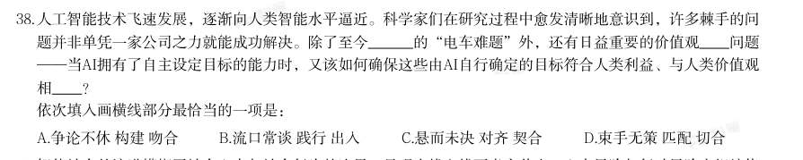

- **A.** 争论不休 构建 吻合
- **B.** 流口常谈 践行 出入
- **C.** 悬而未决 对齐 契合
- **D.** 束手无策 匹配 切合

**答案：C**

### 2026 湖北·统一卷　第 53 题　（逻辑填空（综合））

通过将城市物联网系统与互联网系统进行充分融合,借助大数据、云计算等数字信息处理技术,管理者可以将 城市运行过程中所产生的海量数据资源进行充分整合,提取有效信息后进行优化决策,形成科学可行的城市治 理方案。利用互联网改造城市传统基础设施,接入城市物联网系统并使其智能化,由此可以增进城市各子系统 间使用者、管理者之间的高效协作, 。 填入画横线处最恰当的是:

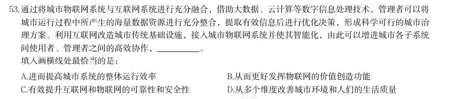

- **A.** 进而提高城市系统的整体运行效率
- **B.** 从而更好发挥物联网的价值创造功能
- **C.** 有效提升互联网和物联网的可靠性和安全性
- **D.** 从多个维度改善城市环境和人们的生活质量

**答案：A**

### 2026 湖北·统一卷　第 54 题　（逻辑填空（综合））

如今,网络和数字媒介已成为未成年人生活的基本环境。短视频以沉浸式体验让他们轻松获得各种热点、热梗 和表情包,“老铁”“666”等迅速进入他们的话语体系,甚至成为特定圈层的身份标识。在各大社交媒体 上,家长们担心“孩子不好好说话”,老师们交流“如何引导学生正确用语”。诙谐幽默的网络语言在丰富人 类表达的同时, 。在“人机共生”时代,如何培育未成年人的语言文化素养值得重视。 填入画横线处最恰当的是:

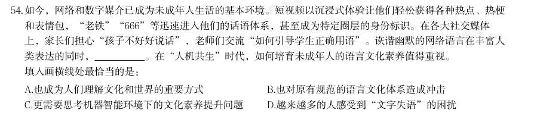

- **A.** 也成为人们理解文化和世界的重要方式
- **B.** 也对原有规范的语言文化体系造成冲击
- **C.** 更需要思考机器智能环境下的文化素养提升问题
- **D.** 越来越多的人感受到“文字失语”的困扰

**答案：B**

### 2026 广东·统一卷　第 16 题　（成语辨析）

的答案。 创新从来都是九死一生,但我们必须有“亦余心之所善兮,虽九死其犹未悔”的豪情。我国广大科技工作者要 有强烈的创新信心和决心,既不 ,也不妄自尊大,勇于攻坚克难、追求卓越、赢得胜利,积极抢占科技 竞争和未来发展制高点。 填入画横线部分最恰当的一项是:

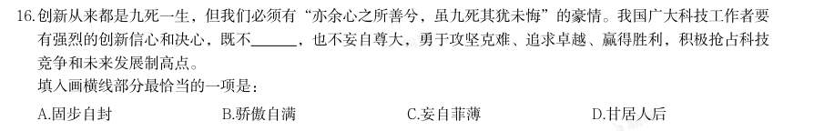

- **A.** 固步自封
- **B.** 骄傲自满
- **C.** 妄自菲薄
- **D.** 甘居人后

**答案：C**

### 2026 广东·统一卷　第 17 题　（两空）

从广袤的海洋到无垠的天空,从复杂的陆地战场到神秘的电磁空间,每一个角落都 着高科技的较量。其 中,数据链宛如一条无形却坚韧的纽带,将各个作战单元紧密相连,成为现代战争中 的关键要素,深刻 地影响甚至决定着战争的走向与胜负。 依次填入画横线处最正确的一项是:

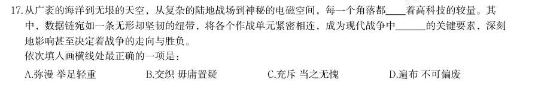

- **A.** 弥漫 举足轻重
- **B.** 交织 毋庸置疑
- **C.** 充斥 当之无愧
- **D.** 遍布 不可偏废

**答案：C**

### 2026 广东·统一卷　第 18 题　（两空）

星间链路技术,让北斗系统实现了“一星通,星星通”。从一片空白、奋力追赶,再到和世界领先的全球导航 系统 ,一代代科研人员自立自强、自主创新、拼搏超越,蹚出了一条 的卫星导航探索之路。 依次填入画横线处最恰当的一项是:

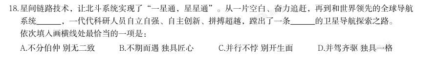

- **A.** 不分伯仲 别无二致
- **B.** 不期而遇 独具匠心
- **C.** 并行不悖 别开生面
- **D.** 并驾齐驱 独具一格

**答案：D**

### 2026 广东·统一卷　第 19 题　（两空）

树立正确的政绩观,既要以“立说立行”的锐气抢抓机遇,又要以“久久为功”的韧劲夯实发展根基。“立说 立行”强调机遇 的紧迫感,“久久为功”则注重 的战略定力,二者看似矛盾,实则统一于高质量 发展的实践逻辑中。 依次填入画横线部分最恰当的一项是:

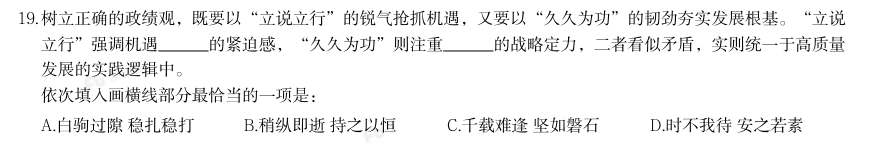

- **A.** 白驹过隙 稳扎稳打
- **B.** 稍纵即逝 持之以恒
- **C.** 千载难逢 坚如磐石
- **D.** 时不我待 安之若素

**答案：B**

### 2026 广东·统一卷　第 20 题　（三空及以上）

全球发展倡议提出以来,理念内涵不断 ,落实机制不断健全,推进路径更加 ,务实合作逐步落地,推 动国际社会聚焦发展问题,培育面向未来的高质量发展动能,为全球南方国家 发展鸿沟、共建美好世界提 供中国方案。 依次填入画横线部分最恰当的一项是:

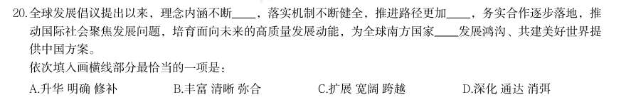

- **A.** 升华 明确 修补
- **B.** 丰富 清晰 弥合
- **C.** 扩展 宽阔 跨越
- **D.** 深化 通达 消弭

**答案：B**

### 2026 广东·统一卷　第 22 题　（一空）

服务群众,用“家常话”将政策解释清楚只是第一步,更需要读懂群众“家常话”背后的喜怒哀乐。“家常 话”里,有群众的关切点,也有推动政策落地的发力点,在这里,“社会救助”不是抽象名词,而是张大爷的 医药费有着落;“产业振兴”不只是报告里的概念,而是李大姐柑橘园里的累累硕果。 ,服务群众 才会更加精准、更有实效。 填入上文画横线处的语句,最恰当的一句是( )。

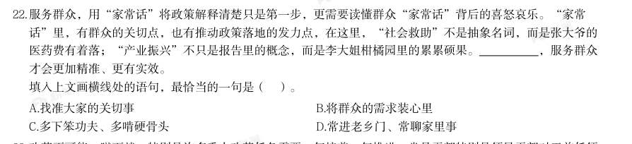

- **A.** 找准大家的关切事
- **B.** 将群众的需求装心里
- **C.** 多下笨功夫、多啃硬骨头
- **D.** 常进老乡门、常聊家里事

**答案：A**

### 2026 广东·统一卷　第 23 题　（一空）

改革不可能一蹴而就,特别是许多重大改革任务需要一年接着一年推进。党员干部特别是领导干部对于前任领 导推进的改革任务,只要是贯彻党中央精神的、切合实践要求的、符合人民群众愿望的,就要坚持一张蓝图绘 到底,一茬接着一茬干。对于改革任务的落实,不能“新官不理旧账”,这是确保干一件成一件的内在要求。 新时代,许许多多改革任务的落实,都是一茬接着一茬干的结果。 以下干事创业精神,最贴合上文要求的是( )。

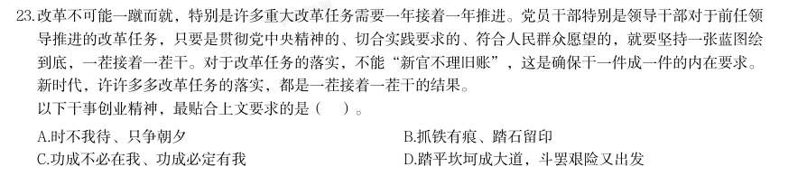

- **A.** 时不我待、只争朝夕
- **B.** 抓铁有痕、踏石留印
- **C.** 功成不必在我、功成必定有我
- **D.** 踏平坎坷成大道,斗罢艰险又出发

**答案：C**

### 2026 广东·统一卷　第 28 题　（一空）

在中华文明滋养的神州大地上, 。袁隆平院士一生扎根稻田,用“粒粒皆辛苦”的执着培育出杂交 水稻;“时代楷模”张玉滚坚守深山小学二十余载,以“桃李不言”的奉献点亮山村孩子的未来;“大国工 匠”高凤林焊接火箭发动机,用“毫厘不差”的精准诠释工匠精神;“人民楷模”王继才32年坚守开山岛, 用“孤岛不孤”的信念诠释守岛人的担当······一位位先进典型、一次次精神洗礼,不断激发全社会的 思想认同、情感共鸣和效仿意愿,营造出崇德向善、见贤思齐、德行天下的浓厚氛围。 据材料内容,填入横线处最合适的句子是( )。

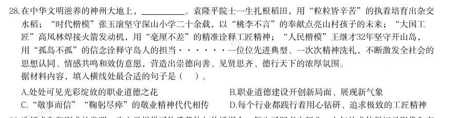

- **A.** 处处可见光彩绽放的职业道德之花
- **B.** 职业道德建设开创新局面、展现新气象
- **C.** “敬事而信”“鞠躬尽瘁”的敬业精神代代相传
- **D.** 每个行业都践行着用心钻研、追求极致的工匠精神

**答案：A**

### 2026 国考·副省级　第 36 题　（成语辨析）
> 材料：出一个最恰当的答案。…

党员干部生活作风的蜕变,往往是从吃喝等看似小事的地方开始的。“堤溃蚁孔,气泄针 芒”,这句古训就是强调 的重要性。习近平同志曾在《之江新语》中写道:“小事小节是 一面镜子,能够反映人品,反映作风。”党员干部要严格对照中央八项规定精神,深刻认识小 与大的辩证关系,主动“照镜子”自查。 填入画横线部分最恰当的一项是:

- **A.** 防微杜渐
- **B.** 积微成著
- **C.** 慎小谨微
- **D.** 曲突徒薪

**答案：A**

### 2026 国考·副省级　第 37 题　（逻辑填空（综合））

在太空实验室开展的脑电测试实验中,航天员戴的“小红帽”叫作脑电帽,里面嵌入了众多 微小的触头,它们像一群 的小侦探,精准捕捉大脑每一个微妙的波动。这顶帽子赋予航天员 神奇的能力——无须言语,无须动作,仅仅通过思维就能给电脑下指令,操控各种设备。 填入画横线部分最恰当的一项是:

- **A.** 未卜先知
- **B.** 明察秋毫
- **C.** 洞若观火
- **D.** 随机应变

**答案：B**

### 2026 国考·副省级　第 38 题　（两空）

正如孙子所说,备战者要“先为不可胜,以待敌之可胜。”战争指挥员要先保证决策稳妥可 靠,部署不出纰漏,不给对手以可乘之机。在 的战争态势下,这是可以掌控的事情。就像足 球比赛中的防守反击战术,先得保证自己不盲动、不冒进、不失球, 、持重待机,而后抓住机 会、一击制胜。 依次填入画横线部分最恰当的一项是:

- **A.** 瞬息万变按部就班
- **B.** 一触即发从长计议
- **C.** 变幻莫测稳扎稳打
- **D.** 波诡云谲以守为攻

**答案：C**

### 2026 国考·副省级　第 39 题　（两空）

面对新的形势和要求,必须进一步全面深化改革,继续完善各方面制度机制,因而制度建设 的任务更为繁重艰巨,加强顶层设计更为重要。如果不能全景式俯瞰和把握制度建设全局,采取 总体构想和战略谋划,做到胸中有数, 地层层系统设计,难免顾此失彼、 ,无法取得制 度建设的成效。 依次填入画横线部分最恰当的一项是:

- **A.** 抽丝剥茧捉襟见肘
- **B.** 循序渐进进退维谷
- **C.** 由表及里得不偿失
- **D.** 自上而下左支右绌

**答案：D**

### 2026 国考·副省级　第 40 题　（两空）

知识产权事务流程复杂,法规晦涩,让人摸不着头脑,公众常 。如今,人们可通过国家知 识产权公共服务电子平台获取各类知识产权办理入口,进行基础数据查询,这样便携的方式像 “ ”一样,节省了时间成本,更有利于在公众心中埋下知识产权保护的种子。 依次填入画横线部分最恰当的一项是:

- **A.** 不求甚解直通车
- **B.** 不知所措通行证
- **C.** 望洋兴叹快进键
- **D.** 望而却步快车道

**答案：D**

### 2026 国考·副省级　第 41 题　（两空）

面对技术突破催生的新产品和新服务,市场响应往往具有 。在层出不穷的技术供给面前, 市场选择是审慎、挑剔的,具有一定的随机性。对于一些技术虽然先进,但应用前景不明朗、难 以迅速形成现金流的企业,市场通常会选择放弃。从这个角度看,瞪羚企业、独角兽企业都是经 受住市场的 胜出者。 依次填入画横线部分最恰当的一项是:

- **A.** 滞后性大浪淘沙
- **B.** 差异性精挑细选
- **C.** 被动性优胜劣汰
- **D.** 模糊性千锤百炼

**答案：A**

### 2026 国考·副省级　第 42 题　（一空）

利用网络存在的安全漏洞入网窃取数据信息,这种方式相当隐蔽,往往会使数据的安全响 应 ;而且网络中流转数据的规模十分巨大,来源异常复杂,攻击者一旦掌握网络漏洞,入 侵网络后就可以在网上“ ”,窃取数据。因此,必须严密防范数据在共享过程中可能遭受的 各种攻击和泄露。 依次填入画横线部分最恰当的一项是:

- **A.** 防不胜防按图索骥
- **B.** 形同虚设守株待兔
- **C.** 名存实亡偷天换日
- **D.** 鞭长莫及瓮中捉鳖

**答案：B**

### 2026 国考·副省级　第 43 题　（三空及以上）

发展新质生产力不能简单理解为 传统产业,它与发展传统产业并不矛盾。一方面,传统产 业平稳发展在稳就业、稳增长等方面具有不可替代的作用;另一方面,传统产业不仅对战略性新 兴产业和未来产业发展有 的支撑作用,而且可以转化为新兴产业,通过科技赋能,成为新质 生产力的重要 。 依次填入画横线部分最恰当的一项是:

- **A.** 取代持续性依托
- **B.** 摒弃系统性抓手
- **C.** 淘汰基础性载体
- **D.** 削弱根本性源头

**答案：C**

### 2026 国考·副省级　第 44 题　（三空及以上）

敢于正视问题的反面是回避矛盾、 ,个别表现在:发言提纲套用、借用、翻用,发言内容 偏离主题、不及重点, 、似曾相识,剖析问题避重就轻、 ,相互批评官话、套话......凡 此种种,致使民主生活会的批评和自我批评有形式而无实质内容和效果,必须防止和纠正。 依次填入画横线部分最恰当的一项是:

- **A.** 敷衍了事老生常谈隔靴搔痒
- **B.** 虚与委蛇长篇大论大而化之
- **C.** 畏首畏尾陈词滥调浮光掠影
- **D.** 闪烁其词不痛不痒张冠李戴

**答案：A**

### 2026 国考·副省级　第 45 题　（三空及以上）

城镇化发展不宜 。城镇化率低且人口规模大的地区,应着重提升水平、挖掘潜力;城镇化 率较高且人口持续集聚的地区,不妨促进大中小城市和小城镇 发展。在此过程中,要坚持系 统观念,统筹城乡、双向发力。如此,才能在城乡一体、良性互动中,让城镇化成为一个顺势而 为、 的发展过程。 依次填入画横线部分最恰当的一项是:

- **A.** 一步到位共同自然而然
- **B.** 一哄而上均衡顺理成章
- **C.** 千篇一律融合大势所趋
- **D.** 整齐划一协调水到渠成

**答案：D**

### 2026 国考·副省级　第 52 题　（逻辑填空（综合））

行政决策要遵循科学、民主和依法的原则,但 。按照行政决策的性质及目标划分,行政决 策可分为经营性决策和管理型决策。经营性决策是政府为履行发展职能,促进经济社会发展而实 施的决策,如制定产业政策、作出招商引资决定等,涉及经济社会发展,因而需要更多遵循经济 规律,面向市场进行成本效益分析,量力而行。管理型决策则是直接涉及行政相对人的利益,如 公共福利政策制定、生态环境保护措施等,需要更多的开放性和公众参与。凡是利益相关者,都 应赋予其表达意见、参与决策的权利。 填入画横线部分最恰当的一项是:

- **A.** 要注意倾听各利益相关群体的不同声音
- **B.** 应根据现实中的具体情况进行适当调整
- **C.** 仍然需要完善相关制度以确保其规范运行
- **D.** 具体要求则因行政决策性质的不同而有差异

**答案：D**

### 2026 国考·副省级　第 55 题　（逻辑填空（综合））

条叶庭荠和四齿芥是沙漠中常见的两种短命植物,其新成熟种子具有生理休眠特性,传播后 的种子能在夏季高温中通过后熟作用,进入非休眠状态,随后在秋季土壤湿度适宜时萌发。未能 在秋季萌发的种子,则会在冬季重新休眠。在早春湿润的雪融期,部分种子通过低温层积作用再 次结束休眠,在早春季节萌发。这种一年两次的休眠循环机制使其能在一年内形成两个不同的萌 发幼苗群体。这种适应策略可能是植物长期适应荒漠降水和温度胁迫生境的一种“两头下注” 策略,有助于它们在极端环境下的维持和繁衍。 “ ‘ 两头下注’ 策略” 指的是:

- **A.** 一年中在不同季节发生两次休眠
- **B.** 在休眠与非休眠状态间随机切换
- **C.** 形成两个环境适应性不同的幼苗群体
- **D.** 能同时应对降水和温度两种极端环境

**答案：C**

### 2026 国考·副省级　第 56 题　（逻辑填空（综合））
> 材料：阳系其他天体(如火星和土卫六“泰坦”)中也有分布。然而,这种令人瞩目的庞然大物却是 研究最少的沙丘类型。人们只知道它存在于风向多变的地区,因风与地表的强相互作用形成: 当风从相反方向吹来,沙子就会堆积于此,星状沙丘的“触手”由此诞生。 近来,英国两位地质学家前往摩洛哥的厄尔切比沙海,试图探明星状沙丘背后的奥秘,结 果发现星状沙丘正在沙漠中悄然“疾行”。1厄尔切比沙海广泛分布着各种类型的复杂沙丘, 他们选择的研究对象,是一座高100 米、宽700 米的星状沙丘,含有约550 万…

下面这段文字,最适合填入文中哪个位置? 研究人员通过计算发现,在过去890 年中,该沙丘总共向西迁移了近500 米,每年的移动速度 都不相同,慢时0.35 米/年,最快可达0.95 米/年,并且似乎正变得越来越快。

- **A.** 1处
- **B.** 2处
- **C.** 3处
- **D.** 4处

**答案：D**

### 2026 国考·副省级　第 57 题　（逻辑填空（综合））

填入画横线部分最恰当的一项是:

- **A.** 仍然可用几个简单步骤还原该过程
- **B.** 这并不影响它记录过去的气候变化
- **C.** 也能探知远比想象复杂的内部结构
- **D.** 沙丘依然呈现出对称和规律的形状

**答案：B**

### 2026 国考·副省级　第 58 题　（逻辑填空（综合））

文中没有提及下列哪方面信息?

- **A.** 拉拉拉利亚沙丘的大致规模
- **B.** 风力作用对星状沙丘形态的影响
- **C.** 研究人员确定沙丘年代的方法
- **D.** 星状沙丘在太阳系广泛分布的原因

**答案：D**

### 2026 国考·副省级　第 59 题　（逻辑填空（综合））

关于拉拉拉利亚沙丘,下列说法与文章相符的是:

- **A.** 早期位置可能在现在的西南方向
- **B.** 沙丘西侧的“触手”形成年代最晚
- **C.** 在距今三千多年的干旱期迅速发展
- **D.** 是厄尔切比沙海中形态最独特的沙丘

**答案：B**

### 2026 国考·副省级　第 60 题　（逻辑填空（综合））

这篇文章支持下列哪一结论?

- **A.** 湿润气候会减缓沙丘积累的速度
- **B.** 厄尔切比沙海拥有世界上最古老的沙丘
- **C.** 全球变暖会导致星状沙丘数量减少
- **D.** 新月形沙丘在新仙女木时期尚未形成

**答案：A**

### 2026 国考·副省级　第 62 题　（逻辑填空（综合））

以下均为悬泉置遗址出土文物上的文字,哪一内容没有在这篇文章中重点介绍?

- **A.** 今欲寄钱三百、帛一匹、絮十斤,愿子方受之
- **B.** 羌人男子狼颠,持牛车一乘、羊十头,诣置易盐
- **C.** 过长罗侯军长吏一,从者四人,人一食,食三升
- **D.** 孟春,禁止伐木,毋覆巢,毋杀孩虫、胎夭飞鸟

**答案：B**

### 2026 国考·副省级　第 63 题　（逻辑填空（综合））

下列说法与这篇文章相符的是:

- **A.** 悬泉置是距离汉朝首都最遥远的驿站
- **B.** 悬泉置遗址出土的简牍九成以上写有文字
- **C.** 公元前一世纪悬泉置曾接待于阗使团
- **D.** 悬泉置遗址出土的纸张主要作为书写载体

**答案：C**

### 2026 国考·副省级　第 64 题　（逻辑填空（综合））

下列哪篇论文最不可能提到悬泉置?

- **A.** 《西北汉代医简所见戍边医学研究述评》
- **B.** 《古代纸质文物纤维组成分析方法概述》
- **C.** 《秦汉时期湘江洞庭水路邮驿的初步考察》
- **D.** 《西汉经敦煌郡与匈奴在西域地区的争夺》

**答案：C**

### 2026 国考·地市级　第 36 题　（逻辑填空（综合））
> 材料：个最恰当的答案。…

2024 年,我国脱贫县农民人均可支配收入增幅高于全国平均水平,脱贫人口务工就业规模保 持稳中有增。2025 年是巩固拓展脱贫攻坚成果同乡村振兴有效衔接5 年过渡期的最后一年,越 , 填入画横线部分最恰当的一项是 ,做好监测帮扶工作。 :

- **A.** 步步为营
- **B.** 行稳致远
- **C.** 慎终如始
- **D.** 绵绵用力

**答案：C**

### 2026 国考·地市级　第 37 题　（逻辑填空（综合））

在太空实验室开展的脑电测试实验中,航天员戴的“小红帽”叫作脑电帽,里面嵌入了众多 微小的触头,它们像一群 的小侦探,精准捕捉大脑每一个微妙的波动。这顶帽子赋予航天

> （本题为图形题，选项为图片，见原卷）

**答案：B**

### 2026 国考·地市级　第 39 题　（两空）

通用人工智能对重大情报的挖掘和精确预测,确实能够提高情报准确性,有利于减少误判; 但有时也可能会使人类盲目自信,刺激其 ,通用人工智能带来的进攻优势,导致最佳防御 战略就是“ 险 ”,这会打破进攻与防御的平衡,引发新型安全困境,反而增加了战争爆发的风 。 依次填入画横线部分最恰当的一项是:

- **A.** 孤注一掷避实击虚
- **B.** 轻举妄动以攻为守
- **C.** 刚愎自用攻其不备
- **D.** 铤而走险先发制人

**答案：D**

### 2026 国考·地市级　第 40 题　（两空）

新史料被发掘,有赖于史家具有证据意识。若是史家不认为某个史料可以作为证据,该史料 可能会被 文明起源这一重大问题提供 。比如甲骨文,起初甲骨被当作龙骨入药,不被史家关注。但晚清学者王懿荣意识 到龙骨非同寻常,后经考证确认甲骨文是商代文字,之后史家以此为证据重构殷商历史,为中华 了 支点。 依次填入画横线部分最恰当的一项是:

- **A.** 视而不见稳固
- **B.** 弃如敝屣崭新
- **C.** 断章取义可靠
- **D.** 束之高阁坚实

**答案：D**

### 2026 国考·地市级　第 42 题　（两空）

五彩滩是一处著名的雅丹地貌景观,位于新疆维吾尔自治区,中国唯一一条注入北冰洋的河 是 的泥岩、砂岩及砂砾组成的奇石怪 岩,这两种 的地貌遥相辉映,“一河隔两岸,胜似两重天”。 依次填入画横线部分最恰当的一项是:

- **A.** 鳞次栉比大相径庭
- **B.** 千姿百态别具一格
- **C.** 色彩斑斓截然不同
- **D.** 绚丽多姿各有千秋

**答案：C**

### 2026 国考·地市级　第 43 题　（两空）

面对新的形势和要求,必须进一步全面深化改革,继续完善各方面制度机制,因而制度建设 的任务更为繁重艰巨,加强顶层设计更为重要。如果不能全景式俯瞰和把握制度建设全局,采取 地层层系统设计,难免顾此失彼、

> （本题为图形题，选项为图片，见原卷）

**答案：D**

### 2026 国考·地市级　第 44 题　（两空）

未来特战力量可通过智能辅助,直接干扰或控制敌方指挥控制系统、造成敌方思想混乱、心 理受挫甚至出现幻觉;或者通过伴随无人平台实施网络作战,篡改指控系统指令和数据实现 “ ”,致使敌方指挥失灵、协同失效、人员失能, 地失去战斗力,从而实现不战而屈人 之兵。 依次填入画横线部分最恰当的一项是:

- **A.** 移花接木彻头彻尾
- **B.** 釜底抽薪无声无息
- **C.** 暗度陈仓潜移默化
- **D.** 反客为主浑然不觉

**答案：B**

### 2026 国考·地市级　第 45 题　（三空及以上）

对于不符合著作权法、专利法、商标法等专门法保护条件的创新成果,反不正当竞争法为其 提供了 保护。面对数字时代 的新型不正当竞争行为,反不正当竞争法通过一般条款的灵 活解释和适用,能够及时规制尚未被其他专门法 当使用。 依次填入画横线部分最恰当的一项是:

- **A.** 补充层出不穷覆的知识产权侵权行为,防止创新成果被不正盖
- **B.** 特殊屡见不鲜界定
- **C.** 升级五花八门收录
- **D.** 额外应运而生明确

**答案：A**

### 2026 国考·地市级　第 47 题　（三空及以上）

敢于正视问题的反面是回避矛盾、 偏离主题、不及重点 B.蕴含泛化停滞不前 D.揭示模糊屈指可数 ,个别表现在:发言提纲套用、借用、翻用,发言内容 , 、似曾相识,剖析问题避重就轻、 此种种,致使民主生活会的批评和自我批评有形式而无实质内容和效果,必须防止和纠正。 依次填入画横线部分最恰当的一项是 ,相互批评官话、套话......凡 :

- **A.** 敷衍了事老生常谈隔靴搔痒
- **B.** 虚与委蛇长篇大论大而化之
- **C.** 畏首畏尾陈词滥调浮光掠影
- **D.** 闪烁其词不痛不痒张冠李戴

**答案：A**

### 2026 国考·地市级　第 48 题　（三空及以上）

城镇化发展不宜 率较高且人口持续集聚的地区,不妨促进大中小城市和小城 。城镇化率低且人口规模大的地区,应着重提升水平、挖掘潜力;城镇化 镇 持系统观念,统筹城乡、双向发力。如此,才能在城乡一体、良性互动中,让城镇化成为一个 发展。在此过程中,要坚 顺 势而为、 的发展过程。 依次填入画横线部分最恰当的一项是:

- **A.** 一步到位共同自然而然
- **B.** 一哄而上均衡顺理成章
- **C.** 千篇一律融合大势所趋
- **D.** 整齐划一协调水到渠成

**答案：D**

### 2026 国考·地市级　第 49 题　（三空及以上）

领导干部领导水平的高低,很重要的一点就在于能否预见在先、 知鹿过” ,如果没有“草摇叶响 的 加 、“窥一斑而知全豹”的预判,见事迟、反应慢,倾向性问题就可能不断叠 、 形、止损于未发。 依次填入画横线部分最恰当的一项是:

- **A.** 独具慧眼警惕延伸
- **B.** 见微知著谨慎激化
- **C.** 胸有成竹细致辐、升级,造成无法挽回的损失。因此,领导干部要做到早预警、早干预,避危于无射
- **D.** 未雨绸缪敏锐演变

**答案：D**

### 2026 国考·地市级　第 50 题　（三空及以上）

进一步全面深化司法改革,必须聚焦改革的本质要求,严格依法依规推进改革,所有履职都 , 职能边界,不脱离法院职能,不超越法院职权,更不能 ,确保改 革不偏离正确方向。积极发挥法治对改革的引导、推动、规范、 作用,确保重大改革依法有 序、于法有据,增强改革的执行力、穿透力。依次填入画横线部分最恰当的一项是:

- **A.** 遵循各自为政监督
- **B.** 划定为所欲为震慑
- **C.** 厘清画地为牢约束
- **D.** 恪守越俎代庖保障

**答案：D**

### 2026 国考·地市级　第 57 题　（逻辑填空（综合））

如何培育好独角兽企业,是一个大课题。不同类型的独角兽企业,需求完全不同。比如,有 的企业需要大量计算资源的支持,有的企业需要与高校相关科研力量加速对接,有的企业则需要 共性技术平台支持。显然,粗放式的政策供给难以满足不同类型独角兽企业的复杂需求, A.26314 , 助力企业加速成长。未来,随着机制的不断创新和完善,将能培育出更多优质的独角兽企业,为 经济的高质量发展注入强劲动力。 填入画横线部分最恰当的一项是:

- **A.** 有关部门应倾听独角兽企业的“声音”
- **B.** 唯有精准施策方可解决不同的“烦恼”
- **C.** 面向独角兽企业的“管家”应运而生
- **D.** 机制创新无疑是解决问题的“又一村”

**答案：B**

### 2026 国考·地市级　第 62 题　（逻辑填空（综合））

自然界的微生物虽然能分解高盐废水中的部分污染物,但它们就像“偏科生”,每个菌种通 常只擅长处理一两种特定污染物。当面对高盐废水中油污、重金属、放射性物质等组成的“混 合垃圾”时,这些天然微生物就显得力不从心。此外,因微生物降解所涉及的基因种类和数目 较多,常规基因工程技术对菌株设计和改造的速度和深度非常有限。近年来,合成生物学技术飞 速发展为降解菌株的构建提供了可能。科学家们能够通过合成生物技术给微生物设计“智能工 具箱”,不仅 填入画横线部分最恰当的一项是:

- **A.** 能通过调控基因构建新菌株
- **C.** 能给细菌安装多种污染物分解能,还能让这些功能像积木一样精准搭配。

**答案：C**

### 2026 国考·地市级　第 65 题　（逻辑填空（综合））

就运行着数以千万计的小行星,它们与地球一样环绕太阳运行。当这些小行星与地球轨道发生交 会时,如果其轨道能量与地球相近,它们就可能被地球引力捕获,成为地球的“迷你月亮”。 根据科学家推断,地球周围随时都可能有“迷你月亮”在运行,只是目前人类观测能力有限, 无法定位其具体位置。 填入画横线部分最恰当的一项是 。太阳系中的小行星数不胜数,它们是太阳系形成后遗留的残余碎片,仅在地球轨道周围 :

- **A.** 小行星的轨道受多种因素扰动
- **B.** 地球的天然卫星并非只有一个见
- **C.** 小行星被地球引力捕获并不罕
- **D.** 小行星撞击地球的概率无法确知

**答案：C**

### 2026 国考·行政执法　第 36 题　（逻辑填空（综合））
> 材料：出一个最恰当的答案。…

在技术的赋能下,检察机关在办理公益诉讼案件时如同拥有了顺风耳、千里眼,不仅能有效 避免“ ”式的线索摸排,也能有力确保证据的客观性和准确性,办案将更加精准、规范、高 效,国家利益和社会公共利益将得到更好守护,公平正义也将更加可感可触。 填入画横线部分最恰当的一项是:

- **A.** 刻舟求剑
- **B.** 管中窥豹
- **C.** 缘木求鱼
- **D.** 大海捞针

**答案：D**

### 2026 国考·行政执法　第 39 题　（两空）

通用人工智能对重大情报的挖掘和精确预测,确实能够提高情报准确性,有利于减少误判; 但有时也可能会使人类盲目自信,刺激其 ,通用人工智能带来的进攻优势,导致最佳防御 战略就是“ ”,这会打破进攻与防御的平衡,引发新型安全困境,反而增加了战争爆发的风 险。 依次填入画横线部分最恰当的一项是:

- **A.** 孤注一掷避实击虚
- **B.** 轻举妄动以攻为守
- **C.** 刚愎自用攻其不备
- **D.** 铤而走险先发制人

**答案：D**

### 2026 国考·行政执法　第 41 题　（两空）

把握好动静之度,是解决问题的关键。过度求静易陷入消极懈怠、 的泥潭。在面对新问题 时,往往会因为害怕承担责任或者担心打破现有秩序,一味地观望等待,致使问题越积越多。相 反,情况不明时过于求动会让很多事情变得杂乱无章,往往 。 依次填入画横线部分最恰当的一项是:

- **A.** 安于现状分身乏术
- **B.** 固步自封事与愿违
- **C.** 裹足不前措手不及
- **D.** 自暴自弃适得其反

**答案：B**

### 2026 国考·行政执法　第 42 题　（两空）

五彩滩是一处著名的雅丹地貌景观,位于新疆维吾尔自治区,中国唯一一条注入北冰洋的河 流额尔齐斯河穿其而过。南岸有绿洲、沙漠,北岸则是 的泥岩、砂岩及砂砾组成的奇石怪 岩,这两种 的地貌遥相辉映,“一河隔两岸,胜似两重天”。 依次填入画横线部分最恰当的一项是:

- **A.** 鳞次栉比大相径庭
- **B.** 千姿百态别具一格
- **C.** 色彩斑斓截然不同
- **D.** 绚丽多姿各有千秋

**答案：C**

### 2026 国考·行政执法　第 46 题　（三空及以上）

中生代寄生蠕虫的化石数量并不稀少,但由于其地质年代相较于寒武纪、奥陶纪等更年轻, 常被认为难以 深层次的生物演化奥秘。其次,这些蠕虫往往体型微小,化石保存状况不佳。 再者,它们形态单调、特征 ,使得分类鉴定难度极高。因此,中生代寄生蠕虫的相关研究仍 然 。 依次填入画横线部分最恰当的一项是:

- **A.** 阐释相似凤毛麟角
- **B.** 蕴含泛化停滞不前
- **C.** 探寻统一无从下手
- **D.** 揭示模糊屈指可数

**答案：D**

### 2026 国考·行政执法　第 49 题　（三空及以上）

作风建设无小事,廉洁自律的考验往往藏在“生活圈”“社交圈”的细微处。年轻干部 必须以“ ”的清醒系紧“风纪扣”,在公私界限上 ,在校准坐标中涵养浩然之气。一 些年轻干部的案例警示我们,许多违纪违法行为的 ,正是对“微特权”“小官僚”习以为 常的麻木。 依次填入画横线部分最恰当的一项是:

- **A.** 常备不懈一丝不苟征兆
- **B.** 如履薄冰寸步不让起点
- **C.** 严阵以待锱铢必较端倪
- **D.** 谨小慎微壁垒分明倾向

**答案：B**

### 2026 国考·行政执法　第 50 题　（三空及以上）

进一步全面深化司法改革,必须聚焦改革的本质要求,严格依法依规推进改革,所有履职都 要立足宪法法律赋权, 职能边界,不脱离法院职能,不超越法院职权,更不能 ,确保改 革不偏离正确方向。积极发挥法治对改革的引导、推动、规范、 作用,确保重大改革依法有 序、于法有据,增强改革的执行力、穿透力。依次填入画横线部分最恰当的一项是:

- **A.** 遵循各自为政监督
- **B.** 划定为所欲为震慑
- **C.** 厘清画地为牢约束
- **D.** 恪守越俎代庖保障

**答案：D**

### 2026 国考·行政执法　第 58 题　（逻辑填空（综合））

液晶显示器是一种光偏振调制的显示器件。当白光光源射入显示器时,通过入射偏振片,自 然光被转换为线偏振光。未施加外来电场时,入射偏振光会顺着液晶分子的排列旋转前进,在正 常黑色操作模式下,偏振光被出射偏振片阻挡并吸收,显示器画面呈现暗态;当施加电压时,液 晶分子倾向平行于施加电场的方向,线偏振光直接到达出射偏振片,由于入射偏振光的偏振状态 不受此液晶分子的影响,并保持与出射偏振片穿透轴方向一致,故能通过出射偏振片形成亮态。 所以 。 填入画横线部分最恰当的一项是:

- **A.** 电场不够强时显示器呈半透明的中间灰度状态
- **B.** 利用适当驱动电压即可得到明暗对比的显示效果
- **C.** 液晶分子的旋转作用可以有效控制光线的穿透
- **D.** 站在不同视角看显示屏时显示效果会有很大差异

**答案：B**

### 2025 湖北·统一卷　第 23 题　（逻辑填空（综合））

D.亭一般为开敞性结构,没有围墙,顶部可分为六角、八角等形状 下列诗文涉及的人物或事件对应的时期错误的是:

- **A.** 合从离衡,佩印者六——战国
- **B.** 饮马瀚海,封狼居胥——东汉
- **C.** 被遇神宗,致位宰相——北宋
- **D.** 血战歼倭,勋垂闽浙——明朝

**答案：D**

### 2025 湖北·统一卷　第 24 题　（逻辑填空（综合））

“超级满月”是月球位于近地点时刚好出现满月,使月亮看起来又大又亮的现象。其发生需要满足的条件是:

- **A.** 农历初一前后,地球运动到太阳与月球之间
- **B.** 农历初一前后,月球运动到太阳与地球之间
- **C.** 农历十五前后,地球运动到太阳与月球之间
- **D.** 农历十五前后,月球运动到太阳与地球之间

**答案：C**

### 2025 湖北·统一卷　第 26 题　（逻辑填空（综合））

司马迁说:“余读孔氏书,想见其为人。适鲁、观仲尼庙堂······祗回留之,不能去。”“余读《离 骚》······悲其志,适长沙,观屈原所自沉渊······想见其为人。”《史记》的“太史公曰”据 信有120余篇,大多 ,彰显客观公正的史学观。唯有对孔子和屈原则是带着浓烈的个人情感,以基本相 同的笔调,发出了触动人们心灵的赞叹。 填入画横线部分最恰当的一项是:

- **A.** 隐晦曲折
- **B.** 直言不讳
- **C.** 秉笔直评
- **D.** 光明正大

**答案：D**

### 2025 湖北·统一卷　第 27 题　（逻辑填空（综合））

全球粒子物理研究主要强国纷纷提出了各自未来的“希格斯工厂”方案。最近几年,在一些国家和地区制定的 粒子物理发展规划中,希格斯粒子的研究 地均居于核心地位。中国物理学会高能物理分会的决议中,也 明确写明,我国提出的环形正负电子对撞机是我国未来高能加速器物理发展的首选项目。 填入画横线部分最恰当的一项是:

- **A.** 一成不变
- **B.** 千篇一律
- **C.** 出乎意料
- **D.** 无一例外

**答案：D**

### 2025 湖北·统一卷　第 28 题　（逻辑填空（综合））

从航天任务连战连捷到重大航空工程深入推进,从空间科学探索到航天科技成果服务经济社会发展,十年来, 一次次振奋人心的火箭腾飞,一项项令人惊叹的航空成就, 出航天人接续奋斗的轨迹。 填入画横线部分最恰当的一项是:

- **A.** 见证
- **B.** 描摹
- **C.** 创造
- **D.** 勾勒

**答案：C**

### 2025 湖北·统一卷　第 29 题　（逻辑填空（综合））

说起中国的民居建筑,人们想到的多是南徽北晋,其实关中的建筑风格 ,中国最早的房屋建筑便出现在 关中临潼姜寨仰韶文化村落遗址。从关中各地聚集而成的关中民俗博物院,将古时关中民宅的建筑风格 呈 现,让我们在艺术的熏陶中感受到关中建筑的伟大。 依次填入画横线部分最恰当的一项是:

- **A.** 青出于蓝 透彻
- **B.** 后来居上 畅快
- **C.** 技高一筹 全面
- **D.** 更胜一筹 淋漓

**答案：A**

### 2025 湖北·统一卷　第 30 题　（逻辑填空（综合））

大数据、人工智能、虚拟现实等新兴技术不断改写信息传播 ,“融媒”“智媒”快速迭代升级。在万物皆 媒、虚实同构的传播语境下,融会贯通不同传播主体、不同传播方式,实现资源跨国配置、价值跨界创造,尤 其是要 各国青年群体的媒介使用习惯和内容选择偏好,研究他们在视听文本、审美旨趣方面的特点,才能 有效地增强中华文明的国际影响力。 依次填入画横线部分最恰当的一项是:

- **A.** 模式 认清
- **B.** 版图 熟悉
- **C.** 格局 洞悉
- **D.** 形式 明确

**答案：B**

### 2025 湖北·统一卷　第 31 题　（逻辑填空（综合））

古人说寿县“恃水以为固”, 。五代十国时期,后周大军将寿县重重包围,守将刘仁瞻誓死守城。后遇 大雨,淮河淝水暴涨后周兵营水深数尺,死伤严重,不战而退。春秋战国时,寿县是可与洛阳、邯郸、临 淄 的重要都会。自晋到唐、宋,寿县也以繁华著称于世,舟楫如梭,商贾如云。 依次填入画横线部分最恰当的一项是:

- **A.** 所言不虚 比肩
- **B.** 言之有理 媲美
- **C.** 当之无愧 鼎峙
- **D.** 名不虚传 扛鼎

**答案：D**

### 2025 湖北·统一卷　第 32 题　（逻辑填空（综合））

江南文化的价值不仅局限于文化典籍和文物古迹之中,更 在人们的日常生活之中。具有几千年江河湖海水 韵的江南文化,以其精神文明、文化特征和风俗习惯, 和影响着一代又一代民众创造有烟火气、有温度的 诗性生活。 依次填入画横线部分最恰当的一项是:

- **A.** 包含 汇聚
- **B.** 蕴含 融汇
- **C.** 酝酿 叠合
- **D.** 孕育 萦绕

**答案：A**

### 2025 湖北·统一卷　第 33 题　（逻辑填空（综合））

历史上的一切医学手段都包含着 的改善身体的愿望。鉴于生命科学对于人类生物学结构和功能的理解仍 然非常 ,在脑科学领域尤其如此,故不能指望生物技术在短期内对人类本性做出实质性的改变,但“更好 的人类”这个未来的发展趋势已经出现。 依次填入画横线部分最恰当的一项是:

- **A.** 显而易见 通俗
- **B.** 尽善尽美 粗浅
- **C.** 朴实无华 晦涩
- **D.** 不言而喻 有限

**答案：B**

### 2025 湖北·统一卷　第 34 题　（逻辑填空（综合））

综合,意味着包容和吸纳。武术、杂技、魔术等表演“绝活儿”,凡是有益于戏曲创作的,皆可为戏曲所用。 当下流行的“跨界融合”,无论是戏曲汲取其他当代艺术元素的创新,还是戏曲给予其他艺术样式灵感与素 材,实质上都与中国戏曲综合性艺术特征相 。综合意味着 ,而不是自设边界。 依次填入画横线部分最恰当的一项是:

- **A.** 契合 吐故纳新
- **B.** 投合 兼收并蓄
- **C.** 迎合 推陈出新
- **D.** 符合 融会贯通

**答案：B**

### 2025 湖北·统一卷　第 35 题　（逻辑填空（综合））

新文化运动作为一场思想文化领域的革命,实际构建了 传统儒学意识形态的现代意识形态。新文化运动时 期形成的社会观、伦理观、中西文化观对 中国现代的社会形态提供了观念性的基础。 依次填入画横线部分最恰当的一项是:

- **A.** 赓续 改进
- **B.** 替代 形塑
- **C.** 取用 重构
- **D.** 转换 完善

**答案：D**

### 2025 湖北·统一卷　第 36 题　（逻辑填空（综合））

福建屏南,群峰耸峙、雨量 ,孕育了茂密的竹海,也造就了屏南传统弓箭制作技艺。一代弓箭工匠,致力 于 竹木弓箭制作工艺、 传统射箭运动,让传统体育运动重新焕发光彩。 依次填入画横线部分最恰当的一项是:

- **A.** 充足 再现 恢复
- **B.** 充沛 复原 复兴
- **C.** 丰沛 修复 弘扬
- **D.** 充实 还原 振兴

**答案：A**

### 2025 湖北·统一卷　第 37 题　（逻辑填空（综合））

网络直播本质而言是一种“眼球经济”,极具效仿意味和引导效应。如果本该弘扬正能量、 真善美的镜 头,却频频出现打擦边球、违背社会公序良俗的行为,那么长此以往不仅会 直播行业的健康发展,也会 风清气正的环境。 依次填入画横线部分最恰当的一项是:

- **A.** 散布 妨碍 损害
- **B.** 撒播 阻挠 腐化
- **C.** 传递 干扰 摧毁
- **D.** 传播 阻碍 侵蚀

**答案：C**

### 2025 湖北·统一卷　第 38 题　（逻辑填空（综合））

在实现第二个百年奋斗目标的新征程上,我们既拥有了强大的思想伟力、显著的制度优势、积累了 的物质 基础、建立了 的产业体系和超大规模的国内市场,又面临着诸多风险挑战,甚至可能遇到难以想象的惊涛 骇浪般的 考验。 依次填入画横线部分最恰当的一项是:

- **A.** 雄厚 完备 严峻
- **B.** 丰厚 完善 巨大
- **C.** 厚实 完美 严酷
- **D.** 浑厚 完整 重大

**答案：C**

### 2025 湖北·统一卷　第 39 题　（逻辑填空（综合））
> 材料：青春的样子,本就是有理想、敢担当、能 、肯奋斗的样子。树立积极的就业观念,到祖国和人民最需要的 地方发挥光和热,在乡村振兴、卫国戍边等各领域各方面工作中争当排头兵和生力军,不仅能够留下无悔的青…

春记忆,而且将在基层 中获得受用终身的精神财富,为走好职业生涯提供 的滋养。 依次填入画横线部分最恰当的一项是:

- **A.** 作为 磨难 日久弥新
- **B.** 刻苦 磨练 经久不衰
- **C.** 吃苦 磨砺 源源不断
- **D.** 奉献 磨炼 滔滔不竭

**答案：D**

### 2025 湖北·统一卷　第 40 题　（逻辑填空（综合））

冠心病、心肌梗塞、脑梗塞、下肢坏死······糖尿病带来的并发症令人痛苦不堪,更麻烦的是,它还会 认知障碍,例如轻度认知损伤和阿尔兹海默病。有研究显示,近十几年来,在死亡的糖尿病患者中,患有 认知障碍的 越来越大。因此,亟须找到引发糖尿病患者认知障碍的 。 依次填入画横线部分最恰当的一项是:

- **A.** 激发 比值 元凶巨恶
- **B.** 导致 比例 幕后黑手
- **C.** 诱发 比重 罪魁祸首
- **D.** 招致 比率 始作俑者

**答案：A**

### 2025 湖北·统一卷　第 51 题　（逻辑填空（综合））

从事实际活动的现实的人,是马克思主义的出发点。实现人的自由全面发展是马克思主义的最高价值追求。要 坚持以人民为中心,坚持人民主体地位,将人民作为改革与发展的实践主体和核心动力,将实现、维护和发展 最广大人民根本利益、 、促进人的自由全面发展作为改革与发展的根本目的和最高价值,激发人民 的历史主动性和创造性,促进社会公正,增进民生福祉,不断实现人民对美好生活的向往,使人民群众有更多 的获得感、幸福感、安全感。 填入画横线部分最恰当的一项是:

- **A.** 大力发展教育培训
- **B.** 尊重人民各项权利
- **C.** 完善各项法律法规
- **D.** 推动人民参与治理

**答案：D**

### 2025 湖北·统一卷　第 53 题　（逻辑填空（综合））

中国科学院大气物理研究所开发的起沙模型很好地模拟出了2001年至2017年东亚沙尘暴频次的年际变化和减弱 趋势,模拟的起沙通量与观测的沙尘天数具有很好的相关关系,相关系数达0.75。从变化的原因来看,沙尘源 区上地表风速减弱、植被覆盖增加、土壤变湿均起到了重要作用,贡献率分别为46%、30%、24%。可见风速 减弱起主导作用,而植被覆盖增加和土壤变湿也有关键作用。 由此可以推知:

- **A.** 沙尘暴的起因有三方面
- **B.** 起沙模型还有提升空间
- **C.** 风速减弱属于人为因素
- **D.** 增加植被覆盖率能够减弱沙尘暴

**答案：C**

### 2025 广东·统一卷　第 12 题　（一空）

党的二十届三中全会提出,鼓励和规范发展天使投资、风险投资、私募股权投资,更好发挥政府投资基金作 用,发展耐心资本,耐心资本是一种专注于( )的资本形式。

- **A.** 中短期投资
- **B.** 长期投资
- **C.** 中期投资
- **D.** 短期投资

**答案：D**

### 2025 广东·统一卷　第 13 题　（一空）

党的二十届三中全会提出,健全保障耕地用于种植基本农作物管理体系,基本农作物是指为了满足人们基本生 产生活需要而大面积栽培的农作物,以下不属于国家层面的基本农作物的是( )。

- **A.** 粮食
- **B.** 油料
- **C.** 蔬菜
- **D.** 苗木

**答案：C**

### 2025 广东·统一卷　第 14 题　（一空）

国家建立基本养老保险、基本医疗保险、工伤保险、失业保险、生育保险等社会保险制度,保障公民在年老、 疾病、工伤、失业、生育等情况下依法从国家和社会获得物质帮助的权利,根据《中华人民共和国社会保险 法》,由用人单位缴纳保险费,职工不缴纳保险费用的是( )。

- **A.** 工伤保险和生育保险
- **B.** 失业保险
- **C.** 基本养老保险
- **D.** 基本医疗保险

**答案：B**

### 2025 广东·统一卷　第 15 题　（一空）

2025年2月召开的广东省高质量发展大会指出,自改革开放以来,广东从“三来一补”起步,从相对落后的农 业省发展到牵动全球的世界工厂,再到( ),产业体系的迭代升级,带来生产力的不断跃迁,支撑广东取得 举世瞩目的发展成就。

- **A.** 国家重要先进制造业高地和新兴产业重要策源地
- **B.** 国家重要先进制造业高地和发展新质生产力的主阵地
- **C.** 引领全球的智造基地和新兴产业重要策源地
- **D.** 引领全球的智造基地和发展新质生产力的主阵地

**答案：A**

### 2025 广东·统一卷　第 16 题　（逻辑填空（综合））

繁杂问题、苗头问题、偶然问题都是问题的具体形态,背后隐藏着不同类型的矛盾。从繁杂问题中把握事物 的 、从苗头问题中发现事物的 、从偶然问题中认识事物的 ,才能看清本质,抓住解决问题的 根本。 依次填入画横线处最正确的一项是:

- **A.** 必然性 趋势性 规律性
- **B.** 规律性 必然性 趋势性
- **C.** 趋势性 规律性 必然性
- **D.** 规律性 趋势性 必然性

**答案：D**

### 2025 广东·统一卷　第 17 题　（逻辑填空（综合））

浪费与消费一字之差,含义却 。反对餐饮浪费行为,并不是反对正常的、健康的餐饮消费,而是倡导取 之有度、用之有节的健康餐饮文化。 填入画横线处最正确的一项是:

- **A.** 截然相反
- **B.** 南辕北辙
- **C.** 大相径庭
- **D.** 求同存异

**答案：A**

### 2025 广东·统一卷　第 18 题　（逻辑填空（综合））

一个人的能力有大小,做不了 的大事,或做些 的小事。只要每个人都发挥潜能,为自己的梦想努 力奋斗,国家和社会也会因此受到更加美好。 依次填入画横线处最正确的一项是:

- **A.** 开天辟地 微不足道
- **B.** 惊天动地 力所能及
- **C.** 名垂青史 默默无闻
- **D.** 轰轰烈烈 无关紧要

**答案：B**

### 2025 广东·统一卷　第 19 题　（逻辑填空（综合））

党员干部的政绩观与事业发展的成效紧密相关,党员干部树立什么样的政绩观,就会产生什么样的发展观。如 果一开始政绩观没有摆正,从政的“第一粒扣子”没有系好,做决策、抓发展、促改革就会错位偏离,甚至会 。 填入画横线处最正确的一项是:

- **A.** 失之毫厘,谬以千里
- **B.** 缘木求鱼,水中捞月
- **C.** 得不偿失,因小失大
- **D.** 胜地不常,盛筵难再

**答案：B**

### 2025 广东·统一卷　第 20 题　（逻辑填空（综合））

实践证明,改革越是 深水区,越是“牵一发而动全身”,越要注重系统集成。面对一些深层次矛盾,单兵 突进式的改革难以奏效, 的改革更可能造成“合成谬误”,唯有凝聚合力才能催生“化学反应”。 依次填入画横线处最正确的一项是:

- **A.** 进入 各尽所能
- **B.** 迈向 各有千秋
- **C.** 步入 各式各样
- **D.** 挺进 各行其是

**答案：C**

### 2025 广东·统一卷　第 23 题　（一空）

新中国成立75年来,全省干部群众持续奋斗,经过几代人的努力,终于使南粤大地重塑绿颜,成为全国 最“绿”省份之一。 。两年来,广东森林质量的提升更加贴近群众的日常生活,丰富的林下经济形 态、森林资源、愈发活跃的生态市场,使靠山吃山成为南粤广袤山区的发展新动力。看得见、摸得着、有欣喜 的绿美广东逐步走进现实。 以下句子填入划线处,最恰当的是( )。

- **A.** 草木蔓发,春山可望
- **B.** 人不负青山,青山定不负人
- **C.** 踏遍青山人未老,风景这边独好
- **D.** 追风赶月莫停留,平芜尽处是春山

**答案：C**

### 2025 国考·副省级　第 36 题　（成语辨析）

的答案。 我们想问题、作决策、办事情,首先要考虑人口基数问题,考虑我国城乡区域发展水平差异大等实际,既不能 ,也不能因循守旧,要保持历史耐心,坚持稳中求进、循序渐进、持续推进。 填入画横线部分最恰当的一项是:

- **A.** 朝令夕改
- **B.** 寅吃卯粮
- **C.** 好高骛远
- **D.** 一厢情愿

**答案：C**

### 2025 国考·副省级　第 37 题　（成语辨析）

随着技术经验积累,高空风弹道修正等技术方法能使火箭在飞行过程中有效抵抗风干扰。为了有更强的适应 性,本发长八火箭在使用自主抗干扰控制技术等成熟方法之外,还增加了自动滚转减载技术,根据风的来向, 会在空中主动滚动调整,使火箭用更稳定的优势面来应对高空风,用“ ”的方式,通过自身的旋转抵消 掉高空风的影响。 依次填入画横线部分最恰当的一项是:

- **A.** 以柔克刚
- **B.** 以守为攻
- **C.** 以虚为实
- **D.** 以退为进

**答案：A**

### 2025 国考·副省级　第 38 题　（两空）

要提高“临事能断”本领,就要处理好反复权衡与适时决断的关系,既要深入考量、三思而行,又要视情而 断、当机立断,不能等待观望、 、议而不决。当然,提倡在关键时刻善于决断,并不意味着可以 、我行我素,而是要善于聚民意、集众智,推动科学决策。 依次填入画横线部分最恰当的一项是:

- **A.** 犹豫不决 泥古不化
- **B.** 左顾右盼 听之任之
- **C.** 举棋不定 刚愎自用
- **D.** 见风使舵 自作主张

**答案：C**

### 2025 国考·副省级　第 39 题　（两空）

当前,各地纷纷布局,加快形成和发展新质生产力。然而,发展新质生产力是一项系统工程,不能盲目跟 风、 ,也不能脱离实际、急于求成,更不能简单复制一种模式,必须坚持从实际出发,从新质生产力的 形成条件入手,考虑周全、 。 依次填入画横线部分最恰当的一项是:

- **A.** 照猫画虎 厚积薄发
- **B.** 一哄而上 谋定后动
- **C.** 拾人牙慧 有备无患
- **D.** 随波逐流 集思广益

**答案：B**

### 2025 国考·副省级　第 40 题　（两空）

人才培养是循序渐进的过程,需认识、 、尊重人才成长规律,坚持“严管”和“厚爱”相结合。人才干事 创业中难免有失误,如果培养者因为害怕犯错而顾虑重重、 ,则违背了人才培育的初衷。所以要为人 才“松绑”,建立健全正向激励和容错纠错机制,为人才成长创造宽容的环境。 依次填入画横线部分最恰当的一项是:

- **A.** 把握 因噎废食
- **B.** 顺应 矫枉过正
- **C.** 运用 半途而废
- **D.** 归纳 瞻前顾后

**答案：A**

### 2025 国考·副省级　第 41 题　（两空）

“南橘北枳”是 的自然规律。一些植物美则美矣,但只能生活在特定的自然环境中。某些地区不顾本地 条件,只想迅速复制网红景观,画虎不成反类犬。一个地区的山水林田湖草是生命共同体,人为“改弦更 张”,可能破坏生态平衡,到头来 。 依次填入画横线部分最恰当的一项是:

- **A.** 颠扑不破 得不偿失
- **B.** 显而易见 后患无穷
- **C.** 众所周知 一无所有
- **D.** 毋庸置疑 贻笑大方

**答案：A**

### 2025 国考·副省级　第 42 题　（两空）

推进中国式现代化是一个探索性事业,还有许多未知领域,需要我们在实践中去大胆探索,通过改革创新来推 动事业发展,决不能 、守株待兔。各地区各部门要结合各自具体实际开拓创新,特别是在前沿实践、未 知领域,鼓励大胆探索、 ,寻求有效解决新矛盾新问题的思路和办法,努力创造可复制、可推广的新鲜 经验。 依次填入画横线部分最恰当的一项是:

- **A.** 刻舟求剑 敢为人先
- **B.** 坐井观天 踔厉奋发
- **C.** 望梅止渴 推陈出新
- **D.** 画地为牢 大展拳脚

**答案：A**

### 2025 国考·副省级　第 43 题　（三空及以上）

无论采取哪种储存方式,氢气对储存系统 的要求都比传统燃油系统更高、更复杂。这是因为,氢分子远 小于航空煤油,更容易从管路缝隙中 ;对于液氢储存,还必须考虑 条件的实现问题,否则升温气化后 体积膨胀的氢气有可能导致燃料箱因压强骤增而直接爆炸。 依次填入画横线部分最恰当的一项是:

- **A.** 密封性 逃逸 恒温
- **B.** 稳定性 泄漏 压力
- **C.** 完整性 溢出 热量
- **D.** 安全性 弥散 季节

**答案：A**

### 2025 国考·副省级　第 44 题　（三空及以上）

改进文风就要多写“短实新”的好文章。“实”就是讲符合实际的话不讲脱离实际的话,讲管用的话不讲空 话,讲反映自己思考的话不讲 的话,讲有感而发的话不讲 的话,讲通俗明白的话不讲故作高深的 话, ,用朴实的语言阐述深刻的理论。 依次填入画横线部分最恰当的一项是:

- **A.** 故弄玄虚 装腔作势 由表及里
- **B.** 照本宣科 无病呻吟 深入浅出
- **C.** 人云亦云 言不由衷 举一反三
- **D.** 陈词滥调 冠冕堂皇 言简意赅

**答案：B**

### 2025 国考·副省级　第 45 题　（三空及以上）

循环肿瘤细胞是早期癌症诊断的重要临床标志物,但其数量仅占正常血细胞量的十亿分之一。想要找到它,可 谓 。新近研制出的多功能仿生柔性膜,拥有“火眼金睛”,可 “生擒”循环肿瘤细胞,还有媲美人 体环境的仿生机制,能将细胞 地带回,实现对癌症的分子分型诊断。 依次填入画横线部分最恰当的一项是:

- **A.** 大海捞针 准确 毫发无损
- **B.** 雾里看花 直接 严丝合缝
- **C.** 异想天开 迅速 轻而易举
- **D.** 无从下手 巧妙 完好无缺

**答案：A**

### 2025 国考·副省级　第 56 题　（逻辑填空（综合））

(一) 1中国古代早期的农作物种植结构,尤其是在先秦时期,可以简单分为以长江中下游地区为代表的典型稻作单 一农作物种植制度和以中原地区为代表的多品种农作物种植制度。其中,中原地区实施多品种农作物种植制 度,包括了粟、黍、稻米、大豆等生长条件需求不同的农作物品种。 2中原地区先秦时期农作物种植结构方面经历了数次重大变化:从裴李岗时期到仰韶时代早期,黍一直是最为 重要的农作物资源,对黍这种耐寒、耐贫瘠但产量较低作物的重视,与当时社会以狩猎采集为主,农业种植为 辅的生计模式相契合;庙底沟时期以后,更为高产的粟取代黍成为主体农作物,这一时期人们获取食物的主要 来源从狩猎采集转变为农耕生产,而大豆的少量出现可能源于人们对植物蛋白的诉求;中原地区在龙山时期 时,稻米和大豆的重要性有了明显提升,显示了本区域对不适于旱作生产低洼地的开发以及通过大豆的种植一 定程度恢复地力;二里岗时期,郑州地区小麦数量增多,可能是人力资源充沛的条件下人们为缓解春荒采取的 重要举措所致;东周时期,小麦重要性的进一步提升,以及红小豆的普遍出现,则可能与“两年三熟轮作 制”的实施有着直接关系。 3《尔雅·释地》中记载:“田一岁曰菑,二岁曰新田,三岁曰畲”,《诗经·小雅》中也提及土地“薄言采 芑,于彼新田,呈此菑亩”,说明商周时期种植制度中存在“菑”“新”“畲”,虽然各家对这几个词的解读 说法不一,但当时存在撂荒、休耕制度是肯定的。在《周礼》中出现的“田莱制”和“易田制”,一方面说明 休耕制度的普遍存在,另一方面显示已经不再实行一致休耕,而是根据土地肥沃或贫瘠的不同确定休耕的长 短。 4人们对土地的利用方式,普遍经历了从长期休耕、短期休耕,再到连年复种、多茬复种的过程。而其中土地 种植方式的转变,也受到了诸多因素的影响,比如可供选择的农作物品种,可利用的耕地条件、水源条件,可 选用的肥料来源,是否有便利的生产工具,等等。但是向农业集约化转变的决定性因素,在于人口密度是否已 经达到了原有土地利用方式难以满足的程度。我们同样可以从植物考古的相关研究中梳理出先秦时期中原地区 几千年来土地利用方式的演变。 5裴李岗时期的中原地区,以粗放型的黍为主要作物,农业占比不高,遗址中多见来自森林山麓地区的核果、 浆果类植物遗存,几乎不见农田杂草,应该属于长期休耕或“森林休耕”的范畴。这一土地利用方式可能一直 延续到了庙底沟时期,随着庙底沟文化的急剧发展,人口和聚落数量大增,河谷平原地区成为遗址的集中分布 区,高产的粟代替黍成为主粮,在采集类植物遗存锐减的同时,农田杂草可能开始大量出现,这一阶段土地的 利用率明显提高,休耕时长可能大大缩短,我们认为该阶段从“森林休耕”转变为“灌木休耕”。 6进入龙山晚期,中原地区迎来了人口和聚落数量的高峰,这一时期气候和降水变动剧烈,大豆在多数遗址的 重要性增加,显示了人们对保持土壤肥力的重视,农田杂草在种类上的增多,可能反映了大量新拓荒的耕地或 土地休耕时长的进一步缩短,从龙山晚期到夏商时期,可能已经进入了“短期休耕”或“草地休耕”的阶段。 至迟在战国时期,我们认为复种制度已经出现在了中原地区,尤其是人口密度最高的河谷区域,一方面铁器和 犁耕的普及极大地提高了生产力水平,另一方面豆类作物和小麦的重要性显著提高, 。 下面这段文字最适合填入文中哪个位置? 不论是粟对黍的取代,还是稻米、大豆的加入,再到小麦重要性的提升,以及红小豆被纳入轮作体系,都是该 地区人们逐渐提高土地利用率的结果。

- **A.** 1和2之间
- **B.** 2和3之间
- **C.** 3和4之间
- **D.** 6之后

**答案：B**

### 2025 国考·副省级　第 57 题　（逻辑填空（综合））

填入画横线部分最恰当的一项是:

- **A.** 都极大推动了农业种植结构的演变
- **B.** 都为这一地区土地复种提供了可能
- **C.** 成为推动古代农业发展水平跃进的关键
- **D.** 也都是反映农业集约化发展的重要指标

**答案：B**

### 2025 国考·副省级　第 58 题　（逻辑填空（综合））

下列时期与土地利用方式,对应正确的一项是:

- **A.** 裴李岗时期——长期休耕或森林休耕
- **B.** 庙底沟时期——草地休耕
- **C.** 龙山时期——轮作制
- **D.** 二里岗时期——复种

**答案：A**

### 2025 国考·副省级　第 59 题　（逻辑填空（综合））

关于中国古代早期的农作物品种,下列哪一说法与原文不相符?

- **A.** 长江中下游地区农作物品种相对比较单一
- **B.** 郑州一带是中国古代较早种植小麦的地区
- **C.** 仰韶时代人们开始通过种植大豆改善土壤
- **D.** 东周时期红小豆已经在中原地区普遍种植

**答案：C**

### 2025 国考·副省级　第 61 题　（逻辑填空（综合））

(二) 在19世纪的欧洲, 。精致的赛璐珞发梳一受热就可能突然起火,优雅的河狸礼帽要用剧毒汞盐 来加工,而迷恋明亮鲜艳的翠绿色则可能引来名为砷中毒的死神。 含砷绿颜料的历史从一种名为“舍勒绿”的物质开始。1775年,瑞典化学家卡尔•威廉•舍勒首先在实验室 里得到了它。在加热的碳酸钠溶液里缓缓加入三氧化二砷,然后加进硫酸铜,再把产物过滤干燥,就得到了这 种颜色有点像抹茶的绿色粉末,它的化学成分是铜的亚砷酸氢盐。25年后,一种更鲜艳的翠绿色颜料诞生了。 它常被叫做“巴黎绿”,或者“翡翠绿”,背后的化学成分是乙酸亚砷酸铜。这两种绿颜料都有很强的毒性。 按照当时的话说,“只要几格令就可以置人于死地”(一格令大约相当于65毫克)。 在梵高、透纳等著名画家的作品中都有这种绿颜料的身影,同时,它在人们的生活中也普及到了令人吃惊 的程度。这是名副其实的“维多利亚流行色”,它们被用于制作印花壁纸、人造花、包装纸和衣服,甚至还出 现在食品和儿童玩具当中。 公平地讲,在那个年代有问题的远不只是绿色颜料,不过鲜艳的巴黎绿和它制成的华美壁纸确实颇具代表 性。在19世纪的欧洲和美国,鲜艳华丽的壁纸图案十分盛行。很多壁纸都描绘着花卉图案或者大幅的自然风 景,要想表现它们的美,就需要大面积使用鲜艳的绿色颜料。砷绿颜料不易褪色、成本低廉,于是它自然受到 了壁纸生产商的青睐。这些壁纸表面会“上胶”,但它却往往不能起到充分的固定作用。时间一长,壁纸上的 绿色便渐渐褪去,同时房间里的各种东西都会覆盖上一层绿色的“灰尘”。除此之外,在潮湿环境和霉菌的作 用下,壁纸中的砷颜料还会发生化学变化,产生带着大蒜味的三甲基胂气体,它同样有可能危害健康。 除了壁纸,这些绿颜料在当时的应用非常普遍,即使不追求华美的装饰,人们也可能会在意想不到的地方 中招。例如,一位波士顿的医生受到手指疼痛的困扰,最终发现原因是他玩的纸牌使用了有毒砷颜料来上色。 而在一个位于马萨诸塞州的儿童福利院,孩子们持续不断地出现呼吸困难,甚至还有两名婴儿死亡,结果问题 出在护士们制服上——其中也发现了含砷颜料。 砷绿礼服刺激皮肤,含砷壁纸令人头疼、恶心,但真正承担最大风险的并不是消费者,而是生产它们的 人。在开采、加工砷矿,以及用绿颜料装饰产品的过程中,工人们接触到的毒物剂量都远超过了消费者。即使 面对恶劣的工作环境,他们也可能别无选择。 其实在这些颜料问世之初,就已经有人提出了担忧。1815年,德国化学家利奥波德•格梅林就在报纸上指 出,把砷颜料用于壁纸是危险的。从1850年代开始,报纸、杂志和医学期刊上都刊登出了大量中毒案例,这些 危险才真正开始得到关注。欧洲各国逐渐开始立法禁止含砷颜料在生活用品中的使用,但唯独在英国,禁令迟 迟没有出台——这与砷矿开采和壁纸制造业的利益牵连有关。 为复制大自然的美,人们选择了舍勒绿与巴黎绿,但这些颜料带来的后果却完全走向了“清新自然”的反 面。现在再来欣赏那些维多利亚风格的壁纸图案,也会感到它们美得相当讽刺吧。 填入画横线部分最恰当的一项是:

- **A.** 新发明未必值得期待
- **B.** 追求时尚远比现在危险
- **C.** 人们难免会亲历惊悚体验
- **D.** 科技创新的火花也会灼伤人

**答案：B**

### 2025 国考·副省级　第 63 题　（逻辑填空（综合））

本文没有对下列哪一问题进行解释?

- **A.** 英国对含砷颜料为何迟迟不颁发禁令
- **B.** 含砷绿颜料最初是如何制备的
- **C.** 贴壁纸的房间为何会有大蒜味
- **D.** 生产砷绿的工人如何避免砷中毒

**答案：D**

### 2025 国考·副省级　第 64 题　（逻辑填空（综合））

文中没有提及下列哪方面信息?

- **A.** 砷中毒病例频繁见诸报道的时间
- **B.** 砷绿颜料用于壁纸加工的突出优势
- **C.** 较早公开提醒含砷颜料有毒的化学家
- **D.** 因使用砷绿颜料而出现中毒症状的画家

**答案：D**

### 2025 国考·地市级　第 37 题　（成语辨析）

《营造法式》刊行之后,两浙一带的建筑技术借助官方的推广完全融入了中国古典木构建筑技术的主流。以抬 梁式为梁柱结构,屋面重量通过椽、檩、梁、斗栱、柱传递至基础的方案,形成此后中国官式建筑 的发 展路径。这种结构开间大,立柱少,气势恢宏,可细分为殿堂式与厅堂式,满足不同礼制等级的需要。 填入画横线部分最恰当的一项是:

- **A.** 源远流长
- **B.** 标新立异
- **C.** 一枝独秀
- **D.** 一以贯之

**答案：D**

### 2025 国考·地市级　第 38 题　（成语辨析）

兔和羚羊等食草动物获取食物时动作敏捷,牛类有瘤胃可以囤积食物,到安全环境中再慢慢消化。大熊猫既没 有敏捷度,也没有瘤胃结构,所以“ ”,选择了其它动物不吃的食物种类,也出现了一些与进食、消化 有关的基因突变,形成了独特的食性——将箭竹作为主食。 填入画横线部分最恰当的一项是:

- **A.** 扬长避短
- **B.** 顺水推舟
- **C.** 因陋就简
- **D.** 另辟蹊径

**答案：D**

### 2025 国考·地市级　第 40 题　（两空）

党的规模大了,一些人容易出现搞小山头、小圈子、小团伙现象,容易出现 、自行其是问题,破坏党的 团结统一,影响党的凝聚力战斗力。随着改革开放逐步深入,社会利益多元化、思想多样化也深刻影响到党 员、干部的观念和行为。我们必须在重大问题、严峻形势面前始终心往一处想、劲往一处使,做到凝心聚力、 ,确保全党紧密团结在党中央周围,步调一致向前进。 依次填入画横线部分最恰当的一项是:

- **A.** 分崩离析 群策群力
- **B.** 南辕北辙 和衷共济
- **C.** 尾大不掉 众志成城
- **D.** 阳奉阴违 同仇敌忾

**答案：C**

### 2025 国考·地市级　第 41 题　（两空）

能量的产生和使用不一定 。可再生能源发电如风力发电、太阳能发电等,会因为天气、季节、地理位置的 不同,存在不同时间尺度的间歇性,而用电需求也有 ,时多时少。低成本大规模的储能系统可以突破可 再生能源“即发即用、不能存储”的瓶颈,显著提高风、光等可再生能源的消纳水平。 依次填入画横线部分最恰当的一项是:

- **A.** 同步 波动性
- **B.** 协调 机动性
- **C.** 平衡 规律性
- **D.** 匹配 差异性

**答案：A**

### 2025 国考·地市级　第 42 题　（两空）

各国正逐步形成以无人机、巡航导弹、弹道导弹、轰炸机等为主力的高效空袭体系,可以实现对目标空域的饱 和袭击。这让只能命中单一目标的防空导弹陷入 的境地。面对复杂多样的战场威胁,防空导弹不再 ,而是“攥指成拳”,朝着防空导弹系统升级转变。 依次填入画横线部分最恰当的一项是:

- **A.** 腹背受敌 各自为战
- **B.** 鞭长莫及 形单影只
- **C.** 捉襟见肘 故步自封
- **D.** 孤掌难鸣 单打独斗

**答案：D**

### 2025 国考·地市级　第 43 题　（两空）
> 材料：推进中国式现代化是一个探索性事业,还有许多未知领域,需要我们在实践中去大胆探索,通过改革创新来推 动事业发展,决不能 、守株待兔。各地区各部门要结合各自具体实际开拓创新,特别是在前沿实践、未…

知领域,鼓励大胆探索、 ,寻求有效解决新矛盾新问题的思路和办法,努力创造可复制、可推广的新鲜 经验。 依次填入画横线部分最恰当的一项是:

- **A.** 刻舟求剑 敢为人先
- **B.** 坐井观天 踔厉奋发
- **C.** 望梅止渴 推陈出新
- **D.** 画地为牢 大展拳脚

**答案：A**

### 2025 国考·地市级　第 44 题　（两空）

降水总量增多、变率减弱可能是最让人 的变化型,这意味着未来的雨水不仅丰盈,还会以“润物细无 声”的方式滋养大地。遗憾的是,全球几乎没有哪个地区的降水类型属于这一变化型。我国大部分地区的降水 变化型属于“更湿润且波动更大”,意味着降水的 将增强,这须引起广泛重视。 依次填入画横线部分最恰当的一项是:

- **A.** 望眼欲穿 偶然性
- **B.** 翘首以盼 持续性
- **C.** 津津乐道 集中性
- **D.** 喜闻乐见 极端性

**答案：D**

### 2025 国考·地市级　第 45 题　（两空）

当前,改革发展任务繁重,需要各级各部门和广大干部高质高效地完成各项任务,才能在日趋激烈的发展竞争 中赢得 。而处理日常纷繁复杂的工作,就如同“十个指头弹钢琴”,需要合理分配力量和节奏。一味强求 自加压力,势必使某个或多个指头的力量受到影响,导致工作 ,工作效能不理想也就在意料之中了。 依次填入画横线部分最恰当的一项是:

- **A.** 主动 左支右绌
- **B.** 优势 进退维谷
- **C.** 认可 手忙脚乱
- **D.** 先机 拖泥带水

**答案：A**

### 2025 国考·地市级　第 46 题　（两空）

面对企业,干部洁身自好只是最低要求,担当作为才是责任所系。民营企业所遇到的困难和问题仍不少,干部 不仅要守住廉洁底线,更应主动为企业 。干部同企业家打交道要把握分寸,并不意味着可以对企业家的 正当要求 ,对企业的合法权益不予保护,而是要积极主动为企业服务。 依次填入画横线部分最恰当的一项是:

- **A.** 雪中送炭 充耳不闻
- **B.** 保驾护航 退避三舍
- **C.** 嘘寒问暖 熟视无睹
- **D.** 排忧解难 置若罔闻

**答案：D**

### 2025 国考·地市级　第 47 题　（三空及以上）

刺沙蓬也叫风滚草,一株可以携带约20万粒种子。在随风滚动时, 的翻滚会帮助它抖落出种子,散落在地 面上,时机成熟就会长成新的刺沙蓬,如此 。并且,它们对水分的需求量较少,对盐度有较好的耐受 性,在海滩、草原和戈壁沙漠中都能 生长。 依次填入画横线部分最恰当的一项是:

- **A.** 连续 环环相扣 广泛
- **B.** 突然 周而复始 野蛮
- **C.** 剧烈 循环往复 肆意
- **D.** 急促 绵绵不绝 疯狂

**答案：C**

### 2025 国考·地市级　第 48 题　（三空及以上）

借鉴各地耕保的好经验、好做法,可以少走弯路,但不可将借鉴当作 。比如,平原地区的耕地恢复方法不 一定适合山区,粮食主产区与主销区可能 。有些经验做法依托的是当地经济基础和民风社情,外地可 能“借”不来也“学”不好,盲目推广可能导致 、劳民伤财。 依次填入画横线部分最恰当的一项是:

- **A.** 套用 背道而驰 功亏一篑
- **B.** 照搬 大相径庭 水土不服
- **C.** 复制 截然不同 物极必反
- **D.** 效仿 天差地别 弄巧成拙

**答案：B**

### 2025 国考·地市级　第 49 题　（三空及以上）

手枪短小轻便、易于隐藏,是军队 的装备。早期手枪由于使用黑火药,燃烧速度较慢,射击速度和射程 受到很大限制。随着无烟火药的发明,弹药技术迎来革命性突破,弹匣手枪 ,无烟火药燃烧速度快,可 大幅提升射击速度和射程,弹匣手枪依托这一技术优势 。 依次填入画横线部分最恰当的一项是:

- **A.** 不可或缺 应运而生 崭露头角
- **B.** 首当其冲 横空出世 声名鹊起
- **C.** 必不可少 初露锋芒 后来居上
- **D.** 屡见不鲜 大放异彩 脱颖而出

**答案：A**

### 2025 国考·地市级　第 62 题　（逻辑填空（综合））

与传统业态相比,新业态顺应多元化、多样化、个性化的产品或服务需求,实现产业与互联网、大数据、云计 算、人工智能等新技术深度融合,通过采用新技术和新模式,为市场引入新元素、丰富新场景,促进新岗位、 新就业形态不断涌现,创造更多就业机会。新业态既提供新的高技能岗位,扩大对高水平劳动力的需求,又通 过带动传统产业转型升级,实现对传统职业和岗位的再造,释放新的就业需求。当前,我国有超2亿灵活就业 人员,新就业形态 。 填入画横线部分最恰当的一项是:

- **A.** 已经成为吸纳就业的重要“蓄水池”
- **B.** 有助于促进区域间劳动资源的互补与共享
- **C.** 为高技能劳动力流动提供充足机会
- **D.** 是有效缓解重点群体就业压力的“缓冲器”

**答案：A**

### 2025 国考·行政执法　第 36 题　（成语辨析）

的答案。 随着技术经验积累,高空风弹道修正等技术方法能使火箭在飞行过程中有效抵抗风干扰。为了有更强的适应 性,本发长八火箭在使用自主抗干扰控制技术等成熟方法之外,还增加了自动滚转减载技术,根据风的来向, 会在空中主动滚动调整,使火箭用更稳定的优势面来应对高空风,用“ ”的方式,通过自身的旋转抵消 掉高空风的影响。 依次填入画横线部分最恰当的一项是:

- **A.** 以柔克刚
- **B.** 以守为攻
- **C.** 以虚为实
- **D.** 以退为进

**答案：A**

### 2025 国考·行政执法　第 39 题　（两空）

习近平总书记关于党的自我革命的重要思想,强调坚持真理,坚守马克思主义政党的性质宗旨,谋根本、谋大 利;强调修正错误,不讳疾忌医、不 ,及时发现和解决自身存在的问题;强调 ,不断深化对党的 自我革命的规律性认识,把党的自我革命的思路举措搞得更加严密,蕴含着党在革故鼎新、守正创新中实现自 身跨越的完整逻辑。 依次填入画横线部分最恰当的一项是:

- **A.** 文过饰非 与时俱进
- **B.** 矫枉过正 实事求是
- **C.** 避重就轻 学以致用
- **D.** 掩耳盗铃 脚踏实地

**答案：A**

### 2025 国考·行政执法　第 40 题　（两空）

此前,司法机关获取救助线索主要靠人工摸排,这存在一定的 、被动性。为此,司法机关尝试运用大数 据,主动发现救助线索,实现“应救尽救、应救即救”,同时衔接社会救助力量,构建多元帮扶机制,提供 救助,切实解决了一些困难群体急难愁盼的问题。 依次填入画横线部分最恰当的一项是:

- **A.** 片面性 一揽子
- **B.** 滞后性 全方位
- **C.** 偶然性 一站式
- **D.** 局限性 全天候

**答案：B**

### 2025 国考·行政执法　第 41 题　（两空）

政府机关作为法律授权履行公共职责的部门,承担广告监管职责 ,但网络平台企业也应参与网络广告的 治理。法律规定,互联网平台经营者在提供互联网信息服务过程中应当采取措施防范、制止违法广告,将网络 平台视为违法广告的“ ”,要求其扮演“协同监管者”的角色。 依次填入画横线部分最怡当的一项是:

- **A.** 责无旁贷 清道夫
- **B.** 义不容辞 责任田
- **C.** 当仁不让 防火墙
- **D.** 自不待言 过滤网

**答案：D**

### 2025 国考·行政执法　第 47 题　（三空及以上）

再严明的纪律,不执行、不遵守、不维护,也是 。从一些违反党纪党规的言行看,有不认真学习造成的 情况,更有 的情况。有的把政治规矩置于脑后,把党的纪律要求 ,毫无自我约束。纪律不是可松 可紧的橡皮筋,不是可有可无的空摆设。 依次填入画横线部分最恰当的一项是:

- **A.** 事与愿违 敷衍了事 视而不见
- **B.** 徒劳无功 混淆是非 本末倒置
- **C.** 一纸空文 明知故犯 束之高阁
- **D.** 虚有其表 有恃无恐 弃如敝屣

**答案：C**

### 2025 国考·行政执法　第 48 题　（三空及以上）
> 材料：借鉴各地耕保的好经验、好做法,可以少走弯路,但不可将借鉴当作 。比如,平原地区的耕地恢复方法不 一定适合山区,粮食主产区与主销区可能 。有些经验做法依托的是当地经济基础和民风社情,外地可…

能“借”不来也“学”不好,盲目推广可能导致 、劳民伤财。 依次填入画横线部分最恰当的一项是:

- **A.** 套用 背道而驰 功亏一篑
- **B.** 照搬 大相径庭 水土不服
- **C.** 复制 截然不同 物极必反
- **D.** 效仿 天差地别 弄巧成拙

**答案：B**

### 2025 国考·行政执法　第 50 题　（三空及以上）

新质生产力既需要政府超前规划引导、科学政策支持,也需要市场机制调节、企业等微观主体不断创新,是政 府“有形之手”和市场“无形之手” 培育和驱动形成的。因此,要深化经济体制、科技体制等改革,着力 打通 新质生产力发展的堵点卡点,建立高标准市场体系,创新生产要素配置方式,让各类先进优质生产要 素向发展新质生产力 流动。 依次填入画横线部分最恰当的一项是:

- **A.** 联合 羁绊 竞相
- **B.** 系统 制约 自由
- **C.** 有序 妨碍 高效
- **D.** 共同 束缚 顺畅

**答案：D**

### 2025 国考·行政执法　第 57 题　（逻辑填空（综合））

。农药、化肥和农膜污染是主要的农业面源污染源,在不同程度上影响着耕地生态水平,近年来, 在一系列农业绿色发展政策的支持下,农药、化肥和农用塑料薄膜使用量大幅下降,农业面源污染情况持续改 善。耕地对于气候调节、水源涵养、生物多样性保护具有重要意义,因此推动耕地高质量保护,提升农田生态 系统的稳定性是题中应有之义。目前,一些地方全力打造生态高标准农田,采用“稻田+生态沟渠+水塘/生态 塘”等治理模式,不仅有效实现了稻田主要面源污染物的减少,还推动了乡村游等生态产业发展。 填入画横线部分最恰当的一项是:

- **A.** 践行绿色生态理念,强化耕地生态功能
- **B.** 多举措全面发力,推动耕地高质量保护
- **C.** 落实耕地保护政策,夯实粮食安全根基
- **D.** 加强农业生态投资,助力生态产业发展

**答案：A**

### 2024 湖北·统一卷　第 21 题　（逻辑填空（综合））
> 材料：的答案。 数字社会中,用户已经离不开各种必须的应用软件,一些应用软件虽然是在用户知情的前提下收集用户个人信 息,但很多时候用户都是被逼无奈地同意。比如,下载App后,要么同意其收集自己的个人信息,要么放弃注…

册使用。这种貌似 的“二选一”,实际上是通过霸王条款限制了用户的选择自由。

- **A.** 均等
- **B.** 自由
- **C.** 恰当
- **D.** 公平

**答案：B**

### 2024 湖北·统一卷　第 22 题　（逻辑填空（综合））

面对北宋王朝百余年的积贫积弱,怀“回天转地”之气概、视“天下大治”为己任的王安石,从“继道而 行”“以道求治”的哲学立场和政治观念出发,借论周公之政畅抒其立法施治的观点,其 显然不仅仅是治 必有法,而更在于强调治须“良法”。 填入划横线部分最恰当的一项是:

- **A.** 缘由
- **B.** 动机
- **C.** 设想
- **D.** 意图

**答案：D**

### 2024 湖北·统一卷　第 23 题　（逻辑填空（综合））

音乐诗画《听此青绿——乐咏千里江山》以十三幅 图景展现传世名画《千里江山图》中的景观和风情,借 鉴《高山流水》《渔舟唱晚》《梅花三弄》等古曲的艺术表达,融合编钟、箜篌、筑等民族乐器和西洋铜管 乐,加入绘画、书法、意境化舞蹈等表现方式,为千山万壑、江河交错的盛景注入 而深邃、浑厚而轻盈的 悠远神韵。 依次填入划横线部分最恰当的一项是:

- **A.** 壮丽 磅礴
- **B.** 华丽 壮阔
- **C.** 宏伟 清雅
- **D.** 绮丽 恢宏

**答案：A**

### 2024 湖北·统一卷　第 24 题　（一空）

金秋时节,五彩斑斓的丰收画卷在广袤大地徐徐展开。14亿人的饭碗,依赖有限耕地上的产出,良种的重要性 不言而喻。“种地不选种,累死落个空”“好种多打粮”“千算万算,不如良种合算”······一句 句 而直白的农谚,道出一粒小小的种子如何承载粮食安全这“国之大者”。当良种与土地相遇,丰收的希 望便开始____。 依次填入画横线部分最恰当的一项是:

- **A.** 质朴 发酵
- **B.** 朴实 滋生
- **C.** 俭朴 点燃
- **D.** 朴素 孕育

**答案：D**

### 2024 湖北·统一卷　第 25 题　（逻辑填空（综合））

湿地被誉为“地球之肾”,和森林、海洋一起,构成了地球的三大生态系统,它在净化水质、 水源、调节 气候、 生物多样性等方面,具有不可替代的生态价值。 依次填入划横线部分最恰当的一项是:

- **A.** 滋养 维持
- **B.** 涵养 维护
- **C.** 保护 衡量
- **D.** 充沛 助力

**答案：B**

### 2024 湖北·统一卷　第 26 题　（逻辑填空（综合））

党的十八大以来,经过艰苦卓绝的努力,我们打赢了人类历史上最大规模脱贫攻坚战;经济总量从54万亿元提 升到114万亿元,占世界经济的比重从11.3%提升到18.5%;港珠澳大桥通车 ,北斗卫星导航系统全面开 通,第三艘航空母舰下水······一个个改天换地的创举,一件件惊天动地的大事,谱写了时代变迁 的 乐章,拓展了历史前行的宽阔航道。 依次填入划横线部分最恰当的一项是:

- **A.** 运行 宽宏
- **B.** 运营 恢宏
- **C.** 运转 宏伟
- **D.** 运载 宏大

**答案：B**

### 2024 湖北·统一卷　第 27 题　（逻辑填空（综合））

中华民族的历史是各民族共同创造的。其间汉族的发展也是因为有其他民族 、 而不断进步。汉族人口 多,原本是由许多少数民族混血形成的,故汉族的贡献也包含了许多少数民族的贡献。 依次填入划横线部分最恰当的一项是:

- **A.** 参加 融合
- **B.** 参与 融入
- **C.** 汇合 创造
- **D.** 凝聚 交融

**答案：B**

### 2024 湖北·统一卷　第 28 题　（逻辑填空（综合））

在当今世界,科学家利用基因编辑技术,为“复活”灭绝物种 了生态修复的新途径,但挽救濒危物种,保 护生物多样性才是核心要义,人类需要采取组合措施来遏制和 生物多样性丧失的严峻形势。 依次填入划横线部分最恰当的一项是:

- **A.** 发明 拯救
- **B.** 开拓 扭转
- **C.** 发现 抢救
- **D.** 开辟 缓解

**答案：B**

### 2024 湖北·统一卷　第 29 题　（逻辑填空（综合））
> 材料：我国已经形成了相对完善的中药质量标准控制体系, 了中药材源头种植到终端产品流通的各个环节。医院 积极利用现代制药新技术 了传统医院中药制剂的给药剂型和给药方法,走科学化的特色制剂发展方式,满 足群众多元化用药需求。…

依次填入划横线部分最恰当的一项是:

- **A.** 包揽 改革
- **B.** 蕴涵 改换
- **C.** 涵盖 改变
- **D.** 囊括 改成

**答案：C**

### 2024 湖北·统一卷　第 30 题　（逻辑填空（综合））

据介绍,光学产品的装配和调试,直接影响成像效果。高精密复杂光学系统对性能有严苛的要求,不仅要实现 狭小空间内超精密光学镜片的精密装调,还需 光学系统的稳定性。高精密复杂光学系统的装配和调试,往 往靠经验丰富的匠人 精密仪器完成,存在装调难度大、周期长、制造加工一致性差等问题。 依次填入划横线部分最恰当的一项是:

- **A.** 维持 制作
- **B.** 确保 配合
- **C.** 保持 组合
- **D.** 确认 搭配

**答案：B**

### 2024 湖北·统一卷　第 31 题　（逻辑填空（综合））

20世纪下半叶兴起的信息通信技术等高新科技,有两个明显特征:一是与每个人的日常生活 ,无人能须 臾脱离高新科技的影响;二是高新科技发展速度 ,科技风险随之增加且难以预测。科技创新活动一旦脱 靶,将造成不可逆的负面影响甚至巨大灾难。为此,需努力控制科技伦理问题的出现,避免被动治理局面。 依次填入画横线部分最恰当的一项是:

- **A.** 休戚与共 惊人
- **B.** 如影随形 迅速
- **C.** 息息相关 迅猛
- **D.** 一脉相连 飞快

**答案：C**

### 2024 湖北·统一卷　第 32 题　（逻辑填空（综合））

短视频已成为互联网的底层应用。某研究报告显示,目前我国短视频用户有10.12亿,青年是绝对主力军。作为 互联网原住民一代,青年会被短视频“集体 ”并不奇怪:“短” 了信息时代消费内容快餐化的需求, 而“视觉化”带来的生动直观、即时满足等特点, 了对年青一代沉浸式体验的“注意力抓取”。 依次填入画横线部分最恰当的一项是:

- **A.** 攻陷 迎合 实现
- **B.** 攻陷 满足 弥补
- **C.** 沦陷 逢迎 达成
- **D.** 沦陷 契合 兑现

**答案：A**

### 2024 湖北·统一卷　第 33 题　（逻辑填空（综合））

暗物质,一种在物质起源和宇宙 过程中具有重要地位的物质,约占整个宇宙物质质量的85%。但它看不 见、摸不着,几乎不和任何物体发生作用。为了捕捉到这 又“腼腆”的暗物质,21世纪以来,国际上 开展了20多个探测实验。人们相信,谁先揭开它的面纱,谁就将促成人类对物质世界和宇宙认识的又一次重 大飞跃。 依次填入画横线部分最恰当的一项是:

- **A.** 蜕变 严肃 持续
- **B.** 演化 神秘 相继
- **C.** 运动 神奇 广泛
- **D.** 膨胀 冷酷 及时

**答案：B**

### 2024 湖北·统一卷　第 34 题　（逻辑填空（综合））

“巴赫金对话”理论的概念经过西方社会学的发展,被 成一种克服现代性危机、重构认同与共同体的有效 手段。具体到政治传播的 里,强调政府与公众的“垂直对话”,其本质是政府紧密围绕民生民意与社会需 求,通过及时的信息公开 不确定性,弥合不同意见并最终确认共同价值的手段。 依次填入划横线部分最恰当的一项是:

- **A.** 推演 领域 消灭
- **B.** 演绎 语境 消弭
- **C.** 论证 情境 消损
- **D.** 归纳 环境 消解

**答案：B**

### 2024 湖北·统一卷　第 35 题　（逻辑填空（综合））

中国汉字经历岁月洗礼, ,如今已发展出成熟而多样的字体系统。随着科学技术的 ,激光照排技术 替代活字印刷,让汉字的传播方式发生了革命性变化,而数字媒体的 使汉字字体的设计迎来了质的飞跃。 当我们以全新的视角重新审视汉字时,会发现其创新的设计方法如万花筒般千姿百态、绚丽多彩。 依次填入划横线部分最恰当的一项是:

- **A.** 久久为功 提升 创新
- **B.** 历久弥新 增长 融合
- **C.** 薪火相传 更迭 介入
- **D.** 厚积薄发 普及 应用

**答案：C**

### 2024 湖北·统一卷　第 36 题　（逻辑填空（综合））

历史上的关羽之所以经历由人到神的 跃升,从根本上讲,是因为他的道德品行和人格气质满足了不同时代 价值信仰重构的精神需求,即在关公身上蕴含着中华优秀文化 的核心价值。那么这种核心价值是什么? 主张刚、毅、直、俭者有之,认为孝、悌、忠、信者有之,可谓众说多歧, 。 依次填入画横线部分最恰当的一项是:

- **A.** 提高 一脉相承 鞭辟入里
- **B.** 擢拔 一以贯之 莫衷一是
- **C.** 提携 一如既往 各执一词
- **D.** 擢用 自始至终 众口难调

**答案：B**

### 2024 湖北·统一卷　第 44 题　（逻辑填空（综合））

元素周期表是化学科学的基石,在化学发展史上具有里程碑意义。作为元素周期表中的“住户”,元素的发现 几乎与人类文明相伴。像铁、铜、金、银等容易以单质形态存在的元素发现得最早,之后从铁器时代到青铜时 代,从炼金术到电解技术,从核辐射到核裂变, ,新“住户”不断占据各自的位置。直至今日,仍 然有新的元素被发现(合成),而且关于元素在生命起源、物种进化中的作用以及元素如何精准调控材料性能 及生命过程等仍然是科学家们非常关注的科学问题。 填入划横线处最恰当的一句是:

- **A.** 元素周期表逐步被填充并扩展
- **B.** 元素周期表被有序地组织起来
- **C.** 元素周期表得到较完美的呈现
- **D.** 元素在周期表不同行列排列着

**答案：A**

### 2024 湖北·统一卷　第 47 题　（逻辑填空（综合））

长期以来,我们将沙质土壤景观统称为“沙漠”,常与荒凉、沙尘暴等相联系,甚至认为是地球的皮肤癌。但 事实上,“山水林田湖草沙”是生命共同体。沙地依靠渗入地下深处的土壤水分,长出了稀疏的乔木、各类灌 木及草本,形成了疏林草原、灌丛草原景观, 。其生物多样性——如毛乌素沙地是鄂尔多斯高原植 物与动物集中分布区,几乎涵盖了鄂尔多斯全部物种。但毕竟受降水限制,大部分沙地土壤水分尚未达到较密 的森林生长的基本水分要求,但局部水分条件较好的地区亦有分布。沙漠同样如此,特别是沙漠湖泊湿地,是 沙漠区宝贵的生物资源宝库。 填入划横线部分最恰当的一句是:

- **A.** 也具有重要的生态价值
- **B.** 形成重要的防风固沙屏障带
- **C.** 构成了自然生态系统必不可少的要素
- **D.** 其生物多样性往往高于同地带植被区

**答案：D**

### 2024 广东·统一卷　第 16 题　（一空）

的答案。 在南粤大地,一场场深入群众的宣传宣讲,一个个扎根基层的思政课堂,都在( )着广东牢记嘱托、感恩 奋进的生动实践。

- **A.** 诉说
- **B.** 倾诉
- **C.** 倾听
- **D.** 传达

**答案：A**

### 2024 广东·统一卷　第 17 题　（逻辑填空（综合））

我们取得的历史性成就、发生的历史性变革,在人类历史长河中是不多见的。这些实实在在的进步,让每一个 中国人都倍感荣光,让唱衰中国的歪理邪说 ,也让越来越多的国际有识之士为我们点赞。

- **A.** 不合时宜
- **B.** 不名一文
- **C.** 不攻自破
- **D.** 不以为然

**答案：A**

### 2024 广东·统一卷　第 18 题　（一空）

潮涌湾区,( )。这片GDP超13万亿元的热土,正在面向全球展示发展机遇和投资商机,邀请全球投资者、企 业家、创新创业者共同谱写粤港澳大湾区建设的壮丽篇章。 填入画横线部分最恰当的一项是:

- **A.** 涓滴不漏
- **B.** 千帆竞渡
- **C.** 风高浪急
- **D.** 海天一色

**答案：B**

### 2024 广东·统一卷　第 19 题　（两空）

如同蒸汽时代既改造手工作坊又产生蒸汽船、蒸汽机车和无数新的商业机会,电气时代既重构蒸汽时代的制造 业同时也发展出化学工业、内燃机等新的产业一样,通过数字经济和实体经济的深度融合重构既有经济体系, 是一个( )又( )的创造性破坏过程。 依次填入画横线部分最恰当的一项是:

- **A.** 简短 迅速
- **B.** 简易 短暂
- **C.** 繁杂 冗长
- **D.** 复杂 漫长

**答案：B**

### 2024 广东·统一卷　第 20 题　（逻辑填空（综合））

实现博物馆业高质量发展,需要做好藏品推介 。 自身资源,讲好文化故事,才能让博物馆里 的典籍 珍宝绽放风采,受到更多观众的喜爱。 依次填入画横线部分最恰当的一项是:

- **A.** 改造 凤毛麟角
- **B.** 盘活 浩如烟海
- **C.** 发掘 车载斗量
- **D.** 优化 寥若晨星

**答案：C**

### 2024 广东·统一卷　第 24 题　（一空）

“ ”。各地各部门要牢固树立人才是第一资源的发展理念,把教师队伍建设作为基础工作,健全中 国特色教师教育体系,提升教师教书育人能力,提高教师政治地位、社会地位、职业地位,不断优化教师管理 和资源配置,营造全社会尊师重教的浓厚氛围,让教师成为全社会最受尊重和令人羡慕的职业之一。 以下句子填入画横线处,最恰当的是( )。

- **A.** 经师易求,人师难得
- **B.** 国将兴,必贵师而重傅
- **C.** 桃李不言,下自成蹊
- **D.** 师也者,教之以事而喻诸德者也

**答案：B**

### 2024 广东·统一卷　第 28 题　（一空）

构建高质量充电基础设施体系,首要在于 ,更好满足不同领域、不同场景充电需求。城际之间应打 造有效满足新能源汽车中长途出行需求的城际充电设施系统。农村地区应确保充电基础设施在适宜使用新能源 汽车的区域有效覆盖。部分城市中心城区公共充电基础设施服务半径已与加油站相当,但城市周边、热门公园 景区等依然需要加强建设力度。 以下句子填入画横线处,最恰当的是( )。

- **A.** 加强技术研发攻关
- **B.** 全面扩大覆盖区域
- **C.** 增加充电设施数量
- **D.** 优化完善网络布局

**答案：C**

### 2024 国考·副省级　第 21 题　（成语辨析）

的答案。 现在,我国经济金融领域风险隐患很多,但总体可控。要坚持底线思维。古人说:“祸几始作,当杜其萌;疾 证方形,当绝其根。”我们要发挥好党的领导和我国社会主义制度优势, ,抓早抓小,着力避免发生重 大风险或危机。 填入画横线部分最恰当的一项是:

- **A.** 对症下药
- **B.** 审时度势
- **C.** 见微知著
- **D.** 当机立断

**答案：C**

### 2024 国考·副省级　第 22 题　（逻辑填空（综合））

世界航天大国都在积极开展空间碎片清除技术研究,提出了各自的清除方案。总的来看有两大类:一类是接触 式,如机械臂抓捕、安装离轨装置等;第二类是非接触式,如用激光或离子束等进行推移。两类清除方 式 ,都是要让碎片离开当前轨道,进入大气层烧毁。 填入画横线部分最恰当的一项是:

- **A.** 如出一辙
- **B.** 殊途同归
- **C.** 双管齐下
- **D.** 各有千秋

**答案：B**

### 2024 国考·副省级　第 23 题　（两空）

全面从严治党和鼓励担当作为是内在统一的,不是彼此对立的。严并不是要把大家管死,使人瞻前顾后、畏首 畏尾,搞成暮气沉沉、 的一潭死水,而是要通过明方向、 、正风气、强免疫,形成风清气正的党 内政治生态,营造有利于干事创业的良好环境,进一步调动全党的积极性、主动性、创造性。 依次填入画横线部分最恰当的一项是:

- **A.** 浑浑噩噩 讲原则
- **B.** 唯唯诺诺 严法纪
- **C.** 无所事事 守底线
- **D.** 无所作为 立规矩

**答案：D**

### 2024 国考·副省级　第 24 题　（两空）

发展社会主义协商民主,要把民主集中制的优势运用好,发扬“团结——批评——团结”的优良传统,广开言 路, ,促进不同思想观点的充分表达和深入交流,做到相互尊重、平等协商而不强加于人,遵循规则、 有序协商而不各说各话,体谅包容、真诚协商而不偏激偏执,形成既畅所欲言、 ,又理性有度、合法依 章的良好协商氛围。 依次填入画横线部分最恰当的一项是:

- **A.** 集思广益 各抒己见
- **B.** 不耻下问 百家争鸣
- **C.** 兼收并蓄 取长补短
- **D.** 虚怀若谷 从善如流

**答案：A**

### 2024 国考·副省级　第 25 题　（两空）

史书是古人写就的,有些内容可能会因有人随意取舍、记忆有误或者心存故意而 历史真实。运用基因等高 科技手段的考古研究是科学,它以客观而非主观的科学事实和科学数据得出结论。科学可以检验,可以用重复 操作检验此前的研究成果是否准确、正确,从而 了人为造假的可能。 依次填入画横线部分最恰当的一项是:

- **A.** 违背 化解
- **B.** 掩盖 规避
- **C.** 虚构 杜绝
- **D.** 偏离 降低

**答案：D**

### 2024 国考·副省级　第 26 题　（两空）

许多老大难问题之所以长期无解,重要原因是调查研究流于形式,导致情况吃得不透、病根找得不准。有的 是“盲人摸象”式调研,眼中只有一个个孤立的“盆景”,得出的结论往往是 ;有的是“刻舟求剑”式 调研,对新情况多凭主观判断下结论,导致出台的政策 不强。 依次填入画横线部分最恰当的一项是:

- **A.** 以偏概全 针对性
- **B.** 老生常谈 科学性
- **C.** 一孔之见 时效性
- **D.** 闭门造车 可行性

**答案：A**

### 2024 国考·副省级　第 27 题　（两空）

推进乡村振兴必须规避两种倾向:一是“只见树木、不见森林”,打造“样板村”,并将资源或政策向其倾 斜;二是“ 、平均用力”,即将单一发展方式套用到所有农村,或将资源进行简单分解。只有尊重农村 发展实际和市场规律, 实施振兴政策,才能使广大农民得到实惠。 依次填入画横线部分最恰当的一项是:

- **A.** 一视同仁 脚踏实地
- **B.** 等量齐观 因地制宜
- **C.** 面面俱到 坚定不移
- **D.** 不偏不倚 步步为营

**答案：B**

### 2024 国考·副省级　第 28 题　（两空）

“潜”是“显”的基础,“显”是“潜”的结果。对于事关长远、事关基础的任务,“一口吃不成个胖子”, 就要扎扎实实、稳步有序推进。这些工作并不 ,政绩也并非 ,但有助于各项事业全面发展、长足 进步,是真正对党、对人民、对历史负责的体现。 依次填入画横线部分最恰当的一项是:

- **A.** 声势浩大 家喻户晓
- **B.** 惊天动地 有目共睹
- **C.** 显山露水 一目了然
- **D.** 轰轰烈烈 引人注目

**答案：C**

### 2024 国考·副省级　第 29 题　（两空）

“木刻分水”是哈尼族在长期梯田农耕活动中形成的 分配水源的制度,具体做法是:根据沟渠所能灌溉的 梯田面积,经过集体协商,确定每份梯田应得水量,刻在横木上,作为分配水源的尺子。哈尼人用其量水、分 水,取之有度,用之有节,既体现出对大自然的崇敬,也实现了对水资源的 。 依次填入画横线部分最恰当的一项是:

- **A.** 公平 精打细算
- **B.** 便捷 物尽其用
- **C.** 科学 量入为出
- **D.** 精确 开源节流

**答案：A**

### 2024 国考·副省级　第 30 题　（两空）

马克思主义理论必须随着实践发展而发展,必须中国化才能 、本土化才能深入人心。马克思主义中国化 的进程是中国共产党人解放思想、统一思想的过程。解放思想不是脱离国情的 ,也不是闭门造车的主观 想象,而是要求我们一切从实际出发。 依次填入画横线部分最恰当的一项是:

- **A.** 薪火相传 高谈阔论
- **B.** 枝繁叶茂 空穴来风
- **C.** 落地生根 异想天开
- **D.** 生生不息 海市蜃楼

**答案：C**

### 2024 国考·副省级　第 31 题　（两空）

从长远看,保护个人信息,并不是把信息数据与互联网经济 开来,而是应当探讨如何在必要、合理、合规 的基础上,实现信息保护与利用的共赢。在大数据、信息化时代,如何在海量个人信息中 敏感信息、利用 好其他可用信息,对发展信息产业、平衡数据应用与用户权益之间的关系,都具有重要意义。 依次填入画横线部分最恰当的一项是:

- **A.** 独立 屏蔽
- **B.** 分离 甄别
- **C.** 区别 剔除
- **D.** 隔绝 剥离

**答案：D**

### 2024 国考·副省级　第 32 题　（三空及以上）

年轻干部要提高抓落实能力。干事业不能做样子,必须脚踏实地,抓工作落实要以上率下、 。特别是主 要领导干部,既要带领大家一起定好盘子、理清路子、开对方子,又要做到重要任务亲自部署、关键环节亲自 把关、落实情况亲自督查,不能高高在上、 ,不能只挂帅不出征。干事业就要有钉钉子精神,抓铁有 痕、踏石留印, 向前走,过了一山再登一峰,跨过一沟再越一壑,不断通过化解难题开创工作新局面。 依次填入画横线部分最恰当的一项是:

- **A.** 一马当先 刚愎自用 披荆斩棘
- **B.** 真抓实干 凌空蹈虚 稳扎稳打
- **C.** 掷地有声 好高骛远 久久为功
- **D.** 责无旁贷 坐而论道 兢兢业业

**答案：B**

### 2024 国考·副省级　第 33 题　（三空及以上）

创造和享受艺术是区别人类与其他生物的重要标志之一。基于当下的限定条件,通过算法进行模仿是AI绘画的 。这些完成品的构图、配色和细节可能极其 ,在审美上与人类的经验高度一致。但从整个创作过程来 看,并不能体现人类在艺术创作里的情感追求,与传统艺术创作理念也 。 依次填入画横线部分最恰当的一项是:

- **A.** 本质 妥帖 相去甚远
- **B.** 核心 精致 大相径庭
- **C.** 前提 丰富 背道而驰
- **D.** 基础 高妙 水火不容

**答案：B**

### 2024 国考·副省级　第 34 题　（三空及以上）

生命科学界普遍认同“科学数据共享”,研究人员在使用数据库的同时,将自己研究发现的基因序列或蛋白质 结构数据存入数据库,同时成为数据库的使用者和 。如今,数据库已经成为生命史书最 的纪录载体 和强大的数据分析平台,为整个生命科学研究所 。 依次填入画横线部分最恰当的一项是:

- **A.** 维护者 完备 期待
- **B.** 推广者 稳定 认可
- **C.** 贡献者 可靠 依赖
- **D.** 建设者 坚定 欢迎

**答案：C**

### 2024 国考·副省级　第 35 题　（三空及以上）

基层工作 ,调研起来难免千头万绪。调查研究要从“小切口”入题,从民生实事选题定向。同时,调研 要坚持“一根竿子插到底”, 直面“真问题”,克服认知盲区和思维局限,秉持更加开阔的视野,方 能 基层“最后一公里”的症结。 依次填入画横线部分最恰当的一项是:

- **A.** 盘根错节 高屋建瓴 治理
- **B.** 错综复杂 追根溯源 洞见
- **C.** 包罗万象 抽丝剥茧 破解
- **D.** 任重道远 实事求是 缓解

**答案：C**

### 2024 国考·副省级　第 36 题　（逻辑填空（综合））

良法是善治的前提。“法非从天下,非从地出,发于人间,合乎人心而已。” ,发挥好人大及其常 委会在立法工作中的主导作用,坚持尊重和体现客观规律,坚持为了人民、依靠人民,坚持严格依照法定权限 和法定程序,深入推进科学立法、民主立法、依法立法。 填入画横线部分最恰当的一项是:

- **A.** 要抓住提高立法质量这个关键
- **B.** 人大要统筹运用法定监督方式
- **C.** 法律体系须与时俱进加以完善
- **D.** 治国理政要保障人民当家作主

**答案：A**

### 2024 国考·副省级　第 37 题　（逻辑填空（综合））

,让绿水青山充分发挥经济社会效益,关键是要树立正确的发展思路,因地制宜选择好发展产业。 在内蒙古大兴安岭的北岸林场,林业工人在护林的同时,围绕“林”字做活“绿文章”,发展森林旅游,实现 了“不砍树照样能致富”;在陕西延安,依托自然生态优势,“小苹果”形成大产业,助村民挑起“金扁 担”······思路一变天地宽。生态保护和经济发展不是矛盾对立关系,积极探索绿水青山转化为金山银 山的新路径,利用自然优势发展特色产业,因地制宜壮大“美丽经济”,就能创造更多“点绿成金”的新奇 迹。 填入画横线部分最恰当的一项是:

- **A.** 党旗红,引领生态绿
- **B.** 思路决定出路
- **C.** 农业发展要因地制宜
- **D.** 美丽经济是发展新出路

**答案：B**

### 2024 国考·副省级　第 43 题　（逻辑填空（综合））

“ 。”人民代表大会制度之所以具有强大生命力和显著优越性,关键在于深深植根于人民之中。一 切国家机关和国家工作人员必须牢固树立人民公仆意识,把人民放在心中最高位置,保持同人民的密切联系, 倾听人民意见和建议,接受人民监督,努力为人民服务。要丰富人大代表联系人民群众的内容和形式,拓宽联 系渠道,积极回应社会关切,更好接地气、察民情、聚民智、惠民生。各级人大常委会要加强代表工作能力建 设,支持和保障代表更好依法履职,使发挥各级人大代表作用成为人民当家作主的重要体现。 填入画横线部分最恰当的一项是:

- **A.** 人视水见形,视民知治不
- **B.** 为政之要,以顺民心为本
- **C.** 善为政者,弊则补之,决则塞之
- **D.** 苟利于民,不必法古;苟周于事,不必循俗

**答案：B**

### 2024 国考·副省级　第 44 题　（逻辑填空（综合））

。我们党当初为什么要创办中央党校?就是为人民解放事业培养骨干力量。90年来,各级党校特别 是中央党校与党的事业同频共振、按需施训,教育培训了一批又一批领导干部,肩负起为党育才的神圣职责, 推动党的事业从胜利走向新的胜利。例如,党校创办初期,马克思共产主义学校一年多时间里共培训 了 1000 多名干部;延安时期,中央党校常规班次培养各类骨干上万人,其中约 65%的七大代表有中央党校的 学习工作经历。党的十八大以来,中央党校举办的主体班次共培训轮训干部8.8万人,其中省部级干部1.3万余 人。 填入画横线部分最恰当的一项是:

- **A.** 党校是领导干部锤炼党性的“大熔炉 ”
- **B.** 党校是干部教育培训的主阵地
- **C.** 党校是传承党的精神血脉的殿堂
- **D.** 党校是党的意识形态工作的重要前沿阵地

**答案：B**

### 2024 国考·副省级　第 51 题　（逻辑填空（综合））

(一) 人们常说“万物有灵”,这里的“物”也包括植物。植物能与昆虫等生物进行各式各样的“互动”,有些 互动似乎是通过声音来实现的。1 近年来,科学家发现植物能对动物发出的声音做出反应。比如,当一些植物“听到”传粉昆虫发出的声 音,就会增加花蜜中糖的浓度;有的植物会改变基因表达,从而对声音进行响应。与此同时,科学家还发现, 一些植物会通过振动,发出超声波。比如,有研究人员通过连接在松树切片上的传感器,探测到松树切片发出 的声音。2 此前还发现植物缺水或受伤时,颜色、气味、形状等表型会发生变化,尚未研究过的问题是:压力状态下 的植物,能发出在空中传播的声音吗?为了回答这个问题,生物学家利拉赫·韩达尼及其团队利用超声波传声 器,记录了番茄和烟草这两种植物在健康与压力状态下发出的声音,对比发现,处于压力状态下的植物并不沉 默,它们会发出气泡膜破裂般的声音,频率很高,超出人耳的听觉范围。这一研究成果最近发表在《细胞》杂 志上。 研究人员在安静的地下环境中创建了一个吸声室,采用两种方法,使植物处于压力状态:一是几天不浇 水,使之缺水;一是剪断它们的茎部,使之受伤。在吸声室里,他们捕捉到植物发出类似气泡膜破裂的短促声 响,音量与正常人的谈话相当,只是频率很高,人类无法直接听见。3 研究表明,缺水的番茄植株,每小时发出大约35次声响;受伤的番茄植株稍微安静,发出大约25次声响。 烟草植株总体上要比番茄植株安静,在缺水情况下每小时发出大约11次声响,受伤状态下发出大约15次声响。 水分充足、未经修剪的植物基本保持安静,每小时只发出1次声响。4 在记录下这些植物的声音后,研究人员训练了一种可以根据发出的声音,识别植物种类与状态的机器学习 算法。这种机器学习模型能够区分番茄与烟草、识别植物的脱水与受损程度,准确率高达70%。目前研究人员 尚未明确这些声音的产生机制,但是认为可能是由植物维管系统中气泡的形成和破裂造成的。并非只有番茄和 烟草这两种植物会“说话”。此前,该研究团队在进行初步调查时,曾经发现玉米、小麦、葡萄和仙人掌等许 多植物,在压力状态下都会发出声音。这些声音是超声波,频率约在20~100千赫兹范围内,音调很高,通常 超出人的听觉范围。不过,有些动物可能可以听到,比如蝙蝠、老鼠和飞蛾等,可能就生活在一个充满植物声 音的世界里。 那么,这些声音是植物“有意”发出的吗?这是研究人员想要了解的另一个问题。目前,他们尚不清楚植 物发出这些声音是否是为了与其他生物进行交流,但是认为这些声音的存在,具有重大的生态和进化意义。无 论植物是否有意发声,检测到植物的声音,都有可能助力农业发展。比如, 。人们通过接收来自农 田或温室的某种特定声音,就可以判断作物是不是缺水了。 目前,研究人员正在研究其他动物和植物对这些声音的反应,也在探索我们在自然环境中识别与解读这些 声音的能力。 下面这段文字最适合填入文中哪个位置? 这意味着,那些人类无法听到的声音,实际上是携带信息的。

- **A.** 1处
- **B.** 2处
- **C.** 3处
- **D.** 4处

**答案：D**

### 2024 国考·副省级　第 52 题　（一空）

填入画横线部分最恰当的一项是( )。

- **A.** 可以在农田安装能捕捉植物声音的机器
- **B.** 植物能对包括声音在内的许多刺激做出反应
- **C.** 研究证明植物发出的超声波能够在空气中传播
- **D.** 这些声音能为监测植物体内水分状态提供新方法

**答案：D**

### 2024 国考·副省级　第 53 题　（一空）

关于利拉赫·韩达尼及其团队的研究,下列说法正确的是( )。

- **A.** 构建了能够识别植物声音的机器模型
- **B.** 建立了类似真空环境的吸声室
- **C.** 对植物在压力下的发声机制作出解释
- **D.** 发现蝙蝠能够听到植物的声音

**答案：C**

### 2024 国考·副省级　第 54 题　（一空）

关于科学家围绕植物发声的研究,下列说法正确的是( )。

- **A.** 松树能够通过振动来发出超声波
- **B.** 缺水时烟草比番茄的发声反应更强烈
- **C.** 植物开花时会向传粉昆虫发出声音信号
- **D.** 植物发声音量与受到的压力成反比

**答案：A**

### 2024 国考·副省级　第 56 题　（逻辑填空（综合））

(二) 人们观瞻南京长江大桥,莫不为其雄伟赞叹不已。然而很少有人知道,宋代曾在南京长江大桥的西南,即 今安徽当涂县境采石矶一带,建造过一座跨江大浮桥,也是世界桥梁史上的创举。 采石自古以来是长江的重要渡口。北宋初,江南人樊若冰举进士不中第,钓鱼采石江上,以小舟装载丝 绳,测得长江宽度,之后诣阙上书,创议修建浮桥,以攻江南。当时南唐军力居南方割据政权第一,水师颇 强,国都金陵城池深固,易守难攻。宋太祖估计战事可能旷日持久,为保障兵力增援和后勤供给,采纳此议, 修建浮桥。 长江自西南方向流经采石矶,江面稍窄而水急。1采石矶上游江面宽阔而水缓,近似喇叭形,因上游泥沙 沉积,形成现在的江心洲,已伸展至采石矶的下游。但在宋时,江心洲或尚未出现,或尚未伸展到采石一带。 2宋人陈造《采石渡》诗说:“大江碍崇山,突起作湍悍。采石天下险,揭厉谁敢玩。”3据现代水文资料,在 枯水期和涨水期,采石一带江水流速为0.96~2.03米/秒,江面宽度为5250~5900米,其中包括江心洲2000米。 因历代泥沙淤积,江面逐渐变窄,估计宋代采石矶一带江面,当比现代更宽。在如此宽阔、风浪险恶的江面上 修建大浮桥,即使从现代技术条件看来,也并不简单,在一千余年前的古代,更是不可思议的奇迹。4这种奇 迹毕竟出现了。开宝七年(974年)冬天,宋人利用枯水期,在采石矶建成浮桥。《续资治通鉴长编》中说, 宋人按照樊若冰的计策,造好几千艘大舰和黄黑龙船,用大舰装载“巨竹絙”,用黄黑龙船在采石矶跨江建成 浮桥。南唐君臣听说宋人试图造桥,认为载籍以来,无有此事,宋人儿戏,必造不成。他们对跨江建浮桥缺乏 足够估计,铸成大错。 宋军建成浮桥后,沿江东下。南唐出兵,企图焚烧浮梁,并未得手。开宝八年(975年)宋军攻破金陵, 南唐后主李煜被迫辞别“凤阁龙楼”,充当降王。采石跨江大浮桥对这次军事胜利,无疑起了很大作用。在一 年多的时间里,浮桥经历了各种气象与水文条件的考验,安然无恙, 。古代浮桥的构造,或在江河 两岸以铁柱、石柱之类系几根牵缆,牵缆上缚工铺板,连接成桥,或以各船下锚矴为主,两岸系牵缆为辅。宋 人记载造桥时“以大舰载巨竹絙”,应即浮桥的缆绳。然而在江阔水深的条件下,以粗竹绳系缆,强度毕竟有 限,估计各船必须在江底下矴石,方能保证浮桥的牢固。宋时浮桥往往“治铁为琐,辫竹为缆”,使之稳固, 采石浮桥应该不会只用竹缆而无铁锁之类的设备。 依据现在采石的江面宽度,我们不妨估计宋代浮桥的长度约6000米上下。依1宋丈约为3.1米计,约合1935 宋丈,须用船773~967艘。宋人记载中的“黄黑龙船数千艘”,当是构筑浮桥用的。 这里不妨以南京长江大桥作比较。南京长江大桥江面正桥长1577米,连同两端引桥,铁路桥总长6772米, 公路桥总长4589米。采石浮桥估计约在6000米上下,其下所用黄黑龙船,少则七百,多则近千艘,十分壮观。 在世界古代史上,建造如此长跨度的大浮桥,无疑是绝无仅有的。这是世界科技史上的一件大事,充分显示了 中华民族的智慧和创造才能。 下面这段文字最适合填入文中哪个位置? 北宋初架设浮桥的记载,南宋前期关于采石水战的记载,证明采石一带尚无江心洲。

- **A.** 1处
- **B.** 2处
- **C.** 3处
- **D.** 4处

**答案：B**

### 2024 国考·副省级　第 57 题　（一空）

填入画横线部分最恰当的一项是( )。

- **A.** 无疑让骄傲自大的南唐君臣追悔莫及
- **B.** 证明宋人的设计和修造是完全成功的
- **C.** 为后世桥梁建造积累了宝贵的经验
- **D.** 樊若冰当初的建议得到了完美实践

**答案：B**

### 2024 国考·副省级　第 58 题　（一空）

关于采石浮桥,文中没有提及( )。

- **A.** 增强浮桥稳定性的技术手段
- **B.** 南唐对宋军造桥情报的反应
- **C.** 宋军防范对方破坏浮桥的举措
- **D.** 选择在采石矶建造浮桥的原因

**答案：C**

### 2024 国考·副省级　第 59 题　（一空）

文中比较了采石浮桥和南京长江大桥,与之相关的说法正确的是( )。

- **A.** 都达到了数千米的超长跨度
- **B.** 都借助了长江中的天然岛屿
- **C.** 都设计了引桥作为组成部分
- **D.** 都是利用枯水期开工建造的

**答案：A**

### 2024 国考·地市级　第 21 题　（逻辑填空（综合））

请根据题目要求,在 四个选项中选出一个最恰当的答案。 所谓环境影响评价,是指对规划和建设项目实施后可能造成的环境影响进行分析、预测和评估,提出预防或减 轻不良环境影响的对策和措施,进行跟踪监测的方法与制度。可以说,环境影响评价是控制环境风险 的“ ”,也是在发展中守住绿水青山的第一道防线,对协同推进经济高质量发展和生态环境高水平保护 发挥着重要作用。 填入画横线部分最恰当的一项是:

- **A.** 预警机
- **B.** 安全阀
- **C.** 试金石
- **D.** 缓冲器

**答案：B**

### 2024 国考·地市级　第 22 题　（成语辨析）

现在,我国经济金融领域风险隐患很多,但总体可控。要坚持底线思维。古人说:“祸几始作,当杜其萌;疾 证方形,当绝其根。”我们要发挥好党的领导和我国社会主义制度优势, ,抓早抓小,着力避免发生重 大风险或危机。 填入画横线部分最恰当的一项是:

- **A.** 对症下药
- **B.** 审时度势
- **C.** 见微知著
- **D.** 当机立断

**答案：C**

### 2024 国考·地市级　第 23 题　（一空）

战场上未解之惑、未识之物、未通之理皆可疑。战场中的善疑并非一味多疑或疑而无度,而是要从全局出发, 围绕作战目的、作战对手、作战体系而“疑”,观察战场态势,分析关联要点,力求对敌方的军事行动 ,对敌方的结构体系心知肚明,从而把握重心,掌握大局。 填入画横线部分最恰当的一项是( )

- **A.** 洞若观火
- **B.** 防患未然
- **C.** 胸有成竹
- **D.** 未卜先知

**答案：A**

### 2024 国考·地市级　第 26 题　（两空）

应急情境下妥善治理谣言,考验的是应急处置能力的临场发挥,更是应急处置能力的建设。网络谣言治理主要 有治标与治本两条路径,前者针对既成事实, ,即时奏效;后者侧重于“治未病”, ,久久为 功。两条路径有机结合,方可有效遏制互联网谣言的生产与传播。 依次填入画横线部分最恰当的一项是:

- **A.** 亡羊补牢 曲突徙薪
- **B.** 双管齐下 未雨绸缪
- **C.** 惩前毖后 深谋远虑
- **D.** 补偏救弊 先发制人

**答案：A**

### 2024 国考·地市级　第 29 题　（两空）

在音乐文化中, 并不会形成传播壁垒,反而会引发人们对不同文化背景下的音乐进行探索。电影是讲好 中国故事的重要媒介,面对跨文化背景下的观众,应当充分发挥音乐这一艺术形式的作用,让优秀的中国故 事、中国精神、中国文化更好地与全球不同层次的观众实现 。 依次填入画横线部分最恰当的一项是:

- **A.** 多元化 互动
- **B.** 差异性 共鸣
- **C.** 独特性 连接
- **D.** 本土化 沟通

**答案：B**

### 2024 国考·地市级　第 32 题　（两空）

民生服务的创新不应忽略老年人的感受,很多对年轻人而言 的操作却给老年人带来不小烦恼,甚至成为 难以逾越的数字鸿沟。因此,大力推进数字技术适老化改造势在必行。这需要全社会成员 站在老年人的 角度,感受他们可能遭遇的困境,让适老化理念贯彻民生服务始终。 依次填入画横线部分最恰当的一项是:

- **A.** 司空见惯 设身处地
- **B.** 烂熟于心 推己及人
- **C.** 手到擒来 将心比心
- **D.** 习以为常 感同身受

**答案：A**

### 2024 国考·地市级　第 33 题　（两空）

北极地区常年漂浮着体积巨大、厚薄不一的海冰。面对这些海冰,绝大部分战舰只能 ,唯有破冰船和冰 面下的潜艇敢于一试身手。当前,世界上力量最强的破冰船,排水量可达3.3万吨,能够 地破开近3米厚 的坚冰,堪称北极航线上的开路先锋。 依次填入画横线部分最恰当的一项是:

- **A.** 望而却步 轻而易举
- **B.** 束手无策 易如反掌
- **C.** 退避三舍 游刃有余
- **D.** 裹足不前 长驱直入

**答案：A**

### 2024 国考·地市级　第 35 题　（三空及以上）

量子理论描述了微观粒子的诸多反直觉行为,广义相对论描述了引力的本质,并做出许多 的预言,比如黑 洞、引力波、引力透镜等。这两种理论在各自领域都运作得非常好,却无法以一种 的方式结合起来。因 此,寻找能将这两种理论统一起来的量子引力理论,是物理学家最大的 之一。 依次填入画横线部分最恰当的一项是:

- **A.** 奇特 完美 目标
- **B.** 著名 直观 难题
- **C.** 大胆 简便 挑战
- **D.** 神秘 合理 困惑

**答案：A**

### 2024 国考·地市级　第 36 题　（三空及以上）

读书学习的过程,实际上是一个不断思考认知的过程。思考是阅读的 ,是认知的必然,是把书读活的关 键。如果只是机械地阅读、被动地接受、 地浏览,没有思考, ,再好的知识也难以吸收和消化。 依次填入画横线部分最恰当的一项是:

- **A.** 延伸 浮泛 敷衍了事
- **B.** 升华 肤浅 走马观花
- **C.** 深化 简单 人云亦云
- **D.** 转化 消极 挂一漏万

**答案：C**

### 2024 国考·地市级　第 37 题　（三空及以上）

载人航天是系统最复杂、科技最 、创新最活跃的工程之一,它 力学、天文学、地球科学、航天医学、 空间科学等众多科学领域,涉及系统工程、自动控制、计算机、航天动力、通信、遥感、新能源、新材料等诸 多工程技术,是 的国家科技成果的“集大成者”。 依次填入画横线部分最恰当的一项是:

- **A.** 广泛 融合 众望所归
- **B.** 密集 涵盖 当之无愧
- **C.** 尖端 集中 独占鳌头
- **D.** 先进 兼顾 不折不扣

**答案：B**

### 2024 国考·地市级　第 40 题　（三空及以上）

守正是创新的前提,创新是守正的路径。守正不是 、循规蹈矩,而是守住本和源、根和魂;创新也不是 凭空幻想、 ,而是在把握事物发展规律的基础上充分发挥主观能动性。只有守正,才能恪守正 道、 ;只有创新,才能与时俱进、推陈出新。 依次填入画横线部分最恰当的一项是:

- **A.** 陈陈相因 纸上谈兵 正本清源
- **B.** 抱残守缺 天马行空 返璞归真
- **C.** 食古不化 向壁虚造 拨乱反正
- **D.** 墨守成规 恣意妄为 固本强基

**答案：D**

### 2024 国考·行政执法　第 21 题　（成语辨析）

请根据题目要求,在 四个选项中选出一个最恰当的答案。 推进公交专用车道的开放共享,不等于废除公交专用通道,更不等于在城市交通治理中不再坚持“公交先 行”的理念。理想状况下的公交专用通道共享,应该是在不影响公交通行效率的前提下,方便社会车辆的通 行,从而在整体上提升道路交通的通行效率,而并非 。 填入画横线部分最恰当的一项是:

- **A.** 不分彼此
- **B.** 厚此薄彼
- **C.** 顾此失彼
- **D.** 此消彼长

**答案：C**

### 2024 国考·行政执法　第 22 题　（逻辑填空（综合））

所谓环境影响评价,是指对规划和建设项目实施后可能造成的环境影响进行分析、预测和评估,提出预防或减 轻不良环境影响的对策和措施,进行跟踪监测的方法与制度。可以说,环境影响评价是控制环境风险 的“ ”,也是在发展中守住绿水青山的第一道防线,对协同推进经济高质量发展和生态环境高水平保护 发挥着重要作用。 填入画横线部分最恰当的一项是:

- **A.** 预警机
- **B.** 安全阀
- **C.** 试金石
- **D.** 缓冲器

**答案：B**

### 2024 国考·行政执法　第 25 题　（两空）

公正司法是维护社会公平正义的最后一道防线。在社会关系调节和纠纷解决中,司法具有 作用。党的十 八大以来,我们着力深化司法体制改革,加快建设公正高效权威的社会主义司法制度。让人民群众与司法“零 距离”,使公平正义更加可见、可感、可 。 依次填入画横线部分最恰当的一项是:

- **A.** 强制性 信任
- **B.** 预防性 贴近
- **C.** 指导性 实现
- **D.** 终局性 触及

**答案：D**

### 2024 国考·行政执法　第 33 题　（两空）

区块链技术使得消费者可以放心“买全球”。当货物从海外运往中国时,物流数据已经开始在区块链上运行。 每个进口商品都获得 的“身份证”,手机扫一扫,就能看到生产、物流全环节,所有信息不可 ,海 淘又多了一分保障。 依次填入画横线部分最恰当的一项是:

- **A.** 简明扼要 变更
- **B.** 独一无二 篡改
- **C.** 一成不变 复制
- **D.** 与众不同 撤销

**答案：B**

### 2024 国考·行政执法　第 38 题　（三空及以上）

未成年人网络游戏防沉迷机制是否有效,不只取决于平台管控是否严格,也取决于是否存在其他 。对此, 为绕开防沉迷机制而设计出来的种种方法,都应予以 清理和整治。对于落实未成年人保护责任,运营商唯 有诚心正意而非 ,才能真正完善未成年人网络游戏防沉迷机制。 依次填入画横线部分最恰当的一项是:

- **A.** 干扰 全面 口是心非
- **B.** 短板 严厉 漫不经心
- **C.** 盲区 彻底 虚张声势
- **D.** 漏洞 系统 虚与委蛇

**答案：D**

### 2023 湖北·统一卷　第 16 题　（逻辑填空（综合））

中国航天事业与中国传统文化交相辉映,也映衬中国航天不断迈向深空的探索道路,“玉 兔号”“夸父一号”“祝融号”所探测的天体,按距离地球由近及远排列正确的是:

- **A.** “玉兔号”“祝融号”“夸父一号”
- **B.** “祝融号”“玉兔号”“夸父一号”
- **C.** “玉兔号”“夸父一号”“祝融号”
- **D.** “夸父一号”“祝融号”“玉兔号”

**答案：A**

### 2023 湖北·统一卷　第 21 题　（一空）

无论题材如何变化,这位词作者的作品里都流淌着浓厚的传统文化神韵。《国旗之下》 也不例外:“北上漠河,早见一番冰雪。南下三沙,海鸥追逐,浪花飞泻。东抵抚远,遥望 日出东海。西陲乌恰,背倚天山,大漠横绝。”四六言错落有致,几句话就把祖国的东西南 北“四至”的特点_________出来,读起来荡气回肠。 填入划横线部分最恰当的一项是:

- **A.** 勾勒
- **B.** 擘画
- **C.** 叙述
- **D.** 描绘

**答案：A**

### 2023 湖北·统一卷　第 22 题　（一空）

翻转课堂是互联网技术迅速发展后兴起的一场全球教育__________。翻转课堂并不等同 于教师录制线下的课堂教学课程、然后把课程从线下搬到线上进行学习,而是通过转变教学 方式,以学生为中心设计线上与线下相融合的混合式学习。 填入画横线部分最恰当的一项是:

- **A.** 革命
- **B.** 改革
- **C.** 变革
- **D.** 革新

**答案：C**

### 2023 湖北·统一卷　第 23 题　（一空）

编译工作是寂寞的。一盏灯、一杯茶、一支笔、一沓纸、一摞书、一个悠长的夜晚,这 是编译人员在岗位上_________的写照。他们不在意外界的喧哗,只坚守内心的宁静。 填入划横线部分最恰当的一项是:

- **A.** 兢兢业业
- **B.** 克勤克俭
- **C.** 勤学苦练
- **D.** 夜以继日

**答案：A**

### 2023 湖北·统一卷　第 24 题　（两空）

从众效应扼杀了个人的独立意见和判断力,_________了人们的思维,使人变得墨守成 规,没有主见。如果你想出类拔萃、事业有成,那就要_________从众心理,不人云亦云, 遇事冷静,有自己的独立判断。 依次填入画横线处最恰当的一项是:

- **A.** 限制放弃
- **B.** 束缚摒弃
- **C.** 制约丢弃
- **D.** 约束抛弃

**答案：B**

### 2023 湖北·统一卷　第 25 题　（两空）

在进行植树任务时,无人机植树系统首先会对地势展开_________,利用地形数据,画 出需要再造树林的高分辨率3D 地图,同时画出播种路线图,_________播种的最优路线。 接着,无人机会在播种范围内飞行并进行“精密的植树活动”,利用空气压力把顶部发芽的 种子射进土壤里。 依次填入划横线部分最恰当的一项是:

- **A.** 勘验确定
- **B.** 勘探拟定
- **C.** 勘测设计
- **D.** 勘察设定

**答案：D**

### 2023 湖北·统一卷　第 26 题　（两空）

早在远古时代,人们就对晴朗夜空中那条神秘的白色亮带——银河充满好奇,并为其 _________了多个富有诗意的名字以及各种美丽的传说。如今,生活在不夜城里的人们已很 难亲眼目睹银河的美景。尽管如此,人们__________银河全貌的努力却从未停止。幸运的是, 天文学家正借助不断升级的观测技术和设备,将银河系的全貌愈加清晰地展现在我们面前。 依次填入划横线部分最恰当的一项是:

- **A.** 授予观察
- **B.** 赋予窥探
- **C.** 设计窥伺
- **D.** 遐想考察

**答案：B**

### 2023 湖北·统一卷　第 27 题　（两空）

由中国歌剧舞剧院推出的舞蹈剧《英雄儿女》以宏伟壮阔的叙事风格、史诗般的影像 _________、沉浸式的体验,带领观众走进抗美援朝那段激情燃烧的岁月。该剧汇集多种舞 蹈形态,舞美运用高科技手段,为观众营造身临其境之感,并以油画的美术风格力图 _________那个时代的真实色彩。 依次填入划横线部分最恰当的一项是:

- **A.** 艺术描摹
- **B.** 质感还原
- **C.** 效果表现
- **D.** 元素展示

**答案：B**

### 2023 湖北·统一卷　第 28 题　（两空）

越来越多的年轻人,不再扎堆前往热门旅游城市,而是选择“反向旅游”:通过选择冷 门目的地、打卡非旅游城市、“宅”式度假的方式,让自己的假期更加舒适。“反向旅游” 对一些热门旅游目的地的_________,能够_________其提升景区的服务水平和运营能力,而 不是躺在自然资源上坐地收钱。 依次填入画横线处最恰当的一项是:

- **A.** 引流迫使
- **B.** 疏导推动
- **C.** 分流倒逼
- **D.** 引导反推

**答案：C**

### 2023 湖北·统一卷　第 29 题　（两空）

国家文化公园的建设将展示最具有独特性、生命力、影响力和传播力的文化_________, 人们在游览体验中感受文化、领悟文化,进而增强文化自信心和提升文化认同感,在心意相 通里让文脉_________流淌。在这一过程中国家文化公园实现了文化资源保护、利用和传承 的统一。 依次填入划横线部分最恰当的一项是:

- **A.** 风景永远
- **B.** 地标持续
- **C.** 景物长远
- **D.** 景观永续

**答案：D**

### 2023 湖北·统一卷　第 30 题　（两空）

塞尚对后来的画家产生过巨大影响,他的艺术展示了某种可能性,即从事物现象的复杂 性转换到构图的几何简洁性。_________,让马蒂斯模仿塞尚的“构筑性的笔触”是不可能 的,他们属于两个不同的体系,_________是色彩表现的方式迥异。塞尚是在忠实地表现自 然,马蒂斯更像是在随心所欲地诠释自然。 依次填入画横线处最恰当的一项是:

- **A.** 因此但
- **B.** 然而尤其
- **C.** 但是只
- **D.** 可是特别

**答案：B**

### 2023 湖北·统一卷　第 31 题　（两空）

彩礼在古代称为聘礼或聘财,古代法律对聘财的认定标准相当_________,对聘财的形 式及数量并无严格的限定。如唐律中“聘财不拘重轻,但同媒约言明纳送礼仪者方是。”立 法者的意图非常明确,聘礼不以钱物多少为限,只要双方具有以此作为聘礼的共同认识,即 为法律所_________。 依次填入画横线处最恰当的一项是:

- **A.** 宽松认可
- **B.** 明确认同
- **C.** 模糊承认
- **D.** 宽泛许可

**答案：A**

### 2023 湖北·统一卷　第 32 题　（两空）

中国元素与现代奥运的激情碰撞、科技赋能下的________________________、独具东方 美学色彩的审美意象······2022 年北京冬奥会、冬残奥会虽然已落下帷幕,但“两 个奥运”中形象鲜活的中国元素与创意无限的艺术_________将永远镌刻在奥林匹克的历史 中。 依次填入划横线部分最恰当的一项是:

- **A.** 别出心裁反响
- **B.** 匠心独运呈现
- **C.** 推陈出新构思
- **D.** 标新立异表达

**答案：B**

### 2023 湖北·统一卷　第 33 题　（两空）

如果我们放宽视野,不难发现以同一性为基础的韵律原则在汉语文学之中是 ________________________的。宽泛意义上的“偶语”几乎是充盈整个汉语文章体式的“韵 律结构”,不仅让语言具有内在的对称感与_________感,而且也是文章气势的来源。 依次填入画横线处最恰当的一项是:

- **A.** 蔚为大观融洽
- **B.** 信手拈来愉悦
- **C.** 更仆难尽和谐
- **D.** 无所不在平衡

**答案：D**

### 2023 湖北·统一卷　第 34 题　（两空）

天地英雄气,千秋尚凛然。清明节既是礼祭祖先、________________________的日子, 也是寄托哀思、祭奠英烈的时刻。社会各界以多种形式表达对英烈深切的缅怀之情和崇高敬 意,追思他们的英勇事迹,感受他们的高尚精神,在新征程中_________奋进力量。 依次填入划横线部分最恰当的一项是:

- **A.** 睹物思人聚齐
- **B.** 鉴往知来汇聚
- **C.** 抚今追昔聚合
- **D.** 慎终追远凝聚

**答案：D**

### 2023 湖北·统一卷　第 35 题　（三空及以上）

统一市场是发达市场经济的重要标志,是大国经济实现高质量发展的制度基础。进入新 发展阶段,作为世界最大的发展中国家,中国加快建设全国统一大市场,是构建高水平社会 主义市场经济体制的__________选择,也是构建新发展格局、实现高质量发展的基础 __________和内在__________。 依次填入横线处最恰当的一组是:

- **A.** 必定支持需求
- **B.** 必然支撑要求
- **C.** 必须支架需要
- **D.** 必由支柱请求

**答案：B**

### 2023 湖北·统一卷　第 36 题　（三空及以上）

老字号拥有品牌优势,在做精做强、发展壮大方面具有独特优势。老字号所__________ 的独特产品、精湛技艺和经营理念,具有______________的品牌价值、经济价值和文化价值, 它们____________着优秀的中华民族文化,是新时期弘扬商业文明的核心内涵和宝贵财富。 依次填入划横线部分最恰当的一项是:

- **A.** 秉持名利双收凝聚
- **B.** 传承不可估量承载
- **C.** 恪守管中窥豹发扬
- **D.** 弘扬

**答案：B**

### 2023 湖北·统一卷　第 37 题　（三空及以上）
> 材料：锤炼…

21 世纪诗坛尽管________________________,众声喧哗,但在重量级诗人的输送上逊色 于上世纪八九十年代。十足才子气背后大手笔缺位,群星闪烁而无月,多元并举背面是欠缺 规范,许多诗人理想_________,有理论锐气,但创作上尚未提供与理论_________的文本。 依次填入画横线处最恰当的一项是:

- **A.** 林林总总高远匹配
- **B.** 光怪陆离高蹈配合
- **C.** 多姿多彩远大搭配
- **D.** 泥沙俱下

**答案：A**

### 2023 广东·乡镇　第 3 题　（两空）

风清则气正,气正则心齐,心齐则事成。在以习近平同志为核心的党中央坚强领导下,贵 州各地各部门靠着不懈的干劲、韧劲,持之以恒加强党风廉政建设,驰而不息开展反腐败工 作。如今,党风政风焕然一新,社风民风持续向好,干群关系更加__________、党心民心更 加__________。

- **A.** 融洽凝聚
- **B.** 和谐包容
- **C.** 密切一致
- **D.** 稳定

**答案：A**

### 2023 广东·乡镇　第 6 题　（一空）

农村生态文明建设,____________________。一是必须加速由高耗能高污染的粗放型农业 生产方式向清洁循环的集约型农业发展方式转变,加强农业科技研发与推广应用,建立全产 业链绿色化农业发展模式。二是促进农业资源循环利用,积极推进农业清洁生产,提高禽畜 养殖废弃物资源化利用。 以下句子填入划横线处,最恰当的是( )。

- **A.** 必须与美丽乡村建设紧密结合
- **B.** 必须大力推进绿色循环农业发展
- **C.** 必须充分利用科技研发促进农业生产
- **D.** 必须树立“绿水青山就是金山银山”的价值导向

**答案：B**

### 2023 广东·乡镇　第 36 题　（一空）

某社区计划组建多支社工团队,为此招幕了一批社工。如果每支团队由3 名社工组成, 则剩余2 名社工;如果每支团队由4 名社工组成,同样剩余2 名社工,则该社区可能招募了 ( )名社工。

- **A.** 32
- **B.** 34
- **C.** 36
- **D.** 38

**答案：D**

### 2023 广东·乡镇　第 41 题　（一空）

某单位去年报名参加志愿活动的党员与非党员之比为1∶3。今年的报名总人数提高了20%, 党员与非党员之比为1∶2,党员人数比去年多了6 人。则今年该单位报名参加志愿活动的 党员共有( )人。

- **A.** 16
- **B.** 24
- **C.** 32
- **D.** 48

**答案：A**

### 2023 广东·乡镇　第 42 题　（逻辑填空（综合））

某牧场的草,匀速生长。如果20 头牛来吃,20 天可将草吃光;如果10 头牛和10 只羊 来吃,30 天可以恰好吃光。已知一头牛每天的吃草量是一只羊的2 倍,则30 只羊吃该牧场 的草,多少天可以吃光?

- **A.** 10
- **B.** 20
- **C.** 30
- **D.** 40

**答案：C**

### 2023 广东·乡镇　第 43 题　（一空）

某单位共有员工200 人,其中订阅杂志的人数比只订阅报纸的人数多88%。则报纸和杂 志均未订阅的员工有( )人。

- **A.** 36
- **B.** 56
- **C.** 76
- **D.** 96

**答案：B**

### 2023 广东·县级　第 16 题　（一空）

只要坚持生态优先、绿色发展,锲而不舍,__________,就一定能把绿水青山变成金山 银山。

- **A.** 点石成金
- **B.** 水滴石穿
- **C.** 风雨无阻
- **D.** 久久为功

**答案：D**

### 2023 广东·县级　第 18 题　（两空）

政府部门要制定政策、营造环境,发挥宣传发动、组织协调、引导扶持作用,但绝不能 __________。要坚持有为政府和有效市场相促进,充分发挥市场机制作用,调动市场主体积 极性,以重点产业项目为__________,促进资源要素更多向乡村流动,以产业“活水”变输 血为造血。

- **A.** 置身事外核心
- **B.** 越俎代庖根本
- **C.** 大包大揽载体
- **D.** 袖手旁观

**答案：C**

### 2023 广东·县级　第 19 题　（两空）

广东,正在加速打开高质量发展新局面。从上到下,从内到外,从你到我,每个人、每 家企业都在全力奔跑,展现出__________的热烈氛围和__________的崭新气象。

- **A.** 龙腾虎跃意气风发
- **B.** 一马平川奋勇当先
- **C.** 争先恐后欣欣向荣
- **D.** 万马奔腾

**答案：D**

### 2023 广东·县级　第 21 题　（一空）

____________________,理论学习贵在独立思考、学用结合,重在学有所悟、用有所得, 在学习和实践中“众里寻他千百度”,最终“蓦然回首”,在“灯火阑珊处”领悟真谛。只 有坚持学习与思考相统一,带着问题学习,养成边学习边思考的习惯,在学习中联系实际, 对现实中的问题进行深入思考,才能真正将理论学深悟透。 以下句子最适合填入划横线处的是( )。

- **A.** 学而不思则罔,思而不学则殆
- **B.** 吾尝终日而思矣,不如须臾之所学也
- **C.** 业精于勤,荒于嬉;行成于思,毁于随
- **D.** 知之者不如好之者,好之者不如乐之者

**答案：A**

### 2023 广东·县级　第 27 题　（一空）

92.46,84.42,76.38,68.34,( )

- **A.** 50.25
- **B.** 53.26
- **C.** 55.17
- **D.** 56.30

**答案：A**

### 2023 广东·县级　第 28 题　（一空）

, , , , , ,,( )

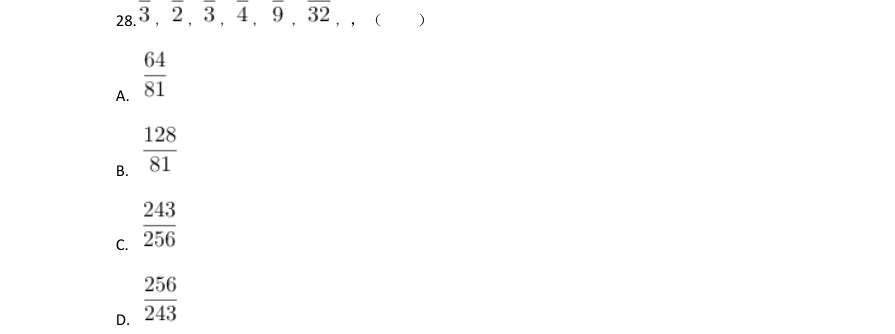

> （本题为图形题，选项为图片，见原卷）

**答案：D**

### 2023 广东·县级　第 29 题　（一空）

0,( ),2,6,12,20

- **A.** -1
- **B.** 0
- **C.** 1
- **D.** 2

**答案：B**

### 2023 广东·县级　第 30 题　（逻辑填空（综合））

（本题题干为图形/公式，文字层无题干，图见原卷）

- **A.** 14
- **B.** 17
- **C.** 19
- **D.** 21

**答案：D**

### 2023 广东·县级　第 31 题　（一空）

某辆货车载有20 吨货物,上午卸了货物总重的20%,下午卸了剩余货物的30%,则下午卸 货后,货车上的货物还剩( )吨。

- **A.** 10
- **B.** 10.4
- **C.** 11.2
- **D.** 12.6

**答案：C**

### 2023 广东·县级　第 34 题　（一空）

某工厂加工出一批正方体奶酪,抽检时质检员从奶酪中切下了一个厚度为2 厘米的长方体 (如图所示)。如果剩余奶酪的体积为144 立方厘米,则奶酪原本的边长为( )厘米。

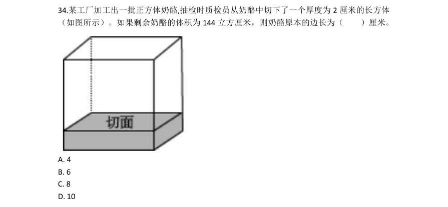

- **A.** 4
- **B.** 6
- **C.** 8
- **D.** 10

**答案：B**

### 2023 广东·县级　第 37 题　（一空）

某印刷厂原计划用全自动装订机花费4 小时装订一批文件,但在还剩300 份文件时装订 机出现故障,无法装订。印刷厂立即安排了部分员工进行人工装订,由于人工装订的总效率 仅为机器的20%,最终比原计划排迟1 小时完成装订。则这批文件共有( )份。

- **A.** 2400
- **B.** 3600
- **C.** 4800
- **D.** 6000

**答案：C**

### 2023 广东·县级　第 38 题　（一空）

某地举办了“铁人三项”体育活动,先进行蛙跳,后游泳,最后竞走到达终点。一位选 手在上午7 点出发,9 点到达了终点,全程未休息,其蛙跳、游泳和竞走的速度分别为每小 时2 千米、3 千米和6 千米。如果蛙跳和竞走的路程相同,则所有项目的总路程是( )。

- **A.** 无法计算
- **B.** 6 千米
- **C.** 8 千米
- **D.** 12 千米

**答案：B**

### 2023 广东·县级　第 39 题　（一空）

某公司向餐馆订购盒饭,要求每份盒饭包含2 种荤菜、2 种素菜。如果餐馆共准备了6 种荤菜和4 种素菜,则最多有( )种盒饭。

- **A.** 42
- **B.** 60
- **C.** 72
- **D.** 90

**答案：D**

### 2023 广东·县级　第 40 题　（一空）

某单位每天都会安排2 人在大楼入口负责安检,安排3 人负责楼层巡查。为此,单位组 织了一支12 人的队伍,并根据序号安排工作:第一天由队员1,2 负责安检,队员3、4、5 负 责巡查;第二天由队员6、7 负责安检,8、9、10 负责巡查;第三天由队员11、12 负责安检, 队员1、2、3 负责巡查······以此类推,如果队员1 今天负责了安检,则最晚在( ) 天后他将再次负责安检。

- **A.** 5
- **B.** 6
- **C.** 7
- **D.** 8

**答案：C**

### 2023 国考·行政执法　第 21 题　（逻辑填空（综合））

请根据题目要求,在 四个选项中选出一个最恰当的答案。 “双减”政策带给作业改革的最大变化,是理念的改变,让我们回到了作业的原点:为什么要布置作业?归根 到底,是为了育人。这彻底扭转了之前作业管理中的“ ”现象,改变了传统作业管理中“眼中有作业、 有分数,但唯独没有人”的痼疾,厘清了“好作业”的标准或者尺度。 填入画横线部分最恰当的一项是:

- **A.** 揠苗助长
- **B.** 本末倒置
- **C.** 缘木求鱼
- **D.** 徒有其表

**答案：B**

### 2023 国考·行政执法　第 22 题　（逻辑填空（综合））

红树林的地下部分长期处于厌氧环境,减缓了根系和凋落物的分解速率,加速了碳埋藏速率。此外,红树林大 多分布于沉积型海岸河口,由上游河流和海洋潮汐共同作用带来的大量外源性碳,被它们固定并快速沉积下 来。这“ ”的组合拳使得红树林成为海岸带蓝碳碳汇的主要贡献者。 填入画横线部分最恰当的一项是:

- **A.** 取长补短
- **B.** 标本兼治
- **C.** 开源节流
- **D.** 一举两得

**答案：C**

### 2023 国考·行政执法　第 23 题　（逻辑填空（综合））

人造血即血氧液,能够用来代替人类血液,满足临床需求,缓解血液短缺状况。而且人造血标准化的生产流程 能够确保其 ,输入人造血不用再担心会感染艾滋病、肝炎等疾病,可最大程度降低输血相关传染病的风 险。因此,研制和批量生产人造血成为当前的热点。 填入画横线部分最恰当的一项是:

- **A.** 安全性
- **B.** 可靠性
- **C.** 规范性
- **D.** 稳定性

**答案：A**

### 2023 国考·行政执法　第 24 题　（两空）

“反觇”思维是从事物甲和乙之间的联系,反推出乙同甲的另一种联系的方法。在作战指挥中,敢于“反道而 觇之”,往往能跳出局部观全局、打破常规辟蹊径,面对复杂多变的战场形势,指挥员若能换位于敌、 定 式,从侧面甚至反向来决策,及时 行动部署,就会拥有战场制敌的更大胜算。 依次填入画横线部分最恰当的一项是:

- **A.** 突破 扭转
- **B.** 摒弃 校正
- **C.** 摆脱 规划
- **D.** 忽略 调整

**答案：B**

### 2023 国考·行政执法　第 25 题　（两空）

相比于其他全球卫星导航系统采取单一轨道星座构型,北斗系统 ,坚定选择了混合星座的特色发展之 路,并首创短文通报模式,开创了通信导航一体化的独特服务模式,信息发送能力从一次120个汉字提升到一 次1200个汉字,遇到突发情况时无需 ,足以将情节一次性说清楚。 依次填入画横线部分最恰当的一项是:

- **A.** 与众不同 言简意赅
- **B.** 独树一帜 字斟句酌
- **C.** 遥遥领先 删繁就简
- **D.** 迎难而上 惜墨如金

**答案：B**

### 2023 国考·行政执法　第 26 题　（两空）

课程思政的显性功能是提升课程的内涵和质量。不少教师认为课程思政是 于传统教学之外的附加行为,这 种认识是错误的。对教学而言,课程思政不是 ,更不是特立独行,它首先是为提升教学质量服务的,是 深层次的教学改革,因为只有高水平的教学活动才能吸引学生,进而影响学生。 依次填入画横线部分最恰当的一项是:

- **A.** 游离 喧宾夺主
- **B.** 隔绝 照本宣科
- **C.** 徘徊 削足适履
- **D.** 独立 敷衍了事

**答案：A**

### 2023 国考·行政执法　第 27 题　（两空）

翻开古代农书,几千年间古人对于土地的保养,几乎与当代耕作学关注的措施 ,其中历代农书涉及最多 的是施肥。在中国古人的摸索中,施肥成为一种讲究,何时、何地施肥,施何种肥,怎样施肥,形成了一个 的体系,在每个年度的农业生产进程中,精心安排在各个时节。 依次填入画横线部分最恰当的一项是:

- **A.** 一脉相承 科学
- **B.** 如出一辙 固定
- **C.** 别无二致 完整
- **D.** 不谋而合 复杂

**答案：C**

### 2023 国考·行政执法　第 28 题　（两空）

指尖上的形式主义是“以痕迹论政绩”的错误政绩观,关注点在于形式美观,而 了根本政绩——人民群众 的满意度。指尖上减负就是要把基层干部从 的“虚功”中解救出来,务求实效、扎根基层,用实践检验 政绩,把工作落实与否、群众满意与否作为衡量政绩的客观标准。 依次填入画横线部分最恰当的一项是:

- **A.** 偏离 阳奉阴违
- **B.** 遗忘 哗众取宠
- **C.** 淡化 花拳绣腿
- **D.** 忽视 华而不实

**答案：D**

### 2023 国考·行政执法　第 29 题　（两空）

我们确立和坚持马克思主义在意识形态领域指导地位的根本制度,新时代党的创新理论 ,社会主义核心 价值观广泛传播,中华优秀传统文化得到创造性转化、创新性发展,文化事业日益繁荣,网络生态持续向好, 意识形态领域形势发生 、根本性转变。 依次填入画横线部分最恰当的一项是:

- **A.** 振聋发聩 历史性
- **B.** 深入人心 全局性
- **C.** 高屋建瓴 实质性
- **D.** 硕果累累 显著性

**答案：B**

### 2023 国考·行政执法　第 30 题　（两空）

补齐公共服务短板,首先要善于发现深层次问题。要深入调研、综合分析、精准掌握,弄清问题的本质和关 键,做到 。同时,补齐公共服务短板不是简单的打打补丁,也不会 。有一些短板和弱项是随着时 代发展而凸显的系统性问题,只有通过推动经济社会高质量发展才能从根本上解决。 依次填入画横线部分最恰当的一项是:

- **A.** 循序渐进 一成不变
- **B.** 细致入微 完美无缺
- **C.** 一针见血 水到渠成
- **D.** 有的放矢 一劳永逸

**答案：D**

### 2023 国考·行政执法　第 31 题　（两空）

对于新业态新模式冲击本地的传统产业,是包容审慎,还是 ?对于非本地人才就业创业、非本地企业项 目立项推广,能否 ,甚至千方百计降门槛、清路障以留人留项目?纵观先进制造业集群所在地,无一不 是当地政府部门怀着“开放之心”,营造出良好的创新生态。 依次填入画横线部分最恰当的一项是:

- **A.** 如芒在背 一视同仁
- **B.** 退避三舍 不偏不倚
- **C.** 拒之门外 开诚布公
- **D.** 推三阻四 海纳百川

**答案：A**

### 2023 国考·行政执法　第 32 题　（两空）

法律惩罚的正当性一定程度上源于公众朴素的道德期待。在具体执法时,不能仅仅 地依赖客观后果,进行 简单归责和惩戒,而应全面考察当事人的主观认知、动机目的等情节,并综合 其社会危害性,由此来审慎 决定是否启动惩罚机制。 依次填入画横线部分最恰当的一项是:

- **A.** 机械 评估
- **B.** 单纯 辨别
- **C.** 盲目 分析
- **D.** 草率 判断

**答案：A**

### 2023 国考·行政执法　第 33 题　（两空）

在普通人看来,法律都是 的,自己一辈子都不会和法律打交道。但在瞬息万变的社会里,人们随时可能 触及法律的红线。很多人平时法律观念和意识不强,柔性执法不仅可以起到 作用,而且有利于提高群众的 学法懂法意识。 依次填入画横线部分最恰当的一项是:

- **A.** 高高在上 教育
- **B.** 高深莫测 预防
- **C.** 遥不可及 警戒
- **D.** 事不关己 提醒

**答案：C**

### 2023 国考·行政执法　第 34 题　（两空）

长期以来,城管执法部门对职责内的执法事项通常是 “用力”,对所有的执法对象“一碗水端平”,以体 现执法的公平性、公正性。但对于超大城市而言,由于城管执法事项繁多,涉及市场主体庞杂,而城管执法力 量是有限的,实践中很难做到 ,进而可能会影响执法效果和执行力。 依次填入画横线部分最恰当的一项是:

- **A.** 精准 滴水不漏
- **B.** 均衡 百无一失
- **C.** 精确 精益求精
- **D.** 平均 面面俱全

**答案：D**

### 2023 国考·行政执法　第 35 题　（三空及以上）

开展未成年人网络环境整治,势在必行且 。网络上可能存在的色情、暴力、过度娱乐等有害信息,会对 普遍拥有智能设备、全面触网的未成年人产生潜移默化的不良影响。只有 清朗洁净的网络空间,才能让青 少年健康成长。实现这一愿景,需要发挥多主体多领域联动优势, 合力,撑起清朗网络蓝天。 依次填入画横线部分最恰当的一项是:

- **A.** 蓄势待发 创设 形成
- **B.** 刻不容缓 营造 凝聚
- **C.** 迫在眉睫 构筑 集成
- **D.** 任重道远 共建 汇聚

**答案：B**

### 2023 国考·行政执法　第 36 题　（三空及以上）

随着技术发展,以数字手段为支撑的“沉浸式”“交互式”网上博物馆日益增多,提高了展览的 。但随 着智能终端的普及,人们难免会对数字博物馆产生 。博物馆在利用数字技术的基础上,也不能忽视实物展 览内涵的提升,使之兼备文化和教育功能,突出 的特点。 依次填入画横线部分最恰当的一项是:

- **A.** 科技性 排斥 润物无声
- **B.** 便捷性 厌倦 触手可及
- **C.** 趣味性 疲劳 寓教于乐
- **D.** 交融性 失望 与时俱进

**答案：C**

### 2023 国考·行政执法　第 37 题　（三空及以上）

传统戏曲中所蕴含的价值理念以及 的表演节奏,很难与当代青年人的生活节奏与审美趣味相合拍。因 而,关于戏曲衰亡的声音 。事实上,戏曲相对于互联网时代知识文化的 、快餐式传播,其可重复 欣赏和耐咀嚼的品格显得更为可贵,其特有的艺术价值决定了它不可能退出历史舞台,更不会走向消亡。 依次填入画横线部分最恰当的一项是:

- **A.** 不疾不徐 如雷贯耳 碎片化
- **B.** 从容不迫 不绝于耳 肤浅化
- **C.** 四平八稳 甚嚣尘上 机械化
- **D.** 慢条斯理 此起彼伏 泡沫化

**答案：D**

### 2023 国考·行政执法　第 38 题　（三空及以上）

没有中华文化沃土的滋养,就不可能有中国特色社会主义制度的 。我们过去对制度的实践基础强调比较 多,对制度的文化支撑关注不够。其实,制度绝不只是一系列外在的 行为规范,还是内在的文化思维价值 认同。这种文化不可能是外来的强加或移植,必须是内在的演化和 。 依次填入画横线部分最恰当的一项是:

- **A.** 勃勃生机 强制性 积淀
- **B.** 枝繁叶茂 约束性 渗透
- **C.** 历久弥新 指导性 转化
- **D.** 欣欣向荣 系统性 升华

**答案：A**

### 2023 国考·行政执法　第 39 题　（三空及以上）
> 材料：环境整治关键要不留死角、不存盲点,光靠人为监管恐怕会 。目前,“互联网+”数字技术已成为环境 监测的利器,为生态环境监测布下“天罗地网”。这张网使任何“ ”,都能充分暴露在数据“阳光”之…

下,让环境监测和污染防治变得更加 、更加具象。 依次填入画横线部分最恰当的一项是:

- **A.** 捉襟见肘 一举一动 有效
- **B.** 力不从心 风吹草动 精细
- **C.** 顾此失彼 小打小闹 动态
- **D.** 收效甚微 蛛丝马迹 直观

**答案：B**

### 2023 国考·行政执法　第 40 题　（三空及以上）

竞争与创新总是 。平台反垄断最终要在抑制垄断与鼓励创新之间达到平衡。一方面,要加快健全市场准 入制度、公平竞争审查机制,预防和 滥用行政权力限制竞争,充分 市场竞争机制的强大动能;另一方 面,要引导和激励平台企业把更多精力用在创新上。唯有如此,平台经济方能为全社会注入持久的创新活力。 依次填入画横线部分最恰当的一项是:

- **A.** 如影随形 约束 调控
- **B.** 互为表里 杜绝 挖掘
- **C.** 相辅相成 打击 激发
- **D.** 息息相关 制止 释放

**答案：D**

### 2023 国考·行政执法　第 50 题　（逻辑填空（综合））

事实推定是指法官在确证基础事实之上,借助经验法则推定待证事实的一种司法认知方法,这实际上是法官价 值判断的过程,受个人经验、情感、家庭背景等因素的影响,法官进行价值判断时可能具有个体特征,价值判 断联通了基础事实与推定事实,对各类事实所作的价值判断不同,得出的判决结论也将不同。因此, 。 填入画横线部分最恰当的一项是:

- **A.** 对事实推定价值判断的说理可提升判决的可接受性
- **B.** 需要对事实推定中的价值判断进行规范
- **C.** 程序正义有助于减少法官个体差异对判决的影响
- **D.** 价值判断不仅要符合形式合理性也要及时回应社会关切

**答案：B**

### 2023 国考·行政执法　第 60 题　（逻辑填空（综合））

立案登记制改革的初衷是保护当事人依法享有的诉权,所谓“有案必立、有诉必理”,只是指那些符合法律规 定立案条件的案件,起诉到人民法院后,法院必须立案,否则法院就没有必要受理。所以, ,对 此,可能有人认为,设立立案标准等于为立案设置了门槛,很难保障当事人通过诉讼解决纠纷的权利。其实任 何权利都有限度,不存在没有边界的权利,当事人通过诉讼解决纠纷的权利同样如此。只有符合立案标准,这 种权利才能通过法院诉讼得以实现。 填入画横线部分最恰当的一项是:

- **A.** 推行立案登记制并不意味着“是案就立”
- **B.** 不能将“立案难”与司法公正简单关联起来
- **C.** 明确立案标准才能保障当事人的合法权益
- **D.** 应正确理解司法资源作为公共产品的有限性

**答案：C**

### 2022 广东·乡镇　第 1 题　（两空）

新时代现实世界是如此新鲜丰富、多姿多彩,生活的______、人民的拼搏奋斗、家庭的______、百姓的爱 恨喜痛,都值得作家去侧耳倾听、用心思考、挥笔书写,真正做到语出一人之口,呼出万众之声。 依次填入画横线部分最恰当的一项是:

- **A.** 日新月异 酸甜苦辣
- **B.** 精彩纷呈 跌宕起伏
- **C.** 精妙绝伦 悲欢离合
- **D.** 一日千里 喜怒哀乐

**答案：A**

### 2022 广东·乡镇　第 2 题　（一空）

在中共一大纪念馆“真理的味道”展陈前,72 种版本的《共产党宣言》作为“镇馆之宝”,吸引参观者驻 足,在此 ______真理的力量。 填入横线处最恰当的是:

- **A.** 感知
- **B.** 感悟
- **C.** 体验
- **D.** 品味

**答案：B**

### 2022 广东·乡镇　第 3 题　（两空）

______历朝历代面临的生态问题不同,______保护环境的治理理念不变。无论在成文法典,还是在政府文 件中,多有号令天下植树造林、固土防沙、兴修水利等内容。 依次填入横线处最恰当的是:

- **A.** 因为 所以
- **B.** 不仅 而且
- **C.** 即使 可是
- **D.** 尽管 但是

**答案：D**

### 2022 广东·乡镇　第 4 题　（两空）

党的百年历史,就是党与群众水乳交融、______的历史。一条扁担、一张借据、半条棉被就是党与人民血 肉相连、情深似海的______ 。 依次填入画横线部分最恰当的一项是:

- **A.** 唇齿相依 印记
- **B.** 相濡以沫 记忆
- **C.** 休戚与共 见证
- **D.** 众志成城 证明

**答案：C**

### 2022 广东·乡镇　第 5 题　（三空及以上）

乡村振兴,关键是产业振兴。因地制宜发展特色产业,大力推动一二三产业融合发展,不断______产业链、 ______供应链、______价值链,走出一条科学有效、农民受益的产业发展之路。 依次填入横线处最恰当的是:

- **A.** 延伸 提升 打造
- **B.** 延伸 打造 提升
- **C.** 提升 打造 延伸
- **D.** 提升 延伸 打造

**答案：B**

### 2022 广东·乡镇　第 6 题　（一空）

文化自信是更深厚的自信。“______。”中华文化扎实之根脉、醇厚之积淀,恰如有源之水,滋养着中华 民族在新的历史条件下的新创造、新发展,给我们的文化自信打下了最深厚的历史根基。 下列句子填入画横线处,最恰当的是:

- **A.** 海纳百川,有容乃大
- **B.** 积土而为山,积水而为海
- **C.** 源浚者流长,根深者叶茂
- **D.** 泰山不让土壤,故能成其大

**答案：C**

### 2022 广东·县级　第 1 题　（两空）

每一寸鲜血浸染的红色热土,每一段感人至深的红色往事,都______着艰苦卓绝的牺牲奉献,______着气 吞山河的壮丽辉煌,是全党全国各族人民弥足珍贵的精神财富。 依次填入画横线部分最恰当的一项是:

- **A.** 汇聚 镌刻
- **B.** 凝聚 描绘
- **C.** 汇集 勾勒
- **D.** 凝结 铭刻

**答案：D**

### 2022 广东·县级　第 3 题　（两空）

一代代特区建设者_____ 、艰苦创业,将昔日落后的边陲小镇、荒滩渔村建成了繁华的现代化城市,在建 设中国特色社会主义伟大进程中谱写了勇立潮头、______的壮丽篇章。 依次填入画横线部分最恰当的一项是:

- **A.** 披荆斩棘 开拓进取
- **B.** 紧锣密鼓 开天辟地
- **C.** 一往无前 开云见日
- **D.** 乘风破浪 开疆拓土

**答案：A**

### 2022 广东·县级　第 5 题　（三空及以上）

社会是企业家施展才华的舞台。______真诚回报社会、切实履行社会责任的企业家,______能真正得到社 会认可, ______是符合时代要求的企业家。 依次填入画横线部分最恰当的一项是:

- **A.** 只有 才 才
- **B.** 只要 就 就
- **C.** 如果 不仅 还
- **D.** 因为 所以 就

**答案：A**

### 2022 广东·县级　第 7 题　（一空）

国有企业作为中国特色社会主义经济制度重要载体,是我国经济社会发展的中坚力量。当前,国有企业改 革和发展面临新问题和新挑战,特别是在全面建成小康社会,开启建设社会主义现代化国家新征程的重要历史交 汇时刻,国有企业以“______”的顽强意志,把企业党建建在实处,应对好每一场重大风险挑战,提高企业效益、 增强企业竞争实力,实现又好又快发展,成为改革的主力军和先行者。 下列句子填入画横线处,最恰当的是:

- **A.** 踏平坎坷成大道,斗罢艰险又出发
- **B.** 山重水复疑无路,柳暗花明又一村
- **C.** 没有比人更高的山,没有比脚更长的路
- **D.** 世上无难事,只要肯登攀

**答案：A**

### 2022 国考·副省级　第 21 题　（一空）

(单选题)思政课教师要有正确的党史观和过硬的党史知识,只有自己观点正确、史料丰富,才能准 确无误地给学生指引方向、有力有理有据地反驳错误观点、________ 地选择恰当的教学方式,推动党 史教育入脑入心、开花结果。 填入画横线部分最恰当的一项是:

- **A.** 信手拈来
- **B.** 轻而易举
- **C.** 游刃有余
- **D.** 随心所欲

**答案：C**

### 2022 国考·副省级　第 22 题　（一空）

(单选题)卫星定位系统是通过获得卫星和用户接收机之间的距离来计算用户位置的,而距离等于传 播时间乘以光速,因此,精确的距离测量实际上就是精确的时间测量。没有高精度的时频,卫星定位系 统就不可能实现高精度的定位。所谓失之毫“秒”谬以千里,这正是原子钟________的地方。 填入画横线部分最恰当的一项是:

- **A.** 大显身手
- **B.** 牛刀小试
- **C.** 脱颖而出
- **D.** 无往不利

**答案：A**

### 2022 国考·副省级　第 23 题　（两空）

(单选题)在未来战争中,掌握算法优势的一方,能快速准确__________战场态势,创新最优作战方 法,实现“未战而先胜”的战争目的。同时,智能科技将__________到战争全要素全过程,物联网、智 联网与脑联网成为战争的基础,从而使得战争全息透明,呈现战争控制“有人”、战场交锋“无人”的 状态。 依次填入画横线部分最恰当的一项是:

- **A.** 预测渗透
- **B.** 主导贯穿
- **C.** 判断投射
- **D.** 反映覆盖

**答案：A**

### 2022 国考·副省级　第 24 题　（两空）

(单选题)实施传统胸外按压心肺复苏,常会发生肋骨或胸骨骨折,导致肺、胸膜及心脏损伤,影响 心肺复苏的成功率。急救专家由此探索出“胸路不通走腹路”的新途径,腹部提压心肺复苏技术 ________ 。与传统心肺复苏技术相比,该技术________,利用腹部提压心肺复苏仪达到起腹心动、起 腹呼吸的目的。 依次填入画横线部分最恰当的一项是:

- **A.** 异军突起推陈出新
- **B.** 横空出世一举两得
- **C.** 粉墨登场扬长避短
- **D.** 应运而生另辟蹊径

**答案：D**

### 2022 国考·副省级　第 25 题　（两空）

(单选题)建筑工程投入巨大,一旦建成再做拆改可谓________。对此,需要完善设计规范和管理制 度,从方案设计一开始就强化监管审核,确保建筑物在形体、色彩、体量、高度和空间环境等方面符合 城市设计要求,避免陷入“________”的窘境,最大程度地维护公共利益。 依次填入画横线部分最恰当的一项是:

- **A.** 徒劳无功覆水难收
- **B.** 劳民伤财木已成舟
- **C.** 得不偿失尾大不掉
- **D.** 血本无归闭门造车

**答案：B**

### 2022 国考·副省级　第 26 题　（两空）

(单选题)当前,我国发展面临着前所未有的风险挑战,既有国内的也有国际的,既有政治、经济、 文化、社会等领域的也有来自自然界的,既有传统的也有非传统的,“黑天鹅”“灰犀牛”还会 ________。要更好应对前进道路上各种可以预见和难以预见的风险挑战,我们必须从历史中获得启迪, 从历史经验中提炼出________的法宝。 填入画横线部分最恰当的一项是:

- **A.** 不期而至克敌致胜
- **B.** 有机可乘战无不克
- **C.** 纷至沓来所向披靡
- **D.** 不请自来攻坚克难

**答案：A**

### 2022 国考·副省级　第 27 题　（两空）

(单选题)解剖是认识某种动物形态特征的重要方式,但对于罕见或稀有物种而言,解剖无疑会破坏 珍贵的样本,其损失________。近年来,无损检测已开始应用于文物鉴定等多种领域,________相关技 术的应用经验,研发出一套专门针对珍稀动物样本无损检测的方法,必将大有可为。 依次填入画横线处恰当的一项是:

- **A.** 难以估量拓展
- **B.** 触目惊心参考
- **C.** 毋庸置疑模仿
- **D.** 不言而喻借鉴

**答案：D**

### 2022 国考·副省级　第 28 题　（两空）

(单选题)当今世界正经历百年未有之大变局,新一轮科技革命和产业变革深入发展,国际力量对比 深刻________,和平与发展仍然是时代主题,人类命运共同体理念________,同时,国际环境日趋复 杂,不稳定性不确定性明显增加,新冠肺炎疫情影响广泛深远,经济全球化遭遇逆流,世界进入动荡变 革期。 依次填入画横线部分最恰当的一项是:

- **A.** 调整深入人心
- **B.** 扭转经久不衰
- **C.** 变化源远流长
- **D.** 变换牢不可破

**答案：A**

### 2022 国考·副省级　第 29 题　（两空）

(单选题)人体肠道内生物的多样性令人惊讶,除细菌外,还________着数十万种被称为噬菌体的病 毒,这些噬菌体可以感染细菌。众所周知,肠道微生物组不平衡会引发各种疾病,如炎症性肠病、过敏 和肥胖,但我们对肠道细菌及噬菌体在人类健康和疾病方面起何种作用________。 依次填入画横线部分最恰当的一项是:

- **A.** 潜伏知之甚少
- **B.** 分布浑然不觉
- **C.** 活跃束手无策
- **D.** 充斥一知半解

**答案：A**

### 2022 国考·副省级　第 30 题　（两空）

(单选题)稳就业之“稳”,既要着眼于________存量,让大家把“饭碗”端稳,更要着眼于扩大增 量,拓宽就业空间。一方面需要不断优化营商环境,让新增市场主体成为解决就业的________;另一方 面还要充分利用新技术衍生的新业态,引导人们转变观念,实现更宽更广的就业。 依次填入画横线部分最恰当的一项是:

- **A.** 维持星星之火
- **B.** 夯实不二法门
- **C.** 强化中流砥柱
- **D.** 巩固源头活水

**答案：D**

### 2022 国考·副省级　第 31 题　（两空）

(单选题)系统观念是做好“十四五”时期各项工作必须坚持的重要原则。各级税务机关要加强 ________思考,立足当前、放眼长远,加强税收领域前沿问题研究,增强做好税收工作的主动性和预见 性。要进行________谋划,自觉把税收工作融入到党和国家事业发展大局中去思考和谋划,加强“十四 五”税收改革发展的顶层设计。 依次填入画横线部分最恰当的一项是:

- **A.** 针对性战略性
- **B.** 系统性长期性
- **C.** 前瞻性全局性
- **D.** 独立性统一性

**答案：C**

### 2022 国考·副省级　第 32 题　（三空及以上）

(单选题)病毒变异每时每刻都在发生,随机性极大,突变率高、变异速度快,这意味着它们更有机 会形成适应环境的________。然而,并非每种变异都能让病毒存活并发展下去。同一时期,病毒的变异 株可能有很多种,但“________”,只有那些能更有效________免疫系统侦测且传播能力强的毒株才能 最终成为优势株。 依次填入画横线部分最恰当的一项是:

- **A.** 特质优胜劣汰突破
- **B.** 性状适者生存躲避
- **C.** 机能胜者为王迷惑
- **D.** 表征此消彼长逃脱

**答案：B**

### 2022 国考·副省级　第 33 题　（三空及以上）

(单选题)我国各地情况千差万别,要________推进城市空间布局形态多元化。东部等人口密集地 区,要________城市群内部空间结构,合理控制大城市规模,不能盲目“摊大饼”。要推动城市组团式 发展,形成多中心、多层级、多节点的网络型城市群结构。城市之间既要加强互联互通,也要有必要的 生态和安全________。 依次填入画横线部分最恰当的一项是:

- **A.** 因地制宜优化屏障
- **B.** 持之以恒修正措施
- **C.** 不遗余力重组壁垒
- **D.** 循序渐进改善系统

**答案：A**

### 2022 国考·副省级　第 34 题　（三空及以上）

(单选题)长期以来,由于政府同社会智库之间的智库成果报送渠道不畅,从而导致智库成果“体内 循环多、成果转化少”等问题。为此,要给社会智库与官方智库________的待遇,建立畅通的智库成果 快速报送渠道,________、广谋良策,充分发挥各级各类智库的“________”作用。 依次填入画横线部分最恰当的一项是:

- **A.** 公平从善如流军师
- **B.** 一致群策群力向导
- **C.** 相同集思广益顾问
- **D.** 平等广开言路参谋

**答案：D**

### 2022 国考·副省级　第 35 题　（三空及以上）

(单选题)发达国家一两百年出现的环境问题,在我国30 多年来的快速发展中集中显现,呈现明显的 结构型、压缩型、复合型特点,老的环境问题尚未解决,新的环境问题________。走老路,去无节制消 耗资源,去不计代价污染环境,________!要正确处理经济发展同生态环境保护之间的关系,更加 ________地推动绿色发展、循环发展、低碳发展,决不以牺牲环境、浪费资源为代价换取一时的经济增 长。 依次填入横线部分最恰当的一组是:

- **A.** 层出不穷如履薄冰迅速
- **B.** 数不胜数肆无忌惮努力
- **C.** 接踵而至难以为继自觉
- **D.** 突如其来积重难返积极

**答案：C**

### 2022 国考·副省级　第 36 题　（一空）

(单选题)________________?这是党史观的重大问题。一个马克思主义政党对自己的错误所抱的态 度,是衡量这个党是否真正履行对人民群众所负责任的一个最重要最可靠的尺度。我们党对自己包括领 袖人物的失误和错误历来采取郑重的态度,一是敢于承认,二是正确分析,三是坚决纠正,从而使失误 和错误连同党的成功经验一起成为宝贵的历史教材。 填入画横线部分最恰当的一项是:

- **A.** 如何对待逆耳忠言
- **B.** 如何看待曲折、失误
- **C.** 是否始终坚持实事求是
- **D.** 犯了错误后能否正确应对

**答案：B**

### 2022 国考·副省级　第 38 题　（一空）

(单选题)________________,最能代表一个时代的风貌,最能引领一个时代的风气。“文变染乎世 情,兴废系乎时序。”在欧洲文艺复兴运动中,但丁、彼特拉克、薄伽丘、达芬奇、拉斐尔、米开朗琪 罗、蒙田、塞万提斯、莎士比亚等文艺巨人,发出了新时代的啼声,开启了人们的心灵。在谈到文艺复 兴运动时,恩格斯说,这“是一个需要巨人而且产生了巨人——在思维能力、热情和性格方面,在多才 多艺和学识渊博方面的巨人的时代”。在我国发展史上,包括文艺在内的文化发展同样与中华民族发展 紧紧联系在一起。先秦时期,我国出现了百家争鸣的兴盛局面,开创了我国古代文化的一个鼎盛期。 20 世纪初,在五四新文化运动中,发端于文艺领域的创新风潮对社会变革产生了重大影响,成为全民族 思想解放运动的重要引擎。 填入横线部分最恰当的一项是:

- **A.** 文艺是铸造灵魂的工程
- **B.** 文化是民族生存和发展的重要力量
- **C.** 文艺是时代前进的号角
- **D.** 文艺创新是与时代脉搏同频共振的

**答案：C**

### 2022 国考·副省级　第 39 题　（逻辑填空（综合））

(单选题)约25 亿年前的“大氧化事件”是指大气中的游离氧含量突然增加,这一事件的具体原因迄 今尚不得而知,但有若干种假说能加以解释,其中主流说法认为,当时破坏氧气的甲烷细菌所依赖的镍 元素急剧减少,而海藻类植物通过光合作用使得地球上的氧气迅速增加,大气中的含氧量不断提升,正 是这一事件使地球上矿物的成分发生了变化,也使动物在地球上有了生存可能。而在“大氧化事件”之 前,地球表面虽然已出现了海洋和陆地,但是空气中依旧氧气稀薄,因此当时的地球是光秃秃的,毫无 绿意。 关于“大氧化事件”,文中没有提及:

- **A.** 对发生原因的主流解释
- **B.** 对地球生态系统的影响
- **C.** 事件发生前的地球面貌
- **D.** 能提供佐证的岩石样本

**答案：D**

### 2022 国考·副省级　第 45 题　（一空）

(单选题)________________。党的历次集中教育活动,都以思想教育打头,着力解决学习不深入、 思想不统一、行动跟不上的问题,既绵绵用力又集中发力,推动全党思想上统一、政治上团结、行动上 一致。要把学习贯彻党的创新理论作为思想武装的重中之重,同学习马克思主义基本原理贯通起来,同 学习党史、新中国史、改革开放史、社会主义发展史结合起来,同新时代我们进行伟大斗争、建设伟大 工程、推进伟大事业、实现伟大梦想的丰富实践联系起来,在学懂弄通做实上下苦功夫,在解放思想中 统一思想,在深化认识中提高认识,切实增强贯彻落实的思想自觉和行动自觉。 填入画横线部分最恰当的一项是:

- **A.** 实践证明,只有马克思主义才能发展中国
- **B.** 坚持思想建党,是我们党的一大政治优势
- **C.** 理论创新每前进一步,理论武装就要跟进一步
- **D.** 一个民族要走在时代前列,一刻不能没有思想指引

**答案：C**

### 2022 国考·副省级　第 53 题　（逻辑填空（综合））

(单选题)关于支持“人类长跑者假说”的人体特征和能力,文中未涉及: 1骨骼结构2发音器官3图像分辨能力4听觉神经5体温调控功能6直立形态

- **A.** 156
- **B.** 234
- **C.** 345
- **D.** 456

**答案：B**

### 2022 国考·副省级　第 58 题　（逻辑填空（综合））

(单选题)根据这篇文中,下列说法正确的是:

- **A.** 尼科尔发现弓形虫对老鼠的感染比较温和
- **B.** 老鼠只有被弓形虫感染了才不会怕猫
- **C.** 刚地弓形虫可以在老鼠体内进行有性生殖
- **D.** 动物行为的改变可能是脑组织持续性炎症的后果

**答案：暂缺**

### 2022 国考·副省级　第 59 题　（逻辑填空（综合））

(单选题)实验人员在复现文中所讲的实验时,不小心打翻鼠笼,导致两组小鼠混淆。以下最有可能 已经受到弓形虫感染的是:

- **A.** 一只凑到研究人员面前嗅来嗅去的小鼠
- **B.** 一只在墙边不停嗅着自己尿液气味的小鼠
- **C.** 一只不停撕咬其他几只同伴的小鼠
- **D.** 一只移动速度明显快于其他同伴的小鼠

**答案：A**

### 2022 国考·地市级　第 21 题　（一空）

文创产品能否经受检验、笑到最后,关键在于是否蕴含了深厚的文化价值与审美价值。在专 注其实用价值的同时,更要看到它们所承载的文化意涵、所具有的文化表达功能。如果对传统文化 ________,盲目引入商业化流程,反而会贬损传统文化的价值。 填入画横线部分最恰当的一项是:

- **A.** 敬而远之
- **B.** 不以为然
- **C.** 不求甚解
- **D.** 浅尝辄止

**答案：C**

### 2022 国考·地市级　第 22 题　（一空）

思政课教师要有正确的党史观和过硬的党史知识,只有自己观点正确、史料丰富,才能准确 无误地给学生指引方向、有力有理有据地反驳错误观点、________ 地选择恰当的教学方式,推动党 史教育入脑入心、开花结果。 填入画横线部分最恰当的一项是:

- **A.** 信手拈来
- **B.** 轻而易举
- **C.** 游刃有余
- **D.** 随心所欲

**答案：C**

### 2022 国考·地市级　第 23 题　（一空）

卫星定位系统是通过获得卫星和用户接收机之间的距离来计算用户位置的,而距离等于传播 时间乘以光速,因此,精确的距离测量实际上就是精确的时间测量。没有高精度的时频,卫星定位系 统就不可能实现高精度的定位。所谓失之毫“秒”谬以千里,这正是原子钟________的地方。 填入画横线部分最恰当的一项是:

- **A.** 大显身手
- **B.** 牛刀小试
- **C.** 脱颖而出
- **D.** 无往不利

**答案：A**

### 2022 国考·地市级　第 24 题　（两空）

近400 年来,人类在探索宇宙方面取得了长足的进步。我们知道了地球上再壮观的烟火表演 与超新星爆发相比,都________;一颗方糖大小的中子星就有数亿吨重;宇宙中充满着________ 的 物质,包括难以捉摸的黑洞、暗物质、引力波等。 依次填入画横线部分最恰当的一项是:

- **A.** 大相径庭千奇百怪
- **B.** 黯然失色不可思议
- **C.** 相形见绌林林总总
- **D.** 不值一提莫名其妙

**答案：B**

### 2022 国考·地市级　第 25 题　（两空）

透光摄影、多光谱成像、三维病害模型......这些听起来更像是医疗或化工业的技术,如今在 文物修复圈成为________ 的“神器”。正是这些现代科技手段对文物的“问诊”与“体检”,弥补 了用肉眼无法看到、用手无法摸到“病情”的缺陷,从而使修复人员可以“________”。 依次填入画横线部分最恰当的一项是:

- **A.** 崭露头角药到病除
- **B.** 交口称赞妙手回春
- **C.** 举足轻重有的放矢
- **D.** 必不可少对症下药

**答案：D**

### 2022 国考·地市级　第 26 题　（两空）

太阳能、风能是产生电力的主要可再生新能源,但都具有随机性、________ 、波动性等特 点。太阳能光板在晴天、白天时能发电,阴天、夜晚时就“罢工”了,风能发电也跟风力和天气息息 相关。因此,目前迫切需要大规模储能装置,将富余的电能储存起来,在发电不足的时间用,以保证 电力的________供给。 依次填入画横线部分最恰当的一项是:

- **A.** 周期性高效
- **B.** 间歇性平稳
- **C.** 地域性持续
- **D.** 阶段性弹性

**答案：B**

### 2022 国考·地市级　第 27 题　（两空）

实施传统胸外按压心肺复苏,常会发生肋骨或胸骨骨折,导致肺、胸膜及心脏损伤,影响心 肺复苏的成功率。急救专家由此探索出“胸路不通走腹路”的新途径,腹部提压心肺复苏技术 ________ 。与传统心肺复苏技术相比,该技术________,利用腹部提压心肺复苏仪达到起腹心动、 起腹呼吸的目的。 依次填入画横线部分最恰当的一项是:

- **A.** 异军突起推陈出新
- **B.** 横空出世一举两得
- **C.** 粉墨登场扬长避短
- **D.** 应运而生另辟蹊径

**答案：D**

### 2022 国考·地市级　第 28 题　（两空）

商标是产品跨入市场的敲门砖,在行业竞争激烈的市场上,市场主体为了在竞争者中 ________,往往倾向于选择能够彰显个性、标新立异的标识作为商标。然而,如果一味追求个性、博 公众眼球,效果可能________。一旦触碰公共秩序和良善风俗底线,就会遭遇商标注册申请被驳回的 尴尬境遇。 依次填入画横线部分最恰当的一项是:

- **A.** 独树一帜适得其反
- **B.** 一鸣惊人事与愿违
- **C.** 拔得头筹过犹不及
- **D.** 一马当先大打折扣

**答案：A**

### 2022 国考·地市级　第 29 题　（两空）

建筑工程投入巨大,一旦建成再做拆改可谓________。对此,需要完善设计规范和管理制度, 从方案设计一开始就强化监管审核,确保建筑物在形体、色彩、体量、高度和空间环境等方面符合城 市设计要求,避免陷入“________”的窘境,最大程度地维护公共利益。 依次填入画横线部分最恰当的一项是:

- **A.** 徒劳无功覆水难收
- **B.** 劳民伤财木已成舟
- **C.** 得不偿失尾大不掉
- **D.** 血本无归闭门造车

**答案：B**

### 2022 国考·地市级　第 30 题　（两空）

基层是国家治理体系的末梢,但这末梢并非________的边角毫末,而是治理现代化总体方略 的关键词,也是人民群众日常生活获得感的中转站,基层治理要满足群众的殷切期望,因此,需要 ________重心下移的治理体系,增添治理资源、激发治理活力,如此基层才能“发声呐喊”。 依次填入画横线部分最恰当的一项是:

- **A.** 默默无闻打造
- **B.** 微乎其微补充
- **C.** 无足轻重构建
- **D.** 可有可无规范

**答案：C**

### 2022 国考·地市级　第 31 题　（两空）

新闻工作一方面不能抱残守缺,不思改革,对于各种呼声________;另一方面又不能________, 不加辨别地跟着各种思潮跑,没有一个界限。不然,就会乱套。对当前的各种社会思潮,我们要冷静 地通过自己的头脑去思考,不能受随意性的支配。 依次填入画横线部分最恰当的一项是:

- **A.** 敷衍了事随波逐流
- **B.** 不以为意拾人牙慧
- **C.** 莫衷一是避重就轻
- **D.** 置若罔闻人云亦云

**答案：D**

### 2022 国考·地市级　第 32 题　（两空）

如今,网络文艺评论受到大众欢迎,但在花样繁多的内容背后经常________着商业目的,无 论是无端批评,还是一味吹捧,都会对观众造成误导,给影视创作带来伤害。互联网的普及让我们既 为网络文艺评论生态的蓬勃生长感到惊喜,也为其________的状况感到忧虑。 依次填入画横线部分最恰当的一项是:

- **A.** 潜藏泥沙俱下
- **B.** 夹杂乌烟瘴气
- **C.** 渗透鱼龙混杂
- **D.** 裹挟杂乱无章

**答案：A**

### 2022 国考·地市级　第 33 题　（两空）

研究基层政府治理体系,有利于从操作层面反观整个政府治理体系,用“________”方式自 下而上逐级剖析政府治理体系建设的逻辑,并通过“以小见大”的方法 ________政府治理体系的全貌。 依次填入画横线部分最恰当的一项是:

- **A.** 抽丝剥茧呈现
- **B.** 管中窥豹探求
- **C.** 按图索骥推知
- **D.** 顺藤摸瓜还原

**答案：D**

### 2022 国考·地市级　第 34 题　（两空）

系统观念是做好“十四五”时期各项工作必须坚持的重要原则。各级税务机关要加强________ 思考,立足当前、放眼长远,加强税收领域前沿问题研究,增强做好税收工作的主动性和预见性。要 进行________谋划,自觉把税收工作融入到党和国家事业发展大局中去思考和谋划,加强“十四五” 税收改革发展的顶层设计。 依次填入画横线部分最恰当的一项是:

- **A.** 针对性战略性
- **B.** 系统性长期性
- **C.** 前瞻性全局性
- **D.** 独立性统一性

**答案：C**

### 2022 国考·地市级　第 35 题　（三空及以上）

病毒变异每时每刻都在发生,随机性极大,突变率高、变异速度快,这意味着它们更有机会 形成适应环境的________。然而,并非每种变异都能让病毒存活并发展下去。同一时期,病毒的变异 株可能有很多种,但“________”,只有那些能更有效________免疫系统侦测且传播能力强的毒株才 能最终成为优势株。 依次填入画横线部分最恰当的一项是:

- **A.** 特质优胜劣汰突破
- **B.** 性状适者生存躲避
- **C.** 机能胜者为王迷惑
- **D.** 表征此消彼长逃脱

**答案：B**

### 2022 国考·地市级　第 36 题　（三空及以上）

作为对农村生产、生活和生态日常的记录,“三农”视频给人的感觉往往淳朴可亲。这不仅 体现在内容上的________,也表现在美学风格上的“原生态”——拍摄是生活实拍,影像生产方式 ________“零添加”。这种真实的生活场景、粗粝的视频画面让观众仿佛回到童年,从而________ 了一种独特的美学风格。 依次填入画横线部分最恰当的一项是:

- **A.** 喜闻乐见类似开创
- **B.** 返璞归真趋向成就
- **C.** 朴实无华追求蕴含
- **D.** 民淳俗厚达到代表

**答案：B**

### 2022 国考·地市级　第 37 题　（三空及以上）

对武器装备来说,没有永远的“明星”,只有彼此的“克星”。站在对手的角度,选准新装 备的“克星”,才能让我们进一步________,抢在对手之前探寻更先进武器装备的制胜机理,打造出 ________未来战场的坚甲利器。从这个意义上说,一个强劲的对手,既是改进武器的“________”, 也是研发武器的“催化剂”。 依次填入画横线部分最恰当的一项是:

- **A.** 攻其不备颠覆指向标
- **B.** 以逸待劳引领助推器
- **C.** 知己知彼适应磨刀石
- **D.** 战无不胜胜任源动力

**答案：C**

### 2022 国考·地市级　第 38 题　（三空及以上）

我国各地情况千差万别,要________推进城市空间布局形态多元化。东部等人口密集地区, 要________城市群内部空间结构,合理控制大城市规模,不能盲目“摊大饼”。要推动城市组团式发 展,形成多中心、多层级、多节点的网络型城市群结构。城市之间既要加强互联互通,也要有必要的 生态和安全________。 依次填入画横线部分最恰当的一项是:

- **A.** 因地制宜优化屏障
- **B.** 持之以恒修正措施
- **C.** 不遗余力重组壁垒
- **D.** 循序渐进改善系统

**答案：A**

### 2022 国考·地市级　第 39 题　（三空及以上）

长期以来,由于政府同社会智库之间的智库成果报送渠道不畅,从而导致智库成果“体内循 环多、成果转化少”等问题。为此,要给社会智库与官方智库________的待遇,建立畅通的智库成果 快速报送渠道,________、广谋良策,充分发挥各级各类智库的“________”作用。 依次填入画横线部分最恰当的一项是:

- **A.** 公平从善如流军师
- **B.** 一致群策群力向导
- **C.** 相同集思广益顾问
- **D.** 平等广开言路参谋

**答案：D**

### 2022 国考·地市级　第 40 题　（三空及以上）

发达国家一两百年出现的环境问题,在我国30 多年来的快速发展中集中显现,呈现明显的 结构型、压缩型、复合型特点,老的环境问题尚未解决,新的环境问题________。走老路,去无节制 消耗资源,去不计代价污染环境,________!要正确处理经济发展同生态环境保护之间的关系,更加 ________地推动绿色发展、循环发展、低碳发展,决不以牺牲环境、浪费资源为代价换取一时的经济 增长。 依次填入横线部分最恰当的一组是:

- **A.** 层出不穷如履薄冰迅速
- **B.** 数不胜数肆无忌惮努力
- **C.** 接踵而至难以为继自觉
- **D.** 突如其来积重难返积极

**答案：C**

### 2022 国考·地市级　第 42 题　（一空）

依托数字文化资源进行新文旅业态和产品的开发,是文物古迹焕发新活力、增强吸引力的重 要手段。但科技应用应有边界,即________________。一旦两者有冲突,理应遵循保护优先原则。打 造沉浸式场景,要借助声电光影,在将静态的、单一的遗产地场景,转化为多维、立体、丰富的体验 场景,其目的无可非议。但沉浸式场景的构建多会涉及器材、设施、设备的导入和搭建,即使只存在 小概率风险,也须慎重。鉴于此,文化遗产地的沉浸式游览,可考虑在遗产地保护范围之外,打造不 依托文物本体的沉浸式体验项目。 填入画横线部分最恰当的一项是:

- **A.** 不能对资源本身及其价值造成破坏或产生不良影响
- **B.** 需坚持适度开发和可持续性发展策略
- **C.** 要把握好真实性和娱乐性之间的尺度
- **D.** 不能过度强调沉浸式体验而忽略文化内涵

**答案：A**

### 2022 国考·地市级　第 44 题　（一空）

“________________。”要加快完善中国特色社会主义法律体系,使之更加科学完备、统一 权威。党的十八大以来,全国人大及其常委会通过宪法修正案,制定法律48 件,修改法律203 件次, 作出法律解释9 件,通过有关法律问题和重大问题的决定79 件次。截至目前,现行有效法律282 件、 行政法规608 件,地方性法规12000 余件。民法典为其他领域立法法典化提供了很好的范例,要总结 编纂民法典的经验,适时推动条件成熟的立法领域法典编纂工作。要研究丰富立法形式,可以搞一些 “大块头”,也要搞一些“小快灵”,增强立法的针对性、适用性、可操作性。 填入画横线部分最恰当的一项是:

- **A.** 法者,天下之准绳也
- **B.** 国皆有法,而无使法必行之法
- **C.** 立善防恶谓之礼,禁非立是谓之法
- **D.** 治国无其法则乱,守法而不变则衰

**答案：D**

### 2022 国考·地市级　第 55 题　（逻辑填空（综合））

都察院是明代设立的重要监察机构,为风宪耳目之官,总负正风肃纪之责。明代对其所属监察 御史的选用要求,明显不同于一般的官吏。除了普遍性的清正廉洁这一操守要求外,还十分看重其“介 直”“骨鲠”的个性。在任职资格上,明英宗正统年间,开始打破了新仕进士不得除授御史之职的规定。 明中叶后,监察御史选用“多不得人”,管理御史的“宪规”“条约”成为空文,御史不断参与到朝廷 的政争之中,使明代官僚体系的有效监督、净化能力不断削弱,这是明代政治日趋腐朽、不断走向衰败 的重要原因。 这是一篇论文的摘要,论文中最不可能论述哪项内容?

- **A.** 监察御史选用资历的演化
- **B.** 监察成效对明代政治走向的影响
- **C.** 都察院的设置及监察御史品秩的演化
- **D.** 明代监察法规在后世的延续及价值分析

**答案：D**

### 2022 国考·行政执法　第 21 题　（一空）

(单选题)安装监控补光灯的目的在于更好地识别车辆信息,从而提高执法效率,存留违法车辆的有 效证据。然而,交通执法的根本目的在于维护道路交通安全,如果执法手段本身对于交通安全构成了隐 患甚至不幸导致事故,那么无疑是________。 填入画横线部分最恰当的一项是:

- **A.** 得不偿失
- **B.** 本末倒置
- **C.** 背道而驰
- **D.** 因小失大

**答案：B**

### 2022 国考·行政执法　第 22 题　（一空）

(单选题)文创产品能否经受检验、笑到最后,关键在于是否蕴含了深厚的文化价值与审美价值。在 专注其实用价值的同时,更要看到它们所承载的文化意涵、所具有的文化表达功能。如果对传统文化 ________,盲目引入商业化流程,反而会贬损传统文化的价值。 填入画横线部分最恰当的一项是:

- **A.** 敬而远之
- **B.** 不以为然
- **C.** 不求甚解
- **D.** 浅尝辄止

**答案：C**

### 2022 国考·行政执法　第 25 题　（两空）

(单选题)如今,网络文艺评论受到大众欢迎,但在花样繁多的内容背后经常________着商业目的, 无论是无端批评,还是一味吹捧,都会对观众造成误导,给影视创作带来伤害。互联网的普及让我们既 为网络文艺评论生态的蓬勃生长感到惊喜,也为其________的状况感到忧虑。 依次填入画横线部分最恰当的一项是:

- **A.** 潜藏泥沙俱下
- **B.** 夹杂乌烟瘴气
- **C.** 渗透鱼龙混杂
- **D.** 裹挟杂乱无章

**答案：A**

### 2022 国考·行政执法　第 26 题　（两空）

(单选题)基层是国家治理体系的末梢,但这末梢并非________的边角毫末,而是治理现代化总体方 略的关键词,也是人民群众日常生活获得感的中转站,基层治理要满足群众的殷切期望,因此,需要 ________重心下移的治理体系,增添治理资源、激发治理活力,如此基层才能“发声呐喊”。 依次填入画横线部分最恰当的一项是:

- **A.** 默默无闻打造
- **B.** 微乎其微补充
- **C.** 无足轻重构建
- **D.** 可有可无规范

**答案：C**

### 2022 国考·行政执法　第 27 题　（两空）

(单选题)在宇宙过去130 多亿年里,暗物质扮演了十分重要的角色。由于在物质的质量比例上占据 ________地位,暗物质决定了宇宙物质在大尺度上的分布——宇宙大尺度结构。现代超级计算机模拟更 是向我们揭示,宇宙中暗物质的空间分布可以再现观测到的星系分布,暗示了星系和暗物质之间 ________的关系。 依次填入横线部分最恰当的一组是:

- **A.** 关键盘根错节
- **B.** 核心唇齿相依
- **C.** 主导千丝万缕
- **D.** 优势如影随形

**答案：C**

### 2022 国考·行政执法　第 29 题　（两空）

(单选题)近400 年来,人类在探索宇宙方面取得了长足的进步。我们知道了地球上再壮观的烟火表演 与超新星爆发相比,都________;一颗方糖大小的中子星就有数亿吨重;宇宙中充满着________ 的物 质,包括难以捉摸的黑洞、暗物质、引力波等。 依次填入画横线部分最恰当的一项是:

- **A.** 大相径庭千奇百怪
- **B.** 黯然失色不可思议
- **C.** 相形见绌林林总总
- **D.** 不值一提莫名其妙

**答案：B**

### 2022 国考·行政执法　第 30 题　（两空）

(单选题)透光摄影、多光谱成像、三维病害模型......这些听起来更像是医疗或化工业的技术,如今 在文物修复圈成为________ 的“神器”。正是这些现代科技手段对文物的“问诊”与“体检”,弥补 了用肉眼无法看到、用手无法摸到“病情”的缺陷,从而使修复人员可以“________”。 依次填入画横线部分最恰当的一项是:

- **A.** 崭露头角药到病除
- **B.** 交口称赞妙手回春
- **C.** 举足轻重有的放矢
- **D.** 必不可少对症下药

**答案：D**

### 2022 国考·行政执法　第 31 题　（两空）

(单选题)太阳能、风能是产生电力的主要可再生新能源,但都具有随机性、________ 、波动性等特 点。太阳能光板在晴天、白天时能发电,阴天、夜晚时就“罢工”了,风能发电也跟风力和天气息息相 关。因此,目前迫切需要大规模储能装置,将富余的电能储存起来,在发电不足的时间用,以保证电力 的________供给。 依次填入画横线部分最恰当的一项是:

- **A.** 周期性高效
- **B.** 间歇性平稳
- **C.** 地域性持续
- **D.** 阶段性弹性

**答案：B**

### 2022 国考·行政执法　第 33 题　（两空）

(单选题)商标是产品跨入市场的敲门砖,在行业竞争激烈的市场上,市场主体为了在竞争者中 ________,往往倾向于选择能够彰显个性、标新立异的标识作为商标。然而,如果一味追求个性、博公 众眼球,效果可能________。一旦触碰公共秩序和良善风俗底线,就会遭遇商标注册申请被驳回的尴尬 境遇。 依次填入画横线部分最恰当的一项是:

- **A.** 独树一帜适得其反
- **B.** 一鸣惊人事与愿违
- **C.** 拔得头筹过犹不及
- **D.** 一马当先大打折扣

**答案：A**

### 2022 国考·行政执法　第 35 题　（三空及以上）

(单选题)当下,传播媒介的________为文化传播创造新符号。其中,短视频平台跨越专业内容生产 门槛,________海量用户,进行日常生活的自我呈现,体现了传播的视觉转向和影像化特点。而虚拟现 实、增强现实、混合现实则在视觉、听觉、触觉等多模态符号中________人类感官,建构受众的认知和 体验。 依据填入画横线部分最恰当的一项是:

- **A.** 创新吸引挑战
- **B.** 更迭聚集延伸
- **C.** 涌现引导丰富
- **D.** 升级融合重塑

**答案：B**

### 2022 国考·行政执法　第 36 题　（三空及以上）

(单选题)早期的电影多是全景式的“纪录视角”,这是由于摄影机无法移动,只能________传统戏 剧我演你看的观演关系。随着各种摄影新技术和剪辑新手法的出现,电影依靠独特的镜头语言,逐渐脱 离戏剧的束缚________。完全依照戏剧思维,使用单一固定的场景所打造的电影虽有佳作,但 ________。 依次填入画横线部分最恰当的一项是:

- **A.** 照搬自立门户屈指可数
- **B.** 保持另起炉灶凤毛麟角
- **C.** 沿袭独当一面差强人意
- **D.** 复制革故鼎新寥寥无几

**答案：A**

### 2022 国考·行政执法　第 37 题　（三空及以上）

(单选题)如果历史观错误,不仅达不到学习教育的目的,反倒会________、走入误区。现在一些错 误倾向要引起警惕;有的________党史上的失误和曲折,肆意抹黑歪曲党的历史、攻击党的领导:有的 将党史事件同现实问题刻意勾连、恶意炒作;有的不信正史信野史,将党史庸俗化、娱乐化,热衷传播 八卦轶闻,对非法境外出版物________,等等。 依次填入画横线部分最恰当的一项是:

- **A.** 轻重倒置渲染青睐有加
- **B.** 南辕北辙夸大津津乐道
- **C.** 缘木求鱼聚焦趋之若鹜
- **D.** 断章取义

**答案：B**

### 2022 国考·行政执法　第 39 题　（三空及以上）

(单选题)对武器装备来说,没有永远的“明星”,只有彼此的“克星”。站在对手的角度,选准新 装备的“克星”,才能让我们进一步________,抢在对手之前探寻更先进武器装备的制胜机理,打造出 ________未来战场的坚甲利器。从这个意义上说,一个强劲的对手,既是改进武器的“________”,也 是研发武器的“催化剂”。 依次填入画横线部分最恰当的一项是:

- **A.** 攻其不备颠覆指向标
- **B.** 以逸待劳引领助推器
- **C.** 知己知彼适应磨刀石
- **D.** 战无不胜胜任源动力

**答案：C**

### 2022 国考·行政执法　第 40 题　（三空及以上）

(单选题)近年来出现的《我在故宫修文物》等以国宝为题材的纪录片,提供了认识历史的新 ________。这些纪录片以具体的文物为线索、又不________于文物,而是描绘物品所处时代的精神世 界,以此引导当代观众与传统文化发生碰撞,引导情感参与,开拓历史视野。这些节目如同荧屏上的博 物馆,让观众________。 依次填入画横线部分最恰当的一项是:

- **A.** 方向受制大开眼界
- **B.** 视角拘泥流连忘返
- **C.** 境界局限身临其境
- **D.** 途径止步叹为观止

**答案：B**

### 2022 国考·行政执法　第 41 题　（一空）

(单选题)“________________。”要加快完善中国特色社会主义法律体系,使之更加科学完备、统 一权威。党的十八大以来,全国人大及其常委会通过宪法修正案,制定法律48 件,修改法律203 件次, 作出法律解释9 件,通过有关法律问题和重大问题的决定79 件次。截至目前,现行有效法律282 件、行 政 法规608 件,地方性法规12000 余件。民法典为其他领域立法法典化提供了很好的范例,要总结编纂民法 典的经验,适时推动条件成熟的立法领域法典编纂工作。要研究丰富立法形式,可以搞一些“大块 头”,也要搞一些“小快灵”,增强立法的针对性、适用性、可操作性。 填入画横线部分最恰当的一项是:

- **A.** 法者,天下之准绳也
- **B.** 国皆有法,而无使法必行之法
- **C.** 立善防恶谓之礼,禁非立是谓之法
- **D.** 治国无其法则乱,守法而不变则衰

**答案：D**

### 2022 国考·行政执法　第 42 题　（一空）

(单选题)依托数字文化资源进行新文旅业态和产品的开发,是文物古迹焕发新活力、增强吸引力的 重要手段。但科技应用应有边界,即________________。一旦两者有冲突,理应遵循保护优先原则。打 造沉浸式场景,要借助声电光影,在将静态的、单一的遗产地场景,转化为多维、立体、丰富的体验场 景,其目的无可非议。但沉浸式场景的构建多会涉及器材、设施、设备的导入和搭建,即使只存在小概 率风险,也须慎重。鉴于此,文化遗产地的沉浸式游览,可考虑在遗产地保护范围之外,打造不依托文 物本体的沉浸式体验项目。 填入画横线部分最恰当的一项是:

- **A.** 不能对资源本身及其价值造成破坏或产生不良影响
- **B.** 需坚持适度开发和可持续性发展策略
- **C.** 要把握好真实性和娱乐性之间的尺度
- **D.** 不能过度强调沉浸式体验而忽略文化内涵

**答案：A**

### 2022 国考·行政执法　第 47 题　（逻辑填空（综合））

(单选题)都察院是明代设立的重要监察机构,为风宪耳目之官,总负正风肃纪之责。明代对其所属监 察御史的选用要求,明显不同于一般的官吏。除了普遍性的清正廉洁这一操守要求外,还十分看重其“介 直”“骨鲠”的个性。在任职资格上,明英宗正统年间,开始打破了新仕进士不得除授御史之职的规定。 明中叶后,监察御史选用“多不得人”,管理御史的“宪规”“条约”成为空文,御史不断参与到朝廷的 政争之中,使明代官僚体系的有效监督、净化能力不断削弱,这是明代政治日趋腐朽、不断走向衰败的重 要原因。 这是一篇论文的摘要,论文中最不可能论述哪项内容?

- **A.** 监察御史选用资历的演化
- **B.** 监察成效对明代政治走向的影响
- **C.** 都察院的设置及监察御史品秩的演化
- **D.** 明代监察法规在后世的延续及价值分析

**答案：D**

### 2021 广东·乡镇　第 1 题　（一空）

建设“红色村”,既要注重源于“红”、体现“红”,更要注重传承“红”、弘扬“红”,用红色文化烘托 红色精神,以红色精神________红色基因。 填入横线处最恰当的词语是:

- **A.** 发现
- **B.** 激活
- **C.** 激荡
- **D.** 发掘

**答案：暂缺**

### 2021 广东·乡镇　第 2 题　（两空）

产业振兴________是实现脱贫攻坚与乡村振兴的重要标志,________是实现二者有效衔接的必然要求。 填入横线部分最恰当的一项是:

- **A.** 或者或者
- **B.** 因为所以
- **C.** 尽管还
- **D.** 不仅

**答案：暂缺**

### 2021 广东·乡镇　第 3 题　（两空）

正是广大基层干部群众以无比巨大的热情投入改革,以只争朝夕的劲头________改革,以一往无前的勇气探 路改革,才令改革开放的大潮澎湃不息,蔚为壮观,________出令世界惊叹的成就。 填入横线处的词语最恰当的一项是:

- **A.** 推动创建
- **B.** 参与创造
- **C.** 推进构建
- **D.** 参加

**答案：暂缺**

### 2021 广东·乡镇　第 4 题　（两空）

乡村振兴,必须在人才队伍建设上尽快破题,研究出台乡村振兴引才专项政策,打通农业人才服务基层的 ________,________基层农业人才的发展空间等。一些地方的农校、政府已经在通过鼓励学生“下地”、农民“上 学”等方式,为基层农技岗位输送人才。 填入横线处的词语最恰当的一项是:

- **A.** 禁锢扩张
- **B.** 渠道增长
- **C.** 脉络扩展
- **D.** 桎梏

**答案：暂缺**

### 2021 广东·乡镇　第 5 题　（两空）

伟大抗疫精神同中华民族长期形成的特质禀赋和文化基因________,是爱国主义、集体主义、社会主义精神 的传承和发展,是中国精神的生动________。 填入横线处最恰当的一项是:

- **A.** 一脉相承诠释
- **B.** 一衣带水展示
- **C.** 相辅相成展现
- **D.** 相得益彰

**答案：暂缺**

### 2021 广东·乡镇　第 9 题　（一空）

要深深地扎根于人民群众之中,不断从人民群众及其参与的各项实践中汲取营养和力量。正所谓, “________________”。当前,密切联系群众最直接的要求就是推动广大党员干部走近群众,扑下身子搞好调研, 真正了解群众所思所想所盼。从群众关注的烦心事、紧要事和身边事等细微之处入手,及时发现问题、精准研判 问题、有效解决问题。 下列句子填入划横线处,最恰当的是:

- **A.** 天地之大,黎元为先
- **B.** 凡治国之道,必先富民
- **C.** 得众则得国,失众则失国
- **D.** 知屋漏者在宇下,知政失者在草野

**答案：暂缺**

### 2021 国考·副省级　第 26 题　（两空）

当前,我国旅游市场的需求还在持续进发,人民的旅游诉求也在不断升级。仅靠评级就想________的想法已 经过时,口碑立身,品质说话才是景区吸引客源的正道。希望景区能摒弃________的心理,为游客营造更加舒心 和放心的环境,为旅游行业发展带来更多正能量。 依次填入画航线部分最恰当的一项是:

- **A.** 一本万利浑水摸鱼
- **B.** 一步到位好高骛远
- **C.** 一劳永逸急功近利
- **D.** 一鸣惊人

**答案：暂缺**

### 2021 国考·副省级　第 31 题　（两空）

代入感是作品引发受众认同的机制,故事人物的某些方面召唤读者将自己替换为主人公,从而________,角 色同呼吸共命运。代入感是长篇网络小说________的属性,由于网络小说连载时间长,读者容易中途放弃。因此, 作品绑定读者,将单纯浏览转变为情感认同便十分重要。 依次填入画横线部分最恰当的一项是:

- **A.** 感同身受不可或缺
- **B.** 惺惺相惜独一无二
- **C.** 身临其境与生俱来
- **D.** 触景生情

**答案：暂缺**

### 2021 国考·副省级　第 37 题　（一空）

疫情对全球生产和需求造成全面冲击,各国应该联手加大宏观政策对冲力度,防止世界经济陷入衰退。要实 施有力有效的财政和货币政策,促进各国货币汇率基本稳定。要加强金融监管协调,维护全球金融市场稳定, ______________,中国将加大力度向国际市场供应原料药、生活必需品、防疫物资等产品。要保护妇女儿童,保 护老年人、残疾人等弱势群体,保障人民基本生活。中国将继续实施积极的财政政策和稳健的货币政策,坚定不 移扩大改革开放,放宽市场准入,持续优化营商环境,积极扩大进口,扩大对外投资,为世界经济稳定作出贡献。 填入画横线部分最恰当的一项是:

- **A.** 要确保全球产业链供应链逐步升级
- **B.** 要加快全球产业链发展一体化进程
- **C.** 要共同维护全球产业链供应链稳定
- **D.** 要努力推进全球供应链的深度融合

**答案：暂缺**

### 2021 国考·副省级　第 51 题　（逻辑填空（综合））
> 材料：当前,我国区域发展形势是好的,同时出现了一些值得关注的新情况新问题。一是区域经济发展分化态势明 显,长三角、珠三角等地区已初步走上高质量发展轨道,一些北方省份增长放缓、全国经济重心进一步南移。1 各板块内部也出现明显分化,有的省份内部也有分化现象。二是发展动力极化现象日益突出,经济和人口向大城 市及城市群集聚的趋势比较明显。2北京、上海、广州、深圳等特大城市发展优势不断增强,杭州、南京、武汉、 郑州、成都、西安等大城市发展势头较好,形成推动高质量发展的区域增长极。3三是部分区…

以下例证放在原文的哪个位置最为合适? 2018 年,北方地区经济总量占全国的比重为38.5%,比2012 年下降4.3 个百分点。

- **A.** 1
- **B.** 2
- **C.** 3
- **D.** 4

**答案：暂缺**

### 2021 国考·副省级　第 52 题　（逻辑填空（综合））

填入第二段画横线部分最恰当的一项是:

- **A.** 我国经济发展的空间结构正在发生深刻变化
- **B.** 经济发展条件好的地区要承载更多产业和人口
- **C.** 应推动形成优势互补高质量发展的区域经济布局
- **D.** 要有效整合资源,主动调整经济结构

**答案：暂缺**

### 2021 国考·副省级　第 54 题　（逻辑填空（综合））

下列哪一内容未在文中明确提及?

- **A.** 数字化能够使消费品企业的工作效率提高
- **B.** 消费品企业可以依托数字化了解用户需求
- **C.** 消费品企业的数字化转型依赖可信的数据
- **D.** 消费品企业借助数字化技术优化销售环节

**答案：暂缺**

### 2021 国考·副省级　第 56 题　（逻辑填空（综合））
> 材料：1今天,世界上超过15 亿人使用筷子,也就是说每五人中就有一人用筷子进餐。西方学者林恩·怀特等人 根据取食方式,将世界文化一分为三,分别是手指取食、刀叉取食、筷子取食所构成的三大饮食文化圈。筷子取 食方式主要流行在亚洲地区,筷子的发明地中国更是典型代表。 2但是在古代中国,筷子在很长一段时间内并不是主要的饮食工具,出现最早且被用作主要取食工具的是 “匕”,是一种状如匕首、介乎刀和匙之间的餐具、长柄浅斗,像今天的汤勺。 3饮食史专家倾向于把食物分为两类:谷物类和非谷物关。以就餐…

如果穿越回古代,根据本文,看不到下列哪一情景?

- **A.** 东汉人用石磨将小麦研磨成粉
- **B.** 战国时的秦兵以小米为食
- **C.** 春秋时的晋人以箸为主要饮食工具
- **D.** 清代人以合食方式聚餐

**答案：暂缺**

### 2021 国考·副省级　第 59 题　（逻辑填空（综合））

根据本文,下列说法正确的是:

- **A.** 小麦的种植面积在唐代中期达到顶峰
- **B.** 世界上已知最早的面条以小米为原料
- **C.** 勺子在清代转变为以舀汤为主的工具
- **D.** 朝鲜半岛在唐代之前就以水稻为主食

**答案：暂缺**

### 2021 国考·地市级　第 21 题　（一空）

发展扶贫产业不能眉毛胡子一把抓,必须立足当地自然禀赋,挖掘地方特色资源,按照“宜种则种,宜养则 养”的原则,注重发展山地农业、生态农业、观光农业等特色产业,学会“靠山吃山唱山歌,靠海吃海念海经”, 谨防产业“________”。应该看到,适合的才是最好的。 填入画横线部分最恰当的一项是:

- **A.** 急功近利
- **B.** 水土不服
- **C.** 削足适履
- **D.** 千篇一律

**答案：B**

### 2021 国考·地市级　第 22 题　（一空）

“人民城市人民建”。搭建民意“直通车”,公众“议事厅”,有事好商量,大家来出力,很多工作就能做 到________。比如上海能在短短一年内迅速形成垃圾分类的新风尚,靠的就是人民群众的主动性、积极性与创造 性。 填入画横线部分最恰当的一项是:

- **A.** 立竿见影
- **B.** 事半功倍
- **C.** 万无一失
- **D.** 尽善尽美

**答案：B**

### 2021 国考·地市级　第 23 题　（一空）

在芯片,操作系统等很多方面,我们需要下定决心,攻坚克难,自力更生。因为一旦核心技术受制于人,就 有被“________”的威胁。所以,我们要有“宝剑锋从磨砺出,梅花香自苦寒来”的定力,逐渐形成一批拥有自 主知识产权的核心技术和产业,把发展的主动权牢牢掌握在自己手中。 填入画横线部分最恰当的一项是:

- **A.** 过河拆桥
- **B.** 落井下石
- **C.** 一网打尽
- **D.** 釜底抽薪

**答案：D**

### 2021 国考·地市级　第 24 题　（两空）

中国道路的成功开创不仅创造了中国奇迹,而且创造了中国经验。中国经验无疑是中国智慧的结晶,具有鲜 明的________。但是,中国经验作为中国道路的积极成果,也是在遵循历史发展和现代化发展规律,吸收世界发 展经验教训的基础上形成的,它是对人类文明发展进行探索的重要产物,反映了人类文明进步的规律,因而又具 有一定的________。 依次填入画横线部分最恰当的一项是:

- **A.** 地域性国际性
- **B.** 实践性理论性
- **C.** 特殊性普遍性
- **D.** 先进性

**答案：C**

### 2021 国考·地市级　第 25 题　（两空）

“为调研而调研”等现象的出现,很大程度上就在于调研不深入、不具体。现实中,有人了解情况习惯于大 而化之、________;有人调研习惯于走设计路线,________。这些心中不揣问题、脚下不沾泥土的错误做法,导 致调研不深、不实、不细、不准,最终也会无效。 依次填入画横线部分最恰当的一项是:

> （本题为图形题，选项为图片，见原卷）

**答案：A**

### 2021 国考·地市级　第 26 题　（两空）

探索和形成一个好的制度不容易,关键是毫不动摇地坚持和巩固,与时俱进地完善和发展、________地遵守 和执行。这要求我们要把制度像种子一样种在头脑里,如红线一般________于工作中。这样才能推动中国特色社 会主义制度更加成熟、更加定型,将制度优势转化为强大的治理效能,通达“中国之治”的新天地。 依次填入画横线部分最恰当的一项是:

- **A.** 坚定不移渗透
- **B.** 一丝不苟应用
- **C.** 不折不扣贯穿
- **D.** 矢志不渝

**答案：C**

### 2021 国考·地市级　第 27 题　（两空）

一根网线、一部手机,把偏远的贫困地区链接进了广阔的大市场,电商扶贫,不是________地把农产品搬到 网上,更是在深层次地倒逼农业产业转型升级,进而扩展到其他相关领域,创建出中国式扶贫的新________。 依次填入画横线部分最恰当的一项是:

- **A.** 简单范本
- **B.** 盲目方向
- **C.** 机械蓝图
- **D.** 被动

**答案：A**

### 2021 国考·地市级　第 28 题　（两空）

在实际应用中,专网通常服务于政府、军队、公安、能源、消防、轨道交通等部门或领域,大部分情况下被 用来进行应急通信、调度指挥,性能可靠、低成本、定制化的特点,使其在行业应用中具备________的优势。即 便5G 时代呼啸而来,专网依旧能够找到________。 依次填入画横线部分最恰当的一项是:

- **A.** 独具一格立足之地
- **B.** 众所周知一席之地
- **C.** 不可替代用武之地
- **D.** 显而易见

**答案：C**

### 2021 国考·地市级　第 29 题　（两空）

信息匮乏的年代,决策水平与信息量成正相关,但当信息从匮乏走向过载甚至爆炸时,决策质量与信息量间 的函数曲线便开始下滑,利用繁杂信息形成________判断变得难上加难,此时,智能化就可以大显身手。计算智 能未必能在逻辑能力上逾越人类,但其强大的处理速度却恰好使信息过载带来的决策困境________。 依次填入画横线部分最恰当的一项是:

- **A.** 理性烟消云散
- **B.** 准确迎刃而解
- **C.** 科学不复存在
- **D.** 有效

**答案：B**

### 2021 国考·地市级　第 30 题　（两空）

一些国家在实现自身现代化过程中选错了参照系,将发达国家有什么,做什么作为实现自身现代化的 ________,导致在向市场经济转型过程中经济停滞、崩溃,危机不断。而中国能够根据自己的要素禀赋条件,发 挥政府在市场经济中________的作用,把自己能做好的产业做大做强,将比较优势变成竞争优势,从而推动经济 长期稳定快速发展。 依次填入画横线部分最恰当的一项是:

- **A.** 目标因势利导
- **B.** 原则总揽全局
- **C.** 模本穿针引线
- **D.** 途径

**答案：A**

### 2021 国考·地市级　第 31 题　（两空）

每个民族都有自己独特的民俗文化,然而,一些人分不清具体的民族文化和民俗文化,加之有人为了短时间 内推出本民族民俗文化,盲目迎合当下的流行需要,反而使自己的民俗文化变得________,出现雷同化传播现象, 使大众对不同区域的特色民俗文化认知较为________,影响大众对民俗文化的了解和兴趣,甚至影响了少数民族 地区的经济发展。 依次填入画横线部分最恰当的一项是:

- **A.** 支离破碎肤浅
- **B.** 不伦不类模糊
- **C.** 名存实亡混乱
- **D.** 面目全非

**答案：B**

### 2021 国考·地市级　第 32 题　（两空）

近代以来,怎样处理中国传统文化与西方文化的关系,成为很多学者关注的重要问题,有人主张全盘西化, 也有人主张全面恢复传统。这些________的观点当然受到了当时历史环境的影响,但也暴露出一些人在思维模式 上的局限,即用________的思维来看待复杂的文化现象。这种思维模式在今天的研究中依然不同程度地存在。 依次填入画横线部分最恰当的一项是:

- **A.** 荒谬经渭分明
- **B.** 偏颇非此即彼
- **C.** 片面针锋相对
- **D.** 极端

**答案：B**

### 2021 国考·地市级　第 33 题　（两空）

从生态学角度来讲,人工种群和野外种群是完全不同的概念。大型哺覆动物行为复杂,其生活技巧人类难以 传授,又很难“无师自通”。如果________将其放归野外,结局很可能是死亡。就算可以放归野外,也必须为它 们找到________的栖息地。 依次填入画横线部分最恰当的一项是:

- **A.** 贸然合适
- **B.** 直接天然
- **C.** 草率理相
- **D.** 随意

**答案：A**

### 2021 国考·地市级　第 34 题　（两空）

噬菌体是一种侵袭细菌的病毒,虽然它们很早就被发现,但由于一次只能攻击一种特定的细菌而未受关注。 然而,曾经不那么受欢迎的________,如今却成了它们最大的吸引力。由于过度使用抗生素,人类无意中________ 了目前最强大、最具耐药性的超级细菌,而噬菌体无疑是对付它们的潜在有效武器。 依次填入划横线部分最恰当的是:

- **A.** 敏感性培育
- **B.** 特异性催生
- **C.** 单一性激活
- **D.** 局限性

**答案：B**

### 2021 国考·地市级　第 35 题　（三空及以上）

现代社会获取盐分轻而易举,以至于人们认为吃盐是________的事情。而事实上,由于盐在地理上的分布不 均以及交通不畅等原因,其在古代一直都属于________之物。在人类历史的绝大部分时间里,人们都在寻找盐, 甚至令盐业成为了历史上第一个由国家垄断的产业。可以说,盐贯穿着整个人类历史,并在人类文明的发展中起 到了________的作用。 依次填入画横线部分最恰当的一项是:

- **A.** 稀松平常必需举足轻重
- **B.** 理所当然稀缺至关重要
- **C.** 天经地义关键承上启下
- **D.** 手到擒来

**答案：B**

### 2021 国考·地市级　第 36 题　（三空及以上）
> 材料：一以贯之…

亲近百姓、接近生活是曲艺这门艺术的生命力所在。当然,任何人都不可能________生活的全部,所以创造 者才有了“采风”一说。采风从来不是去________生活,而是深入其中,体会其中的乐与悲。然而,现在许多的 曲艺工作者没有耐心去深入百姓生活,于是只能写自己熟悉的生活,创作能力无疑也受到了________。 依次填入画横线部分最恰当的一项是:

- **A.** 描摹评判质疑
- **B.** 洞察记录束缚
- **C.** 掌握体验削弱
- **D.** 了解

**答案：D**

### 2021 国考·地市级　第 37 题　（三空及以上）
> 材料：限制…

上世纪八十年代初,SCI 作为一种________的、相对公平的量化指标被引进中国,这是建立科学、公平、公 正的高校科研评价体系的初步尝试,在当代是一种进步。但如果启用先进的考核举措而长期________,甚至演变 成“至上”的法宝和单一的指挥棒,最终都会________,弊大于利。 依次填入画横线部分最恰当的一项是:

- **A.** 详细奉为圭臬画地为牢
- **B.** 稳定唯命是从作茧自缚
- **C.** 客观一成不变物极必反
- **D.** 中立

**答案：C**

### 2021 国考·地市级　第 38 题　（三空及以上）
> 材料：贻笑大方…

医生和患者在沟通时最容易出现的________其实是,患者不同意或没听懂医生的建议,又因为不想被说教或 觉得尴尬而没有如实反馈意见,而医生也大多没有意识到这一点。这显然会大大影响临床诊疗的________ 。此 外,患者还会由于不想被说教而不承认一些不良生活行为。越是健康状况差的患者,越是容易________一些信息, 而他们恰恰是最需要高质量医疗服务的人。 依次填入画横线部分最恰当的一项是:

- **A.** 难点结果遗漏
- **B.** 盲区效率隐瞒
- **C.** 障碍判断虚构
- **D.** 瓶颈

**答案：B**

### 2021 国考·地市级　第 39 题　（三空及以上）
> 材料：回避…

内太阳系的岩石行星与外太阳系的气态行星最初的物质构成________ 。科学家此前认为,由于木星质量大、 引力强,可以在一些物质到达内太阳系之前将其________,阻止了内外太阳系物质的混合。但研究表明,木星的 成长速度不足以阻止外太阳系物质源源不断流入内太阳系,这意味着内外太阳系行星将拥有________的成分。 依次填入画横线部分最恰当的一项是:

- **A.** 大同小异阻拦共同
- **B.** 相去甚远消灭全新
- **C.** 千姿百态捕获独特
- **D.** 大相径庭

**答案：D**

### 2021 国考·地市级　第 40 题　（三空及以上）
> 材料：类似…

随着各种侦察手段的不断演进,可视侦察、红外侦察、雷达侦察等“________”,现代坦克在战场上越来越 难以藏身。对此,现在坦克当然不会“________”。在讲求“发现即摧毁”的现代战场上,坦克必须实现对侦察 手段的“免疫”。见招拆招,________,让对手对自己庞大的身躯“视若无睹”。 依次填入画横线部分最恰当的一项是:

- **A.** 齐头并进束手就擒对症下药
- **B.** 大显身手自暴自弃见机行事
- **C.** 虎视眈眈坐以待毙有的放矢
- **D.** 明察秋毫

**答案：C**

### 2021 国考·地市级　第 47 题　（一空）

虽然物质生产是社会生活的基础,但上层建筑也可以反作用于经济基础,生产力和生产关系、经济基础和上 层建筑之间有着十分复杂的关系,有着作用和反作用的现实过程,并不是单线式的简单决定和被决定逻辑。世界 上的事物总是有着这样那样的联系,不能孤立地静止地看待事物发展,________________,正所谓“有无相生, 难以相成,长短相形,高下相倾,音声相和,前后相随”。在观察社会发展时,一定要注意这种决定和被决定、 作用和反作用的有机联系。对生产力标准必须全面准确理解,不能绝对化,不能撇开生产关系、上层建筑来理解 生产力标准。 填入画横线部分最恰当的一项是:

- **A.** 广袤的自然界是如此,丰富的精神世界也是如此
- **B.** 每一个事物各部分、要素之间都存在联系
- **C.** 否则往往会出现盲人摸象、以偏概全的问题
- **D.** 任何事物都与周围的其他事物相互联系着

**答案：C**

### 2021 国考·地市级　第 50 题　（一空）

戴口罩等遮挡条件下的人脸识别其实是一项“老”技术,此前研究人员在解决军事刑侦和视频监控问题时就 曾长期研究过该技术,并发展出诸多成熟应用。因此,________________。但是以往的技术基础并没有完全打消 人们对戴口罩人脸识别“先天不足”的顾虑。相较于以往,口罩遮挡面部,使得人脸识别系统收集到的面部信息 大量减少。不过研究表明,人脸识别的关键信息集中于眉毛和眼镜,只要模型训练得当,戴口罩人脸识别的准确 率并不会大幅下降。 填入画横线部分最恰当的一项是:

- **A.** 提高识别精准度才是这一技术的难点所在
- **B.** 该技术的稳定性和准确率是有一定基础的
- **C.** 人脸识别技术已经被广泛应用于各个领域
- **D.** 人脸识别并不需要对全脸进行整体识别

**答案：B**

### 2021 国考·地市级　第 56 题　（逻辑填空（综合））

过去近20 年间,地球深部生命研究取得的重要进展之一便是发现了海底洋壳生物圈。洋壳的体积庞大,是 全球海洋沉积物总体积的5 倍左右,栖息于此的微生物规模巨大,不可忽视,它们对全球生物地球化学元素循环 和海底地貌风化都具有重要的潜在影响。然而,受采样技术和条件的限制,目前对洋壳岩石生物圈的研究和认识 还十分有限。此前,有限的研究几乎全部集中于洋壳表层的玄式岩中,而对占洋壳体积近三分之二的下洋壳,尽 管认为其也是深部微生物的可栖息环境之一,但尚缺少直接的证据,对栖息于此的微生物及其对极端环境的应对 策略研究还是空白。 这是一篇文章的开头,这篇文章最可能介绍:

- **A.** 海底洋壳生物圈的发现过程和重要意义
- **B.** 全球海洋沉积物在海底的分布特征
- **C.** 海底地貌风化对微生物生存的影响
- **D.** 海洋下洋壳中的深部微生物及其生存策略

**答案：D**

### 2020 湖北·统一卷　第 21 题　（一空）

从某种意义上来说,唐卡是藏文化中第一个走产业化的门类。产业化的指标之一是________。早在数百年前, 唐卡就已经有了《造像度量经》,“度量”是决定一幅唐卡价值的基本条件。一幅上乘的手绘唐卡,应该是完全 按照《造像度量经》之规定绘制的。 填入划横线部分最恰当的一项是:

- **A.** 类型化
- **B.** 标准化
- **C.** 数据化
- **D.** 规模化

**答案：B**

### 2020 湖北·统一卷　第 22 题　（两空）

中华文化绵延5000 年,有其独特的价值体系,已成为中华民族的基因。中华优秀传统文化是中华民族的突 出优势,________着中华民族最深沉的精神追求,为中华民族生生不息、发展壮大提供了丰厚________,潜移默 化地影响着中国人的思想方式和行为方式,至今仍具有鲜活的时代价值。 依次填入划横线部分最恰当的一项是:

- **A.** 沉淀润泽
- **B.** 积淀滋养
- **C.** 积聚滋润
- **D.** 积蓄

**答案：B**

### 2020 湖北·统一卷　第 23 题　（两空）

文化是“人化”,同时又要“化人”。城市中的人一方面是文化形象的________和代言人,人们的精神面貌、 道德修养、行为举止诸方面都反映出城市的文化形象;另一方面其行为方式又受到城市文化形象的影响,良好的 文化形象会对人产生引导、规范和________作用。 依次填入划横线部分最恰当的一项是:

- **A.** 载体激励
- **B.** 体现训诫
- **C.** 内涵塑造
- **D.** 象征

**答案：A**

### 2020 湖北·统一卷　第 24 题　（两空）

艺术桥是巴黎的一个标志,不仅________了塞纳河畔的风景,更记载了艺术文化的传承和人类文明的繁荣。 热爱美景、艺术和生活的人都会乐见艺术桥能够长久地________,发挥其应有的便民功能以及作为文物景观的历 史价值和艺术作品的美学价值。 依次填入划横线部分最恰当的一项是:

- **A.** 衬托连续
- **B.** 渲染继续
- **C.** 装饰持续
- **D.** 点缀

**答案：D**

### 2020 湖北·统一卷　第 25 题　（两空）

而不少街坊所熟知的“冬病夏治”,就是根据祖国医学“春夏养阳,秋冬养阴”的理论,________四时特性 的养生疗法。“冬病”指某些好发于冬季,或在冬季加重的病变,如支气管炎、慢性阻塞性肺疾病、过敏性鼻炎、 失眠、骨关节痛、体质虚寒症等疾病。“夏治”指夏季这些病情有所缓解,趁其发作缓解季节,补气扶阳、辨证 施治,以________冬季旧病复发,或减轻其症状。 依次填入划横线部分最恰当的一项是:

- **A.** 服从防止
- **B.** 适应免予
- **C.** 顺应预防
- **D.** 符合

**答案：C**

### 2020 湖北·统一卷　第 26 题　（两空）

在西汉时期,一种青铜染炉非常流行,以至于在许多地方都有出土,这种染炉分为三个构造:主体为炭炉, 下部是________炭灰的盘体,上面放置一具活动的杯。它曾让几代学者对它的用途________,直到今天,考古界 才确定它是一种类似现代意义上的“小火锅”。 填入划横线部分最恰当的一项是:

- **A.** 接收孜孜以求
- **B.** 承接迷惑不解
- **C.** 收纳朝思暮想
- **D.** 盛放

**答案：B**

### 2020 湖北·统一卷　第 27 题　（两空）

研究结果显示,只要手机在视线范围或 ________的范围之内,就会导致人们的注意力下降。这并不是手机 的推送或通知分散了人的注意力,而是人们下意识地不去“________”手机,但发布这个指令的过程本身就会耗 费有限的认知资源,造成脑力流失。 依次填入划横线部分最恰当的一项是:

- **A.** 近在咫尺牵挂
- **B.** 唾手可得惦念
- **C.** 触手可及惦记
- **D.** 一步之遥

**答案：C**

### 2020 湖北·统一卷　第 28 题　（两空）

国学如果停留在如此浅层次的形式复古,无异于________,甚至会把国学弄成与现代文明相对抗的姿态,凡 事不问好坏对错,一切以东西古今划界。凡是古人的都是好的,哪怕骑驴;凡是现代的都是“非我族类”,都该 保持距离。如此下去,国学非但不会被这些人“发扬光大”,相反可能会走入狭隘化、极端化、边缘化的境地, 钻进狭小天地里________,与文明发展割断脉络,把自己变成了一块“化石”。 依次填入划横线部分最恰当的一项是:

- **A.** 缘木求鱼蓬荜生辉
- **B.** 掩耳盗铃纤尘不染
- **C.** 刻舟求剑皮里阳秋
- **D.** 买椟还珠

**答案：D**

### 2020 湖北·统一卷　第 29 题　（两空）

中国的格律诗,总体上在唐代________,达到无法超越的地步。宋诗其实是唐诗的延续,宋代有一些优秀的 诗人,他们的创作可与唐人媲美,譬如苏东坡、王安石、陆游等。宋诗中,写得情景交融、意境优美的作品,可 以说________。 依次填入划横线部分最恰当的一项是:

- **A.** 叹为观止触目皆是
- **B.** 登峰造极俯拾皆是
- **C.** 无出其右汗牛充栋
- **D.** 无与伦比

**答案：B**

### 2020 湖北·统一卷　第 30 题　（两空）

长期以来,人们对于“阳春白雪”的传统文化,都是一种仰望的姿态,认为________,于是常常过而不入。 从这个意义上说,搞好文创,需要首先激发起人们对文化的浓厚兴趣,然后同样重要的,是想方设法保留住它。 如此,人们才会在文化探索的旅程中________,走的更深、更远。 依次填入划横线部分最恰当的一项是:

- **A.** 海水不可斗量登堂入室
- **B.** 百思不得其解斗折蛇行
- **C.** 夏虫不可语冰登高履危
- **D.** 可望而不可即

**答案：D**

### 2020 湖北·统一卷　第 31 题　（两空）

饮食在中国文化传承中是较稳定的领域,国有盛衰,代有兴亡,用筷子吃饭数千年不变,与宴饮相关的某些 礼仪程式也很少变化,盛行西周的乡饮酒礼,上可溯至三代遗风,下传至清道光年间,其敬老、尊长、议政的古 风________,连酒会程序——谋宾、迎宾、旅酬和送宾等礼仪也________。 依次填入划横线部分最恰当的一项是:

- **A.** 如出一辙毫无二致
- **B.** 一脉相承大同小异
- **C.** 一脉相通相差无几
- **D.** 衣钵相传

**答案：B**

### 2020 湖北·统一卷　第 32 题　（两空）

两相比较,白话文在通俗易懂的同时,往往在韵律上缺少节奏感,篇幅冗长,而文言文能用________传达出 深层或多层意思,其凝练之美、韵律之美和意境之美是白话文________的。 依次填入划横线部分最恰当的一项是:

- **A.** 一语双关略逊一筹
- **B.** 只言片语无与伦比
- **C.** 三言两语相形见绌
- **D.** 寥寥数语

**答案：D**

### 2020 湖北·统一卷　第 33 题　（三空及以上）

改革开放以来,伴随着一系列体制障碍的清除,物质资本和人力资本得到巨大的________和有效的重新 ________。中国终于把自己在几个世纪“大分流”中的落后地位,________为向发达经济体的“大趋同”,开始 了中华民族复兴的宏伟征程,并以成为世界第二位经济体为象征,取得了世人瞩目的发展成就。 依次填入划线部分最恰当的一项是:

- **A.** 累积组合扭转
- **B.** 积聚分配转变
- **C.** 积累配置逆转
- **D.** 积攒

**答案：C**

### 2020 湖北·统一卷　第 34 题　（三空及以上）
> 材料：转化…

随着智能科技和产业的发展,数据和计算正在成为________经济增长和发展的关键________。作为第四次工 业革命的引擎,智能科技和经济在中国的发展________于经济转型升级中所创造的智能化需求。 依次填入划横线部分最恰当的一项是:

- **A.** 推动因素产生
- **B.** 驱使要点内化
- **C.** 触动质素生长
- **D.** 驱动

**答案：D**

### 2020 湖北·统一卷　第 35 题　（三空及以上）
> 材料：内生…

近年来,人们的生活条件越来越好,对旅游________的要求也越来越高。从前到此一游、________的旅游方 式已逐渐被深度体验、注重文化与互动的旅游方式所替代,正是在这种背景下,文化与旅游融合的发展方式 ________,并成为热点。 依次填入划线部分最恰当的一项是:

- **A.** 质量浮光掠影脱颖而出
- **B.** 环境浅尝辄止蔚然成风
- **C.** 品质走马观花应运而生
- **D.** 生态

**答案：C**

### 2020 湖北·统一卷　第 37 题　（一空）

非遗曲艺周、非遗公开课、非遗影像展等3700 多项活动在全国同步展开,400 多项体验传承活动在20 多个 省区市推出......刚刚过去的“文化和自然遗产日”,一系列精彩的活动让人们走进“养在深闺人未识”的文化遗 产,感知岁月沉淀的文化魅力,也让人们意识到________________。 填入划横线部分最恰当的一项是:

- **A.** 文化遗产保护为先,还需要社会公众的高度参与
- **B.** 文化遗产可以摆脱高冷的标签,飞入寻常百姓家
- **C.** 如何让文化遗产“活”起来也是值得思考的话题
- **D.** 我国能有如此丰富的文化遗产,得益于保护管理

**答案：B**

### 2020 湖北·统一卷　第 38 题　（一空）

压缩空气储能属于一种物理方式的储能,即空气在整个过程中只存在温度、压强等状态的变化,而不会发生 化学方面的变化。储存了众多电力的压缩空气需要放在一间封闭性极好的“屋子”里,而这间“屋子”的“主人” 就是盐。食盐开采后会自然留下一个场所,学名叫做“盐穴”。“盐穴”是一种极其宝贵的不可再生资源,并且 密封性能良好。然而,长期以来这种资源的利用系数很低。由于盐岩具有良好的蠕变特性、自愈合特性,渗透率 极低,并且不会与空气中的氧气发生反应。因此,________________。 填入划横线部分最恰当的一项是:

- **A.** 要依托盐穴资源的优势发展储能产业
- **B.** “盐穴”是储存高压空气的理想场所
- **C.** 应当利用盐穴储能改善发电与用电
- **D.** 要大力开发盐岩提高能源利用效率

**答案：B**

### 2020 湖北·统一卷　第 39 题　（一空）

网络书店的页面为了适应人眼的视野范围,又窄又长,容易让人疲倦,而且图书多按销量或排行榜来呈现。 随着人工智能的发展,现在还可以利用大数据算法,根据读者浏览和购买历史来确定其读书品味,推荐的书目符 合读者口味,这就不可避免地形成“蚕茧效应”,读者只能看到喜欢看的,长此以往,________________,这样 的不足正好可以通过实体书店来弥补。现在不少大型书店的在售图书多到十万种以上,一入书城,如进书海,给 读者带来的体验是网络书店无法比拟的。此时,书店如果能从众多图书中挑选高品质图书,用品质赢得读者,就 可以在和网店的竞争中凸显竞争力。 填入划横线部分最恰当的一项是:

- **A.** 读者在网络书店的收获越来越小
- **B.** 逛实体书店才可能带来意外惊喜
- **C.** 读者阅读视野不知不觉日益狭窄
- **D.** 网络书店无法满足读者阅读需求

**答案：C**

### 2020 湖北·统一卷　第 54 题　（一空）

业内专家建议建立国家营养日或营养周,开展食育进农村等活动,加大公益广告投入,发布适宜不同人群的 膳食指南。针对农村留守儿童多的现状,在家庭监管________的情况下,政府可通过购买服务,让相关社会组织 走进农村,帮助农村孩子健康成长。 填入划横线部分最恰当的一项是:

- **A.** 缺失
- **B.** 薄弱
- **C.** 不力
- **D.** 缺乏

**答案：A**

### 2020 广东·乡镇　第 1 题　（一空）

真正打赢脱贫攻坚战,还需要大力发展优势特色扶贫产业,通过统一规划、连片开发,建设一批特色鲜明、 带动能力强的扶贫产业, ________发展休闲农业、设施农业等农村二三产业。 填入横线部分最恰当的一项是:

- **A.** 因势利导
- **B.** 因地制宜
- **C.** 因时制宜
- **D.** 因材施教

**答案：暂缺**

### 2020 广东·乡镇　第 2 题　（两空）

以理想信念引领乡村治理现代化,________要从组织和制度层面发力,________要在活动阵地建设层面发力, 为党组织宣传理想信念、贯彻落实政策提供制度保障和阵地依托。 填入横线部分最恰当的一项是:

- **A.** 不仅 更
- **B.** 尽管 还
- **C.** 如果 就
- **D.** 即使 也

**答案：暂缺**

### 2020 广东·乡镇　第 3 题　（两空）

良好乡风具有浸润人心,________向善,规范行为,________力量的积极作用,要以实施乡风文明培育行动 为抓手,加强乡村德治,培育稳脱贫,促振兴的文化软环境。 填入横线部分最恰当的一项是:

- **A.** 带动 集中
- **B.** 带领 凝结
- **C.** 引导 集聚
- **D.** 引领 凝聚

**答案：暂缺**

### 2020 广东·乡镇　第 4 题　（两空）

在广袤的大地上,通过“三支一扶”计划成长起来的年轻人,在不同领域和岗位上担当作为,无私奉献, ________了青春的价值,________出一曲曲奋斗赞歌。 填入横线部分最恰当的一项是:

- **A.** 诠释 谱写
- **B.** 书写 传唱
- **C.** 证明 吟诵
- **D.** 展现 描绘

**答案：暂缺**

### 2020 广东·乡镇　第 5 题　（三空及以上）

近几年,脱贫攻坚取得决定性成就的一个重要原因,就是通过派驻工作组、第一书记等驻村帮扶力量,为贫 困农村带去了________的领导、________的思路,________的资源保障,破解了农村发展的人才之困。 填入横线部分最恰当的一项是:

- **A.** 强劲 开明 充分
- **B.** 强硬 明晰 丰富
- **C.** 坚强 开阔 有力
- **D.** 坚毅 明确 充沛

**答案：暂缺**

### 2020 广东·乡镇　第 10 题　（逻辑填空（综合））

今年是全面打赢脱贫攻坚战的收官之年,脱贫攻坚的最后堡垒必须攻克。然而,在这最后冲刺阶段,我们 却不得不面对新冠肺炎疫情带来的严峻挑战,面对疫情风险,那些刚刚脱贫或者尚未脱贫的群众具有明显的脆 弱性。如果不能处理好战“疫”与战“贫”的关系,就有可能让我们来之不易的脱贫攻坚成果出现波折和变数。 上述文字旨在说明:

- **A.** 战“疫”与战“贫”都应被重视
- **B.** 战“疫”与战“贫”绝非易事
- **C.** 战“疫”之后必须严防返贫
- **D.** 战“疫”胜利有利于脱贫攻坚

**答案：暂缺**

### 2020 广东·县级　第 1 题　（一空）
> 材料：注:7 道题暂缺,目前各机构题库均不完整,后期将根据机构题库更新情况更新。…

千百年来,中华民族正是在与各种疫病、自然灾害,侵略等艰难困苦的斗争中,练就了________、众志成城 的精神禀赋。 填入横线部分最恰当的一项是:

- **A.** 可歌可泣
- **B.** 百折不挠
- **C.** 坚定不移
- **D.** 不卑不亢

**答案：暂缺**

### 2020 广东·县级　第 2 题　（两空）

在政务公开中,公众本身________是被动的接受者,________是主动的参与者。只有公众不断地广泛参与, 政务公开才有不断深入的动力。 填入横线部分最恰当的一项是:

- **A.** 既又
- **B.** 不仅更
- **C.** 即使也
- **D.** 因为

**答案：暂缺**

### 2020 广东·县级　第 3 题　（两空）

作为人间最________、最________的情感,爱国是流淌在中华民族血脉之中,去不掉、打不破、灭不了的情 感,是中国人民和中华民族维护民族独立和民族尊严的强大精神动力。 填入横线部分最恰当的一项是:

- **A.** 深层持久
- **B.** 真挚复杂
- **C.** 特殊难忘
- **D.** 强烈

**答案：暂缺**

### 2020 广东·县级　第 4 题　（两空）

党的十八大以来,反腐败与改作风________、既________毒瘤更净化生态,既治病救人更强身健体,共同汇 聚成全面从严治党的强劲脉动。 填入划横线部分最恰当的一组是:

- **A.** 齐头并进扫除
- **B.** 相辅相成驱除
- **C.** 一脉相承去除
- **D.** 双管齐下

**答案：暂缺**

### 2020 广东·县级　第 5 题　（两空）

伟大的成就与变革,往往是前所未有的,是________的,是惊心动魄的,却没有一个是________,是信手拈 来的,是一蹴而就的。 填入划横线部分最恰当的一组是:

- **A.** 空前绝后一帆风顺
- **B.** 开天辟地空中楼阁
- **C.** 荡气回肠轻而易举
- **D.** 振聋发聩

**答案：暂缺**

### 2020 广东·县级　第 6 题　（一空）

坚守初心和使命,就能坚定理想信念,做到_____________,始终从容应对前进道路上的各种风险与挑战。共 产党人的理想信念是党的初心和使命的最集中体现,是共产党人践行初心和使命的精神之钙。在我们党近百年的 征程中,一代又一代共产党人英勇奋斗、流血牺牲,靠的就是为人民谋幸福、为民族谋复兴的初心和使命的激励。 填入横线部分最恰当的一项是:

- **A.** “要留清白在人间”
- **B.** “心底无私天地宽”
- **C.** “栉风沐雨自担当”
- **D.** “千磨万击还坚劲”

**答案：暂缺**

### 2020 广东·综合行政能力测验　第 41 题　（两空）
> 材料：1 项填补空缺,使之符合句子所表达的意思。…

基层减负应当让乡镇干部自冗务中( ),自羁绊中( ),恢复矫健的姿态,重获澎湃的动 能,在乡村振兴中更好地发挥引领带动作用。

- **A.** 突围 逃脱
- **B.** 解围 逃脱
- **C.** 突围 脱身
- **D.** 解围 脱身

**答案：C**

### 2020 广东·综合行政能力测验　第 42 题　（两空）

政府要努力当好服务企业的“店小二”,( )倾听市场主体的呼声,( )“有求必应、无 事不扰”的理念,为新经济企业发展提供更优服务。

- **A.** 耐心 传播
- **B.** 精心 秉承
- **C.** 细心 传承
- **D.** 悉心 秉持

**答案：D**

### 2020 广东·综合行政能力测验　第 43 题　（两空）

打通实体经济与金融服务之间的( ),提升经济社会运行效率,才能让金融这一经济血脉融入 到实体经济的高质量发展中去,( )国民经济循环,持续激发经济活力。

- **A.** 障碍 联通
- **B.** 梗阻 畅通
- **C.** 妨碍 贯通
- **D.** 阻碍 疏通

**答案：B**

### 2020 广东·综合行政能力测验　第 44 题　（两空）

只有( )工作实绩,增强督察检查考核工作的科学性、针对性、实效性,才能进一步( ) 干部崇尚实干、攻坚克难的责任担当。

- **A.** 重视 鼓舞
- **B.** 注重 激发
- **C.** 看重 激励
- **D.** 注意 勉励

**答案：B**

### 2020 广东·综合行政能力测验　第 45 题　（两空）

我国素有尊医重卫的传统,从“悬壶济世”到“白衣天使”,人们对良医的( )从未因时代变 迁而褪色。医师节的设立,是国家和社会对广大医务人员的集体肯定和关怀,也是( )尊医重卫的新举 措。

- **A.** 仰慕 发扬
- **B.** 认可 提倡
- **C.** 尊敬 重视
- **D.** 敬重 倡导

**答案：D**

### 2020 广东·综合行政能力测验　第 46 题　（两空）

有家长认为,升学压力前移,竞争愈发激烈,实际上( )的是公众对优质教育资源的渴求与公 共教育资源配置不均衡、不充分之间的矛盾愈发( )。

- **A.** 展现 突出
- **B.** 反映 突现
- **C.** 折射 突显
- **D.** 呈现 突兀

**答案：C**

### 2020 广东·综合行政能力测验　第 47 题　（两空）

遏制“校园贷”卷土重来,需要监管部门加大甄别力度,定期( )不合规、不合法的网贷平台, 通过制定规范的借款协议和贷款流程,( )隐形高利贷。

- **A.** 排查 防范
- **B.** 排除 防止
- **C.** 筛查 避免
- **D.** 检查 消除

**答案：A**

### 2020 广东·综合行政能力测验　第 48 题　（两空）

总的来说,真实电影的( )过去是、现在也仍然是利用同步声、无画外解说和无操纵剪辑等技术, 尽可能地给观众呈现不加控制的事件。简言之,真实电影希望给予观众一种( )的感觉。

- **A.** 作风 栩栩如生
- **B.** 风格 身临其境
- **C.** 标签 设身处地
- **D.** 特点 如梦似幻

**答案：B**

### 2020 广东·综合行政能力测验　第 49 题　（两空）

金砖五国孕育出各自灿烂文明,彼此( ),人文交流合作( )。我们要继续以民心相通为宗旨, 广泛开展文化、教育、卫生、体育、旅游等各领域人文大交流,筑牢金砖合作民意基础。

- **A.** 交相辉映 大有可为
- **B.** 同气连枝 势在必行
- **C.** 各有所长 蓄势待发
- **D.** 互通有无 刻不容缓

**答案：A**

### 2020 广东·综合行政能力测验　第 50 题　（两空）

广大知识分子的前途命运与中华民族伟大复兴事业( )。纵览历史,那些( )的知识分子,无 不是将聪明才智赤诚奉献于国家富强、民族振兴和人民幸福的追求之中。

- **A.** 休戚与共 博闻强识
- **B.** 无出其右 高山仰止
- **C.** 息息相关 名垂青史
- **D.** 相得益彰 万古流芳

**答案：C**

### 2020 广东·综合行政能力测验　第 51 题　（两空）

推进史学创新,一个重要的问题是要有正确的史观和史识。就治史而言,马克思主义唯物史观至今 仍然( )。现在,有的人为了史学创新而刻意放弃唯物史观的指导作用,这无疑是( )。

- **A.** 如日中天 舍本逐末
- **B.** 历久弥新 缘木求鱼
- **C.** 颠扑不破 南辕北辙
- **D.** 长盛不衰 买椟还珠

**答案：C**

### 2020 广东·综合行政能力测验　第 52 题　（两空）

并非所有纪录片都在商业化之路上( ),前方已然有许多口碑与流量并存的精品用自己的经验告 诉后来者:观众的口味并非( ),无论时代和观众的口味如何变迁,精耕内容、细磨品质永远是赢得观众 的制胜法宝。

- **A.** 一帆风顺 变幻莫测
- **B.** 折戟沉沙 不可捉摸
- **C.** 一败涂地 高深莫测
- **D.** 披荆斩棘 耐人寻味

**答案：B**

### 2020 广东·综合行政能力测验　第 53 题　（三空及以上）

我们( )历史、( )历史、( )历史,并不是要耽搁在历史的苦难上唉声叹气,而是 要从历史中塑造民族精神、民族魂。

- **A.** 研究 重视 借鉴
- **B.** 重视 研究 借鉴
- **C.** 借鉴 重视 研究
- **D.** 重视 借鉴 研究

**答案：B**

### 2020 广东·综合行政能力测验　第 54 题　（三空及以上）

中国对世界的贡献,不仅有中国资金、中国( )、中国市场,还有中国对策、中国( )、 中国经验,更有中国思想、中国( )、中国愿景。

- **A.** 技术 方案 智慧
- **B.** 技术 智慧 方案
- **C.** 智慧 技术 方案
- **D.** 智慧 方案 技术

**答案：A**

### 2020 广东·综合行政能力测验　第 55 题　（三空及以上）

科技带来的便捷与高效不可否认,( )这世上始终有一些事情并不执着于效率。相较于即时通 信的便捷,存留在纸张中的温情( )弥足珍贵,值得反复回味。( )今天我们拥有更加快速便捷的 网络,也无须面对“烽火连三月”的岁月,家书( )抵万金。这,就是不能忘却的情感涵养和文化传承。

- **A.** 然而 或许 而且 依旧
- **B.** 即使 反而 尽管 不再
- **C.** 但 更 纵然 依然
- **D.** 可 也 或许 始终

**答案：C**

### 2020 广东·综合行政能力测验　第 57 题　（一空）

如今,人们对美好生活的期待日益从物质走向精神。这既给中国电影带来更广阔的发展空间, 。如何更好地挖掘新人,为电影市场注入新的活力?如何坚定文化自信,提升创作水平,讲好中国故事? 如何进一步承载时代精神、展现中国风貌,提升中华文化影响力?回答好这些问题,中国电影才能书写出更 加精彩的时代篇章。 以下选项最适合填入画横线处的是( )。

- **A.** 同时也给电影市场提出了更高要求
- **B.** 同时也为中国电影的发展指明了方向
- **C.** 同时也标志中国电影市场不断走向成熟
- **D.** 同时也为中国电影打开了一扇通往世界的窗口

**答案：A**

### 2020 广东·综合行政能力测验　第 76 题　（一空）
> 材料：理的1 项。…

如图所示为a、b、c 三种物质的溶解度曲线。 根据上图,下列表述正确的是( )。 1在t1~t2 温度范围内,同一温度时,上述三种物质配制成的饱和溶液的浓度不可能全部相同 2温度升高时,有两种物质的饱和溶液质量(溶质析出后不计入溶液质量,下同)会减少 3将温度为t2 时溶质质量相同的饱和溶液降温到t1,三种物质的溶液的质量关系是

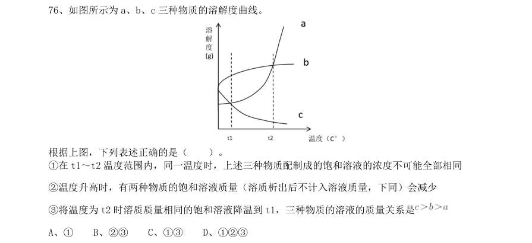

- **A.** 1
- **B.** 23
- **C.** 13
- **D.** 123

**答案：C**

### 2020 广东·综合行政能力测验　第 77 题　（一空）

如图所示,长方体木块竖放在水平地板上,地板的粗糙程度相同。在木块的正中间施加一个缓慢增 大的水平向右的力,则该木块会( )。 1静止一段时间后逐渐增速 2由静止突然快速移动 3在快速移动时突然向右倒下 4受到的摩擦力逐渐减少

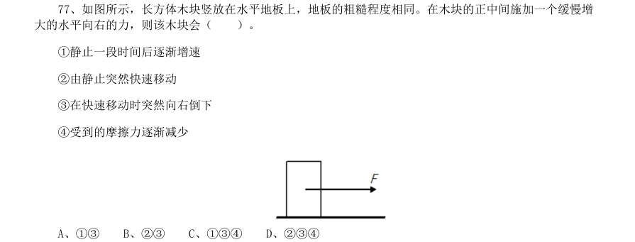

- **A.** 13
- **B.** 23
- **C.** 134
- **D.** 234

**答案：A**

### 2020 广东·综合行政能力测验　第 78 题　（一空）

将一个圆锥体由腰部正中间截断成M1、M2,放在天平如图所示的位置。如果要使天平保持平衡,则 M1 需要( )。

- **A.** 右移5 格
- **B.** 右移4 格
- **C.** 右移1 格
- **D.** 左移1 格

**答案：A**

### 2020 广东·综合行政能力测验　第 79 题　（一空）

为了研究唾液对淀粉的消化作用,实验员往装有5ml 淀粉液的试管1 和试管2 中分别加入2ml 清水 和2ml 唾液,再将试管1 和试管2 同时放入 的温水中水浴10 分钟,冷却后往两支试管中滴入等量的碘液, 则可以观察到( )。

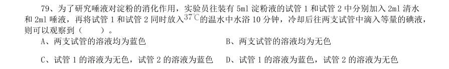

- **A.** 两支试管的溶液均为蓝色
- **B.** 两支试管的溶液均为无色
- **C.** 试管1 的溶液为无色,试管2 的溶液为蓝色
- **D.** 试管1 的溶液为蓝色,试管2 的溶液为无色

**答案：D**

### 2020 广东·综合行政能力测验　第 81 题　（一空）

如图所示,一人站立在小车上,小车静止于光滑的平面上,当此人将手中的篮球连续抛向小车右侧 的护栏并接回,则小车会( )。

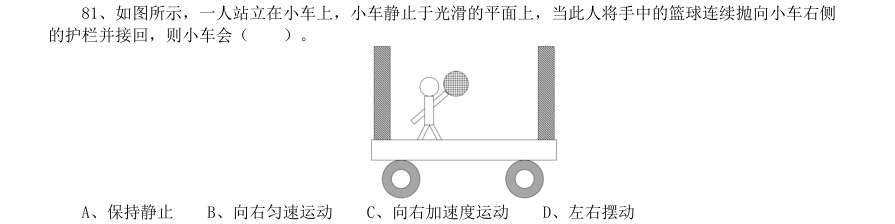

- **A.** 保持静止
- **B.** 向右匀速运动
- **C.** 向右加速度运动
- **D.** 左右摆动

**答案：D**

### 2020 广东·综合行政能力测验　第 82 题　（一空）

一个边长为 的正方体木块漂浮在水池中,木块底部距离水面10 厘米。如果将一个边长为 的相同 材质的正方体木块也放入该水池,则这一木块底部应距离水面( )。

- **A.** 5 厘米
- **B.** 10 厘米
- **C.** 20 厘米
- **D.** 40 厘米

**答案：C**

### 2020 广东·综合行政能力测验　第 85 题　（一空）

研究者在某地区调查A 物种的生存状况,结果发现A 物种在暗处和明处均有分布,其外表有深色和 浅色之分。研究者在调查后推断,该地区A 物种的天敌可能是利用视觉捕食A 物种。下图中最有可能反映研 究者调查结果的是( )。

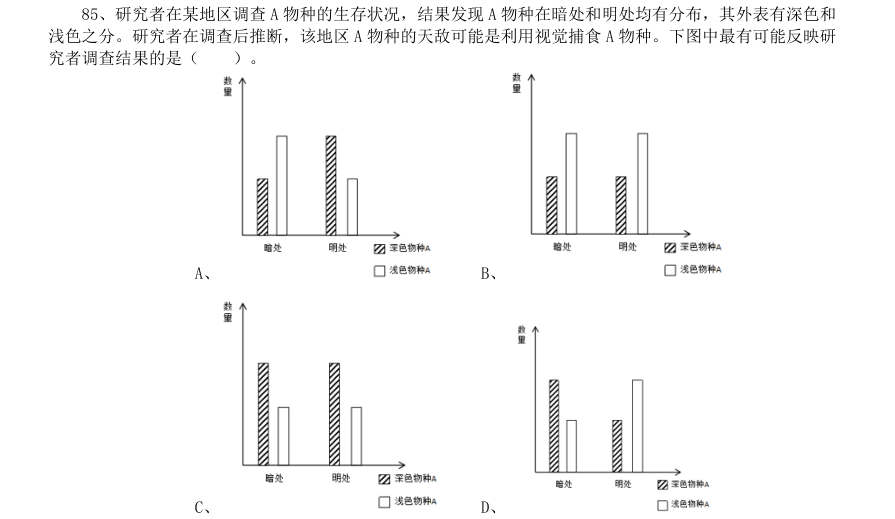

- **A.** 
- **B.** 
- **C.** 
- **D.** 

**答案：D**

### 2020 国考·地市级　第 21 题　（逻辑填空（综合））
> 材料：答案。…

流行病学的一系列证据表明,来自道路的交通噪音会导致心脏病发作。长期暴露在交通噪音中,人体血液的 生化性质(血清蛋白、血糖和各种电解质含量等)会发生改变。在这一方面,连汽车尾气的杀伤力都 。 填入画横线部分最恰当的一项是:

- **A.** 退避三舍
- **B.** 自惭形秽
- **C.** 望洋兴叹
- **D.** 甘拜下风

**答案：D**

### 2020 国考·地市级　第 22 题　（逻辑填空（综合））

中国正处于经济结构转型升级和世界新一轮技术革命的交汇时期,创新驱动高质量发展渐成共识。没有管理 创新、市场创新的商业创新模式 ,有真实需求场景的教育、医疗健康、信息消费、消费升级等模式创 新领域,将会迸发出新的投资机会。 填入画横线部分最恰当的一项是:

- **A.** 举步维艰
- **B.** 日薄西山
- **C.** 难以为继
- **D.** 岌岌可危

**答案：C**

### 2020 国考·地市级　第 23 题　（逻辑填空（综合））

传统饱和打击战术的核心,是从不同方向、不同层次向同一目标发射超出其防御上限的导弹,以数量优势形 成绝对力量优势,压迫及摧毁其防御体系,对敌重要目标进行毁灭性打击。该战术需要庞大的火力投射平台和充 足的武器弹药作支撑,这让世界上大多数国家 。 填入画横线部分最恰当的一项是:

- **A.** 望而却步
- **B.** 无可奈何
- **C.** 束手无策
- **D.** 裹足不前

**答案：A**

### 2020 国考·地市级　第 24 题　（两空）

“万物各得其和以生,各得其养以成”。这方面有很多鲜活生动的事例。始建于战国时期的都江堰,距今已 有2000 多年历史,就是根据岷江的洪涝规律和成都平原悬江的地势特点, 建设的大型生态水利工程,不 仅造福当时,而且 。 依次填入画横线部分最恰当的一项是:

- **A.** 顺势而为利在千秋
- **B.** 因势利导泽被后世
- **C.** 物尽其用历久弥新
- **D.** 因地制宜经久不衰

**答案：B**

### 2020 国考·地市级　第 25 题　（两空）

军事伪装可追溯到上古时代,比如《荷马史诗》中提及的“特洛伊木马”就是军事伪装的早期实例,即将人 员和装备伪装成无害的事物,使得军事行动 。巧妙运用军事伪装技术, 自身真实的作战意图,往往 能取得令人称奇的胜利。 依次填入画横线部分最恰当的一项是:

- **A.** 扑朔迷离转移
- **B.** 悄无声息掩饰
- **C.** 防不胜防严守
- **D.** 出其不意隐藏

**答案：D**

### 2020 国考·地市级　第 26 题　（两空）

短视频诞生之初就 了用户、内容制作方和营销方的界限,打通了自上而下和自下而上的传播 渠道,鼓励用户对已有内容进行再创作。因此,短视频拥有比传统影视作品更快、更多样的传播方式,“内容即 营销”的理念也在短视频上体现得 。 依次填入画横线部分最恰当的一项是:

- **A.** 打破一目了然
- **B.** 消除准确无误
- **C.** 弱化一清二楚
- **D.** 模糊淋漓尽致

**答案：D**

### 2020 国考·地市级　第 27 题　（两空）

科学家网上科普,“高大上”的国家科研机构与轻松娱乐的网络文化场域相遇,不仅没有出现文化上的巨大 冲突、碰撞,反倒形成了一种 、寓教于乐的可爱画风,受到很多年轻人的喜爱。这种意外,看似有很大 的 ,实则是一种科普方式的积极探索创新,预示了打通两个文化场域的可能性。 依次填入画横线部分最恰当的一项是:

- **A.** 别出心裁随意性
- **B.** 相映成趣特殊性
- **C.** 亦庄亦谐偶然性
- **D.** 妙趣横生随机性

**答案：C**

### 2020 国考·地市级　第 28 题　（两空）

现在很多人对快速发展的食品科技比较陌生,对食品从农田到餐桌的全过程知之甚少,因此对错误信息的辨 识能力、对谣言的抵御能力十分有限。那些 的谣言不仅影响消费信心,也给行业、产业带来直接的危害。 强化食品安全科普传播 ,也迫在眉睫,这已经成为全行业和全社会的共识。 依次填入画横线部分最恰当的一项是:

- **A.** 虚张声势至关重要
- **B.** 铺天盖地首当其冲
- **C.** 口耳相传任重道远
- **D.** 耸人听闻势在必行

**答案：D**

### 2020 国考·地市级　第 29 题　（两空）

地球并非太阳系唯一有水的星球,木卫二所拥有的水资源就比地球还多,堪称一颗 的“水球”。不 过,与其邻居木卫三相比,木卫二就 了。通过研究木卫三上极光的微小偏移,科学家推断木卫三拥有巨 大的地下海洋,液态水的含量可能是地球的30 倍。 依次填入画横线部分最恰当的一项是:

- **A.** 彻头彻尾微不足道
- **B.** 不折不扣相形见绌
- **C.** 货真价实差强人意
- **D.** 实至名归自愧弗如

**答案：B**

### 2020 国考·地市级　第 30 题　（两空）

渔业资源恢复是一个复杂而缓慢的过程,需要 的努力,如坚决减少捕捞力量、科学发展增殖渔业和加 强栖息地保护与修复等。 生态系统水平的适应性对策,强化资源管理与养护,依然是下一步渔业 资源恢复的重点工作。 依次填入画横线部分最恰当的一项是:

- **A.** 锲而不舍探索
- **B.** 坚韧不拔制定
- **C.** 坚持不懈借鉴
- **D.** 有条不紊研究

**答案：A**

### 2020 国考·地市级　第 31 题　（两空）

从陆地到天空,从恐龙到鸟类,生物的生态习性发生了巨大改变,身体结构也有了天壤之别。若非有一系列 介于两者之间的过渡物种让人 ,即便熟读《物种起源》,笃信达尔文的演化理论,也仍然会对“恐龙是鸟 类的祖先”的说法 。 依次填入画横线部分最恰当的一项是:

- **A.** 无可辩驳充耳不闻
- **B.** 心服口服置之不理
- **C.** 不置可否不以为然
- **D.** 眼见为实将信将疑

**答案：D**

### 2020 国考·地市级　第 32 题　（两空）

商品或服务没有质量的保障,就像生命失去了健康一样,一切都 。人们进行网络消费时,能够一眼看 到价格,却很难发现是否存在质量问题。这种情况下,质量因素便更加关键。如果商家在营销环节耍小聪明,以 低价为噱头,轻视质量,就如同 ,等到“东窗事发”,注定会收到消费者的差评。 依次填入画横线部分最恰当的一项是:

- **A.** 无从谈起掩耳盗铃
- **B.** 无济于事饮鸩止渴
- **C.** 徒劳无功作茧自缚
- **D.** 黯然失色买椟还珠

**答案：A**

### 2020 国考·地市级　第 33 题　（两空）

五四运动表现出来的爱国主义精神,与以往的爱国主义相比较,具有历史进步性和鲜明时代性。这种爱国主 义不是盲目排外,而是为了维护国家独立和民族尊严;不是 ,而是与民主和科学精神紧密联系,追求发展 进步;不是 ,而是付诸行动,以“直接行动”投入反帝运动。 依次填入画横线部分最恰当的一项是:

- **A.** 刻舟求剑作壁上观
- **B.** 邯郸学步闭门造车
- **C.** 固步自封纸上谈兵
- **D.** 拾人牙慧夸夸其谈

**答案：C**

### 2020 国考·地市级　第 34 题　（两空）

当今世界,处于百年未有之大变局。世界多极化、经济全球化 ,人类的命运紧密相联,各国利益深度 融合。但同时,各种挑战也日益严峻。变局之中,要合作还是要对立,要开放还是要封闭,要互利共赢还是要 , 人类发展处在何去何从的十字路口。 依次填入画横线部分最恰当的一项是:

- **A.** 有目共睹各行其是
- **B.** 高歌猛进独善其身
- **C.** 方兴未艾两败俱伤
- **D.** 势不可挡以邻为壑

**答案：D**

### 2020 国考·地市级　第 35 题　（三空及以上）

过去,我国生产能力滞后,因而把工作重点放在扩大投资、提高生产能力上。现在,产能总体过剩,仍 靠 扩大规模投资抬高速度,作用有限且边际效用递减。虽然短期内投资可以成为拉动经济增长的重要动力,但最终 消费才是经济增长的 动力。在扩大有效投资、发挥投资关键作用的同时,必须更加有效地发挥消费对增 长的 作用。 依次填入画横线部分最恰当的一项是:

- **A.** 一味持久基础
- **B.** 片面根本决定
- **C.** 盲目核心一般
- **D.** 单纯长期实质

**答案：A**

### 2020 国考·地市级　第 36 题　（三空及以上）

有关部门制定银龄讲学计划,在全国招募万名优秀退休教师,下乡支援农村学校。相信白发苍苍的师者,会 无私地奉献燃烧;但是要 乡村师生双双流失的困境,不能仅凭一时兴起的“输血”和情怀。唯有教育资源 真正向农村 ,真正提高乡村教师的待遇和吸引力,乡村振兴才会有 的新鲜血液。 依次填入画横线部分最恰当的一项是:

- **A.** 改善汇聚生生不息
- **B.** 突破集中生机勃勃
- **C.** 扭转倾斜源源不断
- **D.** 摆脱开放薪火相传

**答案：C**

### 2020 国考·地市级　第 37 题　（三空及以上）

秋葵原产印度,却在中国______已久,东汉的《说文解字》称其为“黄葵”,《本草纲目》也有详细记载, 称其为“侧金盏花”。秋葵曾是我较为______的蔬菜,在童年记忆里,家中餐桌上并未出现过它。近些年秋葵却 ______走红,长居网红零食的热门榜单,也逐渐成为寻常百姓的秋日家常菜。 依次填入画横线部分最恰当的一项是:

- **A.** 侨居反感意外
- **B.** 流浪向往瞬间
- **C.** 落户不屑莫名
- **D.** 扎根陌生迅速

**答案：D**

### 2020 国考·地市级　第 38 题　（三空及以上）

5G 网络的建设是一个复杂的过程,无论对于运营商还是产业链中的其他企业都极具挑战性,不能指望______。 毫无疑问,5G 时代正在到来。中国既要避免盲目自信,也不能______。我们应把5G 作为科技创新的一个突破口, 抓住机遇,______,实现自我突破。 依次填入画横线部分最恰当的一项是:

- **A.** 立竿见影自暴自弃脚踏实地
- **B.** 一蹴而就妄自菲薄迎难而上
- **C.** 一日千里夜郎自大逆水行舟
- **D.** 势如破竹谨小慎微砥砺前行

**答案：B**

### 2020 国考·地市级　第 39 题　（三空及以上）

准确、权威的信息不及时传播,虚假、歪曲的信息就会搞乱人心;积极、正确的思想舆论不发展壮大,消极、 错误的言论观点就会肆虐______。这方面,主流媒体守土有责,更要守土尽责,及时提供更多真实客观、观点鲜 明的信息内容,牢牢______舆论场主动权和主导权。主流媒体要敢于引导、善于疏导,原则问题要旗帜鲜明、立 场坚定,一点都不能______。 依次填入画横线部分最恰当的一项是:

- **A.** 蔓延守护犹豫
- **B.** 扩散占据退缩
- **C.** 滋生控制迟疑
- **D.** 泛滥掌握含糊

**答案：D**

### 2020 国考·地市级　第 40 题　（三空及以上）

具有“边缘型状态”的人往往缺乏______的自我认知,没有相对明确的自我形象。有时候他们觉得自已充满 力量,非常自信,似乎是全能的存在;有时候却又觉得自己好像虚弱无力,______,非常自卑。在“边缘型状态” 的人身上,这种转变往往是突然而______的。 依次填入画横线部分最恰当的一项是:

- **A.** 全面弱不禁风深刻
- **B.** 稳定一无是处剧烈
- **C.** 清醒无所作为离奇
- **D.** 完整无足轻重彻底

**答案：B**

### 2020 国考·地市级　第 49 题　（一空）

研究发现,人格特质会对一个人能否拥有充足、良好的睡眠产生影响。例如,一个责任心水平较低的人很难 自我约束,去按照既定计划完成任务。因此他们很难形成固定、良好的睡眠习惯。内向的人更难以入睡,因为他 们更喜欢在独处状态下思考问题。当他们夜晚独自躺在床上,会有意识地思考问题,导致更加难以入睡。同样, 研究人员也发现,习惯早起的人更有责任心,晚上不睡的夜猫子型的人更喜欢新鲜的刺激。每个人其实有着不同 的适应自身的睡眠偏好,而这些睡眠习惯,______。 填入画横线部分最恰当的一句是:

- **A.** 很难在短时间内发生根本改变
- **B.** 最终必然会影响你的身心健康
- **C.** 其实也不存在绝对的评价标准
- **D.** 实际上也反映着你的人格特质

**答案：D**

### 2020 国考·地市级　第 53 题　（一空）

作为世界上最成功的室内栽培植物之一,绿萝几乎就是盆栽的代名词,______。绿萝这个物种早在1880 年 就被确认了,但是你很难想象,直到2004 年,它的原产地才被确定为法属波利尼西亚社会群岛的莫雷阿岛。更 为神秘的是,绿萝是一种过分矜持的植物,虽然它已经扩散到了全世界的热带地区,却只在1962 年有过一次确 切的开花记录,直到2016 年,人们才发现了它开花的秘密。 填入画横线部分最恰当的一句是:

- **A.** 唯一的遗憾就是绿萝从来不开花
- **B.** 因为它非常适合人类的居住环境
- **C.** 但它却也是我们最熟悉的陌生人
- **D.** 是一种不可多得的室内观叶植物

**答案：C**

### 2020 国考·省级　第 23 题　（两空）

伴随衰老,人的记忆力会发生明显衰退。最近,《自然》子刊《自然·神经科学》杂志给出了潜在的解决方 案。他们的方法看起来无比 :电击大脑。这当然不是“网瘾中心”那种野蛮的电击方式,而是一 项有着出色设计的 实验,揭示了脑电波变化与衰老所引起的记忆衰退之间的重要关系。 依次填入画横线部分最恰当的一项是:

- **A.** 粗暴严谨
- **B.** 直接安全
- **C.** 危险神奇
- **D.** 简单有趣

**答案：A**

### 2020 国考·省级　第 24 题　（两空）

在历史研究中,实证主义强调 ,认为史学家是反映历史的镜子,其职责仅限于对史料进行严 格考证、挑选和排列,让史料自身去制造历史,而自己则要 ,这种观点忽视了史学家的主观能动性, 过于绝对和冷漠,在后续的发展中受到很大质疑。 依次填入画横线部分最恰当的一项是:

- **A.** 公正性秉笔直书
- **B.** 独立性冷眼旁观
- **C.** 真实性不动声色
- **D.** 客观性置身事外

**答案：D**

### 2020 国考·省级　第 28 题　（两空）

古城区发展到一定阶段,适度的提升改造是必要的,但如果是通过“拆真”来为“建假”腾出地方,这样的 开发改造必然是 ,其实,提升改造与对老建筑的保护本来可以 ,恰当的修缮,不但可 以让历史建筑重新焕发活力,也能够提升城区的整体质量,达到提升改造的目的。 依次填入画横线部分最恰当的一项是:

- **A.** 顾此失彼齐头并进
- **B.** 暴殄天物双管齐下
- **C.** 得不偿失并行不悖
- **D.** 舍本逐末并驾齐驱

**答案：C**

### 2020 国考·省级　第 34 题　（三空及以上）

测谎的基本原理是:欺骗的人会紧张,以致呼吸、脉搏加快和血压升高。测谎专家因而声称,只要操作、解 析得当,测谎仪能够有效发现说谎者,结果是 的。反对者则认为,一个 且擅长控制情 绪的人是可以对付测谎仪的。在这个过程中,不是人与机器,而是测谎者与被测者的 。 依次填入画横线部分最恰当的一项是:

- **A.** 合理见多识广博弈
- **B.** 可靠有备而来较量
- **C.** 科学不露声色抗衡
- **D.** 准确从容不迫对决

**答案：B**

### 2020 国考·省级　第 35 题　（三空及以上）

千百年来,乡村承担着对村民行为的引导、规训与教育功能,让人们 、明辨是非善恶。农事活动、节 日庆典、民俗习惯、村规民约等,都是维系村落价值取向和有序运行的重要 ,它们以 的形式不断 强化人们的行为规范,并使之内化为人们的道德准则。 依次填入画横线部分最恰当的一项是:

- **A.** 循规蹈矩途径喜闻乐见
- **B.** 与人为善方式言传身教
- **C.** 通情达理载体潜移默化
- **D.** 奉公守法手段耳濡目染

**答案：C**

### 2020 国考·省级　第 47 题　（逻辑填空（综合））

猫虽然平时可能对主人不理不睬,却能在众多声音中识别出主人的声音,并对其投入更多情感和注意。研究 发现,猫不仅敏感于主人的声音(音频信息),还敏感于主人呼唤自己的名字(字符信息)。不只是猫,目前的 研究发现,猿猴、海豚、狗甚至鹦鹉,都可以识别出自己的名字。它们识别名字的方式与人类基本一致,都是在 反复经历某个特殊字符伴随自己的事件之后,才建立起这个字符与自己的关系, 。 填入画横线部分最恰当的一句是:

- **A.** 这揭示了人类与动物之间的互动模式
- **B.** 名字成为与普通字符完全不同的存在
- **C.** 它们由此知道自己拥有一个专属代号
- **D.** 这实质上是一种条件反射的建立过程

**答案：D**

### 2020 国考·省级　第 53 题　（逻辑填空（综合））

根据第3段,下图所画“冕”的形制与原文描述相符的是:

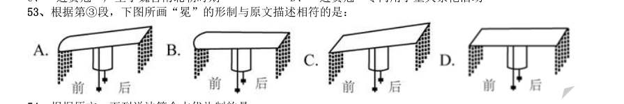

> （本题为图形题，选项为图片，见原卷）

**答案：A**

### 2020 国考·省级　第 54 题　（逻辑填空（综合））

根据原文,下列说法符合古代礼制的是:

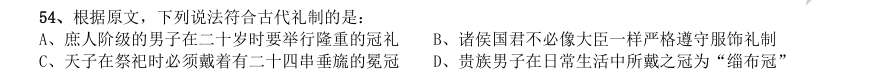

- **A.** 庶人阶级的男子在二十岁时要举行隆重的冠礼
- **B.** 诸侯国君不必像大臣一样严格遵守服饰礼制
- **C.** 天子在祭祀时必须戴着有二十四串垂旒的冕冠
- **D.** 贵族男子在日常生活中所戴之冠为“缁布冠”

**答案：A**

### 2020 国考·省级　第 57 题　（逻辑填空（综合））

关于这颗3D 打印心脏,下列说法错误的是:

- **A.** “黏合胶水”由编辑成的干细胞转化而来
- **B.** 具有血管组织
- **C.** 理论上不会产生排异反应
- **D.** 心肌细胞和内皮细胞来源于患者

**答案：A**

### 2020 国考·省级　第 58 题　（逻辑填空（综合））

下列哪项不属于3D 打印心脏未来需要着力解决的问题?

- **A.** 心肌细胞的共同收缩
- **B.** 支架填充细胞的获取
- **C.** 打印器官的长期存活
- **D.** 正常泵血功能的实现

**答案：A**

### 2020 国考·省级　第 59 题　（逻辑填空（综合））

根据文章,下列说法正确的是:

- **A.** 目前的3D 打印心脏可以跳动
- **B.** 心肌细胞难以在人体之外量产
- **C.** 3D 打印技术无法打印小型器官模型
- **D.** 3D 打印心脏已开始应用于动物实验

**答案：A**

### 2020 国考·省级　第 60 题　（逻辑填空（综合））

文中提到的生物3D 打印技术如果最终成熟,能为患有下列哪种疾病的病人带来福音?

- **A.** 白化病
- **B.** 尿毒症
- **C.** 登革热
- **D.** 红绿色盲

**答案：B**
