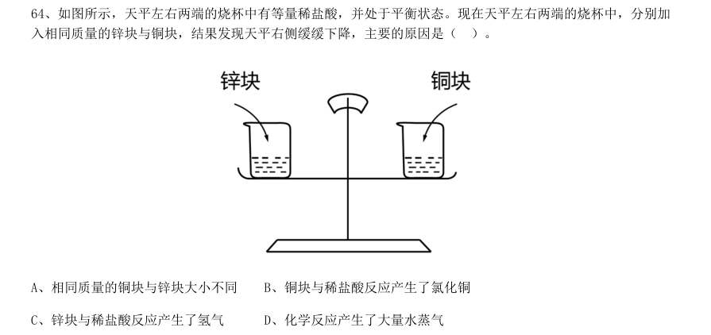
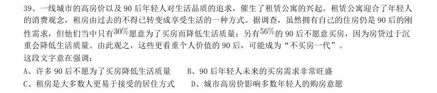
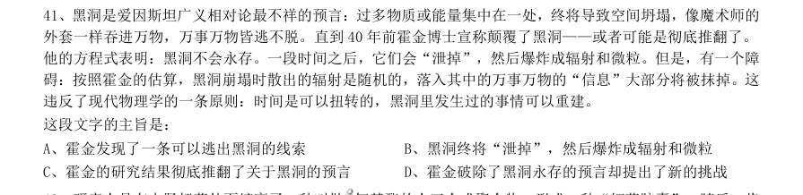
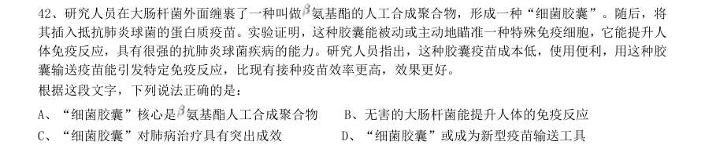
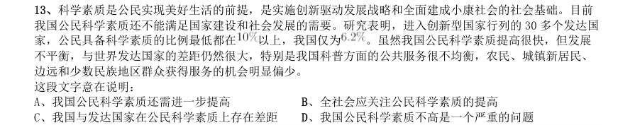
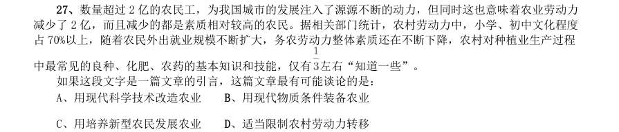

# 言语理解 · 中心理解 · 2010 年代真题

> 所属考点：[YY-ZXJL](../YY-ZXJL-中心理解.md)　｜　本片 424 题

> 本片子考点：对策优先 180　中心句与主旨 95　转折与因果 88　中心理解（综合） 35　主题词 26

### 2019 湖北·统一卷　第 42 题　（对策优先）

大数据是科学决策的重要工具,是高精度对未来进行预测的手段。数据是记录人类行为的工具。靠大数据技 术对未来做一个预测和参考是人类发展的成果。但是,人际的沟通和交流不该因为大数据技术而遭弃,而过于依 赖大数据的预测和推理,放弃人际沟通过程,必然产生人际沟通的弱化,进而影响到人的自由意志。 这段文字旨在强调:

- **A.** 大数据是科学决策的重要工具
- **B.** 大数据将发挥越来越重要作用
- **C.** 大数据不应弱化人际沟通
- **D.** 大数据影响人的自由意志

**答案：C**

### 2019 湖北·统一卷　第 44 题　（主题词）

从人口的空间布局看,城镇化是农村人口向城镇转移,是农民向市民的转变。农民向市民的转变过程,是人 的素质的现代化过程。而人的素质的现代化离不开接受现代化的教育。人的教育的现代化是城镇化的基础和支撑。 城镇化还意味着人们的就业和生产从农业领域向工业和服务业的转移。人的生产方式的现代化,是城镇化的本质 特征,更是人的现代化的本质体现。而支撑人的生产方式现代化的基础则是现代职业教育的普及。 这段文字意在强调:

- **A.** 城镇化是人的生产方式的现代化
- **B.** 城镇化是人的素质教育的现代化
- **C.** 城镇化时代的农民需要职业教育
- **D.** 城镇化是进城农民身份的市民化

**答案：B**

### 2019 湖北·统一卷　第 45 题　（对策优先）

在原始社会,人们唱歌、跳舞,但是不写诗,因为那时候没有文字。同理,史前时代的人也演剧,而且有文 字之后多数中国戏剧演员并不识字,戏剧演出主要是以口传心授的方式传承与传播的。然而长时间以来,人们陷 入了文字与文献崇拜的陷阱不能自拔,乃至文献考据一直成为文学史、戏剧史研究中最受推崇、最有效接近历史 真实的研究方法。如果戏剧史研究领域有“新材料”的话,那一定不仅仅是文献。 这段文字主要强调了:

- **A.** 戏剧史研究要更新理念并创新研究方法
- **B.** 戏剧史研究要对接传统研究并突破局限
- **C.** 戏剧史研究既要重文献又要重考证考据
- **D.** 戏剧史研究应扩大研究领域和研究方法

**答案：A**

### 2019 湖北·统一卷　第 46 题　（中心句与主旨）

一部人类史,就是人与自然、科学与社会的互动史。在漫长的文明进程中,科学曾仅仅是“闲人”的志趣, 科学普及无从谈起,人们在“非科学”的禁锢中艰难摸索。随着近现代科学兴起,人类对自然认识不断加深,科 学与社会联系日趋紧密,科学普及在人与自然、科学与社会的结合点上顽强生长,科学在人类现代化道路上散发 出璀璨的光芒。 上述文字主要阐述了:

- **A.** 人与自然、科学与社会的互动极大促进了科学普及
- **B.** 在人类文明进程中,科学普及前进的道路异常艰辛
- **C.** 科学普及应紧密联系社会并且找准结合点和切入点
- **D.** 随着近现代科学兴起,科学普及前景更加灿烂辉煌

**答案：A**

### 2019 湖北·统一卷　第 47 题　（转折与因果）

20 世纪以来,人类对弦的认识,发生了质的变革。弦就是振动,振动就会产生波,说明波构成了丰富多彩 的大千世界,这为重新认识“美”提供了思想基础和技术方法。研究表明,自然美与物质的波长(或者频率)存 在着深刻的内在联系,物体具有的固有频率与人自身的频率存在耦合关系,“美”是由不同类型波谱的频率与人 的相互作用而产生的。 根据这段文字,下列说法不正确的是:

- **A.** 对同一个人的美丑认识不同,因审美主体的频率不同所致
- **B.** 阳光、鲜花一定时间内大致不变,因为振动频率没有变化
- **C.** 距离产生美,是因为审美主客体在一定频率范围内共振
- **D.** 见义勇为行为得到社会认可,因为审美主体振动频率一致

**答案：D**

### 2019 湖北·统一卷　第 48 题　（对策优先）

工匠精神,匠心为本。有没有工匠精神,关键是看有没有一颗安于默默无闻、执着于追求卓越的匠心。树匠 心,就要坚守初心、执着专注,秉持赤子之心,摒弃浮躁喧嚣,在本职岗位上坐得住、做得好。怎样才能坐得住、 做得好?关键是要做到专心专注、追求至精至善,将产品的每个细节都尽可能做到极致。 这段文字意在强调:

- **A.** 育匠人是传承工匠精神的基础
- **B.** 树匠心是弘扬工匠精神的根本
- **C.** 树匠心要坚守初心、执着专注
- **D.** 树匠心需要良好的社会文化环境

**答案：C**

### 2019 湖北·统一卷　第 49 题　（对策优先）

通过对海豚间通信联系的深入研究,科学家发现,齐普夫定律和信息论中的熵值概念可以很好地为分析外星 信号服务。在接收到地外任何可疑信号后,应该首先用齐普夫定律分析是否存在一定斜率直线特征,如果有某种 特征,则证明其并非毫无意义的噪声。然后进行熵值分析,这样可以不必破译信号便知晓其通信的复杂程度。假 设截获到的某一可疑信号,不仅在齐普夫坐标系中具有斜率为 的直线特征,而且拥有高阶熵值,那么这个信 号极有可能就是我们寻找多时的地外文明。 对这段文字概括最恰当的一项是:

- **A.** 研究发现海豚间通信联系与外星信号极为相似
- **B.** 如何运用齐普夫定律和熵值概念分析外星信号
- **C.** 如何判断可疑地外信号是否来自于外星文明
- **D.** 如何通过地外信号判断外星文明的智慧程度

**答案：B**

### 2019 湖北·统一卷　第 50 题　（中心句与主旨）

在智能化无人超市,客人从进门到出门,一举一动都会被数字化,并且被捕捉记录。这些信息回流到云端后, 通过算法模型,可以得到许多非常有价值的信息:比如男性顾客和女性顾客各自进店最集中的时间段是什么,哪 些商品被拿起又放回去的频次最高等。甚至还能做出预测,比如,传感器感应到进店的女客人很多是穿高跟鞋的, 敏锐的老板便会在女鞋区多放些半跟鞋垫和脚踝磨损修复霜。可见,数字化最终目的是实现商品供应链的优化以 及店内货架与商品摆放的人性化。 这段文字主要介绍:

- **A.** 智能无人零售让超市变得更加聪明、更加善解人意
- **B.** 智能无人零售给线下实体商店的发展前景增添亮色
- **C.** 智能无人零售能够对用户购买行为进行记录与描画
- **D.** 智能无人零售给消费者所带来的更良好的购物体验

**答案：A**

### 2019 湖北·统一卷　第 53 题　（对策优先）

完美主义者习惯于把各项标准都定得过高而不切实际,受到挫折打击后,变得逃避、拖延、自责而失去行动 力。完美主义不仅拖后腿,还可能带来许多心理疾病。由于缺乏一种深刻且始终如一的自尊来源,接受失败的打 击对于完美主义者来说尤其困难,而且可能导致一部分人长期抑郁和退缩。完美主义也与社交焦虑和社交恐怖显 著相关,因为他们很担心自己是否能给别人留下好印象,容易出现羞怯、自卑、回避行为。完美主义也容易导致 强迫症,因为完美主义者对每件事都要求完美无瑕。减少“全或无”的心理倾向,内心会更自在、从容,也更利 于进步。 这段文字意在说明:

- **A.** 标准过高而且不切实际会损害自尊
- **B.** 羞怯自卑容易使人长期抑郁和退缩
- **C.** 社交焦虑和社交恐怖会导致强迫症
- **D.** 为了心理健康应避免完美主义倾向

**答案：D**

### 2019 湖北·选调　第 77 题　（转折与因果）

当面临问题时,有些人在外界压力下试图追求极致的问题解决方法。而事实上,如果他们可以排除外界影响, 避免追求那些极致的问题解决方法,转而在理性的基础上限定自己的探索,发现满意的问题解决方法即可,那么 他们就能最大程度地提升效率。 这段文字意在强调:

- **A.** 面临问题时,不应该因外界压力追求极致的问题解决方法
- **B.** 面临问题时,应排除外界影响,基于理性来限定自己的探索
- **C.** 有时候,追求极致的解决问题的方法并不一定是最经济的
- **D.** 有时候,不一定要在外界压力下找到极致的问题解决方法

**答案：B**

### 2019 湖北·选调　第 78 题　（对策优先）

近些年,网络小说读者越来越多。相关调查表明,网络小说读者之所以对网络小说产生浓厚的阅读兴趣,甚 至成为“网络小说迷”,一是因为在商业化运营模式下,不少网络小说情节设置委婉曲折、引人入胜,类似于以 前盛行一时的说评书,关键时刻总是“请听下回分解”,让网络小说读者欲罢不能;二是因为网络小说通常都非 常通俗化,阅读网络小说不需要太多思考,对网络小说读者而言就是一种消遣、一种娱乐。 这段文字意在强调:

- **A.** 网络小说读者阅读网络小说成瘾的原因
- **B.** 网络小说阅读成为新的娱乐方式的理由
- **C.** 网络小说引发网络小说读者兴趣的原因
- **D.** 网络小说吸引网络小说读者的具体途径

**答案：C**

### 2019 湖北·选调　第 79 题　（转折与因果）

党和国家高度重视推进新型城镇化。在城市发展规划方面,一味追求成为特大城市,反而容易适得其反,给 城市发展带来重重困境。国外的一些特大城市,比如墨西哥城、孟买、雅加达等,就是这方面的负面典型。相反, 国外一些中小城市,比如温哥华、日内瓦、维也纳等,以其独特的历史文化风貌,深厚的人类文明精神积淀而世 界知名,它们的文明程度、宜居程度、城市发展程度都非常高,是众所公认的精神家园和幸福乐园。 这段文字意在说明:

- **A.** 城市发展规划应摆脱一味追求特大城市的思路
- **B.** 城市人口的增减不应成为城市发展规划的指标
- **C.** 文明程度较高的城市就是发展规划成功的城市
- **D.** 国外一些中小城市并不是靠城市人口规模知名

**答案：A**

### 2019 湖北·选调　第 80 题　（对策优先）

我们的工作、生活节奏不断加快;有些人做事往往追求立竿见影,生活不自觉地迈入加急时代。效率就是生 命演变为众所公认的价值观。外出是飞机、高铁,上网要极速体验,吃饭需争分夺秒,就连咿呀学语的孩子,都 不能输在起跑线上。这份急夹杂着对过程的忽视,衍生出对规则的漠视,同时催生出各种问题。 这段文字的主旨是:

- **A.** 节奏提速导致人们做事追求立竿见影
- **B.** 效率就是生命成为众所公认的价值观
- **C.** 人们必须争分夺秒以免输在起跑线上
- **D.** 加急时代生活催生出各种各样的问题

**答案：D**

### 2019 广东·乡镇　第 6 题　（对策优先）

回顾40 年,改革开放旗帜之所以始终高高飘扬,关键得益于基层求新求变的强大意愿以及敢闯敢试的探索精神, 改革再扬帆,也必须尊重基层干部群众在改革进程中的主体性作用。 对这段文字理解准确的是( )。

- **A.** 实践是改革开放最关键的一环
- **B.** 基层的探索精神完全决定于改革的效果
- **C.** 改革必须发挥基层干部群众的主观能动性
- **D.** 改革开放促使基层创新求变

**答案：暂缺**

### 2019 广东·乡镇　第 7 题　（中心句与主旨）

尽管从农业社会走向现代社会,是经济社会发展的必然,但这样不是促使农业农村的“消亡”,做好“三农” 工作,建设好农村,发展好农业,使广大农民获得感、安全感不断提升,依然是社会主义建设的主要内容。 这段文字主要说明了( )。

- **A.** 我国目前仍然处于农业社会
- **B.** “三农”工作的重要性
- **C.** 农业农村会随着经济社会的发展“消亡”
- **D.** 广大农民的获得感、幸福感、安全感有待提升

**答案：暂缺**

### 2019 广东·乡镇　第 8 题　（中心理解（综合））

扶贫干部自掏腰包到基层扶贫,是真扶贫、扶真贫的体现。但若一味宣扬扶贫干部自掏腰包扶贫,不仅会加重 扶贫干部的经济负担,还会在一定程度上让贫困群众产生依赖心理。 对这段文字理解准确的是( )。

- **A.** 一味宣扬扶贫干部自掏腰包扶贫具有一定的副作用
- **B.** 应该大力提倡扶贫干部自掏腰包支持贫困户
- **C.** 当前存在大量扶贫干部自掏腰包扶贫的情况
- **D.** 扶贫干部自掏腰包扶贫是不得已而为之的

**答案：暂缺**

### 2019 广东·乡镇　第 9 题　（中心理解（综合））

完善村民自治,应推动乡村治理重心下移,尽可能把资源、服务、管理下放到基层,培育打造服务性、公益性、 互动性农村社会组织,开展农村社会工作和志愿服务,发挥新乡贤作用。 对这段文字理解准确的是( )。

- **A.** 完善村民自治需要大量引进志愿者
- **B.** 完善村民自治需要让乡贤发挥主要作用
- **C.** 完善村民自治需要把所有资源下放到基层
- **D.** 完善村民自治需要发展农村社会组织

**答案：暂缺**

### 2019 广东·乡镇　第 10 题　（转折与因果）

推动媒体融合发展,事关推进国家治理体系和治理能力现代化。在全媒体时代,媒体不仅是信息的提供者和传 播者,而且在国家治理中也发挥着重要作用。因此,媒体融合不仅仅是一个传播命题,还是一个治理命题。 这段文字的主旨是( )。

- **A.** 国家治理现代化需要促进媒体融合
- **B.** 媒体融合发展有利于促进信息传播
- **C.** 媒体融合发展是信息技术发展的需要
- **D.** 媒体在国家治理中应承担主要责任

**答案：暂缺**

### 2019 广东·县级　第 1 题　（中心句与主旨）
> 材料：在四个选项中选出一个最恰当的答案。…

提升市民的幸福感、获得感是城市治理精细化的根本目的。如果把城市治理比作绣花,那么,以人民为中心 的原则就是那条在千头万绪中( )城市治理方方面面的线。

- **A.** 疏通
- **B.** 贯彻
- **C.** 联合
- **D.** 串联

**答案：暂缺**

### 2019 广东·县级　第 13 题　（中心句与主旨）

国务院及地方政府机构改革顺利实施。重点领域改革迈出新的步伐,市场准入负面清单制度全面实行,简 政放权、放管结合、优化服务改革力度加大,营商环境国际排名大幅上升。对外开放全方位扩大,共建“一带 一路”取得重要进展。首届中国国际进口博览会成功举办,海南自贸试验区启动建设。货物进出口总额超过30 万亿元,实际使用外资1383 亿美元、稳居发展中国家首位。 对这段文字概括最准确的一项是( )。

- **A.** 中国经济运行保持在合理区间
- **B.** 中国经济结构不断优化
- **C.** 中国发展新动能快速增长
- **D.** 中国改革开放取得新突破

**答案：暂缺**

### 2019 广东·县级　第 14 题　（中心句与主旨）

智慧城市是指应用新一代信息技术,进行精细化、动态化管理的城市形态。智慧城市概念已提出10 年,但 是当前大多数智慧城市都还停留在信息系统建设的阶段,无法向信息的整合利用阶段迈进。这一问题的根源在 于大量“数据孤岛”的存在。虽然各个企业、单位都有自己的信息系统,但建设水平参差不齐、没有统一的建 设标准,使得各系统间的数据难以共享,信息很难处理应用。 这段文字主要讲了( )。

- **A.** 建设智慧城市的必要性
- **B.** 智慧城市发展缓慢的原因
- **C.** 各企业、单位应积极打破“数据孤岛”
- **D.** 如何破除智慧城市建设中的“数据孤岛”问题

**答案：暂缺**

### 2019 广东·思维能力测验　第 3 题　（对策优先）

近日,某市出现了一种收费自习室,这种自习室置身于写字楼中,主要供需要参加职业资格考试的白领 使用。但推出一段时间后,经营者发现自习室空置率较高。 以下选项中最不能解释上述现象的是()。

- **A.** 获取职业资格与个人薪酬未直接挂钩
- **B.** 收费自习室定价过高
- **C.** 收费自习室前期宣传效果不理想
- **D.** 许多白领选择公共图书馆看书备考

**答案：A**

### 2019 广东·思维能力测验　第 17 题　（转折与因果）

随着气候变化,严重干旱和极端高温现象变得越来越频繁。有研究预计,全球棉花产量将大幅下降, 以棉花为主要原材料的纺织品价格会进一步上涨,因此服装的批发及零售价格也会大幅上涨。 以下无法削弱上述结论的是()。

- **A.** 棉花作为纺织面料生产的原材料是可以替代的
- **B.** 目前已培育出在干旱条件下能保持产量的棉花新品种
- **C.** 我国用于生产服装的纺织品原料,部分依赖进口
- **D.** 服装生产已经越来越多地使用化学合成纤维材料

**答案：C**

### 2019 广东·思维能力测验　第 33 题　（中心句与主旨）

低骨量人群是骨质疏松症高危人群,我国50 岁以上人群低骨量率接近一半。低骨量人群庞大的主要原 因是对骨质疏松症“普遍不了解”,50 岁以上人群骨密度检测比例很低。如果提高50 岁以上人群的骨密度检 测率,该人群的骨质疏松症发病率就能有效降低。 以下最能指出上述论证缺陷的是()。

- **A.** 假设了骨密度检测是骨质疏松症的有效预防手段
- **B.** 暗含了大部分骨密度低的人并未进一步采取有效措施
- **C.** 忽视了饮食和锻炼对骨质疏松症的重要影响
- **D.** 忽视了低骨量对不同个体的影响因人而异

**答案：A**

### 2019 广东·思维能力测验　第 40 题　（中心句与主旨）

评价一部电影的优劣,主要看其票房表现。一般来说票房高的电影,都是好的电影。 以下与上述推理在结构上最为相似的是()。

- **A.** 科研工作者的成就,主要在于其取得的研究成果。有丰富的科学研究成果的科研工作者都是有成就的
- **B.** 评价产品质量好坏的一个重要标准是其耐用性。这块手表的质量非常好,因为小刘几乎每天都戴
- **C.** 企业看重员工为其创造的价值。小李因为拾金不昧为企业赢得社会声誉,被评为最佳员工
- **D.** 工作方法是否科学主要在于能否解决问题。只要采用了科学的工作方法,向题就能够尽快解决

**答案：A**

### 2019 广东·思维能力测验　第 46 题　（主题词）

汽车无人驾驶技术发展至今,还未实现大规模推广应用。其主要原因是无人驾驶技术还存在安全问题, 一旦随着技术的发展解决了这一问题,汽车无人驾驶技术就能很快普及。 以下与上述推理形式最为相似的是()。

- **A.** 没有高强度的训练,就无法取得优异的比赛成绩。比赛成绩不理想,肯定是因为训练强度不够
- **B.** 没有充分理论基础研究,就无法解决实际问题。现在理论基础研究多了,有更多的实际问题将得以解决
- **C.** 恶性竞争主要是由于企业缺乏核心竞争力,因此,要建立良好的市场秩序,就需要企业发展属于自己的竞争优势
- **D.** 法治与德治相辅相成,法律的有效实施有赖于道德的支撑和滋养,法律是准绳,道德是基石,缺一不可

**答案：B**

### 2019 广东·思维能力测验　第 50 题　（对策优先）

如果全球变暖的趋势持续下去,各类粮食作物的害虫会变得更为活跃,而对于绝大多数害虫而言,温 带地区是其主要栖息地,因此在全球变暖背景下,温带粮食产区受到的影响将会更为严重。 下列选项中,与上述论证在结构上最为相似的是()。

- **A.** 液氮可能造成严重的皮肤和胃肠道损伤。分子料理的流行增加了液氮的使用量,因此可能有更多的人因液氮而受伤
- **B.** 假药、劣药不仅危害患者,还会增加整个卫生系统的负担。低收入国家的假药、劣药十分猖獗,因此这些国家的卫生系统负担往往更重
- **C.** 咖啡能够让参加考试的学生感觉更清醒,更有活力与自信,最终考试成绩也会有所提高。因此,建议考试前适当喝点咖啡
- **D.** 紧张和焦虑会影响人们的记忆能力。在科研过程中,学者尤其需要依赖记忆能力,因此过度紧张和焦虑

**答案：D**

### 2019 广东·选调　第 36 题　（对策优先）
> 材料：1 项。…

理想信念是事业和人生的灯塔,决定我们的方向和立场。理想信念不是拿来说、拿来唱的,更不是用来装 点门面的,只有见诸行动才有说服力。领导干部将理想信念内化于心、外化于行、知行合一,自觉肩负起为民 谋幸福、为中华民族谋复兴的重托才能步稳力沉。 这段文字主要论述了( )。

- **A.** 理想信念的重要性
- **B.** 理想信念应落实到行动
- **C.** 理想信念与民族复兴的关系
- **D.** 理想信念应当成为我们的奋斗方向

**答案：B**

### 2019 广东·选调　第 37 题　（中心句与主旨）

此次政府机构改革再次强调了“要坚决破除制约市场在资源配置中起决定性作用,更好发挥政府作用的体 制机制弊端”,“提高行政效率,全面提高政府效能,建设人民满意的服务型政府”。这突出了政府机构改革 要服务于市场经济转型发展、服务于人民获得感的目标。 这段文字主要论述了( )。

- **A.** 政府机构改革的方向
- **B.** 政府机构改革的对象
- **C.** 政府机构改革的原因
- **D.** 政府机构改革的意义

**答案：A**

### 2019 广东·选调　第 40 题　（对策优先）

所谓荒野,是指未受人类活动干扰或者人工改造较少的自然环境。在传统观念中,荒野是没有多少价值的。 然而,在生态经济日益发展的今天,荒野显得越来越重要。荒野具有原生性、多样性、开放性等特点,有很高 的经济价值、休闲价值和审美价值。 这段文字强调了( )。

- **A.** 人们对荒野的认识不准确
- **B.** 应保护荒野不受破坏
- **C.** 应该大力开发荒野
- **D.** 荒野有巨大的价值

**答案：D**

### 2019 广东·选调　第 41 题　（主题词）

一部影视作品的品质好不好,表演是重要因素,位居“声台形表”第一位的声音表演是重中之重。台词功 底本是演员安身立命的基本素养,但在快餐式文化的背景下,却被许多人轻视,很多人动辄说“颜值就是正义” “流量就是一切”,配音和替身泛滥让一些演员俨然成了刷脸的机器。长此以往,受到伤害的只能是艺术和观 众。 这段文字主要说明了( )。

- **A.** 演员需要通过作品不断提升艺术水准
- **B.** 表演的质量决定了作品的受欢迎程度
- **C.** 影视作品的品质是由演员的表演决定的
- **D.** 观众对好内容、好演员是有鉴赏能力的

**答案：C**

### 2019 广东·选调　第 42 题　（主题词）

如果手机一整天没有响,你会不会觉得不习惯?遇到什么难以解决的问题,不求助网络你是不是不知该怎 么办?坐在地铁上,没有手机,时光会不会流逝得格外缓慢?不知从什么时候开始,我们身边的电子产品越来 越多,电脑、手机、掌上游戏机,还有最新的平板...... 这段文字主要说明了( )。

- **A.** 电子产品在生活中的重要作用
- **B.** 现代人对电子产品的依赖
- **C.** 如何合理使用电子产品
- **D.** 电子产品的不断发展

**答案：暂缺**

### 2019 广东·选调　第 43 题　（对策优先）

中小企业是我国经济发展和社会稳定的重要支撑。近年来,国家出台了一些针对中小企业的税收优惠政策, 但中小企业的税负依然不轻。税收负担削弱了中小企业的竞争能力、盈利能力和工资增长能力,也进一步拉大 了中小企业员工与国有大企业、三资企业员工之间的收入差距。 以下对上述文字概括最准确的一项是( )。

- **A.** 中小企业对经济发展和社会稳定具有重要作用
- **B.** 当前中小企业的税负对其发展造成影响
- **C.** 国家对中小企业采取了税收优惠政策
- **D.** 应该进一步减轻对中小企业的税负

**答案：D**

### 2019 广东·选调　第 44 题　（对策优先）

当今社会,坐车逃票、论文抄袭、伪造个人信息等现象屡见不鲜。过去,人们以道德号召、舆论谴责为主 来维系诚信,“这样做,我在村里还怎么呆下去?”“邻居要是知道了,我还有什么脸见人?”然而现在,对 许多人来说类似的顾虑越来越少,如果谁也不认识谁,单纯的舆论谴责,杀伤力是微乎其微的。 这段文字主要说明了( )。

- **A.** 随着社会发展,个人失信成本降低
- **B.** 传统诚信体系的基础已经动摇
- **C.** 传统的诚信体系优于现代
- **D.** 诚信建设需要转型

**答案：D**

### 2019 广东·选调　第 45 题　（对策优先）

当前,新闻媒体正在深入推进融合发展。新闻作品版权是媒体的核心资产,但目前加剧的侵权现实让人无 奈。作为新闻媒体,一般乐见自己的作品被广泛传播,但前提是尊重原创劳动,并得到授权方能使用。如果对 未经授权擅自使用、传播新闻作品的行为置之不理,传统产业的发展将受到严重影响,媒体的融合发展也会面 临严重困难。 这段文字意在强调( )。

- **A.** 新闻媒体的融合有利于版权保护
- **B.** 新闻媒体的融合发展面临严重困难
- **C.** 新闻媒体应避免自己的作品被随意转载
- **D.** 推动新闻媒体融合发展,必须做好版权保护

**答案：D**

### 2019 广东·选调　第 46 题　（对策优先）

当前,乡贤回归让一批在外精英,通过依法选举加入村干部队伍,参与乡村治理,有利于构建现代化乡村 善治体系。不仅如此,乡贤的回归还可以打破乡村原有的利益格局。本地村民竞选村干部,难免有自身的利益 考量。而回归的乡贤或出于家乡情绪,或应乡镇干部的动员和鼓励,一般与村中利益没有瓜葛。 这段文字旨在说明( )。

- **A.** 乡贤回归有利于推进乡村治理现代化
- **B.** 乡贤回归能直接带动乡村经济社会发展
- **C.** 畅通乡贤返乡之路,还需要完善相应政策措施
- **D.** 乡贤既是本乡本土的贤者,更是在外发展的能人

**答案：A**

### 2019 广东·选调　第 47 题　（主题词）

参加旅行团的旅行,犹如流水线上的产品生产。参加旅行团的游客,往往是在规定时间与明确路线的要求 下,在几天之内,完成心理上对“旅行”符号的消费。难得的旅行本是人们在“朝九晚五”之外的放松,但似 乎又使人们陷入另一种“工作律令”之中,体验着对体力与精力的“假期式消耗”。 这段材料表达的主要观点是( )。

- **A.** 旅行与上班已经没有区别
- **B.** 旅行不应规定时间与明确线路
- **C.** 参加旅行团使旅行失去了原本的意义
- **D.** 旅行团的出游方式无法让游客得到放松

**答案：D**

### 2019 广东·选调　第 49 题　（对策优先）

在某种意义上说,中国传统文化的复兴正当其时:现代化建设已见成效,但也面临着一些难题。然而,一 些传统文化的“复兴者”认为:传统文化与现代化是矛盾的,至少与现代性和启蒙是矛盾的,于是以反现代性 和反启蒙为其定位。 下列说法中,符合作者观点的是( )。

- **A.** 中国已实现了现代化
- **B.** 中国亟需复兴传统文化
- **C.** 传统文化与现代化无法融合
- **D.** 一些人对传统文化复兴的定位有误

**答案：D**

### 2019 广东·选调　第 50 题　（主题词）

国产纪录片的成长与蜕变,最核心的力量来自纪录片在内容和形式上的突破。时下,越来越多的纪录片开 始告别昔日高大上的形象,注重观照现实生活。剖析社会问题,描述普通人的日常,让观众感受到更多人文关 怀,获得了更多情感共鸣,其中不少题材紧跟当下热点,富有强烈的时代感。 这段文字主要说明了( )。

- **A.** 国产纪录片通过内容和形式上的突破取得了进步
- **B.** 富有强烈的时代感是国产纪录片成功的必备条件
- **C.** 过去的国产纪录片往往具有高大上的形象
- **D.** 国产纪录片应体现更多的人文关怀

**答案：A**

### 2019 广东·选调　第 51 题　（对策优先）

我们要提醒自己不要向生活提太多的要求,因为如果这样做,我们幸福所依靠的基础就变得太广大了。依 靠如此广大的基础才可以建立起来的幸福是很容易倒塌的,因为遭遇变故的机会增多了,而变故无时不在发生, 。 以下最适合填在划线处的是( )。

- **A.** 因此,我们应当根据自身条件,适当降低对生活的要求
- **B.** 因此,我们应当尽量简化生活中的各种关系
- **C.** 因此,我们往往在目标实现的时候,对生活又有了新的要求
- **D.** 因此,我们在生活中应该谨慎小心,未雨绸缪

**答案：A**

### 2019 广东·选调　第 52 题　（中心理解（综合））

一个时代有一个时代的审美趣味,古人以为美的东西,未必符合今人的审美需求,今天人们认为的美,也 未必是后人审美的准则。世殊事异,环境在变,社会在变,生活不同,审美自然存在差异性。 通过这段文字,可以得知( )。

- **A.** 古人认为美的东西今人觉得都不美
- **B.** 每个时代的审美完全不同
- **C.** 不同国家地区的审美并不一样
- **D.** 一个时代的审美受到多种因素影响

**答案：A**

### 2019 广东·选调　第 53 题　（转折与因果）

当前流行各式各样的“知识付费”产品。“知识付费”表面上是有针对性地满足了人们对特定知识的需求, 可是这些知识产品制造的过程都是标准化操作,而制造者的首要目的,是通过它来赚钱。所以,“知识付费” 里的知识到底有多少能够解决你本身的困惑,可能就要打一个问号了。 这段文字意在说明( )。

- **A.** “知识付费”产品的本质
- **B.** 人们购买“知识付费”产品的真实原因
- **C.** “知识付费”产品实际价值有待商榷
- **D.** “知识付费”产品与人们购买本意可能存在差距

**答案：C**

### 2019 广东·选调　第 64 题　（转折与因果）

如图所示,天平左右两端的烧杯中有等量稀盐酸,并处于平衡状态。现在天平左右两端的烧杯中,分别加 入相同质量的锌块与铜块,结果发现天平右侧缓缓下降,主要的原因是( )。

- **A.** 相同质量的铜块与锌块大小不同
- **B.** 铜块与稀盐酸反应产生了氯化铜
- **C.** 锌块与稀盐酸反应产生了氢气
- **D.** 化学反应产生了大量水蒸气

**答案：A**

### 2019 国考·地市级　第 43 题　（对策优先）

我国要在21 世纪中叶建成世界科技强国,科学文化建设将在这个历史进程中扮演非常重要的角色。在这个 方面,我们有必要增强文化自信。文化自信不仅表现在对既往文化贡献与价值的认同上,更表现在融汇各种优质 的文化资源、创造新文化的信心和决心上。尽管全面挖掘和传承我国传统文化中的科学因素、充分认识我国历史 上对科学发展做出的贡献十分必要,但更需要思考如何在未来的科学发展和科学文化建设上,做出对世界有重要 贡献的新成就,这应该是增强文化自信更重要的一个方面。 这段文字主要说的是:

- **A.** 文化自信表现在文化资源的整合和创新上
- **B.** 科学文化发展是建设科技强国的核心
- **C.** 判断中国科学发展对世界所做贡献的标准
- **D.** 科学文化建设中增强文化自信的途径

**答案：D**

### 2019 国考·地市级　第 45 题　（转折与因果）

太赫兹波具备微波和红外辐射所没有的独特属性。太赫兹波具有频率高、波长短且在浓烟、沙尘等环境中传 输损耗少等“独门绝技”,可一眼“看透”墙体进而对房屋内部进行扫描,是复杂战场环境下成像寻敌的理想技 术。虽然太赫兹波在大气中传输时易受各类气候条件影响,传输距离有限,但在某些特殊情况下,这一“短板” 恰恰成为太赫兹通信的又一技术“专长”。比如在遇到大气衰减时,太赫兹波的信号根本无法传播到敌人的无线 电监听机构中,因此可实现隐蔽的近距离通信。 这段文字没有提到太赫兹波的:

- **A.** 物理特性
- **B.** 特殊优势
- **C.** 应用场景
- **D.** 发现过程

**答案：D**

### 2019 国考·地市级　第 46 题　（对策优先）

国际金融危机以来,各国对充分就业目标都更为关注。一般来讲,外国输入的产品会和本国生产的产品形成 竞争,一旦本国产品被进口商品替代,从事该项产品生产的本国工人就会失业,这是引起贸易摩擦的根本原因。 通过大力发展对外直接投资,能够起到替代对外贸易的作用。鼓励中国企业把生产活动转移到劳动力成本更低的 贸易伙伴国家,一方面可以替代对目标国的出口,增加目标国的就业;另一方面,对外投资企业在当地生产、当 地出售,依然可以获得出口的利润,还减少了来自本国的顺差,同样可以避免贸易摩擦。 这段文字意在说明:

- **A.** 中国企业的对外直接投资将会逐渐增多
- **B.** 对外直接投资有利于缓解国际贸易摩擦
- **C.** 金融危机有可能影响充分就业目标的实现
- **D.** 就业保护是引起国际贸易摩擦的根本原因

**答案：B**

### 2019 国考·地市级　第 48 题　（中心句与主旨）

过去100 多年来,围绕达尔文进化论是否正确的争论从未停歇。不断涌现的科学事实在弥补达尔文当年未曾 发现的“缺失环节”的同时,也在检验着达尔文进化论的预测能力。例如,2004 年在加拿大发现的“提克塔利 克鱼”化石揭示了从鱼类(鳍)到陆生动物(腿)之间的过渡状态,被公认是“种系渐变论”的一个极好例证。 当然,达尔文进化论并非完美无缺,它确实存在“可证伪”之处。以自然选择理论为例,它在孟德尔遗传学建立 之初就受到了强烈挑战,但各种不能用自然选择理论简单解释的新证据最终还是拓展了人们对进化动力和机制的 认识,而不是摒弃该理论。 这段文字以自然选择理论受到孟德尔遗传学挑战为例,目的是:

- **A.** 说明达尔文进化论具有可证伪性
- **B.** 证明达尔文进化论具有预测能力
- **C.** 提出“种系渐变论”的事实例证
- **D.** 加深人们对生物进化机制的认识

**答案：A**

### 2019 国考·地市级　第 53 题　（转折与因果）

据报道,地球冰川正处于快速融化阶段。但是一些科学家认为,在远古时期,地球曾陷入一种叫做“雪球地 球”的深度冰冻状态,当时冰盖几乎完全覆盖了整个地球。然而,地球出现深度冰冻的次数、延伸范围以及地球 变成雪球的速度,一直是未解之谜。目前,科学家对埃塞俄比亚最新发现的岩石序列进行分析,结果显示“雪球 地球”仅在几千年内就可形成。这项发现支持雪球冰川理论模型,该模型表明,一旦冰层延伸至地球纬度30 度 位置,就会出现全球范围的快速冰川作用。 从这段文字中我们可以获知以下哪一信息?

- **A.** 快速冰川作用出现的原因
- **B.** “雪球地球”的形成速度
- **C.** 地球出现深度冰冻的次数
- **D.** “雪球地球”出现的具体年代

**答案：B**

### 2019 国考·地市级　第 54 题　（中心理解（综合））

全球过度使用或滥用抗生素,导致耐药微生物正在成为传统抗生素产业的死敌。寻求这一困境的破解之道, 是全球抗生素科学家的研发重点,也将决定未来医药产业发展的重点和方向。信息菌素作为一种新型抗生素,具 有全新的杀菌机制,通过在细菌的细胞膜上形成一个致死性离子通道,让细菌内容物泄漏、能量耗竭,从而杀死 细菌。凡是具有脂质双分子生物膜的微生物都逃避不了这种杀伤。信息菌素具有安全、杀菌效果强、不易产生耐 药性等优点,杀菌效率是目前常规抗生素的数百倍甚至数万倍。 根据这段文字,下列说法正确的是:

- **A.** 信息菌素与常规抗生素的杀菌机制类似
- **B.** 传统抗生素难以穿透脂质双分子生物膜
- **C.** 信息菌素对特定微生物有致命的杀伤力
- **D.** 过度使用信息菌素会产生耐药性的问题

**答案：A**

### 2019 国考·地市级　第 55 题　（转折与因果）

基础数学是一门对天赋要求极高的学科,它的高度抽象性让不具备这种天赋的人望而生畏。在某种意义上可 以说,是数学选择了它的追随者,而非相反。加之数学是一门完全依赖人自身最纯粹的大脑机能进行探索的学科, 这使得一流的数学研究介乎学问和艺术创造之间,总是在“灵感乍现”的时刻产生突破。因此,数学家实际上是 一个极其冒险的职业,其成就几乎完全仰仗天赋和灵感的偶然眷顾。另一方面,对具有数学才能的人来说,现代 社会充满了机会的诱惑,金融、计算机、互联网,都是比数学研究更赚钱的行业。 这段文字意在:

- **A.** 解释数学家可遇不可求的现象
- **B.** 说明天赋对于数学研究的意义
- **C.** 探讨基础数学研究的本质规律
- **D.** 强调基础数学发展面临的困境

**答案：A**

### 2019 国考·地市级　第 57 题　（对策优先）

“脱贫”不仅是政策语汇,也是文化社会学的范畴。近年来,农村调研、乡村报道不断反映出一个规律—— 物质的贫困与文化的落后是一体两面,精神的安放与脱贫的实现需要同步达成。因此在评价扶贫工作成绩时,除 了要用人均纯收入、可支配收入等数字标准,要看住房安全、基本医疗这些生存保障,还应该多拿“人文的尺子” 量一量,其结果才更为精准。很多经验表明,某一地区的发展机会未必取决于该地方的自然禀赋,但一定与其人 群的价值取向和生存理念息息相关。唯有开启民智,培养起“精气神”,才能让脱贫成果更持久稳固。 这段文字意在强调:

- **A.** 当下贫困地区的地方文化建设任务艰巨
- **B.** 乡村文化建设应该以可持续发展为原则
- **C.** 扶贫的最终目标是实现生活方式的变革
- **D.** 精神脱贫应该成为评价脱贫工作的指标

**答案：D**

### 2019 国考·地市级　第 58 题　（对策优先）

环境保护主义是一种信念,是一种重建人与自然关系的强烈愿望。要实现这一愿望,就必须树立一种自然共 同体的意识,即将人类在共同体中的征服者角色,变为这一共同体中的普通一员。它暗含着对每个成员的尊敬, 也包括对这个共同体本身的尊敬。只有树立了这样的一种道德意识,人们才有可能在运用其在这一共同体中的权 利时,感到所负有的对这个共同体的义务。这不仅依赖对自然本质的科学理解,也依赖在了解基础上建立起的对 自然的感情。 这段文字最后一句话中的“这”指的是:

- **A.** 热爱自然的感情
- **B.** 自然共同体意识的树立
- **C.** 重建人与自然关系的愿望
- **D.** 对自然共同体的义务

**答案：B**

### 2019 国考·地市级　第 59 题　（对策优先）

强调谋略和构想,是军事战略指导的题中之义,但这种构想必须从客观实际出发,与力量手段相匹配。在中 国革命战争初期,“城市中心论”和“农村包围城市”两条路线的命运之所以截然不同,就是因为前者机械照搬 俄国十月革命的经验,后者是在科学分析中国国情以及敌我力量的构成、对比和布局等基础上,提出的一种符合 中国革命客观实际的战略构想。因此,确定战略目标或制定战略方针,都要依据国家安全总体战略,结合政治、 经济、外交、文化,特别是现有军事力量的实际状况来确定。 这段文字意在说明:

- **A.** 军事战略构想不能机械照搬固有模式
- **B.** 科学分析国情是战略制定的必要前提
- **C.** 军事战略构想应与客观实际紧密结合
- **D.** 战略选择应该取决于特定的时代要求

**答案：C**

### 2019 国考·地市级　第 60 题　（中心句与主旨）

作为经历600 年风雨、年客流量1600 万的世界五大博物馆之一,故宫也曾在公众面前遭遇尴尬,如今却能 华丽转身,在互联网上主打造物之美,兼顾攻略之实。故宫似乎找到了传统文化的“正确打开方式”,实现了传 统文化的形态丰富和再造——故宫已经不再只是那个北京城中轴线上72 万平方米的皇家院子,它在云端,在数 字博物馆里,在创意用品中,更为重要的是,它已经走进了寻常百姓家。从皇家私藏到国家所有,再到多层次、 多渠道的社会共享,在故宫文物面前,人与物的关系发生了分明的进化,早已不再是“天下至宝,尽归帝王家”, 而是更接近共有共享的理念。 根据这段文字,传统文化的“正确打开方式”指的是:

- **A.** 密切与公众的联系
- **B.** 拓宽传统文化宣传渠道
- **C.** 对传统进行新解读
- **D.** 利用网络实现文物共享

**答案：A**

### 2019 国考·省级　第 51 题　（对策优先）
> 材料：根据所给材料,回答51~55 题: 11492 年,哥伦布发现了新大陆,后人将此定位为“世界的开端”和“全球化进程的开始”。然而,让人 意想不到的是,当哥伦布开启这次创造历史的伟大航行时,竟然是揣着香料梦想上路的。香料是推动欧洲国家探 索世界的催化剂,对香料的渴望和欲求激发了葡萄牙、西班牙等国家的全球探索,成为改变世界的原动力。 2香料为何具有如此大的魅力?过去的解释大致是:欧洲中世纪末期,食物容易腐败,使用香料不仅可以掩 盖异味,还可以起到防腐保鲜的作用。然而,这种解释仍然…

同样是基于这种神秘的想象,欧洲人认为香料具有圣洁之气。在基督徒丧葬火化时,香味必须越浓越好。把 香料涂抹在遗体上或者同遗体一起焚烧,有着赎罪的意涵。 这段文字最适合放到文中哪一位置?

- **A.** 1和2之间
- **B.** 2和3之间
- **C.** 4和5之间
- **D.** 5和6之间

**答案：C**

### 2018 湖北·统一卷　第 37 题　（对策优先）

从对技术与知识关系的梳理以及互联网技术自主性的趋向来看,未来新闻传播学科重构中应该注意一个核 心问题:如何平衡人与技术的关系问题,使研究者从沉浸其中的技术系统中跳脱出来,以一种批判的眼光对待 技术体系,避免成为因互联网自主性导致社会失序的推手。对此,唐•伊德指出,“正是因为太熟悉,我们不 仅忽视了由技术系统进行批判性反思的需要,而且也忽视了从这种批判性反思中获得的结果”。因此需要从一 个超越的角度来对待围困我们的技术社会。 这段文字意在强调:

- **A.** 新闻传播学重构有技术与知识双重困难
- **B.** 新闻传播学重构必须正确对待技术体系
- **C.** 新闻传播学重构要梳理人与技术的关系
- **D.** 新闻传播学重构要重视互联网的自主性

**答案：C**

### 2018 湖北·统一卷　第 38 题　（对策优先）

在中国城镇化进程中,传统戏曲面临着前所未有的生态变化。民间职业演出积极地适应农村娱乐需要,或 者重新恢复传统民俗演剧形式,借助节庆礼俗,发挥戏曲传统的礼乐教化职能;或者与时俱进,以时尚流行的 艺术元素充实戏曲本体,衍生出新的戏剧娱乐形态。体制内职业剧团在传统与创新中进行艺术传承,或者深入 农村、送戏下乡,仍然维持在基层农村的演出;或者放弃农村,寻求多元的创新方式,勉力维持城市市场,导 致戏曲在农村文化生活中趋于弱势和边缘。 这段文字意在说明:

- **A.** 戏曲艺术的传承与发展要寻求多元与时俱进
- **B.** 戏曲是传承和弘扬优秀传统文化的重要载体
- **C.** 政府要加大力度支持职业剧团在农村的演出
- **D.** 戏曲在农村的影响力出现了两极化发展趋势

**答案：D**

### 2018 湖北·统一卷　第 39 题　（转折与因果）

一线城市的高房价以及90 后年轻人对生活品质的追求,催生了租赁公寓的兴起。租赁公寓迎合了年轻人 的消费观念,租房由过去的不得已转变成享受生活的一种方式。据调查,虽然拥有自己的住房仍是90 后的刚 性需求,但他们当中只有 愿意为了买房而降低生活质量;另有 的90 后不愿意买房,因为房贷过于沉 重会降低生活质量。由此观之,这些更看重个人价值的90 后,可能成为“不买房一代”。 这段文字意在强调:

- **A.** 许多90 后不愿为了买房降低生活质量
- **B.** 90 后年轻人未来的买房需求非常旺盛
- **C.** 租房是大多数人更易于接受的居住方式
- **D.** 城市高房价影响多数年轻人的购房意愿

**答案：A**

### 2018 湖北·统一卷　第 41 题　（转折与因果）

黑洞是爱因斯坦广义相对论最不祥的预言:过多物质或能量集中在一处,终将导致空间坍塌,像魔术师的 外套一样吞进万物,万事万物皆逃不脱。直到40 年前霍金博士宣称颠覆了黑洞——或者可能是彻底推翻了。 他的方程式表明:黑洞不会永存。一段时间之后,它们会“泄掉”,然后爆炸成辐射和微粒。但是,有一个障 碍:按照霍金的估算,黑洞崩塌时散出的辐射是随机的,落入其中的万事万物的“信息”大部分将被抹掉。这 违反了现代物理学的一条原则:时间是可以扭转的,黑洞里发生过的事情可以重建。 这段文字的主旨是:

- **A.** 霍金发现了一条可以逃出黑洞的线索
- **B.** 黑洞终将“泄掉”,然后爆炸成辐射和微粒
- **C.** 霍金的研究结果彻底推翻了关于黑洞的预言
- **D.** 霍金破除了黑洞永存的预言却提出了新的挑战

**答案：D**

### 2018 湖北·统一卷　第 42 题　（主题词）

研究人员在大肠杆菌外面缠裹了一种叫做 氨基酯的人工合成聚合物,形成一种“细菌胶囊”。随后,将 其插入抵抗肺炎球菌的蛋白质疫苗。实验证明,这种胶囊能被动或主动地瞄准一种特殊免疫细胞,它能提升人 体免疫反应,具有很强的抗肺炎球菌疾病的能力。研究人员指出,这种胶囊疫苗成本低,使用便利,用这种胶 囊输送疫苗能引发特定免疫反应,比现有接种疫苗效率更高,效果更好。 根据这段文字,下列说法正确的是:

- **A.** “细菌胶囊”核心是氨基酯人工合成聚合物
- **B.** 无害的大肠杆菌能提升人体的免疫反应
- **C.** “细菌胶囊”对肺病治疗具有突出成效
- **D.** “细菌胶囊”或成为新型疫苗输送工具

**答案：A**

### 2018 湖北·统一卷　第 44 题　（对策优先）

全社会要形成抵制网络不良信息的“防火墙”。网络文化产品直接面向社会公众,经营者是否违法经营, 受众最先知道、最有发言权。对网络文化产业进行监管要依靠群众、发动群众。应健全群众举报体系,构建严 密的社会监督网络,使网络文化产业发展中的违法行为无藏身之地;引导和教育广大网民增强鉴别能力,面对 形形色色的网络文化产品保持清醒头脑,不受骗上当,不误入歧途;帮助网民提高自身道德修养,从思想上打 造铜墙铁壁,自觉抵制通过网络传播的不良信息。 这段文字意在强调:

- **A.** 对网络文化产业进行监管要构建监督网络
- **B.** 对网络文化产业进行监管要依靠群众力量
- **C.** 网络文化产业经营者要自觉抵制不良信息
- **D.** 网络文化产业经营者要主动接受群众监管

**答案：B**

### 2018 湖北·统一卷　第 45 题　（对策优先）

虽然说经营性养老机构的定价是放开的,政府不能够干预,但是,从保障购买者权益、稳定养老床位价格、 规范市场秩序等角度来说,有关方面需要高度警惕这种销售床位的经营模式带来的种种问题。比方说,床位可 以炒卖,既有可能背离了养老机构床位的属性——把养老服务变成一种投资形式,还有可能把养老机构床位的 价格哄抬高,造成老人们买不起也住不起。另外,床位售价被炒高后很有可能会出现闲置浪费。 这段文字意在强调:

- **A.** 养老机构炒卖床位将带来各种问题
- **B.** 政府应当关注养老机构的床位定价
- **C.** 政府应当规范养老机构的经营模式
- **D.** 养老机构炒卖床位会导致资源浪费

**答案：C**

### 2018 湖北·统一卷　第 46 题　（对策优先）

近年,研究人员研发出了一种“人造皮肤”,能够模仿健康年轻皮肤的特点,有望成为人类的“第二层皮 肤”,“人造皮肤”交叉融合了医学、生物、化学、材料、工程等多个学科,通过对材料的不断筛选、优化及 临床测试,最终才取得这样的成果。现实中,类似的成果还有很多,比如通过心脏外科医生与电气工程学家及 计算机科学家的紧密合作,利用3D 打印将患者病变心脏的扫描成像转变成用于心脏手术的物理模型。历史上, 任何一项医疗技术和医疗器械创新都并非是临床医生或某个学科专家单独完成的。基于临床问题的多学科交叉 合作,才能真正实现医疗技术和医疗器械领域的自主创新。 这段文字意在强调:

- **A.** 医疗自主创新促进多学科合作
- **B.** 医疗领域的自主创新成果显著
- **C.** 医疗技术和医疗器械难以创新
- **D.** 医疗自主创新依托多学科合作

**答案：D**

### 2018 湖北·统一卷　第 48 题　（对策优先）

方言,指各地用语。周秦之时,政府派遣“轩使者”(乘坐轻车的使者)到各地搜集地方用语,并加以记 录整理。两千多年前,西汉扬雄著《轩使者绝代语释别国方言》,东汉应劭将此书名简称为《方言》,此后“方 言”开始作为特定词语使用。与方言对应的是雅言,后称官话、国语。1956 年后称普通话并予以推广。60 年 后,普通话推广已非常成功,而方言却面临着式微、需要保护的局面。 根据这段文字,下列说法正确的是:

- **A.** 说明方言与普通话的发展相辅相成密不可分
- **B.** 说明方言与普通话都拥有非常悠久的发展历史
- **C.** 作者认为普通话的推广导致了方言式微的局面
- **D.** 应该思考如何让推广普通话与保护方言相得益彰

**答案：D**

### 2018 湖北·统一卷　第 49 题　（对策优先）

水熊虫也叫水熊,是对缓步动物门生物的俗称,有记录的约有900 余种,大多是世界性分布的。它们的体 型极小,最小的只有50 微米,最大的也只有1.4 毫米,必须用显微镜才能看清。水熊虫是地球上已知生命力 最强的生物,能在冷冻、水煮、风干的状态下存活,甚至能在真空中或者放射性射线下存活,而一旦将其放回 到正常环境下,仍能恢复到正常状态。 这段文字旨在说明:

- **A.** 水熊虫是缓步动物门生物,种类繁多,分布性广
- **B.** 水熊虫体型非常小,使其易于在极端状态下存活
- **C.** 水熊虫生命力极强,在极端恶劣条件下也可存活
- **D.** 水熊虫可长时间放慢或停止自己的新陈代谢活动

**答案：C**

### 2018 湖北·统一卷　第 50 题　（转折与因果）

近年来,高空坠物事件屡有发生,受到社会广泛关注。不可否认,法律层面的规定,避免了高空坠物发生 后出现索赔难的情形,确保了被侵权人的合法权益得到切实保护。然而,侵权责任法律的规定,明显具有滞后 性,也就是说只有发生侵害行为后,法律才会介入。那么,当侵权行为发生后,伤害或死亡悲剧已经发生,根 本无法实现亡羊补牢的效果。因此,如何强化法律的前置性功能,让法律成为高空坠物的安全防护网,是解决 问题的关键所在。 下列说法与这段文字的主旨无关的是:

- **A.** 强化立法源头设计,有效避免高空坠物
- **B.** 高空坠物侵权法律责任规定还不够完善
- **C.** 有关高空坠物的法律存在明显的滞后性
- **D.** 筑牢安全防护网,让法律成为“事前诸葛”

**答案：D**

### 2018 湖北·统一卷　第 51 题　（主题词）

离开家乡转眼近二十载,立业,成家,每日忙忙碌碌,即使回去,也是行色匆匆,没有机会走街串巷品尝 家乡的美食。一把雪里蕻引起我对家乡美食的馋涎,也勾起我许多的乡愁。我怀念家乡的味道,不仅仅是这些 美味,还有空气中那夹杂的某种浅浅的腥土味以及混合着的一些青草花香的气息,更有那热情洋溢的七邻八舍 的咋呼声。这些平常熟悉的味道,这些以前常被我忽略了的味道,在我离开家乡多年后却给我以某种完全不同 的感受,家乡一切陌生的、熟悉的细节纷至沓来,那些微小的触觉因了怀念都一一被放大了起来,也变得弥足 珍贵起来。 对这段文字概括最准确的关键词是:

- **A.** 乡愁味道
- **B.** 故乡记忆
- **C.** 乡村气息
- **D.** 童年情结

**答案：A**

### 2018 广东·统一卷　第 7 题　（中心句与主旨）

在当代中国,维护社会公平正义,就是要在现代化进程中逐步建立起以权利公平、机会公平、规则 公平为主要内容的社会公平保障体系,( )公平的社会环境,让公平正义的阳光( )每一个国民,使每 个社会成员都能享有平等的权利,有实现个人理想的机会,有表达利益( )的合法途径。

- **A.** 打造 映照 诉求
- **B.** 营造 普照 诉求
- **C.** 创造 照射 要求
- **D.** 制造 照耀 要求

**答案：暂缺**

### 2018 广东·统一卷　第 12 题　（对策优先）

习近平总书记强调,“调查研究是我们党的传家宝,是做好各项工作的基本功”,同时要求“要拜 人民为师,向人民学习,放下架子、扑下身子,接地气、通下情,‘身入’更要‘心至’”。当前,面对新 目标新形势,党员干部要甘当群众的“学生”。党员干部只有“扑下身子”,才能了解群众需要什么、盼望 什么,群众才会愿意、敢于讲真话、说实情、谈想法。如此,调查研究才能抓住老百姓最急最忧最怨的问题, 准确掌握真实情况,避免“走马观花”“蜻蜓点水”。 这段文字主要讲了( )。

- **A.** 调查研究是各项工作的基础
- **B.** 调查研究要讲究方式方法
- **C.** 调查研究的意义及方法
- **D.** 如何了解群众真实情况

**答案：暂缺**

### 2018 广东·统一卷　第 13 题　（对策优先）

乡村振兴根本上是要实现农村经济增收和农民收入提高,其前提是提高劳动生产率水平。由于农业 行业天然具有较大风险的特征,因而需要政府引导更多资本、有效分散风险的金融制度安排和其匹配,通过 产融结合完善农业产业链;通过农业供给侧结构性改革推进农业产业升级,将劳动力、土地、资本等生产要 素更多投入到附加值高的绿色优质安全和特色农产品上,提高农产品的质量,满足人民对高品质农产品的需 求。 以下最能概括这段文字主要内容的是( )。

- **A.** 乡村振兴的体制机制创新
- **B.** 乡村振兴的本质和基础
- **C.** 乡村振兴战略的实践
- **D.** 乡村振兴战略的改革

**答案：暂缺**

### 2018 广东·统一卷　第 14 题　（中心理解（综合））

网络已经渗透到生活的方方面面,语言文字正在从精英创造时代进入大众智慧时代。近日,语言文 字规范类刊物《咬文嚼字》杂志社发布“2017 年度十大流行语”,“不忘初心”“砥砺奋进”“流量”“尬” “怼”等入选。近年来,年度十大流行语的网络特色日益明显,2017 年有超过一半的入选流行语来自于网络 或由网络赋予了新的涵义。 对这段文字理解准确的是( )。

- **A.** 网络语言的流行说明大众对语言文字发展的重要影响
- **B.** 网络流行语逐渐成为大众语言文字的主要组成部分
- **C.** 年度十大流行语征集范围主要以互联网用户为主
- **D.** 精英创造的语言文字正逐渐从网络使用中减少

**答案：暂缺**

### 2018 广东·统一卷　第 15 题　（中心句与主旨）

任何技术的价值观,说到底还是人的价值观。技术中立不代表对技术的使用是无害的,失去道德与 法律的约束,就会有碰触底线的危险。一方面,对于商业组织来说,即使其抱有保护个人数据的使命感,然 而一旦出现商业利益的冲突,仅靠自律是否足够?另一方面,政府组织也会在各类公共服务中采集大量个人 数据,这部分个人数据的敏感程度往往较高,如果缺乏一套完善的制度监管体系严防其被滥用、盗用,那么 也将使公民的个人信息被暴露在较大风险之中。 这段文字意在说明( )。

- **A.** 商业组织的自律有助于保护个人数据
- **B.** 人的价值观决定了技术使用的利弊
- **C.** 技术中立给个人数据带来风险
- **D.** 个人数据的收集需要监管

**答案：暂缺**

### 2018 国考·副省级　第 36 题　（主题词）

南京在历史上的名字变化或褒或贬,根本源头在于统治者的好恶。不惟南京,同样原因也引发了其他地名的 变迁,宋廷平定方腊起义之后,深恨江南百姓造反,艺术修养最高的皇帝宋徽宗遂在地名上做文章:方腊的两个 活动区域,歙州被改成徽州,取的是“徽”的本意“捆绑束缚”;睦州则被改成严州,意思更是不言自明的。相 比之下,朱元璋为避国号讳,取“海定则波宁”之义,将明州改成宁波,已是很“友好”了。 这段文字主要介绍了:

- **A.** 地名变迁背后的政治因素
- **B.** 历史事件对地名的影响
- **C.** 古代帝王在地名方面的偏好
- **D.** 统治者对某些地域的好恶

**答案：A**

### 2018 国考·副省级　第 37 题　（转折与因果）

虽然中国的救灾能力在经历过多次大型自然灾害后有了较大的提升,但是防灾教育依然落后。中国扶贫基金 会2015 年对中国公众的防灾意识进行了调查,结果显示,仅有24.3%的城市居民表示关注灾害应对的相关知识, 这一数据在农村仅为11%。此外,只有不到4%的城市居民在日常生活中做了基本的防灾准备,超过半数的农村居 民从未参加过任何防灾培训。形同虚设的防灾教育无法提高民众的自救能力,等到灾难发生后才开始组织学习, 逝去的生命已经无法挽回。 这段文字意在说明:

- **A.** 防灾教育比救灾更重要
- **B.** 中国的防灾教育亟待加强
- **C.** 防灾教育是提高自救能力的基础
- **D.** 城市与农村在防灾教育上严重失衡

**答案：B**

### 2018 国考·副省级　第 39 题　（对策优先）

民族的文化传统和历史的文化信息被大量地记载于历史经典文献中。除了经典文献,还有各种各样的历史文 物,作为历史文化的载体被代代相传地保存下来。传统村落就是这样一个历史文化载体,相对于经典文献和文物, 它所承载的有关中华民族文化的历史信息更具鲜活性,是中华民族文明发展史的“实证”。它比文字、文物更能 真实地反映中华民族不同地域、不同族群的生产生活方式、道德伦理观念以及民族习俗风情。因此,我们有充分 的理由重视传统村落,保护传统村落。 这段文字意在强调:

- **A.** 保护传统村落对保护民族历史文化有着重要意义
- **B.** 应采取多种方式和途径传承、保护民族历史文化
- **C.** 传统村落是中华历史文化的重要载体和现实体现
- **D.** 传统村落文化较之经典文献更能鲜活地展现历史

**答案：A**

### 2018 国考·副省级　第 40 题　（主题词）

新工业革命浪潮中,很多制造业大国都在押注智能制造。中国既是制造大国,也是使用大国,如果数据是工 业4.0 时代创造价值的原材料,那中国无疑是资源最多的国家。但数据并不会直接创造价值,就像是现金流而非 固定资产决定一个企业的兴衰一样。真正为企业带来价值的是数据流,是数据经过实时分析后及时地流向决策链 的各个环节,成为面向用户、创造价值与服务的内容和依据。虽然德国是工业4.0 的发起者,但作为控制器、物 联网技术和生产设备的提供者,德国只是基础技术的供应商,直接面向客户的价值创造端却是中国。 这段文字意在强调:

- **A.** 我国在新工业革命浪潮中面临新的机遇
- **B.** 我国应当充分挖掘数据资源的潜在价值
- **C.** 数据资源拥有者在智能制造方面更具优势
- **D.** 数据流是企业在工业4.0 时代领先的关键

**答案：B**

### 2018 国考·副省级　第 41 题　（对策优先）

随着智能手机的功能不断增加,手机电池有限的续航能力已不能满足待机需要,充电宝顺理成章地成为高频 应用。而共享充电准入门槛低,线下布局容易,只要抓住“流量”和“刚需”,共享充电几乎是一桩可以看得见 盈利的生意。随着标准的最后敲定,5G 时代或在2019~2020 年到来。进入5G 时代,视频内容、视频电话、视 频直播、高清网络游戏等都将考验手机电池的续航能力,成熟的共享充电场景或将消除这一顾虑。 这段文字主要介绍了共享充电的:

- **A.** 盈利模式
- **B.** 应用场景
- **C.** 销售策略
- **D.** 市场前景

**答案：D**

### 2018 国考·副省级　第 42 题　（对策优先）

自然资源核算的对象,主要是矿产、森林、耕地和水资源等。挪威和加拿大等林业发达的国家,会更重视森 林资源的核算。我国则主要强调森林、耕地和水资源的核算。这是因为矿产和化石能源固然重要,但其市场化程 度也非常高。然而,森林、耕地和水资源的性质完全不同。它们向人类提供的“产品”,如粮食、木材和水产等, 只是其贡献的一部分,更重要的还是其提供的生态服务,如承载生态系统、维护生物多样性等,所有这些生态服 务都是不能进口的。 这段文字主要说明:

- **A.** 我国为什么选择特定自然资源为主要核算对象
- **B.** 正确选择自然资源核算对生态文明建设很重要
- **C.** 不同国家对自然资源核算对象的选择各有偏重
- **D.** 矿产和化石能源与其他资源在性质上存在不同

**答案：A**

### 2018 国考·副省级　第 43 题　（转折与因果）

自海洋石油钻井平台、潜艇等超大型货物相继出现以来,半潜船才渐渐找寻到自己的用武之地。半潜船装运 货物既可利用独特的沉浮方式,又能借助码头设施采用滚装、滑装、吊装等多种方式,具有很强的灵活性和方便 性。此外,半潜船大多具有自航能力,航速可达到15 节以上,能大大缩短重要设备的运输周期。同时,由于自 身携带设备少,燃料消耗少,半潜船续航能力可达到数万公里。更为重要的是,半潜船是通过半潜方式在水中航 行,吃水较深,甲板常常与水面一致,因而抗击大风大浪的稳定性极高。 根据这段文字,以下说法正确的是:

- **A.** 半潜船仅能采用沉浮方式装载货物
- **B.** 半潜船的主要不足是速度相对缓慢
- **C.** 半潜船较稳是由于航行时吃水较深
- **D.** 在超大型货物出现后半潜船才出现

**答案：C**

### 2018 国考·副省级　第 46 题　（转折与因果）

隐身战机目前主要依靠外形设计和材料表面涂层,来降低其可探测性,实现雷达隐身。但是,受现有技术和 材料水平以及战机制造难度、机动性能,造价与后续费用、维护保障方便性等诸多限制,隐身战机不得不在上述 几方面做出一定平衡,因此一般不可能实现全方位和全电磁波段的所谓全隐身,特别是它在执行特殊任务,携带 或挂载暴露在机体外的非隐形配置时,隐身能力要下降很多。 这段文字意在:

- **A.** 介绍制造隐身战机的困境
- **B.** 分析隐身战机的设计缺陷
- **C.** 探讨隐身战机的技术难点
- **D.** 阐述隐身战机的隐身原理

**答案：B**

### 2018 国考·副省级　第 48 题　（主题词）

农村社区化建设目前尚处于探索阶段。“村改居”是城镇化发展的具体表现,也是公共服务向农村社区延伸、 让农民共享改革发展成果的必然要求。长期以来,城乡二元结构导致城市与农村割裂发展,农村地区发展滞后, 公共服务能力薄弱。在城镇化大潮中的“村改居”,就是要打破城乡分治的制度藩篱,因地制宜地让农民也能享 受到和城里人一样的社会保障和公共服务。各地经济发展水平不一、农民对公共服务的要求各异,这就决定了“村 改居”的路径、公共服务的提供种类和农村社区的保障水平等必然“因村而异”。 这段文字意在强调:

- **A.** “村改居”是农村社区化建设的有益探索
- **B.** “村改居”顺利推进的要领在于因地制宜
- **C.** 城乡共享公共服务是农村发展的关键一步
- **D.** 打破城乡二元界限才能促进城镇化的发展

**答案：B**

### 2018 国考·副省级　第 49 题　（对策优先）

目前,国内的多家快递企业开始尝试拓展无人机送货业务,这样既能缓解地面交通拥堵,又能提高快递企业 运营效率。但是,自无人机技术应用以来,安全事故屡屡发生。无人机在快递业的大规模应用,还可能对空管秩 序造成极大冲击。特别是引入人工智能的无人机技术,逐渐摆脱了人工干预,而且还会随着“经验”的不断积累, 优化自己的飞行路线。一旦对其监管落实不到位,极有可能产生不堪设想的后果。对此,我们应采取切实有效的 措施,最大限度地发挥人工智能在无人机领域的优势,防止其可能产生的社会危害。 这段文字意在说明:

- **A.** 无人机的广泛应用需技术和监管共同发力
- **B.** 引入人工智能的无人机技术潜在风险更大
- **C.** 快递企业引入无人机业务的时机尚不成熟
- **D.** 发展人工智能需要更多地考虑其安全隐患

**答案：A**

### 2018 国考·副省级　第 50 题　（对策优先）

干扰致偏是对抗精确制导武器打击的一种有效手段。精确制导武器之所以威胁巨大,关键在于能够直击要害。 高精度打击的前提是弹载制导机构必须准确锁定目标,并实时接收制导修正信号。如果制导信号被压制干扰,或 修正信息不准确,制导武器就无法精确命中目标,威力大打折扣。如果说传统的伪装防护技术是利用“易容术” 将目标隐藏起来,干扰致偏防护技术就是给来袭导弹戴上“磨砂镜”,让其看不清、瞄不准,使制导机构沿着错 误的方向偏离目标,而且这种技术对于无法转入地下的重要阵地目标的防护更具实用价值。 根据这段文字,可以将“干扰致偏”最准确地概括为:

- **A.** 伪装防护技术的“烟雾弹”
- **B.** 导弹制导信号的“跟踪器”
- **C.** 精确制导武器的“迷魂散”
- **D.** 地上阵地目标的“防护伞”

**答案：C**

### 2018 国考·副省级　第 51 题　（中心句与主旨）
> 材料：1人类有五种基本的感觉功能,分别是视觉、听觉、触觉、嗅觉和味觉,这是没有争议的。但有人坚持认为 人类还有一种神秘的“第六感”,可以感知貌似无形的物体。好莱坞甚至还拍摄过一部同名电影,声称有人可以 见到死去的人,甚至可以和他们对话,这就不靠谱了。 2不过,科学界确实有“第六感”一说,指的是人类对于自身空间位置的感觉,科学术语称为“本体感受”。 这个第六感很难用简单通俗的语言加以描述,一来是因为这是关于自己身体的感觉,大家都见怪不怪了;二来这 种感觉的形成机制较为复杂,需要动用全…

下面这段文字最适合放在文中的哪个位置? 奇妙的是,失去了这个基因的两位女孩不但活着,而且身体大致健康,这就引起了伯内曼教授极大的兴趣。进一 步研究发现,两人的皮肤感觉功能都有问题,她们感觉不到震动的音叉。如果用软毛刷子轻轻刷过两人的手掌心, 两人都感觉不到。但如果用软毛刷子轻轻刷过有汗毛的皮肤,两人虽然可以感觉得到,但却觉得像是有人拿小针 扎似的,而不是像大多数人那样会有一种美好的感觉。

- **A.** 3和4之间
- **B.** 4和5之间
- **C.** 5和6之间
- **D.** 7和8之间

**答案：B**

### 2018 国考·副省级　第 60 题　（对策优先）

作者赞同下列哪种观点?

- **A.** 换血能让人返老还童
- **B.** 抑制因子是否存在还需进一步证实
- **C.** 康博伊研究小组的结论支持了主流观点
- **D.** 康博伊研究小组的实验存在伦理问题

**答案：A**

### 2018 国考·地市级　第 41 题　（中心句与主旨）

烙画古称“火针刺绣”,是一门传承千年的艺术。烙画以火为“墨”,用火烧热特制铁笔,在物体上烫出烙 痕作画,因炭化程度不同而呈现出浅褐色、深褐色和黑色等色调。烙画讲究火候和力度,讲究轻重缓急、深浅浓 淡,一支铁笔在手,下笔的力度和时机都决定着画作的质量,任何环节掌握不好都会功亏一篑。 这段文字主要介绍了:

- **A.** 评价烙画水平的标准
- **B.** 烙画制作工艺的特点
- **C.** 制作烙画的关键环节
- **D.** 烙画独有的艺术魅力

**答案：B**

### 2018 国考·地市级　第 44 题　（转折与因果）

从医学角度看,非酒精性脂肪肝是因为脂代谢紊乱等多种因素引起了肝细胞内中性脂肪(主要是甘油三酯和 脂肪酸)过度堆积。脂代谢紊乱引发的多种重要组织损伤,特别是心脑血管和肝脏损害,对健康造成极大威胁, 因此其机制和防治策略研究一直是国际上医学研究的前沿领域。专家指出,尽管饮食控制和改变生活方式对高脂 血症及脂肪肝有明显的改善作用,但在现实生活中很难实施,患者往往由于各种因素不能严格执行医嘱。到目前 为止,人类尚未研发出可以彻底根治和阻止肝脏脂代谢紊乱的有效药物。 关于脂代谢紊乱,文中没有提及:

- **A.** 主要危害
- **B.** 研究状况
- **C.** 改善途径
- **D.** 发病机理

**答案：D**

### 2018 国考·地市级　第 54 题　（对策优先）

绿叶蔬菜中的硝酸盐被人体摄入后,一部分不吸收而被大肠细菌利用,最终排出体外;另一部分被吸收,在 几个小时当中逐渐缓慢转变成微量的亚硝酸盐。亚硝酸盐的存在时间只有几分钟,然后转变成一氧化氮,发挥扩 张血管的作用。换句话说,如果需要亚硝酸盐扩张血管的作用,完全用不着吃剩菜;而且一次性大量摄入亚硝酸 盐是有害的,摄入硝酸盐之后,在体内缓慢转变成亚硝酸盐,才能发挥有益作用。 这段文字反驳了哪种观点?

- **A.** 人体无法避免摄入亚硝酸盐
- **B.** 亚硝酸盐对人体有害
- **C.** 过量食用绿叶蔬菜也有风险
- **D.** 吃剩菜可以扩张血管

**答案：D**

### 2017 湖北·统一卷　第 39 题　（中心句与主旨）

目前,以“文化 科技”“文化 金融”“文化 创意”等为代表的融合模式,已经得到广泛应用。“文化 科 技”,主要是促使高新技术成果向文化领域转化应用,强化文化对信息产业的内容支撑和创意提升。“文化 金融”, 重在引导各类社会资本投资文化领域,利用互联网金融模式,发挥金融创新对文化消费的刺激作用。“文化 创意”, 更多的是以文化为资源,以创意为手段,以产业为目的,发展文化创意产业,同时实现与其他产业的深度融合。 从宏观层面看,以上三个内容同属于“文化 ”融合趋势的哪一种形态:

- **A.** 跨平台融合
- **B.** 跨行业融合
- **C.** 跨路径融合
- **D.** 跨要素融合

**答案：D**

### 2017 湖北·统一卷　第 40 题　（对策优先）

超过一半的人要求将有意义和创意的网络词汇收入词典,代表的是对网络词汇的肯定与重视。但在今天,重视网 络词汇,是否非得通过将之纳入词典的方式来表现?毕竟,相较于传统词汇的变化速度和路径,网络词汇已有很大的 不同。比如,不少网络词汇可能火过一阵就开始被遗忘;比如,传统汉语中的新词一般是通过入选词典而被加以确认, 从而逐渐被推广、使用,然而网络词汇更多源自自发式生长。 这段文字意在说明:

- **A.** 我们对网络词汇需要有开放的态度
- **B.** 网络词汇相较于传统词汇没有生命力
- **C.** 将某些网络词汇纳入词典,确有必要
- **D.** 网络词汇是否纳入词典,要谨慎对待

**答案：D**

### 2017 湖北·统一卷　第 41 题　（中心理解（综合））

研究发现,长期吃核桃等坚果能改善一些与大脑功能相关的指标,和人们所期待的核桃“补脑”功能并不是一回 事。截至目前,并没有直接的研究证据表明,吃了核桃之后,就能短期内提高人的智商,或者提高考试成绩。而且, 多数人的智力会在20-30 岁左右达到顶峰,之后则很难提升。正确的饮食包括日常摄入少量核桃等坚果,确实有利于 延缓大脑衰老,减少包括中风在内的疾病风险,但那种吃了马上就“反应快了,记忆好了,智力蹭蹭往上跑了”之类 的效果,只是我们的一种美好想象。 根据这段文字,下列说法正确的是:

- **A.** 长期吃核桃不能改善与大脑功能相关的指标
- **B.** 吃核桃短期内能够提高人的智商或考试成绩
- **C.** 吃核桃使多数人的智力在20-30 岁达到顶峰
- **D.** 日常摄入适量核桃有利于延缓大脑衰老过程

**答案：A**

### 2017 湖北·统一卷　第 44 题　（中心句与主旨）

有“明清古建筑博物馆”之称的三坊七巷街区,有人将其比喻为鱼骨与鱼刺,有人则形容为菩提树叶,或直呼为 “非”字形。笔者觉得,它倒更像一片优美的棕榈树枝叶,南后街似叶片的主脉,向西伸出的三条支脉为三坊,向东 生出的七条细脉是七巷。由北向南的三坊依次为衣锦坊、光禄坊、文儒坊,七巷的顺序依次为杨桥巷、郎官巷、塔巷、 黄巷、安民巷、官巷和吉庇巷。 对这段文字的内容概括最恰当的一项是:

- **A.** 三坊七巷的历史
- **B.** 三坊七巷的走向
- **C.** 三坊七巷的建筑
- **D.** 三坊七巷的格局

**答案：D**

### 2017 湖北·统一卷　第 47 题　（对策优先）

当下,电视节目主打媒体融合和多终端传播的概念并不新鲜,只要在不同终端进行内容投放的节目都自称是媒体 融合。技术拓展了媒体类型和渠道,真正的媒体融合要借鉴互联网的用户思维,要以不同渠道用户的多层次的“真实 需求”为导向定制内容,与用户之间形成相互分享信息关系,形成媒体融合关键点。 这段文字意在强调:

- **A.** 在不同终端进行相同内容投放成为当下电视节目进行媒体融合的普遍做法
- **B.** 媒体融合本身不能提升节目的内容品质,但能让节目得到更好的传播与吸收
- **C.** 要做到媒体融合,就要把各种终端、渠道整合成一个有机体,形成信息传播的“生态圈”
- **D.** 以用户需求为出发点,内容生产者与用户之间形成相互分享信息关系,是媒体融合的关键

**答案：D**

### 2017 湖北·统一卷　第 49 题　（主题词）

家犬是人类的好朋友,它们虽差异巨大,却有共同祖先——灰狼。灰狼在全球分布非常广泛,但各地的家犬并不 是从各地的灰狼演化而来。通过从基因组DNA 入手,比较来自不同地区的家犬群体的遗传多样性,研究者发现,来自 东亚南部地区的家犬群体具有最高的多样性。同时,系统发育树的结构也支持家犬这一共同的起源地。在系统发育树 上,每一个枝的末端代表一个群体,亲缘关系较近的群体在树上的位置也会比较近。而来自东亚南部地区的家犬样品, 都位于系统发育树的基部位置。 这段文字意在说明:

- **A.** 家犬起源于在全球具有非常广泛分布的灰狼
- **B.** 性情不同、形态各异的家犬有着共同起源地
- **C.** 系统发育树原理为动物演化研究提供了支撑
- **D.** 基因组DNA 的研究根本解决了家犬起源问题

**答案：B**

### 2017 湖北·统一卷　第 50 题　（中心句与主旨）

月球是地球唯一的自然卫星,也是人类目前唯一能够抵达的地外星球。在人造卫星之外,利用这颗自然卫星开展 对地球的遥感观测,有着诸多的优势和不可替代性。月球表面积远远大于任何的人造卫星,因而在月球上布设遥感器, 不用考虑载荷多少、大小、重量等,可同时置放很多不同类型的遥感器,形成主被动、全波段同步观测的能力,对于 观测大尺度地球科学现象——全球环境变化、陆海气相互作用、板块构造及固体潮、三极对比研究等会有深入的认识, 并有可能观测到先前未知的科学现象。 对上述文字概括最准确的是:

- **A.** 月球比人造卫星更加适合布设遥感器
- **B.** 月球对地观测有着天然的综合性优势
- **C.** 月球有望能给空间对地观测带来革命
- **D.** 月球开辟对地观测科学与技术新方向

**答案：B**

### 2017 湖北·统一卷　第 51 题　（对策优先）

在读屏时代,从倡导多读多写汉字的角度,“汉字听写”无疑是一件好事。但是一旦过度,好事也会变成坏事。 比如,比赛偏重冷僻字词,参赛小选手们只能强化记忆,在比赛中展示了“中国式教育”。就连汉字拼音之父周有光 先生也认为,现在把通用汉字增加到8000 多个,这个数量实在有点太多了。联想到近几年一直没有停歇过的汉字繁 简之争以及中高考改革方案的推出,我们不难发现,大家对汉语言文字的关注在日渐深入,民众的母语水平和学习母 语的积极性在不断提高。 从这段文字,可以看出作者的态度是:

- **A.** 新时期的汉字听写比赛应该适度适当导向正确
- **B.** 读屏时代的汉字听写加快语言教育改革的步伐
- **C.** 汉字听写数量过多会引发民众提笔忘字的忧虑
- **D.** 中国式教育与强化记忆是语文教育的必要手段

**答案：A**

### 2017 湖北·统一卷　第 52 题　（对策优先）

近年来,我国推行了一系列改革,为双创营造制度环境。大学生、海归、大企业高管和连续创业者、科技人员这 支“新四军”的崛起,可以看作是创业主体从精英走向大众的一个强有力的信号。不过,因为机制体制不健全,一些 法律、法规、政策存在矛盾,人的价值的最终实现还存在着不少障碍。倘若人的价值迟迟不能得到充分保障,创新创 业者才能的释放势必会受到影响,诸多科技成果就可能烂在抽屉里,诸多科技企业就可能因为缺乏创新而死去。 这段文字意在强调:

- **A.** 改革要为双创营造制度环境
- **B.** 创业主体将从精英走向大众
- **C.** 机制体制阻碍人的价值实现
- **D.** 保障人的价值是双创的前提

**答案：D**

### 2017 湖北·统一卷　第 53 题　（转折与因果）

当20 世纪各种文化遭受危机与困惑之时,学者们往往返身探求不同文明的原点和文化资源,通过世界性的比较 与对话,以寻找未来的发展方向与道路。此时,音乐权威话语的主流地位也开始让位于对话。实现对话的前提是平等 的价值观,以此条件,中西音乐才有对话的可能。否则,我们只有听话的资格,而没有发言与对话的权利。因此,中 国音乐传统不是以其提供给专业音乐创作的素材、音色库、原料等来进行其价值定位的,而是参照当今东西方音乐文 化比较研究而定位的。 本段概括最恰当的一项是:

- **A.** 通过比较与对话探求解决文化危机的途径
- **B.** 中西音乐进行对话的前提是平等的价值观
- **C.** 探讨如何对中国音乐的传统进行价值定位
- **D.** 通过平等对话以摆脱中国音乐传统的困境

**答案：C**

### 2017 广东·统一卷　第 11 题　（中心句与主旨）

贫困有时不仅是收入低下,还是能力匮乏。能力的根本是素质。文明也是一种素质,而且是更重要的素 质。“贫困文化”的研究者早就提出,不但要关注穷人的生活状态,而且要关注他们的价值观念、生活态度 和行为模式。这种“亚文化”一旦形成,就会影响他们改变贫困的状况,而且会代代相传使贫困维持下去。 当年民国乡村建设运动的先驱晏阳初先生,就认定乡村建设的根本之策在于治理“愚、贫、弱、私”,以培 养农民的知识力、生产力、强健力和团结力。 这段文字意在说明:

- **A.** 国民素质的提高根本在于文明的发展
- **B.** 要大力提升贫困群众的发展能力
- **C.** 个人能力发展的根本是文明素质
- **D.** 提升贫困群众的文明素质意义重大

**答案：暂缺**

### 2017 广东·统一卷　第 12 题　（中心理解（综合））

随着东部沿海地区发展转型、产业转移,中西部地区经济崛起,重庆、湖南、四川等传统劳动力输出地, 正迎来返乡创业的热潮。这些创业者中,既有返乡的农民工、企业管理者,也有大学生、公司职员等,他们 怀着浓浓的乡情,抓住家乡发展的大好机遇,带着资金、技术以及先进的管理理念回乡打拼。在中西部的一 些地方,返乡创业的企业数量和创造的产值,已占据县域经济的半壁江山。目前,这一趋势方兴未艾,它给 中西部地区的城镇化、工业化带来了强劲的动力,也改变着中国的经济版图。 对这段文字理解不准确的是:

- **A.** 中西部返乡创业主要受益于东部的发展转型
- **B.** 返乡创业热潮主要出现在传统劳动力输出地
- **C.** 返乡创业成为推动中西部县域经济发展的动力
- **D.** 返乡创业已成为撬动中西部地区转型的新杠杆

**答案：暂缺**

### 2017 广东·统一卷　第 13 题　（对策优先）

科学素质是公民实现美好生活的前提,是实施创新驱动发展战略和全面建成小康社会的社会基础。目前 我国公民科学素质还不能满足国家建设和社会发展的需要。研究表明,进入创新型国家行列的30 多个发达国 家,公民具备科学素质的比例最低都在 以上,我国仅为 。虽然我国公民科学素质提高很快,但发展 不平衡,与世界发达国家的差距仍然很大,特别是我国科普方面的公共服务很不均衡,农民、城镇新居民、 边远和少数民族地区群众获得服务的机会明显偏少。 这段文字意在说明:

- **A.** 我国公民科学素质还需进一步提高
- **B.** 全社会应关注公民科学素质的提高
- **C.** 我国与发达国家在公民科学素质上存在差距
- **D.** 我国公民科学素质不高是一个严重的问题

**答案：暂缺**

### 2017 广东·统一卷　第 14 题　（中心句与主旨）

文化本质上拥有让人处变不惊的力量,不仅让人们依恋传统,也鼓励人们接受新的可能。就像春节团聚, 返回家乡固然是极好的方式,但春节离不开岗位,错峰返乡也依然情意浓浓。选择在第三地旅游过节,又何 尝不是另一种天伦之乐?时代环境变了,文化形态也会相应改变。过去代表“年味儿”的某些形式,或许将 离我们远去,但只要心在一起,就能找到新的“年味儿”取而代之,而不会留下情感或文化空缺。 这段文字的主旨是:

- **A.** 春节的重要性对于国人来说已经有所变化
- **B.** 文化的变迁是其本质主导下的正常现象
- **C.** 家人团聚有很多种时间、形式可以选择
- **D.** 文化是否空缺取决于人们的心是否在一起

**答案：暂缺**

### 2017 广东·统一卷　第 15 题　（转折与因果）

改革进入深层的利益调整和权力重构阶段,阻力越来越大。但是,再硬的骨头也要啃下来,再深的河水 也要蹚过去。政府改革的核心是简政放权、转变职能。中央三令五申,实施清单制度,力度不可谓不大,但 成效却难以让百姓满意。在不少地方和部门,该放的权力难以放到位,该管的环境难以管理好。那么多的 “双创”行为受制于政策的悬置,那么多的企业不是战死沙场,而是倒在了行政审批的“最后一公里”。 这段文字主要说明:

- **A.** 改革越深入,遭遇的阻力越大
- **B.** 改革不可回避,阵痛在所难免
- **C.** 改革深入攻坚,已是不容迟滞
- **D.** 创新发展的巨大潜能蕴藏在改革之中

**答案：暂缺**

### 2017 国考·副省级　第 36 题　（对策优先）

在城镇化初、中期,美国奉行自由经济理论,市场机制起主要作用,联邦政府调控手段薄弱,导致过度郊区 化,造成城镇发展规划结构性失衡、城市无序扩张蔓延、土地资源浪费严重、生态环境破坏等一系列问题。对此, 在城镇化后期,美国政府逐步加大调控力度,通过立法和行政干预,加强了城市规划和产业规划布局,逐步重视 环境保护,特别是上世纪90 年代,美国政府提出的“精明增长”运动,对城镇化建设产生了深刻影响。 这段文字给我们的启示是:

- **A.** 政府要重视推进城镇与农村的均衡发展
- **B.** 生态环境是城镇化进程中首要考虑的问题
- **C.** 城镇化建设与经济协调发展方能取得成效
- **D.** 政府应该对城镇化发展施行规划与干预

**答案：D**

### 2017 国考·副省级　第 37 题　（主题词）

在古代,对未知世界的恐惧感不只属于儿童。中世纪的绘图师们在绘制地图时,并不把未知地带留为空白, 而是画上海蛇和想象中的怪兽,并标记“此处有龙”。几个世纪以来,探险家们穿越大洋,攀登高山,逐渐在地 图上把这些想象替换成了真实的标记。现如今,我们可以从外太空拍摄照片,感叹地球之美。通信网络造就了“地 球村”,世界变得越来越小了。 这段文字的核心观点是:

- **A.** 科技让世界更美好
- **B.** 知识是治疗恐惧的良药
- **C.** 读万卷书,行万里路
- **D.** 吾生也有涯,而知也无涯

**答案：B**

### 2017 国考·副省级　第 38 题　（中心句与主旨）

随着全球气候变暖、冰层融化,南北极所蕴含的巨大能源资源、航道优势等被充分发掘出来,其战略意义愈 发凸显。据估算,仅北极地区的煤炭、石油、天然气储量就分别占到全世界潜在储量的25%、13%、30%。同时, 极地的战略位置也尤为重要。如今,为赢得竞争优势,不仅美国、俄罗斯、加拿大等极地国家纷纷根据各自的国 家利益制定极地战略,而且一些非极地国家和集团也积极参与极地事务,使得极地地区形势骤然变化。作为新兴 战略热点,围绕极地尤其是北极地区的国际斗争将日趋复杂和激烈。 这段文字意在强调:

- **A.** 大国的积极参与使得极地地区形势复杂化
- **B.** 各国应从全球战略高度看待极地地区问题
- **C.** 围绕北极地区的国际斗争即将拉开帷幕
- **D.** 极地成为世界各国战略博弈的热点地区

**答案：D**

### 2017 国考·副省级　第 39 题　（转折与因果）

自明清以来,大众对于国史最熟悉的段落,大概是“三国”,这主要得力于罗贯中所写的史传文学《三国演 义》。《三国演义》“据实指陈,非属臆造”,但题材取舍、人物描写、故事演绎则广纳传说和野史素材,并借 助艺术虚构。在受众那里,《三国演义》经常被当作三国信史,故清代史家章学诚称其“七分实事,三分虚构, 以至观者往往为之惑乱”。这种“惑乱”,就是信史与史传文学两者间的矛盾性给读者带来的困惑。“文”与“史” 固然不可分家,但又不能混淆,也不能相互取代。一旦以“文”代“史”,便会导致“惑乱”。 这段文字主要说的是:

- **A.** 史传文学的生命力在于适度的史学真实性
- **B.** 史传文学是文学性与史学价值的对立统一
- **C.** 人们应避免落入以“文”代“史”的窠臼
- **D.** “文史分家”是评价史传文学的重要标准

**答案：C**

### 2017 国考·副省级　第 44 题　（中心句与主旨）

植物的光合作用,是地球上最为有效的固定太阳光能的过程,人类消耗的石油、天然气等,其实都是远古时 期植物光合作用的直接或间接产物。地球每年经光合作用产生的物质有1730 亿至2200 亿吨,其中蕴含的能量相 当于全世界能源消耗总量的10 到20 倍,但目前的利用率不到 。光合作用是高效利用太阳能的最好榜样,破 解光合作用的神秘机制,将为建立“人工光合作用系统”、继而开发清洁高效的新能源奠定基础。 这段文字主要说的是:

- **A.** 破解光合作用机制的重要意义
- **B.** 植物光合作用的神秘机制
- **C.** 提高光合作用利用率的途径
- **D.** 太阳能与植物光合作用的关系

**答案：A**

### 2017 国考·副省级　第 45 题　（中心句与主旨）

当炫耀式旅游成了目的,扎堆往知名景点挤,也就在意料之中,其实旅游作为一种现代的生活方式,可以有 多样化的功能。如果是为了教育,可以带孩子去看名山大川、古城遗迹,帮助他们了解国家的历史和文化传统; 如果是为了休闲放松,可以去海边、深山,或者就近选择市郊的农家小院,能短暂逃避尘世喧嚣就好。理性面对 旅游目的,寻找合适的度假所在,才是健康的旅游观念,才能更好地享受旅游的快乐。旅游观念转型升级,旅游 市场分化,人满为患的现象才可能消失,旅行中的快乐亦会更加醇厚。 根据这段文字,旅游观念的“转型升级”指的是:

- **A.** 实现多样化的功能
- **B.** 理性面对旅游目的
- **C.** 赋予旅游实际意义
- **D.** 享受旅行中的快乐

**答案：B**

### 2017 国考·副省级　第 46 题　（中心句与主旨）

印象中,文物给我的常是一种高冷、神秘、刻板、枯燥的印象,仿佛都是遥不可及的东西,和百科知识别无 二致,与普通人的生活多有隔膜。尔后,逐渐有一些机会听到收藏家回忆他们和某一文物相遇、相守的故事,或 充满人情世故,或有彼此坚守,交织着个人的情感,也打捞起历史的点滴。我便开始对文物有了新鲜的认识,似 乎还能感受到老物件的温度,意识到原来“文”是中心,“物”只是载体;收藏文物的目的就是为了传播文化, 而不是仅仅将其作为物品小心翼翼地收藏起来。 根据这段文字,下列哪项最好地阐明了作者对文物的看法?

- **A.** 睹物思人
- **B.** 物尽其用
- **C.** 超然物外
- **D.** 寄情于物

**答案：D**

### 2017 国考·副省级　第 47 题　（主题词）

现代信息网络技术、微电子技术和虚拟技术,把人们的视野扩展到一个全新的领域。人们不仅可以借助计算 机技术建立作战实验室,把对历史经验的归纳和对未来的预测融为一体,将计算机自动推理与专家经验指导结合 起来,而且能通过合成动态的人工模拟战场、造就逼真的作战环境,为战略理论研究开启新的渠道和广阔空间。 许多国家以此为依据,提出新的作战原则和理论,并在此基础上形成了本国的国家安全战略,从而实现了国家安 全谋划从经验决策到科学决策的转变。 这段文字意在强调:

- **A.** 现代科技有助于科学制定国家安全战略
- **B.** 现代信息网络技术的发展革新了战争方式
- **C.** 国家安全谋划正从经验决策向科学决策转变
- **D.** 作战原则和理论依赖于科学技术的创新和发展

**答案：A**

### 2017 国考·副省级　第 50 题　（对策优先）

高校专业的设置应该是高校、政府、市场以及社会等多种力量多重考量的结果,过于强调某一方面必然会导 致失衡。要实现相对合理和均衡,就要在制度上提供平台,比如确保大学在设置专业时经过教授委员会或学术委 员会等专门机构的集体论证。教育主管部门也应推动并尊重现代大学治理模式,在专业设置上给专业组织更多的 自主权。在消除不合理的制度因素之后,社会在评价高校专业时,才能有可能以理性平和的心态看待不同专业的 就业状况,而不是把就业率的红牌等同于“专业不好”。 这段文字意在强调:

- **A.** 教育主管部门应给予大学更多的自主权
- **B.** 制度建设是保证专业评估合理性的基础
- **C.** 高校的专业设置应该考虑多方面因素
- **D.** 就业率不是评价专业好坏的唯一标准

**答案：C**

### 2017 国考·副省级　第 52 题　（中心句与主旨）

作者举亨利·福特的例子是为了说明:

- **A.** 汽车产业中的工匠精神决定着工艺水平
- **B.** 技术产业的发展决定了技术应用的前景
- **C.** 技术推广中的额外发明比独创发明更关键
- **D.** 独创性发明本身并不一定具有核心竞争力

**答案：C**

### 2017 国考·副省级　第 55 题　（中心句与主旨）

这篇文章主要谈论的是:

- **A.** 新兴技术的进阶之路
- **B.** 技术的生命周期
- **C.** 新旧技术的优劣比较
- **D.** 技术对社会的影响

**答案：B**

### 2017 国考·副省级　第 60 题　（转折与因果）

这篇文章意在说明:

- **A.** 很多认知现象是无法通过意志力去矫治的
- **B.** 大脑由于进化形成了不可逆转的认知结构
- **C.** 大脑并不像我们想象得那般可靠与完美
- **D.** 掌握大脑运转机制才能更好地应对骗局

**答案：暂缺**

### 2017 国考·地市级　第 28 题　（转折与因果）

有研究者认为人类大脑处理高级数学问题的能力与人类使用语言的能力息息相关,语言中的抽象化能力是处 理高级数学问题的_,但是,不少数学家和物理学家_这种观点的可靠性,爱因斯坦就曾宣称,“词汇和语言, 不管是写下来的还是说出口的,对我的思考过程似乎都没什么用处”。

- **A.** 前提相信
- **B.** 关键否认
- **C.** 条件赞同
- **D.** 起点质疑

**答案：D**

### 2017 国考·地市级　第 41 题　（中心理解（综合））

继指纹识别、虹膜识别等身份认证技术出现之后,科学家们正在研究耳道识别技术。这种识别技术以微型入 耳式耳塞为载体,耳机发出的声波进入外耳道的鼓膜,到中耳、内耳、再反射回鼓膜,形成的声学共振频谱在人 与人之间具有个体差异,可以通过样本匹配并判断使用者的身份,这种识别技术是基于耳道孔构造的唯一性,识 别时间仅需1 秒,准确率达到99%。关于耳道识别技术,这段文字没有涉及:

- **A.** 工作方式
- **B.** 适用范围
- **C.** 生理基础
- **D.** 声学原理

**答案：B**

### 2017 国考·地市级　第 43 题　（中心句与主旨）

许多度假胜地,例如鼎鼎大名的夏威夷,完全是由火山喷发的熔岩堆积形成的,直到今天,夏威夷火山群的 面积还在不断扩大。岩浆中含有大量微量元素。风化之后形成的土壤异常肥沃,造福了当地的百姓。火山岩干净 且透水,火山区的水质一流,是众多天然矿泉水基地。此外,火山区还蕴藏着大量矿产,比如黄金、钻石等。在 科学上,火山还是研究板块构造很好的载体,它是板块漂移学说最有利的证据之一。 这段文字主要介绍:

- **A.** 夏威夷成为旅游胜地的原因
- **B.** 火山的经济、生活与科学价值
- **C.** 板块漂移学说的研究思路
- **D.** 火山岩与土壤、水质的关系

**答案：B**

### 2017 国考·地市级　第 56 题　（对策优先）

空气、水、土地,是人类赖以生存的三大必需条件。然而相对于大气污染和水环境污染,公众对土壤污染并 不够重视,防治意识要弱很多。很大程度上是由于土壤污染具有隐蔽性、滞后性。雾霾来了我们能看到,河水变 臭我们能闻到,可我们并不知道自己吃的大米、蔬菜是什么样的土里种出来的,含有什么不该有的元素。更可怕 的是,土壤污染一旦发生便很难恢复,如果今年这片地里种出的庄稼有毒,明年也必定带毒,若想恢复如初,需 要付出巨大代价以及漫长时间。 这段文字意在强调:

- **A.** 土壤污染与其他生态污染有哪些不同
- **B.** 公众应重视土壤污染并提高防治意识
- **C.** 土壤污染危害的发现为何具有滞后性
- **D.** 土壤污染治理应舍得投入时间和财力

**答案：B**

### 2016 湖北·统一卷　第 40 题　（主题词）

秦汉四百年间,政治与文化相互推动,形成互补机制,其效应是:统一被认为是合理的、正常的,分裂则被 认为是违理的、反常的。秦汉文化造成的这一定势,深刻地影响了此后两千年的中国历史。国家统一,使多元文 化整合的速度与力度加强;而整合后的一统文化,具有强大的凝聚力和向心力,又反过来增加政治一统。 这段文字意在强调:

- **A.** 政治与文化存在紧密联系
- **B.** 秦汉文化对于后世影响深远
- **C.** 中国文化具有强大的向心力
- **D.** 国家统一的前提是文化的一统整合

**答案：B**

### 2016 湖北·统一卷　第 41 题　（对策优先）

汪曾祺曾说语言不是外部的东西,它是和内在的思想同时存在,不可剥离的。在他看来写小说就是写语言, 语文课学的是语言,但语言不是空壳,而是要承载各种各样的思想、哲学、伦理、道德的。怎么做人,如何对待 父母兄弟姐妹,如何对待朋友,如何对待民族、国家和自己的劳动等,这些在语文课里是与语言并存的。从这个 意义来讲,语文教育必须吸收和继承传统文化,而诗歌无疑是传统文化的集大成者。 这段文字意在说明:

- **A.** 诗歌中包含丰富的思想、伦理和道德元素
- **B.** 脱离内在思想的语文教育是空洞无物的
- **C.** 必须重视诗歌在语文教育中的作用
- **D.** 语文教育需要和思想品德教育同步进行

**答案：C**

### 2016 湖北·统一卷　第 42 题　（中心句与主旨）

马克·吐温有一次在教堂听牧师演讲,最初他觉得牧师讲得让人感动,准备捐款。过了十分钟,牧师还没有 讲完,他就有些不耐烦了,于是他决定只捐一些零钱。又过了十分钟,牧师还没讲完,于是他决定一分钱也不捐。 在心理学上,这种刺激过多和作用时间过久而引起心理极不耐烦或反抗的现象,被称为“超限效应”。目前旨在 帮助肌肉萎缩侧索硬化症患者的“冰桶挑战”项目,也应警惕因过度娱乐化而产生这种效应。以秀开始,但不以 秀结尾,留下慈善真精神而不仅是明星录影集,这场跨国接力才算圆满。 对这段文字概括最准确的是:

- **A.** “冰桶挑战”应避作秀之嫌
- **B.** 要弱化明星在慈善中的作用
- **C.** 要把握慈善娱乐化的分寸
- **D.** 应适时预防“超限效应”

**答案：C**

### 2016 湖北·统一卷　第 43 题　（对策优先）

政府采购作为公共财政管理的一项重要制度安排,本意是规范政府购买行为、节约财政资金、从源头上防治 腐败。采购部门不从价格上把关,便违背了制度的初衷。中国社科院公布的一份调研显示,一些地方政府在采购 办公用品过程中,有近八成的商品高于市场价格。这反映了两个方面的问题,一方面是采购需求的不合理,只求 贵的不求对的;另一方面则是政府采购招标环节中存在猫腻。政府采购谁来监督一直是采购制度的软肋所在,采 购招标在没有阳光的空间操作,反而导致了“逆市场竞争”的乱象。 这段文字意在强调:

- **A.** 政府采购制度的初衷是防止腐败
- **B.** 政府采购需要在相关监督下进行
- **C.** 采购需求的不合理导致政务腐败
- **D.** 政府采购中存在大量的违规行为

**答案：B**

### 2016 湖北·统一卷　第 44 题　（中心句与主旨）

英国科学家宣称,已找到了一种替代全球定位系统(GPS)的方法,而无需借助任何空间技术。研究发现, 激光能够限制并冷却放置于真空条件下的原子,将温度降至绝对零度以上的百万分之一度。在这样的温度下,原 子对地球的磁性和重力领域的变化极度敏感。研究者利用这些成果,可以在一台小型装置上限制原子,研究它们 的波动,从而定位其运动,并准确查明它们的所在位置。此时,其踪迹定位工作会交由一个仅有1 米长的装置来 完成,关键在于如何把它打造成微缩装置,以便将其安装在智能手机之中。 这段文字主要介绍的是:

- **A.** 智能手机应用程序的革新
- **B.** 激光在科技创新中的新用途
- **C.** 新定位系统在前沿领域的应用
- **D.** 利用原子进行定位的原理

**答案：D**

### 2016 湖北·统一卷　第 45 题　（转折与因果）

由于冰河期消失,气候转暖,中石器时代的绘画由洞窟转移到露天岩壁。随着人们狩猎工具的进步,对大自 然征服力的增强,动物形象在绘画中逐渐减少并失去原始的野性,而人类活动开始成为绘画描绘的主要对象。岩 画主要分布在北欧和西班牙的拉文特地区。它们以人类狩猎为主要情节,以表现人物、动物的运动和速度为特点。 把运动中的形象表现成剪影效果或带状样式。以拉长的四肢和夸张的动作强调动势,表现狩猎场面中的紧张和活 力。构图具有浓厚的情节性和生活气息,但忽略细节刻画,用色单纯。 根据这段文字,关于中石器时代的岩画,以下说法正确的是:

- **A.** 风格细腻而精致
- **B.** 多表现动物野性
- **C.** 再现了人类生活
- **D.** 色彩鲜艳、丰富

**答案：C**

### 2016 湖北·统一卷　第 46 题　（转折与因果）

“据理力争”不是最佳的表达方式,太用力,太急切地想说明道理,反而少了从容淡定。它反映出“力争” 者的不够自信,也表明他对听众辨别事理能力的低估。 以下与作者表述的观点最接近的是:

- **A.** 有理不在声高
- **B.** 公道自在人心
- **C.** 此时无声胜有声
- **D.** 针尖不必对麦芒

**答案：A**

### 2016 湖北·统一卷　第 47 题　（主题词）

我国古代对于公文的保密最早可以追溯到夏朝。据史书记载,太史令将“图法”(即国家的重要典志、档案) 官藏;商朝时,设立了守藏史这一官职,专门负责保管政府公务文书和典册;周朝继承了商朝的传统,将文书正 本收藏于天府——我国历史上最早的中央档案机构。到了秦朝时,在文书上玺印封缄,在传递过程中使用“封泥” 已是普遍的一种做法。到了东汉时期,办公文件保密用的“封泥”竟然成为把守关隘的比喻词。《后汉书·隗嚣 传》记载:“(王)元请以一丸泥为大王东封函谷关,此万世一时也。”说明守关如封泥,应小心翼翼,不得有 一丝疏漏。 这段文字主要介绍的是:

- **A.** 历代公文的保密方法
- **B.** “封泥”一词的演变过程
- **C.** 档案储存办法的演变
- **D.** 史书对文书保存方法的记载

**答案：A**

### 2016 湖北·统一卷　第 49 题　（对策优先）

人的自尊可以划分为有条件的自尊和无条件的自尊。前者是通过达到一些预设的标准来获得的自尊,自我 价值感有赖于这些标准的实现,而非自我的本真需要,比如认为拥有美貌才有价值感。有条件自尊者往往并不了 解自己的需要,其衡量自尊的标准是内化得来的。如果父母的爱是有条件的,对自己欲求的行为进行奖励,对不 欲求的行为进行惩罚,这就把行为标准强加给了儿童,儿童会不自觉地把这种标准当作自己的人生追求。有条件 的自尊往往通过强烈的自我意识表现出来,这样的人总是通过他人的眼光来看待自己。 与这段文字的意思相符的一项是:

- **A.** 人的本真需求是有条件自尊的来源
- **B.** 父母的过分溺爱会损害孩子的自尊
- **C.** 有条件自尊者往往过于在意外界的评价
- **D.** 父母给孩子制定行为标准对其成长不利

**答案：C**

### 2016 湖北·统一卷　第 51 题　（中心句与主旨）

大数据是指规模极其巨大,以致很难通过一般软件工具加以获取、管理、处理并整理成为有用资讯的海量数 据。其具有大量、高速、多样和价值四个特点,被认为是人类新世纪的“新财富”,价值“堪比石油”,发达国 家纷纷将开发利用大数据作为夺取新一轮制高点的重要目标,就是个明证。 这段文字意在说明:

- **A.** 大数据在处理上还存在技术难度
- **B.** 大数据背后隐藏着巨大的价值
- **C.** 发达国家在开发利用大数据上已经先行一步
- **D.** 开发利用大数据已成为国家竞争的一个热点

**答案：B**

### 2016 广东·乡镇　第 12 题　（中心理解（综合））

生态文明建设是对一个地区党委政府整体工作水平的综合衡量,经济发达而环境污染不是生 态文明,山清水秀而贫穷落后也不是生态文明。 对这段文字理解有误的是( )。

- **A.** 经济发达地区有可能是生态文明地区
- **B.** 山清水秀地区有可能是生态文明地区
- **C.** 贫穷落后地区有可能是生态文明地区
- **D.** 生态文明建设能衡量地方党委政府工作水平

**答案：暂缺**

### 2016 广东·乡镇　第 13 题　（中心理解（综合））

从2006 年开展农村社区建设以来的10 年间,农村经历了经济和社会发展的巨变,农村社区 建设也从最初的实验阶段逐渐过渡到深入试点阶段,取得了很大的成效,积累了丰富的经验。 对这段文字理解有误的是( )。

- **A.** 农村社区建设即将取得全面成功
- **B.** 农村社区建设已经取得了很大成效
- **C.** 农村社区建设已经积累了丰富的经验
- **D.** 农村在过去的10 年间发生了巨大变化

**答案：暂缺**

### 2016 广东·乡镇　第 14 题　（对策优先）

人才是创新的根基,创新驱动实质上是人才驱动。深化改革、推动创新,一方面离不开激发 民智,汇聚民力,另一方面要发挥高端人才的关键作用。只有大力实施人才强国战略,“择天下英才 而用之,聚集一批站在行业科技前沿、具有国际视野和能力的领军人才”,努力抢占经济科技制高点, 才能为推动“中国制造”向“中国智造”转变夯实人才基础,为提升综合国力注入强大推力。 这段文字意在说明( )

- **A.** 人才是创新的一部分
- **B.** 人才是创新的特点
- **C.** 人才是创新的关键
- **D.** 人才是创新的原因

**答案：暂缺**

### 2016 广东·乡镇　第 15 题　（对策优先）

中国经济发展进入新常态,最重要的是两个转变,一是经济增速从高速增长转向中高速增长, 二是经济发展方式从规模速度型粗放增长转向质量效率型集约增长。第一个转变已接近完成,但第二 个转变明显滞后,质量效率型集约增长模式尚未完全形成。我国发展过程中出现的不平衡不协调不可 持续问题,与两个转变不同步有很大关系。延续中国经济发展奇迹,必须加快经济发展方式转变,推 动经济从高速增长转向高效增长、实现由大到强的质的飞跃。 对这段文字理解有误的是( )。

- **A.** 我国不少地方仍存在经济规模速度型粗放增长现象
- **B.** 两个转变同步进行可减少我国经济发展的一些问题
- **C.** 新常态推动我国经济发展实现由大到强的质的飞跃
- **D.** 我国经济增速已经完成从高速增长转向中高速增长

**答案：暂缺**

### 2016 广东·县级　第 22 题　（对策优先）

一本好的社会科学著作,不仅应该做到于无声处听惊雷,在琐屑的生活细节中( ),而且应该让读者在 阅读的过程中,情不自禁地借助作者的方法去检验生活和理解社会。

- **A.** 见微知著
- **B.** 管中窥豹
- **C.** 一叶知秋
- **D.** 洞若观火

**答案：暂缺**

### 2016 广东·县级　第 28 题　（中心句与主旨）

扶贫,粗略地说,有两个责任主体。一个是党和政府,另一个是贫困户自身。后者的责任平时说得少,其 实,要改变命运,自己不奋斗、不拼搏,怎么可能实现呢?政府可以开拓融资渠道、给技术支持、给创业就业 环境,但具体怎么用好这些条件,离不开贫困户自身努力。政策再好,不伸手也够不着。当然,丧失劳动能力, 实在伸不出手的,可以另当别论。这段文字意在说明( )。

- **A.** 贫困户自身对脱贫的责任比党和政府的要轻
- **B.** 贫困户应积极通过自身的努力改变贫困的现状
- **C.** 党和政府应当加强贫困户奋斗拼搏精神的教育工作D、丧失劳动能力的贫困户应争取党和政府更多的帮助

**答案：暂缺**

### 2016 广东·县级　第 29 题　（中心理解（综合））

从宏观调控看,保持政策连续性和稳定性,是精准把握稳增长与调结构平衡的最优选择,这有助于我们在 保持经济运行合理区间的前提下,既能实现稳就业的目标,又能促进结构调整取得积极进展。当务之急是做好 处置预案和政策储备,加强相关的舆论引导、风险隔离和社会保障等配套工作,同时运用必要的金融工具,调 整负债的期限结构,缓解地方政府和企业的短期债务压力。只要处置得当,就不会演变为系统性风险。 与这段文字意思相符的一项是( )。

- **A.** 促进结构调整取得进展的因素之一是保持政策的连续性和稳定性
- **B.** 运用必要的金融工具,调整负债的期限结构,有助于实现稳就业的目标
- **C.** 处置预案和政策储备可以缓解地方政府和企业的短期债务压力
- **D.** 阻止系统性风险发生主要在于缓解地方政府和企业的短期债务压力

**答案：暂缺**

### 2016 广东·县级　第 30 题　（对策优先）

犯其至难方能图其至远。一棵树苗,必须经历风吹、雨淋、日晒、虫害等挑战,才能长成参天大树;一名 干部,也要经受意志、耐力、定力、孤独等考验,方能成为合格干部。没有在恶劣条件下的摸爬滚打,不经受 心理上的辗转反侧乃至痛苦煎熬,就很难获得应对困难的“免疫力”,让内心真正强大起来,做到“逢辱而不惊, 遇屈而不乱”。 下列与这段文字表达的意思最为贴近的一项是( )。

- **A.** 只要功夫深,铁杵磨成针
- **B.** 工欲善其事,必先利其器
- **C.** 任凭风浪起,稳坐钓鱼台
- **D.** 成人不自在,自在不成人

**答案：暂缺**

### 2016 广东·县级　第 31 题　（中心理解（综合））

网络时代独有的文化,可以说是一种“新集体文化”。知识之海、观念之海,在每个“集体人”的参与中更显无 涯。网站“豆瓣”上,无数网友的标记、评论和打分,形成了影片、书籍、音乐的“豆瓣标准”;网站“知乎”中,许 多专业人士分享的知识、经验、见解,形成了对一个问题的多角度考察。而如博客、微博、朋友圈,离开了成 千上万用户的参与则会毫无意义。互联网,网聚人的力量;新集体文化,就是网聚每个人的文化。 上述材料中“新集体文化”指的是( )。

- **A.** 互联网把来自各行各业的人凝聚起来
- **B.** 网友在网络上对问题的回答实现了标准化和多样化
- **C.** 互联网上来自网友群体的各类信息的文化价值D、网友利用网络这个平台自由发表见解的文化现象

**答案：暂缺**

### 2016 广东·县级　第 32 题　（中心理解（综合））

经过长期不懈的努力,我国已经形成了多个层次法律规范构成的中国特色社会主义法律体系。虽然这个法 律体系尚存不足,但我们应当珍惜这种来之不易的成就,确立执行法律就是实现人民意志和公共利益的信仰, 而不应当因为现行法律及根据法律制定的其他法规本身存在不足就主张“另起炉灶”,也不应当因为有的法律规范 没有得到很好实施就动摇对法律的信仰,完全无视“做到重大改革于法有据”这一价值取舍判断标准,主张“冲破” 现行法律制度的羁绊。对于这段文字,以下理解有误的是( )。

- **A.** 中国特色社会主义法律体系已经形成
- **B.** 我国的法律体系本身还存在着一些不足
- **C.** 法律改革应该突破现行法律制度的桎梏
- **D.** 实现对法律的信仰需要法律的良好执行

**答案：暂缺**

### 2016 广东·县级　第 34 题　（转折与因果）

分享经济作为一种新的经济形态,面临的挑战和问题不少,行业、社会、监管等也在逐渐调整和适应。但 是不能因此采取一种压制态度,而应创造更好的环境,使其规范健康得发展。这段文字主要表达的意思是( )。

- **A.** 要以包容的态度,营造分享经济发展的良好环境
- **B.** 相关法规的调整和监管手段都跟不上分享经济的步伐
- **C.** 分享经济是新生事物,本身仍有许多需要完整的地方
- **D.** 不能压制新生事物的发展,否则就无法跟上新时代的发展

**答案：暂缺**

### 2016 广东·县级　第 35 题　（对策优先）

中国改革开放的30 多年,与经济发展相比,社会建设发展水平相对滞后,出现了一些新情况、新矛盾和 新问题,收入分配差距拉大、医患纠纷、劳资纠纷、非法集资等矛盾明显增多。由于社会组织等发展滞后,我 们往往习惯于用行政和经济办法解决这些问题,而实际上每个社会成员都有社会归属感和多样化的社会需求。 除经济物质需求外,还有社会精神需求等诸方面,需要组织归属、社会救助、心理辅导等社会支持。很多社会 问题往往由于处置不当,从而引发和积累更深的社会矛盾。 这段文字的主要意思( )。

- **A.** 处理社会问题,不适合再使用行政和经济的手段
- **B.** 我国经济社会发展不平衡,出现了一些新的社会问题
- **C.** 处理社会问题不能局限于行政和经济办法,还需要社会支持
- **D.** 社会成员的需求既有经济物质需求,也有精神心理需求

**答案：暂缺**

### 2016 国考·副省级　第 43 题　（对策优先）

自从1958 年第一个永久起搏器被植入人体后,可植入医疗设备的制造商就在不断研究为其产品提供电能的 各种方法。不可充电的锂电池目前较为普遍,在心脏病和神经源性疾病的移植设备中,不可充电的锂电池一般能 够使用7 年到10 年,已经属于比较“长寿”的了,研究者认为,除非在生物电池领域取得突破性的进展,否则 植入式设备始终无法真正永久、可靠地工作。 这段文字意在说明:

- **A.** 可植入设备目前主要用于医疗领域
- **B.** 神经源性疾病的治疗需引入新技术
- **C.** 供电能力目前是可植入设备的瓶颈
- **D.** 可植入医疗设备的发展前景较广阔

**答案：C**

### 2016 国考·副省级　第 46 题　（对策优先）

以往关于网络提速与降价的讨论中,舆论多从运营商和消费者博弈的角度切入,聚焦低网速、高收费对于公 众生活的影响,使用的是服务者义务和消费者权利的说理逻辑。此次却提供了一个新的观察视角,即低质量、高 成本的宽带服务潜在地阻止了社会信息化的进程。在现代信息社会的运行中,宽带建设具有基础设施的意义,是 知识型经济、网络化社会、数字化生活、服务型政府最起码的物理支撑。没有一个高速度、高水平的宽带环境, 信息交流的效率会滞后,科技创新的成本会增加,信息化社会的发育和创新型社会的成长自然会受到束缚。 这段文字意在说明:

- **A.** 宽带建设应该成为信息化社会的的基石
- **B.** 以往关于网络提速与降价的讨论存在误区
- **C.** 网络运营商的服务质量应走在服务业的前列
- **D.** 信息交流效率的提高有赖于宽带环境的改善

**答案：A**

### 2016 国考·副省级　第 47 题　（对策优先）

长期以来,政府对公共事务的处理处于相对垄断状态,随着社会转型加剧,社会治理遇到的挑战越来越多, 政府已无力也没有必要去处理诸多繁杂的社会性事务。这一局面的出现,迫切要求厘清政府与社会的关系,社会 能处理的交给社会,政府只是进行宏观调控和监督等必须由政府自身完成的事务,也就是从全能型政府转变为服 务型政府。政府购买公共服务,有助于剥离政府的一部分职能,扩大社会自我服务的空间,使社会有能力进行自 我管理和自我服务,最终促进社会整体效率的提高。 这段文字意在强调:

- **A.** 政府对公共事务的垄断阻碍了社会效率的提高
- **B.** 社会转型弱化了政府在处理公共事务中的作用
- **C.** 政府职能向服务型转变是社会转型的内在要求
- **D.** 购买公共服务是今后政府提高效率的首要方式

**答案：C**

### 2016 国考·副省级　第 48 题　（对策优先）

无论导演还是监制,都是非常复杂的工种,经验的积累非常重要。没有经历过片场的摸爬滚打,在现场的执 行能力就会有问题。因此,在一些电影产业成熟的国家,新人从学校毕业之后,要先在制片厂当学徒,从写剧本 开始,再经过副导演、执行导演等环节,在各方面技能掌握齐全之后,最终成长为一名合格的导演,此后再“导 而优则监”。 下列哪句话最能概括这段文字所包含的道理?

- **A.** 纸上得来终觉浅,绝知此事要躬行
- **B.** 书山有路勤为径,学海无涯苦作舟
- **C.** 天才是1%的天赋加99%的努力
- **D.** 不想当将军的士兵不是好士兵

**答案：A**

### 2016 国考·副省级　第 52 题　（转折与因果）

随着债务置换计划的实施,地方债到期不能偿付的风险基本消弭,刚性兑付再一次得到确保。但地方债管理 要真正走向规范化,还有许多技术问题有待解决,其中最为突出的就是地方政府的信用评级问题。信用评级是债 券定价的基础,直接关乎发行方的融资成本,但由于信用评级标准不明确,东部发达地区和西部欠发达地区的政 府信用评级―样,地方政府信用和国家信用评级一样,甚至还出现地方债利率低于国债利率的情形,这在理论上 显然是说不通的,也完全不能反映“市场在资源配置中起决定性作用”的要求。 这段文字意在强调:

- **A.** 地方债务管理风险仍需引起重视
- **B.** 地方政府信用评级制度亟待完善
- **C.** 债务利率的确定应当符合市场规律
- **D.** 解决地方债务问题应考虑地域差异

**答案：B**

### 2016 国考·副省级　第 54 题　（主题词）

我们已经目睹,那些科幻小说中原本只存在于想象之中的未来科技逐―实现,并且改变了真实的世界。也许 有一天,科幻小说不再思索和模拟技术的实际作用,而把全部注意力放在叙事者的主题,人类宿命甚至宇宙命运 之上,我们仍要感谢它们帮助我们幻想过未来世界。只是,但愿永远可以有人像儒勒•凡尔纳在一百多年前那样 由衷地发问:难道人们真的不可能用更短的时间环游地球吗? 根据这段文字可以知道,作者希望科幻作品:

- **A.** 尽可能想象科技发展对人类的影响
- **B.** 更加关注科幻故事情节本身的发展
- **C.** 能够继续激励和启发未来科技的创新
- **D.** 应努力探讨未来科技应用的具体表现

**答案：C**

### 2016 国考·副省级　第 55 题　（中心句与主旨）

文学走进互联网,获得了―个崭新的平民化开放视野;网络上自由、兼容和共享的虚拟空间,打破了精英写 作对文学话语权的垄断,为愿意上网创作的网民提供了“人人都能当作家”的机会。这种“新民间文学”,标志 着文学话语权向民间回归。尽管如此,网络写作仍然不能与“人民写作”相提并论,因为文学的“人民写作”并 不取决于传媒的公共性和参与的广泛性,而取决于这种文学的人民性价值取向和为广大民众喜闻乐见的审美品 格。 这段文字主要说的是:

- **A.** 大众化是未来文学发展的趋势
- **B.** 文学创作应坚持人民性的价值取向
- **C.** 网络写作为普通人提供了平等的话语权
- **D.** 平民化的网络文学不能等同于“人民写作”

**答案：D**

### 2016 国考·副省级　第 56 题　（对策优先）

在现代军事中,战略威慑的地位越来越重要。战略威慑的实力,由常备军和后备力量两个部分组成,要确保 这两支力量正常运转和发展,除了国民经济动员外,还需要一种无形力量的支持。这正是信息化战争中,新闻舆 论战所承担的战略任务。因为没有媒体的宣传,别人就不可能全面感受到你的“强大”,其威慑作用也会大打折 扣。从海湾战争到伊拉克战争,美国都是借助媒体挥舞“威慑大棒”,战前就发动大规模的舆论攻势,使对方先 失一局。可见,通过舆论战抢占话语权,先发制敌,形成对己有利的战争环境,有助于实现战略目标。 这段文字意在说明:

- **A.** 新闻舆论战对战略威慑至关重要
- **B.** 舆论战成为打赢信息化战争的重要手段
- **C.** 大规模舆论攻势成为现代战争的前哨战
- **D.** 媒体宣传是联结常备军与后备力量的纽带

**答案：A**

### 2016 国考·副省级　第 57 题　（中心理解（综合））

判断一个环形坑或环形构造的形成是否与陨石撞击作用有关,关键是要查明该坑岩石是否受过陨石强烈撞击 伴随的冲击波作用。在强烈冲击波作用下,靶岩将发生冲击变质。关于陨石撞击坑的判别,国际科学界明确了三 项冲击变质诊断性指标:矿物击变面状页理、矿物击变玻璃、击变矿物高压多形转变。在自然界中,除了地外天 体超速撞击引起的冲击波作用外,任何其他天然过程或地质作用均不能在地质体中引发这类矿物物理变化。如能 在地表环状地质构造中发现上述三项指标之一,即可确定该地区发生过陨石撞击事件。 根据这段文字,对某处环形坑或环形构造来说:

- **A.** 发现矿物击变玻璃即可断定为陨石撞击形成
- **B.** 其形成往往能证明该处受过强烈冲击波作用
- **C.** 三项冲击变质诊断性指标通常不会同时出现
- **D.** 强烈地震有可能引发击变矿物高压多形转变

**答案：A**

### 2016 国考·副省级　第 59 题　（转折与因果）

近代以来,史学界发展出几种“专门之学”,即简帛学、敦煌学、徽学、黑城学等,主要对象是出土或传世 的文书,包括简帛文书、敦煌吐鲁番文书、徽州文书、黑城文书,时间跨度从战国秦汉直至明清。虽然这些研究 的对象多是文书,中国却并没有自己的“古文书学”,原因当然是多方面的,其中一个重要原因,就是这些研究 是随着出土或传世文书的不断发现而逐步扩大兴盛,却又各自为界。所以,只有在文书数量足够多、研究足够丰 富、积累足够厚重、交流足够频繁的情况下,才有可能建立“中国古文书学”。这段文字主要反映了史学界怎样 的研究状况?

- **A.** 重考据轻分析
- **B.** 重发展轻交流
- **C.** 重理论轻实践
- **D.** 重传统轻创新

**答案：B**

### 2016 国考·地市级　第 47 题　（中心句与主旨）

在讨论科学与宗教作为认知方式的差异和优劣时,常常有人提出“科学不是万能的,科学也会出错”的观点。 这显然很正确,但在那种讨论中,在没有人声称“科学永远正确”的情况下,主动插入这种观点,却明显是在用 “所有认知方式都非完美无缺”这一事实,来故意混淆不同的认知方式。这是极具误导性的。 根据这段文字可以知道,作者想说的是:

- **A.** 在关于认知方式的讨论中不应偏离议题
- **B.** 任何一种认知方式都不会是完美无缺的
- **C.** 生搬“科学会出错”的观点有时会混淆视听
- **D.** 科学和宗教这两种认知方式并没有优劣之分

**答案：C**

### 2015 湖北·统一卷　第 43 题　（中心句与主旨）

黏土看上去似乎是一种肥沃度差、由多种矿物质组成的混合物,但却可能是地球生命的起源地。在模拟古代 的海水中,黏土会形成水凝胶——由大量可吸收液体的微小空间构成(像海绵一样)。过去几十亿年里,被禁锢在 这些空间里的化学物质可能发生了复杂的反应,从而形成了蛋白质、脱氧核糖核酸以及最终生成活细胞的各种系 统。黏土形成的水凝胶可能对上述化学过程起到了禁锢和保护的作用,直至发育出将活细胞包裹住的细胞膜为止。 这段文字意在说明:

- **A.** 黏土富含生命需要的营养物质
- **B.** 水凝胶对生化反应的保护作用
- **C.** 黏土在地球生命起源中的作用
- **D.** 地球生命也许最初发源于黏土

**答案：D**

### 2015 湖北·统一卷　第 44 题　（对策优先）

专家认为,家庭氛围不和谐、缺少父母关爱是导致青少年出现心理精神问题、继而迷上网游的原因之一。家 庭是孩子体验情感,发展情商的关键场所。如果家庭中不能给孩子提供需要的安全感、尊重、亲密与爱,孩子很 有可能在网游中逃避恐惧和孤独,寻求安慰。忙于工作的父亲和爱批评唠叨的母亲往往“善于”制造这样的情感 生态。如果一个充满冒险精神追求刺激的男孩过着单调和一成不变的生活时,网游世界自然显得精彩无限。 这段文字的主要观点是:

- **A.** 应尽可能地保证孩子的情感供给
- **B.** 情感缺位容易使孩子沉迷于网游
- **C.** 亲子关系和谐可使孩子冷落网游
- **D.** 应创造满足孩子个性的情感生态

**答案：B**

### 2015 湖北·统一卷　第 45 题　（对策优先）

“商业信誉”无疑指向的就是“信用”和“名誉”。它是指社会公众对具体商业主体的经济能力、信用状况 等所给予的社会评价,在刑法上,并不是所有“损害”商业信誉的行为都将构成犯罪。如该商业主体自身存在问 题,经媒体曝光后信誉大跌、名誉扫地,这种损害实则是由主体自身的问题所带来的。而媒体行使舆论监督权并 无违法,反而应该得到法律的保护。 这段文字意在强调:

- **A.** 媒体曝光商家不守信誉的行为不违法
- **B.** 商家自身问题造成信誉损害不受法律保护
- **C.** 法律对损害商业信誉行为的认定十分审慎
- **D.** 应出台法律保护媒体对商家进行舆论监督

**答案：A**

### 2015 湖北·统一卷　第 46 题　（对策优先）

近年来我国中小学音乐课程在许多地区还是没有受到足够的重视,教材内容不能与时俱进,一些音乐教师只 注重技能培养而忽略了音乐教育的主旨首先应当是“树德立志”。在教授学生一部音乐作品之前,教师首先应该 理解其中所表现的道德思想,然后以多样化的形式对学生的身心进行正面教育。作为音乐教师当以此为己任,使 孩子们真正热爱音乐,在他们的心灵中种下一颗真、善、美的健康种子。 这段文字意在强调:

- **A.** 音乐教育应注重作品的道德教化
- **B.** 教师应以培养孩子真善美为己任
- **C.** 音乐教育以强调树德立志为主旨
- **D.** 音乐教育的内容、主旨都须转变

**答案：A**

### 2015 湖北·统一卷　第 47 题　（对策优先）

关于演员认证,大家最为熟悉的莫过于“一级演员”这个称谓,而“一级演员”的评选,有一个主要考量标 准是,“为繁荣中国的文化事业做出了突出贡献”,这样的考量标准本身也是含糊的。另据相关资料显示,把“一 级演员”称为“国家一级演员”只是习惯使然,在职称前面冠以“国家”二字,更多是出于对荣耀的显示。也可 以这么理解,一个演员的知名度和受欢迎程度,主要来自他的作品,和他的职称并无关系。 这段文字主要强调:

- **A.** 评价演员的标准应明确、可行
- **B.** 演员认证不是衡量能力的标尺
- **C.** 评价演员应看重作品而非职称
- **D.** 当前演员认证存在的现实问题

**答案：C**

### 2015 湖北·统一卷　第 49 题　（对策优先）

目前,各城市的城管机构设置不尽相同,一般分为城建监察大队、城市管理局、城市管理行政执法局、城市 管理委员会四种。由于城管工作实际是各自为政,没有一部专门的全国性法律来指导,各地方政府根据立法权限 制定了一些地方性条例,但差异很大,难以系统化,并由此导致近年来各地不断出现一些“城管暴力执法”事件, 影响到社会安定。 这段文字意在说明:

- **A.** 当前我国城市多头管理之“乱”
- **B.** 城管执法问题是社会关注的焦点
- **C.** 城管纳入法制轨道是当务之急
- **D.** 有必要制定全国性的城管法规

**答案：D**

### 2015 湖北·统一卷　第 51 题　（对策优先）

所谓“环境资源商品化”就是赋予自然以经济价值,并将环境纳入市场经济体系中,将环境转化成像其他商 品那样也可以进行分析的产品。只要在经济决策中赋予环境适当的价值,环境就能得到更好的保护。这种观点认 为,各种生态环境问题的出现,正是由于资源环境没有被视为“商品”,没有拿到市场上进行交易造成的。 这段文字意在说明:

- **A.** 自然和环境应被赋予经济的价值
- **B.** 环境是当今市场经济中的重要元素
- **C.** 环境资源商品化可以更好地对环境进行保护
- **D.** 生态问题的出现与资源环境未被视为与“商品”有关

**答案：A**

### 2015 湖北·统一卷　第 52 题　（中心句与主旨）

分布于不同地方的语言使用者,在长期的发展过程中,积累了生产生活的共同或独特的经验,这些经验或知 识体系都凝聚在语言之中。而各个语言群体对自然界的认识分别在不同的方面达到了不同的深度,形成了认识结 构的互补分布,共同构成了人类广博精深的知识体系。 这段文字意在说明:

- **A.** 语言促进了各个群体知识体系的分化
- **B.** 人类群体通过语言将经验和知识加以发扬和运用
- **C.** 人类知识体系通过不同群体以语言的方式保存和建构
- **D.** 人类各群体的经验和知识体系在深度和广度上各不相同

**答案：C**

### 2015 湖北·统一卷　第 53 题　（转折与因果）

唐卡是极富藏族文化特色的一种绘画形式,自吐蕃王朝兴起至今已有1300 多年的历史,是雪域高原的文化 瑰宝。它的题材除了宗教外,还有很多历史和民俗内容,因此又被称为了解西藏的“百科全书”。所以,要想了 解西藏的历史,除了正襟危坐地阅读严谨但略显呆板的大部头史书外,你还可以选择一种惬意和愉悦的方式—— 欣赏唐卡,与众多的古人对话,想象曾经的历史事件,体味藏人丰富的精神世界,了解独特的藏地民俗,这是一 个让历史变得立体可感的过程。 这段文字意在说明:

- **A.** 唐卡可以给大家提供一种惬意轻松的了解西藏的方式
- **B.** 唐卡中记录了独特的藏族民俗和曾经的历史事件
- **C.** 唐卡是了解西藏文化和历史的“百科全书”式的绘画形式
- **D.** 唐卡是极富藏族文化特色且历史悠久的一种绘画形式。

**答案：A**

### 2015 广东·乡镇　第 11 题　（中心句与主旨）

“土地代耕”是指一些不愿种地或者没能力种地的农民将土地委托给大户或专业合作社,由 其代耕、代种。对农民而言,支付一定服务费用,保证自家土地不撂荒,还能增产增收;对代耕大户 或合作社而言,收入主要靠代耕费及赚取农资差价等。在一些地区,农民“不想种又舍不得”,在打 工和务农之间两头忙,两头不得利。而“土地代耕”一方面有利于农业社会化服务组织培育发展,解 决务工农民的后顾之忧,另一方面也为农业标准化、规范化经营降低成本、提高效益创造条件。 根据这段文字,对“土地代耕”理解准确的是:

- **A.** 有助于彻底解决土地撂荒的问题
- **B.** 会增加农业生产成本
- **C.** 会显著降低农民务农的积极性
- **D.** 既便于农民外出打工又能增加收入

**答案：暂缺**

### 2015 广东·乡镇　第 12 题　（中心理解（综合））

种粮大户们认为,要真正使种粮有效益,农民种粮有积极性,一方面是要加大对种粮新主体 的扶持力度,特别是要加大各类补贴力度,规范操作运行,确保各项政策不折不扣地兑现到农民手中, 使种粮有效益、不吃亏、得实惠。另一方面,要对稳定多年的种粮规模经营主体优先安排基础设施建 设,在国土整治、农业综合开发、粮食基础能力建设、粮食高产创建、测土配方施肥等方面向种粮大 户及粮食专业合作社倾斜。 对这段文字理解不准确的一项是:

- **A.** 加大扶持力度有助于提高种粮积极性
- **B.** 农民种粮积极性的大小取决于种粮的收益
- **C.** 种粮大户及粮食专业合作社应该享有政策优惠
- **D.** 加强基础设施建设有助于提高种粮积极性

**答案：暂缺**

### 2015 广东·乡镇　第 13 题　（中心句与主旨）

当前意义上的人民福祉已经不同于历史上简单的温饱状态,而是包括极为丰富的内容:既包 括人民的权利和尊严,也包括人民的收入和消费,同时也涉及自由、安全、社会保障和精神生活等方 面。 这段文字主要说明了:

- **A.** 人民福祉的内涵相比以往有了巨大的变化
- **B.** 人民已经不仅仅满足于温饱状态了
- **C.** 人民福祉的含义在历史发展过程中会不断丰富
- **D.** 人民福祉已经从物质层面向精神层面过渡

**答案：暂缺**

### 2015 广东·乡镇　第 14 题　（中心理解（综合））

宋、明、清三代,非进士出身者,基本无法成为宰相,而许多炙手可热的官职,也规定不是 进士出身者不许担任。能考上一个进士,已经殊为不易,更何况作为进士中第一名的状元了!状元一 旦出笼,便立刻进入国家的储才机构——翰林院,被作为未来的宰相加以重点培养,各种别人削尖了 脑袋也谋不到的美差也会扑面而来,挡都挡不住。 根据这段文字,下列说法正确的是:

- **A.** 考取状元是成为宰相的必经之路
- **B.** 重要官职都由进士出身者担任
- **C.** 状元在仕途上有更好的发展机会
- **D.** 只有状元才能进入翰林院

**答案：暂缺**

### 2015 广东·乡镇　第 15 题　（对策优先）

人力资源竞争,固然是一种市场竞争,却与普通商品的市场属性有所不同。薪资待遇固然是 不可或缺的重要因素,但劳动者对于职业的权衡,却是多方面因素综合考量的结果。因此,人力资源 的竞争,必须回归以人为本的理念。 根据这段文字,下列表述正确的是:

- **A.** 人力资源与普通商品存在本质上的差异
- **B.** 劳动者在选择职业时不考虑薪资待遇
- **C.** 劳动者会从多方面综合考量职业
- **D.** 只要以人为本就能在人力资源竞争中获胜

**答案：暂缺**

### 2015 广东·乡镇　第 16 题　（对策优先）

经济增长下滑源于人口的老龄化,果真如此吗?有结论指出:人口结构越年轻,国家越穷, 而反之则越富。那么为什么要恐惧老龄化呢?人们认为衰老会让人变得脆弱,65 岁以上的人是社会的 负担。不过,一些人的生产力要远远高于其他人,而这并不关乎年龄。事实证明,人口老龄化需要结 合人力资本,特别是教育和健康状况来综合考虑。全球大多数国家年轻人受教育程度高于年长者,他 们通过提高教育程度来提高生产力水平的办法,或许可以弥补人口少的缺陷。 这段文字旨在说明:

- **A.** 人们完全有能力应对人口老龄化问题
- **B.** 要多角度分析人口老龄化对经济的影响
- **C.** 人口老龄化对经济增长没有任何影响
- **D.** 人口老龄化对经济增长造成负面影响

**答案：暂缺**

### 2015 广东·乡镇　第 17 题　（中心理解（综合））

对于雾霾天气,人们深受其害。殊不知,精神上也存在雾霾现象,如果不及时驱除,就会使 心灵压抑灰暗,精神萎靡不振,思想浑浑噩噩,危害一点儿都不比雾霾天气小。现代社会,节奏快, 压力大,矛盾多,这种精神的雾霾对于个人生活和各项事业的害处多多。如何调试心情,驱散雾霾? 一剂良方就是借助文艺的力量,以文“明”志、以文“养”心、以文“怡”情、以文“化”人。 对这段文字理解准确的一项是:

- **A.** 借助文艺有助于驱散精神雾霾
- **B.** 精神雾霾比雾霾天气更难驱散
- **C.** 不良生活方式是导致精神雾霾出现的原因
- **D.** 精神雾霾对人们的危害比雾霾天气更大

**答案：暂缺**

### 2015 广东·乡镇　第 19 题　（转折与因果）

在现代社会中,虽然以有经济保障和物质享受为前提的婚姻数量迅速减少,但是“金钱决定 一切”、“拜金论”仍然在一些人心中根深蒂固。在恋爱婚姻自由的现代社会里,依然存在家长极力 干涉子女婚姻的情形,家庭背景、教育背景和工作条件仍然是主要的参考因素。我们不禁思考:金钱 能决定一切吗?当然不是。 通过这段文字最有可能作出的结论是:

- **A.** 为了美好的婚姻,我们要有正确的婚姻观和对待婚姻的态度
- **B.** 婚姻中感情是最重要的因素,经济保障和物质享受均无需考虑
- **C.** 现代社会中女性需要通过婚姻中的财富和地位提高自身的身份
- **D.** 纯粹建立在美貌和激情基础上的婚姻将会是失败和不幸的婚姻

**答案：暂缺**

### 2015 广东·乡镇　第 20 题　（中心句与主旨）

对于消费者来讲,传统零售业最大的弊端在于信息的不对称。而互联网可以将一件商品的真 正定价变得透明,让每个人都知道商品的真正价格区间。传统制造业属于封闭式生产,由生产商决定 商品品种、型号,生产者与消费者之间是割裂的。而互联网会让消费者全程参与到生产环节,由用户 决定他们想要的商品。 这段文字旨在说明:

- **A.** 个性化定制是传统零售业的发展方向
- **B.** 互联网将打破信息不对称的格局
- **C.** 互联网会对传统零售业和制造业产生影响
- **D.** 互联网会对传统行业进行渗透与改造

**答案：暂缺**

### 2015 广东·县级　第 11 题　（对策优先）

从高层决心和公众自觉方面看,大气污染治理的步伐不断加快。调整能源结构、产业转型升级,需要 政府更有所作为,这是无可争议的重头。同时,作为每位公民却可做到少些抱怨,多些从自身做起,比如不放 鞭炮、多乘坐公共交通等等。 作者通过这段文字主要想表达的是:

> （本题为图形题，选项为图片，见原卷）

**答案：暂缺**

### 2015 广东·县级　第 13 题　（中心句与主旨）

现代社会中对公共事务的探讨已经成为一种常态,与一般的“公共知识分子”和媒体不同,智库对公共 事务的参与应基于科学的分析和论证,而非情绪的宣泄和价值判断的争议。智库要尽可能从自己一手得到的材 料和客观事实出发进行研究,完成对复杂资料的筛选和判断,建立持之以恒的预测分析系统。 作者通过这段文字主要想表达:

- **A.** 智库是一个参与公共事务管理的专业机构
- **B.** 智库的运作具有相当高规格的要求
- **C.** 智库应该科学客观地参与公共事务的探讨
- **D.** 智库对公共事务的探讨比一般的“公共知识分子”和媒体更深入

**答案：暂缺**

### 2015 广东·县级　第 15 题　（中心句与主旨）

从发展趋势来看,淡化GDP(国内生产总值)增长目标是大势所趋,因为片面过度追求这一个指标, 不足以满足人民群众对青山绿水、放心食品、良好教育、便捷出行、健康工作、安享晚年等美好生活方面更高 水平的期待与向往。 这段文字主要谈论的是:

- **A.** 片面追求GDP 指标的不当之处
- **B.** 淡化GDP 增长目标后的发展趋势
- **C.** 人民群众对美好生活的期待与向往
- **D.** 淡化GDP 增长目标这一趋势出现的原因

**答案：暂缺**

### 2015 广东·县级　第 16 题　（中心理解（综合））

一项调查结果显示,那些态度最积极乐观的被调查者在研究持续期间膳食结构的改善幅度最大,而最 消极悲观的被调查者不仅从一开始便更倾向于选择较不健康的饮食,而且在运用各种手段加以干预后,改善的 情况也不理想。研究者指出,自控能力是令乐观者更易成功戒除抽烟、喝酒和暴饮暴食等坏习惯的关键。 对这段文字理解准确的一项是:

- **A.** 饮食结构取决于人的情绪的好坏
- **B.** 不健康的饮食习惯很难通过干预而改善
- **C.** 积极乐观的人更容易改善不良饮食习惯
- **D.** 悲观者的自控能力无法通过干预而改善

**答案：暂缺**

### 2015 国考·副省级　第 41 题　（中心句与主旨）

如果能够做好南极生态环境的承受力评估,并严格执行有关规定,南极旅游造成的生态影响就可以得到有效 控制。因为与南极大陆极为广袤的地域相比,游客活动的地域仅为总面积的3%左右。而如何管理好长期设在南 极的科考站,才是更为棘手的问题,尤其是一些被废弃的科考站,已对南极生态环境造成了新的威胁。 这段文字意在强调:

- **A.** 南极生态环境评估的意义
- **B.** 南极生态旅游的发展前景
- **C.** 南极生态环境管理机制的必要性
- **D.** 南极科考站对当地生态环境的影响

**答案：D**

### 2015 国考·副省级　第 42 题　（对策优先）

随着我国对外开放深化和世界经济全球化加速,国际经济环境因素对我国宏观经济运行稳定性的影响越来越 大,需要我们密切关注,谨慎对待。目前国际市场石油价格、粮食和食用油价格上涨对我国国内市场价格的影响 越来越大,成为造成国内市场相关商品价格上涨的不可忽视的因素。这种输入型成本推动造成的价格上涨的影响, 将随着我国对国外石油等重要资源性商品依赖程度的上升,而变得越来越大,可能成为推动价格上涨的长期因素, 对此我们必须更加重视。 这段文字意在说明:

- **A.** 我国输入型成本将随全球化程度的加深不断增高
- **B.** 我国对外依赖型经济模式是价格上涨的原因之一
- **C.** 国际市场价格对我国国内市场价格的影响很大
- **D.** 要重视国际经济因素对我国经济稳定性的影响

**答案：D**

### 2015 国考·副省级　第 43 题　（中心句与主旨）

汉语西文字母词被汉语词典收录的历史已有100 多年,收录字母词早已是汉语词典和工具书编纂的惯例和通 行的做法。1903 年出版的《新尔雅》在正文中收录了“X 光线”一词,这是汉语词典首次收入字母词。在辞书史 上,这部词典是近代中国最早的一部新语词词典,它虽然还不是纯粹现代意义上的汉语词典,但具有承前启后的 重要意义。 这段文字介绍《新尔雅》的目的是:

- **A.** 总结西文字母词在汉语词典中的收录规律
- **B.** 说明汉语词典收录西文字母词早有先例
- **C.** 论述其对于近代以来辞书编纂的影响
- **D.** 探讨汉语词典收词规律的历史演变

**答案：B**

### 2015 国考·副省级　第 45 题　（中心句与主旨）

中国历代统治者对户口的管理都极为重视,他们将户口多寡作为国力盛衰与社会治乱的标志,建立了从中央 至州、县、乡的完备户籍管理体系,但究其原因,是将户籍作为调派劳役、征收赋税的主要依据,以此维护建立 在小农经济基础上的特权。这是一种源远流长的文化烙印,纵使历史的车轮滚滚向前,但那道印痕仍难以抹去。 这段文字主要介绍了:

- **A.** 户籍管理体系的文化背景
- **B.** 户籍制度存在的历史根源
- **C.** 中国古代户籍管理体系的构建方式
- **D.** 户籍制度对维护政治统治的深远影响

**答案：A**

### 2015 国考·副省级　第 46 题　（对策优先）

“微创新”,这个概念正在成为中国企业尝试的新方向。今天的技术革新在很多时候已经不再是颠覆性的更 新换代,任何针对用户体验的微小改变,都可能引爆整个市场。微博就可以看作是在博客基础上的微创新,用 140 个字拉低了用户门槛,迅速引发了全民微博潮。对于习惯了模仿的企业来说,如何不让微创新成为“山寨” 的代名词,是问题的关键,特别是在互联网领域,像团购这样的一窝蜂现象屡见不鲜,然而其中很难看到“微创 新”在发挥作用。 这段文字用“团购”来说明:

- **A.** 盲目从众的现象
- **B.** 更新换代的趋势
- **C.** 复制与模仿的做法
- **D.** 集体相约采购的行为

**答案：A**

### 2015 国考·副省级　第 47 题　（对策优先）

当夜深人静,即将准备进入梦乡时,我们的身体常常会突然抽搐一下,这种抽搐通常被科学家们称作临睡肌 跃症(又称入睡抽动)。目前没有研究彻底弄清它的原因,因而人们对此有诸多猜测。有一种解释认为,人脑是基 于爬行动物的大脑进化而来的,因此仍然保留了一部分爬行动物的应激反应模式。肌肉彻底放松时,大脑会基于 这一应激反应模式,以为我们在自由坠落,出于自我保护的需要,大脑指挥全身肌肉马上行动,试图在下坠过程 中抓住什么东西,于是本已放松的肌肉会突然收紧,导致入睡抽动。 这段文字:

- **A.** 介绍临睡肌跃症的临床表现
- **B.** 提供一种对临睡肌跃症的解释
- **C.** 说明临睡肌跃症与大脑的关系
- **D.** 阐述临睡肌跃症对人类的意义

**答案：B**

### 2015 国考·副省级　第 51 题　（对策优先）

超细颗粒功能制备机是先以高速气流的猛烈碰撞把颗粒超细粉碎、自动分级后,再加入需要复合的纳米或微 米材料进行多种性能的捏合,使颗粒分体达到所需要的功能。使用超细颗粒功能制备机将化学药品超细粉碎后, 仍容易团聚结块不易流化,而且药效易挥发。此时加入药品级的表面包覆复合剂,通过高速旋转吸附在药品的超 细颗粒表面,既能防止超细颗粒团聚,又能形成一层保护膜以保护药效。 这段文字说明了“超细颗粒功能制备机”:

- **A.** 承担了药品从原料变成制剂的加工任务
- **B.** 特点及它在药品粉碎以及制备中的运用
- **C.** 设计原理及在药品粉碎和制备中的应用
- **D.** 解决了化学药品粉碎制备中出现的问题

**答案：C**

### 2015 国考·副省级　第 55 题　（主题词）

据报道,某卫视的亲子节目核心观众群女性观众占比近2/3。可以想象这样的场景:晚上,年轻的母亲独自 带着年幼的孩子,在家看电视上的“爸爸带孩子”,而年轻的爸爸也许还在加班、在应酬,也许只是待在卧室里 打游戏、玩电脑——他们的孩子依然延续着没有父亲陪伴的故事。事实上,这种现象同样发生在母亲身上,在不 少现代家庭,养育孩子的职责主要推到上一代老人身上。 这段文字旨在强调:

- **A.** 父母亲情教育缺席现代的家庭生活
- **B.** 在现实生活中亲子教育的主体缺位
- **C.** 当下亲子节目赢得共鸣的真正原因
- **D.** 现实生活中父母与子女间缺少交流

**答案：B**

### 2015 国考·副省级　第 56 题　（转折与因果）

西方现代文论认为,一部作品产生后就是独立的文本,和作者无关。然而这个原则却不适用于中国传统文学。 中国古代的文学家,很多是朝廷的官员或预备官员,至少是读书人,是文明的传承者,他们的言行是社会风尚的 风向标,文学承载着移风易俗的责任,因此社会价值体系对文学家的人格有较高的要求。如汉代的扬雄写过赞美 王莽的文章,因而被宋人看不起;严嵩的诗写得好,但是后世读的人少,诗集也少有刊刻——怎能让祸国殃民的 罪人立言不朽呢!古人虽也说过“孔雀虽有毒,不能掩文章”的话,但仍坚持“德艺双馨”的文艺评论原则。 根据这段文字,下列哪项符合传统上中国古代对文学作品的看法:

- **A.** 文如其人
- **B.** 文以载道
- **C.** 知人论世
- **D.** 诗以言志

**答案：A**

### 2015 国考·副省级　第 57 题　（对策优先）

传统的创新观念认为创新没有固定结构,不遵从规则和模式。想要成为创新者的人被告知要“跳出固有思维 模式”,“尽情拓展思路,用与你的产品和服务毫不相关的东西做类比”。我们则主张一种截然不同的方法:在 众所周知的框架内思考,不要跳出它的范围。人在专注于某个状况或问题的内部因素时,创造力才是最强的,通 过对某个特定的创新任务进行界定,之后对其外延加以封闭,由此,我们大多数人才可能会更具持久的创造力。 这段文字意在说明:

- **A.** 专注是提升创造力的重要影响因素
- **B.** 框架内的思维往往会更有助于创新
- **C.** 忽视规则和模式的观念不利于激发创造力
- **D.** 没有固定结构的创新会限制创新者的思维

**答案：B**

### 2015 国考·副省级　第 58 题　（中心句与主旨）

20 世纪初普朗克、波尔等物理学家共同创造了量子力学,它与相对论一起被认为是现代物理学的两大基本 支柱。量子力学的发展,革命性地改变了人们对物质的结构及其相互作用的认识。借助量子力学,许多现象才得 以真正地被解释,新的、无法凭直觉想象出来的现象被预言,接着又被验证。量子力学等理论的诞生,对于推动 世界文明进步具有十分深远的意义。这些耗时多年的基础研究成果,其科学价值是无可估量的,绝不是用“有没 有用”这样的简单标准就能衡量的。 这段文字意在强调:

- **A.** 科学研究需要长期积累
- **B.** 量子力学对现代物理学意义重大
- **C.** 基础研究不应急功近利
- **D.** 科学价值无法用量化指标来衡量

**答案：C**

### 2015 国考·副省级　第 59 题　（对策优先）

新闻是客观的报道,评论是主观的判断,评论要想摆脱主观臆断而尽可能保持客观理性,必须以新闻事实为 基础,而不是依靠自己的想象。这决定了评论永远只能跟在新闻的后面,根据新闻事实,作出相应的评论和价值 判断,而不能跑在新闻的前面,不能作出超越新闻事实的判断,不能根据碎片化的想像拼凑出一个事实,然后大 加挞伐。 对这段文字的主旨概括最准确的是:

- **A.** 评论是新闻报道的延伸
- **B.** 评论源于新闻却高于新闻
- **C.** 评论是对新闻事实的提炼与升华
- **D.** 评论虽有主观性但仍须基于新闻事实

**答案：D**

### 2015 国考·副省级　第 60 题　（对策优先）

回溯整条产业链,中国奶粉业的困境是上游小农经济的困境。中国处于人口出生高峰期,所需奶粉量与出产 之间存在巨大的缺口,高质量的奶源是稀缺产品,尤其在草场退化,奶农自养为主的今天,传统的畜牧模式已经 成为中国奶粉发展最大的掣肘。我国的奶源无法满足暴涨的市场需求,如果要保障有质量的奶源,需要将目前的 小农式散养模式,转变为工业牧场式养殖模式,而这需要土地流转、农业人口分流、原始资本大量投入等诸多根 本性改革,难度比恢复奶粉信用还高。 这段文字意在说明中国奶粉业:

- **A.** 产业链布局上存在先天不足
- **B.** 从生产模式上变革困难重重
- **C.** 短时间内难以摆脱进口依赖
- **D.** 恢复自身行业信用尚待时日

**答案：B**

### 2014 湖北·统一卷　第 40 题　（对策优先）

在没有特别说明的情况下,通货膨胀一般是用消费者价格指数(CPI)衡量的物价涨幅,这主要是因为CPI 是根据一国消费者最终消费支出的商品种类和权重编制的价格指数。该指数直接影响居民收入的真实购买力。政 府从维护居民福利的角度看,没有哪个价格指数比CPI 更合适,更体贴民意了。而食品价格波动主导了中国的消 费者价格波动,这不仅是因为食品价格在商品篮子中超过三成以上的比重,更重要的是食品价格本身的剧烈变动。 故而关注食品价格波动成为研究中国通货膨胀的重中之重。 对这段文字概括最准确的是:

- **A.** 说明在中国食品价格为何成为研究通胀问题的焦点
- **B.** 分析控制食品价格波动对中国国计民生的重要意义
- **C.** 解释食品价格波动如何对消费者价格指数产生影响
- **D.** 强调提高居民的真实购买力应从控制食品价格入手

**答案：A**

### 2014 湖北·统一卷　第 41 题　（对策优先）

在中国传统观念中,雕塑一直未被看作是与绘画同等的艺术形式;在中国传统学术中,也只有“画学”而没 有“雕塑学”。历史上的这种不重视,造成19 世纪末20 世纪初,大量具有极高史料研究价值的石雕作品流失海 外。而今天,新兴收藏家们的目光也只停留在艺术品的财富表象上,因此使得元、明、清三代的铜塑金佛像价格 一路飞涨。而面对那些真正体现中国雕塑文化及历史风貌的高古石雕时,他们表现得却有些畏畏缩缩、举棋不定, 这难免让人觉得遗憾。 这段文字主要谈论的是:

- **A.** 观念上重视雕塑艺术的意义
- **B.** 目前雕塑收藏家不成熟的心态
- **C.** 高古石雕在中国不受重视的原因
- **D.** 雕塑收藏品价格与价值背离的状况

**答案：C**

### 2014 湖北·统一卷　第 43 题　（对策优先）

英国有着高福利的传统,1601 年英国引入世界首部《济贫法》,1948 年依据《贝弗里奇计划》,宣布建成 世界上第一个福利国家,承诺提供“从摇篮到坟墓”全天候福利保障制度服务。但随着经济不景气、尤其是老龄 化的日趋严重,英国65 岁以上老年人口目前已达16%,养老金严重入不敷出,目前养老金缺口已达GDP 的26%。 养老金改革合情合理,但这无疑触动了国民养老费用的奶酪,遭至强烈反抗也在情理之中。显然,福利制度的刚 性特征使得由简入奢易,由奢入简难。 对这段文字概括最准确的是:

- **A.** 描述英国养老金改革计划举步维艰的状况
- **B.** 揭示人口老龄化对英国政府提出的新要求
- **C.** 反思英国实行全天候福利保障制度的弊端
- **D.** 分析英国高福利传统难以为继的客观原因

**答案：A**

### 2014 湖北·统一卷　第 44 题　（对策优先）

历史上,语言在世界上的分布反映了世界权力的分配,使用最广泛的语言,如英语、西班牙语、法语、阿拉 伯语和俄语,都是或曾是帝国的语言,这些帝国曾积极促进其他民族使用它们的语言。权力分配的变化产生了语 言使用的变化,英国和法国都曾坚持在其殖民地使用自己的语言,但大多数前殖民地独立后,都在不同程度上努 力用本土语言代替帝国语言,并取得了不同程度的成功。 这段文字意在说明:

- **A.** 本土语言是民族独立的重要标志
- **B.** 语言使用是政治权力的某种表现
- **C.** 利用权力推行语言是无法持续的
- **D.** 殖民统治对语言分布有深刻影响

**答案：B**

### 2014 湖北·统一卷　第 45 题　（对策优先）

默读电视新闻、广告和节目文稿的人,比观看电视节目本身的人能记住和回想起更多信息;你鄙视某杂志的 价值原则,仍可以津津有味地读它,如果电视节目出现这种情况,你就看不下去,赶紧换台。在这种情况下,我 们不愿意把时间花在不同意的观点上,就不太可能进行反思,实际上对一切东西的质疑都将更为稀少。把两个书 面记录摆在一起看,很容易发现不一致处,甚至能很容易地辨别信息之间权威程度的差别;比较两个视频报道就 比较麻烦了,在被要求从两个互相冲突的电视报道中加以选择时,观众要么依靠直觉,要么依靠他在观看之前相 信的东西。 这段文字意在说明:

- **A.** 阅读文本比看电视更助于思考
- **B.** 信息接受途径影响人的行为习惯
- **C.** 电视有可能使人形成错误的价值观
- **D.** 喜欢阅读的人比爱看电视的人更冷静

**答案：A**

### 2014 湖北·统一卷　第 46 题　（对策优先）

在漫长的进化过程中,食物匮乏一直是人类面临的首要威胁。由于食物供应的不确定性和食物不能长期保留, 人类一直过着饱一顿、饿几顿的生活,能够最大限度有效利用食物的个体具有生存优势。在经历了反复的饥荒选 择后,具有生存优势的个体和他们体内的基因,就会通过自然选择的方式被保留下来。这些基因能在饱餐一顿后 刺激胰岛素大量分泌,从而最大限度地转化利用血液中的葡萄糖。虽然这样做的代价是可能导致肥胖,但它对肌 体的危害所造成的生存威胁,却直到中年后才会表现出来,而在人类历史的绝大部分时间里,人的平均寿命不到 30 岁。 这段文字意在说明:

- **A.** 古人的生存环境与现代人完全不同
- **B.** 人类的生理结构是自然选择的结果
- **C.** 食物匮乏是人类长期应对的首要问题
- **D.** 肥胖与人类生存繁衍的优势基因相关

**答案：D**

### 2014 湖北·统一卷　第 47 题　（对策优先）

商标作为一种大众传播的视觉符号,一定要具有特定含义,并且需要以简洁的形象,鲜明地传达出它所具有 的特定信息。所以,只具有形象美而不具有丰富内涵的商标是不能称为“标志”的,充其量只是一种图案或图形。 同时,我们也必须明白,每个企业都必然具有多方面的特性,试图用一种形象涵盖所有信息是不可能的,试图在 一枚商标中容纳所有特征,也是不可取的。这就需要设计师通过分析和筛选,提炼出对象所具有的独特属性,使 其与视觉形象完美融合,从而创造出全新的、具有鲜明指示性的符号标识。 这段文字意在说明:

- **A.** 商标怎样才能呈现企业的独特属性
- **B.** 商标的创造过程是对设计师的考验
- **C.** 商标应该是形象与内涵的完美统一
- **D.** 商标的内涵是对商标的最基本要求

**答案：C**

### 2014 湖北·统一卷　第 48 题　（对策优先）

亚洲国家躲过了近年来的全球大萧条,其中最主要的原因是它未被卷入2008 年金融危机。然而近日一项 调查显示,亚洲的债务水平正在以可怕的速度增长。从某些方面来说,这有部分合理理由,许多国家的超低息政 策鼓励贷款,债务增长是财富增长的自然产物,但值得警惕的是,亚洲国家需要借助更大的债务规模来保持经济 增长。这个信息表明,亚洲经济健康状况不像GDP 增长速度反映的那样良好,亚洲目前的债务水平总体来说低于 欧洲,还处在安全范围内,但债务的迅速增长会让经济体更容易遭受冲击。 这段文字意在表明:

- **A.** 亚洲国家经济增长缺乏后劲
- **B.** 盲目追求GDP 增长速度后患无穷
- **C.** 亚洲国家需警惕陷入债务危机
- **D.** 要全面认识超低息贷款政策的利弊

**答案：C**

### 2014 湖北·统一卷　第 49 题　（对策优先）

气象条件及其变化不仅影响人的生理健康,对心理情绪的影响也非常明显。有利的气象条件使人情绪高涨、 心情舒畅;不利的气象条件使人情绪低落、懒惰无力,甚至导致心理及精神病态和行为异常。研究表明,高温、 高湿、阴雨以及一些异常天气事件,都不利于人的心理健康。世卫组织的一份资料表明,20 世纪的厄尔尼诺现 象使全球约10 万人患上抑郁症,精神病发病率上升8%。究其原因,是该现象引起全球范围的气候异常和天气灾 难,超过部分人的心理承受能力,导致其出现坐卧不安、思维迟钝等精神异常状况。 这段文字意在说明:

- **A.** 异常天气会对人的精神状况产生不利影响
- **B.** 抑郁症与气候异常、天气灾难有一定关系
- **C.** 有必要深入研究厄尔尼诺等异常气象条件
- **D.** 古代“天人合一”的说法有一定的科学道理

**答案：A**

### 2014 湖北·统一卷　第 51 题　（对策优先）

据英国《每日邮报》报道,科学家和心理学家长期以来一直未解开一个谜团——为什么我们会忘记童年发生 的事情?这是人生之中最无忧无虑、最快乐的时光。目前,两位科学家认为他们揭开了谜底。他们指出,生命初 期大脑记忆中枢的细胞快速生长,这意味着早期存在的大脑记忆细胞之间的关键性连接将被更新替代,因此,人 们童年时期的记忆就不太可能恢复。他们认为,这可以解释为什么人类很少有对幼年时期的回忆。实际上,无法 回忆起童年生活的细节也具有一定的好处,它能使人们不会经常回忆起婴儿时期发生的一些不愉快事件。 根据这段文字,童年回忆缺失的主要原因是:

- **A.** 大脑记忆细胞快速发育
- **B.** 记忆随时间而模糊消退
- **C.** 生命初期语言能力较低
- **D.** 儿童具有自我保护机制

**答案：A**

### 2014 湖北·统一卷　第 52 题　（主题词）

几乎每个人的内心深处,都有着对乌托邦和理想社会的向往。反乌托邦主题则是将其逻辑进行推演,最终会 发现理想(主要是对制度和技术的崇拜)往往会导致种种无法控制的弊端:极权统治、非人性社会、精神压抑等。 与乌托邦批判“旧”或允诺“新”的热度相比,反乌托邦的语汇更加冷峻,也更尊重人性的真实,大多数反乌托 邦作品都充满想象力和黑色幽默,其辛辣的讽刺让我们哭笑不得,然后冷汗涔涔。 对这段文字概括最准确的是:

- **A.** 介绍反乌托邦作品的特点
- **B.** 揭示乌托邦理想的弊端
- **C.** 描述理想与现实之间的鸿沟
- **D.** 指出乌托邦与反乌托邦作品的差异

**答案：A**

### 2014 湖北·统一卷　第 53 题　（中心句与主旨）

1草原上的大量事例已经证明这些帝国都是昙花一现 2这些民族在历史上是一股巨大的力量 3这种压力不断地影响着这些地区历史的发展 4世界上的游牧民族大都生息在欧亚大草原上 5他们的历史重要性在于他们向东、向西流动时,对中国、波斯、印度和欧洲所产生的压力 6他们的历史重要性主要不在于他们所建立的帝国

- **A.** 146532
- **B.** 165342
- **C.** 426153
- **D.** 416523

**答案：C**

### 2014 广东·乡镇　第 41 题　（中心句与主旨）

乡村文化,只有跟乡村的未来发展相和谐,跟老百姓过日子不冲突,才能引动我们广袤乡村社会的文化之 河长流。 下列选项中,与作者观点一致的是:

- **A.** 乡村文化的保护与传承,要与乡村的发展变化相适应
- **B.** 乡村文化的保护与传承,要保持乡村的原有风貌
- **C.** 乡村文化的保护与传承,与社会发展完全没有关系
- **D.** 乡村文化的保护与传承,常与老百姓利益发生冲

**答案：暂缺**

### 2014 广东·乡镇　第 43 题　（对策优先）

我国环境保护和治理污染的重心在城市,特别是中心城市,而相对忽视了广大的农村。其实,我国农村最 需要环境保护、环境治理和生态建设。 这段文字主要说明了:

- **A.** 环境保护和治理污染的重心在城市
- **B.** 环境保护和治理污染需要城市与农村联动
- **C.** 环境保护和治理污染的重心要向农村转移
- **D.** 环境保护和治理污染的难点在农村

**答案：暂缺**

### 2014 广东·乡镇　第 44 题　（对策优先）

如果说中央政府改革是上篇,地方政府改革就是下篇,需要整体构思,通盘考虑、上下贯通,把政府改革 的整篇文章做好。地方政府职能转变和机构改革,是党和国家改革开放事业大局的重要内容,也是深化行政体 制改革的重要组成部分。 这段文字主要说明了:

- **A.** 取消地方行政审批的重要性
- **B.** 搞好地方政府改革的重要性
- **C.** 调整优化机构编制的重要性
- **D.** 加快政府职能转变的重要性

**答案：暂缺**

### 2014 广东·乡镇　第 45 题　（中心句与主旨）

人以食为天,食品安全尤其是粮食安全是根本,在水土资源刚性约束的条件下,种业成为挖掘增产潜力、 保障食品安全的关键,它不仅是农业发展的战略产物,也决定着农业发展的水平和竞争力,而且是人类赖以持 续生存发展的战略。 这段文字主要说明了:

- **A.** 种业的重要性
- **B.** 粮食安全的重要性
- **C.** 环境保护的重要性
- **D.** 农业发展的重要性

**答案：暂缺**

### 2014 广东·乡镇　第 46 题　（转折与因果）

富人有富人的忧愁,穷人有穷人的快乐。立业与成功,是诸多人的幸福理想;生活幸福,工作幸福,则是 每个人的平常愿望。幸福密码,似乎像账户密码,一般人都有,但是别人看不到,只有自己用心才能体会。 下列选项中,与作者观点不一致的是:

- **A.** 富人与穷人都能获得幸福的感觉
- **B.** 实现平常愿望也能让人感到幸福
- **C.** 幸福与每个人的内心感受有关
- **D.** 物质支撑的幸福才更加恒定持久

**答案：暂缺**

### 2014 广东·乡镇　第 47 题　（对策优先）

调查研究发现,某地基层农业科技队伍“断层”问题较为突出。因受地方事业总编制数的限制,当地农业 科技推广服务机构已超过10 年没有补充人才,而随着农业科技人员的升迁、调动,基层农业科技骨干日渐减 少,农技服务队伍“青黄不接”。 通过这段文字,作者旨在建议:

- **A.** 建立多元基层农技技术推广体系,实现技术推广与生产需求结合
- **B.** 明确建设中以公益性为指导原则,解除县乡农技服务的后顾之忧
- **C.** 发展政府外的涉农企业力量加入,完善现代农业的农技推广体系
- **D.** 增设基层农业科技推广专项编制,解决农技服务队伍断层的问题

**答案：暂缺**

### 2014 广东·乡镇　第 49 题　（中心理解（综合））

乡村与城市,本是两种不同的生活空间和文明形态,自有其不同的运行路径和发展规律。推进城乡一体, 建设美丽乡村,不是追求城乡一样,不是让乡村全然变成城市,而是要尊重不同的文明,顺应不同的规律,走 出一条生态、生产与生活契合,自然、文化与历史和谐的城乡差别化互动型协调发展道路。从文明的演进看, 我们不可以割断历史;从社会的变迁看,我们也不可能消灭乡村。 这段文字理解不准确的一项是:

- **A.** 建设美丽乡村不能简单等同于农村城市化
- **B.** 建设美丽乡村要符合乡村的发展规律
- **C.** 建设美丽乡村是让乡村全然变成城市
- **D.** 建设美丽乡村要考虑城乡差别化发展

**答案：暂缺**

### 2014 广东·乡镇　第 50 题　（中心句与主旨）

调查显示,一方面当前的农村文化生活有了一定的发展,随着新农村建设的逐步深入,农村文化建设取得 了一些成绩,各项公益文化设施不断增加,农民享受文化生活的意识得到提高,农民文化生活内容不断丰富, 精神面貌也为之焕然一新。另一方面,受各种条件制约,农民享受文化生活的渴望与相对滞后的文化产品的矛 盾日益显著,这在一定程度上抑制了农村文化生活建设和进一步发展。 这段文字主要说明了:

- **A.** 农村文化生活的现状及特征
- **B.** 农村文化生活存在的问题
- **C.** 影响农村文化生活的主要因素
- **D.** 农村文化建设所取得的成绩

**答案：暂缺**

### 2014 广东·乡镇　第 51 题　（对策优先）

推进改革需要相应的经济环境,从实际情况看,速度过高或过低都不利于改革。如果发展速度过低,就业 会出问题,居民收入增速及民生改善步伐也会相应放缓,老百姓就会不满意,改革就难以推进。但发展速度过 高,会使各方面的关系绷得很紧,容易引发通胀,妨碍结构调整,也会影响改革。改革是发展的动力,总体有 利于经济增长。 这段文字主要说明了:

- **A.** 实现经济持续稳定健康地发展要靠改革
- **B.** 要处理好改革与发展的关系
- **C.** 经济发展仍是解决我国所有问题的关键
- **D.** 我国市场经济改革和发展取得明显成效

**答案：暂缺**

### 2014 广东·乡镇　第 52 题　（中心句与主旨）

中国人的饭碗任何时候都要牢牢端在自己手上,保障一个国家的农业安全,造就一大批高素质的农民是一 项重大战略选择。农业里不靠农民,我们面临的现实不仅是农民数量萎缩,而且素质堪忧。青壮年农民数量急 剧减少,农业劳动力老龄化严重,“未来谁种地”备受社会关注。因为没有人,农业安全就是一句空话。 这段文字旨在说明:

- **A.** 吸引有志于农业的年轻人务农至关重要
- **B.** 保障农业安全需要依靠高素质农民
- **C.** 劳动力数量急剧下降对农业安全的影响
- **D.** 国家的农业安全取决于农业劳动力的素质

**答案：暂缺**

### 2014 广东·乡镇　第 53 题　（对策优先）

实践一再告诫我们,要真正服务好干部群众,就必须关注“沉默的大多数”,特别要注意听那些平时听不 到、难听到的底层干部群众的声音。要畅通各种民主渠道,通过开通热线电话、举办问政问计活动等形式,多 捕捉来自“无声”干部群众的声音,从中去了解、感知、分析、思考,切实找准服务指导基层的差距不足和用 力方向,使之成为推动基层建设的重要依据和参考。 对这段文字理解最准确的一项是:

- **A.** “无声”干部群众的声音更值得重视
- **B.** 要重视来自“无声”干部群众的声音
- **C.** 大多数干部群众都是“沉默的”
- **D.** 畅通民主渠道才能获取干部群众的声音

**答案：暂缺**

### 2014 广东·乡镇　第 54 题　（对策优先）

城镇化是一个自然历史过程,有其内在规律。要坚持按规律办事,理清政府和市场的边界。要发挥市场在 资源配置中的决定性作用,以市场化、社会化方式整合城镇化建设资源,壮大城市产业基础,改善就业条件, 解决好公共服务投融资等问题。同时,政府要切实履行在创造制度环境、编制发展规划、建设基础设施、提供 公共服务,加强社会治理等方面的职责。 这段文字主要说明了:

- **A.** 推进城镇化建设要处理好政府与市场的关系
- **B.** 推进城镇化建设要注重发挥政府的主导作用
- **C.** 推进城镇化建设要发挥市场的决定作用
- **D.** 推进城镇化建设要尊重城镇化的内在规律

**答案：暂缺**

### 2014 广东·县级　第 21 题　（转折与因果）

“不谋全局者不足谋一域,不谋万世者不足谋一时。”大局是相对局部而言的,是全局中最重要的部分。 唯物辩证法认为,整体处于统帅的决定地位,部分服从和服务于整体。部分是整体中的部分,部分离不开整体, 离开了整体,部分也就不成其为部分。因此,大局的走向决定局部的命运。正因为大局在事物发展中起着主导 的决定作用,找准全局性、大局性的问题,也就抓住了工作的重点和中心;掌握了大局,也就掌握了工作成败 的关键。 与这段文字意思相符的一项是:

> （本题为图形题，选项为图片，见原卷）

**答案：暂缺**

### 2014 广东·县级　第 22 题　（对策优先）

大数据给人类呈现的是一幅既美好又可怕的未来图景:美好之处在于,它将给我们带来更大的视野和更新 的发现,进而改变我们的工作和生活方式;可怕之处在于,它给我们带来更多的风险和更大的挑战,除了数据 本身的安全之外,它更多地关乎人们的隐私。与此同时,在研究和制定大数据发展的政策中,需要打破思想上 的束缚,做到与时俱进,与网俱进;需要有一个强有力的集中统一指挥与协调机制;需要处理好发展与安全的 辩证关系;需要主动平衡全球治理的责任权利。 这段文字旨在说明:

- **A.** 大数据的政策选择要考虑发展与安全
- **B.** 安全问题将成为大数据应用的瓶颈
- **C.** 大数据应用对人们生活的影响利大于弊
- **D.** 大数据的安全风险应该引起足够的重视

**答案：暂缺**

### 2014 广东·县级　第 24 题　（对策优先）

航天技术脱胎于二战时发展起来的弹道导弹技术,靠人力计算弹道十分困难,由此促成世界上第一台计算 机的诞生,使人类进入信息时代;美国为了扩大空间优势,适应空间飞行的需要,促使集成电路的诞生和发展; 如今,超市中货物编码随处可见,这项技术脱胎于阿波罗登月时用条形码对航天器进行管理.......据统计,我 国近年来开发使用的1100 多种新材料,80%是在航天技术的牵引下完成的。目前已有近2000 项空间技术成果 运用于通信、纺织、石油、交通运输、医疗等行业。 作者通过这段文字主要想传递的信息是:

- **A.** 航天技术发展的历程
- **B.** 航天技术发展的未来走向
- **C.** 航天技术发展带来的间接影响
- **D.** 航天技术发展所面临的突破

**答案：暂缺**

### 2014 广东·县级　第 25 题　（中心句与主旨）

城市不仅是一个国家或者地区的政治、经济、文化、科技和教育中心,而且已经成为经济增长的强大引擎。 美国的纽约、芝加哥和洛杉矶三个城市群,日本的东京、阪神和名古屋三大城市群,以及中国的长三角、珠三 角和环渤海三大城市群等等对本国经济的贡献率都在一半以上。 承接上述文字最恰当的一句是:

- **A.** 可以说,一个国家的经济发展主要依赖于城市群的经济发展
- **B.** 可以说,任何国家或者地区都应该重点关注大城市的发展
- **C.** 可以说,城市的兴衰关乎国家的兴衰,城市的发展关乎国家的发展
- **D.** 可以说,城市的发展离不开国家的支持,国家的发展离不开城市的支撑

**答案：暂缺**

### 2014 广东·县级　第 26 题　（转折与因果）

当今,自然科学和社会科学之间的界限和分离局面已经被打破。多学科相互交叉、相互渗透,这是高度分 化、高度综合的科学、技术、经济、社会一体化的结果。因此,知识结构的合理和多元化是科学、技术发展对 科技从业人员新的和更高的要求。 作者通过这段文字主要想表达的是:

- **A.** 自然科学和社会科学之间已经出现了深度的融合
- **B.** 科技从业人员将面临自然科学和社会科学一体化所带来的严峻挑战
- **C.** 科技从业人员需要具备多方面知识的综合运用能力
- **D.** 科技从业人员不仅要有扎实的专业知识,还要有广博的知识面

**答案：暂缺**

### 2014 广东·县级　第 27 题　（中心句与主旨）

金鱼实际上是一类人工驯养的鲫鱼。大约2000 年以前,中国的古人就开始养殖银鲫,作为食物和观赏鱼。 随着时间的推移,基因突变和人工选择使银鲫身上出现了橙、红、黄等颜色,改变了其沉闷乏味的形象,也造 就了我们今天看到的多姿多彩的金鱼。17 世纪的时候,金鱼传到欧洲,并于19 世纪50 年代传到美国。 这段话主要介绍了:

- **A.** 金鱼的演进
- **B.** 金鱼的特点
- **C.** 金鱼的用途
- **D.** 金鱼的养殖

**答案：暂缺**

### 2014 广东·县级　第 28 题　（中心句与主旨）

一项调查研究结果显示:如果一个家庭非常整洁、一尘不染,这个家庭的幸福指数一定比较低。理由是, 这个家里一定有一个非常挑剔的人。你只要把东西放歪一点,她心里就不舒服了。有孩子的家庭,玩具不轻易 拿出来玩,总是整整齐齐地放在那里,待在这个家庭里面很受罪,更别说幸福指数了。 这段文字的主要观点是:

- **A.** 非常整洁、一尘不染的家庭幸福指数低
- **B.** 在整洁的家庭中,孩子一般不轻易玩玩具
- **C.** 家庭中有成员比较挑剔,这个家庭会非常整洁
- **D.** 家庭幸福指数高低取决于家庭是否有挑剔的成员

**答案：暂缺**

### 2014 广东·县级　第 29 题　（对策优先）

上世纪80 年代有一句口号叫“从我做起,从现在做起”,现在提倡“少说空话,多干实事”。具体在解 决交通堵塞这个问题上,如果大家都能够“从我做起,从现在做起”,少发一点牢骚,在行车时多观察一下周 围在采取适当的行动,交通堵塞的现象肯定会大大缓和,也就是驾驶员如果能自觉一点,不需要现在那么多的 交警也能够有很好的交通秩序。 这段文字的主要观点是:

- **A.** 营造良好的交通秩序需要大家的自觉性
- **B.** “只说空话,不干实事”会加剧交通堵塞
- **C.** 解决交通堵塞的根本在于提高人们的素质
- **D.** 增加交警的数量无助于缓解交通堵塞

**答案：暂缺**

### 2014 广东·县级　第 30 题　（中心句与主旨）

动物和人的差异很多,按照演化生物学家道金斯等人的观点,最大的差异可能在于动物缺乏“文化”。野 生动物个体在环境中的绝大部分行为,都可以追溯到它的基因;个体间的文化传承即便存在,影响通常也微乎 其微。如果两群狼面对同一场景做出了不同的反应,那是因为它们的遗传特征不同,而不是因为它们各自经历 了不同的狼群历史、有不同的狼群文化。就算有动物因为和人相处而从人类这里习得了复杂的行为,但当它回 归野外时,也几乎不可能把自己学会的人类技巧教给其他动物,不能改变其种族的原有行为。 根据这段文字,对“文化”理解最准确的一项是:

- **A.** 种族成员共有的行为习惯
- **B.** 改造自我及其种族的能力
- **C.** 可以模仿和传承的行为模式
- **D.** 与遗传基因无关的行为模式

**答案：暂缺**

### 2014 广东·县级　第 31 题　（中心理解（综合））

这个时代有两个看似彼此矛盾的趋向:一方面,随着人们受教育水平的提高及获得信息渠道的多元化,人 们能对各种传言作出更清醒的理性判断;但另一方面,信息的爆炸性增长和技术进步也使谣言传播的速度大大 加快,人们往往来不及一一分辨各种信息的真假。虽然人们总是假定,只要不断提升人类的理性水平,并使信 息透明化,就能消弭谣言产生的土壤,但迄今为止这一直只是个理想。没有哪个社会的人所传播的信息是完全 正确的,在很多情况下,人们为了尽快获知自己所关心的真相,常常都在不知不觉中传播着谣言。 根据这段文字,下列说法正确的是:

- **A.** 人类的理性水平达到一定的程度就能阻止谣言的产生
- **B.** 谣言的传播往往反映了人们迫切想了解真相的需要
- **C.** 人们的理性判断与信息技术的进步是彼此矛盾的趋向
- **D.** 信息的增长和技术进步是谣言产生的主要根源

**答案：暂缺**

### 2014 广东·县级　第 32 题　（中心句与主旨）

科学家通过一系列的实验认为,金钱能激起人们的排他心理,这很可能是人的本能反应,就像爱情具有排 他性一样。当相互合作存在金钱利益关系的时候,人们就会本能地保护自己的利益,于是会以反感的态度回应 对方,并产生一定程度的厌恶心理。由此便有了金钱毁灭爱情、污染亲情和斩断友情的种种现象,显示出人情 味真的难敌铜臭味。不过,实验还证实,人们在金钱面前产生排他心里的同时,独立性和创造性也明显增强了。 而且金钱作为人类文明的一个重要产物还要一直存在下去,回避它显然是不现实的。 通过这段文字,可以判断作者的观点是:

- **A.** 金钱是把双刃剑
- **B.** 应该正视金钱的作用
- **C.** 金钱会影响人际关系
- **D.** 要处理好金钱与情感的关系

**答案：暂缺**

### 2014 广东·县级　第 33 题　（对策优先）

很多孩子只能听赞美之词,听不得半点反对意见;有的孩子外表高傲,内心脆弱,敏感多疑。他们遇到一 些不顺心的事情,就会有极端的举动,这就是所谓的“蛋壳心理”。过分骄纵、百般溺爱是导致这种心理的最 直接原因。建议父母在孩子顺心的成长道路上制造一点挫折,让孩子会在逆境中保持自信,学会在挫折面前保 持乐观,培养孩子的韧性和抗挫折能力。另外,父母要学会对孩子说“不”,要让孩子知道并不是所有的要求 都能够得到满足,使他们学会接受拒绝。 最能概括这段文字的一项是:

> （本题为图形题，选项为图片，见原卷）

**答案：暂缺**

### 2014 广东·县级　第 34 题　（中心理解（综合））

天边曾经很遥远,现在忽然近了,正所谓咫尺天涯。天边发生的事情,诸如哪里又罢工了,哪里又骚乱了, 哪里又政变了,只要上个网,转眼之间,我们就能了如指掌。人们义愤填膺,群情激奋,忧心如焚,比自己吃 了苍蝇还窝心,恨不得插上翅膀,去帮忙开飞机、驾驶轮船。而身边发生的事情,诸如哪天是母亲的生日,亲 戚家的孩子叫什么名字,妻子的发型是么时候换了,我们一概浑然不知。甚至身边的老人在路边倒地不起,从 他身边走过的人匆匆瞥一眼,就加快脚步赶紧逃离,没有一个人愿意或敢于将跌到的老人搀扶起来。 通过这段文字,可以看出作者的意图是:

- **A.** 说明人们通过网络开拓了视野
- **B.** 批评人们过多关注“天边”的事
- **C.** 倡导人们要胸怀天下、志向远大
- **D.** 提醒人们要多关心身边的人和事

**答案：暂缺**

### 2014 广东·县级　第 35 题　（中心理解（综合））

高薪贫困症是都市白领群体的焦虑症之一。从社会学角度来说,它可以理解为白领薪水高,但因为各种过 高的债务和生活成本,常有收入不抵支出的“相对贫困”及由此带来的紧张焦虑感。从个人职业生涯发展的角 度来说,可以理解为部分职场人拥有较高的收入,但职业价值感不足,职业规划不清晰,内心诉求未得到满足, 因而产生了职业心理焦虑。 根据这段文字,下列表述正确的是:

- **A.** 大多数都市白领群体都患有高薪贫困症
- **B.** 高薪贫困症源于多种因素所带来的心理焦虑
- **C.** 白领的职业价值感不足导致产生高薪贫困症
- **D.** 入不敷出和职业规划不清晰必然产生高薪贫困症

**答案：暂缺**

### 2014 广东·县级　第 36 题　（对策优先）

工业革命开始以后,化石燃料(煤炭、石油、天然气)的燃烧量越来越大,使大气中二氧化碳的浓度不断 增加。同时,雷击、虫害、砍伐造成的森林火灾、草地衰退和森林破坏也使能够吸收二氧化碳的绿色植物遭到 破坏。所以,要控制全球变暖,必须改变能源结构,大力植树造林。有科学家指出,只有以核燃料代替化石燃 料,才能从根本上防止温室效应的加剧。 这段文字意在:

- **A.** 探讨全球气候变暖现象出现的主要原因
- **B.** 强调核能在防止温室效应加剧中的关键作用
- **C.** 阐明大气层中二氧化碳含量上升的巨大危害
- **D.** 呼吁人们改变能源结构并大力植树造林

**答案：暂缺**

### 2014 广东·县级　第 38 题　（中心句与主旨）

在英国的教育中,要求孩子尊重的对象不仅局限于家人和朋友,还包括对所有生命都怀有爱心和责任感。 喜爱小动物是孩子的天性,把珍惜和爱护小动物作为切入口,教导孩子珍爱生命是英国幼儿园、小学普遍采取 的方式。此外,英国一些野生动物园组织或者救护中心也跟中小学有合作,经常组织学生参观他们收容救治的 受伤动物和遭到遗弃的宠物。在这种教育背景下,家长也会刻意教育孩子理解生命的意义,把理性和温情代代 相传。 这段文字主要讨论的是:

- **A.** 尊重生命可以传递理性和温情
- **B.** 关爱生命可以从爱护小动物开始
- **C.** 生命教育依赖于家庭和社会的配合
- **D.** 生命教育的方式方法

**答案：暂缺**

### 2014 广东·县级　第 39 题　（转折与因果）

在全球“智慧风潮”和相关政策的激促下,我国很多地方纷纷提出创建“智慧城市”的口号,将建设“智 慧城市”作为培育竞争力、应对金融危机、扩大市民就业、抢占未来科技制高点的重要战略。但是,应当看到, 目前的“智慧城市”实践多处于概念构建期,人们对“智慧城市”的理解还仅仅局限于物联网、互联网、云计 算等智能城市或数字城市层面,各大媒体出现的“智慧城市”也让人难以区别哪些是城市营销的手段,哪些是 城市建设的实况。 这段文字意在说明:

- **A.** 建设“智慧城市”是未来城市发展的重要战略
- **B.** 建设“智慧城市”还有很长的路要走
- **C.** 目前对于“智慧城市”概念的界定尚不明确
- **D.** 媒体中的“智慧城市”很可能只是一种城市营销手段

**答案：暂缺**

### 2014 广东·县级　第 40 题　（中心句与主旨）

中国传统医药学由汉、藏、蒙等多个民族的传统医药学共同组成。它有着东方传统医药学的神秘之处,往 往含有神话、传说的成分。它的许多原理至今也无法用现代医学理论进行科学的解释。但这种“神秘”的医药 学,却常常有着神奇的功效。比如藏医,很长一个时期,它用青藏高原所独有的植物、动物、矿物和食物对患 者进行治疗,对包括癌症、中风在内的多种令现代医学棘手的疾病有着较好的疗效。 这段文字主要说明了:

- **A.** 中国传统医药学的构成及特征
- **B.** 中国传统医药学的治疗原理
- **C.** 中国传统医药学具有神奇的功效
- **D.** 中国传统医药学与现代医学的区别

**答案：暂缺**

### 2014 国考·统一卷　第 41 题　（对策优先）

相对于政府公关,民间外交更具柔性,传播内容和载体更易于被接受,更能达到“润物细无声”的效果。当 前,越来越多外国民众来华参观访问,中国越来越多的公民走出国门,网络媒体的发展也使普通公众更易影响舆 论。因此要因势利导,通过新闻媒体、社区组织、民间社团等渠道,引导国内公众主动配合公共外交,积极传播 中国的文化传统和价值理念,维护国家形象。 这段文字意在强调:

- **A.** 民间外交与政府公关的差别
- **B.** 民间外交在国际交往中的意义
- **C.** 应引导民间外交积极发挥作用
- **D.** 媒体应在国际交往中正确引导公众

**答案：C**

### 2014 国考·统一卷　第 42 题　（转折与因果）

收入分配是一系列社会政治经济政策及其相关制度的结果,因此,改革收入分配,其实质就是改革造成收入 分配不公平的社会政治经济政策及其相关制度。收入分配改革,从严格意义而言,并非是“均贫富”的改革,而 是使社会政治经济制度更加靠近公平、公正和正义的改革,是为全体社会成员提供更加平等发展机会的社会政治 经济环境的改革。有了起码的社会公平、公正和正义,有了可以为社会成员提供平等发展机会的政治经济制度, 才有可能形成一个合理的收入分配制度。 这段文字主要说明了:

- **A.** 收入分配改革的实质
- **B.** 收入分配改革的背景
- **C.** 什么是真正的社会公正
- **D.** 什么是合理的收入分配制度

**答案：A**

### 2014 国考·统一卷　第 43 题　（对策优先）

偶然性在心理学中扮演的角色时常被外行人士甚至临床心理从业者忽略。人们很难意识到,行为的变化有一 部分是随机因素引起的,因此心理学家不应自诩能够预测每一个案的行动。心理学的预测应该是概率性的,表示 自己可以在个体层次上进行心理预测,是临床心理学家常犯的错误。 这段文字意在说明:

- **A.** 人的行为发展变化具有偶然性
- **B.** 心理学的预测是对行为的总体预测
- **C.** 目前对人类行为预测的准确性还不高
- **D.** 临床心理学家更擅长对个体进行心理预测

**答案：B**

### 2014 国考·统一卷　第 45 题　（对策优先）

将“幸福”传感器放在人体表面或植入人体,通过各项指标可测出人们每一刻的幸福指数。没有一个“幸福” 传感器会是完美无缺的,而且也不需要。温度计被发明出来时也很不精确,但随着时间推移,温度计的设计日渐 精致,现已是不可或缺的日用品。科学家们相信,“幸福”传感器也将遵循类似进化进程,虽然它们在评估人们 心理状态时总会有一定程度的不确定性,可穿戴传感器已比衡量幸福的传统工具来得更为低调,更加易用。 这段文字意在强调:

- **A.** 任何“幸福”传感器都不可能完美无缺
- **B.** “幸福”传感器将成为不可或缺的日用品
- **C.** “幸福”传感器会向着高精度的方向发展
- **D.** 人类并不需要完美无缺的“幸福”传感器

**答案：B**

### 2014 国考·统一卷　第 46 题　（转折与因果）

通过遥感探测发现,每年10 月到次年的3 月期间,每2—3 天在2 公里以上的高空就有一股从西风带吹来的 浮尘,当它抵达华北平原上空后,由于地势降低,风速下降以后浮尘便会往下与污染物相混合,遭遇水汽后细粒 子个体便迅速增大,造成大范围高强度的污染现象。如果遇上南边气流比较强,会形成华北地区持续多天的重污 染天气。 这段文字意在说明华北地区空气污染现象的:

- **A.** 形成原因
- **B.** 形成过程
- **C.** 覆盖范围
- **D.** 发生时间

**答案：A**

### 2014 国考·统一卷　第 48 题　（对策优先）

事实上,延期偿债不仅无助于真正缓解地方政府债务风险,在大多数情况下反而是埋下了威力更为巨大的“定 时炸弹”。一旦“借新还旧”成为地方政府的常规做法,后果更是不堪设想。有鉴于此,中央政府应及时采取强 硬手段,制止地方政府继续大唱“拖字诀”;有关部委也应积极考虑借助资本市场消化地方政府公共债务,以债 务证券化等方式引入民间资本,化解债务风险;地方政府也应适当削减其经济建设职能,实现财权、事权对等, 从根本上消除负债过度的生存土壤。 对这段文字概括最准确的是:

- **A.** 强调中央政府在缓解地方政府债务风险上的指导作用
- **B.** 论述缓解地方政府债务风险的有效手段
- **C.** 分析限制地方政府延期偿债的原因
- **D.** 说明地方政府偿还债务的常规做法

**答案：B**

### 2014 国考·统一卷　第 52 题　（转折与因果）

在西方,足球曾经是卑贱、粗野的代名词。那时的足球活动没有什么规则,更谈不上什么礼仪,和打群架没 有什么区别,弄出人命是常有的事。但这种游戏特别血腥,特别刺激,特别有吸引力,虽屡屡遭禁,却每每“春 风吹又生”。为了使得这个人们又爱又恨的游戏益于身心,也为了改变“下贱的踢球人”的形象,人们创造了足 球规则,增加了足球礼仪。 这段文字意在强调:

- **A.** 规则和礼仪对足球运动很重要
- **B.** 足球在西方一直颇受大众欢迎
- **C.** 足球运动曾有遭人唾弃的历史
- **D.** 足球运动面貌经历了巨大变化

**答案：A**

### 2014 国考·统一卷　第 54 题　（转折与因果）

在漫长的传统农业社会,人类一直无法摆脱生产的不足和基础物资的匮乏,而且社会总财富相对比较恒定, 财富主要依靠有限的自然资源来供给。这就意味着,国际关系更多地是围绕获取有限的自然资源展开的。然而, 现代工商业的发展、科学技术的进步使得社会财富总量得到了爆炸式的增长,世界各国越来越认识到,共同建立 一个公正合理的世界秩序是实现大家利益的最佳途径。 这段文字意在说明:

- **A.** 社会总财富的增长主要依赖对自然资源的利用
- **B.** 社会财富获取方式的变化对国际关系产生深刻影响
- **C.** 国际关系与自然资源之间存在紧密的联系
- **D.** 人类正逐渐摆脱自然资源供给的束缚

**答案：B**

### 2014 国考·统一卷　第 55 题　（转折与因果）

在地震面前,科学还是大有作为的。通过对地震波的研究,人们发现地震波包括纵波和横波,前者传播速度 更快,但破坏力较小,而后者则相反。因此,人们通过地震监测台网,监测到传播速度更快的地震波纵波,向监 测中心发出信号,监测中心即可通过客户端用无线电波向公众和重点设施发出警报。也就是说,地震警报是无线 电波和地震横波的一场“赛跑”,在地震横波尚未到达时,给人们以警示。 这段文字意在说明:

- **A.** 地震波横波的监测难度高于纵波
- **B.** 地震警报系统的精度和速度亟待提高
- **C.** 无线电波技术的发展是实现震前预测的前提条件D、科学利用两种地震波的时间差可以发出有效的地震警报

**答案：暂缺**

### 2014 国考·统一卷　第 56 题　（转折与因果）

传统的纯文学杂志正在悄然地进行一场“时尚革命”。最近一段时间,陆续有著名纯文学杂志宣布“触网”, 这些杂志都有几十年历史,从来都是“几十页纸走天下”,所以此番赶时髦引发了众多围观。不过本报记者在调 查中了解到,这些文学期刊大多面临传统读者减少、年轻读者难寻的窘境。因此“触网”对它们而言固然是时尚, 也是一种顺应时代的自我救赎。 这段文字没有论及的是:

> （本题为图形题，选项为图片，见原卷）

**答案：C**

### 2014 国考·统一卷　第 57 题　（对策优先）

解决科技与经济结合的问题始终是科技体制改革的核心,以往的改革从技术商品化、科技运行机制、组织结 构、人事制度等方面采取了一系列措施,主要着力在微观组织层面。改革进程发展到今天,需要更多地从宏观管 理层面思考问题。换句话说,改革已经改到了推动科技体制改革的政府管理者自己头上。政府科技资源配置的理 念需不需要转变?对科技活动管理的模式需不需要改变?管理科技活动的组织机构需不需要调整?回答了这三 个问题,才有可能解决科技、经济“两张皮”的问题。 这段文字意在说明:

- **A.** 应从政府管理角度思考科技体制改革问题
- **B.** 进行国家科技体制的深层次改革迫在眉睫
- **C.** 明确政府职责是科技体制改革的重要前提
- **D.** 科技与经济相脱节是我国科技体制的弊端

**答案：A**

### 2014 国考·统一卷　第 58 题　（转折与因果）

进入21 世纪以来,欧洲一直受竞争力下滑的困扰。2010 年,欧盟曾在新颁布的“欧洲2020 战略”中,明 确提出研发创新占国内生产总值的比例平均每年都要达到3%。但在债务危机的冲击下,各国忙于紧缩财政,创 新问题一直被忽视。根据欧盟最新的统计数字,2011 年,欧盟研发经费占国内生产总值的比例仅为2.03%,27 个成员国中,仅丹麦和马耳他实现了既定目标。未来数年,由于公共债务和“财政契约”的限制,欧盟各国的财 政政策总体上仍会偏紧,能够用于刺激研发的资金有限,这意味着创新困境难有改善,从根本上决定了欧洲经济 增长将缺乏引擎。 根据这段文字,欧洲竞争力不断下滑的根本原因是:

- **A.** 债务危机重创欧洲制造业
- **B.** 用于研发的资金投入有限
- **C.** 财政紧缩导致创新力度不足
- **D.** 经济增长无法带动产品质量上升

**答案：C**

### 2014 国考·统一卷　第 60 题　（转折与因果）

我10 岁的时候,就辍学回家当了农民,当时我做梦也没有想到几十年后,我竟然成了一个以写小说为职业 的人。我在农村度过了漫长的青少年时期,在这期间,我把周围几个村子里那几本书读完之后,就与书本脱离了 关系。我的知识基本上是用耳朵听来的:就像诸多作家都从老祖母讲述的故事里汲取了最初的文学灵感一样,我 也有一个很会讲故事的祖母,还有一个会讲故事的爷爷,还有一个比我的爷爷更会讲故事的大爷爷——我爷爷的 哥哥,村子里凡是上了点岁数的人,都是满肚子的故事,我在与他们相处的几十年里,从他们嘴里听说过的故事 实在是难以计数。 这段文字的关键词是:

- **A.** 耳朵阅读回忆
- **B.** 耳朵阅读灵感
- **C.** 阅读故事灵感
- **D.** 阅读故事回忆

**答案：C**

### 2013 湖北·统一卷　第 53 题　（转折与因果）

公元1616 年,莎士比亚与汤显祖同年逝世。二人可算作16、17 世纪之交的伟大剧作家。二人都酷爱写剧本, 不过写法却不大一样。比如《罗密欧与朱丽叶》故事临近结尾,一双恋人殉情身亡,惨烈的悲剧以双方家族的和 解收尾。和解的意愿的确美妙,只可惜,莎翁用于和解的笔墨太过不经意,仿佛仅仅为了“和解”的概念草草应 付收场。《牡丹亭》里的杜丽娘,因梦中的相遇而相思,而哀,而死,又因此而还生,而圆满。汤显祖将笔墨挥 洒于爱而不耗损于恨,推敲于柔美而不沉醉于暴力,他笔下的爱,期待、给予、容纳、无嗔。 这段文字的主旨是:

- **A.** 阐述莎士比亚和汤显祖的伟大之处
- **B.** 分析《牡丹亭》独特的写作手法
- **C.** 比较莎士比亚和汤显祖的艺术风格
- **D.** 总结中外古典戏曲的共同点

**答案：C**

### 2013 湖北·统一卷　第 56 题　（对策优先）

解决城市交通可以尝试一种新机制:公交因为承担着为低收入者、环保人士等提供社会公益性服务的职能, 由政府购买公交服务低价提供给公众;个体自行车出行或纳入到政府购买体系,或推行自行车优先措施;出租车 因为价格的高低并不会影响需求者对出租车这种出行方式的选择,所以自然由开放的竞争市场来提供相应的服 务,对小汽车的使用者可以征收道路使用费,是交通拥堵的外部性内化,这种机制的实施,还要求有配套措施, 比如完善公交优先基础设施,鼓励拼车行为、恢复或建设自行车车道、制定针对绿色出行的政策法规,引导和鼓 励绿色出行方式等。 对文中的“新机制”最恰当的概括是:

- **A.** “主体---配套”机制
- **B.** “多元---环保”机制C、“保障---市场”机制
- **D.** “公平---高效”机制

**答案：暂缺**

### 2013 湖北·统一卷　第 57 题　（中心句与主旨）

我们说儒家是道德至上或者道德决定论的时候,有一种宏观上的总体定性和评价。所谓“子罕言利”或者“小 人喻于利”是着眼于人作为一种道德存在、超越存在的“应然”特质而立论,所拒斥和鄙夷的只是“不义而富且 贵”。具体到关乎民生的问题,儒家并非不言利、否定利,而是主张让利于民,惠民富民,并非认为道德决定民 生,而是认为民生决定道德。 根据这段文字,以下说法正确的是:

> （本题为图形题，选项为图片，见原卷）

**答案：B**

### 2013 湖北·统一卷　第 58 题　（转折与因果）

“真实”是指事实、真理,它可以用于客观事物:自然、社会、个人;它的反面是虚假,是不真。“真诚” 也是“真”,但是是指主观意识领域里的真,它仅涉及人,而且是主体的个人,它强调的是向内反省,要求的是 忠实于自己,是不欺己、不欺心,这就好像内心有一个法官在检查所有的意识和念头,看它们是真的发自内心, 还是一些浮在表面的托辞和借口。彻底的真诚要求一个人能鉴别和杜绝一切有意无意哄骗自己的念头,在行为上 就反映为:言其真心所欲言,行其真心所欲行。 这段文字意在说明:

- **A.** “真实”与“真诚”的区别
- **B.** “真诚”的本质含义及外部表现
- **C.** “真诚”行为属于主观表现因而难以鉴别
- **D.** 如何使“真实”与“真诚”实现内在统一

**答案：B**

### 2013 湖北·统一卷　第 59 题　（对策优先）

今后,技术的交叉与融合会越来越明显,新一轮技术和产业革命的方向不会仅仅依赖于一两类学科或某种单 一技术,而是多学科、多技术领域的高度交叉和深度融合,技术融合趋势决定了战略性新兴产业不可能也不应该 孤立地发展,而是既要有利于推动传统产业的创新,又要有利于未来新兴产业的崛起。而且,战略性新兴产业与 其他产业之间,战略性新兴产业内部之间的融合也是大势所趋,这将使得行业间的界限越来越模糊,综合竞争也 越来越猛烈。 这段文字主要说的是:

> （本题为图形题，选项为图片，见原卷）

**答案：A**

### 2013 湖北·统一卷　第 60 题　（对策优先）

现代农业的发展不能脱离生态安全和产品安全两个基本要求,因此,农业污染防治应作为现代农业发展的重 要任务之一。不同于工业污染和城市污染,农业污染涉及面广而隐蔽性强,评估难度大,不适合建立惩罚型机制。 同时,由于农民收入水平相对较低,不可能进行“污染收费”。所以,必须建立激励型经济补偿机制,从根本上 提高农户防控污染的积极性。这种补偿机制实质上是对生态建设与保护所付出的成本(包括放弃发展机会的损失) 进行补偿。 对这段文字的主旨概括最准确的是:

- **A.** 农业污染防治是现代化农业发展的重要任务
- **B.** 治理农业污染与工业污染的方法有所不同
- **C.** 转变农业发展模式是治理农业污染的前提
- **D.** 现代农业污染防治应树立激励补偿型理念

**答案：D**

### 2013 湖北·统一卷　第 61 题　（对策优先）

在市场经济条件下,企业要想达到自身获利的目的,必须首先生产或提供对他人有价值的东西。如果企业置 他人利益不顾,采取欺骗的手段进行不正当的交换,不仅不被社会容忍,而且要受到法律惩罚。市场经济内在要 求企业遵循诚信、公平、负责等交换准则。这些交换准则,内含着维系和推动企业发展的道德力量。换言之,不 具备道德力的企业、不对他人或社会负责任的企业,终究被淘汰出局。 这段文字意在说明:

> （本题为图形题，选项为图片，见原卷）

**答案：C**

### 2013 湖北·统一卷　第 62 题　（转折与因果）

阅读危机与障碍在发达国家与欠发达国家均不同程度地存在着,并且呈现出比较一致的规律。一项关于“阅 读危机”的调查报告表明,人们在逐渐远离书籍,而接近电视和电子媒体。还有一项题为“读还是不读”的研究 报告指出:人们读书的时间越来越少了,而青少年是读书最少的人群。和过去的20 年相比,家庭用于买书的费 用减少了,阅读理解技能正在退化,阅读质量受阅读者的社会、文化、经济状况的影响越来越大。 对这段文字概括最准确的一段文字是:

- **A.** 关于阅读现状的研究引起各界的关注
- **B.** 全球范围内人们的阅读现状令人堪忧
- **C.** 青少年阅读能力和阅读兴趣普遍下降
- **D.** 电视和电子媒体对读书构成较大威胁

**答案：B**

### 2013 湖北·统一卷　第 63 题　（中心句与主旨）

隋唐时期的三彩陶器,标志着彩釉陶器的横空出世,同时也开启了中国陶器与西域的交流,襟怀宽广的大唐 盛世,借鉴了中亚、南亚诸国的金银器造型及工艺,丰富了中国壶具的型制与装饰语言。长沙窑的盘口壶、广口 壶,还有更具代表性的执壶等名声显赫的中国陶瓷,则通过陆上、海上两条途径实现了西至阿拉伯与欧洲、非洲, 东到日本、朝鲜及东南亚诸国的商品与文化输出,并深刻影响了这些国家民众的生活方式。 这段文字主要介绍了:

- **A.** 唐代文化艺术交流对其他国家产生影响
- **B.** 陶瓷发展的历程闪现着文化交流的光辉
- **C.** 唐代陶器吸收国外工艺并向全世界输出
- **D.** 陶制壶具的输出影响当地居民生活方式

**答案：B**

### 2013 湖北·统一卷　第 64 题　（对策优先）

学术评价中,往往交织着主客观的各种复杂因素。由于学术评价常受到评价主体学术观点、情感倾向、价值 观等因素的影响,所以人们倾向于依靠量化数据进行评价。事实上,这类数据所包含的评价意义是由点击者、下 载者、引用者体现出的,过度倚重这类数据就是把量化数据的制作者当成了评价主体。 这段文字意在说明:

- **A.** 以量化指标为标准的评价体系备受争议
- **B.** 在进行学术评价时不能过多依赖量化数据
- **C.** 正确的学术评价需要经历很长的历史过程
- **D.** 经得住实践检验的学术评价才是可靠的

**答案：B**

### 2013 湖北·统一卷　第 65 题　（转折与因果）

审慎原则并不是不尊重科学,而是对科学应用的务实态度。科研成果的取得及其社会认可,往往代表着巨大 的经济利益甚或科学家的终身成就,这就很难保证科学家不会放松科学原则要求而违规;科研成果的社会化往往 与企业利益相连,企业逐利时难免会刻意隐瞒危害。由于科研的未知性因素和危险的发现难度及时间跨度过大, 即使科学家和企业都秉承道德原则,也很难保证能发现科研成果的潜在危害。 这段文字意在强调:

- **A.** 对科学成果的应用应当秉承谨慎态度
- **B.** 科研成果应用的潜在危险无法被预测
- **C.** 科学附带的经济效益腐化了科学精神
- **D.** 道德原则是科学研究首要遵循的原则

**答案：A**

### 2013 湖北·统一卷　第 66 题　（转折与因果）

很早以前,科学家就发现有些人对于某些药物的反应和其他病人不同。例如,某种麻醉用肌肉松弛剂会导致 特定的人无法呼吸。后来,科学家发现产生这种问题的原因在于这类人拥有特定的基因。这也就带来了一个大问 题:研究人们之间的遗传差异是否可以促进医学发展出更高级的治疗手段。也就是说,根据个人的基因进行“量 体裁药”。科学家已经辨认出一批与药物相互作用的基因,但是要真正实现,恐怕为时尚早。 根据这段文字,以下说法正确的是:

- **A.** 基因学的研究成果已广泛应用于医学
- **B.** 医学用药不当会导致人体遗传基因变异
- **C.** 人体的基因差异可能会体现在药物反应上
- **D.** 基因与药物能够互相作用的假设还无法证明

**答案：C**

### 2013 湖北·统一卷　第 70 题　（对策优先）

18 世纪产业革命以后,能源的大量开发利用成为各国经济发展的主流,其开发程度的规模直接决定了一国 经济的增长,特别是煤炭的大规模开发利用和大量廉价石油的供应改写了工业化国家的经济发展史。经济学研究 的能源战略也主要是如何以不断增长的能源供给保证经济社会发展日益增长的需要,而任何提高能源消费水平的 研究和开发都被认为是不合算和不经济的,这种能源战略对鼓励人们开发利用资源,保证工业化国家基础建设和 工业的高速增长起了积极作用,但对开发能源不作限制,造成了能源资源的破坏和浪费,形成了到现在还无法根 治的环境污染和公害。 根据这段文字,以下说法正确的是:

- **A.** 能源战略的经济意义远远不能抵消其对环境造成的危害
- **B.** 18 世纪后的能源开发战略追求对能源的无限制开发和利用
- **C.** 煤炭和石油的开发程度是一国经济发展的标志
- **D.** 能源开发缺乏合理地规划使产业革命后的能源开发陷入无序

**答案：A**

### 2013 湖北·统一卷　第 71 题　（中心句与主旨）

数学方法是西方科学中极其重要和不可或缺的方法,严谨和精确是科学精神的重要组成部分,而严谨和精确 在很大程度上是由数学方法带来的。科学要求各种概念尽可能被定量且能以一定的精确性加以检验。定律和定理 的精确性体现在它的数学表达上,实验测定值与定律和定理的数学推定值二者的符合或接近,是定律和定理得以 成立的主要依据,也是定律和定理令人信服的主要原因。长期以来形成的观念是:一门学科如果不能“数学化“, 就算不得精确学科,或被认为是不成熟的学科。 对这段文字的主旨概括最准确的是:

- **A.** 数学的魅力在于严谨和精确
- **B.** 数学表达使定律和定理更精准
- **C.** 数学化是衡量科学成果的标准
- **D.** 数学方法是使科学精准化的手段

**答案：D**

### 2013 湖北·统一卷　第 73 题　（对策优先）

水资源短缺一直是我国在人口增长、城市化和工业化过程中所面临的一个长期的、趋势性的问题,成为制约 我国经济发展的一大瓶颈。专家认为,海水淡化是沿海及临海地区最经济、最实用、最灵活的水危机解决方案。 随着技术的进步,海水淡化的成本将逐步降低,最终将达到与成本正逐步上升的城市自来水竞争的程度,从而得 以大规模推广。 这段文字主要强调的是:

- **A.** 海水淡化的必要性和可行性
- **B.** 海水淡化的经济性和实用性
- **C.** 制约中国经济发展的水危机
- **D.** 解决沿海地区水危机的有效措施

**答案：A**

### 2013 湖北·统一卷　第 74 题　（对策优先）

19 世纪,爱默生和其他一些作家向读者传授一种称为“自助论“的理论,在这些人看来,一个有个性的人 必须要有一颗充实的大脑。在这种思想的指导下,为了得到他人的尊重,有必要在闲暇时广泛涉猎文化史上的杰 出著作。同时,也有必要熟悉哲学、神学和世界范围内的重大政治事件。这种风气在一个多世纪的时间里塑造了 美国新闻业。在那几十年里,杂志致力于推广古典歌剧、高雅艺术和宗教神学,而不是电影或大众健康常识。 这段文字意在说明:

- **A.** 广泛阅读可以充实我们的大脑
- **B.** 主流媒体有引导大众品位的责任
- **C.** 新闻媒体是主流文化观的集中体现
- **D.** 自助论为美国新闻业的发展提供了方向

**答案：D**

### 2013 湖北·统一卷　第 75 题　（转折与因果）

传记,从本质上说,是人的生命活动的记载,是人类生命的一种特殊载体。人的生命活动,不仅表现出生存 和发展的渴求,而且表现出自身潜能的开发、释放。这种自身潜能的开发、释放,就是一种力的创造。创造,包 括多种形式,有政治家治国平天下的才能展现,有哲学家、思想家在精神领域的探索,有军事家运筹帷幄、驰骋 疆场的战斗较量,有科学家的发明创造,有文学家、艺术家的才华展示,有改革家对生存环境的革新改造,等等。 这是一幅幅壮丽的生命画卷,是活力向惰性的挑战。人类只有在这样的挑战中才能保持其生命的活力,并为活力 的凝聚创造更好的条件。中国古典传记,正是这种生命活力的形象性展现。 这段文字主要说明了:

- **A.** 传记是人类生命活动最为生动的记载
- **B.** 中国古典传记从多角度展现了生命活力
- **C.** 人类自身潜能的开发包括多种形式
- **D.** 人类个体与整体创造性在传记中有不同的表现

**答案：B**

### 2013 广东·一卷　第 26 题　（中心句与主旨）

农村新型金融机构不能仅仅着眼于自身的经济效益,还应遵循国际银行业共同遵守的金融机构社会责任基 准,以推动和谐农村建设为己任,正确履行资源配置功能,对社会发挥正的外部效应,实现自身利益和社会效 益的双赢。 这段文字旨在说明:

- **A.** 实现双赢是农村新型金融机构的目标
- **B.** 农村新型金融机构应担负起社会责任
- **C.** 和谐农村的建设依赖于农村新型金融机构
- **D.** 国际银行也都在追寻自身的社会效益

**答案：暂缺**

### 2013 广东·一卷　第 28 题　（转折与因果）

抗生素是指用于治疗各种细菌感染或抑制致病微生物感染的药物。但是,滥用抗生素会造成致病菌的耐药 性,因此要严格控制抗生素的使用。公众对抗生素的治疗作用有一定了解,但对其毒副作用了解比较少。大部 分公众相信自己使用抗生素不会发生危险,并对抗生素产生依赖性。 上述文字主要说明了:

- **A.** 大部分公众感冒后会选择使用抗生素
- **B.** 公众对抗生素仍知之甚少,依赖性强
- **C.** 抗生素能有效治疗各种细菌感染
- **D.** 滥用抗生素会降低抗生素的疗效

**答案：暂缺**

### 2013 广东·一卷　第 29 题　（对策优先）

国家实施“农村义务教育学生营养改善计划”的目标,是有效改善农村少儿的营养状况和健康素质。由于各 地的地理环境、食物资源、饮食习惯、传统民俗不同,要实现这一目标,就需要在对各地农村少儿健康和营养 状况的实证研究基础上,因地制宜地提出合理的食物结构和改善计划。 这段文字主要说明了:

- **A.** 农村少儿的营养需科学改善
- **B.** 各地的营养改善方式存在差异
- **C.** 营养改善目标是通过研究来确定的
- **D.** 地域不同,营养改善的目标就不同

**答案：暂缺**

### 2013 广东·一卷　第 30 题　（转折与因果）

在一些基层单位,总会发生群众同干部“顶嘴”的现象,有的还因此造成了干群情绪对立。究其原因,主要 是一些基层干部忽视了群众的“辩白心理”。心理学家认为,人们在受到他人的批评时,大都会本能地产生一种辩 解意识,也就是“辩白心理”。即便是做了明显的、无可推卸的错事,有的人也会讲几条客观原因来为自己辩解, 冲淡自己的过失所造成的不良影响。一般来讲,“辩白心理”主要有以下两种表现:一种是通过辩白说明问题,另 一种是为了逃避责任。 根据上述文字,以下说法正确的是:

- **A.** 群众之所以为自己“辩白”是想让干部弄清真实情况
- **B.** 基层干部对待群众的“辩白”,要区分不同情况,正确处理
- **C.** 做错事却心存侥幸以求逃避责任的人容易产生“辩白心理”
- **D.** 基层干部与群众发生纠纷是因为忽视群众的“辩白心理”

**答案：暂缺**

### 2013 广东·一卷　第 32 题　（对策优先）

近年来,随着城市化进程的加快,生活在一些大中城市的城中村及近郊的农民,因拆迁一次性拿到高额补 偿款而一夜骤富,但新的问题也随之而来,一些人要么大肆挥霍,要么坐吃山空,几年下来,重返贫困,甚至 比拆迁之前更为窘迫。毋庸置疑,暴富返贫与理财意识不强、管理能力不足有关。同时也提醒我们,在推进城 市化过程中,如何让征地拆迁后的农民获得稳定的保障,制度设计需要更加细致、更科学。 作者通过这段文字意在强调:

- **A.** 暴富返贫主要源于拆迁户们缺乏理财意识
- **B.** 应提高拆迁户管理补偿款的能力以保值增值
- **C.** 政府对于暴富返贫的现象需进行政策干预
- **D.** 征地拆迁后的农民应获得稳定的保障

**答案：暂缺**

### 2013 广东·一卷　第 33 题　（转折与因果）

中华文化在数千年的历史演变中之所以始终保持强劲的生命力,就在于中华文化既具有鲜明的民族特征, 同时,善于吸收不同民族、不同国家、不同地区的相关文化因子,作为改善自身文化机制,培养文化能力的有 机元素。这就是为什么古巴比伦文化、古印度文化相继消亡,而中华文化却历数千年经久不衰并不断开创新继 而创造新的文明奇迹的奥秘所在。 这段文字主要说明了:

- **A.** 只有不断改善自身文化机制才能经久不衰
- **B.** 中华文化始终保持强劲生命力的关键
- **C.** 古巴比伦文化的消失源于缺乏鲜明的民族特征
- **D.** 中华民族要善于吸收不同民族、国家和地区的相关文化

**答案：暂缺**

### 2013 广东·一卷　第 34 题　（中心句与主旨）

“幸福不幸福,关键看收入,收入多少直接决定着员工的满意度和幸福度。”在采访中,大多数员工认为薪 酬最能体现自身的职业价值,并认为工资待遇是激发员工积极性最重要的因素。 作者通过这段文字意在强调:

- **A.** 提高工资待遇就可以激发员工的积极性
- **B.** 企业应该重视薪酬的激励作用
- **C.** 工资收入越高,员工的幸福感就越强
- **D.** 工资待遇比个人发展前景更具激励作用

**答案：暂缺**

### 2013 广东·一卷　第 38 题　（转折与因果）

一直以来,医改的议题之重就是降价。无论是由政府购买医疗服务的医保覆盖、统一招标采购减少中间环 节的加价,还是对公立医院各项收费的行政调节,无一不是以减少个人看病负担为目标。然而,如果上游的费 用控制难以实现,即便是再精良的制度设计,也会显得乏力。 根据上述文字,可以看出作者的观点是:

- **A.** 应加大政府对医疗服务的购买力
- **B.** 应加强政府对医院各项收费的调节作用
- **C.** 政府应该减少医院在招标采购中的环节
- **D.** 政府应想办法从源头上降低成本

**答案：暂缺**

### 2013 广东·一卷　第 39 题　（中心理解（综合））

中国经过五胡乱华和南北朝的时期,民族大混合和国家的离散,直到隋唐时代中国才重新统一,将分裂的 南北重新组成一个统一的国家。这段时期,在民族的成分和文化因素方面,都是由多元重新整合成新局面,经 济方面也有很大的改变。 根据这段文字,下列说法正确的是:

- **A.** 中国是在隋唐时期才开始统一的
- **B.** 隋唐时期中国经济开始逐渐好转
- **C.** 隋唐时期的经济、文化均出现了多元融合
- **D.** 隋唐是中国文化和经济最鼎盛时期

**答案：暂缺**

### 2013 广东·一卷　第 40 题　（转折与因果）

目前国内关于个人信息保护的法规分散,既缺乏对个人信息的界定,也缺乏可操作的标准,执法主体缺位, 执法力度不足。对于个人信息保护的难题,业内讨论认为主要有三方面:保护程度界定,难以区别正当或非法 使用个人信息;信息泄露取证,难以确定个人信息是在哪个环节发生泄露;执法力度统一,难以确保多个监管 主体执法的宽严尺度一致。 因此,个人信息保护的关键在于:

- **A.** 保障信息充分流通的同时避免滥用个人信息
- **B.** 行业自律与政府部门监管相结合
- **C.** 要形成一定程度的执法威慑
- **D.** 要出台专门的法律法规保护个人信息

**答案：暂缺**

### 2013 广东·一卷　第 41 题　（转折与因果）

近年来,社会热点事件频频占据了我们的视线,从毒奶粉事件到染色馒头事件,无疑给广大民众带来了巨 大的心理负担和精神困惑;曾经轰动全国的抢盐事件,更是对社会正常秩序的一种冲击。很明显,这些社会热 点事件,给人们的社会生活带来了破坏性甚至是毁灭性的影响。但是最为严重的影响,莫过于这些社会热点事 件所产生的负面效应的不断扩散,并由此引发的公众的困惑和不安。 根据这段文字,可以看出作者的意图是:

- **A.** 呼吁对社会热点事件负面效应的扩散进行有效抑制
- **B.** 批判社会热点事件的负面效应混淆了公众的视听
- **C.** 揭示社会热点事件的负面效应不断扩散的实质
- **D.** 提醒人们在复杂多变的环境中提高甄别社会热点事件的能力

**答案：暂缺**

### 2013 广东·一卷　第 42 题　（转折与因果）

说起社会公正,最多人的答案是要机会平等。说起机会平等,人们脑海浮现的,往往是竞技场上的起跑线。 只要大家站在同一起跑线,竞争就是公平的,因此最后跑出来的结果无论是什么,那也是公正的。问题是:到 底要满足什么条件,我们才能站在相同的起跑线?更进一步,当我们用起跑线这一比喻来思考正义问题时,背 后有着怎样的道德想象? 这段文字的主要观点是:

- **A.** 只有站在相同的起跑线上才能实现机会平等
- **B.** 机会平等的概念,不能只停留在同一起跑线上
- **C.** 机会平等是努力确保起点公平,容许竞争者自由发挥
- **D.** 所谓起点公平是要抹平竞争者的所有差别

**答案：暂缺**

### 2013 广东·一卷　第 43 题　（中心句与主旨）

在公众印象中,每一次加大尾矿治理力度,总是在发生严重的尾矿溃坝事故之后。而突击式的尾矿治理方 式不太可能持久奏效。数量巨大的尾矿伴随着矿山的开采不断增加,随着矿山枯竭,经年累月贮存起来的尾矿 被堆放于江岸的山坡,因在技术层面缺乏有效的处理方法,只能以非安全的暴露方式,继续留存在自然界中。 这段文字主要想传递的信息是:

- **A.** 尾矿如不能得到有效治理将会产生各种隐患和威胁
- **B.** 我们总是在事故发生之后突击式的治理尾矿
- **C.** 遗留的历史包袱和新增的隐患令尾矿治理压力剧增
- **D.** 中国的尾矿治理将以何种模式继续进行才能有效

**答案：暂缺**

### 2013 广东·三卷　第 26 题　（转折与因果）

说起社会公平,最多人的答案是要机会平等。说起机会平等,人们脑海浮现的,往往是 竞技场上的起跑线。只要大家站在同一起跑线,竞争就是公平的,因此最后跑出来的结果无论是 什么,那也是公正的。问题是:到底要满足什么条件,我们才能站在相同的起跑线?更进一步, 当我们用起跑线这一比喻来思考正义问题时,背后有着怎样的道德想象? 这段文字的主要观点是:

- **A.** 只有站在相同的起跑线上才能实现机会平等
- **B.** 机会平等的概念,不能只停留在同一起跑线上
- **C.** 机会平等是努力确保起点公平,容许竞争者自由发挥
- **D.** 所谓起点公平是要抹平竞争者的所有差别

**答案：暂缺**

### 2013 广东·三卷　第 27 题　（对策优先）

识才需要智慧,用人需要胆略,护才需要勇气。大规模选拔人才必须依照制度进行,但 “制度选人”不能代替“伯乐相马”。现在通行的标准化选人方法,只能选出一般性的优秀人才, 而那些特殊性的杰出人才则很难被选拔出来,甚至会被当作“不合格产品”加以淘汰。 承接上述文字最恰当的一句是:

- **A.** 因此,领导者只有独具匠心和慧眼,才能将他们选拔出来
- **B.** 因此,高明的领导者应当大胆地起用、加倍地呵护杰出人才
- **C.** 因此,标准化的选人方法已不合时宜,更为灵活、覆盖面更广、尊重特点、承认差别的选拔方法应运而生
- **D.** 因此,选人方法必须由一般性人才向特殊性人才转换,为特殊性人才的发展开辟广阔的

**答案：暂缺**

### 2013 广东·三卷　第 30 题　（转折与因果）

目前国内关于个人信息保护法的法规分散,既缺乏对个人信息的界定,也缺乏可操作的 标准,执法主体缺位,执法力度不足。对于个人信息保护的难题,业内讨论认为主要有三方面: 保护程度界定,难以区别正当或非法使用个人信息;信息泄露取证,难以确定个人信息在哪个环 节发生泄露;执法力度统一,难以确保多个监管主体执法的宽严尺度一致。 因此,个人信息保护的关键在于:

- **A.** 保障信息充分流通的同时避免滥用个人信息
- **B.** 行业自律与政府部门监管相结合
- **C.** 要形成一定程度的执法威慑
- **D.** 要出台专门的法律法规保护个人信息

**答案：暂缺**

### 2013 广东·三卷　第 33 题　（对策优先）

国家实施“农村义务教育学生营养改善计划”的目标,是为了有效改善农村少儿的营养 状况和健康素质。由于各地的地理环境、食物资源、饮食习惯、传统民俗不同,要实现这一目标, 就需要对各地农村少儿健康和营养状况的实证研究基础上,因地制宜地提出合理的食物结构和改 善计划。 这段文字主要说明了:

- **A.** 农村少儿的营养需科学改善
- **B.** 各地的营养改善方式存在差异
- **C.** 营养改善目标是通过研究来确定的
- **D.** 地域不同,营养改善的目标就不同

**答案：暂缺**

### 2013 广东·三卷　第 36 题　（对策优先）

互联网的普及让人们开始超越以民族、国家为单位看待历史发展的视角,看到了世界各 个地区、各个文化之间的频繁互动和交流。而一些跨国公司,利用现代社会信息传送的发达和便 利,其各个部门根据需要可以分布在世界的各个角落,通过电信技术和互联网加以沟通。 对这段文字概括最准确的是:

- **A.** 互联网使当今世界进入信息交流十分便利的时代
- **B.** 当今世界的交流和沟通已经完全突破民族、国家的限制
- **C.** 以互联网为代表的信息时代的来临标志着当今世界走向全球化
- **D.** 以互联网的普及为核心的信息时代改变了交流与沟通的传统模式

**答案：暂缺**

### 2013 广东·三卷　第 37 题　（中心句与主旨）

大众传媒主要是通过报纸、电视、广播等平台来开展。人际传播是指举办论坛、公众开 放日等活动,实现人和人之间的传播。新媒体集合了大众传媒和人际传播两者的优点,兼具广泛 性和精准性,既可以同时面对数百万甚至是数千万的受众,也可以实现传播者和受众一对一的交 流。受众既是传播的目标对象,也是传播的主体,可以帮助我们实现二次乃至多次再传播。 根据上述文字,对“新媒体”理解不准确的一项是:

- **A.** 新媒体是建立在大众传媒传播和人际传播的基础之上的
- **B.** 新媒体的受众已从传播的目标对象转变为传播的主体
- **C.** 新媒体有助于我们实现二次乃至多次再次传播
- **D.** 新媒体的双向互动性体现了它与传统媒体的区别和优势

**答案：暂缺**

### 2013 广东·三卷　第 38 题　（转折与因果）

威慑其实是让假想敌人的内心产生恐惧,从而阻止他做出对自己不利的事情来。但是这 种恐惧的根源有两个:第一,对手要认可威慑方所具备的实力,很难想象一个弱小的国家能够威 慑强大的美国;第二,对手还要相信威慑方动用实力来达到目的的决心,换句话说,对手要确认 威慑方的意图。如果对手认为威慑方并不具备真实的进攻性意图,那么简单的展示实力或者言语 威胁就毫无意义了。 根据这段文字,以下说法正确的是:

- **A.** 威慑方通过让潜在对手相信自己的实力以达到威慑的目的
- **B.** 威慑的目的在于阻止强大对手的攻击并使其产生惧怕
- **C.** 威慑方真实明确的意图更能给对手带来恐惧
- **D.** 威慑的成功与否关键在于被威慑方的认知

**答案：暂缺**

### 2013 广东·三卷　第 40 题　（中心句与主旨）

干细胞是具有自我更新和多向分化潜能的原始细胞群体,是形成各种组织器官的起源细 胞。当机体成熟体细胞因衰老或受伤死亡,干细胞随时生产它们的替代品来维持各种细胞更新和 组织修复。可惜的是,随着年龄的增长,人体中的干细胞族群增殖和分化的能力会严重减弱。从 这个角度看,通过某种方式干预和恢复干细胞的活力就有望修复组织功能,达到延缓衰老的效果。 这段文字意在说明:

- **A.** 人类实现青春不老的美丽夙愿依赖于干细胞技术的应用
- **B.** 恢复活力的干细胞能替换各种因衰老或受伤而死亡的细胞
- **C.** 干细胞技术将有助于改善人类健康水平、提高生活质量
- **D.** 人体之所以会老去是因为衰老细胞不能及时被干细胞替代

**答案：暂缺**

### 2013 广东·三卷　第 43 题　（对策优先）

中国稀土产业正面临内外夹击困局:国内,资源消耗过快,环境污染严重,非法采矿现 象屡禁不绝,大量稀土被变相出口与走私;国外,美国、欧洲、日本在稀土出口问题上不断对我 国施压。半个多世纪的超强度开采,已使我国的稀土资源保有储量及保障年限不断下降。部分专 家指出,以人均资源量相比,目前我国已经是稀土匮乏的国家,然而我国尚未完成工业化,未来 需要更大量的稀土。 这段文字主要想传达的信息是:

- **A.** 超强度开采使我国稀土资源匮乏,人均资源量低
- **B.** 我国已经为稀土的开采付出了沉重的环境代价
- **C.** 需要统筹管理稀土开发、生产和出口突破困境
- **D.** 国内外因素造成稀土行业的开发无序等多种困难

**答案：暂缺**

### 2013 国考·统一卷　第 41 题　（对策优先）

先秦儒家的“人情—秩序”理论一方面确实存在压抑人性、压抑情感的消极因素;另一方面,我们也不能否 认其正面价值,它是站在治世的高度探寻人生修养之艺术,将个体性情自由与群体政治需要融为一体,把情感发 动与秩序建构统一起来,为治世之道开出了一剂良方。先秦儒家的这种治世理论对于当下的和谐社会建设不无有 益的启示。如今,我们在强调个性自由的同时,也应当为这种自由设定一个边界:社会和谐。唯有如此,个体真 性情的发动才能具有合理性与正当性,个体与社会才能达成统一,而这正是和谐社会建立的根基。 这段文字主要是说明先秦儒家“人情—秩序”理论的:

- **A.** 时代特征
- **B.** 现实意义
- **C.** 独特价值
- **D.** 深远影响

**答案：B**

### 2013 国考·统一卷　第 44 题　（主题词）

有着36 亿年历史的细菌是整个生命史中的耐力冠军,是地球上最大的“适者”。在很多学者看来,无论将 来人类将如何统治地球,细菌地位的改变仍然无法想象。它们的数量居于压倒性地位,种类之繁无可匹敌;它们 的生活环境极为广泛,代谢模式又无可比拟。人类对于环境的破坏性行为可能招致自身的毁灭,但对于种类繁多 的细菌来说毫无影响。 这段文字意在强调:

- **A.** 微小的细菌相对于人类来说生命力更强
- **B.** 地球的自然环境最适宜于细菌生长繁殖
- **C.** 细菌的生存繁殖远远超出了人们的想象
- **D.** 遵循自然规律才是人类的生存发展之道

**答案：A**

### 2013 国考·统一卷　第 45 题　（对策优先）

生命是如此的复杂,以至于几乎每一位生物学家都只能在一个很小的领域进行探索。尽管在每一个领域都产 生了大量的描述性数据,但是科学家能够从这些海量的数据中得出一个整体的概念吗?例如,生物是如何运作 的?系统生物学这门正在形成的学科为回答这些问题提供了一些希望。它试图把生物学的各个分支联系起来,利 用数学、工程和计算机科学的方法让生物学研究更加量化。不过,现在还无法得知这些方法是否能够最终让科学 家理解生物运作的整体图景。 这段文字意在说明:

- **A.** 获取描述性数据是生物研究的必要条件
- **B.** 系统生物学为解开生命之谜提供了可能
- **C.** 如何从生物学数据中得到生命全景还是未知
- **D.** 对生物运作的整体图景进行科学解释即将成为现实

**答案：C**

### 2013 国考·统一卷　第 46 题　（对策优先）

页岩气燃料因价格便宜和洁净,现已成为许多国家政府、石油公司以及地质勘探和开采公司的重点研究目标。 预计中国未动用的页岩气储量比普通天然气多10 倍,比美国的储量还高。美国对页岩气的使用已走在了前面, 一些专家表示,页岩气可能帮助美国摆脱对进口能源的依赖。21 世纪初,页岩气使用只占美国天然气总量的1%。 而今天已占到25%,以后还可能再增加。然而,这并不意味着中国可以复制美国的过程。亚洲的地质情况与美洲 有很大差别,而且每个国家开发页岩气所需要解决的问题都是不同的,必须考虑诸如页岩中气的含量、施工成本、 后勤保障以及地质和地球化学等参数。 根据这段文字,下列说法正确的是:

- **A.** 中国页岩气燃料的储量居世界第一位
- **B.** 页岩气燃料开采时对生态环境破坏不大
- **C.** 地质条件决定了各国页岩气开发的独特性
- **D.** 目前世界各国都在加大对页岩气的开采投入

**答案：C**

### 2013 国考·统一卷　第 47 题　（对策优先）

市场经济以自愿交易为基础,交易即产权的交换,交易顺利完成的前提是产权的界定和保护。若无产权保护, 市场就有可能变成战场,侵占将取代互利,成为配置资源的主要方式。若想防止暴力配置资源,社会必须保护产 权和保证契约的执行,这就需要一个完善的法律体系,法律的作用是惩罚侵权者和违约者。 这段文字意在说明:

> （本题为图形题，选项为图片，见原卷）

**答案：A**

### 2013 国考·统一卷　第 49 题　（对策优先）

每个人的德行都与公共生活紧密相关。现代国家中的公民,是构成社会的基本分子,离不开公共生活。公共 生活的重要部分之一,就是完全超越利己动机的公益慈善。事实上,追问人的本性,每个社会成员都有向善、为 善的一面。与其说这是完成他的社会责任,不如说这会给他带来助人的喜悦和欢愉。这既是本性,也是权利。那 种片面地将公益慈善视为社会精英特权或某些组织禁脔的思想,是无视人之本性的陋见,不利于公共伦理和公共 道德的形成,是阻碍现代公民意识生成的绊脚石。 这段文字意在强调:

- **A.** 德性与公共生活紧密相关
- **B.** 行善给人带来喜悦和欢愉
- **C.** 做善事是社会成员的权利
- **D.** 不正确的慈善观危害甚大

**答案：C**

### 2013 国考·统一卷　第 55 题　（中心句与主旨）

木版年画曾是我国民间最普及的艺术品之一,如今,随着生活方式的改变,具有浓郁乡土气息的传统年画几 乎已无迹可寻。这些改变,不仅使年节少了许多味道,也使木版年画的手工技艺面临生存的危机。如果其不能应 世而变,终将成为博物馆里的标本。但从文化遗产的角度看,木版年画又不应在商业过程中肆意改变,那么与社 会适应又不失人文内涵就成了新的课题。 这段文字想要传递的信息是:

- **A.** 年画的传统功能减弱但文化价值依然存在
- **B.** 传统技艺如何在市场竞争中保持其生命力
- **C.** 木版年画需要在保留传统的同时进行创新
- **D.** 生活方式的变化导致木版年画正逐渐衰退

**答案：C**

### 2013 国考·统一卷　第 56 题　（对策优先）

语言文字功底扎实,大致意思是要求学者能较好地掌握研读经典和撰写论文所需要的语言文字。这一点具有 普适性,而对于研究传统文化或西方文化、印度文化的学者来说尤其重要。没有扎实的古文字功底,不熟练掌握 英语、梵文等外语,仅从白话本、汉译本这些第二手资料入手来做学问,固然也可以取得一定的学术成果,但不 大可能成为学术大家。 这段文字意在说明:

- **A.** 掌握古文字和外语是搞好学术研究的前提
- **B.** 占有第一手资料才能取得突出的学术成果
- **C.** 正确解读语言文字是文化研究的关键所在
- **D.** 语言文字功底影响学术研究的深度与水平

**答案：D**

### 2013 国考·统一卷　第 57 题　（中心句与主旨）

城墙是古代城市的标志,也是研究城市发展的独特角度。对中国城墙的描述,自古以来就大量出现在正史、 方志、文学作品或绘图绘画中,并且是都城学、规划学、军事学等多门学科的重要研究对象,这说明城墙并非一 堵“墙”那么简单。可以说,每一座古城墙,都是一本厚重的大书,每一块城砖、每一座城门、每一段护城河, 都是这本大书中的一行一页。面对如此厚重的中国城墙,我们当心存敬畏。 这段文字意在说明:

- **A.** 应对古城墙的文化遗产价值予以重视
- **B.** 古城墙的文化价值远高于其商业价值
- **C.** 亟须对现存的古城墙开展保护和研究
- **D.** 城墙为研究城市发展提供了独特视角

**答案：A**

### 2013 国考·统一卷　第 58 题　（中心理解（综合））

“90 后”一代拥有一个网络童年,信息技术革命带来的社会变迁在他们身上打下了深深的烙印。他们中的 不少人使用“火星文”,装扮怪异,喜欢动漫,照毕业照时不会正襟危坐,而要追求“古灵精怪”的效果......假 如舆论的关注点和兴奋点都集中在这些个性行为上,关于“90 后”的刻板印象就会悄然形成,从而导致对这个 群体的认知偏差。 这段文字未暗示的信息是:

- **A.** 舆论过分关注“90 后”的个性行为
- **B.** “90 后”身上也蕴含着优秀的品格
- **C.** 社会应以包容的心态看待“90 后”
- **D.** “90 后”受到网络文化的巨大影响

**答案：B**

### 2013 国考·统一卷　第 60 题　（中心句与主旨）

在陈列馆里,有一只名为“西班牙公主”的船舶模型上雕刻着这样的文字:本船共计航海50 年,其中11 次 遭遇冰川,有6 次遭海盗抢掠,有9 次与另外的船舶相撞,有21 次发生故障抛锚搁浅。陈列馆的一面墙上,是 对上千年来造船厂的所有出厂的船舶的概述:造船厂出厂的近10 万只船舶当中,有6000 只在大海中沉没,有 9000 只因为受伤严重不能再进行修复航行,有6 万只船舶都遭遇过20 次以上的大灾难,没有一只船从下海那一 天开始没有过受伤的经历...... 与这段文字主旨无关的名言是:

- **A.** 对于不屈不挠的人来说,没有失败这回事
- **B.** 对勇气的最大考验,就是看一个人能否做到败而不馁
- **C.** 人的一生就是进行尝试,尝试得越多,生活就越美好
- **D.** 人生的光荣,不在永不失败,而在于能够屡仆屡起

**答案：C**

### 2012 湖北·统一卷　第 36 题　（对策优先）

现在电影创作对热门题材大肆重复利用,一个题材有市场,多方人马就一拥而上,这不是健康的电影生态。 相比之下,对民族文化的挖掘却不多见,比如以传统节日端午节、中秋节等为背景的开发,以及对昆曲、黄梅 戏等民族艺术元素的利用都很少。一旦用心去挖掘这些中华民族文化财富,呈现在创作者面前的就是一个精彩 纷呈的艺术宝库,国产电影也将迎来一个百花齐放的春天。 对这段文字的主旨最准确的概括是:

- **A.** 国产电影需努力摆脱不健康的生态
- **B.** 国产电影将迎来一个百花齐放的春天
- **C.** 国产电影不能陷入题材重复利用的误区
- **D.** 国产电影应该深入挖掘民族文化的宝藏

**答案：D**

### 2012 湖北·统一卷　第 39 题　（对策优先）

在一个环境和经济都面临挑战的高度技术化的时代,提高我们的理解能力和辨析科学证据与科学观点的能 力至关重要。而要想做到这一点,出路之一就是需要来自自然科学和人文社会科学不同领域的专业人士的鼎力 合作。比如,对于像地球气候变化这类复杂的问题,需要科学家去挖掘并阐述其根本原因,但与此同时,人文 科学与社会科学工作者也同样需要去评估气候变化之于人口与社会的影响,而新闻工作者则需要把这类信息完 整地传递给社会大众,在他们的共同努力下,才能把科学的新发现及其与社会相关的联系向社会大众解释得更 好更清楚。 这段文字意在强调:

- **A.** 不同领域专家分工协作的方式
- **B.** 不同领域专家分工协作的目的
- **C.** 提高公众理解科学能力的途径
- **D.** 提高大众理解科学能力的意义

**答案：C**

### 2012 湖北·统一卷　第 40 题　（对策优先）

许多人很崇尚言论自由,以为言论自由就可以解决思想自由的问题。实际上,言论表达的自由并不必然走 向思想自由。假如我们观察网络媒体上的有些表达,就会发现它存在着一种极端化的趋势,严谨的人不一定参 与表达和讨论,同时网络媒体上有许多非理性的谩骂和恶意攻击等。结果虽然言论自由了,但一个人的思想表 达很容易遭到围攻,这不是思想自由,仅仅是言论自由而已。 这段文字意在强调:

- **A.** 思想自由的前提并非言论自由
- **B.** 言论自由将导致思想的极端化
- **C.** 思想自由并不等于言论自由
- **D.** 言论自由不必然导致思想自由

**答案：D**

### 2012 湖北·统一卷　第 41 题　（对策优先）

国际金融经济危机与主权债务危机相继爆发,使西方标榜的资本主义制定优越性黯然失色,迫使国际社会 反思其弊端。目前无论是欧洲推崇的高福利“莱茵模式”,还是美英推崇的完全自由“盎格鲁·撒克逊模式”, 均因其固有的缺陷而陷入困境,过度放纵的西方经济社会制度导致的种种弊端暴露无遗,引发全球范围内反思。 这段文字意在说明:

- **A.** 全球应反思西方发展模式的失败
- **B.** 西方发展模式的弊端是过度放纵
- **C.** 西方发展模式开始走下“神坛”
- **D.** 西方两种主流发展模式都已过时

**答案：C**

### 2012 湖北·统一卷　第 42 题　（对策优先）

为避免养老金制度面临破产之灾,英国政府主要从四方面改革这项制度:一是增加养老保险缴费。从2011― 2012 财政年度开始,雇员和雇主的缴纳比例将各上升1%,合计为25.8%。二是推迟退休年龄。无论男女领取 养老金的年龄都将进一步提高。三是对职业养老金加以改革,规定第二支柱自愿职业养老金将自2012 年10 月 起成为强制性的职业养老金,要求所有年收入7475 英镑以上、年龄在22 岁到法定退休年龄之间、没有参加任 何职业养老金计划的劳动者都将“自动加入”职业养老金计划。四是成立了由政府资助的低成本的国家职业储 蓄信托,储蓄信托具有超低的0.3%年管理费率,届时第三支柱的私人养老金、个人寿险会更多地和第二支柱 融合,统一使用国家职业储蓄信托平台,从而构成英国养老金的主体。 英国政府养老金制度改革措施的实质是:

- **A.** 增加更多的养老金品种以供选择
- **B.** 统一使用国家职业储蓄信托平台
- **C.** 增强职业养老金制度的吸引力
- **D.** 增加养老金收入并节约其开支

**答案：D**

### 2012 湖北·统一卷　第 43 题　（对策优先）

科学家一直认为大脑中的语言中心让我们有别于与人类血缘关系最近的进化近亲,实际上,二者是相似的。 或许,是时候开始重新审视猴子和人类语言的起源了。最近一项新研究发现,与人类语言能力有关的大脑区域 所在位置与科学家一直认为的截然不同。这个控制语言能力的区域距离大脑中央更近,比此前认为的近了3 厘 米,这意味着人类大脑与猴子大脑的相似度超出此前预计。 这段文字意在说明:

- **A.** 猴子和人类语言起源的关系可能比想象得更密切
- **B.** 人类大脑与猴子大脑的相似度远远超出我们的想象
- **C.** 人类大脑中的“语言中心”位置可能与此前认为的不同
- **D.** 大脑中的“语言中心”位置决定了人类和猴子的区别

**答案：A**

### 2012 湖北·统一卷　第 44 题　（对策优先）

团购行业确有“病入膏肓”之忧,从团购行业现实环境来看,短期内,资本日益枯竭,内生发展乏力,行 业洗牌风暴日渐临近。在一个混乱的格局中,只有“死亡”案例不断上演,才能澄清市场,才能防止劣币驱逐 良币,才能"吹尽黄沙始见金"。同时,笔者相信,"死者"的惨重教训,将能激发生者的求生欲望。但愿在"死 亡"开始降临于团购行业时,同行的倒下,能触及有价值生存者的灵魂,推彼及已,心存悲悯,从而反躬自省, 以求强身之道。对资本的鞭笞,团购行业从业者别指望公众会对你同情:好的产品、有价值的服务,才是与公 众互动沟通的最好媒介;唯有创新灵魂不死,才能凤凰涅槃。 下列不符合作者对“团购”态度立场的是:

- **A.** 充满期待
- **B.** 善意忠告
- **C.** 指责批评
- **D.** 理性分析

**答案：C**

### 2012 湖北·统一卷　第 45 题　（对策优先）

五世纪初,日本出现被称为“假名”的借用汉字的标音文字。八世纪时,以汉字标记日本语音的用法已较 固定,其标志是《万叶集》的编定,故称“万叶假名”。是为纯粹日语标音文字的基础。 日本文字的最终创 制是由吉备真备和弘法大师(空海)来完成的。他们俩人均曾长期留居中国唐朝,对汉字有很深的研究。前者根 据标音汉字楷体偏旁造成日文“片假名”,后者采用汉字草体创造日文“平假名”。时至今天,已在世界占据 重要地位的日本文字仍保留有一千多个简体汉字。 这段文字意在说明的是:

- **A.** 日本文字产生的历史过程
- **B.** 汉字在日本的影响和地位
- **C.** 汉字对日本文字的影响
- **D.** 日本文字与汉字的联系

**答案：C**

### 2012 湖北·统一卷　第 46 题　（对策优先）

网络影评在传统影评集体失语的生态环境下迅速兴起并蓬勃发展,借助互联网这个载体,网络影评因突破 时空界限而体现出开放、互动、便捷的特征,因回归到大众而使内容形式趋向多元,因摆脱了现实的身份制约 和利益牵挂而得以真实表露和独立发声。相较于传统影评,网络影评的优势体现在篇幅、格式、风格和传播上 具有更多的自由。 作者通过这段文字意在强调:

- **A.** 网络影评兴起并蓬勃发展的趋势
- **B.** 网络影评兴起并蓬勃发展的条件
- **C.** 网络影评兴起并蓬勃发展的前景
- **D.** 网络影评兴起并蓬勃发展的原因

**答案：D**

### 2012 湖北·统一卷　第 47 题　（对策优先）

新兴产业物联网的发展势如破竹,仅几年时间,物联网的产业规模就呈现出年30%以上的复合增长率。专 利等知识产权为这个朝阳产业的迅速崛起提供了强有力的支撑。预测未来几年,全球物联网市场规模将出现快 速增长,我国2015 年物联网市场规模将达到7500 亿元,市场前景将远远超过计算机、互联网、移动通信等市 场。而从我国目前的专利申请情况来看,核心技术专利、通过《专利合作条约》途径提交的国际专利申请的数 量都有明显不足。因此,业内专家指出,需要加速我国物联网产业的专利布局。 与这段文字意思不相符的一项是:

- **A.** 我国物联网市场规模未来有可能超过计算机市场
- **B.** 我国物联网产业作为朝阳产业发展规模快速增长
- **C.** 我国物联网产业的发展需要自主知识产权的支撑
- **D.** 我国物联网产业将发展成为未来我国的支柱产业

**答案：D**

### 2012 湖北·统一卷　第 48 题　（对策优先）

由细颗粒物造成的灰霾天气对人体健康的危害甚至要比沙尘暴更大。粒径10 微米以上的颗粒物,会被挡 在人的鼻子外面;粒径在2.5 微米至10 微米之间的颗粒物,能够进入上呼吸道,但部分可通过痰液等排出体外, 另外也会被鼻腔内部的绒毛阻挡,对人体健康危害相对较小;而粒径在2.5 微米以下的细颗粒物吸入人体后会 进入支气管,干扰肺部的气体交换,引发包括哮喘、支气管炎和心血管病等方面的疾病。这些颗粒还会进入血 液,其中的有害气体、重金属等溶解在血液中,对人体健康的伤害更大。 这段文字意在说明:

- **A.** 重金属等会溶解于血液中危及人体健康
- **B.** 灰霾天气中的细颗粒物对人体健康伤害大
- **C.** 不同粒径的颗粒物对人体健康的不同影响
- **D.** 灾害天气中各自尺寸颗粒物的致病机理

**答案：B**

### 2012 湖北·统一卷　第 49 题　（对策优先）

微博注册的方式很简单,浏览者只要登记个电子邮箱地址,设置好密码就可以成为微博用户了。写微博的 要求不高:只需撰写只言片语,便可宣泄情感。所以,只要使用者会电脑打字或者发手机短信,便可以将自己 的情感以简短快捷的形式发布出去。此外,微博的界面设置方式使得信息浏览也变得更加方便,而且一条微博 的内容仅相当于两三条手机短信,花费不了多长时间。在这个信息过剩,人们的注意力被严重瓜分的时代,微 博更符合人们快速阅读的需求。 与这段文字的意思不相符的一项是:

- **A.** 微博使用门槛低、信息发布简便易行
- **B.** 微博的内容更迎合现代人阅读的需求
- **C.** 使用者可以借助微博宣泄自己的情感
- **D.** 微博界面的设置便于使用者浏览信息

**答案：B**

### 2012 湖北·统一卷　第 50 题　（对策优先）

海洋石油开发对海洋造成污染主要表现在:生活、生产以及自然过程中产生的废弃物、含油污水排入海洋; 发生意外漏油、溢油、井喷等事故;其最大的危害是对海洋生物的影响。油膜和油块能粘住大量鱼卵和幼鱼, 使鱼卵死亡、幼鱼畸形,还会使鱼虾类产生石油臭味,而成年鱼类、贝类长期生活在被污染的海水中,其体内 蓄积了某些有害物质,当进入市场被人食用后则危害人类健康。防止海洋石油开发形成的污染要从加大技术革 新和提高海洋石油开发工作者的环保意识抓起。 这段文字未提及海洋石油开发的:

- **A.** 污染现状
- **B.** 环保意识
- **C.** 污染表现
- **D.** 危害对象

**答案：A**

### 2012 湖北·统一卷　第 59 题　（转折与因果）

（本题题干为图形/公式，文字层无题干，图见原卷）

- **A.** B 两地直线距离40 千米,汽车P 与两地直线距离和等于60 千米。则以下判断正确的是:
- **B.** 如果A、B、P 不在同一条直线上,汽车的位置有无穷多个
- **C.** 如果A、B、P 位于同一条直线上,汽车位于A、B 两地之间或两地外侧
- **D.** 如果A、B、P 位于同一条直线上,汽车位于A、B 两地外侧,且汽车到A 的距离为20 千米

**答案：B**

### 2012 广东·统一卷　第 16 题　（中心句与主旨）
> 材料：在四个选项中选出一个最恰当的答案。…

人类所创造的每一种文化都是一个动态的生命体,各种文化聚集在一起,形成各种不同的文化群落、 文化圈、甚至类似食物链的文化链。他们互相关联成一张动态的生命之网,其作为人类文化整体的有机组成 部分,都具有自身的价值,为维护整个人类文化的完整性而发挥着自己的作用。 这段文字主要表明:

- **A.** 人类文化实质是一种动态的生命体
- **B.** 人类文化的聚集类似于生态的系统
- **C.** 人类文化本身就像一个生态系统
- **D.** 人类文化相互关联组成动态网络

**答案：暂缺**

### 2012 广东·统一卷　第 26 题　（中心句与主旨）

随着物质生活水平的提高,人们对文化产品、文化服务表现出越来越高的要求,调查发现,59.3%的 民众希望社区有群众文化活动场所,37.9%的民众期望能便捷地获取当地的公共文化信息。此外,能享受到农 家书屋、乡镇综合文化站的文化资源(27.5%)、能在校园、社区、企业或农村享受到流动公共文化服务(22.7%), 也是人们较为普遍的诉求。 这段文字意在说明:

- **A.** 人们的文化需求类型呈多元化的特征
- **B.** 人们对文化表现出越来越多的要求
- **C.** 应为群众提供丰富优质的文化产品和服务
- **D.** 文化事业有着非常广阔的发展空间

**答案：暂缺**

### 2012 广东·统一卷　第 27 题　（中心理解（综合））

数量超过2 亿的农民工,为我国城市的发展注入了源源不断的动力,但同时这也意味着农业劳动力 减少了2 亿,而且减少的都是素质相对较高的农民。据相关部门统计,农村劳动力中,小学、初中文化程度 占70%以上,随着农民外出就业规模不断扩大,务农劳动力整体素质还在不断下降,农村对种植业生产过程 中最常见的良种、化肥、农药的基本知识和技能,仅有 左右“知道一些”。 如果这段文字是一篇文章的引言,这篇文章最有可能谈论的是:

- **A.** 用现代科学技术改造农业
- **B.** 用现代物质条件装备农业
- **C.** 用培养新型农民发展农业
- **D.** 适当限制农村劳动力转移

**答案：暂缺**

### 2012 广东·统一卷　第 28 题　（中心句与主旨）

据第六次全国人口普查主要数据公报,中国城镇常住人口超过6.7 亿,比欧盟27 国的总人口还多, 众多农村人口在较短的时间内涌到城市里,一方面为国家创造了巨额的财富,大大推进了二、三产业的发展; 另一方面,城市发展和管理中的问题也集中表现出来,给城市管理带来了考验。 对这段文字概括最准确的是:

- **A.** 快速城市化有利于经济的发展
- **B.** 快速城市化有利有弊
- **C.** 过快的城市化不利于社会稳定
- **D.** 应全面看待城市化的快速发展

**答案：暂缺**

### 2012 广东·统一卷　第 29 题　（中心句与主旨）

“人口抚养比”通常用百分比表示,用来说明每100 名劳动年龄人口大致要负担多少名非劳动年龄 人口。目前,一般将15 岁至64 岁的人群定义为劳动年龄人口,14 岁以下和65 岁以上的人群定义为非劳动 年龄人口。据测算,我国的人口抚养比到2013 年将降低到最低点,之后就会上升。 根据上述文字,对“人口抚养比”理解最准确的一项是:

- **A.** “人口抚养比”的大小主要取决于非劳动年龄人口的数量
- **B.** 劳动年龄人口的比重越高,“人口抚养比”则越高
- **C.** “人口抚养比”是非劳动年龄人口与劳动年龄人口数之比
- **D.** 劳动力供给越充分,“人口抚养比”则越高

**答案：暂缺**

### 2012 广东·统一卷　第 32 题　（中心句与主旨）

丁磊养猪,柳传志卖水产,刘强东种大米......如今IT 业精英们纷纷“带甲归田”,在继续做强信息 产业的同时,大手腕投资农业。从最前沿的电子科技,到最传统的农耕养殖,旁人看来这风马牛不相及,但 面对经营规模小、组织化程度低、科技实力弱的中国农业,IT 界的骄子们“守望麦田”的背后,看中的是其 未来发展潜力。 这段文字主要说明了:

- **A.** 我国农业越来越受到人们的重视
- **B.** IT 业精英们的目光向农业转移
- **C.** 我国农业产业发展面临新机遇
- **D.** 我国农业有着美好的发展前景

**答案：暂缺**

### 2012 广东·统一卷　第 33 题　（中心理解（综合））

医学上认为,不论在哪个年龄段,超重者患高血压、心血管疾病以及II型糖尿病的风险都会升高, 这些疾病同时也是导致肾病的危险因素。研究人员曾对1830 名6 岁至14 岁的日本儿童进行尿检,结果显示, 27 名儿童出现持续性蛋白尿、尿中红血球增多等肾病症状。经对比后发现,这些尿检异常儿童的身高体重指 数(BMI)以及血压的收缩压(高压)明显高于尿检正常儿童。 通过这段文字可以看出:

- **A.** 儿童须注意预防肾病发生
- **B.** 体重超标是肾病发生的原因
- **C.** 越来越多的肥胖儿童出现肾病
- **D.** 儿童肥胖与肾病风险存在关联

**答案：暂缺**

### 2012 广东·统一卷　第 34 题　（中心句与主旨）

数据显示,2010 年中国市场上自主品牌汽车的占有率曾经达到45%,自主品牌狭义乘用车曾经在市 场上达到了32.2%。2011 年在全行业下降2.45%的情况下,自主品牌市场占有率进一步下降,其中自主品 牌狭义乘用车下降到30.7%,自主品牌广义乘用车从45%下降到42%。今年以来,这一下滑势头并没有得 到根本扭转,一季度的数据显示,自主品牌汽车的市场占有率进一步降低。 这段文字意在说明:

- **A.** 自主品牌汽车市场占有率不断下降
- **B.** 自主品牌汽车面临严峻挑战
- **C.** 自主品牌汽车未来竞争将更加激烈
- **D.** 自主品牌汽车机遇与挑战并存

**答案：暂缺**

### 2012 广东·统一卷　第 35 题　（中心句与主旨）

通货膨胀的直接后果之一就是现金的购买力降低。一位俄罗斯的退休女科学家抱怨说,她和家人辛 苦一辈子积累的钱存在银行里,原先够花几十年,可是通货膨胀使他们存的钱只够买一千克香肠。一个诚实 的劳动者遭受如此不公正的损失,自然就会产生愤怒的心情,甚至触犯法律。当社会中这样想的人很多时, 社会的道德水平将大大降低,社会的安定性就会被破坏。 这段文字的主要观点是:

- **A.** 通货膨胀将会使诚实劳动者的利益受到很大的损害
- **B.** 城市的劳动者遭受不公正的损失就容易触犯法律
- **C.** 通货膨胀会大大降低诚实劳动者的生活水平
- **D.** 通货膨胀的一个严重后果是破坏社会的安定

**答案：暂缺**

### 2012 广东·统一卷　第 36 题　（中心句与主旨）

研究人员发现,无论人们是否进行剧烈运动,轻度脱水都会给人们带来负面影响。与男性相比,女 性更容易受轻度脱水的影响:她们的认知能力尽管不会出现明显波动,但会觉得所面对的问题变得更难。同 时,她们还会感到头疼、疲劳、无法集中精力。对男性而言,轻度脱水同样会让他们感觉疲劳、紧张、焦虑, 并难以应对智力问题。 这段文字的主要观点是:

- **A.** 轻度脱水产生的影响是负面的
- **B.** 女性比男性更容易受脱水影响
- **C.** 轻度脱水危害生理心理健康
- **D.** 无论运动与否都要给身体补水

**答案：暂缺**

### 2012 广东·统一卷　第 37 题　（对策优先）

岁末年初,一场“泄密风波”突如其来,包括国内最大的程序员网站CSDN、天涯社区等数家知名网 站的用户信息外泄,在网上曝光的用户信息条数过亿,被称为“中国互联网有史以来涉及面最广、规模最大、 危害最深的泄密事件”。一时间,短信、电邮、网站弹窗纷纷发出警示,强烈建议用户修改密码,“今天你 改密码了吗?”俨然成为网民之间的问候语。“谁来保护我的信息安全”成为公众的揪心之问。 这段文字主要说明了:

- **A.** 网络上的个人信息安全问题须予以重视
- **B.** 知名网站的信息安全状况不容乐观
- **C.** 及时修改密码是保护网上信息安全的重要手段D、网民对网络信息安全问题普遍担忧

**答案：暂缺**

### 2012 广东·统一卷　第 38 题　（中心理解（综合））

所谓压力测试,是指将整个金融机构或资产组合置于某一特定的(或假设的)极端市场情况下(如 利率骤升100 个基本点、某一货币突然贬值30%、股价暴跌20%等),测试其表现状况,看能否经受这些市场 变量突变所带来的压力。银行压力测试就是通过测算银行在遇到假定的小概率事件情况下可能发生的损失, 分析这些损失对银行盈利能力和资本金带来的负面影响。 根据这段文字,下列表述正确的是:

- **A.** 压力测试主要关注极端情况下所发生的风险
- **B.** 压力测试是一种以定量分析为主的风险分析方法
- **C.** 压力测试是一种有助于考察银行的抗风险能力和稳健性状况
- **D.** 压力测试能有效避免或降低极端风险对银行带来的冲击

**答案：暂缺**

### 2012 广东·统一卷　第 39 题　（对策优先）

人类学家罗宾·邓巴提出的“社会脑假说”认为,灵长类动物在共同生活的过程中,个体需要与种 族内的每个其他个体建立起某种长期的“社交关系”。而负责处理复杂与抽象思维的大脑新皮质在整个大脑 中所占的比例越大,个体能处理的人际关系也就越多,于是平均种族就越庞大。人类的大脑新皮质大小有限, 提供的认知能力只能使一个人维持与大约150 人的稳定人际关系。 这段文字的主要观点是:

- **A.** 150 人是人类最常见也最稳定的群体规模
- **B.** 大脑新皮质越大,动物的种群平均数量就越多
- **C.** 人类的交友能力受大脑新皮质大小的限制
- **D.** 人类大脑新皮质是灵长类动物中面积最大的

**答案：暂缺**

### 2012 广东·统一卷　第 40 题　（中心理解（综合））

传统的信息处理方式,通常是存储、处理与终端一体化运动,如同人们用水用电,过去是每家每户 一口水井,就近建,水量有限,还经常闲置。云计算则把计算资源(服务器等)集中起来,形成“资源池”, 好比建起自来水厂和管网,远程供水,人们可以随时取用,想用多少都能满足,同时避免“一户一井”的闲 置和浪费。 根据这段文字,我们可以得出的结论是:

- **A.** 云计算即将取代传统的信息交付和使用模式
- **B.** 云计算能有效降低信息处理和使用的成本
- **C.** 云计算有助于提高信息处理的效率
- **D.** 云计算是对传统信息处理模式的突破

**答案：暂缺**

### 2012 广东·统一卷　第 41 题　（转折与因果）

上世纪90 年代,柯达被公认为全球最有价值的五大品牌之一,据统计,柯达掌握着至少100 项数字 图像、影像专利。然而市场瞬息万变,巅峰之后,柯达难以挽回地开始走下坡路。然而,柯达也曾经尝试转 型,比如它曾想将成功的商业模式复制到新拓展的药品和化学行业,但由于缺乏相关领域的技术和专长而告 失败。与此同时,柯达不舍得放弃高利润率的胶卷业务而逐渐丢掉领先优势和创新的动力。 这段文字旨在说明:

- **A.** 昔日的努力和成就是企业最宝贵的财富
- **B.** 技术的不断创新和升级才是持续发展的保障
- **C.** 某一行业成功的商业模式难以复制到其他行业D、企业的成功很难一劳永逸,市场优势往往昙花一现

**答案：暂缺**

### 2012 广东·统一卷　第 42 题　（中心句与主旨）

“超级网银”全称是“网上支付跨行清算系统”,通过构建“一点接入、多点对接”的系统架构, 实现“一站式”网上跨银行财务管理,是2009 年研发的标准化跨银行网上金融服务产品,2010 年8 月30 日 正式上线。“超级网银”不仅能使用当前的网上银行服务,还可以跨行查询别的银行账户,甚至能跨行将其 他银行账户内的钱汇入当前账户。 根据这段文字,“超级网银”的作用主要是:

- **A.** 跨行转账和跨行账户实行管理
- **B.** 统一身份验证和跨行账户管理
- **C.** 跨行资金汇划和跨行资金归集
- **D.** 统一直联平台和跨行资金汇划

**答案：暂缺**

### 2012 广东·统一卷　第 43 题　（对策优先）

所谓好与差,实际上源于我们的衡量标准。每个孩子都有自己的特点,不能仅仅因为成绩不好就把 其定位为“差生”。我们要培养的是具有真正正直、善良、真诚等美好品德的孩子,让他们拥有积极乐观的 人生态度,懂得尊重自己、尊重他人,有自己的兴趣爱好,有责任心,有信心,宽容、大度,在别人需要帮 助的时候会伸出援助之手。 根据这段文字,以下说法正确的是:

- **A.** 对孩子品德、人生态度等方面的培养比成绩更加重要
- **B.** 我们不应该将成绩做为衡量孩子好与差的唯一标准
- **C.** 有着美好品德和积极人生态度的孩子才是好孩子
- **D.** 品德与人生态度是评价孩子好与差的重要标准

**答案：暂缺**

### 2012 广东·统一卷　第 44 题　（对策优先）

给红十字会抹黑的不是某个人,而是不够透明的运行机制,任何一个公益组织都需要建立在信任的 基础上,失去了公众的信任,还有何公益可言?对爱心的亵渎,是对公信的最大的贬损。完善中国公益慈善 机构的制度建设和规范管理,进一步加强资金的透明度,还有很长一段路要走,而质疑的种子一旦播下,很 快就会生根,看来中国红十字会要重塑公信力,不是走个过场的调查审计所能办到的。 通过这段文字可以看出作者的意图是:

- **A.** 指出红十字会正面临着严重的信任危机
- **B.** 呼吁人们重新树立对红十字会的信心
- **C.** 解释红十字会出现信任危机的原因
- **D.** 呼吁红十字会等公益慈善机构规范管理

**答案：暂缺**

### 2012 广东·统一卷　第 45 题　（中心句与主旨）

毋庸置疑,并非所有的新闻内容都能借助网络流行语传播,尤其是在政府的新闻宣传中,网络流行 语的使用要更加理性、客观、审慎。一些网络流行语更多地停留在嘲讽、抱怨的层面,一定程度上发泄了个 人或者青年群体对时代和社会现象的不满。如果政府在新闻宣传中引用这类网络流行语,不仅不利于引导青 年合理表达诉求,更无助于社会有序解决问题,可能会在更大程度上诱发群体情绪,导致社会的不和谐。 根据这段文字下列观点正确的是:

- **A.** 一些网络流行语对社会现象的描述不够理性客观
- **B.** 新闻报道中网络流行语的使用不利于社会的和谐
- **C.** 政府的新闻宣传不应该使用网络流行语
- **D.** 网络流行语有好有坏良莠不齐

**答案：暂缺**

### 2012 国考·统一卷　第 46 题　（转折与因果）

蒙田说:“初学者的无知在于未学,而学者的无知在于学后。”意思是说,第一种无知是连字都不识,当然 谈不上有学问;第二种无知却是错读了许多书,反而变得无知。“初学者”的无知容易辨别、也容易避免,但是 “读书读得越多越好”的错误观点似乎更能迷惑人。因此有必要审慎选择阅读的书目,以免读得越多就偏离得越 远。 根据这段文字,“初学者的无知”和“学者的无知”:

- **A.** 都是缺乏正确引导造成的
- **B.** 既容易区分又经常被混淆
- **C.** 都是求知过程中难以避免的
- **D.** 是两种不同学习经历的反映

**答案：D**

### 2012 国考·统一卷　第 47 题　（主题词）

在古代,每逢战乱,手艺人都会成为战争双方争夺的对象,这是因为手艺人掌握着传统社会中最重要的技术, 他们代表着当时最先进的社会生产力。如今,尽管现代科学技术取代了手工技能,成为当今时代最强大的生产力, 但传统工艺完全可以借助现代科技而提升,继续服务于大众。 这段文字意在说明:

- **A.** 与现代科技联姻是传统工艺发展的有效途径
- **B.** 任何时代,社会发展的第一要素是社会生产力
- **C.** 现代科技的进步对传统手工艺产生的深远影响
- **D.** 现代科技可以解决制约着生产的传统工艺难题

**答案：A**

### 2012 国考·统一卷　第 48 题　（主题词）

目前我国气象卫星的技术能力,只能在太空给大气“拍照”,呈现出的是平面的图像,对大气的立体探测能 力尚不足。随着卫星更新换代、新科技的研发,今后可以给大气做“CT”,比如能监测出云层的厚度、温度及湿 度的分布、台风的热力学结构,这将提高天气预报的准确率,提升我国应对气候变化的能力。目前我国的气象卫 星在规模、核心技术方面和美国等发达国家相比还存在一些差距,再经过十年的发展,有望赶上国际先进水平, 甚至在部分领域取得领先,可能从一个“气象卫星大国”变成“气象卫星强国”。 根据这段文字,以下说法正确的是:

- **A.** 现阶段欧美国家的天气预报准确率略高于中国
- **B.** 我国和发达国家的气象卫星技术水平相差十年
- **C.** 我国气象卫星未来将能够实现大气的立体探测
- **D.** 目前我国气象卫星技术在某些领域处于世界领先地位

**答案：C**

### 2012 国考·统一卷　第 49 题　（转折与因果）

苏州曾经是经济兴盛、文化发达、人才荟萃之地。明末清初以后,苏州士绅除少数人发生身份和观念转化 外,多数人的传统观念仍根深蒂固。而作为社会主流的士绅观念和意识往往通过各种渠道浸润展延,严重影响一 般民众。正因如此,晚清苏州民风靡弱闲散,生活节奏缓慢,缺乏早期现代化必需的紧迫感与开拓精神。清末及 民国初期,苏州人很少愿意将资本投入到现代实业中,以至于苏州钱庄吸收的存款在当地难以消纳,不得不转向 外埠寻求出路。 这段文字主要介绍了:

- **A.** 清末苏州资金消纳的途径与方式
- **B.** 苏州民众在士绅观念影响下的转变
- **C.** 民国初期苏州实业发展衰落的原因
- **D.** 士绅观念制约了近代苏州的现代化进程

**答案：D**

### 2012 国考·统一卷　第 50 题　（对策优先）

人口的激增,让地球的粮食供应面临严峻的考验,有科学家预计,到2050 年,需要增加70%的耕地,人类 才能养活自己。但地球上根本没有这么多可增加的耕地。于是,科学家转向海洋求助:在远离海岸的开阔海域中 养鱼,可以给人类提供足够的营养。我们可以大胆地预计,人类食物的蓝色革命即将拉开序幕。 根据这段文字,“人类食物的蓝色革命”是指:

- **A.** 对海洋产品进行深度加工,提高其利用率
- **B.** 海水养殖业将逐渐取代传统农业的主导地位
- **C.** 加大深海养殖的力度,弥补近海养殖的不足
- **D.** 海洋鱼类资源将在人类食物结构中占较大比重

**答案：D**

### 2012 国考·统一卷　第 51 题　（中心句与主旨）

瓦特发明的蒸汽机将人类带入工业社会,从此,以消耗自然资源为基础的社会经济发展模式向各领域逐渐渗 透,开始主导人类社会的方方面面。这种模式如同做蛋糕一样,被做得越来越大,已经不只局限在“突飞猛进” 的工业生产领域,在城市规划与建设等领域更为突出。这种模式的确为社会创造出了巨大财富,人们也从中或多 或少得到了实惠,但其弊端正在逐渐显现。 根据这段文字,可以看出作者的意图是:

- **A.** 倡导转变社会经济发展模式
- **B.** 批判工业社会的经济增长方式
- **C.** 揭示工业社会经济发展模式的实质
- **D.** 呼吁人们降低对自然资源的消耗水平

**答案：B**

### 2012 国考·统一卷　第 52 题　（转折与因果）

在任何一个历史时代和艺术潮流中,丧失民族特性的艺术家和作品都会成为外来艺术的附庸和追随者。这不 但使民族文化处于被改造的弱势地位,还会让艺术家丧失民族自信心,这样的创作无疑也是缺乏活力的。近些年, 当代绘画的活跃和繁荣,不仅仅得益于艺术家日益扩大的视野和活跃的创作思想,更得益于中国艺术家对于本民 族文化的尊重和挖掘。 这段文字意在说明:

- **A.** 艺术创作离不开民族特性
- **B.** 艺术家应该保持民族自信心
- **C.** 绘画的繁荣得益于本土文化元素的挖掘
- **D.** 民族文化对绘画艺术的发展产生深刻影响

**答案：A**

### 2012 国考·统一卷　第 53 题　（对策优先）

审计部门的审计,只是对相关单位的财政资金使用起到一个监督的作用,但是问责的权力并不在审计部门, 他们的职责是发现问题,然后把问题移交给司法等相关部门去查处。这也就意味着,如果没有了其他部门依法依 规的后续处理,那么审计部门所做的工作就会付诸东流。公众呼吁“审计清单之外还应该有一个问责清单”,原 因正在于此。 对这段文字概括最恰当的是:

- **A.** 审计部门的职能范围有待拓宽
- **B.** 审计工作发挥作用的前提是流程透明
- **C.** 问责程序是审计工作发挥效用的保障
- **D.** 公众对审计、问责机制的建议应受重视

**答案：C**

### 2012 国考·统一卷　第 54 题　（中心句与主旨）

随着社会环境的影响和对儿童阅读市场的认识不断加深,越来越多的作家自觉地思考读者定位,发挥自己 的创作特长。从读者年龄段来说,有的作家专心致志地为幼儿写作,有的专门为小学低年级写作,还有的着力满 足小学中高年级的阅读需求;从写作内容来说,有的作家专门为孩子写科幻故事,有的一心写冒险小说,有的则 认真地为孩子写生活故事。 对这段文字概括最准确的是:

- **A.** 儿童图书写作的目的性不断增强
- **B.** 儿童图书作者的创作定位趋向精准
- **C.** 定位准确的儿童图书更适合儿童阅读
- **D.** 作家应结合自身特长与市场需求确定创作方向

**答案：B**

### 2012 国考·统一卷　第 58 题　（主题词）

1798 年,英国航空科学家乔治·凯利设计出最早的直升飞行器并实践了飞行计划,其创意来自童年玩耍过 的中国玩具“竹蜻蜓”。一百年后,“竹蜻蜓”加上达·芬奇直升飞行器的设计草图,又变幻成了俄国伊戈尔·西 科斯基童年梦中的趣味飞行;当他的公司在1931 年秋正式向泛美航空公司交付第一架S-42 四发水上飞机的时候, 西科斯基动情地说道:“现在大家看到的正是我30 年前童年梦中的那个座舱......” 这段文字主要想传递的信息是:

- **A.** 很多代表进步的产物萌生于童年的梦想
- **B.** 科技发展的每一步都凝聚着人类的智慧
- **C.** 许多看似平凡的事物却蕴藏了无限的奥秘
- **D.** 儿时的想象力往往更为大胆,更富有创造性

**答案：A**

### 2012 国考·统一卷　第 59 题　（对策优先）

行业收入差异反映了行业壁垒的存在,其给予社会的直接影响就是个人的价值可能是无用的。在市场经济社 会,最有价值的本是人才,一个人只要有能力,在不同行业都应该能够得到社会的承认,但是在行业壁垒存在的 现实中,个人的价值让位于行业的价值,个人的价值由行业的价值体现,而不是由个人体现,当然此种情况下行 业的发展也将受到制约。同时,由于进入行业的机制并不是自由竞争,行业收入差异还将让人们看到公平的缺失 和缺位——那些没有能力但有关系进入高收入行业者,他们仅仅因为能够进入而成为了更有价值的人。 这段文字旨在说明:

- **A.** 行业壁垒的存在体现了用人机制的不公
- **B.** 个人价值的高低不应该由行业价值来评估
- **C.** 行业收入差异使人们对个人价值的评判发生扭曲D、行业壁垒使得真正的人才往往被拒之门外

**答案：C**

### 2012 国考·统一卷　第 60 题　（转折与因果）

云南是“生物王国”,而且地处大江大河的上游,是江河下游地区的“生态屏障”。曾有一段时间,云南想 通过旅游等第三产业绕过工业化来发展,最大限度地保护生态环境和民旅文化。现在看来,如果工业或者相关产 业发展不到位,第三产业就没有服务对象,不仅经济社会发展受到制约,生态环境保护往往也因缺乏社会经济资 源而难以持久维持。 作者通过这段文字意在强调:

- **A.** 云南经验证明发展工业与保护环境两者并举不悖
- **B.** 在云南单纯发展第三产业,保护环境的作用不大
- **C.** 在云南兼顾经济发展与环境保护有较多困难
- **D.** 在云南发展工业是保护生态环境的必要条件

**答案：D**

### 2012 国考·统一卷　第 61 题　（转折与因果）

中国学术历来轻“术”。经济学、金融学都是太低级的“术”,所以,它们往往被忽略。遗憾的是,时下的 儒家研究学者还是不能走出用文化来谈文化的圈子,特别是以儒家文化来评价儒家文化,其结论当然不会是别的, 用“四书五经”来看“四书五经”,只能是越看越美。如果脱离传统儒家社会的实践现实,不去研究特定文化背 后的成因(特别是经济成因),那么得出“以中华文明整合世界”这样的认识就不奇怪了。 这段文字意在说明:

- **A.** 中国文化研究缺少经济成因分析
- **B.** 传统中国学术历来看轻经济学科的价值
- **C.** “以中华文明整合世界”的想法轻率荒谬
- **D.** 当代儒家研究学者依然没有走出轻“术”的窠臼

**答案：D**

### 2012 国考·统一卷　第 62 题　（中心句与主旨）

目前,IBM 公司研发的电脑沃森战胜了美国电视智力节目《危险边缘》的两名人类常胜将军。一时间,很多 网友担心,电脑越来越像人了,将会超越人类智慧。从深蓝到沃森,人工智能又向前跨越了一大步。电脑会代替 人脑吗?近几年,每次有电脑战胜人脑的事发生,都会有“终结者”之类的担忧。甚至有人认为,电脑的计算速 度正变得越来越快,不久的将来电脑将能够模拟人脑、产生意识,并最终替代人类。 作者对于“电脑替代人脑”这种观点的态度:

- **A.** 作者认为人工智能技术有可能实现电脑模拟人脑
- **B.** 看不出作者是否认同“电脑替代人脑”这种观点
- **C.** 认同这种观点,因为人工智能技术不断超越人类智慧
- **D.** 不认同这种观点,因为人类是人工智能技术的主宰者

**答案：B**

### 2012 国考·统一卷　第 64 题　（对策优先）

当前,信息技术、视听手段的空前发展,改变着人们的生活方式。可以说,这是发明蒸汽机和电力以来,最 伟大的科学进步。不少人认为,电视,电脑提供的画面与音响,已足够提供人类所需要的信息与知识,超过了文 字的功能。于是他们片面地认为,人类进入了所谓的“读图时代”。 这段文字意在说明:

- **A.** 传统文字的价值依然存在,并不会被图像信息完全替代
- **B.** 对于信息与知识的主要来源,很多人存在错误的看法
- **C.** 影像所提供的信息含量并不比文字负载的信息少
- **D.** 信息技术的影响力在当前社会是非常重大的

**答案：A**

### 2012 国考·统一卷　第 65 题　（对策优先）

纵观历史,所有的文明都深知教育的价值。实质上,每一种文明的巅峰状态都伴随着许多伟大学术中心的 发展——古希腊、阿巴斯王朝崩峰时期的阿拉伯穆斯林,阿卡巴国王统治时期的印度和中国的唐朝时期都是如此。 鉴于西方近几个世纪的领先地位,如今西方拥有众多全球知名大学便不足为奇。真正使这些西方大学出类拔萃的 是,它们认为自己负有保护全人类的古老知识和发展学术前沿的使命。 这段文字意在强调:

- **A.** 西方大学的成功之处在于重视学术研究,而不是以西方文明为导向
- **B.** 任何文明的兴盛与历史并无直接关联,而是来源于教育事业的繁荣
- **C.** 重视人类文明的成果并使其不断发展进步是西方优秀学校的独特之处
- **D.** 为了传承和发扬中国文化,中国的大学需要向西方众多知名大学学习

**答案：C**

### 2011 湖北·统一卷　第 21 题　（对策优先）

北极海域浮冰面积逐渐减小,总计缩小达20%左右,使北极熊难以在浮冰上长久立足,加之某些国家对海 豹大量捕杀,使本来就不多的北极海豹越来越少,北极熊更难在浮冰上捕食海豹,我们来到北极斯匹兹卑尔根 岛西北海岸北纬80 度附近一海湾时,惊讶地拍摄了北极熊捕鱼的全过程,我们看到北极熊改变了以捕食海豹 为生和“不下水”的习性开始跳下冰冷的海水抓鱼为食。 这段文字充分表明:

- **A.** 北极环境日益恶劣
- **B.** 物竞天择,适者生存
- **C.** 聪明的物种更难适应环境
- **D.** 环境变化改变了北极熊的生活习性

**答案：D**

### 2011 湖北·统一卷　第 23 题　（对策优先）

有个教授把学生分成几组,发给每组一些拼图碎片,并且计时,看看哪一组能够最先完成。其实,每片拼 图背面都按顺序标注了数字只需要按照这些数字的顺序拼接,很快就能拼出整个画面,不过很少有哪组注意到 这一点,有的拼了很长时间才发现背面有数字标记,有的压根就没看到。 这段文字意在说明:

- **A.** 细致的观察更有利于成功
- **B.** 注意正反两面才能全面了解事物
- **C.** 机会只给有准备的人
- **D.** 磨刀不误砍柴工

**答案：A**

### 2011 湖北·统一卷　第 27 题　（对策优先）

法国人谈起中国人心目中的法国文学,总忍不住用一种轻蔑的口吻说:“你们喜欢《茶花女》。”在法国 人眼里,喜欢大仲马还算有些品味,毕竟他有一部《基督山伯爵》,有《三个火枪手》。小仲马有什么呢?只 不过写了一个交际花而已。法国文学是法国人的骄傲,在世界文学中有着举足轻重的地位。仅喜欢《茶花女》, 显而易见是对法国文学的不尊重。《茶花女》在中国成为一种流行,差不多是一百多年前的事情。当时正赶上 戊戌变法失败,人心沮丧,改良的路行不通,大家只好将就胡乱看小说。“茶花女”在中国本土的诞生,是生 逢其时。 这段文字意在说明:

- **A.** 《茶花女》在中国的流行有一定的社会背景
- **B.** 对文学作品的喜好能反映出一个人的品味
- **C.** 评价文学作品要结合其诞生的时代背景
- **D.** 中国人和法国人的文学审美观存在区别

**答案：A**

### 2011 湖北·统一卷　第 28 题　（对策优先）

细小的火山灰中含有二氧化硅,这种化合物的熔点是1100 摄氏度。而目前大部分飞机的涡轮发动机工作 温度为1400 摄氏度,一旦火山灰被吸入引擎的内部,二氧化硅溶化后就会吸附在涡轮叶片和涡轮导向叶片上, 导致灾难性后果。1982 年,两架飞机曾经从印度尼西亚西爪哇省加隆贡火山喷发的火山灰中穿过,两架飞机 的八个引擎全部停转,在从11000 米高空滑翔至400 米高度后才重新启动得以紧急迫降。 这段文字主要介绍:

- **A.** 火山灰对飞机飞行有严重影响
- **B.** 二氧化硅是火山灰的主要成分
- **C.** 降温能使飞机有效避免火山灰的危害
- **D.** 历史上火山喷发曾险些导致飞行事故

**答案：A**

### 2011 湖北·统一卷　第 29 题　（对策优先）

从羊皮纸、竹简到纸张、活字印刷术的发明,从莫尔斯电码、二进制代码到影像的数字化,文化产品的载 体,越来越轻盈,精神产品的传播也越来越迅捷。特别是互联网的发明和应用正好打破了文化的内容传播的时 空界限,让文字、视频、音乐也可以在瞬间传到地球上的任何一个角落。同时,借助科技创新的种种新工具, 人们可以以更快捷的速度,制作精彩纷呈的动漫游戏、数字影视、手机报纸、网络出版、有声读物等等,并由 此创造出一个个全新的文化产业。 这段文字主要说明了:

- **A.** 文化的进步包含科技的发展和创新
- **B.** 科技创新使文化创新的潜力变得无穷
- **C.** 科技创新大大推进了文化创新的进程
- **D.** 科技创新为文化创新提供了工具和载体

**答案：D**

### 2011 湖北·统一卷　第 30 题　（对策优先）

一战后,不仅仅是自然科学,德国整个学术文化都呈现出一片繁荣景象,海德格尔在哲学史上的地位无需 赘述,马克思·韦伯名震整个社会科学史,施密特是影响现代宪政最重要的人物之一;心理学方面,格式塔学 派也悄然兴起,在文学上,霍普特曼和托马斯曼两位诺贝尔得主双星闪耀,雷马克的《西线无战事》是上个世 纪最有名的作品之一;戏剧、电影和音乐亦都迅速进入黄金时代,风格变的迷人而多样化,德国似乎要把它在 政治和经济上所失去的,从科学和文化上赢回来,对于当时内外交困,14 年间更迭了多次内阁的政权来说, 这样的繁荣,也算是一个小小的奇迹。 下列说法和这段文字相符的是:

- **A.** 一战后德国在学术文化方面引领世界
- **B.** 德国政府历来十分重视科技的发展与进步
- **C.** 学术文化和政治经济的发展不一定是同步的D、自然科学与社会科学的发展往往是相互促进的

**答案：C**

### 2011 湖北·统一卷　第 31 题　（对策优先）

网络时代是一个“信息过剩而注意力稀缺”的时代,以网络为基础的当代经济本质是“注意力经济”,在 这种经济形态中,最重要的资源是注意力,因此在互联网上如何吸引注意力成为一个非常重要的问题。网络时 代对注意力的经济价值的强调无疑是必须的,但如果忽视了对吸引注意力的道德评价和精神意义,却会导致对 注意力缺乏应有的人文关怀和起码的尊重,以至于会有人利用网络手段的便捷性和隐匿性,通过不实和不良信 息去浪费、污染、践踏他人的注意力,这无疑也是一种严重的精神伤害。 根据这段文字,可以看出作者的意图是:

- **A.** 呼吁网络时代要善用注意力,珍视其精神和文化价值
- **B.** 强调网络时代如何吸引注意力是创造经济价值的关键
- **C.** 强调网络时代忽略了对吸引注意力的道德评价
- **D.** 呼吁应加强对网络注意力污染和扭曲的管理

**答案：A**

### 2011 湖北·统一卷　第 32 题　（对策优先）

早在1990 年第一辆电动汽车就已经上路。尽管近些年一些知名汽车厂商先后推出了各自的纯电动概念车, 但这并未拉近电动汽车与现实生活之间的距离。究其原因,电动汽车的研发并非只是将传统发动机更换为电动 机这般简单,而是一个庞大的研究课题,仅车用电池就存在电池容量、存储能力、稳定性等诸多问题。此外, 用电动机代替传统发动机后,车身设计、传统系统、电器系统都会发生颠覆性的变化。解决这一系列问题,需 要汽车厂家具备雄厚的研发能力。 这段文字意在说明:

- **A.** 电动汽车研发的瓶颈是蓄电池的问题
- **B.** 电动汽车广泛应用于实际生活尚需时日
- **C.** 电动汽车已成为汽车工业研究发展的新方向
- **D.** 电动汽车的研发进程取决于厂家的研发实力

**答案：B**

### 2011 湖北·统一卷　第 34 题　（对策优先）

美国农业部的数据库里有常见食物的各种维生素含量,有人统计了各种食物在“生”和“熟”状态下的数 据,剔除含水量变化的影响得出了各种维生素通过加热之后的损失比例,虽然这些数据不一定非常准确,但是 足够我们得到一个有意义的影响:维生素A 和E 受温度影响不大,食物加工为熟食之后损失为10%左右,维生 素C 的损失是16%,而维生素B 最不稳定,损失为26%,其他的维生素也基本上在这个范围之内,总体而言, 把食物加热做成熟食之后,维生素的损失大致在10%~25%之间。 这段文字主要强调的是:

- **A.** 生食与熟食的维生素含量没有差异
- **B.** 食物中不同维生素受温度影响不同
- **C.** 加热对食物中维生素的破坏是有限的
- **D.** 加热后的食物中维生素损失比例

**答案：D**

### 2011 湖北·统一卷　第 37 题　（对策优先）

近年来,在经济发展前景不明和资金链吃紧的压力下,多数跨国公司基于实际考虑,开始实行战略性收缩, 以期回笼资金,抵御国际金融危机的冲击,与此同时,另一些跨国公司基于对未来的判断,提高了新兴市场和 新兴产业在战略中的比重,抢占下一个繁荣的先机。例如,自国际金融危机发生以来,某跨国公司在全球裁员 数以千计的情况下,通过各种渠道向亚太地区提供了7.4 亿欧元的资金发展新业务。 这段文字主要说明:

- **A.** 跨国公司在应对金融危机时,采取了不同策略
- **B.** 亚太地区已经成为全球经济体系中的一个重点
- **C.** 金融危机迫使很多跨国公司进行局部性的战略收缩
- **D.** 发展新兴市场和行业是经济复苏的一条捷径

**答案：A**

### 2011 湖北·统一卷　第 38 题　（对策优先）

尽管“负面新闻”关注的是体现冲突、对抗、不和谐的负面题材,报道者对题材的使用角度的表现方式却 可能不尽相同,优秀的报道者往往在负面题材中发现积极的因素,即使发现不了积极的因素,也会以建设性的 态度处理消极因素,给人以警醒、反思;而蹩脚的报道者面对某些负面题材,会以猎奇把玩的心态进行报道, 使人徘徊于感官的刺激当中,难以获得精神的震撼、洗礼与反思,反而会扩大人们对社会的恐惧与不安全感, 造成极坏的影响。 这段文字意在说明:

- **A.** 即使负面题材也包含着可供挖掘的积极因素。
- **B.** 报道者是否优秀主要体现在对负面题材的挖掘深度。
- **C.** 对负面题材的处理方式是影响新闻效果的关键因素。
- **D.** 优秀的新闻工作者应该以更为积极的视角处理负面题材。

**答案：C**

### 2011 湖北·统一卷　第 39 题　（对策优先）

历史证明每一轮经济危机都伴随着一场深刻的技术革命,然后逐渐走出低谷,并开始复苏。不得不承认, 金融危机让“中国制造”遭遇空前危机,这造成的直接结果是各地区都在抓产业升级。但同时新的问题出现了, 在“抓大放小”的惯性思维下,不少人认为产业升级是大企业的事,与中小企业没有多大干系。显然这是一种 误读。产业升级的核心动力是科技创新,而中小企业是科技创新最为活跃的力量。 这段文字主要说明了:

- **A.** 产业升级过程中,中国企业面临的新问题
- **B.** 产业升级过程中,离不开中小企业的参与
- **C.** 技术变革是企业度过金融危机的最好手段
- **D.** 产业升级是使“中国制造”渡过金融危机的关键

**答案：B**

### 2011 湖北·统一卷　第 40 题　（对策优先）

加拿大研究人员对北美不同地区平均年龄29 岁的308 位志愿者(其中198 位是女性)进行了调查,结果 发现,50.7%的人有互联网拖延症而且上网时间的47%不是用来工作,而是用来拖延工作,研究表明:白领的 拖延情况,比蓝领更严重,被雇佣白领比自由经营的白领更严重,雇佣情况下,下级比上级拖延情况更严重, 如果人们对成功的确定性大或者容易转移注意力就更容易拖延,而令人愉悦的工作、更直接的回报、更大的机 会,会让人有动力完成的更快。 根据这段文字以下最不容易患互联网拖延症的一项是:

- **A.** 较少的体力付出
- **B.** 丰厚的薪酬
- **C.** 有趣的工作内容
- **D.** 明确的人生

**答案：C**

### 2011 广东·统一卷　第 11 题　（中心理解（综合））

（本题题干为图形/公式，文字层无题干，图见原卷）

- **A.** 和B 两个码头分别位于一条河的上下游,甲船从A 码头到B 码头需要4 天,从B 码头返回A 码头需要6 天;乙船在静水中速度是甲船的一半。乙船从B 码头到A 码头需要多少天:
- **B.** 55/7
- **C.** 12
- **D.** 16

**答案：暂缺**

### 2011 广东·统一卷　第 29 题　（对策优先）

尽管新儒家学者无一例外地夸大了儒家哲学的精神义理在现代社会中可能产生的作用和影响,因而 是需要否定和批判的;但此种影响的实际存在倒确实是毋庸置疑的。 这段话中的“此种影响”是指:

- **A.** 儒家哲学的精神义理可能对社会发生的影响
- **B.** 对儒家哲学作用的夸大所造成的影响
- **C.** 新儒家学者对人类社会发展的影响
- **D.** 儒家哲学在过去产生过的实际影响

**答案：暂缺**

### 2011 广东·统一卷　第 30 题　（对策优先）

高新技术企业的工资制度需要改革。应该允许企业在积累增长大于消费增长、劳动生产力的增长大 于工资总额增长的前提下,自主确定职工工资标准和企业内部分配办法。国家可以通过调节个人收入所得税 管理这些企业。 这段话主要支持了这样一种观点,即在高新技术企业的工资改革中:

- **A.** 个人所得应不断提高
- **B.** 应确定职工工资标准和企业分配办法
- **C.** 企业对职工工资标准应有一定自主权
- **D.** 劳动生产力的增长将大于工资总额的增长

**答案：暂缺**

### 2011 广东·统一卷　第 32 题　（中心理解（综合））

下列没有语病的一项是:

- **A.** 有没有坚定的意志,是一个人在事业上能够取得成功的关键
- **B.** 我们的很多部门,特别是部门的负责同志,是否把消防安全放在应有的重要位置,决定着他们在安全工作中的态度和做法
- **C.** 当前,除了要协调城乡发展,加强农村基础设施建设之外,提高农村劳动力素质,也是能否建设好社会主义新农村的一条重要途径
- **D.** 电子工业能否迅速发展,并广泛渗透到各行各业中去,关键在于造就一批专业技术人才

**答案：暂缺**

### 2011 广东·统一卷　第 33 题　（中心句与主旨）

思维是借助语言材料并以语言为载体而进行的。 这句话主要支持了这样一种观点,即:

- **A.** 只有借助语言才能实现文化传承
- **B.** 有了语言才能进行完整的思维活动
- **C.** 语言是社会群体意识的引导工具
- **D.** 语言是人类文明的重要标志之一

**答案：暂缺**

### 2011 广东·统一卷　第 34 题　（中心句与主旨）

每个人最大的成长空间在其最强的优势领域,一个人才的奇迹都是在最合适自己的岗位上和最能发 挥自己优势的领域中创造出来的。使用人才应当唯器是适,用其所长,各得其宜。 这段话的主旨是:

- **A.** 要重视和培养人才
- **B.** 人才使用应尽其所能
- **C.** 人才的成长空间在其优势领域
- **D.** 人才使用应各得其所

**答案：暂缺**

### 2011 广东·统一卷　第 35 题　（对策优先）

有了正确路线就必须贯彻始终;不管遇到什么样的国际国内风浪,除非大规模外敌入侵,否则就不 要改变。 这段话的意思是在强调:

- **A.** 不管遇到什么情况,都必须把正确路线贯彻始终
- **B.** 只有在遇到国际国内风浪的特殊情况下才能改变路线
- **C.** 如果遇到大规模外敌入侵,正确路线就应作出调整和改变
- **D.** 只要不是遇到极意外的情况,正确路线都要贯彻始终

**答案：暂缺**

### 2011 广东·统一卷　第 36 题　（转折与因果）

《大秦帝国》、《汉武大帝》、《雍正王朝》......一部部歌颂盛世之治的文艺作品引来无数目光, 然而,那些极尽繁华的书写却难掩历史叙事的思想缺失。从政治文化视野看,“盛世情结”叙事往往过分认 同人治文化与功利立场。 这段文字意在说明:

- **A.** 历史叙事作品缺乏思想
- **B.** “盛世情结”作品的价值局限
- **C.** 文艺作品应该抛开功利立场
- **D.** 歌颂盛世的作品需重新审视

**答案：暂缺**

### 2011 广东·统一卷　第 37 题　（中心理解（综合））

不论动机多么伟大,不论出于多么善良的心地,想要改变一个人,哪怕只是改变一个孩子,都是徒 然的,如果他并不能理解这种改变。 这段话的意思是说:

- **A.** 人是很难改变的,无论他怎样努力
- **B.** 没有善良的动机就不能使人改变
- **C.** 孩子和成人一样不容易改变
- **D.** 只有当人自己想改变时他才会改变

**答案：暂缺**

### 2011 广东·统一卷　第 39 题　（中心理解（综合））

门窗都为木质,有的粗糙一些,有的很精致,尤其是窗子,雕成各种图案,有菱形、圆形、方形, 还有其它各种变形,各具特色。 从这段话中可以看出:

- **A.** 有的门粗糙一些,但窗子都很精致。
- **B.** 门是粗糙的,窗子是精致的。
- **C.** 门很粗糙,但有些窗子很精致。
- **D.** 门和窗都有粗糙的。

**答案：暂缺**

### 2011 广东·统一卷　第 40 题　（中心理解（综合））

按重复钮时,录像机的多功能显示屏上将出现“R”标记,放像将开始,当磁带到达录像部分的终点 时,将自动倒带到起始点,然后重新开始放像。该过程将反复进行。从这段话中可知, 当按录像机重复钮时:

- **A.** 磁带将自动倒回到起始点,然后开始放像
- **B.** 磁带将从头至尾反复运转
- **C.** 磁带将开始放像,直到放至磁带终点,倒回重放
- **D.** 磁带将开始放像,放至录像节目的终点,倒回重放

**答案：暂缺**

### 2011 广东·统一卷　第 41 题　（对策优先）

并非所有的新兴产业都具有战略性,某些新兴产业发展到一定阶段才可能成为战略产业。战略性新 兴产业就是具备战略产业部分条件且将来可能成长为战略产业的新兴产业。与其他产业相比,战略性新兴产 业具有超强的渗透、扩散作用,既能提升其他产业的技术水平和市场竞争力,也能支撑和拉动国民财富的长 期增长,其发展主要由重大科技创新推动。根据这段文字,下列表述正确的是:

- **A.** 新兴产业发展到一定阶段就可以成为战略产业
- **B.** 与战略性新兴产业相比,其他产业不具有渗透、扩散作用
- **C.** 战略产业是由新兴产业发展起来的
- **D.** 战略性新兴产业对其他产业发展具有促进作用

**答案：暂缺**

### 2011 广东·统一卷　第 42 题　（转折与因果）

随着新的传播技术的出现,新的传播媒介也应运而生,网络媒体的影响力日益扩大,对传统媒体带 来越来越严峻的挑战。手机媒体由于发展时间短、相关技术瓶颈尚需突破,目前尚未找到合理的商业模式, 但是手机由于具有巨量的用户群,必将在不远的未来迎来黄金发展期,进一步颠覆传媒业市场格局。 这段文字的主要内容是:

- **A.** 网络媒体颠覆传媒业市场格局
- **B.** 手机媒体颠覆传媒业市场格局
- **C.** 手机媒体发展面临的技术瓶颈
- **D.** 手机媒体的现状与未来

**答案：暂缺**

### 2011 广东·统一卷　第 43 题　（对策优先）

民生问题的发生源自人的正常需要难以被满足,而人的需要的满足必须有一定的资源、工具、手段 和方式。在给定的社会历史条件下,人们用来解决民生问题的这些资源、工具、手段和方式都是特定的,是 不以人的愿望为转移的。如果条件不具备,人们的民生需求就无法得到满足,由此产生的民生问题在给定的 社会历史时期内就难以得到解决。 这段文字的中心论点是:

- **A.** 民生问题的发生源自人的正当需要难以被满足
- **B.** 人的需要的满足是不以人的愿望为转移的
- **C.** 民生问题的解决受社会历史条件的限制
- **D.** 民生问题需要特定的资源、工具、手段和方式来解决

**答案：暂缺**

### 2011 广东·统一卷　第 44 题　（转折与因果）

面对具有威胁性的突发事件,恐慌心理是人们进行自我保护的本能反应。但是,过度的恐慌反应, 常常会导致比事件危害本身更为严重的消极后果。经验显示,在突发性公共事件中,许多损失可能不是事件 本身造成的,而是由于人们的过度恐慌导致的。 这段文字意在强调:

- **A.** 产生恐慌心理是人们在突发事件中的正常反应
- **B.** 在突发性公共事件中,人们的损失往往是自己造成的
- **C.** 突发事件发生时,人们其实不必慌张
- **D.** 面对突发事件,人们应尽量保持稳定的心态

**答案：暂缺**

### 2011 广东·统一卷　第 45 题　（中心理解（综合））

英国的心理学家对一个占星学院中3000 多名大学生进行性格测试,发现受访者性格竟然与其所在星 座代表的性格非常相似;而在之后的针对2000 名从未接触过星座学说的小学生的测试中,心理学家发现受访 者的性格与星座并没有太大联系。根据这段文字, 我们可以得出的结论是:

- **A.** 知识结构决定人的性格
- **B.** 心理暗示影响人的性格
- **C.** 星座学说没有价值
- **D.** 小学生比大学生更诚实

**答案：暂缺**

### 2011 国考·统一卷　第 46 题　（转折与因果）

中国历代异常发达的政治哲学和历史哲学早就无数次地告诫世人:权力的私有及日益专横,只能导致万民涂 炭、王朝崩溃的惨祸。但是所有这些深痛剖析永远难以进入法律层面而成为制约统治权力的刚性力量,所以它们 只能转而定型为一种“代偿”方式,即思辨、文学和伦理等领域中的深深涵咏和喟叹。因此,在中晚唐开端的中 国皇权社会后期文化中,以李商隐等人的作品为代表,不仅“咏史”之作数量日益庞大,而且诸多经典之作极其 警策,具有空前沉郁的历史悲剧感。 对这段文字的主旨概括最准确的是:

- **A.** 告诫世人吸取历史兴亡的深刻教训
- **B.** 剖析权力私有必然造成社会危机
- **C.** 评价李商隐等唐代诗人的创作成就
- **D.** 说明咏史诗作诞生的社会政治背景

**答案：D**

### 2011 国考·统一卷　第 47 题　（转折与因果）

在美国,学术界、工商界 、主管部门和多数消费者倾向于认为用豆浆代替牛奶是一种更健康的选择。不过, 绝大多数西方人很不喜欢豆味,所以美国的豆浆有进一步去除或掩盖豆味的操作,而中国人就会觉得这样一点儿 豆浆味也没有。对奶味的偏好和对豆味的排斥,是豆浆在西方不够受欢迎的主要原因。此外,豆浆在保存过程中 比牛奶容易发生聚集下沉,这也给豆浆成为牛奶那样的方便食品带来了难度。保存难度高,加上市场需求量不是 那么大,导致美国豆浆的价格远远高于牛奶。 对这段文字的主旨概括最准确的是:

- **A.** 对比中国人和西方人对豆浆口味的不同喜好
- **B.** 探究豆浆在西方市场不受欢迎的根本原因
- **C.** 剖析豆浆在美国市场上价格偏高的原因
- **D.** 指出豆浆打入美国市场所必需的技术手段

**答案：C**

### 2011 国考·统一卷　第 48 题　（主题词）

美国著名学者伊顿曾预言:“我们深信,在不久的将来,我们国家的最高经济利益,将主要取决于我们同胞 的创造才智,而不取决于自然资源。”伊顿的预言在今天已经变为现实。金融危机、能源和矿产资源价格急剧上 涨,世界经济滞涨风险苗头显现,国民的创新能力得到许多国家前所未有的重视。 这段文字意在强调:

> （本题为图形题，选项为图片，见原卷）

**答案：C**

### 2011 国考·统一卷　第 50 题　（转折与因果）

信息时代里的企业就像一个完整的人,组织如骨骼,资金如血液,信息如神经。信息流就是生命线,信息系 统是神经系统,顾客需求是刺激源。在统一的数字神经系统下,从决策者到管理者再到执行者,从人到机器,如 果信息可以一路顺畅,整个企业就能用一个大脑思考。这颗数字大脑不仅要对多样化、个性化的顾客需求做出及 时准确的反应,还要在对这类信息资源的筛选和分析汇总中不断寻找新的机遇,拓展进步的空间,打造时刻贴近 顾客需求的无缝隙的服务品牌。 这段文字意在强调:

- **A.** 打造知名品牌是企业长远发展的基础
- **B.** 应高度重视企业各个环节的有效整合
- **C.** 如何对顾客需求做出及时准确的反应
- **D.** 信息系统对企业具有至关重要的意义

**答案：D**

### 2011 国考·统一卷　第 51 题　（对策优先）

诗人从生活和大自然中捕捉灵感,将语言剪裁成诗;知音的理解和回响,可以使诗的意象和隐藏其中的思想 感情浮现出来。“天地一沙鸥”,“海上生明月”,“悠然见南山”,经由后人的吟诵品味,其意象更为深化; “巴山夜雨”,“易水悲歌”,“汉关秦月”,“江山风光”和人物诗文相互烘托,转化为跨时空的文化符号, 丰富了文学的内容,影响着一代代人的精神面貌。 这段文字的关键词是:

- **A.** 诗知音意象
- **B.** 自然灵感文化
- **C.** 生活感情品味
- **D.** 文学符号精神

**答案：A**

### 2011 国考·统一卷　第 52 题　（对策优先）

甜菜的上部叶片垂直生长,叶簇呈漏斗形,这种生长方式所形成的叶面空间的配制结构,极有利于光照的吸 收,提高植株和群体的光合效率。而车前草的叶片是轮生的,叶片夹角为137.5 度,这正是圆的黄金分割的弦角, 叶片按照这个角度生长,可以充分利用光照。梨树随着树干长高,叶片沿对数螺旋上升,每个叶片都不会遮蔽下 面的叶片。 这段文字意在说明:

- **A.** 光照吸收率是影响植物生长的关键因素
- **B.** 暗合数学规律的叶片结构对植物生长有利
- **C.** 不同的生长环境造成了植物叶片生长的差异
- **D.** 对光照的吸收影响叶片的生长角度

**答案：B**

### 2011 国考·统一卷　第 53 题　（转折与因果）

纵观世界流行音乐史,你会发现它基本上就是黑、白两种不同文化的融合史,而且总是由黑人提供原始素材, 然后白人把它“偷”过来,并加以完善,最终作为一种崭新的商品推向全球。牙买加由于其特殊的地理位置,成 为这一融合的最大受益者,这种模式也被顺理成章地推广到田径领域,终于成就了牙买加田径运动的辉煌。 这段文字主要谈论:

- **A.** 世界流行音乐史的发展模式
- **B.** 文化融合给牙买加带来的好处
- **C.** 地理位置在文化交流中的特殊意义
- **D.** 黑人和白人对音乐、体育的不同贡献

**答案：B**

### 2011 国考·统一卷　第 54 题　（对策优先）

目前,我国正处于产业结构调整的关键阶段。在当前的世界经济危机中,我们已有的外贸主导型经济模式可 持续性越来越小。农业是经济危机的避风港,只有通过强农惠农、提高农业综合生产能力和粮食市场竞争力,来 全面提高农民的收入,推动农村经济的大发展和广阔的农村市场需求的大升级,才能全面扩大内需,推动我国外 向型经济向内向型经济的顺利转型。 对这段文字的主旨概括最准确的是:

- **A.** 当前我国扩大内需最有效的途径应是大力发展农业
- **B.** 世界经济危机可以成为我国经济转型的一个契机
- **C.** 当前我国产业结构调整的重点是农业生产结构的调整
- **D.** 强农惠农政策是当前我国转变经济发展方式的必然要求

**答案：D**

### 2011 国考·统一卷　第 56 题　（转折与因果）

纵观各国货币发展历史,货币国际化虽然给所在国带来一定风险,但却远远低于所带来的好处。从老百姓的 角度看,本国货币的国际化程度高,就意味着在出国旅行、消费、留学的过程中,可以较为便利地用本币进行支 付,不必经过繁琐的汇兑程序;从政府的角度看,国际货币发行国,可以通过发行本国货币为国际赤字融资,相 对于别的国家征收了“铸币税”,其中的好处不言而喻。因此,许多国家的货币都“争先恐后” 地走向国际化。 这段文字意在:

- **A.** 揭示促使货币国际化的原因
- **B.** 说明实现货币国际化的结果
- **C.** 提醒货币国际化潜藏的危险
- **D.** 剖析货币国际化的实现途径

**答案：A**

### 2011 国考·统一卷　第 57 题　（对策优先）

在以前的对外传播和交往中,我们的外交官经常会遇到这样的情况:外国人在中国博大精深、错综复杂的文 化历史面前望而却步,甚至连我们自己也无法精要地描述这一深刻变动的古老文明,我们提出的“和平崛起”“和 谐世界”等战略框架和口号,更多地着眼于国外的战略决策者,而不是针对那些普普通通,对中国不甚了解的国 外民众,用现代形象管理学的标准来衡量,我们的“广告词”和“象征符号”还不太贴近群众,在视觉触摸感和 情感想象力上,还总让人感到有些缺憾。 这段文字探讨的核心问题是:

- **A.** 外交官在对外交往中遭遇的困境
- **B.** 古老文明走向世界需要突破的难关
- **C.** 我国在对外传播和交往中存在的误区
- **D.** 中西不同文化间客观上存在的隔膜

**答案：C**

### 2011 国考·统一卷　第 59 题　（对策优先）

一般来说,一个社会的监督体系是由多方面力量组成的,媒体监督不应成为其中的主要力量,更不应“一枝 独秀”,因为这个体系还应该包括公众监督、制度监督等多个方面,任何一方面的缺失,都会使整个体系出现明 显漏洞。单纯依靠一种监督力量,对于任何一个社会来说都是“不安全”的,因为不同的监督力量,在整个体系 中扮演的角色是不同的。媒体监督相对于制度监督等方式而言,是一种非强制性的监督,不仅受制于舆论环境, 而且监督效果在很大程度上取决于监督对象的态度。因此,将整个社会监督的“希望”全部寄托在媒体身上,既 不科学,也不现实。 这段文字针对的主要问题是:

- **A.** 目前媒体监督被赋予过多的期望
- **B.** 社会监督未引起监督对象的足够重视
- **C.** 媒体监督的效果尚不理想
- **D.** 强制性监督的作用未得到充分发挥

**答案：A**

### 2011 国考·统一卷　第 63 题　（转折与因果）

文明和文化是不同的。文明使所有的地方所有的民族越来越相似,按照德国人埃利亚斯《文明的进程》的说 法,文明是一个群体社会中大家按照同一规则生活,就好像按照一个节拍跳舞,不至于踩到脚一样;而文化使一 个民族与别的民族不同,它是与生俱来的,不是规则而是习惯。其实城市化也可以这样看:城市迅速发展,摩天 大楼变成城市象征,这其实是现代文明在世界各个角落强势发展的结果。但是,我们又希望文明不要压倒文化, “同一”不要消灭“差异”。 这段文字意在:

- **A.** 质疑现代文明忽略民族个性的趋势
- **B.** 探究城市化进程与文明发展的关系
- **C.** 强调城市化进程中保存文化的必要性
- **D.** 比较文明与文化对人类发展的不同影响

**答案：C**

### 2011 国考·统一卷　第 64 题　（转折与因果）

中小企业由于规模有限、力量较小,不论是技术创新还是市场扩展,很多事情依靠每个企业单打独斗既不可 能,也不经济。因此,发展中小企业的协会和服务组织,对中小企业的发展十分重要。这类组织既可以是综合性 的,也可以是专业性的。事实证明,中小企业的发展与这类服务组织的发展之间存在着很大的相关性。积极参与 和支持这类组织的发展和运作是中小企业的分内之事,虽然会花费一定的精力,付出一定的代价,但这种付出和 代价是值得的。 这段文字意在说明:

- **A.** 发展中小企业协会和服务组织将成为大势所趋
- **B.** 中小企业应意识到参与协会和服务组织的意义
- **C.** 现实状况下中小企业协会和服务组织大有可为
- **D.** 中小企业参与协会和服务组织才能提高竞争力

**答案：B**

### 2011 国考·统一卷　第 65 题　（转折与因果）

有些被宣称为“清热下火”的凉茶,其实连茶的远亲都算不上,它们不是普通的“茶叶”,只是含些中草药 提取液。从现代医学角度看,人体的许多症状跟中医所说的“热”“火”类似,而这些症状,有许多是会自然减 退的,不管喝凉茶还是白水,一段时间后都会减轻。另一方面,在理论上完全可能有中草药的某些成分正好对某 些症状有效,所以不少人喝了凉茶,觉得清了“热”,下了“火”,这并不奇怪。但是,这样一种“有效”却符 合大众的思维方式,但凡质疑这些功效的言论都会招来大量消费者“现身说法”的攻击,也就成了顺理成章之事。 这段文字意在说明:

- **A.** 乱喝凉茶可能会对健康不利
- **B.** 很多消费者并不了解凉茶的实质
- **C.** 某些凉茶“清热下火”的功能值得怀疑
- **D.** 凉茶中真正发挥功效的是中草药成分

**答案：B**

### 2010 湖北·统一卷　第 3 题　（对策优先）

郭店《老子》的文字考释工作主要是由湖北省荆门市博物馆进行的,其成果《郭店楚墓竹简》一书已成为各学 科学者进一步研究的基础,这充分证明其工作是 的,此后,又有不少学者对该书有所补充,有 所 。

- **A.** 有条不紊借鉴
- **B.** 有目共睹修订
- **C.** 独树一帜讨论
- **D.** 卓有成效匡正

**答案：D**

### 2010 湖北·统一卷　第 5 题　（中心句与主旨）

这本书虽然以心理学经典理论为基础,但其主要内容都是年轻人非常 的话题,再加上轻松的语言、 丰富的事例,使得年轻人在阅读时总能找到自己的 。

- **A.** 敏感收获
- **B.** 熟悉影子
- **C.** 热衷答案
- **D.** 时髦榜样

**答案：B**

### 2010 湖北·统一卷　第 21 题　（转折与因果）

湖北以在洞庭湖之北而得名,但在地理上提的最多的却是长江。她影响着整个湖北的气候,土壤,物产,同 时也酝酿了灿烂辉煌的楚文化。 这段文字中的“她”指的是:

- **A.** 湖北
- **B.** 洞庭湖
- **C.** 地理特点
- **D.** 长江

**答案：D**

### 2010 湖北·统一卷　第 22 题　（对策优先）

大多数人一般选择夏季旅行,其实在全国的绝大多数省份,夏季都是最没有旅行质量的季节,高温难耐,体 力消耗大,此时的风景极少有吸引眼球的特质,景致大打折扣,尤其是一些人文景点,在强光的照射下更显得索 然无味。 对这段文字的意图概括最准确的是:

- **A.** 建议大家尽量避开夏季出游
- **B.** 说明季节变化会影响景观质量
- **C.** 探讨影响旅行质量的各方面因素
- **D.** 分析人们对旅行存在的认识误区

**答案：A**

### 2010 湖北·统一卷　第 23 题　（转折与因果）

地处美丽富饶的江汉平原腹地的荆州古城,有着2600 多年的历史,是历朝封王置府的重镇。这里东衔九省通 衢的武汉三镇,西临举世瞩目的长江三峡,南傍浩淼无垠的洞庭湖,北垂雄奇险秀的武当山,区位优势十分明显。 这段文字主要介绍荆州:

- **A.** 地理位置
- **B.** 悠久历史
- **C.** 灿烂文化
- **D.** 富饶物产

**答案：A**

### 2010 湖北·统一卷　第 24 题　（对策优先）

农业有着艺术永远无法比拟的实践性。湖北的农民在节庆的巫文化中,按照自己的需要造就了各种神灵,向 它们许愿,祈求它们保佑农业生产的顺利进行。这种节庆活动,意外地促成了农业生产经验的发展,比如“春社” 中放在社神前的“社种”,竟使农民能利用温室观察稻种出芽的情况;“嫁毛娘”的过程中,燃烧的火把消灭了 大量飞蛾。 这段文字意在说明:

- **A.** 巫文化对农业与艺术的不同影响
- **B.** 巫文化怎样促进农业生产的发展
- **C.** 推动历史进步的是人力而非神力
- **D.** 湖北的农民创造了哪些节庆形式

**答案：B**

### 2010 湖北·统一卷　第 25 题　（转折与因果）

有一次,就在一架民航客机即将着陆时,乘务员突然通知机上的乘客说“由于机场拥挤,无法降落,预计到 达时间要推迟1 个小时”,机舱里顿时一片抱怨之声,乘客们都在焦急等待着度过这段难熬的时间。几分钟后, 乘务员又宣布“再过 分钟,飞机可以安全降落”,乘客们如释重负地松了口气。又过了5 分钟,广播里又 说“现在飞机就要降落了”,尽管晚了十几分钟,乘客们还是喜出望外。 这段文字传达的道理是:

- **A.** 既来之,则安之
- **B.** 退一步海阔天空
- **C.** 道歉更易获得别人的谅解
- **D.** 适当的言语有利于稳定情绪

**答案：D**

### 2010 湖北·统一卷　第 26 题　（转折与因果）

人类社会的发展历史证明,中间阶层是社会的稳定器,他们有稳定的工作和收入,经济上乐于消费,政治上 渴望稳定。中国目前的问题是中间阶层的规模还不够大,也不稳定,而且随着经济形势的变化,也开始面临失业 的威胁。如果政府袖手旁观,置之不理,将不利于社会的稳定。 这段文字意在说明:

- **A.** 稳定是社会发展的前提和保障
- **B.** 中间阶层的壮大有利于扩大内需
- **C.** 为什么中间阶层是社会的稳定器
- **D.** 要培育和帮助中间阶层发展壮大

**答案：D**

### 2010 湖北·统一卷　第 30 题　（对策优先）

长期以来,“准确定位”被认为是制定城市发展战略的头等大事,也被视为提升城市竞争力的关键环节。这 种定位思维偏重城市作为空间的存在和物理形态的延续,却忽视了城市的功能和价值的体现,忽视了对“人”这 个城市主体的观照,最终造成城市建设“摊大饼”、千城一面。如果说资源禀赋决定了城市竞争中的比较优势, 那么城市的品牌和价值才是城市竞争优势的核心。只有从定位导向转到价值导向,才能真正提升城市品质、产业 品质和市民生活品质,推动城市竞争力的提升和城市生产力发展的良性循环。 对这段文字的主旨概括最准确的是:

- **A.** 城市竞争力实际是多种因素的综合体
- **B.** 城市建设“摊大饼”的模式并不可取
- **C.** 城市发展要更加重视城市价值的提升
- **D.** 制定城市发展战略应该注意因地制宜

**答案：C**

### 2010 湖北·统一卷　第 32 题　（中心句与主旨）

2009 年 月 日,武汉市深化医药卫生体制改革工作会议召开,具有武汉本土特色的医改方案正式 出台,并同步推出全国首个普通市民看得懂的“市民版”方案。“市民版”方案中所提炼的“要让市民平时少得 病,得病有保障,看病更方便,治病少花钱”四项承诺,是武汉此次医改的根本所在。按照方案,本市 年医 改目标为:实现基本医保全面覆盖,优先使用基本药物,取消公立医院药品加成,挤干药价水分,切实降低居民 就医负担。2009 年,武汉市级财政已经安排 12.93 亿元资金,用于支持医疗机构建设,为此次医改奠定基础。 对这段文字的主旨概括最准确的是:

- **A.** 强调实现医改目标的必要条件
- **B.** 强调财政支持对实施医改的意义
- **C.** 介绍武汉市医改方案的主要特色
- **D.** 介绍武汉市医改方案及初步进展

**答案：D**

### 2010 湖北·统一卷　第 33 题　（对策优先）

在过去的一个世纪,中国所发生的变化用任何形容词来表述都不为过。形容词有一个优势,可以让每个人充 分发挥自己的想象力;但这个优势同时也是一个劣势,那就是每个人想象的内容是不可比较的。没有比较,就难 以看出系统性变化。能够看出系统性变化的是基于一定标准的追踪调查数据。非常遗憾的是,对人类历史上发生 的如此重大的变化,迄今为止,尚没有可供比较的跟踪数据。 这段文字意在说明:

- **A.** 中国在过去一个世纪中发生了重大的变化
- **B.** 数据比较是准确评价历史变化的前提
- **C.** 应该建立系统数据反映中国发生的变化
- **D.** 人们对中国所发生的变化存在不同认识

**答案：C**

### 2010 湖北·统一卷　第 34 题　（转折与因果）

2009 年 月 日,武汉农村综合产权交易所正式挂牌运营,成为农村产权交易市场化的新平台。在 交易产品设计上,武汉农交所的特色在于“综合”二字。与成都、重庆相比,武汉农交所的交易品种更多,交易 范围更广。成都农村产权交易所的交易产品主要是农村土地流转和林地流转,重庆农村土地交易所仅限于土地交 易,而武汉农交所的交易产品覆盖了当前农村产权交易不存在争议的所有九大类,其中,农业领域产权交易、农 村集体经济组织股权交易、农村房屋产权交易在全国都有突破意义。 这段文字主要:

- **A.** 分析武汉农交所成立的背景
- **B.** 比较武汉农交所目前的优势
- **C.** 说明武汉农交所的交易范围
- **D.** 强调武汉农交所的突出特点

**答案：D**

### 2010 广东·统一卷　第 17 题　（转折与因果）

美国是当今全球化进程的主要 ,全球化因此被深深打上美国的烙印。许多的人开始思考这样 的问题,即全球化除了可以通过资本主义和美国方式推进外,是否还存在其他方式?

- **A.** 引领者
- **B.** 推动者
- **C.** 主导者
- **D.** 倡导者

**答案：暂缺**

### 2010 广东·统一卷　第 21 题　（中心句与主旨）

为了进一步增加农民收入,国家发改委提出四项措施,其中包括 主要农产品价格, 农 业补贴力度, 新的收入增长点,采取有力措施促进农民工就业等。

- **A.** 提高 加大 培育
- **B.** 提升 加强 增加
- **C.** 提升 加大 培育
- **D.** 提高 加强 增加

**答案：暂缺**

### 2010 广东·统一卷　第 22 题　（转折与因果）

公益性岗位是由政府出资扶持,社会力量筹集资金,以安置大龄就业困难群体为主,符合社会公共 利益的管理、服务类岗位。以“4050”人员为主的“北京市文明乘车监督员”群体,他们在下岗中经历了自 我同一性的解构,产生了自我认同危机与焦虑。然而,在文明乘车监督员这个公益性岗位中,他们逐渐地摆 脱自我认同危机,在新的社会角色扮演中获得了新的群体归属、新的自我价值,在自我意义的追寻中,重新 建构了自我,获得自我认同和社会认同。 这段话主要强调:

- **A.** 公益性岗位的定义
- **B.** 北京文明乘车监督员自我重塑
- **C.** 公益性岗位从业者的主要心理特征
- **D.** 公益性岗位有助于从业者的自我认同与重塑

**答案：暂缺**

### 2010 广东·统一卷　第 23 题　（对策优先）

领导干部读书学习也应该有这三种境界:首先,要有“望尽天涯路”那样志存高远的追求,有耐得 住“昨夜西风凋碧树”的清冷和“独上高楼”的寂寞,静下心来通读苦读;其次,要勤奋努力,刻苦钻研, 舍得付出,百折不挠,下真功夫、苦功夫、细功夫,即使是“衣带渐宽”也“终不悔”,“人憔悴”也心甘 情愿;再次,要坚持独立思考,学用结合,学有所悟,用有所得,要在学习和实践中“众里寻他千百度”, 最终“蓦然回首”,在“灯火阑珊处”领悟真谛。 下列表述最能概括上述文字内容的是:

- **A.** 读书要有明确的目标和坚持的恒心
- **B.** 读书要和实践相结合
- **C.** 读书要讲究方法和技巧
- **D.** 要爱看书、勤读书和善读书

**答案：暂缺**

### 2010 广东·统一卷　第 24 题　（中心句与主旨）

研究源,是为了流。研究远古,是为了现实。创造物可以过时,创造的哲理不会过时。只要找到了 中华先贤创造中华文明的认识论与方法论,只要找到了中华先贤提出问题与解答问题的方法,完全可以在先 贤的基础上创造出新的辉煌。换言之,可以在先贤的基础上解答西方文化不能解答的问题。 这段文字意在强调的是:

- **A.** 研究先贤智慧,发展现代文明
- **B.** 我们可以在先贤的基础上,创造出新的文化
- **C.** 中华先贤的文化可以解答西方文化不能解答的问题D、创造物可以过时,创造的哲理不会过时

**答案：暂缺**

### 2010 广东·统一卷　第 25 题　（中心理解（综合））

尽管通胀预期与现实的通胀还不是一回事,它通过不断积累可以促使通胀发生,而且通胀预期带来 的行为将加剧通胀的压力。如果不加以正确管理、引导和化解的话,它都可能被积累放大,形成通胀恐慌, 最终导致通胀“实现”。 根据这段文字,“通胀预期”与“通胀”的关系是:

- **A.** 通胀预期将最终导致通胀
- **B.** 通胀预期可能导致通胀
- **C.** 通胀预期是通胀的前奏
- **D.** 通胀预期带来的行为将加剧通胀

**答案：暂缺**

### 2010 广东·统一卷　第 26 题　（对策优先）

每个人都希望自己的工作水平和能力能有所长进。但实际上总有一些人,确实就停留在一个水平上 没有任何进步,甚至退步。安于现状,今天和昨天没有什么不同,明天也不会有什么新的打算。这种心态让 一些人做什么事情都提不起劲来。能不能长进,怎样能长进,需要每一个职场中人认真思考。激情地投入工 作与麻木而呆滞地工作,是完全不同的两个天地。 这段话的主旨是:

- **A.** 在职场中要充满激情的工作
- **B.** 态度决定“高度”
- **C.** 职场中人应对未来有计划
- **D.** 每个人都应该提高自己的工作水平和能力

**答案：暂缺**

### 2010 广东·统一卷　第 27 题　（转折与因果）

数字技术的发展,为文化遗产的保护提供了全新的高科技手段。各个国家纷纷推出相关的措施和计 划。然而,数字技术毕竟只是技术手段,最终不可能代替人类的智慧和精神。如果没有正确的理念加以引导, 它可能堕落成“数字陷阱”。虚拟性有可能让一种文化变成一种“真实的”幻境,同时也会使那些不具传播 强势的文化样式受到来自“文化单极化”的挤压,从而在“马太效应”中更加速其消亡。 下列符合作者观点的一项是:

- **A.** 只要有正确的理念加以引导,数字技术就可以为文化遗产提供很好的保护。
- **B.** 正确理念的引领是把数字技术应用于文化遗产保护领域的前提
- **C.** 数字技术的虚拟性对强势文化有利,而对弱势文化不利
- **D.** 数字技术会导致文化遗产保护领域中“马太效应”的出现

**答案：暂缺**

### 2010 广东·统一卷　第 28 题　（中心句与主旨）

随着全球能源、环境以及气候变化等问题日益突出,空间太阳能引起了美国等国家的兴趣。长期来 看,空间太阳能不但能够使人类减少对有限的化石能的依赖,也可作为使用的一种途径,并且空间太阳能还 将带来空间利用和探索的新时代。 最能反映上述问题主旨的一项是:

- **A.** 空间太阳能引起了美国等国家的兴趣
- **B.** 空间太阳能的开发利用具有重要意义
- **C.** 空间太阳能可以解决当前全球的能源问题
- **D.** 空间太阳能将给宇航工业带来革命性的影响

**答案：暂缺**

### 2010 广东·统一卷　第 29 题　（中心句与主旨）

美国语言学家哈里森教授说:“想象一下,如果无缘无故地,鲸要灭绝了,或者金字塔要倒塌了, 亚马逊森林被砍伐,人们会非常气愤,并且想尽办法去阻止,因为那些是人类共同的遗产, 是肉眼可见的。 语言是更加古老、复杂精细的人类财富。 每种语言都是一个结构独特的思想世界,反映了一种独特的人类 存在方式。每种语言都有无限的表达可能性,无限的搭配可能性,它们的词汇、发音系统和语法,以精妙的 结构组合起来,比我们手建的任何建筑更伟大。 ” 教授的这段话意在强调:

- **A.** 要保护和挽救那些将要消亡的语言
- **B.** 语言和生态环境一样,是人类的共同的财产
- **C.** 语言是比鲸类、金字塔和亚马逊森林更宝贵的人类财富
- **D.** 语言比任何建筑都更值得保护

**答案：暂缺**

### 2010 广东·统一卷　第 30 题　（中心句与主旨）

近期国际农产品价格有所上涨,国内粮价也受到冲击,但国内农产品市场相对封闭,其供求基本上 仍处于强力可控之中,农产品价格的稳定,决定了CPI 的相对稳定。不过,警惕性不能放松,一旦国内农产 品价格涨起来,进而引发连锁反应,前几年由农产品价格上涨引发的通胀可能会重现。 这段文字主要在强调:

- **A.** 国内的农产品价格稳定
- **B.** 要保持国内农产品价格的稳定
- **C.** 国际农产品价格的上涨冲击了国内农产品价格
- **D.** 前几年由农产品价格上涨引发的通胀可能会重现

**答案：暂缺**

### 2010 国考·统一卷　第 21 题　（转折与因果）

法国著名寓言作家拉封·丹笔下有这样一则寓言:北风和南风比威力,看谁能把行人身上的大衣吹掉。北风 呼呼地刮,想让凛冽的狂风刮走人们身上的衣服,结果行人为抵御寒冷侵袭,把大衣裹得更紧。南风徐徐吹动, 温暖和煦,行人觉得很暖和,便解开纽扣,脱掉了大衣,南风获胜。 这个寓言意在告诉人们:

- **A.** 方法得当柔可克刚
- **B.** 实践是检验真理的唯一标准
- **C.** 具体问题具体分析
- **D.** 工欲善其事,必先利其器

**答案：A**

### 2010 国考·统一卷　第 22 题　（转折与因果）

呈现大自然多样性的热带森林是许多动物最后的栖息地,它们的存在对人类来说极其重要。面对热带森林被 严重破坏的状况,人们很容易忘记,这是温带地区大部分森林已经遭遇过的:在已开发地区,大量原始森林消失 了;在开发区,尤其在严重降雨区平原森林砍伐严重,一旦那些山坡的植物被冲坏,就会引起诸如洪水和泥土坍 塌等问题。多数植物种类分布广泛,能够承受局部砍伐并幸存下来,但也有些种类分布范围很狭窄,过量砍伐会 使之永远消失。 根据这段文字,可以看出作者的意图是:

- **A.** 呼吁重视与加强对温带森林的保护
- **B.** 说明温带森林实际上更易遭到破坏
- **C.** 分析乱砍滥伐森林的严重后果
- **D.** 强调森林对人类生存的重要性

**答案：D**

### 2010 国考·统一卷　第 23 题　（对策优先）

有人说,凡是知识都是科学的,凡是科学都是无颜色的,并且在追求知识时,我们要知道没有颜色的态度, 假使这种说法不随意扩大,我也认同。但我们要知道,只要是一个活生生的人,便必然有颜色。对无颜色的知识 的追求,必定潜伏着一种有颜色的力量,在后面或底层加以推动。这一推动力量,不仅决定一个人追求知识的方 向与成果,也决定一个人对知识是否真诚。 这段文字中“有颜色的力量”指的是:

- **A.** 研究态度
- **B.** 价值取向
- **C.** 道德水准
- **D.** 兴趣爱好

**答案：B**

### 2010 国考·统一卷　第 24 题　（中心句与主旨）

中国古代的科学著作大多是经验型的总结,而不是理论型的探讨,所记各项发明都是为了解决国家与社会生 活中的实际问题,而不是试图在某一研究领域获得重大突破。从研究方法上来说,中国科技重视综合性的整体研 究,重视从总体上把握事物,而不是把研究对象从错综复杂的联系中分离出来,独立研究它们的实体和属性,细 致探讨它们的奥秘。这使得中国古代的科学技术没有向更高层次发展。 这段文字重在说明:

- **A.** 研究方法的缺陷使中国古代科技长期停滞不前
- **B.** 解决实际问题是推动中国古代科技发展的动力
- **C.** 中国古代的科学研究关注的重点及其历史背景
- **D.** 中国古代的科技水平没有长足进步的根本原因

**答案：D**

### 2010 国考·统一卷　第 25 题　（中心句与主旨）

古希腊古罗马是西方文明的摇篮,西方哲学、美学及各种艺术形式始于此,西方的音乐文化也由此开始,这 个时期出现过最早基于口头传唱的希腊长诗,如《伊利亚特》和《奥德赛》;数学家毕达哥拉斯揭示了音乐与数 学之间的关系;著名的三大悲剧家埃斯库罗斯、欧里庇得斯、索福克勒斯既是戏剧家也是音乐家,在他们的戏剧 中,音乐发挥了奇妙的作用。 从这段文字可以看出,古希腊古罗马时期音乐文化的特点是:

- **A.** 含义比现在更为狭窄
- **B.** 与其他艺术及科学联系密切
- **C.** 与艺术和哲学有严格的区分
- **D.** 内容主要涉及数学和戏剧

**答案：B**

### 2010 国考·统一卷　第 26 题　（中心句与主旨）

传统的动物资源保护措施主要是划定保护区或建立保种基础。这些措施能很好地保护物种的多样性,但也存 在一些缺点:保护区面积大,偷猎现象屡禁不止;建立良种基地保护地方品种投资大,时间长,容易出现近亲繁 殖、物种衰退等现象。试管、克隆、冷冻保存等生物技术新成果的问世,为动物遗传资源的保护和利用开辟了新 途径,建造“动物诺亚方舟”不再是天方夜谭。 这段文字主要介绍了:

- **A.** 保护动物物种多样性所取得的突破性进展
- **B.** 动物资源保护促成了生物技术新成果的诞生
- **C.** 生物技术的进步为动物资源保护开辟了新天地
- **D.** 传统资源保护措施所遇到的困难和取得的进步

**答案：C**

### 2010 国考·统一卷　第 27 题　（对策优先）

今天,随着科学技术的迅速发展,人们的物质与精神文化需求日益增长,小范围、低水平的科普活动已经不 适应时代的发展。“理解科学”这个大“科普”,便成为迫切需要全社会关注的重大课题。随着科学技术的纵深 发展,科学技术逐渐形成了自己的概念和逻辑体系,也渐渐远离了大众的视线与常识。人们很难凭借以往的知识 结构和经验,来准确理解科学及其所引起的各种变化,很难判断其社会价值与意义,这就使得一些科学技术成为 横亘在人类发展道路上的知识壁垒。 这段文字意在说明:

- **A.** 公民的科学素养与飞速发展的科学存在差距
- **B.** 提高科普工作水平所面临的种种困难
- **C.** 现代科学技术有成为知识壁垒的可能
- **D.** 在新形势下提升科普工作水平的必要性

**答案：D**

### 2010 国考·统一卷　第 29 题　（转折与因果）

一只小型广告灯箱一年可以杀死约35 万只昆虫。亮如白昼的夜晚还会严重影响昆虫特别是成虫的生命周期。 昆虫是自然界食物链中的一个重要环节,很多小型动物、鸟类和蝙蝠以昆虫为主要食物,许多植物靠昆虫授粉, 如果昆虫的种类和数量发生变化,必将严重影响生态环境。过度的照明对能源浪费和环境污染的压力更是不言而 喻。 这段文字意在强调:

- **A.** 光照对动植物生长的主要影响
- **B.** 自然界各物种之间的关系密切
- **C.** 光污染对自然生态平衡的干扰
- **D.** 昆虫在自然界中的重要作用

**答案：C**

### 2010 国考·统一卷　第 30 题　（中心句与主旨）

有人说,经济领域与道德领域的规则不一样,经济领域强调的是“经济人”角色,以取得更大、更多的利润 为做事原则;而道德领域则要求奉献、利他、互助等。其实,经济领域固然有供求信号、等价交换、产权明晰、 利润最大化等规则,但既然它是人们的社会活动,道德原则也会每时每刻渗透其中,两者难以清晰地割裂开来。 这段文字意在强调:

- **A.** 市场经济中伦理道德的作用是必然存在的
- **B.** 社会性是经济领域和道德领域的共同属性
- **C.** 社会活动中各领域的价值观念在相互渗透
- **D.** 在社会活动中需兼顾经济原则与道德原则

**答案：A**

### 2010 国考·统一卷　第 31 题　（主题词）

与硬实力相比,软实力偏重的是一种影响力、一种精神性。一个城市的软实力是外界对这个城市吸引力、感 染力的直觉反应和头脑印记,是市民对这座城市的认同与依恋,是城市管理者智慧与情怀的折射。软实力与硬实 力结合,构成了一个城市的整体实力,而两者相加并非一个常数,软实力直接影响着硬实力效能的发挥。软实力 像一条绳子,硬实力像一堆硬干柴,绳子虽软,却可以把硬干柴紧紧捆绑在一起,形成铸造一座美好城市的巨大 能量。 这段文字意在说明:

- **A.** 城市整体实力的概念及其构成
- **B.** 城市软实力的内涵及其重要性
- **C.** 城市软实力和硬实力各有侧重
- **D.** 城市软实力和硬实力相得益彰

**答案：B**

### 2010 国考·统一卷　第 32 题　（主题词）

改革开放以来,我国经济总体上保持了高速增长态势,但劳动就业的增长却远远低于经济增长的速度。目前, 尽管我国服务业吸纳劳动就业的比重在不断上升,甚至已经成为吸纳就业的主力军,并且基本消化了包括从农业 和制造业中转移出来的劳动力存量在内的所有新增劳动力,但与发达国家相比,它对劳动就业的贡献率还是太低。 我们务必利用产业结构调整和增长模式转变的机会,发掘服务业对发展经济和扩大就业的巨大潜力。 这段文字主要说明了:

- **A.** 产业结构调整是我国服务业快速发展的重要契机
- **B.** 服务业是保障我国就业快速增长的重要推动因素
- **C.** 我国服务业对劳动就业的吸纳能力有待进一步拓展
- **D.** 就业与经济增长不一致的主要原因在于服务业发展滞后

**答案：C**

### 2010 国考·统一卷　第 35 题　（对策优先）

避讳是为了表示对封建君主和尊者的敬畏,必须避免直接说出他们的名字而采用别的方式加以表达,它是封 建宗法制度的产物,又是家天下和尊祖敬宗的体现。它起源于西周,完备于秦汉,盛行于唐宋,到清代的雍正、 乾隆年间发展到极致。避讳作为封建社会特有的禁忌制度目前已经消亡了,但是,不许犯忌和害怕犯忌的双向心 理并没有消除,避讳已经演变为某些趋吉避凶的习俗,在现实生活中的影响依然存在。 根据这段文字,以下说法正确的是:

- **A.** 封建社会的发展使得避讳愈来愈严格
- **B.** 趋吉避凶的心理使人们进行各种避讳
- **C.** 在当今现实生活中仍然存在避讳现象
- **D.** 避讳由统治者运用国家权力强令实行

**答案：C**

### 2010 国考·统一卷　第 36 题　（中心句与主旨）

在安科莱,以畜牧为生的希马人和以农业为生的伊鲁人共同居住;在亚利桑那,纳瓦霍人以前靠狩猎和采集 为生,现在主要以畜牧为主,他们与经营农业的霍皮人为邻;澳洲东南沿海地带以前住着以狩猎和劫掠粮食为生 的土著居民,现在却住着从事农业、畜牧业及工业的欧洲人。 作者列举这些事实意在说明:

- **A.** 环境迫使人们接受某种生活方式
- **B.** 人们对自然环境有很强的适应能力
- **C.** 不同文化的族群完全有可能和谐相处
- **D.** 地理环境并非人类生产方式的决定因素

**答案：D**

### 2010 国考·统一卷　第 37 题　（中心句与主旨）

哲学曾经是一种生活方式。所谓苏格拉底的哲学,不只是和别人对话的方法,以及他在对话中提出的种种理 论,更是他不立文字、浪迹街头、四处与人闲聊的生活方式。哲学从一开始就不是一种书面的研究,而是一种过 日子的办法。只不过我们后来都忘记了这段,把它变成远离日常的艰深游戏。即便是很多人眼中刻板的康德,也 不忘区分“学院意义的哲学”和“入世意义的哲学”,并且以后者为尊。 这段文字意在说明:

- **A.** 哲学源于生活,应服务于民众
- **B.** 如今的哲学发展偏离了他的本质
- **C.** 康德和苏格拉底的哲学观念一脉相承
- **D.** 当代人们对哲学的诠释方式发生了改变

**答案：A**

### 2010 国考·统一卷　第 38 题　（对策优先）

炮制技术被认为是中医药的核心技术,也是中医独有的传统技能,掌握它就等于掌握了中医药市场。国外企 业通常通过在我国开办饮片加工厂、聘请国内炮制专家“偷学”炮制技术,目前这样的外资企业达到几十家。这 是因为,一些地方政府对国家在特殊领域的规定并不了解,无从管起;还有一些地方政府虽明知这些规定,但为 了经济指标,对此不管不顾。调研表明,国内实际饮片厂数量比国家药监局公布的多几百家。 这段文字意在表明:

- **A.** 国家应加强对炮制技术保密工作的管理
- **B.** 政府应加强对设立中药饮片厂的资格审查
- **C.** 我国中医药行业的发展受到外资企业的威胁
- **D.** 地方政府应该加强对中医药行业相关规定的了解

**答案：A**

### 2010 国考·统一卷　第 39 题　（转折与因果）

世界记忆工程是世界遗产项目的延续。世界遗产项目是联合国教科文组织于1972 年发起的,比世界记忆工 程早20 年,它关注的是自然和人工环境中具有突出意义和普遍价值的文化和自然遗产,如具有历史、美学、考 古、科学和人类学研究价值的建筑物或遗址。而世界记忆工程关注的是文献遗产,具体讲就是手稿、图书馆和档 案馆保存的任何介质的珍贵文件,以及口述历史的记录等。 根据这段文字,世界遗产项目与世界记忆工程的主要区别体现在:

- **A.** 文化与档案
- **B.** 实物与遗迹
- **C.** 实物与记录
- **D.** 遗产与文献

**答案：C**

### 2010 国考·统一卷　第 40 题　（对策优先）

中国古代礼制要求服装尽力遮掩身体的各种凹凸,在裁制冕服时可以忽略人体各部位的三维数据,不需要进 行细致的测量。冕服章纹要有效地体现等级区别,图案就必须清晰可辨、鲜明突出。这使中国古代服饰中与服饰 图案相关的绘、染、织、绣等工艺技术相当发达,也使中国古代服装的裁制向着有利于突出图案的方向发展。与 西方重视身体三维数据、要求服装紧窄合体的立体剪裁法不同,中国古代无论是冕服对人所占空间的扩大,还是 图案对冕服平面风格的要求,都指向了中国传统服装宽大适体的平面剪裁法。 这段文字意在说明:

- **A.** 礼制对官员服装的规定制约了中国古代服饰艺术的发展
- **B.** 中西方剪裁方法的分化以冕服的产生与发展为特征
- **C.** 中国古代服装的剪裁方法推动了印染技术的发展
- **D.** 礼制的要求使中国传统服装采用了平面剪裁法

**答案：D**
