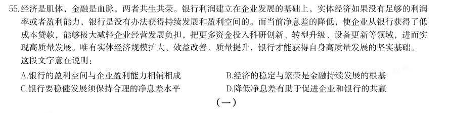
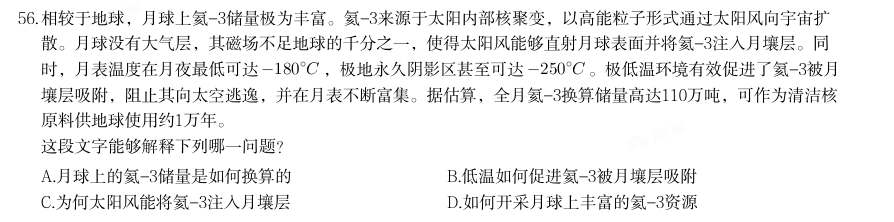
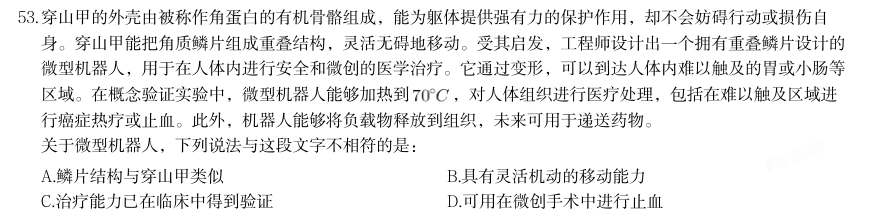
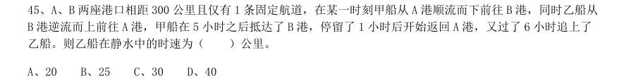
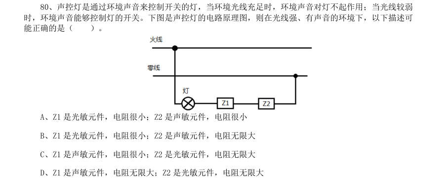
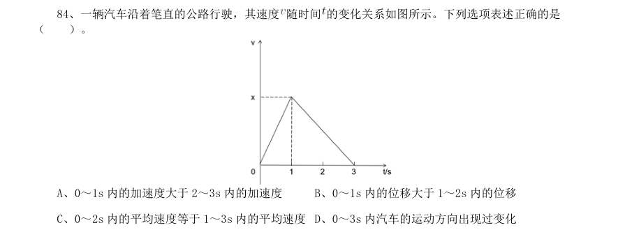

# 言语理解 · 中心理解 · 2020 年代真题

> 所属考点：[YY-ZXJL](../YY-ZXJL-中心理解.md)　｜　本片 214 题

> 本片子考点：中心句与主旨 72　对策优先 61　转折与因果 55　中心理解（综合） 18　主题词 8

### 2026 广东·统一卷　第 27 题　（对策优先）

文化重在化人,但能否真正用文化引导人们坚定理想、塑造灵魂、涵养品德、砥砺人格等,要看“化”的水 平。如何使以文化人“化”得合情理、“化”得受欢迎、“化”得效果好,考验着我们的文化工作水平。习近 平总书记强调:“要润物细无声,运用各类文化形式,生动具体地表现社会主义核心价值观,用高质量高水平 的作品形象地告诉人们什么是真善美,什么是假恶丑,什么是值得肯定和赞扬的,什么是必须反对和否定 的。” 根据这段文字,作者意在强调:

- **A.** 文化工作的目的和意义
- **B.** 文化工作水平的重要性
- **C.** 以文化人要注重文化传播的方式方法
- **D.** 以文化人要坚持社会主义核心价值观

**答案：C**

### 2026 广东·统一卷　第 29 题　（中心句与主旨）

造纸术和印刷术的发明,为文学提供了物质载体与传播媒介,催生了图书出版业,电气技术使得记录影像和声 音成为可能,带动广播、电影、电视等的发展,在新一轮科技革命和产业变革加快孕育的今天,人工智能、 5G、区块链等新技术得到普及应用,科技进步对文化创新的驱动作用日益显著,极大地激发文化创新创造活 力,为文化繁荣发展提供了新的载体和机遇。 对上述文段内容概括最准确的是( )。

- **A.** 文化创新与科技革命始终深度融合
- **B.** 文化产业发展为科技创新带来澎湃动力
- **C.** 文化领域的发展变革与科技进步息息相关
- **D.** 科技进步充分激发大众文化创新创造活力

**答案：C**

### 2026 国考·副省级　第 47 题　（转折与因果）

埋藏较浅的饱水松散砂土遭受地震等强烈振动时,颗粒间的位置迅速调整,相互间失去接触 压力和摩擦力,有被振密的趋势。由于孔隙水压力急剧升高,颗粒快速聚集、挤出,随着水流不 断翻滚,由固态砂土变成液态混合物,这个过程叫作“液化”。液态混合物会向压力低的方向 运动,若地下有合适的通道或洞穴,则会涌向这些地方。当它们涌出地表,呈现喷砂冒水状态 时,就被称为“砂涌”。它们在流动过程中会破坏沿途的地貌景观和建筑,严重时还会造成人 畜伤亡。 这段文字所描述的自然现象可以概括为:

- **A.** 潜藏在地下的“暗河”
- **B.** 被摇成“液体”的砂土
- **C.** 沙漠中的“隐形”杀手
- **D.** 大地的“多米诺骨牌”效应

**答案：B**

### 2026 国考·副省级　第 49 题　（主题词）

当前国际局势急剧变化,确保战略物资供应的安全与稳定已成为捍卫国家核心利益的战略制 高点,世界多个国家立足战略物资供应链安全保障,已多轮更新《关键矿产清单》,展现了高度 的敏锐性与响应速度。我国自《全国矿产资源规划(2016-2020 年)》明确将稀土、晶质石墨等 24 种矿产纳入战略性矿产范畴以来,虽已奠定坚实基础,但在面对新兴战略物资尤其是对战略 性新兴产业构成关键制约的矿物时,清单的更新步伐尚显滞后。以氢能电池产业为例,其核心材 料如铂族金属等在全球战略价值日益凸显,却在我国当前的储备规划中未能获得应有的重视与优 先地位。 这段文字意在说明:

- **A.** 战略储备规划要与新能源发展需求相匹配
- **B.** 铂族金属应纳入国家战略性矿产资源目录
- **C.** 我国战略物资清单的更新力度亟待加强
- **D.** 新形势对我国物资储备体系提出新要求

**答案：C**

### 2026 国考·副省级　第 53 题　（转折与因果）

在信息技术领域,晶体管和激光器是两大核心元件。晶体管的微型化推动电子芯片飞速发展, 催生摩尔定律,即每隔约18 个月,集成电路上可容纳的晶体管数量将翻一番,这一趋势推动最 先进的晶体管尺寸达到纳米级别。相比晶体管,缩小激光器的难度要大得多,因为两者所依赖 的微观粒子截然不同,前者依赖电子,后者依赖光子。在可见光和近红外波段,光子波长比晶体 管中的电子波长高出3 个数量级。受衍射极限制约,这些光子能被压缩到的最小模式体积比晶 体管中的电子要大10 亿倍。因此,构建纳米尺度激光器的核心挑战在于如何突破衍射极限, 将光子的体积“压缩”到最小。 这段文字主要介绍:

- **A.** 构建纳米尺度激光器的难点
- **B.** 信息技术领域面临的核心挑战
- **C.** 摩尔定律对于突破衍射极限的制约
- **D.** 晶体管微型化对电子芯片发展的意义

**答案：A**

### 2026 国考·副省级　第 61 题　（中心句与主旨）
> 材料：井南侧1.5 千米处。悬泉置是汉帝国设立在丝绸之路上的国家驿置机关,创立于汉武帝时期, 担负传递信息、接待官员、迎送使者的重大任务,是截至目前丝绸之路长安-天山廊道路网上唯 一现存也是最古老的官方邮驿机构。 1987 年全国第二次文物普查时,悬泉置遗址被发现。从1990 年秋到1992 年冬,经国家 文物局批复后对遗址进行了清理发掘。经过历时三年的文物考古发掘,初步探明整个遗址包括主 体建筑、灰区、马厩及附属建筑,总面积22500 平方米,出土各类文物残留碎片70000 余件…

关于悬泉置,文中介绍了哪些信息? 1具体位置;2主要功能;3重要价值;4遗址发掘时间;5遗址特点;6历史沿革;7文物遗 存;8名称由来;9遗址保护措施

- **A.** 123457
- **B.** 135678
- **C.** 235679
- **D.** 236789

**答案：A**

### 2026 国考·地市级　第 63 题　（对策优先）
> 材料：B.能使微生物快速识别可分解污染物 D.能克服传统菌株“遇盐失活”的瓶颈…

对于县域而言,“错位”首先必须植根于自身“家底”。习近平总书记强调做好“土特 产”文章,正是点明要善于发掘和利用这种基于本土禀赋的比较优势,形成“人无我有”的独 特起点。同时,随着技术进步、市场变化,过去的优势可能减弱,新的机遇窗口不断开启。因 此,“错位发展”更需秉持发展眼光和创新思维,不仅要立足当前“有什么”,更要前瞻性 谋划“能发展什么”“应发展什么”,主动对接国家战略需求、区域发展格局、城市功能疏 解、乡村全面振兴需要和市场前沿,将潜在优势有效转化为产业竞争力与市场效益。 这段文字意在说明:

- **A.** 以产业促发展方能激活乡村振兴新动能
- **B.** 县域产业发展应主动聚焦国家战略需求
- **C.** 县域经济如何科学把握“错位发展”
- **D.** 前瞻性谋划为什么要先摸清“家底”

**答案：C**

### 2026 国考·地市级　第 64 题　（中心理解（综合））

半规管原本是感知头部运动的器官,目前尚不清楚它是如何捕捉气压变化的。当半规管感知 气压降低,会将信息传递给前庭神经,再传递给下丘脑。下丘脑负责调整自主神经。自主神经是 维持体内状态不变、使身体适应外界变化的神经,分为交感神经和副交感神经,前者负责将身 体切换到“战斗模式”,后者负责切换到“放松模式”。当下丘脑因气压变化受到刺激时,自 主神经的功能就会紊乱,导致精神状态不佳。交感神经过度活跃时,身体会处于紧张状态,产 生焦虑感;交感神经不能正常工作时,人就会无精打采。 根据这段文字,下列说法正确的是:

- **A.** 交感神经负责使人进入放松状态
- **B.** 气压变化时人的前庭神经最先感知
- **C.** 副交感神经过度活跃使人产生焦虑感
- **D.** 气压变化通过下丘脑影响人的精神状态

**答案：D**

### 2026 国考·行政执法　第 52 题　（对策优先）

生态保护修复工程的人工修复工程投资和建设周期一般为3 到5 年,而高寒地区生态群落完 成自然演替往往需要几十年乃至更长的时间。以拉萨河流域山水林田湖草生态保护修复试点工程 为例,在工程验收时植被覆盖度显著增加,但群落自然演替尚未完成,生态系统的稳定性仍然较 低。由于现有生态修复工程的相关投资多用于工程实施周期内,工程周期结束后大多依靠高寒生 态系统自然恢复,在管护力度不足的情况下,生态系统容易发生再次退化,威胁生态修复工程效 益的长期可持续性。 这段文字意在说明,高寒地区生态系统修复工程要:

- **A.** 保障后期管护与可持续性
- **B.** 充分发挥系统的内在恢复能力
- **C.** 科学规划投资和建设周期
- **D.** 强调验收流程的规范性与科学性

**答案：A**

### 2026 国考·行政执法　第 62 题　（中心句与主旨）

中纬度地区高空的西风带,是在北极极涡外环绕全球一周的强大气流,由上升的赤道暖空气 在向两极运动过程中受地球自转影响而偏转形成。西风带就像是地球大气环流中的一根“皮筋 儿”,其松紧程度取决于赤道和极地之间的温度差。当温差较大时,西风带流动较强,冷空气 被束缚在极地。而随着全球变暖,南北温差减小,西风带环流变弱,这根“皮筋儿”变松了。 当极涡分裂南下时,冷暖空气的南北交汇现象会变得更加剧烈。西风带上大尺度波动的增强, 会使中纬度地区的天气过程变得更加极端,急剧降温,并且持续时间更长。 这段文字主要解释了:

- **A.** 为何中纬度地区会有极端寒潮天气
- **B.** 为何中纬度地区高空会形成西风带
- **C.** 西风带的风力为何如此巨大而持久
- **D.** 西风带的风力为何与南北温差有关

**答案：A**

### 2026 国考·行政执法　第 64 题　（中心句与主旨）

牵牛花色丰富,且一朵花一日之内的花色有诸多变化,清晨时的蓝紫色至午后会逐渐变作粉 紫色,而这与花朵内的花青素以及当天的温度、日照等有关,天气晴好的日子,这种变色似乎更 加明显。清人邹一桂擅画,所著《小山画谱》中曾说:“清晓开放,日高即殷,遇阴曀则花竟 日。”牵牛清早盛开,经阳光曝晒则会变作红色,碰到阴天则会开放一整日。大自然的诸种变 化都有科学解释,诗人却将理性的科学事实化作了感性的诗句—— “晚卸蓝裳着茜衫”,数次 咏过牵牛的宋代诗人杨万里,将花色变化比作女子更换衣衫,平添了几分细腻与温柔。 作者引用古代诗文,是为了说明:

- **A.** 牵牛的花期较为短暂
- **B.** 牵牛具有变色的生物特性
- **C.** 牵牛是古代诗画的常见题材
- **D.** 牵牛被古人赋予了文化意蕴

**答案：B**

### 2026 国考·行政执法　第 65 题　（转折与因果）

早期宇宙中,一个典型的星系会从周围的星系间介质中吸积气体,并将这些气体转化为恒 星。这一过程会增加星系的质量,从而提高气体吸积的效率,加速恒星形成。然而,星系并不是 无限增长的,天文学家将这一过程称为“熄灭”。在近域宇宙中,大约有一半被观测到的星系 已经不再形成恒星,也就是成为了息产星系,它们不再包含年轻明亮的蓝色恒星,只剩下更 老、更小的红色恒星,因此,它们的外观呈现红色。 根据这段文字,下列说法正确的是:

- **A.** 停止形成恒星的星系外观呈现红色
- **B.** 近域宇宙中大多数星系是息产星系
- **C.** 星系质量与恒星形成效率呈正相关
- **D.** 息产星系中仍包含少量的蓝色恒星

**答案：A**

### 2025 湖北·统一卷　第 25 题　（中心理解（综合））

下列关于我国重要历史文物的叙述错误的是:

- **A.** 青铜器“利簋”又名“武王征商簋”,其铭文记载了武王伐纣这一历史事件
- **B.** 三星堆遗址出土了青铜大立人像、青铜神树、金面罩等珍贵文物
- **C.** 新疆出土的汉代织锦护臂,织有“五星出东方利中国”八字
- **D.** 位于陕西西安的半坡遗址出土了嵌绿松石象牙杯

**答案：D**

### 2025 湖北·统一卷　第 41 题　（转折与因果）

起伏越多越大的地形,越不利于上方气流的稳定,因此,在山地丘陵和城镇的上空,哪怕雷暴云产生了滚轴 云,也很容易因地形的扰乱而被迅速破坏。而在广袤、平坦的海洋上空,滚轴云却可以经久不散。同样广袤的 内蒙古大草原,看起来也理应利于滚轴云的频繁生成。但是,与大海低空湿润的空气相比,草原低空的空气未 必湿润,而暖湿气流是雷暴云生长的基础。如果低空湿度不够,雷暴云即使形成,也难以在低空中形成大量的 云体。 这段文字主要介绍了:

- **A.** 滚轴云是雷暴云生长的前提
- **B.** 暖湿气流是滚轴云形成的基础
- **C.** 地形和湿度是雷暴云形成的关键
- **D.** 内陆中滚轴云比海洋更少的原因

**答案：D**

### 2025 湖北·统一卷　第 42 题　（中心句与主旨）

与工业经济、数字经济相比,生物经济最大的特点是打破了数字经济“赢者通吃”的商业模式,具有资源依赖 性强、技术多样性高、市场垄断程度低等特点,为生物资源丰富、生物技术相对落后的国家提供了一次难得 的、可能实现跨越式发展的机遇。我国生物资源丰富、市场潜力大,生物技术已有良好基础,做强做大生物经 济,不仅能有效缓解甚至最终解决粮食安全、能源安全、环境安全、生物安全等问题,而且能够大幅度提高人 民健康水平,推进新一轮经济增长。 这段文字旨在说明:

- **A.** 我国生物经济的发展现状与前景研判
- **B.** 全球生物经济演进的规律和发展布局
- **C.** 中国面临生物经济的巨大机遇和挑战
- **D.** 生物经济对构建新发展格局意义重大

**答案：D**

### 2025 湖北·统一卷　第 43 题　（中心句与主旨）

人工智能所带来的智能化和自动化社会发展趋势提升了社会生产效率,并对传统公共管理者的决策和服务角色 带来挑战,人工智能作为新型的权利所有者逐渐代替传统公共管理者,作为基于计算逻辑,算法规则和数据的 公共管理者参与到社会治理过程之中,从而使未来人工智能场景下的公共管理者角色由“事务性供给”转 向“公共性维护”,这一趋势在将传统的公共管理者从社会事务管理中解放出来的同时,也淡化了传统公共管 理者在社会中的管理者角色,使社会治理逐渐呈现由自由平等的生产者联合治理的特点。 这段话所要表达的中心思想是:

- **A.** 人工智能消除公共权力
- **B.** 人工智能加速生产者联合
- **C.** 人工智能提高技术治理能力
- **D.** 人工智能推动社会自主管理的实现

**答案：A**

### 2025 湖北·统一卷　第 44 题　（转折与因果）

历史早期季节体系的发展演变与农事周期之间具有紧密联系。殷商及其从前的“二时”观念是围绕种植粟、黍 等农作物的农事活动而产生的一种社会时间,殷商以来对冬小麦的推广种植并使其嵌入到固有的农业结构中, 推动了先秦时期人们“四时”观念的萌生与演进,所以,“四时”观念的产生,是在对既有的“二时”观念进 一步细化的基础上得以实现的,而冬小麦的推广种植及其在农业生产中重要地位的逐渐凸显,成为人们细 化“二时”观念为“四时”观念的契机。 这段文字主要讲述的是:

- **A.** 社会时间超过自然时间之外而独立存在
- **B.** 先秦“四时”观念与“二时”观念的联系
- **C.** 冬小麦的推广种植在农业生产中的重要地位
- **D.** 冬小麦的推广种植与先秦“四时”观念的产生

**答案：C**

### 2025 湖北·统一卷　第 45 题　（转折与因果）

在中老年患者中,动脉硬化是个常见病,当血管出现硬化病变后,很多人认为只要将硬化的血管变“软”就可 以改善病情。事实上,动脉硬化是以脂质代谢障碍为基础的一类病变,以胆固醇及低密度脂蛋白为主的脂质首 先在血管内膜下沉积,然后逐渐在局部形成血栓,进一步通过纤维化及钙化形成动脉硬化斑块,最终导致动脉 壁增厚变硬、血管腔狭窄。动脉硬化是一个不可逆的过程,出现硬化后的血管是无法恢复到正常状态的,因此 动脉硬化的进程只能延缓,不能逆转。 这段文字旨在说明:

- **A.** 硬化的血管难再“软”
- **B.** 老年人难逃动脉硬化
- **C.** 动脉硬化是个常见病
- **D.** 动脉硬化是基础病变

**答案：B**

### 2025 湖北·统一卷　第 46 题　（中心句与主旨）

在距今约1.26亿年至7200万年之间,树脂产量和沉积量特别大,地层里的琥珀十分丰富,该时段称为白垩纪树 脂时期,比白垩纪树脂时期更早期的琥珀非常稀少,且很少包含生物;白垩纪结束后琥珀数量明显下降,近乎 消失,直到6100万年前新生代地层中才开始出现新的琥珀。白垩纪树脂时期全球气候温暖湿润,大气中二氧化 碳和甲烷等温室气体含量较高,频繁的火山活动促进气候变暖、改变大气成分,有利于松柏类植物生长,生物 活跃、病虫害增加使树木分泌更多树脂,野火频发,促进树脂产生与埋藏,海平面上升使许多内陆低地被淹 没,土层中石化树脂被冲刷、搬运、沉积形成琥珀矿藏。 这段文字主要介绍了白垩纪树脂时期琥珀化石的:

- **A.** 形态特征
- **B.** 科学价值
- **C.** 形成原因
- **D.** 类别划分

**答案：D**

### 2025 湖北·统一卷　第 50 题　（中心理解（综合））
> 材料：我国主要粮食品种供给充足,但在资源和环境双重约束下,构建多元食物供给体系还面临较大压力。现代设施 农业包含设施种植、设施畜牧、设施渔业和工厂化育秧设施、粮食烘干设施、仓储冷链物流设施等公共服务设 施,可以利用现代信息技术、生物技术、工程装备技术与现代经营管理方式,突破资源、环境和市场的限制, 拓宽农业发展时空,缓解粮食生产面临的问题,尽可能规避市场风险。…

与这段文字意思相符的一项是:

- **A.** 我国设施农业应用广泛,粮食品种供给充足
- **B.** 现代经营管理方式构建了多元食物供给体系
- **C.** 解决育秧难问题,须建设工厂化育秧设施
- **D.** 现代设施农业可以突破资源、环境的制约

**答案：A**

### 2025 湖北·统一卷　第 52 题　（中心理解（综合））

典籍版本资源有多种形式。除书籍外,印刷古籍的雕版,文字记录的简帛、金石器物、石刻、碑刻、拓本、绘 画、纸币、档案及近代以来各种类型的媒介等,均可纳入典籍版本资源的范畴。从广义上来说,凡是能够印证 中华文明、以物证史、以物叙史、可以直观感受或触摸的实物,都可视为典籍版本资源。典籍版本资源是中华 文明的“活化石”,是中国历史不绝如缕、一脉相承的“见证人”,也是中国文化影响世界的“实证者”。它 为全面深入了解中华文明提供了一把钥匙,具有不可比拟的独特优势,在推动建设中华民族现代文明方面发挥 着重要作用。 这段文字重在讨论典籍版本:

- **A.** 资源范畴与文化价值
- **B.** 文献属性与社会作用
- **C.** 形式类型与历史意蕴
- **D.** 实物来源与优势地位

**答案：B**

### 2025 湖北·统一卷　第 54 题　（对策优先）

隐私计算作为一项可以实现数据在流转过程中“可用不可见”的技术,其价值被快速发掘并放大,成为数据安 全、数据保护市场的关注焦点。隐私计算为解决数据存证、数据流通安全及隐私保护等问题提供了基础支撑, 为海量复杂数据要素的全面流通提供了坚实的技术保障。这使隐私计算等技术成为驱动金融科技纵深发展的重 要引擎。然而,隐私计算也面临着算力挑战。未来应重点探索隐私计算安全、性能、效果的平衡与统一,构建 高安全、高效率、高可能的数据流通生态,实现隐私计算扩大应用落地范围,更好地推动数字经济发展。 这段文字未谈论隐私计算的:

- **A.** 应用前景
- **B.** 技术保障
- **C.** 发展难题
- **D.** 发展方向

**答案：B**

### 2025 广东·统一卷　第 11 题　（中心理解（综合））

2024年,中国科技以奋进姿态奏响创新强音,向着科技强国目标迈出更加坚实的步伐。以下有关2024年中国科 技成就的表述有误的是( )。

- **A.** 深海载人潜水器“梦想”号标志我国深海探测关键技术取得重大突破
- **B.** 深中通道联通陆海,为粤港澳大湾区协同发展按下“快捷键”
- **C.** 南极秦岭站建成并投入使用,开启新时代极地科考新征程
- **D.** 嫦娥六号在人类历史上首次实现了月球背面采样返回

**答案：C**

### 2025 广东·统一卷　第 21 题　（对策优先）

我国农业基础还不稳固,城乡区域发展和居民收入差距仍然较大,城乡发展不平衡、农村发展不充分仍是社会 主要矛盾的集中体现。完善城乡融合发展体制机制是补上农业农村短板、建设农业强国的必然选择,能够促进 各类要素更多向乡村流动,让农业农村在现代化进程中不掉队,逐步赶上来;是满足人民对美好生活的向往、 促进共同富裕的内在要求,将解放和发展农村社会生产力,拓展农民增收致富渠道,推动城乡基本公共服务均 等化,让农村逐步具备现代化生活条件,让农民过上更加富饶美好的生活。 上述文段主要说明了完善城乡融合发展体制机制的( )。

- **A.** 重要意义
- **B.** 主要内容
- **C.** 基本要求
- **D.** 实践路径

**答案：C**

### 2025 广东·统一卷　第 22 题　（对策优先）

经验可以让人少走弯路,但一味迷信,生搬硬套经验,就会陷入经验主义。随着进一步全面深化改革的推进, 我们将遇到更多难啃的硬骨头,涉及的都是体制机制深层次的问题。抓好改革落实,既要善用经验,又要打破 传统定义,跳出路径依赖,干前人没干过的事。根据实践需要和试点探索提出新的改革措施,在继承中创新, 在创新中提升,实现创造性执行、高水平落实。 对上述文段提及的在推进改革过程中对待经验的正确态度,以下概括最准确的是( )。

- **A.** 警惕“经验主义”,避免迷信盲从
- **B.** 既“善用经验”,又“推陈出新”
- **C.** 坚持与时俱进,不断创新发展
- **D.** 打破思维定式,跳出路径依赖

**答案：D**

### 2025 广东·统一卷　第 25 题　（中心句与主旨）
> 材料：中国气候类型多样,拥有丰富的高温生存经验。现代都市应从中国传统的建筑设计与生活方式中学习如何规避 高温,如街道设计尽可能保留“骑楼街”这类遮风避雨建筑元素。对于高温高湿地区来说,遮阴、通风比单纯…

的环境绿化更重要。此外,通过洒水给街道降温应考虑空气热容量的影响,一般不宜在白天进行。 上述文段的主旨是( )。

- **A.** 高温地区适宜采用遮阴、通风的建筑
- **B.** 规避高温是城市规划主要考虑的方面
- **C.** 现代都市应向传统借鉴高温适应经验
- **D.** 应对高温应综合考虑气候和生活方式

**答案：C**

### 2025 广东·统一卷　第 26 题　（转折与因果）

“大数据杀熟”是商家利用互联网平台的技术、信息和市场地位优势而实施的一种差异化定价策略,本质上是 一种价格歧视,即同样的产品或服务对用户设置不同的价格,“大数据杀熟”之所以遭人诟病,是因为它对部 分消费者群体设置了相对不公平的高价,“不公平”是指平台在获取用户个人信息后隐瞒商品或服务的有效价 格信息,抬高消费者的比价成本,从而侵犯了消费者的知情权、选择权和公平交易权。 根据上述文段,不能得出的是( )。

- **A.** “大数据杀熟”对部分消费者设置了高价
- **B.** “大数据杀熟”侵犯了消费者的合法权益
- **C.** “大数据杀熟”影响了消费者的比价成本
- **D.** “大数据杀熟”的主要目的是差异化定价

**答案：B**

### 2025 广东·统一卷　第 27 题　（对策优先）

只要代表人民的利益、为社会发展作出贡献的人都能成为戏曲作品的主要人物,如革命英雄、卓有贡献的科学 家、劳动道德模范及普罗大众。就艺术创作而言,为了使戏曲人物形象更富有艺术典型性,即便是取自历史事 实或当代现实中的人物,也必须进行艺术创造,而不能把人物的现实生活轨迹完全照搬到舞台上。毕竟戏曲艺 术创作就是“美的发现和美的创造”,即把现实美转化为更具有吸引力的艺术美。 上述文段主要说的是( )。

- **A.** 戏曲作品创作要以实现艺术美为目的
- **B.** 戏曲作品中的现实性和艺术性的平衡
- **C.** 戏曲作品塑造主要人物应遵循的原则
- **D.** 现实人物是戏曲作品创作的主要来源

**答案：A**

### 2025 广东·统一卷　第 28 题　（主题词）

城市化进程历史性地改变了基层社会结构,现代都市生活带来一系列社会问题,促使学界重新认识以儒家思想 为核心的传统伦理的恒久价值,在城市化的“后半程”,家庭仍然是社会的基本单元。如何发掘传统伦理的现 代意义,打造一种新型“东方伦理型生活方式”,不仅是“以人为核心的新型城镇化”的题中应有之义,也将 有中国式现代化提供强大的社会基础和道义支撑。 根据上述文段,无法得出的是( )。

- **A.** 在现代基层社会结构中,传统伦理已丧失其价值
- **B.** 在城市化进程中,家庭始终是社会的基本单元
- **C.** 打造“以人为核心的新型城镇化”正当其时
- **D.** 城市化进程极大地改变了基层社会结构

**答案：C**

### 2025 广东·统一卷　第 30 题　（对策优先）

非物质文化遗产的“非物质”属性,决定了非遗不能仅被宣之于展板、陈列于展架,更需要活态的保护、传承 与发展。活态保护的重要出发点之一,就是从非遗所处的社会文化系统出发,更好地涵养滋生其上、浸润其中 的一方水土,无论是美术、曲艺等艺术形式,玉雕、刺绣等精工绝艺,还是礼仪、节庆等民俗活动,非遗保护 的背后应该是文化生态的保护,如此才能让非遗在活的土壤中生生不息。 上述文段主要说的是( )。

- **A.** 非遗的“非物质”属性决定了其保护方式的独特性
- **B.** 文化生态保护是非物质文化遗产保护的必要方面
- **C.** 社会文化系统是非遗活态保护的重要出发点
- **D.** 非物质文化遗产离不开其背后的文化生态

**答案：B**

### 2025 国考·副省级　第 46 题　（对策优先）

如果一味沉湎于琐碎的日常事务,缺乏大局观念和政治远见,不分轻重缓急,不从原则高度想问题,就会陷入 事务主义。习近平总书记指出:“如果忙忙碌碌,只是机械做事,陷入事务主义,是很难提高认识和工作水平 的。”这就意味着,要提高认识水平,必须走出事务主义的泥潭。毛泽东曾经指出:“庸俗的事务主义家不是 这样,他们尊重经验而看轻理论,因而不能通观客观过程的全体,缺乏明确的方针,没有远大的前途,沾沾自 喜于一得之功和一孔之见。”这为如何走出事务主义提供了指南针和路线图。 这段文字认为,为避免陷入事务主义,应该:

- **A.** 具有清晰明确的工作方案
- **B.** 坚持从理论高度看待问题
- **C.** 不断从实践中总结经验教训
- **D.** 通过学习补齐能力素质短板

**答案：B**

### 2025 国考·副省级　第 47 题　（中心句与主旨）

定向能武器是通过定向发射高能激光束、电磁波束、高能粒子束等对目标发起直接攻击的武器。低空无人机飞 行速度慢、尺寸小、雷达散射面窄、红外特征弱,普通防空系统难以及时发现和截获,而定向能武器则可利用 强激光点杀伤与高功率微波面覆盖相互配合,在低空近程区形成密集拦截网,应对无人机“蜂群”的压制。无 人机“蜂群”高度依赖高敏传感器和无线通信设备,飞行越低、密度越大,导航和控制系统越易受外界干扰。 此时,定向能武器对其稍加影响,使其联合作战能力受限,即可快速实现对无人机“蜂群”的杀伤。 这段文字主要介绍了定向能武器:

- **A.** 在无人化战争中的作战模式
- **B.** 应对无人机“蜂群”的制胜机理
- **C.** 实现低空作战的基本原理和核心技术
- **D.** 具有超越普通防空系统的特点和优势

**答案：B**

### 2025 国考·副省级　第 48 题　（中心句与主旨）

习近平新时代中国特色社会主义思想植根于新时代中国特色社会主义伟大事业的创造性实践,每一个理论成分 背后都有着鲜活的实践支撑。比如蕴含“创新、协调、绿色、开放、共享”新发展理念的经济高质量发展案 例、体现“党的领导、人民当家作主和依法治国有机统一”政治理念的现代治理案例、体现“绿水青山就是金 山银山”的生态文明思想案例等。通过讲述这些蕴含中国观点、体现中国立场、彰显中国智慧、弘扬中国价值 的生动故事,让国际社会更加深切地感知和理解习近平新时代中国特色社会主义思想的理论内涵和实践逻辑。 这段文字意在强调:

- **A.** 党的创新理论要在实践中检验和发展
- **B.** 讲好中国故事有助于提高国际话语权
- **C.** 要积极利用案例传播党的创新理论
- **D.** 理论宣传应该综合运用国内外资源

**答案：C**

### 2025 国考·副省级　第 50 题　（转折与因果）

同位素定年方法利用放射性同位素衰变原理来计算地表水进入封闭地下环境的时间,可以反映水在地下的补给 径流排泄规律;稳定同位素有同位素分馏和季节效应,在不同体系中分布比例存在差异,因此可以用来示踪地 下水的混合过程。目前,地下水循环研究中常用的同位素包括碳、氢、氧、硫等。随着技术发展,金属同位素 等非传统同位素的应用,扩大了地下水定年范围。其中,镁元素是主要造岩元素,易在风化过程中以离子形式 进入水体,且镁元素迁移行为简单、参与地球化学行为广,可以在地下水科学研究中发挥重要作用。 这段文字没有提及:

- **A.** 稳定同位素用于示踪地下水混合过程的原理
- **B.** 镁元素在地下水研究中发挥重要作用的原因
- **C.** 推动非传统同位素用于地下水研究的关键技术
- **D.** 计算地表水进入封闭地下环境所用时间的意义

**答案：C**

### 2025 国考·副省级　第 53 题　（中心句与主旨）

合唱发端于公元6世纪的西方古典音乐,并于20世纪初以“学堂乐歌”的方式传入中国。作为一种高度专业化 的多声部声乐类别,其千百年来一直在追求创作与演唱技术的发展与精进。过去相当长的时间内,中国的室内 合唱更多在音乐专业领域内,或是有一定知识储备的文化圈内开展艺术实践与鉴赏,与普通老百姓的欣赏层面 尚有距离,使其推广受到限制。近年来,随着一批合唱团与合唱作品的“改良下沉”,这一艺术形式逐渐亲 民,其厚重的古典传统不断被注入轻盈的流行时尚气息,“跨界”属性使合唱频频突破专业视野,吸引大众目 光。 这段文字意在说明:

- **A.** 室内合唱和传统合唱存在技术差别
- **B.** 流行音乐为合唱艺术注入了新活力
- **C.** 合唱艺术呈现出亲民化发展趋势
- **D.** 合唱艺术由重技术向重形式转变

**答案：C**

### 2025 国考·副省级　第 55 题　（中心句与主旨）

经济是肌体,金融是血脉,两者共生共荣。银行利润建立在企业发展的基础上,实体经济如果没有足够的利润 率或者盈利能力,银行是没有办法获得持续发展和盈利空间的。而当前净息差的降低,使企业从银行获得了低 成本贷款,能够极大减轻企业经营发展负担,把更多资金投入科研创新、转型升级、设备更新等领域,进而实 现高质量发展。唯有实体经济规模扩大、效益改善、质量提升,银行才能获得自身高质量发展的坚实基础。 这段文字意在说明:

- **A.** 银行的盈利空间与企业盈利能力相辅相成
- **B.** 经济的稳定与繁荣是金融持续发展的根基
- **C.** 银行要稳健发展须保持合理的净息差水平
- **D.** 降低净息差有助于促进企业和银行的共赢

**答案：D**

### 2025 国考·地市级　第 56 题　（中心理解（综合））

相较于地球,月球上氦-3储量极为丰富。氦-3来源于太阳内部核聚变,以高能粒子形式通过太阳风向宇宙扩 散。月球没有大气层,其磁场不足地球的千分之一,使得太阳风能够直射月球表面并将氦-3注入月壤层。同 时,月表温度在月夜最低可达 ,极地永久阴影区甚至可达 。极低温环境有效促进了氦-3被月 壤层吸附,阻止其向太空逃逸,并在月表不断富集。据估算,全月氦-3换算储量高达110万吨,可作为清洁核 原料供地球使用约1万年。 这段文字能够解释下列哪一问题?

- **A.** 月球上的氦-3储量是如何换算的
- **B.** 低温如何促进氦-3被月壤层吸附
- **C.** 为何太阳风能将氦-3注入月壤层
- **D.** 如何开采月球上丰富的氦-3资源

**答案：C**

### 2025 国考·地市级　第 57 题　（对策优先）

“微利惠民”是老年助餐行业的重要特点,但这也导致其盈利点不够清晰,加上配套服务体系建设还不够健 全、客流不稳定等因素影响,导致一些助餐机构经营困难。当前,要进一步推广老年助餐服务,应在设施场 地、资金筹集、税费减免等方面加大支持力度,并提高政策精准度。此外,还要充分发挥市场机制作用,不断 提高助餐机构自身能力。最后,应从老年人的现实需求和助餐服务的运营实际出发,引导更多主体参与,完善 多元筹资机制,落实各项优惠措施,才能进一步扩大服务覆盖面,形成更合理的布局,为更多老年人提供便 利。 这段文字意在强调:

- **A.** 老年助餐服务行业有良好的市场发展前景
- **B.** 多重因素导致老年助餐机构面临经营困境
- **C.** 应当帮助老年助餐机构适当提高盈利能力
- **D.** 多措并举多方参与方能推广老年助餐服务

**答案：D**

### 2025 国考·地市级　第 60 题　（转折与因果）

在一些科幻影片中,大质量黑洞周身的光环令人印象深刻。事实上,这并不是黑洞在发光,而是由宇宙中的气 体物质构成的吸积盘所辐射的光芒。当黑洞附近有物质靠近时,这些物质并不会立刻被黑洞吞噬,而是被吸引 到一个叫做吸积盘的结构中。当吸积盘受黑洞引力和摩擦的作用不断向内旋进时,内层的气体和尘埃被挤压导 致温度上升从而发射出电磁辐射,这就形成了黑洞周身的光环。不过,由于黑洞强大的引力对光的扭曲效应, 我们所能看到的吸积盘并不是一个扁平的圆盘,而是圆盘的远端被折起来,如同给黑洞戴了个“帽子”。 这段文字主要介绍:

- **A.** 黑洞周身产生光环的原因
- **B.** 吸积盘的形成及物质构成
- **C.** 吸积盘与黑洞作用的方式
- **D.** 黑洞吞噬宇宙物质的过程

**答案：A**

### 2025 国考·地市级　第 63 题　（对策优先）

相比高校和科研机构,企业处于市场最前沿,对有市场潜力的技术感知更灵敏,对产业发展趋势的把握也更敏 锐。因此,在颠覆性技术的研发、转移转化过程中,需要强化企业科技创新主体地位。在课题立项中,要加快 提升企业技术创新决策的主体地位,建立企业常态化参与国家科技创新决策的机制;在创新过程中,要着力强 化企业科研组织的主体地位,支持领军企业聚焦国家重大需求,牵头组建创新联合体,加快形成企业主导的产 学研深度融合。同时,人才、经费等创新要素也要加快向企业特别是科技领军企业集聚。 这段文字意在说明:

- **A.** 应着力完善国家科技创新决策的体制机制
- **B.** 颠覆性技术创新需重视并发挥企业的作用
- **C.** 要大力推进颠覆性技术的研发及转移转化
- **D.** 创新要素的大量积聚有助于企业技术创新

**答案：B**

### 2025 国考·地市级　第 64 题　（转折与因果）

熔盐堆是第四代核能系统中唯一的液态燃料堆,我国研发的熔盐堆是“钍基熔盐堆”,即用钍元素作为核燃 料、用熔融态的盐作为热介质进行发电。和常规铀反应堆不同,钍基熔盐堆内部循环的是液态盐。这些液态盐 既可被当作核燃料的承载体,又能被当作核裂变反应的冷却剂,因此在使用时要将钍元素溶解在氟盐冷却剂里 生成氟化盐,进而不断输出巨大的能量。由于钍基熔盐反应堆是用氟化盐作冷却剂,依赖的水资源较少,在缺 水的干旱地区甚至沙漠地区也能建造和运行。 这段文字解释了下列哪一问题?

- **A.** 液态盐作为反应堆核燃料承载体有何缺陷
- **B.** 钍元素通过何种方式溶解在氟盐冷却剂中
- **C.** 第四代核能系统为何仅有一种液态燃料堆
- **D.** 钍基熔盐反应堆为何可以在干旱地区建造

**答案：D**

### 2025 国考·行政执法　第 55 题　（中心句与主旨）

随着互联网的发展,网络空间中出现了许多“声音工作者”,以生产解说、配音等相关的数字产品为生。然 而,随着技术发展,模仿人声用 AI 生产内容逐渐普及,不仅一些具有辨识度的名人声音被滥用,许多“声音 工作者”的声纹信息也遭遇侵权风险。民法典规定,对自然人声音的保护参照适用肖像权保护的有关规定。所 以,声音权即声音的可辨识性,具有人格属性,可以作为一项人格权益保护的条件。任何自然人的声音均应受 到法律的保护,未经许可,擅自使用、许可他人使用录音制品中的声音,构成侵权。 这段文字主要介绍了:

- **A.** 声音权侵权行为构成要件的法律规定
- **B.** 应用 AI 技术模仿人声存在侵权风险
- **C.** “声音工作者”职业发展中的权益危机
- **D.** 技术发展给人格权益保护带来挑战

**答案：A**

### 2025 国考·行政执法　第 56 题　（对策优先）

足够的执法权限是基层治理高效运行的必要条件。权限不足,可能导致基层执法需求与实际权力配置之间存在 较大张力,让基层治理陷入“看得见的管不着”的低效治理困境;但权限如果过度下放,又可能出现“接不 住、管不好”的现象。因此,一方面需要进一步完善执法目录动态调整机制和制度,确保执法职能精准划转、 行政职权科学配置;另一方面需要加快完善基层执法事项基准库,建立基层执法事项指导目录,确保执法事项 在基层供需精准对接、有效贯通执行、全面落实落细。 这段文字意在强调,基层治理应:

- **A.** 重视“基层执法”,提升基层执法服务效果
- **B.** 围绕“精准赋权”,科学动态调整执法权属
- **C.** 加快“权限下放”,精准对接基层执法需求
- **D.** 调整“执法目录”,落实落细基层执法事项

**答案：B**

### 2025 国考·行政执法　第 58 题　（中心理解（综合））

从本质上看,量子雷达成像的原理与传统雷达一致,都是对电磁场携带信息的提取,但二者获取物体信息的物 理机制不同,传统成像技术建立在电磁场的确定性理论模型之上,利用电磁场的一阶关联信息,通过记录辐射 场的光强或相位分布获取物体的图像信息;而量子成像技术则建立在电磁场的量子统计不确定性理论之上,利 用了电磁场的高阶关联信息,通过辐射场分布的强度、相位的空间统计特性获得物体图像信息,因而量子雷达 可以获得超越传统雷达系统衍射极限的成像分辨能力。 这段文字无法解释下列哪一问题?

- **A.** 量子成像技术是如何获得物体图像信息的
- **B.** 传统成像技术与电磁场的确定性理论模型有何关系
- **C.** 量子雷达成像分辨能力为何可以超越传统雷达
- **D.** 量子雷达与传统雷达的发射信息载体有何不同

**答案：D**

### 2025 国考·行政执法　第 60 题　（转折与因果）

近百年来,对于天然气水合物的研究通常是保压取样后在实验室进行,或在耐压舱中模拟水合物的形成分解。 但由于深海与海面之间压力和温度的差异,在样品回收过程中,天然气水合物的一些性质会被破坏,实验室的 模拟舱也很难还原深海复杂的环境条件。拉曼光谱技术能在深海原位环境中对天然气水合物进行直接研究。在 这项技术中,激光通过光纤系统传输到深海,并与待测样品发生拉曼散射,通过采集和分析散射光谱,可获得 样品组分、结构和理化性质等信息。 这段文字没有提及:

- **A.** 在实验室模拟舱研究天然气水合物的弊端
- **B.** 拉曼光谱技术对研究天然气水合物的优势
- **C.** 深海环境对应用拉曼光谱技术的限制
- **D.** 天然气水合物样品性质被破坏的原因

**答案：C**

### 2025 国考·行政执法　第 65 题　（转折与因果）

织纹螺主要分布于中国东南沿海,一般生活在近海礁石附近和泥沙底,自身并不产毒,其毒素来源于摄入的带 毒海藻。织纹螺使人中毒的毒素主要是麻痹性贝类毒素,其中的石房蛤毒素是已知毒性最强的海洋生物毒素之 一,它通过阻断神经细胞膜中的钠通道而引起麻痹,毒性是眼镜蛇毒的80倍;另外还有河豚毒素,这是自然界 发现的毒性最强的神经毒素之一,其毒性比氰化钠还强1000多倍,0.5毫克即可致人死亡。这两种毒素的化学性 质非常稳定,煮沸、盐腌、日晒等均不能将其破坏,所以吃上一颗织纹螺就可能致人死亡。 这段文字没有解释下列哪一问题?

- **A.** 河豚毒素的毒性为何比氰化钠更强
- **B.** 织纹螺携带的毒素是从哪里来的
- **C.** 石房蛤毒素是如何使人体麻痹的
- **D.** 为何加工过的织纹螺仍然含有毒素

**答案：A**

### 2024 湖北·统一卷　第 37 题　（中心理解（综合））

到2030年,我国数字人整体市场规模将达2700亿元。数字人应用的多元拓展,得益于我国数字技术的不断进步 和产业布局的持续完善。我国数字人产业上下游均已具备一定规模的企业集群,有较深厚的技术积累。看上 游,成像设备产品已发展成熟,智能传感器等关键技术正被集中攻坚;看下游,应用领域加速从文娱行业向制 造业、现代服务业延伸。同时,数字人产品制作企业高速发展、相关服务平台正加快打造,数字人制作水平明 显提升,数字人产业将加快走向成熟。 对这段文字理解不正确的是:

- **A.** 数字人应用场景将更为广泛
- **B.** 目前数字人产业仍处在成长期
- **C.** 我国数字人市场发展前景良好
- **D.** 智能传感器等关键技术已有重大突破

**答案：D**

### 2024 湖北·统一卷　第 38 题　（中心句与主旨）

伴随着城市化快速发展的步伐,今天的少年儿童与乡土田园渐行渐远。如何开展既符合时代特色又“接地 气”的耕读教育?这道“考题”,考验的是学校与教师勇于创新的意识、因地制宜的本领。很多学校意识 到:“耕”离不开土地和自然,“读”重在学习广博有趣的各类知识、涵养自强不息的人格品德、树立报效国 家的崇高志气。于是,越来越多的学生被老师们带到原野田间,越来越多的课堂开设在了大自然里。学生们饶 有兴致地学习农耕知识、活泼健朗地舒展心胸情怀,耕读教育的真正意义由此得以实现。 对这段文字概括最恰当的一项是:

- **A.** 耕读为本计之久远
- **B.** 古为今用耕读传家
- **C.** 劳动教育能够激发内生动力
- **D.** 在“土味”课堂实现耕读教育的价值

**答案：D**

### 2024 湖北·统一卷　第 39 题　（中心句与主旨）

2012年至2021年,国家知识产权局累计授权发明专利395.3万件,年均增长13.8%,累计注册商标3556.3万件, 年均增长25.5%。累计评出中国专利金奖310项,获奖项目新增销售额超过2.5万亿元,我国知识产权使用费进出 口总额累计2.19万亿元,年均增长13.7%,其中出口年均增长31.2%。超过进口增速近20个百分点。知识产权有 力支撑了创新型经济、品牌经济、区域特色经济和开放型经济发展。 这段文字旨在说明:

- **A.** 知识产权运用的效益快速增长
- **B.** 知识产权助力优化营商环境
- **C.** 知识产权创新专利的数量上升
- **D.** 知识产权国际合作持续深化

**答案：A**

### 2024 湖北·统一卷　第 40 题　（中心句与主旨）

冰冻圈主要分布在地球两极和中低纬度的高山地区,在气候系统和气候变化中扮演着重要角色。极地温度对于 全球的影响力也许比我们想象中要大得多。可以说,极地温度就像一个遥控器,控制着地球上其他地方的“恒 定”温度。卫星数据显示,北极的浮冰正在加速消融、减少。冰越来越少,意味着地球能够反射到太空的阳光 变少了,也意味着更多深海海水被暴露出来去吸收阳光而变暖,地球会变得更暖,冰会融化得更快,而且很难 恢复,如此往复,会放大全球的温度变化情况。 与这段文字的意思相符的一项是:

- **A.** 极地和高山地区地表上存在多年冰体
- **B.** 极地温度决定着地球上其他地方的温度
- **C.** 北极冰冻圈的加速融化会导致全球变暖
- **D.** 极地冰冻圈的融化速度慢于中低纬度高山冰冻圈

**答案：C**

### 2024 湖北·统一卷　第 41 题　（转折与因果）

如今无论什么季节,任何水果都能随时买回家尝鲜,很多人对此并不赞同,理由是反季水果的种植过程中总会 有不利于健康的因素,因此他们在选购水果的时候,会侧重购买当季、当地产的水果。但是,果蔬中是否存在 不利于健康的因素,与自然栽种还是大棚栽种没有必然联系。随着现代化农业技术的推广应用,大棚栽种水果 技术越来越成熟,所有的保鲜剂、食品添加剂、植物生长调节剂,只要是国家相关标准允许使用的,且在规定 的用量下,对人体健康是没有危害的。 这段文字旨在说明:

- **A.** 人们倾向于购买当季当地产的水果
- **B.** 反季水果在种植过程中会产生不利于健康的因素
- **C.** 水果是否存在不利于健康的因素与栽种方式的选择无关
- **D.** 应加强现代农业技术的推广应用,减少添加剂对健康的危害

**答案：C**

### 2024 湖北·统一卷　第 43 题　（中心句与主旨）

新农人,不同于传统农民,也异于新型职业农民,他们多是从城市回流农村的新群体。如果说过去大部分年轻 人以跳出农门为奋斗目标之一的话,近年来,跳回农门正在成为新时尚。新农人带来了新技术、新商业模式和 运营理念,创造了新的就业机会和空间,丰富并拓展了农村经济业态。但在现实中,新农人融入农村社会网 络,激活产业网络并没有那么容易。不少人虽然在物理意义上返乡回乡了,但在社会关系上仍是“异乡人”。 正如不少调研所显示的,新农人不了解农村,不知道如何与农民打交道,难以有效嵌入当地产业网络开展分工 合作。 这段文字主要说明了:

- **A.** 新农人,回得去并不等于融得进
- **B.** 新农人需补短板,否则创业难成
- **C.** 新农人具备新理念,掌握新技术
- **D.** 时代呼唤更多新农人回农村创业

**答案：A**

### 2024 湖北·统一卷　第 46 题　（主题词）

碳纤维是由有机纤维经过一系列热处理转化而成,含碳量高于90%的无机高性能纤维,是一种力学性能优异的 新材料,其比重不到钢的五分之一。碳纤维树脂复合材料抗拉强度是钢的7至9倍,还具有出色的耐热性、优秀 的抗腐蚀性与抗辐射性。以碳为主要原料,以碳纤维复合材料、石墨烯等为核心的新一代复合材料是21世纪最 具应用前景的新材料,可应用于飞机结构材料、人工韧带等身体代用材料以及火箭外壳、工业机器人等领域, 但碳纤维复合材料发展也面临着高质量树脂基材缺乏等发展瓶颈问题。 根据这段文字,下列说法正确的是:

- **A.** 碳纤维是一种含碳量高的有机纤维
- **B.** 碳正成为21世纪的主导型先进材料
- **C.** 碳纤维树脂复合材料的抗拉强度优于钢
- **D.** 碳纤维树脂复合材料是一种最耐热且最坚硬的材料

**答案：C**

### 2024 湖北·统一卷　第 48 题　（中心句与主旨）

“医疗美容”是指运用手术、药物、医疗器械以及其他具有创伤性或者侵入性的医学技术方法对人的容貌和人 体各部位形态进行的修复与再塑。这个行业在迅速发展的同时,也出现了许多乱象。一些地方医疗美容机构制 售假劣“水光针”“整形用注射填充物”等美容针剂、违规使用“热玛吉”“光治疗”等医疗美容设备,导致 医美事故频发,甚至出现非法从业、虚假宣传、借“医美贷”实施诈骗等违法犯罪行为,给消费者身心带来巨 大伤害。 这段话主要介绍的是:

- **A.** 医美行业发展迅速
- **B.** 医美行业事故频发
- **C.** 医美行业虚假宣传
- **D.** 医美行业乱象丛生

**答案：D**

### 2024 湖北·统一卷　第 50 题　（中心理解（综合））

实践是人的思维方式得以形成的最切近的现实基础,人的思维方式是实践的要素、结构、过程、程序、规律的 观念反映,是实践方式的内化与积淀。没有实践活动,也就没有思维方式或思维结构。而思维方式或思维结构 一经形成,又成为人们进行认知活动、评价活动和实践活动的思维的框架、定势、模式、取向。实践方式作为 由实践的各种要素、活动构成的实践逻辑,经过实践的无数次的重复,逐步扬弃了具体实践活动的个别性、特 殊性与偶然性而具备了一般性、普遍性与必然性,人类实践也逐渐趋向稳定、成熟并形成了相对稳定的模式。 与这段文字的意思相符的一项是:

- **A.** 实践即是一种思维方式
- **B.** 思维即是一种实践方式
- **C.** 实践方式形成思维方式
- **D.** 思维方式形成实践方式

**答案：C**

### 2024 湖北·统一卷　第 51 题　（对策优先）

从古到今,人类不断梦想着能够找到长生不老的“灵丹妙药”,但目前也未有合法批准的能够真正用于抵抗衰 老的药物或疗法。以干细胞抗衰老疗法为例,由于具有自我更新和多向分化能力,干细胞在组织再生等领域具 有良好的应用潜力,也被宣传为延缓衰老的有力武器。然而科研人员提醒,虽然干细胞疗法在动物实验中表现 出一定的治疗效果,但对于人类而言,还需要等待临床试验结果。衰老是机体在整体水平上的系统性变化,不 是单一组织的变化,干细胞目前还无法同时针对所有组织细胞发挥治疗或起到延缓衰老的作用。 这段文字意在强调:

- **A.** 采用干细胞疗法抵抗衰老大有可为
- **B.** 干细胞治疗用于延缓衰老还有许多问题
- **C.** 从古到今人类为延缓衰老进行了各种尝试
- **D.** 当前干细胞的抗衰老研究仍处于实验探索阶段

**答案：D**

### 2024 广东·统一卷　第 21 题　（对策优先）

纪录片肩负着在国际交流中真实展现中国形象、有效传播中国声音的使命。加强国际传播能力建设,是中国纪 录片发展面临的重大课题。既要创新传播形式、拓展传播平台、细分国际受众,也要积极拓宽素材的维度与视 野,加强国际化叙事表达,丰富能激发受众情感共鸣的主题内容,增强国际传播实效。 根据以上文段,作者意在强调:

- **A.** 要着力提升纪录片的国际传播能力
- **B.** 要通过纪录片更好地展现国情风貌
- **C.** 要积极拓宽纪录片素材的维度与视野
- **D.** 要选取能引起观众共鸣的纪录片主题

**答案：D**

### 2024 广东·统一卷　第 22 题　（对策优先）

大力倡导绿色消费方式是实现经济高质量发展和生态环境高水平保护共赢的重要推动力。要进一步引导全社会 认同绿色消费,使绿色消费方式成为公众自觉选择;引导促进绿色产品消费,为促进经济社会发展全面绿色转 型创造条件;全面推动各领域消费绿色转型升级,形成节约适度、绿色低碳、文明健康的生活方式和消费模 式。 本段文字主要讲了( ) 。

- **A.** 如何倡导绿色消费方式
- **B.** 如何实现经济高质量发展
- **C.** 为什么要倡导绿色消费方式
- **D.** 为什么要实现经济高质量发展

**答案：A**

### 2024 广东·统一卷　第 23 题　（中心理解（综合））

当前,数字经济规则已成为国际经贸规则竞争的制高点。在新发展格局下,中国应主动参与数字经济国际规则 谈判,积极争取与欧盟等区域外经济体签订数字贸易和数字经济合作框架,持续推动加入《数字经济伙伴关系 协定》,提升在数字经济国际规则竞争中的话语权和规则制定权。 根据这段文字,作者最有可能认同:

- **A.** 全球数字技术深度合作尚存阻碍
- **B.** 中国应深度参与全球数字经济规则制定
- **C.** 数字经济发展催生数字技术国际合作壁垒
- **D.** 各国应致力于促进数字经济发展红利的共享

**答案：D**

### 2024 广东·统一卷　第 27 题　（对策优先）

公园功能的拓展,需要规划先行。一方面要精准定位公园的基本功能,充分考虑公园周边居民的功能需求,将 周边居民日常生活和工作引入公园。另一方面要强化公众参与的理念,让居民参与到公园建设前、建设中、建 设后的全过程。 对这段文字理解准确的是( )。

- **A.** 公园建设过程中应当了解居民的功能需求
- **B.** 公园必须满足全市居民的日常生活和工作需求
- **C.** 公众参与公园建设有助于提升公园建设效率
- **D.** 应根据周边居民的需要不断拓展公园的功能区域

**答案：D**

### 2024 广东·统一卷　第 29 题　（转折与因果）

气候变化是全人类共同面临的严峻挑战。当前,全球气候变暖正在加速演进,极端天气气候事件呈现频发、强 发、广发特征,严重影响全球经济社会和自然生态环境。世界气象组织日前指出,2023年10月是全球有记录以 来最热的10月。同时,由于厄尔尼诺现象将至少持续至明年4月,大大增加了出现破纪录高温的可能性。 根据以上文段,以下说法正确的是( )。

- **A.** 厄尔尼诺现象呈现出频发、强发、广发的特征
- **B.** 气候变化会对生态环境和人类经济社会造成影响
- **C.** 根据世界气象组织的记录,10月份一般是最热的月份
- **D.** 全球气温的反复变化是极端天气气候事件的主要原因

**答案：A**

### 2024 国考·副省级　第 38 题　（中心句与主旨）

纵观世界电子对抗战争史,夺取制电磁权行动已从过去的“信号对信号”“设备对设备”的对抗,发展到信息 化战场“体系对体系”的对抗。随着大功率、远距离、强干扰电子设备的使用和综合电子对抗系统的发展,制 电磁权的打击目标与过去相比发生了根本性变化,主要表现在:由早期的主要干扰某个通信链路或雷达,发展 到对抗雷达网和制导武器系统,进而发展到击破网络信息体系;由主要打击信息获取与传输系统,发展到打击 整个信息系统的要害目标。近几年,这种精打要害的制胜方式得到前所未有的发展,用电子进攻摧毁敌方作战 体系的能力已日趋成熟。 这段文字主要介绍夺取制电磁权行动的( )。

- **A.** 历史背景及布局要求
- **B.** 设备特点及未来趋势
- **C.** 发展过程及作战方式
- **D.** 技术支撑及显著优势

**答案：C**

### 2024 国考·副省级　第 40 题　（中心句与主旨）

目录链主要依托区块链技术进行搭建,可将政府部门、职能机构的数据共享关系和流程上链锁定,建构起数据 共享的新规则。所有的政务数据共享、业务协同行为在链上共建共管,无数据的职责会被调整,未上链的系统 将被关停,从而建立起部门业务、数据、履职的全新“闭环”,解决应用与数据脱节、技术与管理失控等问 题。在具体技术应用上,目录链通过数据协调机制实现数据信息高效交互,通过多点共识确保数据存储不可篡 改,通过交互验证对数据计算和结果的可信度审计追溯,从而实现对数据资源目录进行全面管理和监控。 这段文字主要介绍了目录链的:

- **A.** 产生背景及共享规则
- **B.** 数据存储及监管流程
- **C.** 适用场景及流程体系
- **D.** 技术依托及应用价值

**答案：D**

### 2024 国考·副省级　第 41 题　（中心句与主旨）
> 材料：大模型赋能,生成式人工智能正在引发新一轮智能化浪潮。得益于拥有庞大的数据、参数以及较好的学习能 力,大模型增强了人工智能的通用性。从与人顺畅聊天到写合同、剧本,从检测程序安全漏洞到辅助创作游戏 甚至电影,生成式人工智能本领加速进化。随着技术迭代,更高效、更“聪明”的大模型将渗透到越来越多的…

领域,有望成为人工智能技术及应用的新基座,变成人们生产生活的基础性工具,进而带来经济社会发展和产 业的深刻变革。人工智能大模型强大的创新潜能,使其成为全球竞争的焦点之一。 这段文字意在说明:

- **A.** 人工智能在大模型赋能下正在快速发展
- **B.** 加快发展新一代人工智能势在必行
- **C.** 生成式人工智能的创新潜能亟待挖掘
- **D.** 生成式人工智能已成为全球研究的焦点

**答案：A**

### 2024 国考·副省级　第 42 题　（中心句与主旨）

火山喷发时,大量矿物粒子及颗粒物裹挟烟尘形成蘑菇云,甚至瞬间穿透对流层,进入相对稳定的平流层。其 中部分颗粒物很快随风雨降落地面,另一部分以硫化物为主的物质在平流层中长期无法沉降,经过一系列化学 反应形成硫酸盐气溶胶,随风在全球范围内均匀扩散,像遮阳伞一样反射太阳光,被称为“阳伞效应”。同 时,这些气溶胶颗粒又是形成云层冰晶的凝结核,这导致火山灰波及之处多为阴雨天气。而水汽在向液态、固 态水转化的过程中也会吸收大量太阳辐射,这也是为什么在强烈火山喷发活动后,地表会出现明显的降温现 象。 这段文字未对哪一现象做出解释?

- **A.** 火山灰波及之处多为阴雨天气
- **B.** 硫酸盐气溶胶在全球范围内扩散
- **C.** 强烈火山喷发活动后地表明显降温
- **D.** 硫化物在平流层中发生的化学反应

**答案：D**

### 2024 国考·副省级　第 45 题　（中心句与主旨）

非洲企鹅成年后身高只有60至70厘米,不过嗓门可不小,时常发出浑厚而响亮的叫声,被戏称为“公驴企 鹅”。非洲企鹅主要栖息于南非好望角附近的西蒙镇,这里属于地中海气候,全年温和舒适,同时本格拉寒流 带来了南极的冰冷海水,上升补偿流还将海底营养物质带至海面,让这里形成了有利于渔业的自然环境,沙丁 鱼、凤尾鱼等浅水鱼类为非洲企鹅提供了充足的营养。另外,非洲企鹅好像涂了粉红色的“眼影”,那是用来 调节体温的腺体。当体温上升时,有更多血液流经眼睛上方的腺体,利用空气流动帮助身体降温,“眼影”的 颜色也会更加鲜艳。 根据这段文字可知,非洲企鹅:

- **A.** 以深水鱼类等为食物来源
- **B.** 眼部颜色浅说明其体温较低
- **C.** 用“驴叫声”来警示敌人
- **D.** 适宜在地中海地区生存繁衍

**答案：B**

### 2024 国考·副省级　第 48 题　（中心句与主旨）

如何精准评估生态产品的受益主体与范围,准确核算产品的价值量,是实现生态产品价值绕不开的问题,鼓励 研发自然资源资产信息化管理平台是主要途径之一。将自然资源资产负债表所涉及的资源信息和评估核算模块 录入系统,依托技术、数据,叠加功能图形信息,形成自然资源资产“一张图”信息化管理平台。还应鼓励有 条件的城市建设生态系统生产总值数字化服务平台,利用大数据、云计算技术,系统反映生态资源的数量、质 量、分布、权属等信息,绘制生态产品价值地图,实现精细化动态核算。 这段文字主要讲的是:

- **A.** 开发信息化管理平台,提升生态产品监管水平
- **B.** 利用数字技术,增强生态产品价值的核算效能
- **C.** 建设统一的服务平台,实现生态资源系统管理
- **D.** 整合自然资源资产,推动数字化管理平台建构

**答案：B**

### 2024 国考·副省级　第 49 题　（对策优先）

我国经济已由高速增长阶段转向高质量发展阶段,这是一个重要转变。一个时期以来,传统投资驱动的经济增 长模式已经难以为继,同时经济全球化遭遇逆流,大进大出的环境条件已经变化,不可能单纯依靠出口实现经 济发展质的提升。因此,必须根据我国经济发展实际情况,建立起扩大内需的有效制度,特别是要更好更充分 释放消费潜力。消费作用的不断强化,能有效降低我们对出口和投资的依赖,有利于经济长远发展,促进经济 内外平衡发展,实现提质增效。 这段文字意在说明:

- **A.** 高质量的经济发展需重点平衡好质与量的关系
- **B.** 单纯依靠出口实现经济发展的模式亟待改变
- **C.** 释放消费潜力有利于推动经济高质量发展
- **D.** 优化扩大内需制度是经济长远发展的关键

**答案：C**

### 2024 国考·地市级　第 43 题　（中心句与主旨）
> 材料：目录链主要依托区块链技术进行搭建,可将政府部门、职能机构的数据共享关系和流程上链锁定,建构起数据 共享的新规则。所有的政务数据共享、业务协同行为在链上共建共管,无数据的职责会被调整,未上链的系统 将被关停,从而建立起部门业务、数据、履职的全新“闭环”,解决应用与数据脱节、技术与管理失控等问…

题。在具体技术应用上,目录链通过数据协调机制实现数据信息高效交互,通过多点共识确保数据存储不可篡 改,通过交互验证对数据计算和结果的可信度审计追溯,从而实现对数据资源目录进行全面管理和监控。 这段文字主要介绍了目录链的:

- **A.** 产生背景及共享规则
- **B.** 数据存储及监管流程
- **C.** 适用场景及流程体系
- **D.** 技术依托及应用价值

**答案：D**

### 2024 国考·地市级　第 46 题　（对策优先）

村落形成是优胜劣汰、自我生长的过程。我们现在看到的村落,是经过历史“折叠”后的结果,当下呈现的只 是其中一个切面。村落里的大部分遗留物中,都隐藏着不同历史阶段的痕迹,想要看清楚,需要将“折叠”展 开,按照各种痕迹进行重新整理和立体化呈现。所谓“没有特色、没有传统的村落”,其实是因为信息残缺较 为严重,但其中的历史印记不会完全消失。要发现这些信息,必须通过长时间的田野调查,与原住民进行深入 交流,感受他们对艺术的认知与理解,找到他们能接受、认为美的形式,这才是艺术乡建最重要的切入点。 作者通过这段文字想说的是:

- **A.** 村落中的历史文化信息亟待发掘整理
- **B.** 艺术乡建应以复原村落特色为着力点
- **C.** 发现历史细节是振兴传统村落的基础
- **D.** 扎实的田野调查对艺术乡建至关重要

**答案：D**

### 2024 国考·地市级　第 47 题　（转折与因果）

核桃油富含不饱和脂肪酸,但易氧化、存储时间短,限制了其应用。最近,研究团队以食用纳米纤维素作为唯 一凝胶因子,以核桃油为载体,通过乳液模板法,成功构造出性能良好的核桃油凝胶,使核桃油变身“植物黄 油”。在乳液阶段,食用纳米纤维素吸附并紧密包裹在核桃油油滴表面,形成不均匀的致密网格结构,降低液 滴的聚集;冷冻干燥后,其结构产生形变,获得油脂结合能力强的核桃油凝胶。由于纳米纤维素可定向“裁 剪”,因此可构造不同性质的多不饱和油凝胶,这为核桃油的多元化应用提供了新路径。 下列说法与这段文字相符的是:

- **A.** 食用纳米纤维素具有不易吸附的特点
- **B.** 添加食用纳米纤维素会稀释核桃油浓度
- **C.** 纳米纤维素会使不饱和脂肪酸发生形变
- **D.** 纳米纤维素拓宽了核桃油的应用范围

**答案：D**

### 2024 国考·地市级　第 53 题　（中心理解（综合））

穿山甲的外壳由被称作角蛋白的有机骨骼组成,能为躯体提供强有力的保护作用,却不会妨碍行动或损伤自 身。穿山甲能把角质鳞片组成重叠结构,灵活无碍地移动。受其启发,工程师设计出一个拥有重叠鳞片设计的 微型机器人,用于在人体内进行安全和微创的医学治疗。它通过变形,可以到达人体内难以触及的胃或小肠等 区域。在概念验证实验中,微型机器人能够加热到 , 对人体组织进行医疗处理,包括在难以触及区域进 行癌症热疗或止血。此外,机器人能够将负载物释放到组织,未来可用于递送药物。 关于微型机器人,下列说法与这段文字不相符的是:

- **A.** 鳞片结构与穿山甲类似
- **B.** 具有灵活机动的移动能力
- **C.** 治疗能力已在临床中得到验证
- **D.** 可用在微创手术中进行止血

**答案：C**

### 2024 国考·地市级　第 54 题　（中心句与主旨）

大模型赋能,生成式人工智能正在引发新一轮智能化浪潮。得益于拥有庞大的数据、参数以及较好的学习能 力,大模型增强了人工智能的通用性。从与人顺畅聊天到写合同、剧本,从检测程序安全漏洞到辅助创作游戏 甚至电影,生成式人工智能本领加速进化。随着技术迭代,更高效、更“聪明”的大模型将渗透到越来越多的 领域,有望成为人工智能技术及应用的新基座,变成人们生产生活的基础性工具,进而带来经济社会发展和产 业的深刻变革。人工智能大模型强大的创新潜能,使其成为全球竞争的焦点之一。 这段文字意在说明:

- **A.** 人工智能在大模型赋能下正在快速发展
- **B.** 加快发展新一代人工智能势在必行
- **C.** 生成式人工智能的创新潜能亟待挖掘
- **D.** 生成式人工智能已成为全球研究的焦点

**答案：A**

### 2024 国考·地市级　第 58 题　（中心句与主旨）

任何领域人才的成长进阶之路都离不开激励。以往提起技能人员,人们往往会想到“社会认可度低”“上升空 间有限”“工资待遇不高”等标签。一些年轻人不愿意进工厂,企业也时常出现技工荒,这都不利于制造业的 高质量发展。经过多年的努力,我国通过出台各类支持技能人才发展的政策措施,引导用人单位对高技能人才 实行岗位分红、专项特殊奖励、技术创新成果入股等激励办法,为构建完善的高技能人才培养体系提供了保障 和依据。如今,技能人才的上升空间更加广阔,上升渠道更加通畅,评价机制更加完善,待遇水平也更有吸引 力。 这段文字意在说明:

- **A.** 政策激励使技能人才培养体系更完善
- **B.** 企业应为技能人才成长提供上升空间
- **C.** 应不断创新企业吸纳人才的激励办法
- **D.** 技能人才是制造业高质量发展的保障

**答案：A**

### 2024 国考·地市级　第 60 题　（对策优先）

在数字经济时代,因为用工关系的多样化、灵活化、去组织体化、去劳动关系化等特征,市场配置劳动力资源 的一面更加凸显,就更需要回到市场经济的一般法律体系,从数字经济协同治理的角度考虑新就业形态劳动者 权益保护的问题。劳动法的制度和思路处于兜底保障的位置,是一种末端解决问题的思路;其他市场经济的法 律处于优化产业和市场秩序的位置,是一种前端解决问题的思路。源头治理与兜底保障相结合,才能更好实现 产业有序发展与新就业形态劳动者权益维护的平衡。 这段文字意在说明:

- **A.** 劳动法与市场经济的其他法律是相辅相成的
- **B.** 新就业形态下劳动者权益维护思路亟待更新
- **C.** 数字经济时代劳动保障需加强法律体系协同
- **D.** 维护劳动者权益才能更好促进数字经济发展

**答案：C**

### 2024 国考·行政执法　第 46 题　（转折与因果）

公共法律服务是全面依法治国的基础性、服务性和保障性工作,承担着为全民提供法律知识普及以及教育和法 治文化活动等职能。随着经济社会发展,人们法律意识增强,服务需求增长,但公共法律服务体系建设中发展 不平衡、设施不完善的短板日益凸显,一些地区尚存在法律服务资源紧张、人才经费保障不足、公众知晓率低 等问题。因此,建设法治社会,亟待加快建设覆盖城乡、便捷高效、均等普惠的现代公共法律服务体系,提升 法律服务的社会公信力,让人民群众共享公共法律服务成果。 这段文字意在强调:

- **A.** 全面依法治国,离不开现代公共法律服务体系建设
- **B.** 健全的公共法律服务体系有利于法律意识的增强
- **C.** 公共法律服务体系建设,要注重弥合地区发展鸿沟
- **D.** 应以人民群众需求为导向,建设公共法律服务体系

**答案：A**

### 2024 国考·行政执法　第 49 题　（对策优先）

胜诉权益不能及时有效兑现,是影响人民群众感受司法公正的最后一道藩篱。自动履行率越高,意味着越多的 案件无需进行执行程序就可兑现裁判,既减少了衍生案件,也能防止社会关系进一步撕裂。这要求通过建立自 动履行正向激励机制,把司法信用融入企业生产、群众生活,推动形成守法践诺的良好风尚;建立“谁办理、 谁负责”的案件履行督促机制,让承办法官引导和督促当事人自动履行裁判义务。加强反向惩戒、强化执行刚 性,对有能力而拒不执行判决裁定的人,用足用好失信惩戒机制,使其主动履行裁判义务,提升执行到位率。 这段文字主要介绍:

- **A.** 着力强化案件裁判兑现的重要价值
- **B.** 有效兑现胜诉权益对司法公正的意义
- **C.** 失信惩戒对提升执行到位率的作用
- **D.** 提升自动履行率保障胜诉权益的途径

**答案：D**

### 2024 国考·行政执法　第 55 题　（对策优先）

从行政管理链条看,制度建设处于前端,行政复议处于末端。行政复议案件的产生,必然经过一般性行政管理 规定、行政机关具体实施、产生具体行政行为、不服行政行为申请行政复议等环节。每个复议案件或多或少反 映了行政管理中存在的问题。行政机关,特别是作为行政复议被申请人的行政机关,要善于“抓末端、治已 病”。如果是个案具体实施问题,可以个案纠正;如果是制度性、普遍性问题,则要对制度进行查漏补缺;如 果是制定制度时不曾预见的新问题,更要予以关注,适时进行规范,避免小问题变成大问题。 作者通过这段文字想说的是:

- **A.** 善用行政复议可以提升行政管理水平
- **B.** 对行政复议案件要具体问题具体分析
- **C.** 行政管理链条是环环相扣的有机整体
- **D.** 行政复议案件是行政管理问题的外化

**答案：A**

### 2024 国考·行政执法　第 59 题　（对策优先）

个人信息保护案件往往涉及非法收集、获取、提供、出售、购买、使用个人信息等多个环节,责任主体除了已 被追究刑事责任的犯罪者外,还可能包括下游的违法处理信息者。在民事公益诉讼案件办理中,是否可以连带 追究下游违法者的赔偿责任,司法实践中存在争议。根据民法典,认定连带责任必须遵循法定或约定原则,在 此原则指导下,个人信息保护法规定了共同处理者的连带责任。因此,当不同侵权主体主观具有共同过错,客 观上实施了共同侵害个人信息权益的行为时,可以依法追究各侵权人的连带责任。 关于个人信息保护案件,作者认为:

- **A.** 应该强化对犯罪者民事责任的追究
- **B.** 应当依法追究下游违法者的赔偿责任
- **C.** 认定连带责任须在法定原则指导下进行
- **D.** 法律应明确案件中各侵权人的相关责任

**答案：B**

### 2024 国考·行政执法　第 60 题　（中心句与主旨）

现实生活中的案件事实总是相当复杂,很多时候国家机关一时难以查明案件真相。即使案件事实清楚,如果其 性质处于一般违法行为与犯罪行为的临界线上,在法律适用层面仍是刑法理论与司法实践的难点。行政执法人 员与刑事追诉人员对相关法律的理解可能也会存在一定差异。在这些因素的影响下,“行刑衔接”不再是单纯 的由行政执法到刑事司法的衔接,也可能是由行到刑再到行、由刑到行再到刑的衔接。正因为如此,有的法律 明文规定了多环节的移送。 这段文字意在:

- **A.** 解释“行刑衔接”中出现多环节衔接的原因
- **B.** 剖析目前“行刑衔接”导致的多重复杂状况
- **C.** 强调区分一般违法行为与犯罪行为的必要性
- **D.** 探讨实践中影响行政执法与刑事司法的因素

**答案：A**

### 2023 湖北·统一卷　第 38 题　（对策优先）
> 材料：契合…

近年来,AI(人工智能)开始运用于香水制作行业。与需要几十年时间训练嗅觉的调香 师不同,AI 调香不依靠嗅觉制作香水,而是利用先进的机器学习算法,分析和学习现有香 水的原料与配方,将其成分对比分析,输出一个新配方。它还能结合历史销售数据和行业趋 势等信息,获取香水在不同性别、年龄和销售地区的受欢迎程度,预测人类的喜好,进而创 造出针对目标人群的新香水配方。 这段文字重在说明:

- **A.** AI 调香可大大缩短香水的研发周期
- **B.** AI 调香研发的新型产品优于调香师
- **C.** AI 调香可以获得受用户欢迎的最佳解
- **D.** AI 调香在香水制作行业中运用前景广阔

**答案：D**

### 2023 湖北·统一卷　第 39 题　（中心句与主旨）

目前,新型消费也并非一种已经发展成熟或已定型的消费形态,随着数字技术的加快发 展,将来可能还会出现更多新的消费业态和消费模式。“数字化”是新型消费最基本的属性。 新型消费对人们的消费理念、消费模式和消费场景等多方面产生了新的影响。可以说,新型 消费绝不是一次普通的消费升级,而是新时代的一场消费革命。 这段话主要讲述了:

- **A.** 新型消费的影响
- **B.** 新型消费的内涵
- **C.** 新型消费的体系
- **D.** 新型消费的视角

**答案：A**

### 2023 湖北·统一卷　第 40 题　（转折与因果）

“抵触”和“不一致”是“法律冲突”的两种情形。从语义上说,“抵触”或“不一致”, 都是指两个规范在内容上的“非同一性”;而且它们有程度上的差别,可以说“抵触”是极 端的“不一致”,“不一致”是轻微的“抵触”。但是,《立法法》将“纵向”法与法之间 的法律冲突称为“抵触”,把“横向”法与法之间的冲突称为“不一致”。这样,在《立法 法》的意义上,“抵触”与“不一致”不是一种法律冲突程度上的区别,而是一种法律冲突 情景上和性质上的区别:下位法与上位法冲突称“抵触”,同位法之间的冲突称为“不一致”。 下列与这段文字的意思相符的一项是:

- **A.** 下位法与上位法相互矛盾而且冲突程度严重的,才属于“抵触”
- **B.** “抵触”和“不一致”是“法律冲突”的不同情形,纵横交错
- **C.** 同位法之间,其规定的内容上出现“不同一”,属于“不一致”
- **D.** “抵触”与“不一致”在法律冲突程度、情景和性质上有区别

**答案：C**

### 2023 湖北·统一卷　第 42 题　（对策优先）

当前,在发展格局的重要影响下,要实现我国零售业的高质量发展,就要发展线上和线 下共同融合的多元立体零售模式,同时要重视新零售供应链生态圈的建设。电商平台企业除 了整合上下游供应链合作伙伴、金融、服务及行业资源,朝着“有边界又无边界”的商业生 态圈发展,还需要通过线上线下双渠道的协同联动实现持续发展的商业生态布局;商业企业 要打破地域的空间限制,改变单一的店铺销售模式,积极借助数字化改造及建设的工具为“新 零售”赋能,最终构建“多元要素协同”的“新零售”供应链生态圈。 这段文字重在说明:

- **A.** “新零售”供应链的特征及潜能
- **B.** “新零售”供应链生态圈多维服务
- **C.** “新零售”供应链生态圈的协同逻辑
- **D.** “新零售”供应链生态圈的创新与竞争

**答案：C**

### 2023 湖北·统一卷　第 43 题　（中心句与主旨）

黄河文化源远流长、博大精深,具有根源性、灵魂性、包容性、忠诚性、原创性、可持 续性特征。全面认识和把握这些特征,有利于我们坚定文化自信,保护生态环境。在保护、 传承、弘扬和创新黄河文化方面要谋划开展丰富多彩的活动,系统打造代表黄河六大特征的 典型地标,以传统艺术和现代艺术相结合的形式讲好“黄河故事”,延续历史文脉,以具体 行动激励全社会坚定文化自信,为实现中华民族伟大复兴的中国梦凝聚精神力量,谱写新时 代建设社会主义现代化国家更加出彩的绚丽篇章。 这段文字主要强调的是:

- **A.** 黄河文化源远流长、博大精深
- **B.** 黄河文化具有可持续性的特征
- **C.** 讲好“黄河故事”延续历史文脉
- **D.** 黄河文化的保护、传承、弘扬和创新

**答案：D**

### 2023 湖北·统一卷　第 44 题　（对策优先）

氨氧化古菌是一种广泛分布的海洋微生物,它们通过将氨氧化成亚硝酸盐来获得能量。 这一过程需要氧气的参与,但它们却常分布在无氧环境中。最新研究发现,氨氧化古菌能在 黑暗的缺氧环境中自行生成氧气。研究人员将其移至缺氧海水中,随着氨氧化反应的进行, 氧气逐渐被耗尽,但几分钟后氧气浓度又升高。在排除其他可能后,研究人员判定是氨氧化 古菌自行产生了氧气,虽然不多,但足以维持自身运行。不过,研究人员尚不完全清楚其产 氧机制。 与这段文字的意思相符的一项是:

- **A.** 缺氧状态下亚硝酸盐会分解氧气,促进氨氧化古菌的氧循环
- **B.** 氨氧化古菌虽分布广泛,但无法在氧气稀薄区域获取能量
- **C.** 生活在暗黑地带的海洋微生物,无需光也可进行光合作用
- **D.** 海洋世界里还存在着研究人员没弄明白的微生物产氧方式

**答案：D**

### 2023 湖北·统一卷　第 45 题　（转折与因果）

在20 世纪90 年代,地面蜂窝移动通信(GSM 和CMDA)和低轨道卫星通信(铱星系统) 在全球是竞争关系。虽然地面移动通信从2G 到3G、4G 和5G 得到了快速发展及广泛应用, 但只覆盖约20%的陆地面积和6%的地球表面积。由于人类活动空间日益拓展,行业及军事 应用愈发广泛,人们对具有覆盖范围广、受地理条件限制小等特性的卫星通信的需求越来越 强烈。因此,卫星通信与地面移动通信在5G/6G 走向互补关系,共同构建覆盖全球的星地 融合通信网络是大势所趋。 这段文字旨在说明:

- **A.** 低轨道卫星通信与地面蜂窝移动通信由竞争转为互补
- **B.** 地面蜂窝移动通信与低轨道卫星通信相比覆盖范围小
- **C.** 低轨道卫星通信与地面蜂窝移动通信是全球竞争关系
- **D.** 卫星通信与地面移动通信共同构建全球星地融合网络

**答案：D**

### 2023 湖北·统一卷　第 46 题　（中心句与主旨）

淮扬菜被称为“士大夫菜”,同时也是国宴的标准菜系,但这与淮扬菜深受国民喜爱, 成为国民菜并不矛盾,淮扬菜历经2000 多年,绵延不绝的基础就在民间。淮扬菜有许多大 众耳熟能详的菜品,可能很多人吃过,但却不知道吃的就是淮扬菜。淮扬地区,至今仍有斗 菜的习俗,春节期间,主妇都要做出拿手好菜来宴请宾客,亲朋好友间还会进行厨艺比拼, 这让淮扬菜不断涌现出新菜品。淮扬菜就是在这样的氛围中,一代代传承创新。 这段文字重在强调:

- **A.** 淮扬地区斗菜习俗历史悠久
- **B.** 淮扬菜符合当代人的养生理念
- **C.** 淮扬菜是国宴菜,更是国民菜
- **D.** 民间传承为淮扬菜绵延不绝提供基础

**答案：D**

### 2023 湖北·统一卷　第 47 题　（中心句与主旨）

原始体育的萌芽与日复一日地生产劳动分不开,跳绳运动也不例外。古时,跳绳所用的 绳被称为“绳索”,它是由古人编结而成的,人们在编绳索的过程中,通常会有一些跨越的 动作,这些下意识的行为吸引了活泼好动的孩子,他们就用短的绳子在旁边反复模仿,并逐 渐摸索出一些简单的跨越绳子的方法,当成一种游戏来玩,于是跳绳这一活动就产生了。对 于跳绳的明确起源众说纷纭。最早出现的史料是汉代画像石上的跳绳图,证明当时已有了跳 绳活动。南宋《荆楚岁时记》中有“飞百索”的记载,正是后来的跳绳游戏。 这段文字重在说明:

- **A.** 跳绳运动文化的内涵
- **B.** 跳绳运动的悠久历史
- **C.** 原始体育起源于“模仿”
- **D.** 原始体育起源于生产劳动

**答案：B**

### 2023 湖北·统一卷　第 49 题　（中心理解（综合））

基础教育是受政治、经济、文化、舆论乃至学界深度影响的领域。学业负担有其自身发 生的逻辑链条,义务教育阶段的学业负担问题,既是一个客观存在,在某种程度上也是一个 被社会舆论“建构”出来的主观存在。不同家庭、学校和学生所感受的学业负担与政策意图 治理的学业负担可能大相径庭。学业负担问题的治理也受到教育内外部多重因素的掣肘,具 有极高的挑战性。推动基础教育领域的公私合作而非对立,发挥双方的优势,对包括缓解学 业负担问题在内的诸多问题均有意义。 对这段文字理解不准确的一项是:

- **A.** 学业负担问题涉及到主客观综合因素
- **B.** 学业负担有其自身发生的历史与现实逻辑
- **C.** 学业负担问题受到社会各个层面的深度影响
- **D.** 缓解学业负担问题有助于推动基础教育发展

**答案：D**

### 2023 湖北·统一卷　第 50 题　（转折与因果）

“教资考试热”的出现体现了教师这个职业的地位逐渐提升,近年来我国出台了一系列 提高教师地位、改善教师待遇的文件,教师的收入和社会地位不断提升。教师职业具有延续 性、内生性发展的特点,年龄大的教师具有更丰富的教学经验,可以不断地进行自我提升、 延续发展。专家提醒广大报考者,选择教师职业也要理性,教师对个人的付出和努力要求很 高,选择教师职业意味着要有奉献精神。因此,每个人在选择从事教师这个职业之前,要对 自己人生的定位和未来发展有一个整体判断,而不是盲目地追逐。 对这段文字理解不正确的一项是:

- **A.** 教师职业前景光明
- **B.** 并不是所有人都适合教师这个行业
- **C.** 教资考试需要降温
- **D.** 选择教师职业需要做好奉献的准备

**答案：C**

### 2023 湖北·统一卷　第 53 题　（转折与因果）

化石能源制氢和工业副产制氢工艺成熟、成本较低,短期仍将是主要氢源。但化石能源 储量有限,且制氢过程仍存在碳排放问题,工业副产制氢的产量有限且供应辐射路程短。从 清洁低碳角度看,大规模电气化是我国多个领域实现降碳的有力抓手,如电动汽车替代燃油 汽车、电采暖取代传统锅炉采暖等。然而,仍有部分行业难以通过直接电气化实现降碳,最 为困难的行业包括钢铁、化工、航运航空等。氢能具有能源燃料和工业原料双重属性,可在 这些难以深度脱碳的领域发挥重要作用。 这段文字重在强调:

- **A.** 化石能源制氢和工业副产制氢是主要氢源
- **B.** 电动汽车、电采暖等通过直接电气化实现降碳
- **C.** 氢能在部分难以深度脱碳的领域有重要的运用前景
- **D.** 大规模电气化是我国多个领域实现降碳的有力抓手

**答案：C**

### 2023 湖北·统一卷　第 118 题　（中心句与主旨）

表1 所列的主要畜禽产品中,相较于2012 年,2021 年零售价格增长幅度超过50%的是:

- **A.** 猪肉、牛肉、羊肉
- **B.** 猪肉、羊肉、鸡肉
- **C.** 牛肉、羊肉、鸡肉
- **D.** 羊肉、鸡肉、鸡蛋

**答案：B**

### 2023 广东·乡镇　第 7 题　（主题词）

协调城乡发展旨在让农民平等参与改革发展进程,共同享受改革发展成果,以实现城乡人 民共同富裕。协调城乡发展要求深入实施乡村振兴战略,加快推进农业农村现代化:推进以 人为核心的新型城镇化,深化户籍制度改革,加快农业转移人口市民化,实现基本公共服务 城乡均等。 对这段文字,以下理解最准确的是( )。

- **A.** 新型城镇化要求实现全体农业人口市民化
- **B.** 农业农村现代化的重心在深化户籍制度改革
- **C.** 公共服务城乡均等能极大提高农业人口素质
- **D.** 协调城乡发展的目标是促进城乡人民共同富裕

**答案：D**

### 2023 广东·乡镇　第 8 题　（中心句与主旨）

烈士纪念设施是讲好英雄烈士故事的重要平台,要在建设好、管理好烈士纪念设施的基础 上,将其教育作用发挥好,创新手段发挥其红色教育主阵地功能。比如,在烈士纪念设施的 展板和展柜上设置二维码,参观者可以扫码收听烈士事迹及相关介绍;开设烈士纪念设施 VR 虚拟现实展厅,让网络祭扫者全方位参观烈士纪念设施,等等。 本段文字主要讲的是( )。

- **A.** 如何讲好英雄烈士的红色故事
- **B.** 如何保护和管理好烈士纪念设施
- **C.** 如何强化烈士纪念设施的教育作用
- **D.** 如何利用科技手段加强烈士纪念设施建设

**答案：C**

### 2023 广东·乡镇　第 9 题　（对策优先）

对各级领导干部来说,摸清吃透基层情况,了解“第一手”民意,才能扎实开展好各项工 作。网络中的群众诉求和建议是社情民意的直观表达,群众反映的问题清单就是党员干部办 实事的履职清单。各级干部特别是领导干部要深刻认识互联网在国家管理和社会治理中的作 用,不断创新互联网时代群众工作机制,用信息化手段更好地了解社会态势、畅通沟通渠道、 辅助决策施政。 这段文字意在强调( )。

- **A.** 各级领导干部要善于运用网络了解民意,做好工作
- **B.** 互联网在国家管理和社会治理中发挥着重要作用
- **C.** 了解民情民意是各级领导干部开展好各项工作的基础
- **D.** 听取和接受群众意见建议是新时代社会治理的内在要求

**答案：A**

### 2023 广东·乡镇　第 15 题　（中心句与主旨）

习近平主席指出我们要善于通过历史看现实、透过现象看本质,把握好全局和局部、当 前和长远、宏观和微观、主要矛盾和次要矛盾、特殊和一般的关系,不断提高战略思维、历 史思维、辩证思维、系统思维、创新思维、法治思维、底线思维能力,为前瞻性思考、全局 性谋划、整体性推进党和国家各项事业提供科学思想方法,体现了以下哪个观念?( )

- **A.** 必须坚持守正创新
- **B.** 必须坚持系统观念
- **C.** 必须坚持问题导向
- **D.** 必须坚持胸怀天下

**答案：B**

### 2023 广东·县级　第 23 题　（对策优先）

城乡历史文化保护传承,要在精准上下功夫。城乡历史文化范围广、类型多、数量大, 情况尤为复杂。不同的传统建筑、旧城街巷等物质遗存,相异的地域风情、民俗习惯等非物 质传承,构成了各城市与众不同的文化气质。这也决定了历史文化保护传承方法不能完全相 同,必须坚持分类科学。在历史文化名城建设中,历史古都型如何保护、传承,传统风貌型 如何延续、更新,地域特色型如何保持、创新;在文化特质赓续中,江南水乡如何留住恬静 雅致,北方大院如何维持古朴雄浑,湘西古城如何散发神秘通幽······不同地域、不 同类型的历史文化,只有精准施策,才能保护好、传承好。 这段文字意在强调( )。

- **A.** 城乡历史文化保护传承要因地制宜
- **B.** 城乡历史文化保护传承面临着复杂局面
- **C.** 城乡历史文化保护传承应保留城市的物质遗存
- **D.** 城乡历史文化保护传承需要关注城市的文化气质

**答案：A**

### 2023 广东·县级　第 24 题　（转折与因果）

企业数字化转型并不是为了数字化而数字化,其核心在于价值创造。对企业而言,价值 创造直接体现在业务端,数字化转型实质上是业务的转型,是在以技术为支点、业务为内核 的新一代数字技术驱动下,进行业务、管理和商业模式的深度变革重构。因此,数字化转型 不是系统和应用简单从“非数字化”到“数字化”的过程,而是着眼于解决业务问题,从业 务切入,将数字化技术和工具赋能于业务,更有效地解决业务问题。 对这段文字,理解不准确的是( )。

- **A.** 企业数字化转型离不开数字化技术和工具的支持
- **B.** 系统和应用数字化不属于企业数字化转型的要求
- **C.** 企业数字化转型本质是革新业务、管理和商业模式
- **D.** 只有落脚到业务上,企业才能真正实现数字化转型

**答案：B**

### 2023 广东·县级　第 25 题　（对策优先）

近年来,消费成为拉动我国经济增长的主要动力。但是不可忽视的是,我国消费率偏低 仍是一个基本事实。从消费需求看,我国在结束“模仿型排浪式”消费阶段后,尽管个性化、 多样化消费逐渐成为主流,但总体消费水平还不高,提升和优化的空间还很大。如何让老百 姓敢消费、能消费、愿消费,进而消费得起、消费得好,如何精准满足人民群众多样化、差 异化、个性化需求,如何优化收入结构、提升消费能力,等等,这些都是我们扩大内需、释 放经济活力需要解决的现实问题。 上述文段主要讲了( )。

- **A.** 加快经济增长面临的主要问题
- **B.** 当前我国消费需求的特点和趋势
- **C.** 我国消费的现状和需要解决的问题
- **D.** 消费的重要性与扩大内需的可能性

**答案：C**

### 2023 国考·行政执法　第 42 题　（对策优先）

在市场经济时期,劳动密集型制造工厂普遍采用流水线技术,工人被高度“去技能化”,几乎不需要技能便可 完成装配操作,企业没有需求也没有动力去培养中高级技术工人。但是,当一个国家的产业结构向中高端迈进 时,高水平职业教育的支撑作用就会显现出来。技术进步与人力资本相互影响、相互促进:企业引进的高端生 产线,需要技术工人去操作和维护,否则技术改造和升级就无法实现;如果没有配套的职业技能培训体系,企 业的转型升级就难以达到预期效果。 这段文字意在说明:

- **A.** 产业结构转型升级需要职业教育的支撑
- **B.** 技术进步对人力资本提出了更高要求
- **C.** “技工荒”会随产业结构升级更趋严重
- **D.** 职业技能培训需求与经济增长有相关性

**答案：A**

### 2023 国考·行政执法　第 43 题　（对策优先）

作为经典的艺术门类,绘画在历史长河中并非独立发展。在原始艺术中,音乐、诗歌、舞蹈三位一体,密不可 分,绘画则将载歌载舞的场景留存于世。不同艺术门类成熟之后各自独立,但在发展的过程中又相互吸收、相 互依托、相互影响。各艺术门类之间的吸收与借鉴、配合与结合,是艺术发展创新的重要手段。古典名画是人 类审美情趣的集中体现,很长一段时间是深藏在博物馆中的高雅艺术,名画想要真正“活”化,还需要借助跨 界融合。 这段文字意在强调:

- **A.** 绘画是诗歌和舞蹈传承的重要载体
- **B.** 不同艺术门类的跨界融合由来已久
- **C.** 古典名画可以借助跨界融合重焕生机
- **D.** 打破形式壁垒是艺术创新的重要手段

**答案：C**

### 2023 国考·行政执法　第 44 题　（转折与因果）

火山灰是指火山爆炸性喷发形成的,直径小于2毫米的喷发碎屑。在爆炸性火山活动中,围岩和岩浆被炸碎成 细小的颗粒,形成火山灰。火山灰从火山口喷发到大气中,经过大气搬运再沉降到各类环境中,整个过程通常 只有数年,从地质时间尺度来看,几乎只是瞬间。所以在各种地质记录中,火山灰是一种高精度的绝对时间标 志层。火山灰年代学正是利用地质记录中的火山灰层来确定地质年代的科学,该学科可以解决一些重要的科学 问题,比如大型火山喷发事件与气候变化、人类演化之间的关系,以及气候快速变化的区域差异等。 这段文字主要介绍了:

- **A.** 火山灰的形成过程与主要特点
- **B.** 火山灰年代学的研究思路和价值
- **C.** 火山灰在自然环境中的分布状态
- **D.** 火山喷发对环境和人类的影响

**答案：B**

### 2023 国考·行政执法　第 47 题　（中心句与主旨）

我国在改革开放后逐渐认识到保护民间文学艺术作品的重要性,并在1990年著作权法规定保护办法另行规定。 但时隔三十余年,保护办法仍未出台。尽管如此,在著作权法颁布后,学界就民间文学艺术作品法律保护展开 研究讨论,提出多种保护方案,涉及权利客体、权利主体、权利内容、保护期限、权利限制等方面的问题。当 然,也有个别学者反对用著作权法保护民间文学艺术作品,主张通过公法加以保护。与此同时,国家版权局也 加快推进相关立法,但因质疑声音过大而夭折。 作者可能赞同下列哪一观点?

- **A.** 通过公法保护民间文学艺术作品是最可行的路径
- **B.** 围绕民间文学艺术作品法律保护的争议流于表面
- **C.** 国家版权局应就民间文学保护倾听多方面意见
- **D.** 民间文学艺术作品法律保护缺位状态亟需改变

**答案：D**

### 2023 国考·行政执法　第 48 题　（中心理解（综合））

传统X射线在对抗癌细胞时,无法主动辨别正常细胞和癌细胞,在进入人体后实施无差别杀伤。与之不同,重 离子束在穿越生物组织的过程中,不会在沿途不断地释放能量,而会在某个深度形成一个剂量高峰,科学界称 之为“布拉格峰”。也就是说,在穿透过程中,重离子束只是路过,并不施加伤害;当它到达癌细胞时,才开 始杀敌。这样,正常细胞终于可以不再被误伤,这有利于保护正常组织和关键器官。 根据这段文字,与传统射线相比,重离子束:

- **A.** 堪称“蒙面杀手”
- **B.** 采用“游击战术”
- **C.** 具有更强的“穿透力”
- **D.** 能精确“区分敌我”

**答案：D**

### 2023 国考·行政执法　第 49 题　（转折与因果）

传统成像技术都是对视域内的物体进行观测,非视域成像技术则能够对隐藏在视线外的物体进行拍照,实 现“视线拐弯”“隔墙观物”,极大地拓展了人类的成像能力。这一技术的实现过程通常是将激光脉冲发射到 中介墙上,利用中介墙使激光散射到被遮挡的非视域场景中,该场景中的隐藏物体再次将激光散射到中介墙 上,最终由中介墙散射至接收系统,整个过程激光经历了3次漫反射,通过记录光量子的飞行时间实现对非视 域场景的重构。然而,由于激光经过多次漫反射,整个光路存在巨大的衰减,使得非视域成像目前仅能在实验 室内进行短距离的原理性验证。此外,多次漫反射导致的时空信息混杂,使得成像算法成为一个科研难题。 关于非视域成像技术,这段文字未提及:

- **A.** 基本原理
- **B.** 突出优势
- **C.** 应用前景
- **D.** 技术难题

**答案：C**

### 2023 国考·行政执法　第 53 题　（对策优先）

“高精尖”产业是辐射带动力强的产业集群,对经济具有极强的拉动作用,不仅能实现中心城市的经济高质量 发展,而且能带动周边地区的产业联动转型。京津冀协同发展中,产业对接协作是区域战略的核心内容之一, 产业升级是三地的共同任务,在疏解非首都核心功能的过程中,天津和河北是北京产业转移的主要承接者。然 而,两地仅简单承接北京转移的一般产业是远远不够的,迫切需要发展“高精尖”产业,带动区域科技创新与 成果转化,促进区域产业联动,形成经济协同发展的格局。 这段文字意在说明:

- **A.** “高精尖”产业承担着高水平创新的重大使命
- **B.** 形成“高精尖”产业是城市群建设的长远目标
- **C.** 我国区域经济发展应以“高精尖”产业为依托
- **D.** “高精尖”产业对京津冀协同发展有重要意义

**答案：D**

### 2023 国考·行政执法　第 54 题　（中心句与主旨）
> 材料：要推动老旧小区的适老化改造和无障碍环境建设,关键是提升整个社会对适老化改造的思想认识,实现适老化 改造特别是居家适老化改造“心理无障碍”。要多渠道、全方位宣传引导居家适老化改造的政策与价值,转变 老人、子女和社会对居家适老化改造的认知;同时,要通过养老服务中心、居家养老服务中心等载体,打造居 家适老化改造样板房,强化直观感受,转变老人的传统观念,让老人逐步形成“为养老服务买单”、让子女形 成更加关注父母居家养老环境的社会意识,提升适老化改造的家庭主观能动性。…

这段文字强调要:

- **A.** 平衡主体利益,因地制宜推动适老化改造
- **B.** 统筹各方资源,激活适老化改造的多元力量
- **C.** 补位标准规范,提升适老化改造的品质与效率
- **D.** 加强宣传引导,做到适老化改造“心理无障碍”

**答案：D**

### 2023 国考·行政执法　第 56 题　（转折与因果）

生态修复请求分为生态修复的行为请求和费用请求,前者是为了防止生态环境权益损害的发生或扩大,请求责 任人停止污染破坏行为;当被破坏的生态环境无法恢复时,请求责任人进行人工修复。如果责任人不具有修复 能力或意愿,可请求责任人承担修复费用。因此,修复行为请求应作为首要诉求,在责任人不能或不愿进行修 复时,才能提出修复费用请求。在司法实践中,很多公益诉讼人却往往将修复费用请求作为首要诉求,但由于 诉求和判决的修复费用数额不易确定,责任主体短期内难以承担修复费用,生态修复工作很难有效开展。 这段文字意在说明:

- **A.** 应该制定生态修复费用的分级标准
- **B.** 修复费用请求往往很难得到有效落实
- **C.** 应根据责任人的能力确定生态修复诉求
- **D.** 生态修复诉讼应当首先提出修复行为请求

**答案：D**

### 2023 国考·行政执法　第 57 题　（转折与因果）

在银河系中,恒星形成于巨型分子云的引力塌缩。而塌缩的残留物会围绕着新生的恒星转动,形成一个富含尘 埃的气体盘,称为“原行星盘”。在年轻恒星中,周围存在原行星盘的比例会随恒星年龄增长而下降,存在的 时长中值约为200万~300万年。然而,正是通过原行星盘获得气体及所需物质,许多行星才能在这短短几百万 年内大致演化成型。对于类似地球的其他行星而言,经历了原行星盘阶段,早期物质至少演化成了行星胚胎, 并在原行星盘消散后经历进一步的碰撞和演化,最终形成现在的类地行星。 根据这段文字,下列说法正确的是:

- **A.** 恒星和原行星盘的存在时间大致相同
- **B.** 原行星盘是类地行星形成中的必经阶段
- **C.** 巨型分子云引力塌缩后随即形成行星和恒星
- **D.** 行星在运动中不断从原行星盘中获取所需物质

**答案：B**

### 2023 国考·行政执法　第 58 题　（转折与因果）

从“市场体系”到“统一市场”再到“全国统一大市场”,实际就是从建设市场到建设一体化市场,再到建设 大市场和强市场。我们的市场人均收入和消费水平低,虽然人口多,但是市场呈现为行政分割状态,因此只是 潜在规模大,实际规模并不具有竞争优势。对此,除了要通过深化改革,释放生产力、提升工资水平、分好国 民收入这块蛋糕,还要处理好两个重要问题:一是大力纠正导致市场分割的因素;二是加快资本市场化建设, 提高财产性收入比重。这是在扩大工资占比条件受限的前提下,迅速做大做强市场的关键。 这段文字针对的主要问题是:

- **A.** 行政区域分割和非一体化抑制了有效竞争
- **B.** 财产性收入在国民收入中的比重还比较低
- **C.** 我国市场潜在规模优势还未转化为现实优势
- **D.** 消费需求疲软阻碍了全国统一大市场的形成

**答案：C**

### 2023 国考·行政执法　第 59 题　（中心句与主旨）

颠覆性技术在军事领域的应用,使现代空袭作战向陆、海、空、天、电、网等领域发展。电子战飞机、预警指 挥机在现代空袭体系中的作用愈发重要;第四代隐身飞机投入实战大大增强了空袭体系的突防能力;空射导弹 等精确制导弹药智能化水平、抗干扰能力和目标识别能力增强,作战效能大大提高。未来将进一步提高精确制 导弹药的命中精度,空袭体系的精确打击能力将进一步增强。同时,运用小型或超小型无人机,在战场上对重 要目标实施“蜂群”式打击,会给重要目标的防护造成很大困难。 这段文字意在说明:

- **A.** 颠覆性技术提高了空袭作战的综合打击能力
- **B.** 军事领域的颠覆性技术研究取得突破性进展
- **C.** 精确打击能力的增强提升了空袭作战的效能
- **D.** 智能化时代的空中防御体系面临着空前挑战

**答案：D**

### 2022 广东·乡镇　第 7 题　（中心句与主旨）

实践证明,打赢脱贫攻坚战,关键在于对扶贫对象进行精细化管理、对扶贫资源进行精确化配置、对扶贫 对象进行精准化扶持。贫有百种,困有千样。只有坚持因村因户因人施策,因贫困原因施策,因贫困类型施策, 对症下药,精准滴灌,靶向治疗,才能做到真扶贫、扶真贫、真脱贫。 以下最能概括上述文段所表达的“脱贫攻坚精神”内涵的是:

- **A.** 尽锐出战
- **B.** 开拓创新
- **C.** 攻坚克难
- **D.** 精准务实

**答案：D**

### 2022 广东·乡镇　第 8 题　（中心句与主旨）

近年来,越来越多的镇村深刻认识到“绿水青山就是金山银山”的经济和生态双重价值,积极探索发展乡 村旅游、田园生态旅游。但有的地方道路、休闲空间等配套基础设施不完备,游客成过客、不愿意留下来过夜, 弱化了旅游业对当地餐饮、住宿及日常消费的带动力。只有完善配套基础设施,才能留住游客、发展回头客,提 升镇村旅游业的发展潜力。 上述文段主要讲了:

- **A.** 改善配套基础设施对镇村旅游业发展的重要性
- **B.** 乡村旅游、田园生态旅游对游客的吸引力不足
- **C.** 消费带动力不强是当前镇村旅游发展面临的问题
- **D.** 镇村旅游发展潜力有待进一步挖掘

**答案：A**

### 2022 广东·乡镇　第 9 题　（转折与因果）

“为什么我的时间总是不够用?”我们常被这个问题困扰。我们抱怨有太多事情要做,好像永远都做不完。 于是“没有时间”成了我们的口头禅。在这种背景下,“时间管理”理念应运而生。时间管理倡导的很多方法, 并不是要让人们逃离现代性境遇所构筑的牢笼,而是对其加以技术性强化。时间管理原本是要教会我们更精细、 更严苛地分割利用时间,由于人们的主观感受常常不一样,有些人依然会觉得时间不够用,事情永远做不完,甚 至为此心力交瘁。 对上述文段理解最准确的是:

- **A.** 精细化地分割和利用时间是时间管理的本质要求
- **B.** 时间管理没有完全解决人们“时间不够用”的困扰
- **C.** 对时间进行技术性强化是一种有效的时间管理办法
- **D.** 严格的时间管理在一定程度上会左右人们的主观感受

**答案：B**

### 2022 广东·乡镇　第 10 题　（中心句与主旨）

迄今为止,国内外农业灾害史研究还未能建立一个全面记录历史时期世界各地自然灾害发生完整过程和灾 情信息的综合性灾害史料数据库。在气候变化、灾害影响与适应防灾减灾应用等方面研究的资料需求无法得到满 足,以致于不能全面地揭示灾害成因和环境后果。 上述文段主要讲了:

- **A.** 建立综合性灾害史料数据库的紧迫性
- **B.** 综合性灾害史料对于农业灾害研究的重要性
- **C.** 农业灾害史研究当前面临的问题
- **D.** 推动农业灾害成因和环境后果研究需加强国际合作

**答案：C**

### 2022 广东·县级　第 6 题　（主题词）

建设生态文明,要在形成支持绿色发展、循环发展、低碳发展的机制上下真功夫、下大气力;主动抓住新 一轮科技革命和产业变革带来的新机遇,掌握革命性、关键性绿色核心技术,进而带动生态技术和生态产业交叉 融合、群体跃进。换言之,从“生产力与生产关系矛盾运动规律”来看,如同“铁和犁”于农业文明、“纺纱机 和蒸汽机”于工业文明一样,只有实现绿色生产力和绿色生产关系的根本性变革,生态文明才会成为真正引领人 类文明的新形态。 对上述文段理解最准确的是:

- **A.** 生态文明是人类文明形态中的最高级阶段
- **B.** 生产力和生产关系的辩证关系决定了生态文明的发展
- **C.** 实现绿色生产关系变革的关键是取得绿色核心技术突破性进展
- **D.** 形成支持绿色、循环和低碳发展的机制是生态文明建成的标志

**答案：B**

### 2022 广东·县级　第 8 题　（中心句与主旨）

对互联网金融加强监管,不是为了制约互联网企业,而是鼓励和保护真正有价值的金融创新,促进互联网 金融规范有序健康发展。广大互联网企业只有正确认识行业监管与自身发展的关系,将监管要求内化到企业经营 管理中,才能更好地走上规范健康发展的轨道。 上述文段主要讲了:

- **A.** 推进互联网金融监管创新的价值
- **B.** 当前互联网企业面临的机遇和挑战
- **C.** 制约互联网企业健康发展的客观因素
- **D.** 互联网金融监管对企业发展的重要性

**答案：D**

### 2022 国考·副省级　第 37 题　（中心句与主旨）

(单选题)在传统基层治理中,缺乏社会组织、市场等各主体的共同参与、质询和监督,必然导致政 府公共服务能力下降、权力垄断和滥用等问题,容易弱化公众信任程度,引发社会信任危机。区块链技 术基于去中介信任机制、共识机制、协调共享机制,适用于多环节、多方协同参与且互不信任的场景。 而信任是多元主体进行基层协同治理和互信规则建构的合作基础,区块链的算法信任机制与基层社会治 理“公共性+信任”的价值追求相契合。借助区块链技术可以促进治理生态中双边信任向多边信任及社 会公信的转变,突破传统国家治理体系所形成的认知固化和思维僵化。 这段文字意在强调:

- **A.** 健全信任机制是基层协同治理的条件
- **B.** 区块链技术有助于推进基层治理改革
- **C.** 区块链技术的应用能够提升政府公信力
- **D.** 治理生态离不开多元社会主体间的协作

**答案：B**

### 2022 国考·副省级　第 43 题　（中心句与主旨）

(单选题)福厦高铁是我国第一条真正意义上的海洋环境下运行的高速铁路。湄洲湾跨海大桥是其中 最长的海域施工区段,也是全线重点控制性工程,其主桥设计为预应力混凝土连续刚构矮塔斜拉桥。索 鞍是斜拉桥施工中的关键环节,施工精度高,控制难度大。湄洲湾跨海大桥位于曲线段上,海域风大浪 急,斜拉桥主塔索鞍定位困难。为达到主跨通航要求,主墩承台均需埋入河床面以下,这给围堰施工作 业增加了难度。施工人员克服海上恶劣天气的影响,采取预埋劲性骨架、增加控制点位等手段实现了索 鞍精确定位,有效地解决了索鞍定位控制难题。 这段文字主要介绍了湄洲湾跨海大桥:

- **A.** 对福厦高铁贯通的重要意义
- **B.** 围堰施工中面临的复杂环境
- **C.** 索鞍定位的难点及解决措施
- **D.** 使用矮塔斜拉索结构的原因

**答案：C**

### 2022 国考·副省级　第 44 题　（转折与因果）

(单选题)隔扇是我国古代的一种门,用于分隔室内外或室内空间。隔扇门既可联通内外,又能分隔 空间,同时可以透光、通风等,因而具有门、窗、墙的功能。隔扇门在唐代已经出现,宋代以后大量采 用,用于朝向内院的房屋立面墙,分隔房屋内部空间。如太和殿隔扇,主要由抹头(横向的木条)、上 部的隔芯、下部的裙板组成。其中,隔芯在隔扇中占用的比例最大。隔芯部分的纹饰稀疏有致,为糊纸 裱绢提供支点,同时起到通风、采光的作用。由于隔芯会采取不同形式的纹饰,因而这部分是最能体现 隔扇艺术特色的部分,是装饰的重点所在。 关于隔扇,这段文字未提及:

- **A.** 制作流程
- **B.** 出现时间
- **C.** 基本功能
- **D.** 主要材质

**答案：A**

### 2022 国考·副省级　第 46 题　（中心句与主旨）

(单选题)改革开放40 多年来,尽管我国农业劳动力绝对数量不断下降,但农产品产量逐年增加,土 地适度规模经营不断推进,制度创新成果显著。我国实现土地适度规模经营主要的方式有两种:一是土 地经营权流转形成的土地适度规模经营,由农户拥有的承包权派生出租、转包、入股等方式,让第三方 分享其经营权;二是土地经营权不流转,农户将田间作业环节托转给新的服务主体,形成服务的适度规 模经营。这两种方式都形成了新条件下土地农户承包经营权的共享,为小农与现代农业有机衔接找到了 切实可行的路径。 这段文字意在说明:

- **A.** 土地经营权的制度创新促进了农业发展
- **B.** 土地经营权的流转要把握好尺度和范围
- **C.** 经营权共享是土地适度规模经营的核心特征
- **D.** 农业专业化发展离不开土地权属的制度创新

**答案：C**

### 2022 国考·副省级　第 47 题　（中心句与主旨）

(单选题)当技术的进步逐渐拨开传统“战争迷雾”之时,网络和电磁等虚拟空间因素也给侦察情报带 来了相应的挑战。一方面,网络空间的开放互联,庞大的用户群体、被动的防御特性,未知的安全漏洞,使 得网络攻击的隐蔽性不断增强、难以防范。同时,情报的处理,分发离不开安全稳定的网络支撑。另一方 面,战场上的无人化侦察装备种类繁多,特别是重点区域和要害目标附近,用频装备数量庞大,导致局部电 磁拥挤,容易出现频率自扰现象。而且交战双方极易互相实施电磁干扰和压制,使得无人化侦察装备的稳 定运行遭受严峻考验。 这段文字主要介绍了:

- **A.** 虚拟空间因素对侦察情报工作的影响
- **B.** 新形势下驱散传统“战争迷雾”的关键
- **C.** 无人化侦察装备升级引发的连锁反应
- **D.** 侦察情报技术信息化进程中遭遇的困境

**答案：A**

### 2022 国考·副省级　第 48 题　（对策优先）

(单选题)行政处罚不是为罚而罚,行政处罚法是为了规范行政处罚的设定和实施。依据处罚与教育 相结合、过罚相当等基本原则,对于故意扰乱交通秩序、严重违法的行为,确实应该给予严厉处罚。但 对于轻微、对社会没什么危害性的违法行为,若事事都处罚,会加大交通运输从业人员负担,反而不符 合规范市场秩序、更好地促进社会稳定等执法理念的要求。同时,也会降低违法行为人受到行政处罚后 的耻辱感,达不到处罚与教育相结合的目的。 这段文字讨论的问题是:

- **A.** 如何让违法行为人感受到执法的温度
- **B.** 如何科学认定轻微违法行为
- **C.** 是否应对所有违法行为进行处罚
- **D.** 处罚标准是否应作出调整

**答案：C**

### 2022 国考·副省级　第 50 题　（转折与因果）

(单选题)对于山区河流开发保护研究来说,传统采沙方法依靠人力取水,采样时间间隔长,获取数 据效率低。坐底仿生水沙观测系统的投放,标志着我国山区河流水沙监测进入了高时间分辨率全过程监 测的新阶段。所谓仿生,就是指系统形状像一条鱼,能匍匐在水流很急的水底,这种系统和技术可以搭 载水温、浊度及压力传感器等多种观测设备,以此实现对河流水文特征及动力条件的分钟级连续观测。 目前,该技术已经应用于对青藏高原河流沉积物来源、组成及从搬运动力过程开展超高时间分辨率定量 化研究中。 根据这段文字,坐底仿生水沙观测系统:

- **A.** 是我国第一套监测山区河流水沙的系统
- **B.** 探测结果可以为灾害预警提供数据支撑
- **C.** 可以自行漂浮在水中对全流域进行监测
- **D.** 实现了对河流水沙沉积过程的连续监测

**答案：D**

### 2022 国考·副省级　第 51 题　（对策优先）
> 材料：与其生活在森林里的类人猿亲戚们分化的关键时刻。传统观点认为,在草原上,猿人们很快过上了狩猎 者的生活。作为灵长类生物,他们并不具备强健的肌肉和锋利的牙齿,仅凭体力很难成功捕获猎物,不 得不依靠精细的社会分工进行合作,并通过发明各种工具和武器捕猎求生。捕猎所获肉食,使得他们获 得了丰富的蛋白质,对大脑发育也有某种助益。总之,狩猎的生活方式最终塑造了我们目前熟悉的人 类。 2然而,这个观点也并非没有漏洞。在原始人类究竟是否为狩猎者这个问题上,学界始终有不同意 见。唐娜·哈特与罗伯…

(单选题)下面这段文字最适合放在文章的哪个位置? 在这种食腐生活模式下,人类进化成了一种需要花大量精力进行“战略思考”的生物。比如,原始人类 可能具有一定的计划能力和交流能力,以便在不同个体之间交换动物尸体位置的信息。这些也许对人类 大脑的进化起到了推动作用。

- **A.** 1和2之间
- **B.** 2和3之间
- **C.** 3和4之间
- **D.** 4和5之间

**答案：D**

### 2022 国考·副省级　第 52 题　（中心句与主旨）

(单选题)作者列举北京猿人的例子,意在说明:

- **A.** 远古人类的骨骼尚未进化完善
- **B.** 远古时期存在“人吃人”的现象
- **C.** 远古时期猛兽对人类形成严重威胁
- **D.** 远古人类可能是食肉动物的猎物

**答案：D**

### 2022 国考·副省级　第 54 题　（转折与因果）

(单选题)下列哪一说法能在这篇文章中得到印证?

- **A.** 研究者在远古人类获得生存优势的原因方面已达成共识
- **B.** 人类语言的复杂性得益于原始人类作为猎人的分工协作
- **C.** 具有复杂功能的大脑极大地帮助人类获得了生存优势
- **D.** 长期居于稳定的生态位是从猿人进化到智人的关键

**答案：C**

### 2022 国考·副省级　第 56 题　（转折与因果）
> 材料：1老鼠生性胆小机警,我们常用“胆小如鼠”来形容一个人懦弱怕事。老鼠怕猫更被认为是天经地 义的事情。这对冤家也常被搬上屏幕,例如《猫和老鼠》和《黑猫警长》。 2那么,老鼠有没有不怕猫的时候呢? 3答案是肯定的。比如当老鼠感染一种名叫刚地弓形虫的寄生虫的时候。1908 年,细菌学家查尔斯 ·尼科尔在突尼斯的刚地疏趾鼠体内发现了这种只有几个微米大小的细胞内寄生原虫。随着研究深入, 人们发现,弓形虫只在家猫和虎、狮等猫科动物体内进行有性生殖,其无性繁殖则可以发生在几乎所有 温血动物(…

(单选题)下面这段文字最适合放在文章的哪个位置? 有人不禁要问,既然老鼠感染弓形虫后连猫都不怕,那么它对其他捕食者或威胁的恐惧感有没有变化 呢?

- **A.** 2和3之间
- **B.** 3和4之间
- **C.** 5和6之间
- **D.** 7和8之间

**答案：C**

### 2022 国考·地市级　第 41 题　（中心句与主旨）

在传统基层治理中,缺乏社会组织、市场等各主体的共同参与、质询和监督,必然导致政府 公共服务能力下降、权力垄断和滥用等问题,容易弱化公众信任程度,引发社会信任危机。区块链技 术基于去中介信任机制、共识机制、协调共享机制,适用于多环节、多方协同参与且互不信任的场景。 而信任是多元主体进行基层协同治理和互信规则建构的合作基础,区块链的算法信任机制与基层社会 治理“公共性+信任”的价值追求相契合。借助区块链技术可以促进治理生态中双边信任向多边信任 及社会公信的转变,突破传统国家治理体系所形成的认知固化和思维僵化。 这段文字意在强调:

- **A.** 健全信任机制是基层协同治理的条件
- **B.** 区块链技术有助于推进基层治理改革
- **C.** 区块链技术的应用能够提升政府公信力
- **D.** 治理生态离不开多元社会主体间的协作

**答案：B**

### 2022 国考·地市级　第 49 题　（转折与因果）

研究发现,人体存在一种细胞清洁过程,被称为分子伴侣介导的自噬(CMA)。CMA 和阿尔 兹海默症之间存在动态的相互作用。CMA 的效率会随着人类年龄的增长而下降,导致人体内有害蛋白 质积累成不溶性团块,形成有毒蛋白质聚集体,从而损害细胞,导致阿尔兹海默症症状的出现。而早 期的阿尔兹海默症也会损害CMA,使CMA 活性显著降低。为此,研究人员开发出了一种新药,该药物 通过提高CMA 关键成分的受体水平来重振CMA 效率,从而改善小鼠记忆力,显示出治疗阿尔兹海默症 的潜力。 根据这段文字,以下说法正确的是:

- **A.** 新药物能够减缓阿尔兹海默症的发展
- **B.** 新药物的功效是通过提高CMA 效率来实现的
- **C.** 阿尔兹海默症抑制了CMA 的发生
- **D.** 抑制有害蛋白质积累能够提高记忆力

**答案：B**

### 2022 国考·地市级　第 50 题　（中心句与主旨）

从学理的角度来说,知识产权诉前行为保全是指为及时制止正在实施或即将实施的侵害权利 人知识产权或侵害之虞的行为,而在当事人起诉前根据其申请,由法院签发的一种禁止行为人为或不 为一定行为的强制性命令。它属于知识产权侵权救济的一种暂时性措施,有着维权“及时雨”的功能。 有别于传统财产权侵权,知识产权客体的易复制性与极易扩散性,使得知识产权人改变了过去倚重事 后救济来保护权力的习惯。在当前国家加大知识产权保护力度、建立知识产权侵权惩罚性赔偿制度的 背景下,及时有效地制止侵权比等到切实的损害结果发生后的救济更加有效。 这段文字主要介绍了知识产权诉前行为保全的:

- **A.** 救济原则与法律依据
- **B.** 研究背景与实施过程
- **C.** 法律效力与赔偿策略
- **D.** 法理概念与司法功能

**答案：D**

### 2022 国考·地市级　第 51 题　（中心句与主旨）

改革开放40 多年来,尽管我国农业劳动力绝对数量不断下降,但农产品产量逐年增加,土 地适度规模经营不断推进,制度创新成果显著。我国实现土地适度规模经营主要的方式有两种:一是 土地经营权流转形成的土地适度规模经营,由农户拥有的承包权派生出租、转包、入股等多种方式, 让第三方分享其经营权;二是土地经营权不流转,农户将田间作业环节托转给新的服务主体,形成服 务的适度规模经营。这两种方式都形成了新条件下土地农户承包经营权的共享,为小农与现代农业有 机衔接找到了切实可行的路径。 这段文字意在说明:

- **A.** 土地经营权的制度创新促进了农业发展
- **B.** 土地经营权的流转要把握好尺度和范围
- **C.** 经营权共享是土地适度规模经营的核心特征
- **D.** 农业专业化发展离不开土地权属的制度创新

**答案：C**

### 2022 国考·地市级　第 54 题　（中心句与主旨）

当技术的进步逐渐拨开传统“战争迷雾”之时,网络和电磁等虚拟空间因素也给侦察情报带 来了相应的挑战。一方面,网络空间的开放互联,庞大的用户群体、被动的防御特性,未知的安全漏洞, 使得网络攻击的隐蔽性不断增强、难以防范。同时,情报的处理,分发离不开安全稳定的网络支撑。另 一方面,战场上的无人化侦察装备种类繁多,特别是重点区域和要害目标附近,用频装备数量庞大,导 致局部电磁拥挤,容易出现频率自扰现象。而且交战双方极易互相实施电磁干扰和压制,使得无人化侦 察装备的稳定运行遭受严峻考验。 这段文字主要介绍了:

- **A.** 虚拟空间因素对侦察情报工作的影响
- **B.** 新形势下驱散传统“战争迷雾”的关键
- **C.** 无人化侦察装备升级引发的连锁反应
- **D.** 侦察情报技术信息化进程中遭遇的困境

**答案：A**

### 2022 国考·地市级　第 56 题　（转折与因果）

对于山区河流开发保护研究来说,传统采沙方法依靠人力取水,采样时间间隔长,获取数据 效率低。坐底仿生水沙观测系统的投放,标志着我国山区河流水沙监测进入了高时间分辨率全过程监 测的新阶段。所谓仿生,就是指系统形状像一条鱼,能匍匐在水流很急的水底,这种系统和技术可以 搭载水温、浊度及压力传感器等多种观测设备,以此实现对河流水文特征及动力条件的分钟级连续观 测。目前,该技术已经应用于对青藏高原河流沉积物来源、组成及从搬运动力过程开展超高时间分辨 率定量化研究中。 根据这段文字,坐底仿生水沙观测系统:

- **A.** 是我国第一套监测山区河流水沙的系统
- **B.** 探测结果可以为灾害预警提供数据支撑
- **C.** 可以自行漂浮在水中对全流域进行监测
- **D.** 实现了对河流水沙沉积过程的连续监测

**答案：D**

### 2022 国考·地市级　第 57 题　（中心句与主旨）

在急剧的社会转型中,各种社会问题难免会对民众的社会心态造成负面影响,使得民众在社 会态度、社会认知、社会情绪方面出现消极的变化。这也说明了“培育人民自尊自信、理性平和、积 极向上的社会心态”对当今社会治理的重要性和迫切性。同时,它也提示了社会心理服务体系建设的 具体方向和策略,即社会心态培育主要通过心理疏导和干预、个体心态和群体心态的培育等方式,提 升人民的公平感、信任水平,降低人民的焦虑感,同时引导人们的价值观,最终维护社会的和谐与稳 定。 这段文字意在说明:

- **A.** 推进社会心理服务体系建设有重要意义
- **B.** 社会转型期要注重健康社会心态的培育
- **C.** 民众的社会心态容易受社会问题的影响
- **D.** 社会心态的培育离不开心理疏导和干预

**答案：B**

### 2022 国考·地市级　第 60 题　（对策优先）

客观而言,在脱贫攻坚战中,虽然一些地方探索出了农民入股合作社当股东分红的经营模式, 但由于农民是个体分散入股,在合作社中也只是小股东,各类决策经营权都由合作社说了算,农民的 主体地位和作用发挥不明显,积极性也不是很高。改变这种状况,需要集体经济组织出面,整合各类 资源要素,比如各类“三农”资金、土地资源以及其他闲置资源等,以集体经济组织的名义加入到专 业的合作社,从而增加农民的话语权和经营决策权,更有效地维护农民的利益。 这段文字意在说明:

- **A.** 农民在合作社中积极性不高的原因
- **B.** 当前巩固脱贫攻坚成果的主要途径
- **C.** 专业合作社在整合资源要素中的作用
- **D.** 在合作社中引入集体经济组织的意义

**答案：D**

### 2022 国考·行政执法　第 44 题　（中心句与主旨）

(单选题)法律和道德都是具有一定约束性的社会规范,都能发挥规范人们行为的功能,但发挥作用 的具体机制不同。法律更注重以国家的外在强制力保障规则实施,主要是一种他律。道德虽然也通过社 会评价等方式产生外部约束作用,但更强调自律,通过人们内心的价值认同来感染人心、凝聚共识,实 现个体对于道德规范的自愿遵从。现代法治强调良法善治,实现这一目标离不开道德作用的发挥。道德 为法律创制提供伦理基础,为法律的正当性提供评判标准,也为法律实施提供道义支持,对于法治体系 的建立和运行具有重要支撑作用。 这段文字意在说明:

- **A.** 良法善治的实现需要道德“保驾护航”
- **B.** 道德规范是现代法治精神的重要来源
- **C.** 法律和道德发挥作用的机制不同
- **D.** 法治和德治互为表里,不可偏废

**答案：A**

### 2022 国考·行政执法　第 54 题　（中心句与主旨）

(单选题)回顾法律史,从法的完善来看“由习惯到习惯法再到成文法”是法演进的一般规律;从整 个法体系看民商事立法最早进行了习惯考量。我国民事立法也有考量习惯的传统,《大清民律草案》等 均开宗明义地阐明了习惯要素的地位;新中国成立后民事立法中的制度和政策要素不断增强,习惯要素 逐渐式微;当下,伴随依法治国的深入推进,在《民法典》编纂过程中,直接源于生活并反映生活的社 会习惯要素得以强调,如在规定处理民事纠纷的依据时,就直接说明“法律没有规定的,可以适用习 惯”,并将习惯的内涵从《合同法》中的“交易习惯”拓展到“民事习惯”范畴。 这段文字主要介绍:

- **A.** 我国民事立法中对习惯要素的重视与考量
- **B.** 习惯要素在我国《民法典》中的具体体现
- **C.** 我国民事立法发展与演进的一般规律
- **D.** 习惯要素作为中西方立法来源的传统

**答案：A**

### 2022 国考·行政执法　第 57 题　（对策优先）

(单选题)客观而言,在脱贫攻坚战中,虽然一些地方探索出了农民入股合作社当股东分红的经营模 式,但由于农民是个体分散入股,在合作社中也只是小股东,各类决策经营权都由合作社说了算,农民 的主体地位和作用发挥不明显,积极性也不是很高。改变这种状况,需要集体经济组织出面,整合各类 资源要素,比如各类“三农”资金、土地资源以及其他闲置资源等,以集体经济组织的名义加入到专业 的合作社,从而增加农民的话语权和经营决策权,更有效地维护农民的利益。 这段文字意在说明:

- **A.** 农民在合作社中积极性不高的原因
- **B.** 当前巩固脱贫攻坚成果的主要途径
- **C.** 专业合作社在整合资源要素中的作用
- **D.** 在合作社中引入集体经济组织的意义

**答案：D**

### 2022 国考·行政执法　第 60 题　（转折与因果）

(单选题)研究发现,人体存在一种细胞清洁过程,被称为分子伴侣介导的自噬(CMA)。CMA 和阿尔 兹海默症之间存在动态的相互作用。CMA 的效率会随着人类年龄的增长而下降,导致人体内有害蛋白质 积累成不溶性团块,形成有毒蛋白质聚集体,从而损害细胞,导致阿尔兹海默症症状的出现。而早期的 阿尔兹海默症也会损害CMA,使CMA 活性显著降低。为此,研究人员开发出了一种新药,该药物通过提高 CMA 关键成分的受体水平来重振CMA 效率,从而改善小鼠记忆力,显示出治疗阿尔兹海默症的潜力。 根据这段文字,以下说法正确的是:

- **A.** 新药物能够减缓阿尔兹海默症的发展
- **B.** 新药物的功效是通过提高CMA 效率来实现的
- **C.** 阿尔兹海默症抑制了CMA 的发生
- **D.** 抑制有害蛋白质积累能够提高记忆力

**答案：B**

### 2021 广东·乡镇　第 6 题　（对策优先）

依托红色资源打造的旅游点,如何让游客真正“留下来”“再回来”?必须强化党组织的政治功能和服务功 能,提升农村基层党组织的组织力。在党组织的领导下,让绿色产业和特色农家乐融合,增强游客体验感、参与 感,走出一条“红色基因+绿色产业+特色旅游”的振兴之路。在此基础上,充分挖掘保护利用红色资源,推动形 成基层党建、红色资源、新农村建设融合发展的新格局。 这段文字主要分析了:

- **A.** 发展红色旅游的路径
- **B.** 发展红色旅游的意义
- **C.** 基层党建新格局的内涵
- **D.** 新农村建设融合发展的目标

**答案：暂缺**

### 2021 广东·乡镇　第 7 题　（中心理解（综合））

通过主体再造实现人的发展,这是实现脱贫的根本途径。借助“改变环境—发展产业—教育培训—参与公共 生活”模式,引导贫困人群进入新的社会行动结构之中,在参与社会行动中实现自我觉醒、自我教育,在自我改 造中实现自我发展,由此形成脱贫的内生动力,这种脱贫更能引导人走上自我解放的道路,因而也具有更深刻的 意义。 对这段文字理解准确的是:

- **A.** 只有改变环境,才能实现脱贫致富
- **B.** 摆脱贫困是实现人的解放的最终目标
- **C.** 教育培训在实现脱贫中具有决定性作用
- **D.** 实现脱贫意味着主体的再造和人的发展

**答案：暂缺**

### 2021 广东·乡镇　第 8 题　（转折与因果）

县域是一个相对独立的社会,不只是属于整体社会的一部分。每个县域有自己的社会结构、社会关系、社会 行为规范以及独特的生活方式、文化和语言传统,因此是一个亚社会。而且县域社会是一个复杂的社会体系,由 各种村落、乡镇和城镇等子体系构成,各个子体系之间以不同方式和机制形成关系,从而构筑成县域社会。 这段文字主要讲了:

- **A.** 县域的现实意义
- **B.** 县域的相对独立性
- **C.** 县域的社会学概念
- **D.** 县域的子体系构成

**答案：暂缺**

### 2021 广东·乡镇　第 10 题　（对策优先）

随着时代的发展,年轻人的婚恋观也在不断变化,从家长的“要少了会遭笑话”,到年轻人“多要了会被笑 话”,再到最后“彩礼多少无所谓,不要都行”,看似是对彩礼的探讨,但实质上是摒弃了不健康的面子观和陈 规陋习,展现的是时代的进步。这既需要相关部门引导,也需要家庭成员提升认知,更新观念,那些更广泛的陈 规陋习在农村的生存空间才会越来越小。 上述文段意在说明:

- **A.** 要彩礼这一风俗最终会被人们摒弃
- **B.** 破除陈规陋习需要全社会共同努力
- **C.** 新时代的年轻人要接纳新的思想观念
- **D.** 陈规陋习在农村的生存空间越来越小

**答案：暂缺**

### 2021 国考·副省级　第 42 题　（转折与因果）

传统的文明标准有三个,即文字、青铜器和城市。但后来许多考古学家发现,由于区域不同,文明的差异也 很大,这个判断标准不但行不通,还会给考古工作带来阻碍。现如今,国际上对文明的判断标准主要是:已进入 国家社会形态,具有一套礼仪系统和统治管理制度。良渚文化虽未有青铜器和较为成熟的文字,但具有早期国家 社会形态和较为完整的礼仪系统以及管理制度,还具有许多东方文明的因素。有良渚文化考古研究员甚至认为, 良渚文化是东方早期一个集大成的文明。 这段文字意在强调:

- **A.** 城市应该成为认定文明的首要标准
- **B.** 良渚文化符合通行的文明判断标准
- **C.** 传统的文明评判标准仍具有现实意义
- **D.** 良渚文化颠覆了传统上对文明的认识

**答案：暂缺**

### 2021 国考·副省级　第 53 题　（对策优先）
> 材料：消费品企业有充分的理由去开展数字化转型。消费端是最活跃的市场,对消费者和消费市场的理解早已融入 消费品企业的基因,数字化则为消费品企业提供了全新的消费者洞察机会。1 首先,消费品企业进行数字化转型的动力之一是增加与消费者的互动。多年前,消费群体几乎是隐形的,企 业通过发邮件或在电视上打广告的方式来做营销。在数字化的今天,企业营销开始注重每一位个体消费者、强调 点对点的互动。数字化做得好的消费品企业会去了解每一个消费个体的喜好和行为,从而获得非常细致的消费洞 见——某个消费者喜…

下面这段文字最适合放在文中的哪个位置? 例如,营养食品公司提供可供下载体验的App 产品,消费者在App 上不仅可以购买产品,也可以获得来自品牌的 营养建议;时尚企业则可以开发自营销售的App 平台,同时为消费者提供服饰穿搭建议。因此,数字渠道既是出 色的销售渠道,也可以为消费者提供数字产品和服务。

- **A.** 1
- **B.** 2
- **C.** 3
- **D.** 4

**答案：暂缺**

### 2021 国考·副省级　第 55 题　（中心句与主旨）

这篇文章意在说明:

- **A.** 消费品企业面临数字化转型压力
- **B.** 消费品企业应该拓展转型途径
- **C.** 数字化为企业用户提供消费指南
- **D.** 数字化为消费品企业转型赋能

**答案：暂缺**

### 2021 国考·副省级　第 57 题　（对策优先）

以下这段文字最适合放在原文的哪个位置? 要理解在古代中国,为何“匕”作为饮食工具比筷子出现更早也更为重要,我们需要仔细考察历史上中国人通常 摄入的食物种类。

- **A.** 1和2之间
- **B.** 2和3之间
- **C.** 3和4之间
- **D.** 4和5之间

**答案：暂缺**

### 2021 国考·副省级　第 58 题　（中心句与主旨）

根据本文,促使筷子成为主要进餐工具的因素不包括:

- **A.** 以小麦粉制成的食品的流行
- **B.** 水稻早熟新品种的引入
- **C.** 合食制逐渐普及
- **D.** 麦饭替代小米粥成为主食

**答案：暂缺**

### 2021 国考·地市级　第 42 题　（中心句与主旨）

一般而言,城市群之间的交通干线分布着许多城市,聚集着大量产业和人口,从而构成经济带。加强经济带 规划和经济带上城市建设,是建设现代化区域发展体系和促进区域协调发展的重要方面。为此,应依托重要交通 干线聚集经济要素,形成纵向或横向的经济发展轴,充分发挥其对统筹区域协调发展的作用。比如,沿海经济带、 长江经济带、陇海兰新经济带和京广京哈经济带等已经集聚了大量人口、产业,城市分布也比较密集,形成了比 较明显的经济发展轴,已成为承东启西、连南贯北的经济主骨架。 这段文字意在说明:

- **A.** 经济带建设对区域协调发展具有重要意义
- **B.** 我国区域经济发展应以城市群建设为依托
- **C.** 交通干线承担着聚集经济要素的重大使命
- **D.** 形成经济发展轴是城市群建设的长远目标

**答案：暂缺**

### 2021 国考·地市级　第 43 题　（对策优先）

在现代化进程中,城的比重上升,乡的比重下降,是客观规律,但在我国拥有近14 亿人口的国情下,不管 工业化、城镇化进展到哪一步,农业都要发展,乡村都不会消亡,城乡将长期共生并存,这也是客观规律。即便 我国城镇化率达到70%,农村仍将有4 亿多人口。如果在现代化进程中把农村4 亿多人落下,到头来“一边是繁 荣的城市、一边是凋敝的农村”,这不符合我们党的执政宗旨,也不符合社会主义的本质要求。这样的现代化是 不可能取得成功的!40 年前,我们通过农村改革拉开了改革开放大幕。40 年后的今天,我们应该通过振兴乡村, 开启城乡融合发展和现代化建设新局面。 这段文字主要谈的是:

- **A.** 城镇化建设
- **B.** 全面建成小康社会
- **C.** 乡村振兴战略
- **D.** 脱贫攻坚

**答案：C**

### 2021 国考·地市级　第 45 题　（主题词）

早在先秦时期,我国就逐渐形成了以炎黄华夏为凝聚核心,“五方之民”共天下的交融格局。秦国“书同文, 车同轨,量同衡,行同伦”,开启了中国统一的多民族国家发展的历程。此后,无论哪个民族入主中原,都以统 一天下为己任、都以中华文化的正统自居。分立如南北朝,都自诩中华正统;对峙如宋辽夏金,都被称为“桃花 石”;统一如秦汉、隋唐、元明清,更是“六合同风、九州共贯”。秦汉雄风、大唐气象、康乾盛世,都是各民 族共同铸就的历史。今天,我们实现中国梦,就要紧紧依靠各族人民的力量。 这段文字意在说明:

- **A.** 我们悠久的历史是各民族共同书写的
- **B.** 我们辽阔的疆域是各民族共同开拓的
- **C.** 我们灿烂的文化是各民族共同创造的
- **D.** 我们伟大的精神是各民族共同培育的

**答案：A**

### 2021 国考·地市级　第 46 题　（对策优先）

《汉书・平帝纪》记载,元始二年,“民疾疫者,舍空邸第、为置医药”提出了“隔离”是防疫的重要举措。 明代中期我国就出现了预防天花的“人痘”接种术。18 世纪末,英国科学家爱德华•琴纳发明了接种牛痘预防天 花的方法,经过几代科学家不懈努力,最终研制出灭活天花病毒的疫苗。随着现代医学科技发展和公共卫生基础 设施不断完善,霍乱、鼠疫、流感等这些曾经对人类造成巨大危害的传染病逐渐得到了有效控制。近些年来,在 抗击严重急性呼吸综合征(SARS)、中东呼吸综合征(MERS)、甲型H1N1 流感、埃博拉病毒等多次重大传染病 中,科学技术都发挥了重要作用。新中国成立以来,我国通过传染病重大科技专项研发部署,在传染病防治领域 的科研水平、技术能力、平台建设、人才队伍等方面都有了明显提升。 这段文字主要说的是:

- **A.** 中西方在疫情防治理念方面存在诸多共性
- **B.** 借鉴历史经验对于防控疫情具有重要意义
- **C.** 疫情防控离不开国家自上而下的科学部署
- **D.** 科学发展和技术创新有助于人类战胜疫情

**答案：D**

### 2021 国考·地市级　第 49 题　（转折与因果）

港珠澳大桥的沉管隧道是世界岛隧工程历史上首个真正意义上的外海深水安装沉管隧道,具有划时代的意义。 大桥主体结构的设计使用寿命长达120 年,这意味着在一个多世纪的时间里,桥体的核心结构,尤其是6.7 公里 长的沉管隧道不能出现丝毫的质量问题。大桥的隧道由33 节沉管连接而成,每节标准沉管相当于一艘满载的“辽 宁号”航母。如此巨大的沉管,还要保证0.5 毫米以下这一苛刻的误差限度,这使得它的运输过程不允许出现丝 毫差池——不能远距离运输,更不可能在陆地上建好再辗转进入海中。因此,工程师们在距离大桥不远的桂山牛 头岛,专门建设了一座沉管管节预制工厂,并采用最先进的流水线进行生产。 关于珠港澳大桥,这段文字主要介绍的是:

- **A.** 主体结构的设计标准
- **B.** 施工中对质量的严格把控
- **C.** 保证核心结构质量的措施
- **D.** 在世界桥梁史上的标志意义

**答案：C**

### 2021 国考·地市级　第 53 题　（对策优先）

与线下教学相比,由于时空差异,线上教学更加依赖于教师的指导和帮助,对资源的需求更大。然而,在知 识经济时代,教师早已不再是知识垄断者,网络社会中的个体都有可能成为兼具知识消费者和生产者的双重角色。 因此,推动社会力量参与在线教育资源供给,需要改变学校“单打独斗”的传统教育格局,以开放的态度接纳企 业在线教育服务。例如,学校可适当采取外包的形式,向那些通过资质审核的教育机构、企业购买网络课程服务, 提供“智能+真人”的双引擎驱动教学服务。此外,双方还可在资源支持、学情监测、评价反馈等方面加强协同 创新,促进在线教育的健康发展。 这段文字意在说明:

- **A.** “智能+真人”是教育服务的发展趋势
- **B.** 教育资源供给来源不再局限于学校内部
- **C.** 共享经济时代在线教育将成为一种常态
- **D.** 在线教育的健康发展需要引入社会力量

**答案：D**

### 2021 国考·地市级　第 55 题　（转折与因果）

水田不单单是水稻的种植区,也可以是稻香水美、鱼肥虾壮的养殖场。传统矮秆水稻因为追求最大产量,都 采用密植栽种,加上植株株秆矮小,水田中空间狭窄,导致空气流通不好,水中有效含氧量降低,不利于开展水 田综合种养结合生产。而高秆水稻株型高大、叶茂且冠层高,植株间距较为稀疏,可为蛙、鱼和泥鳅等稻田养殖 动物提供良好的栖息环境,具有适宜种养结合的优势,较好地解决了植株过密导致的水田上方空气对流不充分、 空间不足的问题。与现在常见的稻田综合种养模式相比,该模式的经济效益显著提升,将极大地提升农民种植的 积极性。 根据这段文字,高秆水稻种植:

- **A.** 克服了传统矮秆水稻种植模式的弊端
- **B.** 催生了种养结合的新型种植模式
- **C.** 将成为未来水稻种植业的发展方向
- **D.** 为稻田养殖动物提供了良好的栖息地

**答案：D**

### 2021 国考·地市级　第 57 题　（中心句与主旨）

大数据、人工智能脱胎于网络,而又与网络的侧重点不同。网络强调的是设备和主体之间的连接,是信息社 会的基础设施;大数据是因网络的连接和对世界的数字化而形成的数据资源;人工智能则是在大数据的基础上通 过反复训练进化而成的处理数据的智慧体系。就当前的发展形势而言,中国拥有世界上最大的网民群体和网络基 础设施体系,世界上最大的移动互联网用户群体、电子商务客户群体、电子金融和社交媒体用户群体等,这使得 中国成为世界上大数据规模最大的国家,并由此产生了丰富的应用实践和人工智能衍生产品。 这段文字主要介绍:

- **A.** 网络、大数据和人工智能之间的关系
- **B.** 中国发展大数据、人工智能的优势
- **C.** 中国互联网用户群体的构成情况
- **D.** 人工智能衍生产品的发展基础

**答案：B**

### 2021 国考·地市级　第 58 题　（对策优先）

近年来,3D 打印技术开始应用于食品、建筑、医疗卫生、航空航天等多个领域。随着3D 打印技术在金属零 部件制造上取得较大进展,各国开始探讨其在武器装备制造与维修中的应用。研究表明,3D 打印对军用武器及 设施维修效果显著,能直接在战场上把需要的零部件“打印”出来,及时、精准完成受损装备的维修,快速恢复 其作战能力。然而,这种方式制造的军用装备有着不可避免的缺陷,对装备材料要求极高的军用设备来说,除了 尺寸受限,其强度和质量也令人担忧。受技术、成本的限制,3D 打印技术难以取代大规模流水线生产。 这段文字主要介绍了3D 打印技术:

- **A.** 广阔的应用前景
- **B.** 取得的最新进展
- **C.** 在军事领域的应用情况
- **D.** 与大规模流水线生产的区别

**答案：C**

### 2021 国考·地市级　第 59 题　（转折与因果）

登陆火星并不是一件容易的事。地球和火星最近时,也有5600 万千米的距离,是地球和月亮距离的140 倍, 想要靠火箭的动力突破这一距离,目前是不可能的。因此,需借助地球的公转把探测器“甩”到火星,不过,需 要合适的时机,这就是“发射窗口”。当火星探测器到达远日点,与火星轨道相切时,火星也正好运行到那里, 探测器才能与火星交会。在这个时间窗口发射火星探测器,不仅是最省能量的,探测器的有效载荷也会相应增多。 这种特定的时机和位置每隔26 个月才出现一次。 这段文字主要:

- **A.** 强调探测器登陆火星的技术难点
- **B.** 说明探测器“发射窗口”稍纵即逝的特点
- **C.** 描述火星探测器的理想运行轨迹
- **D.** 解释要抓住窗口期发射火星探测器的原因

**答案：D**

### 2021 国考·地市级　第 60 题　（中心句与主旨）

有学者认为,技术文本和政治文献的机器翻译替代人工翻译在未来几年就可能实现,机器翻译译文总体质量 超过职业译者也是必然的,甚至文学翻译也同样如此。机器翻译发展到今天已到了第三代,即神经机器翻译,其 根本原理就是根据语境化原则建立海量的分门别类的语料库来处理。通过让机器反复学习和训练,语料库文本不 断完善,翻译的准确率不断提高,且翻译内容越专业、场景或任务越固定、标准越统一,翻译准确率越高。 上述文字主要用来反驳以下哪个观点?

- **A.** 机器翻译不可能取代人工翻译
- **B.** 文学翻译的难度远大于技术文本翻译
- **C.** 机器翻译难以做到准确性与流畅性的统一
- **D.** 机器翻译离不开人工翻译和优化的辅助

**答案：A**

### 2020 湖北·统一卷　第 42 题　（对策优先）

正因为中国法律史学除了单纯的理论研究,还要探究解决当代中国的法律问题,所以有必要坚持独立的中国 立场,不论是单纯的理论研究,还是切近实际的应用研究,都需坚持独立思想立场,才能做出有价值的研究成果。 这里的独立立场,其实就是中国自身的立场,而不是站在别国的立场之上。近代以来,西方国家一些学者对于中 国法律不客观的负面评价,曾经影响到中国学者对待本国法律历史的态度。直到今天,这种影响仍没有完全消除, 需要加以矫正。 这段文字旨在强调:

> （本题为图形题，选项为图片，见原卷）

**答案：C**

### 2020 湖北·统一卷　第 43 题　（中心句与主旨）

水熊被认为是世界上最顽强的动物,其显著特征是能在各种极端环境中存活下来。科学家曾经将水熊冰冻在 冰层之中,暴露在放射线之下,甚至将它们发送至太空,但令人惊奇的是,水熊仍能从假死状态中复活。最近, 科学家揭示了水熊复活的秘密,其DNA 兼具动物和细菌成分,使其成为“弗兰肯斯坦”混合体。此外,科学家在 研究水熊复活过程中哪些基因会被激活时,还发现了一组特殊蛋白质。这组蛋白质能够快速替换体内损耗的水分, 并修复受损细胞,致使这种动物接近于不可毁灭状态。 这段文字旨在说明:

- **A.** 水熊的显著特征是能在各种极端环境中存活
- **B.** 水熊是一种能复活的“弗兰肯斯坦”混合体
- **C.** 水熊拥有神秘DNA 使它接近于不可毁灭
- **D.** 水熊拥有的特殊蛋白质能修复受损的细胞

**答案：A**

### 2020 湖北·统一卷　第 44 题　（转折与因果）

生长在非洲大草原上的灰犀牛,身躯庞大,给人一种行动迟缓、安全无害的错觉,从而时常忽略了危险的存 在——当灰犀牛被触怒发起攻击时,却会体现出惊人的爆发力,阻止它的概率接近于零,最终引发破坏性极强的 灾难。概率大、破坏力强是"灰犀牛"事件最重要的特征。很多危机事件,与其说是“黑天鹅”,不如说更像是“灰 犀牛”。它们并非发端于不可预测的小概率事件(“黑天鹅”),而是大概率、高风险事件(“灰犀牛”)不断 演化的结果,这些风险的存在早就广为人知,却由于体制或认识的局限,没有得到积极防范和应对,最终升级为 全面的系统性危机。 根据上述文字,下列说法正确的是:

- **A.** “黑天鹅”和“灰犀牛”事件都是严重的无法防范的危机事件
- **B.** 与“灰犀牛”相对,“黑天鹅”是指破坏性不强的小概率事件
- **C.** 许多“黑天鹅”事件背后都隐藏着“灰犀牛”危机
- **D.** “灰犀牛”和“黑天鹅”事件没有明显区别,一定条件下可以互相转化

**答案：C**

### 2020 湖北·统一卷　第 45 题　（中心句与主旨）

最新研究表明,火星表面可能包含着一种叫做高氯酸镁的有毒化学化合物,它在紫外线下能摧毁细菌。研究 者将枯草杆菌放置在短波紫外线辐射下,其状况类似于火星表面,发现高氯酸镁具有强杀菌性,这意味着它能潜 在杀死所有细菌。只要存在高氯酸镁,枯草杆菌几分钟内就失去生存能力。同时,研究人员发现火星表面其它两 种物质——氧化铁和过氧化氢,与高氯酸镁结合后杀菌性能增强10 倍。这项发现表明,火星表面对于细胞非常 危险。长远来看,可能对后续的火星探索产生影响,尤其是可能大大增加了人类开发火星的成本。 这段文字意在强调:

- **A.** 高氯酸镁杀灭枯草杆菌有奇效
- **B.** 已找到为火星表面消毒的方法
- **C.** 火星自身具有杀菌自净的能力
- **D.** 火星比预想更不适宜生命存活

**答案：D**

### 2020 湖北·统一卷　第 46 题　（对策优先）

大凡作诗填词,都是语言与情感互相迁就的过程。一位初学者最初萌生什么样的感情,选择什么样的句式来 起手,是不可预知的。可是一旦他有了初步的构思,就总能在《唐宋词格律》这部书里得到适当的帮助。他会知 道用哪些词牌适合表达怎样的感情,应该选择什么样的韵脚,以及怎样合理运用某些修辞方法,在面对特殊句法 的时候不上当。如果读过足够多的古人诗词,具有一定的语感,就确实能在这部书的帮助下完成初次创作。它不 能教人写出惊才绝艳的名篇,却以最大的诚意,防止你闹出各种笑话。 上述文字意在说明:

- **A.** 《唐宋词格律》因词调丰富而适合初学者使用
- **B.** 诗词创作实质上是语言与情感互相迁就的过程
- **C.** 《唐宋词格律》为初学者提供了非常好的帮助
- **D.** 诗词创作者须有充沛的情感及较高的文学修养

**答案：C**

### 2020 湖北·统一卷　第 47 题　（转折与因果）

在移动阅读时代,自媒体的影响力不可小觑。由于拥有更广阔的传播路径和分发渠道,受公众关注度高,自 媒体人掌握了一定话语权。有些自媒体人与传统媒体机构相比,确实不落下风,公信力给他们带来了收益。然而, 公信力是把双刃剑,自媒体人既要看到流量背后的利益,也要认识到滥用自己的公信力会引发哪些负面效果,若 以为可以仰仗传播力而“任性”,则实实在在打错了算盘。滥用话语权的后果,将直接影响自己辛苦树立起来的 公信力,失去公众的支持与关注。 这段文字意在强调:

- **A.** 自媒体具有强大的影响力
- **B.** 自媒体人不应只关注收益
- **C.** 自媒体人应争取公众支持
- **D.** 自媒体的话语权不可滥用

**答案：D**

### 2020 湖北·统一卷　第 48 题　（转折与因果）

我国研究机构日前宣布,世界上第一个全超导托卡马克“东方超环”(EAST)实现了稳定的101.2 秒稳态长 脉冲高约束等离子体运行,创造了新的世界纪录。这标志着EAST 成为世界上第一个实现稳态高约束模式运行持 续时间达到百秒量级的托卡马克核聚变实验装置。EAST 高11 米、直径8 米、重达400 吨,是我国第四代核聚变 实验装置,其科学目标是让海水中大量存在的氘和氚在高温条件下,像太阳一样发生核聚变,为人类提供源源不 断的清洁能源,所以也被称为“人造太阳”。 这段文字主要说明了:

- **A.** 大力发展清洁能源势在必行
- **B.** 核聚变技术可创造清洁能源
- **C.** 短期内难建成真正的“人造大阳”
- **D.** “人造太阳”装置取得革命性突破

**答案：D**

### 2020 湖北·统一卷　第 49 题　（对策优先）

社交恐惧症是焦虑障碍的一个重要亚型,其主要症状是害怕受到注视,例如害怕在大庭广众之下讲话等,症 状严重时甚至不敢出门。害羞则是一种常见的人格特质,本身并不具有病理性。不过,绝大多数社交恐俱症患者 在接受治疗之后,症状都会得到明显缓解,对于症状程度较轻的患者,应该首选心理治疗;如果患者因工作忙等 原因不能或不愿意接受心理治疗,则可以首选药物治疗,但将药物治疗与心理治疗结合起来才是治疗社交恐惧症 最有效的方法。此外,大多数社交恐惧症患者都起病于青少年时期,所以预防非常重要。 根据这段文字,以下说法正确的是:

- **A.** 害羞是社交恐惧症的一个重要亚型
- **B.** 社交恐惧症无法通过药物治疗治愈
- **C.** 中老年人不会成为社交恐惧症患者
- **D.** 症状程度较轻者用结合治疗最有效

**答案：D**

### 2020 湖北·统一卷　第 50 题　（对策优先）

全球数以百计的医疗机构声称可用干细胞疗法修复多发性硬化症患者受损的组织细胞。专家指出,这些机构 直接向患者打广告称可治愈疾病,而实际上没有任何证据表明它们有效或不会造成伤害。在这种情况下,处理相 关广告十分必要,某些类型的干细胞移植,例如使用血液或皮肤干细胞,经全面临床试验证实能治疗特定种类的 癌症以及让烧伤病人完成植皮手术,因而得到监督机构批准。专家称,虽然干细胞疗法前景广阔,但许多潜在的 干细胞疗法仍处于研发的最初阶段,尚未得到监管机构的批准,还需要通过严格的临床试验和监管手续来确定其 是否安全有效。 这段文字意在说明:

- **A.** 血液和皮肤干细胞已广泛用于治疗
- **B.** 干细胞疗法目前仍然存在一定风险
- **C.** 监管组织应引入有效广告管理措施
- **D.** 研发细胞和组织疗法仍是巨大挑战

**答案：B**

### 2020 湖北·统一卷　第 51 题　（转折与因果）

人之所以能看到物体,是因为物体阻挡了光波的通过。如想让某个小球隐形,可在该小球的四周覆盖一层以 同心圆形状排列的超材料,这种材料能挡住传来的一切光波,并且不发生反射或吸收现象。被挡开的波在物体的 另一边再次会合后继续沿直线传播。在观察者看来,物体就似乎变得“不存在”了,也就实现了视觉隐身,简而 言之,隐身衣使用的超材料,可以让雷达波、光线或者其他的波绕过物体而不会被反弹,进而达到不可视的效果。 未来,隐形衣将被首先应用于军事领域,提高作战的隐蔽性和安全性。但如果任何人都可以实现隐形,也会引发 一系列社会问题。 与这段文字意思相符的一项是:

- **A.** 隐身衣能够让光线穿透自身
- **B.** 物体阻挡光波使人能够视物
- **C.** 隐身衣用于军事会引发战争
- **D.** 使用超材料能够反弹雷达波

**答案：B**

### 2020 湖北·统一卷　第 52 题　（中心句与主旨）

技术是一把“双刃剑”,应用得当可以造福社会,造福人民,应用不当会危害社会,危害人民。当前,从整 个世界范围来看,网络安全威胁不断增加,信息安全问题日益突出。没有网络安全就没有国家安全,没有信息安 全就谈不上让信息化更好造福人民。信息时代,人们享受着数字化生活带来的诸多便利。但网络黑客、互联网诈 骗、侵犯个人隐私等又让很多人“中招”。可见,信息化应用越深入,就越要重视信息安全问题。 这段文字意在强调:

- **A.** 必须完善法律法规,为数字化生活提供法治保障
- **B.** 解决信息安全问题,提高数字化生活的安全系数
- **C.** 降低信息化应用成本,增进人民福祉,造福社会
- **D.** 提高数字化生活质量,就必须加强信息技术手段

**答案：B**

### 2020 广东·乡镇　第 6 题　（中心句与主旨）

在基层工作中,长期直面各种矛盾和诱惑,不断经受大事急事难事烦事的考验,可以在挑重担、啃硬骨头、 接烫手山芋的磨砺中壮筋骨、长才干,练就忠诚、干净、担当的政治品格,培养坚忍不拔、百折不挠的性格, 成长为处理各种矛盾问题的高手,发展成治理社会、发展经济的能人。 上述文段主要说明了:

- **A.** 基层锻炼是干部培养的必要条件
- **B.** 基层工作面临巨大挑战
- **C.** 基层需要能力强的干部
- **D.** 基层工作有助于干部成长

**答案：暂缺**

### 2020 广东·乡镇　第 8 题　（转折与因果）

农村公共文化服务好不好,要以村民满不满意为评价标准。因此,文化建设从一开始。就要以“人”为中心, 站在村民的角度考虑问题,认真对待他们的精神文化需求,才能击中痛点,“对症下药”,才能实现文化建设 的“精准化”,才能避免“一刀切”以及由此产生的资源浪费。 这段文字主要讲了:

- **A.** 农村文化建设要以“人”为本
- **B.** 农村文化建设要追求“精准化”
- **C.** 农村公共文化建设服务的标准
- **D.** 建设农村公共文化服务的意义

**答案：暂缺**

### 2020 广东·乡镇　第 9 题　（对策优先）

政务公开的目标,既要保障公众的知情权和监督权,又要畅通政府与公众之间的交流互动,以公开推动理念 转变与流程再造,建设人民满意的服务型政府。没有交流互动,政务公开就成了“为公开而公开”;没有监督 权和知情权的配合,政务公开就成了“稻草人”和“花架子”。在政务公开中,公众本身不仅是被动的接受者, 更是主动的参与者。只有公众持续不断地广泛参与,政务公开才有不断深入的动力。 对这段文字理解不准确的是:

- **A.** 政务公开需要公众的主动参与
- **B.** 公众参与越广泛,政务公开才能越深入
- **C.** 政务公开源于公众对政府工作的知情意愿
- **D.** 政府与公众的交流互动有利于建设服务型政府

**答案：暂缺**

### 2020 广东·乡镇　第 45 题　（中心理解（综合））

（本题题干为图形/公式，文字层无题干，图见原卷）

- **A.** B 两座港口相距300 公里且仅有1 条固定航道,在某一时刻甲船从A 港顺流而下前往B 港,同时乙船从
- **B.** 港逆流而上前往A 港,甲船在5 小时之后抵达了B 港,停留了1 小时后开始返回A 港,又过了6 小时追上了

**答案：暂缺**

### 2020 广东·县级　第 8 题　（中心句与主旨）

衡量一座城市的治理水平,往往不在于建了多少高楼大厦,更要看弱势群体有多大程度的尊严,生活能否得 到基本保障。平时如此,疫情防控期间同样如此。防控任务艰巨,要照顾到方方面面,兼顾每一个群体,实属不 易,但越是如此,越要关注最需关注的人:大众的生活越是被按下暂停键,越要关注那些生活无以为继的群体, 为他们输送温暖和信心。 通过这段文字,作者意在强调:

> （本题为图形题，选项为图片，见原卷）

**答案：暂缺**

### 2020 广东·县级　第 9 题　（对策优先）

让中国标准走向世界,是实现技术、产品和服务输出的最有效方式。但必须看到,标准竞争仍是核心技术硬 实力的体现,美、日、欧等标准有其历史优势,在市场上已形成体系优势,我国标准制定和输出想要追赶发达国 家的脚步还需要不断努力,一方面质量和技术含量不断提升,成果的转化欠缺动力,另一方面,技术之外的配套 工作也有待持续完善。 这段文字主要说明了:

- **A.** 中国标准走向全世界仍然任重道远
- **B.** 需要加强技术创新推动中国标准走向世界
- **C.** 中国标准与现行国际标准还有一定差距
- **D.** 核心技术硬实力不足阻碍了中国标准的输出

**答案：暂缺**

### 2020 广东·县级　第 10 题　（中心理解（综合））

在互联网时代,每个人都是“价值出口”;在地球村时代,每个人都是“国家名片”,更重要的是,大时代、 大变迁,让中国人有着无比丰富的生命的可能,有着更为多彩的生活体验。梦想与奋斗、成功与挫折、欢笑与泪 水,正是最能打动人心的故事。学会发现故事、讲述故事、讲述自己的故事、身边的故事、我们就能向世界更好 地展现一个真实、立体、生动的中国。 对这段文字理解准确的是:

- **A.** 人人都要学会讲故事
- **B.** 每个人都是国家形象的组成部分C、平凡的点滴重构了“中国故事”
- **D.** 世界对改革开放的中国故事感兴趣

**答案：暂缺**

### 2020 广东·思维能力测验　第 10 题　（转折与因果）

荨麻疹属于过敏性疾病,有不少人认为,牛奶海鲜等食品是诱发荨麻疹的主要原因。但如果我们让 荨麻疹患者停止食用牛奶、海鲜等食品,他们的荨麻疹症状并不会立即好转。因此,牛奶、海鲜等食品并不 是荨麻疹的主要诱因。 以下最能指出上述论断存在的逻辑错误的是( )。

- **A.** 假设了在停止接触过敏源后,过敏性疾病的症状应当立即好转
- **B.** 默认了绝大多数荨麻疹患者都曾食用过牛奶、海鲜等食品
- **C.** 忽视了许多其他的过敏性疾病的症状可能与荨麻疹非常接近
- **D.** 默认了牛奶、海鲜诱发荨麻疹的可能性远高于其他食物

**答案：A**

### 2020 广东·思维能力测验　第 18 题　（转折与因果）

如果全球变暖的趋势持续下去,主要粮食作物的害虫会变得更为活跃。对于绝大多数害虫而言,温 带地区是其主要栖息地,因此在全球变暖背景下,温带粮食产区受到的虫害影响将会更为严重。 上述论证最可能基于的潜在假设是( )。

- **A.** 全球变暖是当今各国正面临的主要气候问题
- **B.** 绝大多数害虫在生长繁殖过程中不会进行大的迁移活动
- **C.** 现代农业科技手段始终难以消除各种虫害的影响
- **D.** 全球变暖不会直接导致主要粮食作物的生长状况发生变化

**答案：B**

### 2020 广东·思维能力测验　第 42 题　（中心句与主旨）

通常来说,我国食源性汞摄入主要来自大米和鱼。而某地区人们几乎不吃鱼类,也不喜食大米,所 以该地区不可能发生汞中毒。 下列选项中,与上述推理结构最为相似的是( )。

- **A.** 某地区不可能成功种植脐橙树,因为该地区土壤盐碱度高,且年降雨量只有400 毫米,而脐橙树适宜生长在弱酸性土壤和年降雨量在1000 毫米以上的环境中
- **B.** 曾国藩曾说天下古今之庸人,皆以一惰字致败,天下古今之才人,皆以一傲字致败。小贾既不懒惰,也不骄傲,所以他一定会成功
- **C.** 中国电影金鸡奖准确反映了本年度电影创作的最高水平。《湄公河行动》获得了第31 届中国电影金鸡奖最佳故事片奖,因此,《湄公河行动》是本年度艺术水准最高的电影
- **D.** 西汉南越王墓是岭南地区所发现的规模最大的汉代彩绘石室墓,并出土了文物一万余件。因此,西汉

**答案：A**

### 2020 广东·思维能力测验　第 57 题　（中心句与主旨）

某广告宣称,甲、乙两个品牌美白爽肤水的主要卖点都是其美白功效,而甲品牌的美白爽肤水有超 过70%成分与知名乙品牌产品成分一样,但甲品牌爽肤水的售价却不到乙品牌的五分之一。如果上述广告不 存在虚假成分,则消费者可以据此认为甲品牌爽肤水性价比远远高于知名乙品牌。 下列最能削弱上述论点的是( )。

- **A.** 两个品牌的爽肤水的相同成分为基础成分,不具美白效果
- **B.** 使用者反映,两个品牌爽肤水的使用感受有一定差异
- **C.** 产品组成成分是决定产品性能的关键因素
- **D.** 爽肤水还可以具有其他功效

**答案：A**

### 2020 广东·综合行政能力测验　第 58 题　（中心句与主旨）

过去,不少干部存在“先污染后治理”的惯性思维,认为追赶发展阶段“环境代价还是得付”;生 态环保与修复各唱各调,谋全局不足,缺乏整体推进。如今,“不搞大开发”“绿色发展”深入人心,“共 抓大保护”“生态优先”成为共识,沿江各省市“去污还绿”“拒黑植绿”。环境保护联防联控、生态修复 加强合作、环境犯罪联合执法······为搞好长江大保护,沿江省市逐渐摒弃各自为战,在“共”字上 做好文章。 上述文字主要说的是( )。

- **A.** 长江沿岸省市转变理念,形成合力治理生态
- **B.** 沿江地区共同治理长江,成效令人瞩目
- **C.** 长江生态文明建设的系统工程正稳步推进
- **D.** 大干快上、追求规模速度的发展模式已然走到尽头

**答案：A**

### 2020 广东·综合行政能力测验　第 59 题　（中心句与主旨）

有网友感慨,进入了自媒体时代,新闻越来越多,离真相却越来越远。的确,浮夸自大的文风套路, 看似抄了“10 万+”的近路,实则误入新闻生产的歧路。全媒体时代,真实客观理性的新闻准绳没有变,新 鲜有趣优质的价值取向没有变,平实求实务实的文风导向也没有变。只有创作者自律自觉,将文风与世风勾 连,给流量和情绪松绑,方能写出真正从容自信的作品。 上述文字意在指出( )。

- **A.** 新闻媒体浮夸自大的文风影响深远
- **B.** 许多新闻媒体误入了新闻生产的歧路
- **C.** 新闻报道来不得半点虚假和浮夸
- **D.** 全媒体时代新闻创作的正确文风导向

**答案：D**

### 2020 广东·综合行政能力测验　第 60 题　（转折与因果）

历史证明,一个文化认同感强的民族,往往是最容易抗拒外来侵略、保持民族和国家团结、不容易 为外来势力分裂的民族。中华民族几千年来一直维持团结统一,这种由文化认同而产生的爱国主义民族精神 是非常重要的,因而即使有分裂也是暂时的。 对这段文字理解准确的是( )。

- **A.** 文化认同感强的民族不会被外来势力分裂
- **B.** 文化认同是维系国家统一的根本力量
- **C.** 培育爱国主义民族精神有利于巩固民族团结
- **D.** 中华民族历史上的分裂是因为缺乏文化自信

**答案：B**

### 2020 广东·综合行政能力测验　第 61 题　（对策优先）

我们处于高速发展的进程中,科学的触角延伸到了我们日常生活的各个角落。而“科学仍然是摆脱 贫穷和落后的金光大道”,就这个角度来说,某些最重要的科学发现和科学方法必须在最大的范围内使公众 得到了解,使公众具备一双“慧眼”,支持、理解科学,树立科学的生活方式,这才能让科学真正地服务于 最广大人民的根本利益。 上述文段意在指出( )。

- **A.** 科学对生活的重要性
- **B.** 掌握科学知识的方法
- **C.** 普及科学知识的重要性
- **D.** 公众具备科学素养的重要性

**答案：D**

### 2020 广东·综合行政能力测验　第 62 题　（对策优先）

从道德角度说,我们提倡国家、民族利益高于一切,这种集体主义、爱国主义并不违反法律中有关 个人权利保障的条款。维护个人合法权利属于法律范畴,为了集体利益而牺牲个人权利很多时候并非法律规 定,而是属于道德范畴,它们都是社会主义社会所需要的。相反,如果将依法治国和以德治国对立起来,则 是有害的。例如,认为提倡集体主义、爱国主义就是不尊重个人权利,以私权神圣为由反对提倡集体主义、 爱国主义,这样的论断和做法实际混淆了法律和道德的不同功能。 对这段文字理解准确的是( )。

- **A.** 我们既需要法治的社会,又需要道德高尚的社会
- **B.** 在崇尚集体主义的国家中,道德要求往往高于法律规定
- **C.** 维护个人合法权利与集体主义、爱国主义之间是矛盾的
- **D.** 在社会主义社会,依法治国和以德治国同等重要

**答案：A**

### 2020 广东·综合行政能力测验　第 63 题　（主题词）

形式主义与官僚主义是一对孪生兄弟。长期以来,形式主义整而难治,禁而难绝,根子在于官僚主 义作祟。从根本上整治形式主义,首先要以政治建设为统领,让广大干部始终牢记“为了谁”“依靠谁” “我是谁”。要树立正确的政绩观,以实际行动践行“以人民为中心”的执政理念。 上述文段的主题是( )。

- **A.** 要通过政治建设根治形式主义
- **B.** 形式主义的根源在于官僚主义
- **C.** 正确的政绩观能根治形式主义
- **D.** 树立正确政绩观有利于政治建设

**答案：A**

### 2020 广东·综合行政能力测验　第 64 题　（对策优先）

不可否认,学生到职场人的角色转换注定需要时间。一方面,职场的“游戏规则”不同于校园。在 学校,一个人只需在所学专业有所建树,再辅以丰富的实践经历,便可成为师弟、师妹心中的榜样。而职场 对人的要求大大提高,团队协作、人际沟通等能力样样不可少。高智商与高情商是在职场站稳脚跟的关键, 后者甚至显得更为重要。步入职场,过往的成绩归零。无论你是不是名校毕业生,无论你的学历是本科还是 硕博,在新的跑道上“栽跟头”在所难免。 对这段文字理解最准确的是( )。

- **A.** 要想在所学的专业有所建树就必须要有高智商
- **B.** 与学校相比,职场对刚踏进社会的毕业生要求更高
- **C.** 学生的在校学习成绩对踏入社会工作的帮助不大
- **D.** 毕业生可以通过提前积累经验避免在职场“栽跟头”

**答案：B**

### 2020 广东·综合行政能力测验　第 65 题　（转折与因果）

近代以后,中华民族复兴进程曾多次被打断,给我们留下了深刻的历史警示。古人云,“天下之祸 不生于逆,生于顺”。今天,我们以党和国家事业的历史性成就和变革,推动中国特色社会主义进入了新时 代,但中华民族伟大复兴绝不是轻轻松松、敲锣打鼓就能实现的。前进的道路上,我们还会面临这样那样的 风险挑战,如果处理不好、处理不当都会对我国发展进程产生重大冲击和干扰。 以下最符合这段文字所表达的意思的是( )。

- **A.** 积谷防饥
- **B.** 高瞻远瞩
- **C.** 曲突徙薪
- **D.** 居安思危

**答案：D**

### 2020 广东·综合行政能力测验　第 66 题　（对策优先）

为了真正地把握社会现实,不仅需要坚实彻底的理论,还需要使这样的理论深入到社会的实体性内 容中去,并通过这样的深入实现其全面的具体化。之所以这么说,是因为现实本身是具有实体性内容的,并 因而是具体的。遗忘了这一点,再高明的理论也只能被当做“外部反思”来加以运用,也就是说,被当做某 种公式来教条地加以运用。 这段文字意在强调( )。

- **A.** 理论应当深入实践并实现全面的具体化
- **B.** 人们不应当遗忘现实本身是实体而且具体的
- **C.** 好的理论不能只被当成“外部反思”的工具
- **D.** “外部反思”有可能将理论公式化和教条主义化

**答案：A**

### 2020 广东·综合行政能力测验　第 67 题　（对策优先）

科学技术的发展加速了生产、贸易和消费的跨国化,从而最终导致民族国家的某些功能性变化。但 是,在分析这一过程时应该防止过分地夸大民族国家的衰亡。事实上,当代世界日益全球化的经济和文化关 系没有发展出与之相应的新的政治形式,全球化的经济过程仍然是以民族国家体系作为其政治保障的。 根据这段文字,作者最有可能认同( )。

- **A.** 科学技术的发展使民族国家走向衰亡
- **B.** 民族国家全面地介入当代世界的社会关系
- **C.** 民族国家在全球化过程中仍具有重要作用
- **D.** 民族国家正在以积极的姿态干预经济过程

**答案：C**

### 2020 广东·综合行政能力测验　第 68 题　（中心理解（综合））

线在中国岩画中较为常见。同样是在用线表现动物的形象,西方岩画的线描更多的是着眼于表现动 物结构的准确性,线只是一种手段,它的审美意义是依附于形象表现得像还是不像的基础之上的。而中国岩 画的线描相对而言则更讲究“线”本身的形式感,动物的形象只是被线借用来表现理想审美状态的一种符号。 对这段文字理解准确的是( )。

- **A.** 西方岩画的线描完善了线的审美价值
- **B.** 中国岩画的线描提升了线的审美价值
- **C.** 西方岩画的线具有相对独立的审美价值
- **D.** 中国岩画的线具有相对独立的审美价值

**答案：D**

### 2020 广东·综合行政能力测验　第 69 题　（中心句与主旨）

所有的经济活动并不发生在抽象的空间内,而是发生在实实在在的社会空间里,任何经济交易都是 发生在人与人之间和不同社会群体之间。或者说,经济生活不能独立于社会生活,而是社会生活的一个重要 组成部分。社会的正常运作是经济发展的最基本条件,基本社会正义的重要性也在这里,如果没有基本社会 正义,社会运作就会出现很大的问题。 该段文字意在说明( )。

- **A.** 经济生活与社会生活相互依存,密不可分
- **B.** 经济活动能为基本社会正义创造经济条件
- **C.** 经济的可持续发展要求基本社会正义
- **D.** 社会缺少基本正义将使社会失去秩序和稳定

**答案：C**

### 2020 广东·综合行政能力测验　第 70 题　（转折与因果）

放眼当下,人工智能正有力提高经济社会发展的智能化水平,有效增强公共服务和城市治理能力; 展望未来,人工智能必将为经济社会发展持续注入新动能。但也要看到,传统人工智能主要依靠机器学习算 法,这一运行模式也带来一些问题:知识引导方法长于推理,但是难以拓展;数据驱动模型擅于预测识别, 但过程难以理解;策略学习手段能对未知空间进行探索,但依赖于搜索策略。 对这段文字理解最为准确的是( )。

- **A.** 人工智能的发展既有成就,也有风险,应当谨慎对待
- **B.** 人工智能前途光明,但依然存在着困难与挑战
- **C.** 人工智能本质上并不能代替人类的思考
- **D.** 人工智能必须有新的方法替代机器学习算法

**答案：B**

### 2020 广东·综合行政能力测验　第 71 题　（对策优先）

。要聚焦脱贫攻坚、教育医疗、社会保障、生态环境、平安建设等重点领域,从广大群众 普遍关心的就业、看病、上学、住房、养老等方面的实际问题入手,一件件梳理、一条条研究、一项项落实, 力求早解决、早见效。要把“当下改”和“长久立”结合起来,从人民群众普遍关注、反复出现的问题背后 查找制度机制弊端,把中央要求、群众期盼、实际需要、新鲜经验结合起来,把该完善的体制机制完善起来, 巩固深化整改成果。 以下最适合放在文段开始的是( )。

- **A.** 注重解决群众最急最忧最盼的紧迫问题,就要回应群众关切,把为民服务解难题落到实处
- **B.** 着重解决群众最关心的问题,就要广泛回应群众的诉求,把以人民为中心的服务理念落实落细
- **C.** 重视群众最关切的切身利益和问题,倾听群众呼声必不可少,以此作为解决群众问题的根本
- **D.** 重点解决人民群众关注的民生问题,及时回应群众呼吁,落实各项群众工作重点

**答案：A**

### 2020 广东·综合行政能力测验　第 72 题　（主题词）

近年来,市场监管、司法等部门纷纷开展了告知承诺制度的积极探索。告知承诺制度是指行政机关 在办理有关事项时,以书面形式把法律法规中规定的证明义务和证明内容一次性告知申请人。申请人书面承 诺已符合告知的条件、标准和要求,愿意承担不实承诺的法律责任,行政机关便不再索要有关证明,直接予 以办理。该制度的创新之处是以一种“合同式”治理的方式来替代以往反复的行政审批。 以下最适合接在这段文字后面的是( )。

- **A.** 告知承诺制度已经在多个部门里面进行了推广使用,但是也有群众说造成了新的不便,那么下一步应该如何解决新的问题,值得深入思考、研究
- **B.** 告知承诺制度已经取得了一定的实践经验,应当考虑如何进一步宣传推广方案,最终取代反复的行政审批
- **C.** 显然,告知承诺制已经迈出了简约治理的第一步,接下来要怎么走下去,各个部门都应该结合自身实际,加以整改落实
- **D.** 尽管告知承诺制度已经在许多行政领域开展了应用探索,也取得了一些成绩,但实施中存在的问题不

**答案：C**

### 2020 广东·综合行政能力测验　第 80 题　（对策优先）

声控灯是通过环境声音来控制开关的灯,当环境光线充足时,环境声音对灯不起作用;当光线较弱 时,环境声音能够控制灯的开关。下图是声控灯的电路原理图,则在光线强、有声音的环境下,以下描述可 能正确的是( )。

- **A.** Z1 是光敏元件,电阻很小;Z2 是声敏元件,电阻很小
- **B.** Z1 是光敏元件,电阻很小;Z2 是声敏元件,电阻无限大
- **C.** Z1 是声敏元件,电阻很小;Z2 是光敏元件,电阻无限大
- **D.** Z1 是声敏元件,电阻无限大;Z2 是光敏元件,电阻无限大

**答案：C**

### 2020 广东·综合行政能力测验　第 83 题　（转折与因果）

如图所示,以下说法正确的是( )。

- **A.** 潜水者看到的岸上的人比实际中更高;岸上的人看到的潜水者位置比实际更深
- **B.** 潜水者看到的岸上的人比实际中更高;岸上的人看到的潜水者位置比实际更浅
- **C.** 潜水者看到的岸上的人比实际中更矮;岸上的人看到的潜水者位置比实际更深
- **D.** 潜水者看到的岸上的人比实际中更矮;岸上的人看到的潜水者位置比实际更浅

**答案：B**

### 2020 广东·综合行政能力测验　第 84 题　（转折与因果）

一辆汽车沿着笔直的公路行驶,其速度 随时间 的变化关系如图所示。下列选项表述正确的是 ( )。

- **A.** 0~1s 内的加速度大于2~3s 内的加速度
- **B.** 0~1s 内的位移大于1~2s 内的位移
- **C.** 0~2s 内的平均速度等于1~3s 内的平均速度D、0~3s 内汽车的运动方向出现过变化

**答案：A**

### 2020 国考·地市级　第 41 题　（对策优先）

民之所好好之,民之所恶恶之。环境就是民生,青山就是美丽,蓝天也是幸福。发展经济是为了民生,保护 生态环境同样也是为了民生。既要创造更多的物质财富和精神财富以满足人民日益增长的美好生活需要,也要提 供更多优质生态产品以满足人民日益增长的优美生态环境需要。要坚持生态惠民、生态利民、生态为民,重点解 决损害群众健康的突出环境问题,加快改善生态环境质量,提供更多优质生态产品,努力实现社会公平正义,不 断满足人民日益增长的优美生态环境需要。 这段文字意在:

- **A.** 阐释人与自然和谐共生的基本观念
- **B.** 呼吁人民群众参与到生态文明建设之中
- **C.** 强调良好的生态环境是民生之福祉
- **D.** 揭示绿水青山就是金山银山的发展理念

**答案：C**

### 2020 国考·地市级　第 42 题　（转折与因果）

西太平洋是全球海山系统分布最为集中的海域,人类对此处海山的认识却非常有限。西太平洋的马里亚纳海 沟是板块俯冲地带,海底地质运动非常活跃,海山火山岩的物质组成及成因等是海洋地质科学家感兴趣的问题; 西太平洋的暖池和北赤道流等对中国气候有重要影响,是物理海洋科学家关注的重点区域;这里还有全球海洋生 物多样性最高的珊瑚礁大三角区,是开展海洋生物起源与进化研究的热点区域。因此,海洋科学家可以在此开展 海山的水文物理、化学及生源要素、地形地貌和地质环境及生物生态等多学科协同探测与研究。 这段文字主要介绍了:

- **A.** 在西太平洋开展科学研究的重要价值
- **B.** 人们对西太平洋海山系统的认识
- **C.** 西太平洋区域所蕴含的海洋资源
- **D.** 西太平洋对中国气候和地质的影响

**答案：A**

### 2020 国考·地市级　第 47 题　（对策优先）

在整个宇宙中,氢是最常见的元素,现今太阳中大约75%是氢。据此可以推测,太阳系在形成的时候,主要 成分也应该是氢元素。随着太阳的形成,太阳系绝大部分物质都集中到了太阳,而在太阳之外,元素发生了分层: 靠近太阳的地方,温度很高,只留下了硅、铁、氧等相对较重的元素,这些元素聚集在一起,就形成了水星、金 星地球等岩质行星;在逐渐远离太阳的地方,温度降低,这些元素的比例也逐渐降低,行星的大气成分就以氢为 主了,还有一些氮,如木星、土星等;而在太阳系边缘,星体中的重元素已经很少,大多以水冰、甲烷等为主。 这段文字主要介绍:

- **A.** 温度对太阳系物质构成的影响
- **B.** 氢元素对于太阳系形成的意义
- **C.** 太阳系中不同元素的分布情况
- **D.** 太阳系各行星的元素构成情况

**答案：C**

### 2020 国考·地市级　第 48 题　（转折与因果）

在战场上,人机协同被人工智能所取代,至少目前来看短时间内很难发生。人工智能能解决的问题有限,替 代首先会发生在部分领域,但却依然离不开人机协同。人工智能的主要实现手段是机器学习,深度学习是实现机 器学习的一种方式。尽管目前深度学习在众多领域已取得非常好的效果,但涉及战场上要求创造性、无法给出明 确定义和边界、缺乏数字化知识经验的任务,机器可能就无能为力。所以今后一段时间里,机器在作战领域中更 多的是起辅助作用,最终的决策依然离不开人类。 这段文字意在说明:

- **A.** 人机协同在战场上仍将扮演重要角色
- **B.** 人工智能的学习能力有待进一步提高
- **C.** 战场环境对机器学习提出了更高要求
- **D.** 人工智能尚无法适应复杂的战场需求

**答案：A**

### 2020 国考·地市级　第 50 题　（对策优先）

在地面装备中,锂离子电池主要应用于军用无人地面车辆、机器人、混合电动战车等。对使用油电混合驱动 的地面战车来说,采用锂离子电池作为动力源不仅可以降低油耗,减少后勤负担,还可以提高战术车辆的机动力 和生存能力。目前,多国军队都加大了混合电驱动战车、无人地面车辆、地面机器人的锂离子电池模块的研发力 度。不过,对大型地面装备来说锂离子电池功率偏弱是制约其进一步应用的主要因素。因此,未来还需要继续研 发高比功率、低成本的锂离子电池,满足地面装备的任务需求。 根据这段文字,锂离子电池:

- **A.** 在大型装备应用方面存在不足
- **B.** 在军事应用中具有广泛适用性
- **C.** 被各国作为新型电池大力发展
- **D.** 是未来战场动力源的发展方向

**答案：A**

### 2020 国考·地市级　第 51 题　（中心句与主旨）

食品药品安全追溯体系是依赖现代信息技术,对可能存在的食品药品安全隐患发出预警的一项制度。它之所 以被一些国家广泛采用,是因为一方面能降低监管部门信息获取成本,提升监管效率;另一方面也能倒逼企业提 高安全意识,主动进行风险控制。这项制度已引进我国多年,并体现在相关法律法规以及行动规划中。但在实践 中,区域分割、部门分治等问题仍比较突出,没有形成高效的地方联动、部门合力,对解决食品药品安全问题缺 少整体效果。 这段文字意在强调:

- **A.** 我国的食品药品安全追溯制度仍有待完善
- **B.** 完善的食品药品安全追溯体系有重要价值
- **C.** 相关部门应该加强对食品药品安全的监管
- **D.** 多方合作是解决食品药品安全问题的关键

**答案：D**

### 2020 国考·地市级　第 52 题　（中心句与主旨）

“风筝不断线”是吴冠中上世纪80 年代前后提出的艺术理念,在中国当代美术史上产生了重要的影响。看 上去,这是关于“形式美”与“抽象美”之间内在联系的一种阐述,实则它强调的是:艺术创作再怎么创新,再 怎么放飞自我,都不能远离现实生活。在吴冠中看来,抽象绘画就像放风筝,风筝是作品,是“从生活中来的素 材和感受,被作者用减法、除法或别的法”抽象成的某一种艺术形式,而观众是天空。要让风筝飞上天空,艺术 家手中“须有一线联系着作品与生活中的源头”。只有“风筝不断线”,艺术才有根基,才能保持与观众的交流。 下列观点符合“风筝不断线”理念的是:

- **A.** 艺术来源于生活而高于生活
- **B.** 艺术的第一目的是再现现实
- **C.** 艺术创作应当以生活为基础
- **D.** 艺术离开民众就失去了土壤

**答案：C**

### 2020 国考·地市级　第 54 题　（对策优先）

现代信息技术与高等教育教学的融合,衍生出大规模在线开放课程,打破了传统教育的时空界限和学校围墙。 六年来,中国慕课从无到有,从小到大,在实践中总在向一个共识靠近,那就是高等教育作为高层次人才的主要 供给者,知识创新的主要推动者,要回应时代需求,就必须创新发展,把慕课建设作为加快中国教育现代化、发 展“互联网+教育”“智能+教育”的战略先手棋,推进这场深度融合信息技术与教育教学的课堂革命向纵深发展。 这就意味着,慕课的建设与发展必然离不开高校的参与和支持、学校与社会的共同协力。 这段文字意在:

- **A.** 介绍中国慕课的发展理念和现状
- **B.** 强调高校应在慕课发展中发挥重要作用
- **C.** 说明高校需重视高级人才的培养和储备
- **D.** 探讨中国慕课突破传统的新思路

**答案：B**

### 2020 国考·地市级　第 56 题　（中心理解（综合））

某科技杂志刊文,介绍了一种可“自愈”橡胶。普通橡胶里的分子由高强度的共价键相连,断裂后无法恢复。 于是科研人员将其改由氢键连接,在此基础上开发了一种“分子绳”,将原本很难共处的氢键和共价键结合在一 起,允许它们在分子尺度上均匀混合,从而制造出一种透明坚韧的可“自愈”橡胶。这种新型橡胶受到拉力时会 出现网状纹路,形似裂纹但不会完全裂开,并形成一些纤维状的连接物。拉力消失后,橡胶恢复原状。这项技术 可用于制造军用装备的轮胎,受损后无须立即更换,可提高其战场生存能力。 这段文字没有提及“自愈”橡胶的:

- **A.** 特殊性能
- **B.** 科学原理
- **C.** 功能缺陷
- **D.** 应用前景

**答案：A**

### 2020 国考·地市级　第 57 题　（中心句与主旨）

不久前,“水电费纳入征信”的传闻引起了公众的广泛关注。从现有社会经济活动的精细程度看,征信这种 数字式指标性评价,未必能穷尽经济生活中的所有可能性。疏忽、出差、留学、搬家、住院乃至因纠纷而暂停缴 纳,均有可能造成水电费的拖欠,显然,这些突发状况未必就能准确体现“个人信用”。倘若将这些指标以一种 窄口径列入统计,就有可能造成误伤。正因为突发情况多,作为社会服务部门,更要尽到足够的提示、通知责任, 并提供充足、便捷的补救渠道。在相关准备不充分时,水电费纳入征信理应审慎推进。 这段文字意在说明:

- **A.** 选取征信指标应做到谨慎合理
- **B.** 当下水电费不宜纳入征信系统
- **C.** 服务工作的精细程度有待提高
- **D.** 征信系统与日常活动密切相关

**答案：B**

### 2020 国考·地市级　第 60 题　（转折与因果）

不论是以巴尔扎克为代表的19 世纪欧洲文学,还是以鲁迅为先导的中国现代文学,多半高擎现实主义大旗 开垦生活,塑造典型。新时期以来的文学创作,基本也都坚守现实主义立场,比较善于揭露、针砭生活中的负面 客观真实,这是完全必要且非常宝贵的。然而,部分小说缺乏对生活中积极因素和正面形象的塑造,缺少对正面 价值和情感的呼吁。其实,现实主义创作以人道主义思想为武器,不仅注重剖析社会的阴暗面,也应注重展示生 活的亮点;不仅看重批判社会阴暗面的准确性和深刻性,也更看重作家对人物命运的关怀和同情。 这段文字主要批评了新时期以来文学创作中哪个方面的问题?

- **A.** 典型人物的塑造过于刻板单一
- **B.** 作家缺乏对现实生活的关注
- **C.** 缺乏对优秀文学传统的继承
- **D.** 部分小说存在消极负面的倾向

**答案：D**

### 2020 国考·省级　第 37 题　（对策优先）

庞大的劳动力供给支撑了改革开放以来经济的快速发展,形成人口红利。不过,人口规模并不必然转化为人 口红利,还需要基本的文化素质支撑。改革开放以来,我国将基础教育工作放到重要位置,制定了义务教育法等 法律法规,不断增加相关领域投入,从而保证了劳动力素质的提高。近年来,随着老龄化水平的不断提升,劳动 力人口出现了规模缩减的迹象。为了在新的劳动力供给条件下实现经济可持续发展,需要实施职工素质建设工程, 推动建设宏大的知识型、技术型、创新型劳动者大军,促进人口红利向人才红利的转变。 这段文字主要说的是:

- **A.** 当前形势对提高人口素质提出了新要求
- **B.** 教育是当前实现经济可持续发展的关键
- **C.** 当前的经济发展需要释放人口红利
- **D.** 劳动力素质的提高需夯实基础教育

**答案：A**

### 2020 国考·省级　第 51 题　（转折与因果）
> 材料：11928 年,洛阳金村的古墓里出土了数千件战国时期文物,其中有一面镜子,上面雕镂着一个披甲执剑、 头上戴冠的武官。有趣的是,冠两侧都插着羽毛,专家认为那是一种名为“鹖”的鸟的尾羽,这种冠就叫“鹖冠”。 “鹖冠”是战国到汉代时武官所戴之冠。鹖鸟生性好斗,至死不却,因此武官佩戴鹖冠,以此昭示英勇气概。 2武官戴“鹖冠”,文官的冠则叫“进贤冠”,代表文官有举荐贤能的义务。那么“进贤冠”又有怎样的装 饰呢?山东沂南汉墓出土的画像石上有一个画面:两位身穿袍服的文官,头戴“进贤冠”,耳…

下面这段文字最适合放在文中哪一位置? 由此可见,一种服饰的出现与流行有各种各样的缘由,但是纵观中国服饰史,就会发现这些缘由中最重要的还是 政治因素。通过“冠”的形制,我们可以更好地理解这一点。

- **A.** 1和2中间
- **B.** 2和3中间
- **C.** 3和4中间
- **D.** 4和5中间

**答案：B**
