# 资料分析 · 平均数计算 · 2000 年代真题

> 所属考点：[ZL-AVG](../ZL-AVG-平均数计算.md)　｜　本片 28 题

> 本片子考点：现期平均数 27　平均数增长率 1

### 2009 国考·统一卷　第 122 题　（现期平均数）
> 材料：在2008 年8 月8 日至24 日奥运会期间,北京市的空气质量不仅天天达标,而且有10 天达到一级,全面兑现了对奥运会空气质量的承诺。下图是2008 年1~8 月北京市大气质量检测情况,图中一、二、三、四级是空气质量等级。一级空气质量最好,一级和二级都是质量达标天气。2008 年北京的空气质量控制目标是全年达标天数累计达256 天。…

1~8 月间,月平均空气质量合格天数约为多少天:

- **A.** 22
- **B.** 24
- **C.** 26
- **D.** 28

**答案：A**

### 2009 国考·统一卷　第 123 题　（现期平均数）
> 材料：在2008 年8 月8 日至24 日奥运会期间,北京市的空气质量不仅天天达标,而且有10 天达到一级,全面兑现了对奥运会空气质量的承诺。下图是2008 年1~8 月北京市大气质量检测情况,图中一、二、三、四级是空气质量等级。一级空气质量最好,一级和二级都是质量达标天气。2008 年北京的空气质量控制目标是全年达标天数累计达256 天。…

若将空气质量达标任务平均分配到各月,截至 月末,全年 天空气质量达标的计划完成情况是:

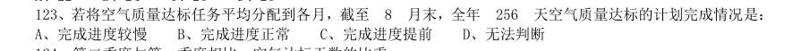

- **A.** 完成进度较慢
- **B.** 完成进度正常
- **C.** 完成进度提前
- **D.** 无法判断

**答案：C**

### 2008 湖北·统一卷　第 126 题　（现期平均数）

年份 城市居民人均可支配收入 农村居民人均纯收入 城乡比率 343.4 133.6 2.57:1 477.6 191.3 2.50:1 739.1 397.6 1.86:1 1510.2 686.3 2.20:1 1700.6 708.6 2.40:1 2026.6 784.0 2.58:1 2577.4 921.6 2.80:1 3496.2 1221.0 2.86:1 4283.0 1577.7 2.72:1 4838.9 1926.1 2.51:1 5160.3 2090.1 2.47:1 5425.1 2162.0 2.51:1 5854.0 2210.3 2.65:1 6280.0 2253.4 2.79:1 6859.6 2366.4 2.90:1 3.11:1 3.23:1 我国城乡居民收入差距 上表中,农村居民人均纯收入增加最多的年份为:

- **A.** 1995 年
- **B.** 1993 年
- **C.** 1996 年
- **D.** 2003 年

**答案：A**

### 2008 湖北·统一卷　第 129 题　（现期平均数）

上表中,城市居民人均收入增长率最低的年份为:

- **A.** 1998 年
- **B.** 1999 年
- **C.** 2003 年
- **D.** 1991 年

**答案：A**

### 2008 国考·统一卷　第 129 题　（平均数增长率）

若南亚地区1992 年总人口数为15 亿,该地区平均人口年增长率为2%,那么2002 年南亚地区饥饿人口总 量为多少亿人:

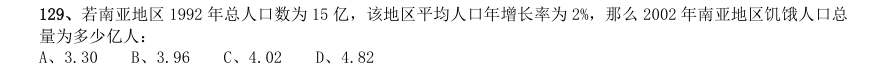

- **A.** 3.30
- **B.** 3.96
- **C.** 4.02
- **D.** 4.82

**答案：C**

### 2007 广东·统一卷　第 94 题　（现期平均数）
> 材料：(个)活动R8LD活动机构员年平均人数(万人)动人员(万人)工程师人贝总计5.O5…

A.0.40 亿元 B.1.90 亿元 C.3.17 亿元 D.3.83 亿元 93.2004 年广东高技术行业企业平均拥有科技活动人员多少人?( ) A.5i5.8 人 B.21.6 人 C.16.9 人 D.13.4 人 根据材料,下列表述错误的一项是( )。

- **A.** 2004 年,在广东高技术行业中,开展科技活动的企业有794 家
- **B.** 2004 年,在广东高技术行业中,开展R&D 活动的企业占l2.67%
- **C.** 2004 年,在广东高技术行业中,大中型工业企业主要集中在电子及通信设备制造业
- **D.** 若2000 年在广东高技术行业的企业中,有科技机构的企业为l68 个,则到2004 年,增长了1.35 倍

**答案：暂缺**

### 2007 国考·统一卷　第 122 题　（现期平均数）
> 材料：2006 年五月份北京市消费品市场较为活跃,实现社会消费品零售额272.2 亿元,创今年历史第二高,据统 计,1~5 月份全市累计实现社会消费品零售额1312.7 亿元,比去年同期增长12.5%。 汽车销售继续支持北京消费品市场的繁荣。5 月份,全市机动车类销售量为5.4 万辆,同比增长23.9%,据 对限额以上批发零售贸易企业统计,汽车类商品当月实现零售额32.3 亿元,占限额以上批发零售贸易企业零售 额比重的20.3%。 据对限额以上批发零售贸易企业统计。5 月份,家具类…

若保持同比增长不变,预计北京市2007 年前5 个月平均每月的社会消费品销售额:

- **A.** 将接近255 亿元
- **B.** 将接近280 亿元
- **C.** 将接近300 亿元
- **D.** 将突破300 亿元

**答案：C**

### 2007 国考·统一卷　第 133 题　（现期平均数）
> 材料：2005 年全国专利审查与专利代理业务研讨会宣布,预计在“十一五”期间,我国专利申请总量将达346 万 件,其中发明专利申请总量将达到140 万件,实用新型专利申请总量将达到89 万件,外观设计专利申请总量将 达到117 万件。 据介绍,我国专利审批总体能力在“十五”期间大幅提高,审查周期大幅缩短。发明专利人均待审量由“十 五"初期(2001 年)的154 件下降到“十五”末期(2005 年)的85 件,平均结案周期从“十五”初期的53 个月缩短 至“十五”末期的24 个月。…

与1985 年4 月1 日至2000 年4 月1 日间专利申请平均受理时间相比,2000 年4 月1 日至2004 年6 月1 日间专利申请的平均受理时间下降了:

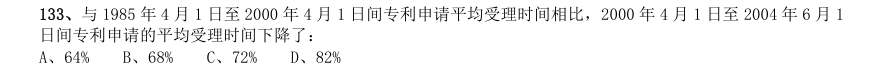

- **A.** 64%
- **B.** 68%
- **C.** 72%
- **D.** 82%

**答案：C**

### 2006 广东·统一卷　第 98 题　（现期平均数）
> 材料：2000—2004 年我国大中型企业专利申请及拥有量统计图(单位:件)2004 年我国部分省、市大中型工业企业专利申请及拥有量统计表单位:件地区专利申请量(件)发明专利申请量(件)发明专利拥有量(件)北京天津上海浙江江苏黑龙江山东广东四川陕西青海…

根据上图,2000年至2004年间,我国大中型工业企业三项专利统计指标的平均增幅最大的一项是( )。

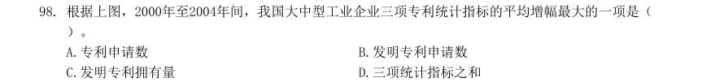

- **A.** 专利申请数
- **B.** 发明专利申请数
- **C.** 发明专利拥有量
- **D.** 三项统计指标之和

**答案：暂缺**

### 2006 国考·统一卷　第 117 题　（现期平均数）
> 材料：2000 年至2004 年全国大中型工业企业部分科技指标情况表单位2000 年2001 年2002 年2003 年2004 年企业总数个设有科技机构企业的比重科技人员万人科技人员占从业人员的比例科技经费亿元科技经费占销售额的比例…

2004 年,全国大中型工业企业平均每个从业人员创造销售额约为( )。

- **A.** 30.7 万元
- **B.** 60.7 万元
- **C.** 382.7 万元
- **D.** 682.3 万元

**答案：A**

### 2006 国考·统一卷　第 128 题　（现期平均数）
> 材料：2004 年广播、电视宣传基本情况表项目节目套数(套)播出时间(小时/日)自办节目时间(小时/日)新闻节目专题节目教育节目文艺节目服务性节目无线广播合计中央台和国际台地方台电视播映合计中央台地方台…

中央电视台与地方电视台平均每套节目的自办时间之比约为( )。

- **A.** 20∶9
- **B.** 12∶9
- **C.** 1∶72
- **D.** 1∶160

**答案：A**

### 2005 广东·统一卷　第 88 题　（现期平均数）
> 材料：86—90 题: 2004 年,广东国民经济保持平稳快速的发展势头,尤其是二、三产业的快速发展为广东城镇居民收入增 加奠定了基础。调查资料显示,2004 年广东城镇居民人均可支配收入 13 627.65 元,比上年增长10.1%,人均消费陛支出10694.79 元,增长11.0%。按家庭人口计算,广 东城镇居民人均工薪收入1l 646.42 元,增长11.8%。2004 年广东城镇居民家庭八大类消费支出除了家 庭设备用品及服务支出下降9.9%外,其他七类支出都有不同程度的增长…

2004 年低收入户家庭人均可支配收入增幅比全省平均收入增幅低多少?

- **A.** 9 907.55 元
- **B.** 2.8 个百分点
- **C.** 72.7%
- **D.** 7.3 个百分点

**答案：暂缺**

### 2005 广东·统一卷　第 89 题　（现期平均数）
> 材料：86—90 题: 2004 年,广东国民经济保持平稳快速的发展势头,尤其是二、三产业的快速发展为广东城镇居民收入增 加奠定了基础。调查资料显示,2004 年广东城镇居民人均可支配收入 13 627.65 元,比上年增长10.1%,人均消费陛支出10694.79 元,增长11.0%。按家庭人口计算,广 东城镇居民人均工薪收入1l 646.42 元,增长11.8%。2004 年广东城镇居民家庭八大类消费支出除了家 庭设备用品及服务支出下降9.9%外,其他七类支出都有不同程度的增长…

2003 年,广东城镇居民人均消费陛支出多少元?

- **A.** 13 627.65 元
- **B.** 10 694.79 元
- **C.** 9 634.95 元
- **D.** 9 566 元

**答案：暂缺**

### 2005 广东·统一卷　第 90 题　（现期平均数）
> 材料：86—90 题: 2004 年,广东国民经济保持平稳快速的发展势头,尤其是二、三产业的快速发展为广东城镇居民收入增 加奠定了基础。调查资料显示,2004 年广东城镇居民人均可支配收入 13 627.65 元,比上年增长10.1%,人均消费陛支出10694.79 元,增长11.0%。按家庭人口计算,广 东城镇居民人均工薪收入1l 646.42 元,增长11.8%。2004 年广东城镇居民家庭八大类消费支出除了家 庭设备用品及服务支出下降9.9%外,其他七类支出都有不同程度的增长…

2004 年,广东城镇居民人均可支配收入余额约为:

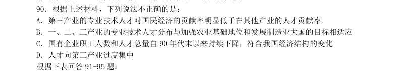

- **A.** 2 932.86 元
- **B.** 1 981.23 元
- **C.** 9 907.56 元D.11 646.42 元

**答案：暂缺**

### 2005 广东·统一卷　第 95 题　（现期平均数）
> 材料：表 1:2002 年全国与部分省市高技术产业基本情况表 2:2002 年全国与部分省市高技术产业科技活动情况企业数(个)当年家总产主值(亿元)增加值(亿元)销售收入(亿元)利润(亿元)全国广东江苏上海北京天津浙江福建山东…

2002 年,平均每个高技术企业拥有科技机构数最高的省(市)是:

- **A.** 广东
- **B.** 江苏
- **C.** 浙江
- **D.** 山东

**答案：暂缺**

### 2005 国考·统一卷　第 125 题　（现期平均数）
> 材料：环渤海经济区正逐步成为引人注目的经济增长第三极,而京津冀在环渤海经济区占有举足轻重的位 置。但以北京、天津为核心的京津冀城市群分布比较散乱,彼此间的空间联系松散且薄弱,重复建设问 题比较严重,资源浪费现象普遍存在。2003 年,北京、天津两市人均GDP 分别超过或接近3 万元,城 镇居民可支配收入均高于全国平均水平,而河北人均GDP 刚刚突破1 万元,城镇居民可支配收入7239 元,比全国平均水平低14.6%,比北京市低近一半;从市场开放度看,京津两市由于享受开放城市、 沿海…

北京市城镇人均可支配收入约比全国平均水平高( )。

- **A.** 15%
- **B.** 22%
- **C.** 64%
- **D.** 102%

**答案：C**

### 2005 国考·统一卷　第 127 题　（现期平均数）
> 材料：1993-2003 年某国国内生产总值指数年份国民生产总值国内生产总值第一产业第二产业第三产业人均国内生产总值说明:本题中指数的计算方法为:当年的数值与上一年数值的比乘以100。举例来说,假设第一年的数值为m,第二年的数值为n,则第二年的指数为100×(n/m)。…

与上一年相比,人均国内生产总值增长最快的年份是( )。

- **A.** 1994 年
- **B.** 1996 上
- **C.** 2002 年
- **D.** 2003 年

**答案：C**

### 2005 国考·统一卷　第 128 题　（现期平均数）
> 材料：1993-2003 年某国国内生产总值指数年份国民生产总值国内生产总值第一产业第二产业第三产业人均国内生产总值说明:本题中指数的计算方法为:当年的数值与上一年数值的比乘以100。举例来说,假设第一年的数值为m,第二年的数值为n,则第二年的指数为100×(n/m)。…

第三产业的指数超过人均国内生产总值的年份有( )。

- **A.** 5 个
- **B.** 7 个
- **C.** 9 个
- **D.** 11 个

**答案：C**

### 2005 国考·统一卷　第 129 题　（现期平均数）
> 材料：1993-2003 年某国国内生产总值指数年份国民生产总值国内生产总值第一产业第二产业第三产业人均国内生产总值说明:本题中指数的计算方法为:当年的数值与上一年数值的比乘以100。举例来说,假设第一年的数值为m,第二年的数值为n,则第二年的指数为100×(n/m)。…

2003 年与2001 年相比,人均国内生产总值增长了( )。

- **A.** 25.6%
- **B.** 27.2%
- **C.** 6.5%
- **D.** 24.3%

**答案：B**

### 2004 国考·A卷　第 90 题　（现期平均数）

从平均水平来看,投资增长最快的年份是( )。

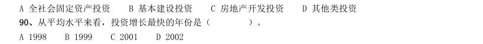

- **A.** 1998
- **B.** 1999
- **C.** 2001
- **D.** 2002

**答案：A**

### 2004 国考·A卷　第 101 题　（现期平均数）
> 材料：各分类指数情况如下: 6 月份竣工面积分类指数为111.46,与5 月份基本持平,比去年同期上升7.42 点。1~6 月份,全国累计完 成房屋竣工面积8187 万平方米,同比增长40.4%,增幅比去年同期增加20 个百分点。 6 月份资金来源分类指数为108.47,比5 月份上升2.41 点,比去年同期上升4.68 点。1~6 月份,全国房 地产开发到位资金达到5723 亿元,同比增长48.4%,增幅比去年同期高13.4 个百分点。 6 月份新开工面积分类指数达到108.91…

2002 年上半年,商品房平均销售价格是( )。

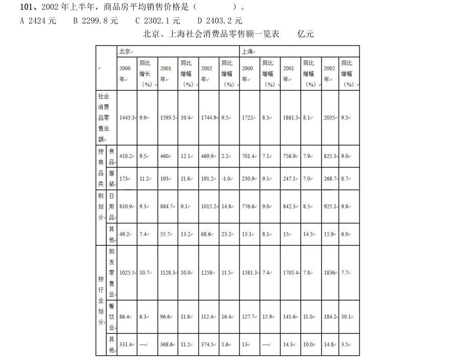

- **A.** 2424 元
- **B.** 2299.8 元
- **C.** 2302.1 元
- **D.** 2403.2 元

**答案：B**

### 2003 国考·A卷　第 113 题　（现期平均数）
> 材料：某地区劳动力文化程度的资料如下:(单位:万人)分组合计文盲小学初中高中大专本科及以上男性3452711712060912 女性40548228903063 总计75075345210901515(注:学习年限标准:文盲,0 年;小学,6年;初中,9 年;高中,12 年;大专,15 年;本科及以上,16 年)…

经折算,该地区劳动力的平均学习年限约为7.34 年,那么造成这一现状的主要原因,我们可以认为( )。

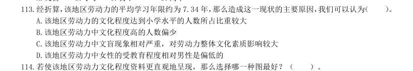

- **A.** 该地区劳动力的文化程度达到小学水平的人数所占比重较大
- **B.** 该地区劳动力中文化程度高的人数偏少
- **C.** 该地区劳动力中文盲现象相对严重,对劳动力整体文化素质影响较大
- **D.** 该地区劳动力中女性的受教育程度相对男性是偏低的

**答案：A**

### 2003 国考·A卷　第 116 题　（现期平均数）

某地区用水与人口情况 日平均用水量分配图 当日平均用水量为200 万吨时的年代,人口约为多少万?( )。

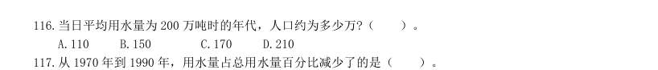

- **A.** 110
- **B.** 150
- **C.** 170
- **D.** 210

**答案：A**

### 2003 国考·A卷　第 118 题　（现期平均数）

日平均灌溉用水的实际水量从1970 年到2000 年如何变化?( )。

- **A.** 减少了
- **B.** 增加了
- **C.** 不变
- **D.** 无法确定

**答案：B**

### 2003 国考·A卷　第 119 题　（现期平均数）

从1970 年到1990 年,日平均发电用水量大约增加了多少万吨?( )。

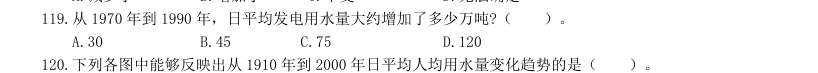

- **A.** 30
- **B.** 45
- **C.** 75
- **D.** 120

**答案：C**

### 2003 国考·A卷　第 120 题　（现期平均数）

下列各图中能够反映出从1910 年到2000 年日平均人均用水量变化趋势的是( )。 三、根据下列图表回答问题。 下面几张图分别是中国网民的性别、年龄及学历构成。

> （本题为图形题，选项为图片，见原卷）

**答案：A**

### 2002 国考·A卷　第 124 题　（现期平均数）

单选、 从2000 年到2002 年中国的平均经济增长率最接近的是:

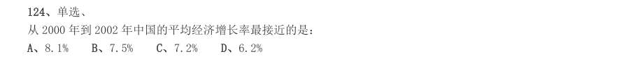

- **A.** 8.1%
- **B.** 7.5%
- **C.** 7.2%
- **D.** 6.2%

**答案：B**

### 2001 国考·统一卷　第 110 题　（现期平均数）

如果按照1978~1990 年进口额平均增长速度计算,预计1996 年进口额约为多少亿元?( )。

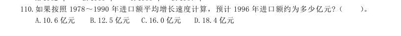

- **A.** 10.6 亿元
- **B.** 12.5 亿元
- **C.** 16.0 亿元
- **D.** 18.4 亿元

**答案：B**
