# 资料分析 · 平均数计算 · 2010 年代真题

> 所属考点：[ZL-AVG](../ZL-AVG-平均数计算.md)　｜　本片 74 题

> 本片子考点：现期平均数 73　平均数增长率 1

### 【2019 湖北省考·第 109 题】HB-2019-ty-X109　平均数计算｜现期平均数
> 材料：2017 年我国成年国民图书阅读率为 ,比上年增加0.3 个百分点;报纸阅读率为 ,比上年降低2.1 个百分点;期刊阅读率为 ,比上年增加1 个百分点。 2017 年我国成年国民数字化阅读方式(网络在线阅读、手机阅读、电子阅读器阅读、平板电脑阅读等)的接 触率为 。…

平板电脑阅读 电子阅读器阅读 2017 年我国成年国民阅读一本纸质图书平均需要:

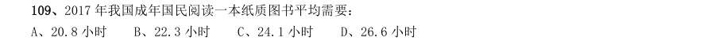

- **A.** 20.8 小时
- **B.** 22.3 小时
- **C.** 24.1 小时
- **D.** 26.6 小时

**答案：D**

### 【2019 湖北省考·第 119 题】HB-2019-ty-X119　平均数计算｜现期平均数
> 材料：2017 年全国举办马拉松赛事达1102 场,其中,中国田径协会举办的A 类赛事223 场,B 类赛事33 场。2017 年马拉松赛事的参与人次达到了498 万人次,2016 年、2015 年马拉松赛事的参与人次分别为280 万人次、150 万人次。 2017 年全年马拉松直接从业人口数72 万,间接从业人口数200 万。年度产业总规模达700 亿元,比去年同 期增长约 ,中国田径协会设置的发展目标是到2020 年,全国马拉松规模赛事超过1900 场,其中中国田径协 会认证赛…

在2017 年马拉松运动年度产业总规模的基础上,从2018 年开始,每年需要平均增长多少才能实现中国田 径协会设置的2020 年马拉松运动产业规模目标?

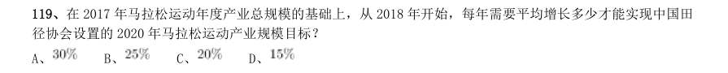

- **A.** 
- **B.** 
- **C.** 
- **D.** 

**答案：C**

### 【2019 湖北省考（选调）·第 117 题】HB-2019-xd-X117　平均数计算｜现期平均数
> 材料：自改革开放以来,外商在华投资势头良好。今年两会期间,《中华人民共和国外商投资法(草案)》成为重 要议题。2018 年,外商直接在华投资(非金融类)新设立企业60533 家。外商直接在华投资金额8856 亿元,折 1350 亿美元。其中“一带一路"沿线国家对华直接投资新设立企业4479 家,对华直接投资424 亿元。全年高技 术制造业实际使用外资(非金融类)898 亿元,增长35.1%。…

2018 年,外商直接在华投资(非金融类)新设企业的平均投资额(单位:万元)在以下哪个区间内?

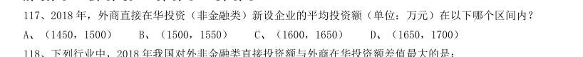

- **A.** (1450,1500)
- **B.** (1500,1550)
- **C.** (1600,1650)
- **D.** (1650,1700)

**答案：A**

### 【2019 湖北省考（选调）·第 121 题】HB-2019-xd-X121　平均数计算｜现期平均数
> 材料：2018 年,我国软件和信息技术服务业运行态势良好,收入和效益增长较快,吸纳就业人数稳定增长。2018年,全国软件和信息技术服务业规模以上企业3.78 万家,累计完成软件业务收入63061 亿元,软件和信息技术服务业实现利润总额8079 亿元,同比增长9.7%,从业人数比上年增加25 万人。…

年,全国软件和信息技术服务业规模以上企业3.78 万家,累计完成软件业务收入63061 亿元,软件和信息技术 服务业实现利润总额8079 亿元,同比增长9.7%,从业人数比上年增加25 万人。 2013—2018 年,我国软件和信息技术服务业人均创收额同比增速回落超过5 个百分点的年度有:

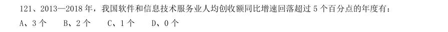

- **A.** 3 个
- **B.** 2 个
- **C.** 1 个
- **D.** 0 个

**答案：C**

### 【2019 国考（地市级）·第 111 题】GK-2019-ds-X111　平均数计算｜现期平均数

析、比较、计算和判断处理。 (一) 2017 年第三季度,全国平均每吨进口药品单价约为多少万美元?

- **A.** 2
- **B.** 19
- **C.** 8
- **D.** 96

**答案：B**

### 【2019 国考（地市级）·第 118 题】GK-2019-ds-X118　平均数计算｜现期平均数
> 材料：2017 年全国二手车累计交易量为1240 万辆,同比增长19.3%;二手车交易额为8092.7 亿元,同比增长34%。 2017 年12 月,全国二手车市场交易量为123 万辆,交易量环比上升7.4%,上年同期交易量为108 万辆。…

2017 年1~10 月,平均每月全国二手车交易量约为多少万辆?

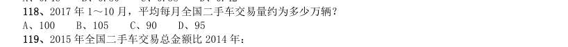

- **A.** 100
- **B.** 105
- **C.** 90
- **D.** 95

**答案：A**

### 【2019 国考（地市级）·第 128 题】GK-2019-ds-X128　平均数计算｜现期平均数
> 材料：2017 年,A 省完成邮电业务总量6065.71 亿元。其中,电信业务总量3575.86 亿元,同比增长75.8%;邮政 业务总量2489.85 亿元,增长32.0%。 2017 年,A 省移动电话期末用户1.48 亿户,比上年末增长3.1%。其中,4G 期末用户达1.18 亿户,比上年 末增长29.3%。互联网宽带接入期末用户3128 万户,比上年末增长9.9%。移动互联网期末用户1.31 亿户,比上 年末增长13.9%,移动互联网接入流量同比增长158.8%。 2017…

2017 年前三季度,A 省平均每人次客运旅客运输距离(旅客周转量÷客运总量)同比( )

- **A.** 下降了不到2%
- **B.** 下降了2%以上
- **C.** 上升了不到2%
- **D.** 上升了2%以上

**答案：C**

### 【2018 湖北省考·第 106 题】HB-2018-ty-X106　平均数计算｜平均数增长率
> 材料：2017 年上半年,全国居民人均可支配收入12932 元,比上年同期名义增长8.8%,其中,城镇居民人均可 支配收入18322 元,增长8.1%(以下如无特别说明,均为同比名义增长);农村居民人均可支配收入6562 元, 增长8.5%。…

按收入来源分,2017 年上半年,全国居民人均工资性收入7435 元,增长8.6%,占全国居民人均可支配收 入的比重为57.5%;人均经营净收入2117 元,增长5.9%,占全国居民人均可支配收入的比重为16.4%;人均财 产净收入1056 元,增长9.6%,占全国居民人均可支配收入的比重为8.2%;人均转移净收入2324 元,增长11.9%, 占全国居民人均可支配收入的比重为18.0%。 2016 年上半年,城镇居民人均可支配收入约为多少万元?

- **A.** 1.4
- **B.** 1.7
- **C.** 2.1
- **D.** 2.3

**答案：B**

### 【2018 湖北省考·第 107 题】HB-2018-ty-X107　平均数计算｜现期平均数
> 材料：2017 年上半年,全国居民人均可支配收入12932 元,比上年同期名义增长8.8%,其中,城镇居民人均可 支配收入18322 元,增长8.1%(以下如无特别说明,均为同比名义增长);农村居民人均可支配收入6562 元, 增长8.5%。…

2017 年上半年,全国居民消费支出主要数据按消费类别分,其指标的增长率超过全国居民人均消费支出 水平增长率的有几个?

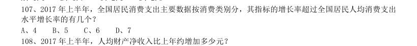

- **A.** 4
- **B.** 5
- **C.** 6
- **D.** 7

**答案：B**

### 【2018 湖北省考·第 108 题】HB-2018-ty-X108　平均数计算｜现期平均数
> 材料：2017 年上半年,全国居民人均可支配收入12932 元,比上年同期名义增长8.8%,其中,城镇居民人均可 支配收入18322 元,增长8.1%(以下如无特别说明,均为同比名义增长);农村居民人均可支配收入6562 元, 增长8.5%。…

2017 年上半年,人均财产净收入比上年约增加多少元?

- **A.** 92
- **B.** 102
- **C.** 112
- **D.** 122

**答案：A**

### 【2018 湖北省考·第 119 题】HB-2018-ty-X119　平均数计算｜现期平均数
> 材料：根据以下材料,回答116~120 题。 2016 年,我国全年完成邮电业务收入总量43344 亿元,比上年增长52.7%。其中,邮政业务收入7397 亿 元,增长45.7%;电信业务总量35948 亿元,增长54.2%。邮政业全年完成邮政函件业务36.2 亿件,包裹业务 0.3 亿件,快递业务量312.8 亿件;快递业务收入总量3974 亿元。电信业全年新增移动电话交换机容量7318 万户,达到218384 万户。2016 年来全国电话用户总数152856 万户(电话包括固定…

2012~2016 年期间,我国固定互联网宽带接入用户的平均数是:

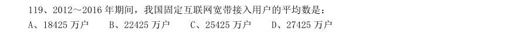

- **A.** 18425 万户
- **B.** 22425 万户
- **C.** 25425 万户
- **D.** 27425 万户

**答案：B**

### 【2018 广东省考·第 88 题】GD-2018-ty-X088　平均数计算｜现期平均数
> 材料：A 市坚持发挥科技创新的引领作用,强化企业的创新主体地位,研发投入不断增加,研发人员快速增长, 创新能力持续增强,锂电池等新兴产业尤为突出。 五年来,企业创新意愿不断提升,研发投入快速增长。2016 年,该市有研究与试验发展(R&D)活动的 单位172 家,比2012 年增加26 家,R&D 经费内部支出19.55 亿元,比2012 年增加11.65 亿元,增长 ,年均增长率为 ;R&D 经费内部支出与地区生产总值之比为 ,比2012 年提高0.5 个百分 点。规模以上工业企…

2012 年,该市平均每家研究与试验发展(R&D)活动单位的R&D 经费内部支出约为( )亿元。

- **A.** 0.023
- **B.** 0.054
- **C.** 0.163
- **D.** 0.242

**答案：该题答案缺失，见原卷**

### 【2018 广东省考·第 92 题】GD-2018-ty-X092　平均数计算｜现期平均数
> 材料：2017 年第四季度,人力资源部门对东、中、西三大区域共95 个城市的公共就业服务机构市场供求信息进行了统计分析,部分数据如下:总体而言,用人单位通过公共就业服务机构招聘各类人员约433.7 万人,进入市场的求职者约354.2 万人,岗位空缺与求职人数的比率约为1.22,比去年同期上升0.09,市场需求略大于供给。 与去年同期相比,需求人数增加15.6 万人,求职人数减少17.3 万人。与上季度相比,需求人数和求职人数分别减少了58.9 万人和73.2 万人,各下降了和。 分…

2015—2017 年,各季度的岗位空缺与求职人数比率的平均值约为( )。

- **A.** 1.07
- **B.** 1.09
- **C.** 1.11
- **D.** 1.13

**答案：该题答案缺失，见原卷**

### 【2018 广东省考·第 98 题】GD-2018-ty-X098　平均数计算｜现期平均数
> 材料：近年来,广东全省医疗卫生资源总量继续增加,医疗服务能力不断增强。截止2016 年底,全省医疗卫生机构4.91 万个,医疗卫生机构拥有床位46.5 万张,其中:医院37.2 万张,卫生院5.7 万张。医疗卫生机构卫生技术人员66.8 万人,其中:执业(助理)医师24.4 万人,注册护士28.4 万人,医护比1:1.16。…

2016 年全省医疗卫生机构的平均床位数约是2012 年的( )倍。

- **A.** 1.2
- **B.** 1.5
- **C.** 2
- **D.** 2.3

**答案：该题答案缺失，见原卷**

### 【2018 国考（副省级）·第 117 题】GK-2018-fs-X117　平均数计算｜现期平均数
> 材料：2016 年“一带一路”沿线64 个国家GDP 之和约为12.0 万亿美元,占全球GDP 的16.0%;人口总数约为32.1 亿人,占全球总人口的43.4%;对外贸易总额(进口额+出口额)约为71885.6 亿美元,占全球贸易总额的21.7%。…

2016 年“一带一路”沿线国家中,东欧20 国的人均GDP 约是中亚5 国的多少倍?

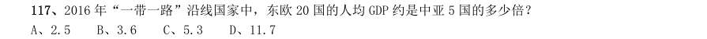

- **A.** 2.5
- **B.** 3.6
- **C.** 5.3
- **D.** 11.7

**答案：A**

### 【2018 国考（副省级）·第 126 题】GK-2018-fs-X126　平均数计算｜现期平均数
> 材料：2016 年,全国城市公园数量排名前五的省份依次是广东、浙江、江苏、山东和云南,公园数量分别为3512 个、1171 个、942 个、828 个和683 个。…

其中,广东省的公园面积达到65318 公顷,占全国公园面积的比重超过 17%;公园绿地面积达到89591 公顷,占全国公园绿地面积的比重约为14%。 注:公园绿地指具有公园作用的所有绿地的统称,即公园性质的绿地,并非公园中的绿地面积,包括综合公园、 专类公园、带状公园、街旁游乐园和社区公园等。 2016 年,佛山市平均每个公园的面积约为多少公顷?

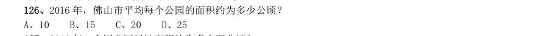

- **A.** 10
- **B.** 15
- **C.** 20
- **D.** 25

**答案：A**

### 【2017 湖北省考·第 111 题】HB-2017-ty-X111　平均数计算｜现期平均数

根据以下资料,回答111~115 题。 2015 年江苏、浙江、江西三省的税收收入平均增速是:

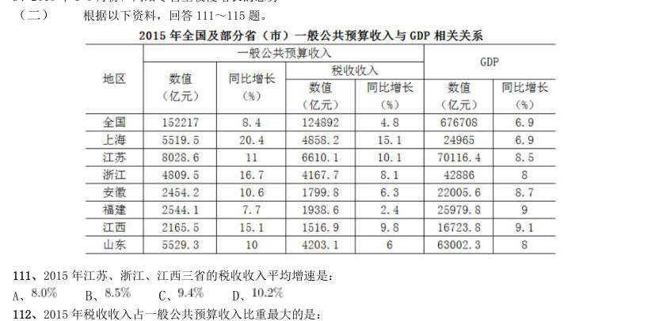

- **A.** 
- **B.** 
- **C.** 
- **D.** 

**答案：C**

### 【2017 湖北省考·第 113 题】HB-2017-ty-X113　平均数计算｜现期平均数

2015 年一般公共预算收入高于表中七个省(市)平均值的有:

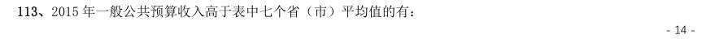

- **A.** 上海、安徽、福建、江西
- **B.** 江苏、浙江、安徽、山东
- **C.** 上海、江苏、浙江、山东
- **D.** 安徽、福建、江西、山东

**答案：C**

### 【2017 湖北省考·第 119 题】HB-2017-ty-X119　平均数计算｜现期平均数
> 材料：根据以下资料,回答116~120 题。 2015 年国家自然科学基金委全年共接收173017 项各类申请,同比增长约 ,择优资助各类项目40668 项,比 上年增加1579 项,资助直接费用218.8 亿元,平均资助强度(资助直接费用与资助项数的比值)53.8 万元,各项工 作取得新进展新成效。 在研究项目系列方面,面上项目资助16709 项,比上年增加1709 项,占总项数的 ,直接费用102.41 亿元, 平均资助率(资助项目占接收申请项目的比重) ,同比下降2.5 个百…

2015 年重点项目的平均资助强度约为:

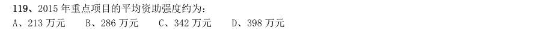

- **A.** 213 万元
- **B.** 286 万元
- **C.** 342 万元
- **D.** 398 万元

**答案：B**

### 【2017 广东省考·第 86 题】GD-2017-ty-X086　平均数计算｜现期平均数
> 材料：2016 年,某省小微服务业呈现出经营平稳面、资产规模、享受税收优惠政策范围“三扩大”的特点,主 要行业实现较快增长。 2016 年,该省小微服务业样本企业实现营业收入80.1 亿元,同比增长 ,高于规模以上重点服务业 企业8.2 个百分点,增速比上年回落0.6 个百分点。经营平稳面扩大,2016 年4 季度, 的企业认为本 企业综合经营状况良好或稳定,同比提高3.3 个百分点,处于历史较高水平。 2016 年,小微服务业样本企业资产总计367 亿元,同比增长 ,户均1643…

各主要行业中,水利、环境和公共设施管理业,信息传输、软件和信息技术服务业,租赁和商务服务业, 房地产业的增速明显高于平均水平。 2016 年,该省小微服务业样本企业的营业收入比2015 年大约多多少亿元?

- **A.** 5.3
- **B.** 10.7
- **C.** 12.3
- **D.** 23.0

**答案：该题答案缺失，见原卷**

### 【2017 广东省考·第 88 题】GD-2017-ty-X088　平均数计算｜现期平均数
> 材料：2016 年,某省小微服务业呈现出经营平稳面、资产规模、享受税收优惠政策范围“三扩大”的特点,主 要行业实现较快增长。 2016 年,该省小微服务业样本企业实现营业收入80.1 亿元,同比增长 ,高于规模以上重点服务业 企业8.2 个百分点,增速比上年回落0.6 个百分点。经营平稳面扩大,2016 年4 季度, 的企业认为本 企业综合经营状况良好或稳定,同比提高3.3 个百分点,处于历史较高水平。 2016 年,小微服务业样本企业资产总计367 亿元,同比增长 ,户均1643…

2015-2016 年,平均每季度大约有多少企业认为自身综合经营状况良好或稳定?

- **A.** 
- **B.** 
- **C.** 
- **D.** 

**答案：该题答案缺失，见原卷**

### 【2017 国考（副省级）·第 123 题】GK-2017-fs-X123　平均数计算｜现期平均数
> 材料：截至2014 年末,我国共有博物馆3658 个,占文物机构总数的43.5%。全国文化机构拥有文物藏品4063.58 万件,比上年末增加222.77 万件。其中,博物馆文物藏品2929.97 万件,文物商店文物藏品770.00 万件。文物 藏品中,一级文物9.82 万件,二级文物68.82 万件,三级文物340.51 万件。…

2014 年,平均每家博物馆接待观众人次数约是其他文物机构的多少倍?

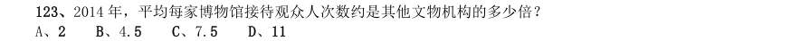

- **A.** 2
- **B.** 4.5
- **C.** 7.5
- **D.** 11

**答案：C**

### 【2017 国考（副省级）·第 127 题】GK-2017-fs-X127　平均数计算｜现期平均数
> 材料：2015 年我国钟表全行业实现工业总产值约675 亿元,同比增长3.2%,增速比上年同期提高1.7 个百分点。 全行业全年生产手表10.7 亿只,同比增长3.9%,完成产值约417 亿元,同比增长4.3%,增速提高1.9 个 百分点;生产时钟(含钟心)5.2 亿只,同比下降3.7%,完成产值162 亿元,同比下降4.7%,降幅扩大1.3 个百分点;钟表零配件、定时器及其他计时仪器产值96 亿元,同比增长14.3%,增速基本保持上年水平。 2015 年我国钟表行业规模以上工业企…

2015 年钟表全行业平均每制造一只手表,能实现约多少元的产值?

- **A.** 36
- **B.** 39
- **C.** 42
- **D.** 63

**答案：B**

### 【2017 国考（副省级）·第 128 题】GK-2017-fs-X128　平均数计算｜现期平均数
> 材料：2015 年我国钟表全行业实现工业总产值约675 亿元,同比增长3.2%,增速比上年同期提高1.7 个百分点。 全行业全年生产手表10.7 亿只,同比增长3.9%,完成产值约417 亿元,同比增长4.3%,增速提高1.9 个 百分点;生产时钟(含钟心)5.2 亿只,同比下降3.7%,完成产值162 亿元,同比下降4.7%,降幅扩大1.3 个百分点;钟表零配件、定时器及其他计时仪器产值96 亿元,同比增长14.3%,增速基本保持上年水平。 2015 年我国钟表行业规模以上工业企…

2015 年我国钟表行业规模以上工业企业主营业务利润率比轻工行业平均水平:

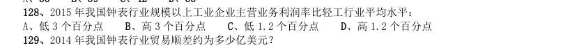

- **A.** 低3 个百分点
- **B.** 高3 个百分点
- **C.** 低1.2 个百分点
- **D.** 高1.2 个百分点

**答案：C**

### 【2016 湖北省考·第 116 题】HB-2016-ty-X116　平均数计算｜现期平均数
> 材料：2015 年2 月,我国快递业务量完成8.2 亿件,同比增长18.7%;业务收入完成136.0 亿元,同比增长22.5%。 消费者对快递业务进行的申诉中,有效申诉(确定企业责任的)占总申诉量的97.6%,为消费者挽回经济损失229.8 万元。…

2015 年2 月,全国每百万件快递业务中,有效申诉量未23.4 件,对企业1 的每百万件有效申诉量为75.13 件,环比增长48.0%,对企业2 的每百万件有效申诉量未32.56 件,环比增长55.0%,对企业3 的每百万件有效 申诉量为31.86 件,环比增长140.0%,对企业4 的每百万件有效申诉量为17.81 件,环比增长36.0%。 2015 年2 月,平均每笔快递业务的收入在以下哪个范围之内?

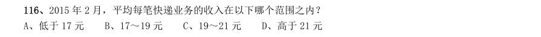

- **A.** 低于17 元
- **B.** 17~19 元
- **C.** 19~21 元
- **D.** 高于21 元

**答案：A**

### 【2016 广东省考（县级）·第 97 题】GD-2016-xj-X097　平均数计算｜现期平均数
> 材料：2000 年、2005 年、2010 年我国普通高中专任教师总人数分别为756850 人、1299460 人、1518194 人。其 中,女性人数分别为273110 人、558625 人、723566 人。…

2005 年,我国31-45 岁的普通高中专任教师的平均年龄可能会是( )岁。

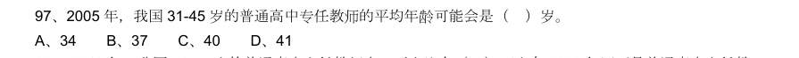

- **A.** 34
- **B.** 37
- **C.** 40
- **D.** 41

**答案：该题答案缺失，见原卷**

### 【2016 国考（副省级）·第 121 题】GK-2016-fs-X121　平均数计算｜现期平均数
> 材料：2014 年末全国共有公共图书馆3117 个,比上年末增加5 个。年末全国共图书馆从业人员56071 人。 2014 年末全国公共图书馆实际使用房屋建筑面积1231.60 万平方米,比上年末增长6.3%;图书总藏量79092万册,比上年末增长5.6%;电子图书50674 万册,比上年末增长34.2%;阅览室座席数85.55 万个,比上年末增长5.7%。…

2014 年,全国平均每个公共图书馆月均流通人次约为:

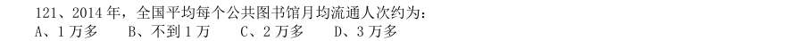

- **A.** 1 万多
- **B.** 不到1 万
- **C.** 2 万多
- **D.** 3 万多

**答案：A**

### 【2016 国考（副省级）·第 123 题】GK-2016-fs-X123　平均数计算｜现期平均数
> 材料：2014 年末全国共有公共图书馆3117 个,比上年末增加5 个。年末全国共图书馆从业人员56071 人。 2014 年末全国公共图书馆实际使用房屋建筑面积1231.60 万平方米,比上年末增长6.3%;图书总藏量79092万册,比上年末增长5.6%;电子图书50674 万册,比上年末增长34.2%;阅览室座席数85.55 万个,比上年末增长5.7%。…

2012~2014 年,平均每流通人次约产生多少册次的书刊文献外借?

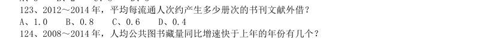

- **A.** 1.0
- **B.** 0.8
- **C.** 0.6
- **D.** 0.4

**答案：B**

### 【2016 国考（副省级）·第 124 题】GK-2016-fs-X124　平均数计算｜现期平均数
> 材料：2014 年末全国共有公共图书馆3117 个,比上年末增加5 个。年末全国共图书馆从业人员56071 人。 2014 年末全国公共图书馆实际使用房屋建筑面积1231.60 万平方米,比上年末增长6.3%;图书总藏量79092万册,比上年末增长5.6%;电子图书50674 万册,比上年末增长34.2%;阅览室座席数85.55 万个,比上年末增长5.7%。…

2008~2014 年,人均公共图书藏量同比增速快于上年的年份有几个?

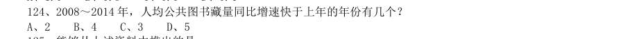

- **A.** 2
- **B.** 4
- **C.** 3
- **D.** 5

**答案：C**

### 【2016 国考（副省级）·第 131 题】GK-2016-fs-X131　平均数计算｜现期平均数
> 材料：2014 年全国社会物流总额213.5 万亿元,同比增长7.9%,比上年回落1.6 个百分点。 2014 年全国社会物流总费用10.6 万亿元,同比增长6.9%。其中,运输费用5.6 万亿元,同比增长6.6%; 保管费用3.7 万亿元,同比增长7.0%;管理费用1.3 万亿元,同比增长7.9%。…

2014 年每实现100 万元的社会物流额,其运输费用平均约为多少万元?

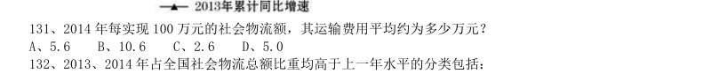

- **A.** 5.6
- **B.** 10.6
- **C.** 2.6
- **D.** 5.0

**答案：C**

### 【2016 国考（地市级）·第 114 题】GK-2016-ds-X114　平均数计算｜现期平均数
> 材料：2014 年全国棉花播种面积4219.1 千公顷,比2013 年减少2.9%。棉花总产量616.1 万吨,比2013 年减产2.2%。…

如果2014 年安徽省的棉花单位面积产量能够达到全国平均水平,那么其棉花总产量将达到约多少万吨?

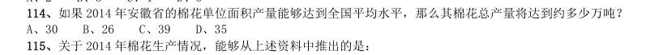

- **A.** 30
- **B.** 26
- **C.** 39
- **D.** 35

**答案：C**

### 【2015 湖北省考·第 113 题】HB-2015-ty-X113　平均数计算｜现期平均数
> 材料：经过50 多年的发展,我国台湾地区资本市场建立起由“证券交易所集中市场—上柜市场—兴柜市场”构成的完 善成熟的多层级资本市场体系。今年由于金融海啸、欧债危机等因素影响,台湾多层次资本市场总体成交值从 2010 至2012 年连续3 年下降,2012 年较2011 年衰退23.38%。周转率也呈现逐年下降趋势,2012 年证券交易所 几种市场周转率为97%,上柜市场周转率为175%,兴柜市场周转率为27%。 台湾资本市场第一层次是证券交易所集中市场。在准入门槛方面,台湾证交所要…

2012 年台湾证券交易所集中市场平均每家公司成交值是兴柜市场平均每家公司成交值的倍数为:

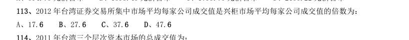

- **A.** 17.6
- **B.** 27.6
- **C.** 37.6
- **D.** 47.6

**答案：D**

### 【2015 广东省考（乡镇）·第 98 题】GD-2015-xz-X098　平均数计算｜现期平均数
> 材料：2013 年全年,我国出口苹果数量为994664.1 吨,同比增长1.9%,金额为10.3 亿美元,同比增长 7.3%。 2013 年12 月,我国出口苹果数量为117478.4 吨,比11 月下降8.0%,金额为1.2 亿美元,比11 月下降7.7%,同比出口数量增长2.6%,金额增长12.5%。…

2013 年我国平均每月出口苹果数量为多少吨:

- **A.** 82888.7
- **B.** 87997.3
- **C.** 98734.8
- **D.** 117478.4

**答案：该题答案缺失，见原卷**

### 【2015 国考（副省级）·第 116 题】GK-2015-fs-X116　平均数计算｜现期平均数

根据资料所提供的信息进行分析、比较、计算和判断处理。 (一)根据以下资料,回答116—120题。 与2011 年同期相比,2014 年1 季度农村居民人均现金收入约增长了:

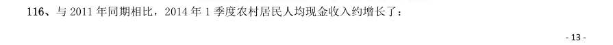

- **A.** 25.9%
- **B.** 36.8%
- **C.** 47.4%
- **D.** 52.5%

**答案：C**

### 【2015 国考（副省级）·第 117 题】GK-2015-fs-X117　平均数计算｜现期平均数

2013 年城镇居民人均可支配收入同比增加了:

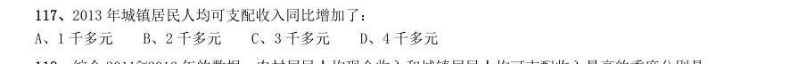

- **A.** 1 千多元
- **B.** 2 千多元
- **C.** 3 千多元
- **D.** 4 千多元

**答案：B**

### 【2015 国考（副省级）·第 118 题】GK-2015-fs-X118　平均数计算｜现期平均数

综合2011 2013 年的数据,农村居民人均现金收入和城镇居民人均可支配收入最高的季度分别是:

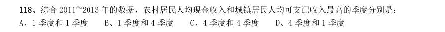

- **A.** 1 季度和1 季度
- **B.** 1 季度和4 季度
- **C.** 4 季度和4 季度
- **D.** 4 季度和1 季度

**答案：D**

### 【2015 国考（副省级）·第 119 题】GK-2015-fs-X119　平均数计算｜现期平均数

2011—2013 年,农村居民年人均现金收入超过1 万元的年份有几个:

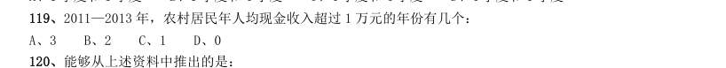

- **A.** 3
- **B.** 2
- **C.** 1
- **D.** 0

**答案：C**

### 【2015 国考（副省级）·第 132 题】GK-2015-fs-X132　平均数计算｜现期平均数
> 材料：2013 年末全国共有群众文化机构44260 个。比上年末增加384 个,其中乡镇文化站34343 个,增加242 个。 年末群众文化机构从业人员164355 人,比上年末增加8127 人,群众文化机构实际使用房屋建筑面积3389.4 万平方米。比上年末增长6.9%,年末群众文化机构共有馆办文艺团体6022 个,演出15.13 万场,观众6569 万人次。…

2013 年每个馆办文艺团体平均每月演出约多少场:

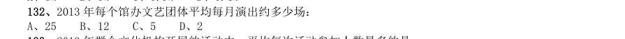

- **A.** 25
- **B.** 12
- **C.** 5
- **D.** 2

**答案：D**

### 【2015 国考（副省级）·第 133 题】GK-2015-fs-X133　平均数计算｜现期平均数
> 材料：2013 年末全国共有群众文化机构44260 个。比上年末增加384 个,其中乡镇文化站34343 个,增加242 个。 年末群众文化机构从业人员164355 人,比上年末增加8127 人,群众文化机构实际使用房屋建筑面积3389.4 万平方米。比上年末增长6.9%,年末群众文化机构共有馆办文艺团体6022 个,演出15.13 万场,观众6569 万人次。…

2013 年群众文化机构开展的活动中,平均每次活动参加人数最多的是:

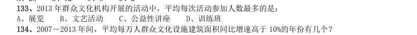

- **A.** 展览
- **B.** 文艺活动
- **C.** 公益性讲座
- **D.** 训练班

**答案：A**

### 【2015 国考（副省级）·第 134 题】GK-2015-fs-X134　平均数计算｜现期平均数
> 材料：2013 年末全国共有群众文化机构44260 个。比上年末增加384 个,其中乡镇文化站34343 个,增加242 个。 年末群众文化机构从业人员164355 人,比上年末增加8127 人,群众文化机构实际使用房屋建筑面积3389.4 万平方米。比上年末增长6.9%,年末群众文化机构共有馆办文艺团体6022 个,演出15.13 万场,观众6569 万人次。…

2007-2013 年间,平均每万人群众文化设施建筑面积同比增速高于10%的年份有几个?

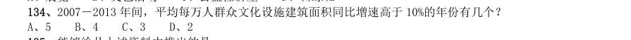

- **A.** 5
- **B.** 4
- **C.** 3
- **D.** 2

**答案：B**

### 【2015 国考（地市级）·第 111 题】GK-2015-ds-X111　平均数计算｜现期平均数

根据资料所提供的信息进行分析、比较、计算和判断处理。 (一) 根据以下资料,回答111—115 题。 与2011 年同期相比,2014 年1 季度农村居民人均现金收入约增长了:

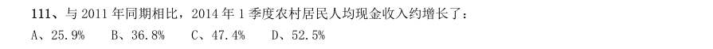

- **A.** 25.9%
- **B.** 36.8%
- **C.** 47.4%
- **D.** 52.5%

**答案：C**

### 【2015 国考（地市级）·第 112 题】GK-2015-ds-X112　平均数计算｜现期平均数

2013 年城镇居民人均可支配收入同比增加了:

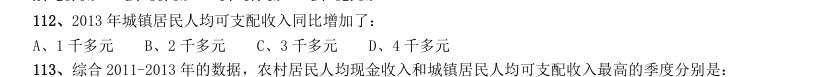

- **A.** 1 千多元
- **B.** 2 千多元
- **C.** 3 千多元
- **D.** 4 千多元

**答案：B**

### 【2015 国考（地市级）·第 127 题】GK-2015-ds-X127　平均数计算｜现期平均数
> 材料：2013 年末全国共有群众文化机构44260 个。比上年末增加384 个,其中乡镇文化站34343 个,增加242 个。 年末群众文化机构从业人员164355 人,比上年末增加8127 人,群众文化机构实际使用房屋建筑面积3389.4 万平方米。比上年末增长6.9%,年末群众文化机构共有馆办文艺团体6022 个,演出15.13 万场,观众6569 万人次。…

2013 年每个馆办文艺团体平均每月演出约多少场:

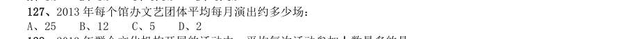

- **A.** 25
- **B.** 12
- **C.** 5
- **D.** 2

**答案：D**

### 【2014 湖北省考·第 121 题】HB-2014-ty-X121　平均数计算｜现期平均数

2013 年1—5 月,保险业平均每月业务及管理费用约为多少亿元?

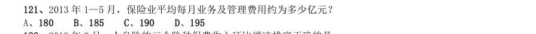

- **A.** 180
- **B.** 185
- **C.** 190
- **D.** 195

**答案：B**

### 【2014 国考·第 116 题】GK-2014-ty-X116　平均数计算｜现期平均数
> 材料：2012 年全国国道网车流量较大的地区主要集中在北京、天津、上海、江苏、浙江、广东和山东,上述省市 国道网的日平均交通量均超过2 万辆。全国国道网日平均行驶量为244883 万车公里,北京、天津、河北、山西、 上海、浙江、湖北、广东的国道年平均拥挤度均超过0.6。其中,国家高速公路日平均交通量为22181 辆,日平 均行驶量为148742 万车公里;普通国道日平均交通量为10845 辆,日平均行驶量为111164 万车公里。全国高速 公路日平均交通量为21305 辆,日平均行…

2009—2012 年全国国道日平均交通量同比增速最快的一年是：

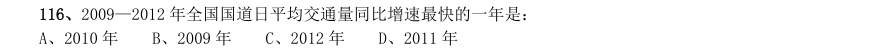

- **A.** 2010 年
- **B.** 2009 年
- **C.** 2012 年
- **D.** 2011 年

**答案：C**

### 【2014 国考·第 119 题】GK-2014-ty-X119　平均数计算｜现期平均数
> 材料：2012 年全国国道网车流量较大的地区主要集中在北京、天津、上海、江苏、浙江、广东和山东,上述省市 国道网的日平均交通量均超过2 万辆。全国国道网日平均行驶量为244883 万车公里,北京、天津、河北、山西、 上海、浙江、湖北、广东的国道年平均拥挤度均超过0.6。其中,国家高速公路日平均交通量为22181 辆,日平 均行驶量为148742 万车公里;普通国道日平均交通量为10845 辆,日平均行驶量为111164 万车公里。全国高速 公路日平均交通量为21305 辆,日平均行…

2012 年国家高速公路日平均交通量约是普通国道日平均交通量的:

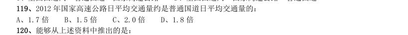

- **A.** 1.7 倍
- **B.** 1.5 倍
- **C.** 2.0 倍
- **D.** 1.8 倍

**答案：C**

### 【2014 国考·第 126 题】GK-2014-ty-X126　平均数计算｜现期平均数

2012 及2013 年1~4 月某市电影院线票房情况 2013 年1—4 月,该市电影院线平均每场电影观众人数最少的月份是:

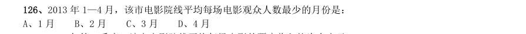

- **A.** 1 月
- **B.** 2 月
- **C.** 3 月
- **D.** 4 月

**答案：C**

### 【2014 国考·第 127 题】GK-2014-ty-X127　平均数计算｜现期平均数

2013 年第一季度,该市电影院线平均每场电影的票房收入约为多少元:

- **A.** 1170
- **B.** 1370
- **C.** 1570
- **D.** 1770

**答案：B**

### 【2014 国考·第 129 题】GK-2014-ty-X129　平均数计算｜现期平均数

2012 年1—4 月,该市平均每天观看电影的观众超过10 万人次的月份有几个:

- **A.** 1
- **B.** 2
- **C.** 3
- **D.** 4

**答案：B**

### 【2013 湖北省考·第 151 题】HB-2013-ty-X151　平均数计算｜现期平均数
> 材料：某市2010 年全年实现农业增加值124.3 亿元,比上年下降1.6%。粮食播种面积22.3 万公顷,比上年减少 0.3 万公顷;粮食产量115.7 万吨,比上年下降7.3%。 全市农业观光园1303 个,比上年增加9 个;观光园总收入17.8 亿元,比上年增长16.7%。民俗旅游实际经 营户7979 户,比上年减少726 户;民俗旅游总收入7.3 亿元,增长20.7%。种业收入14.6 亿元,比上年增长13.5%。…

该市2010 年粮食平均产量约为每公顷:

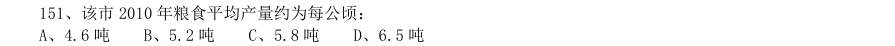

- **A.** 4.6 吨
- **B.** 5.2 吨
- **C.** 5.8 吨
- **D.** 6.5 吨

**答案：B**

### 【2013 广东省考（一卷）·第 99 题】GD-2013-1-X099　平均数计算｜现期平均数

2012 年该市文化产业从业人员人均生产总值比上一年约减少了:

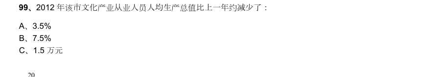

- **A.** 3.5%
- **B.** 7.5%
- **C.** 1.5 万元
- **D.** 2 万元

**答案：该题答案缺失，见原卷**

### 【2013 广东省考（三卷）·第 97 题】GD-2013-3-X097　平均数计算｜现期平均数
> 材料：2012 年,某省加大扶持贫困残疾人力度,财政投入扶贫资金3816.3 万元,比上年大幅增长 18%,扶持贫困残疾人员56561 人,脱贫35110 人,享受优惠政策的贫困残疾人117727 人,比上 年增加3%。 截止2012 年底,城镇残疾人员安排就业人数共227192 人,其中,集中就业25135 人,按比 例就业合计 91384 人,个体及其他形式就业110673 人。农村残疾人实际就业630900 人,其中, 从事农业生产活动515278 人,从事其他形式就业115…

该省每年投入的残疾人财政扶贫资金如果可以均分到每位享受优惠政策的贫困残疾人身 上,则2012 年享受优惠政策的贫困残疾人的人均扶贫金额要比2011 年增长约( )元:

- **A.** 30
- **B.** 40
- **C.** 50
- **D.** 60

**答案：该题答案缺失，见原卷**

### 【2013 国考·第 122 题】GK-2013-ty-X122　平均数计算｜现期平均数
> 材料：2011 年发现违法用地行为7.0 万件,涉及土地5.0 万公顷(耕地1.8 万公顷),同比分别上升5.8%、11.0% (耕地下降2.4%)。…

2011 年结案的案件中,平均每个案件的罚没款约为多少万元:

- **A.** 0.56
- **B.** 1.13
- **C.** 3.78
- **D.** 6.14

**答案：D**

### 【2013 国考·第 126 题】GK-2013-ty-X126　平均数计算｜现期平均数
> 材料：截至2011 年4 月21 日22 时,沪深两市已有534 家上市公司公布第一季度财报。这534 家公司实现营业总 收入4572.78 亿元,同比增长30.74%;实现净利润336.7 亿元,同比增长30.52%。不过,一季度销售收入和净 利润环比则有所下降,其中营业总收入环比下降12%,净利润环比下降25%,这534 家公司2011 年一季度存货 6167.68 亿元,较上年年末增长10%。 已公布一季度的创业板公司有71 家,实现营业收入80.08 亿元,同比增长73.6…

已公布一季报的534 家公司,平均每家在2010 年第四季度实现营业收入约多少亿元:

- **A.** 0.63
- **B.** 7.54
- **C.** 8.56
- **D.** 9.73

**答案：D**

### 【2013 国考·第 127 题】GK-2013-ty-X127　平均数计算｜现期平均数
> 材料：截至2011 年4 月21 日22 时,沪深两市已有534 家上市公司公布第一季度财报。这534 家公司实现营业总 收入4572.78 亿元,同比增长30.74%;实现净利润336.7 亿元,同比增长30.52%。不过,一季度销售收入和净 利润环比则有所下降,其中营业总收入环比下降12%,净利润环比下降25%,这534 家公司2011 年一季度存货 6167.68 亿元,较上年年末增长10%。 已公布一季度的创业板公司有71 家,实现营业收入80.08 亿元,同比增长73.6…

这534 家公司中,平均每家中小企业板公司在2011 年第一季度的净利润约是创业板公司的:

- **A.** 2 倍
- **B.** 3 倍
- **C.** 4 倍
- **D.** 5 倍

**答案：A**

### 【2013 国考·第 128 题】GK-2013-ty-X128　平均数计算｜现期平均数
> 材料：截至2011 年4 月21 日22 时,沪深两市已有534 家上市公司公布第一季度财报。这534 家公司实现营业总 收入4572.78 亿元,同比增长30.74%;实现净利润336.7 亿元,同比增长30.52%。不过,一季度销售收入和净 利润环比则有所下降,其中营业总收入环比下降12%,净利润环比下降25%,这534 家公司2011 年一季度存货 6167.68 亿元,较上年年末增长10%。 已公布一季度的创业板公司有71 家,实现营业收入80.08 亿元,同比增长73.6…

已公布2011 年一季报的房地产公司中,平均每家公司的存货比上年同期增长了约多少亿元:

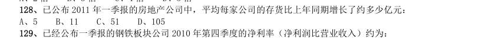

- **A.** 5
- **B.** 11
- **C.** 51
- **D.** 105

**答案：B**

### 【2012 湖北省考·第 109 题】HB-2012-ty-X109　平均数计算｜现期平均数
> 材料：2011 年某省接待过夜游客总量再次实现突破,达到3001.34 万人次,同比增长16.0%,实现旅游收入324.04亿元,同比增长25.8%。12 月份宾馆平均开房率为74.02%。同比增长0.06%;全年累计宾馆平均开房率为62.37%。 同比增长2.0%。 该省2011 年12 月及全年接待过夜旅客人数该省2011 年12 月及全年接待过夜游客的旅游收入情况…

2011 年12 月该省接待过夜游客中,境外游客每人的平均消费约为境内游客的:

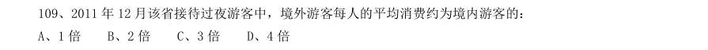

- **A.** 1 倍
- **B.** 2 倍
- **C.** 3 倍
- **D.** 4 倍

**答案：C**

### 【2012 湖北省考·第 116 题】HB-2012-ty-X116　平均数计算｜现期平均数
> 材料：2006 年至2011 年全年我国农村居民人均纯收入分别为3587 元、4140 元、4761 元、5153 元、5919 元、 6977 元;城镇居民人均可支配收入分别为11759 元、13786 元、15781 元、17175 元、19109 元、21810 元。 2000 年至2011 年全年我国粮食产量分别为49804 万吨、50160 万吨、52871 万吨、53082 万吨、54648 万 吨、57121 万吨。 与2010 年相比,2011 年全年粮食种植面积1…

2011 年末全国参加城镇基本医疗保险的人数47291 万人,增加4028 万人。其中,参加城镇职工基本医疗 保险人数25226 万人,参加城镇居民基本医疗保险22065 万人。截至9 月底,2646 个县(市、区)开展了新型 农村合作医疗工作,新型农村合作医疗参合率97.5%;新型农村合作医疗基金支出总额为1114 亿元,受益84 亿人次。 2011 年我国城镇居民人均可支配收入比2008 年大约增加了:

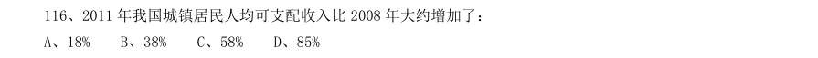

- **A.** 18%
- **B.** 38%
- **C.** 58%
- **D.** 85%

**答案：B**

### 【2012 广东省考·第 96 题】GD-2012-ty-X096　平均数计算｜现期平均数
> 材料：根据资料,完成下面各题。 全国艺术表演团体机构与人员情况图全国艺术表演团体赴农村演出情况图2010 年全国艺术表演团体分地区情况表…

根据资料,完成下面各题。 全国艺术表演团体机构与人员情况图 全国艺术表演团体赴农村演出情况图 2010 年全国艺术表演团体分地区情况表 平均每场次农村演出的观众人数最少的年份是哪年:

- **A.** 2007
- **B.** 2008
- **C.** 2009
- **D.** 2010

**答案：该题答案缺失，见原卷**

### 【2012 广东省考·第 98 题】GD-2012-ty-X098　平均数计算｜现期平均数
> 材料：根据资料,完成下面各题。 全国艺术表演团体机构与人员情况图全国艺术表演团体赴农村演出情况图2010 年全国艺术表演团体分地区情况表…

2009 年,平均每个表演团体机构农村演出的场次数约为多少次:

- **A.** 8
- **B.** 83
- **C.** 121
- **D.** 1170

**答案：该题答案缺失，见原卷**

### 【2012 国考·第 119 题】GK-2012-ty-X119　平均数计算｜现期平均数
> 材料：根据以下资料,完成各题。 2010 年,某省广电实际总收入为145.83 亿元,同比增长32.07%。其中,广告收入为67.08 亿元,同比增 长25.88%;有线网络收入为45.38 亿元,同比增长26.35%;其他收入为33.37 亿元,同比增长57.3%。 2010 年,该省广电收入中,省级收入为65.32 亿元比上年增加15.5 亿元;地市级收入为41.61 亿元,比 上年增加13.39 亿元;县级收入为38.90 亿元,比上年增加6.52 亿元。 2010 年该省各…

该省有线电视用户平均每月的有线网络费用约为多少元:

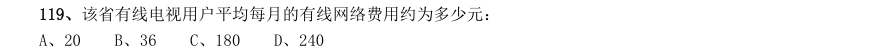

- **A.** 20
- **B.** 36
- **C.** 180
- **D.** 240

**答案：A**

### 【2012 国考·第 121 题】GK-2012-ty-X121　平均数计算｜现期平均数

三大经济圈中,2010 年三次产业增长速度均超过全国平均水平的有几个:

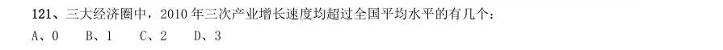

- **A.** 0
- **B.** 1
- **C.** 2
- **D.** 3

**答案：B**

### 【2011 广东省考·第 99 题】GD-2011-ty-X099　平均数计算｜现期平均数
> 材料：1949 年以来,我国人力资本存量形成受到两次大的破坏和冲断。第一次是反右,大跃进经济崩溃期间, 在校生数由1960 年的10963 万人,下降到1962 年的7480 万人,其中中专生由222 万人下降到54 万人;第 二次是“文革”动乱期间,估计有70--80 万人未能受到大学教育,超过1 亿中小学生受到质量很低的教育, 几百万知识分子无法工作和科研。全国12 岁以上人口平均文化程度由1964 年的2.34 仅上升到1982 年的 4.61,不足小学毕业程度。…

1982 年,我国12 岁以上人口平均文化程度是多少:

- **A.** 2.34 年
- **B.** 4.61 年
- **C.** 小学毕业程度
- **D.** 无法确定

**答案：该题答案缺失，见原卷**

### 【2011 国考·第 122 题】GK-2011-ty-X122　平均数计算｜现期平均数
> 材料：2008 年世界稻谷总产量68501.3 万吨,比2000 年增长14.3%;小麦总产量68994.6 万吨,比2000 年增长17.8%;玉米总产量82271.0 万吨,比2000 年增长39.1%;大豆总产量23095.3 万吨,比2000 年增长43.2%。…

将每个国家的四种谷物按2008 年的产量分别排序,哪个国家产量排名第一的谷物与2000 年相比产量增长 率最高:

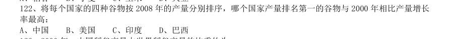

- **A.** 中国
- **B.** 美国
- **C.** 印度
- **D.** 巴西

**答案：D**

### 【2011 国考·第 128 题】GK-2011-ty-X128　平均数计算｜现期平均数
> 材料：2010 年上半年,全国原油产量为9848 万吨,同比增长5.3%,上年同期为下降1%。进口原油11797 万吨(海 关统计),增长30.2%。原油加工量20586 万吨,增长17.9%,增速同比加快16.4 个百分点。成品油产量中,汽 油产量增长6%,增速同比减缓7.9 个百分点;柴油产量增长28.1%,增速同比加快15.8 个百分点。 据行业统计,2010 年上半年成品油表观消费量10963 万吨,同比增长12.5%。其中,一、二季度分别增长 16.3%和9.2%。 20…

2010 年5 月份,布伦特原油的平均价格约为每桶多少美元:

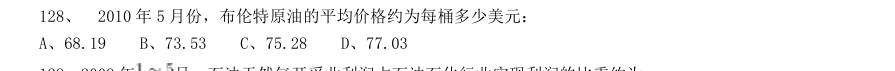

- **A.** 68.19
- **B.** 73.53
- **C.** 75.28
- **D.** 77.03

**答案：D**

### 【2011 国考·第 134 题】GK-2011-ty-X134　平均数计算｜现期平均数
> 材料：2010 年一季度,我国水产品贸易进出口总量158.7 万吨,进出口总额40.9 亿美元,同比分别增长14.2%和29.0%.其中,出口量67.1 万吨,出口额26.5 亿美元,同比分别增长11.7%和24.9%;进口量91.6 万吨,进口额14.4 亿美元,同比分别增长16.0%和37.5%。…

2010 年一季度,我国对以下哪个国家或地区出口水产品的平均单价最高:

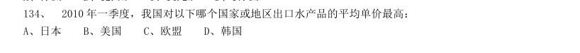

- **A.** 日本
- **B.** 美国
- **C.** 欧盟
- **D.** 韩国

**答案：A**

### 【2010 湖北省考·第 105 题】HB-2010-ty-X105　平均数计算｜现期平均数

2004-2009 年,哪年的产量最接近平均值:

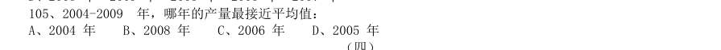

- **A.** 2004 年
- **B.** 2008 年
- **C.** 2006 年
- **D.** 2005 年

**答案：D**

### 【2010 湖北省考·第 107 题】HB-2010-ty-X107　平均数计算｜现期平均数

与 年相比,2009 年农村居民家庭人均纯收入增长率为:

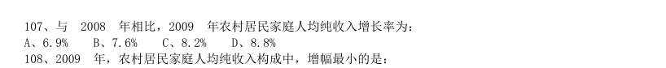

- **A.** 6.9%
- **B.** 7.6%
- **C.** 8.2%
- **D.** 8.8%

**答案：C**

### 【2010 湖北省考·第 108 题】HB-2010-ty-X108　平均数计算｜现期平均数

2009 年,农村居民家庭人均纯收入构成中,增幅最小的是:

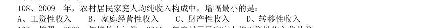

- **A.** 工资性收入
- **B.** 家庭经营性收入
- **C.** 财产性收入
- **D.** 转移性收入

**答案：B**

### 【2010 湖北省考·第 109 题】HB-2010-ty-X109　平均数计算｜现期平均数

按照 年增长率计算,2010 年农村居民家庭人均工资性收入将达到:

- **A.** 2291.45 元
- **B.** 2309.37 元
- **C.** 2345.86 元
- **D.** 2326.21 元

**答案：A**

### 【2010 广东省考·第 77 题】GD-2010-ty-X077　平均数计算｜现期平均数
> 材料：根据下列资料和图形,完成各题。 2008 年各级财政共支出城市低保资金393.4 亿元,比上年增长41.8%,保障了2330 多万城镇贫困人口 的基本生活。得到最低生活保障人员中:在职人员82.2 万人,占总人数的3.5%,灵活就业人员381.7 万人, 占总人数的1.3%,老年人316.7 万人,占总人数的13.6%,登记失业人员564.3 万人,占总人数的24.3%, 未登记失业人员402.2 万人,占总人数的17.2%。在校生358.1 万人,占总人数的15.3%,其他…

2008 年全国城市最低生活保障月人均保障水平为:

- **A.** 140.41 元
- **B.** 146.65 元
- **C.** 1684.94 元
- **D.** 1759.81 元

**答案：该题答案缺失，见原卷**

### 【2010 国考·第 103 题】GK-2010-ty-X103　平均数计算｜现期平均数

资料中人均国民生产总值和幸福指数均排名前五的国家(地区)有几个:

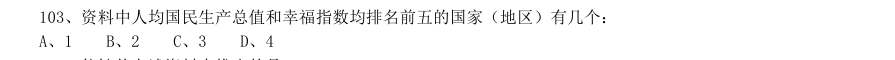

- **A.** 1
- **B.** 2
- **C.** 3
- **D.** 4

**答案：A**

### 【2010 国考·第 106 题】GK-2010-ty-X106　平均数计算｜现期平均数

2009 年1-5 月,邮电系统平均每月订销报纸、杂志约多少亿份:

- **A.** 13.7
- **B.** 14.2
- **C.** 14.6
- **D.** 17.8

**答案：B**

### 【2010 国考·第 114 题】GK-2010-ty-X114　平均数计算｜现期平均数
> 材料：新中国成立后,经过60 年特别是改革开放以来的建设,我国公共卫生体系初步建立,卫生服务能力明显增强。2008 年全国共有卫生机构27.8 万个,比1949 年增加约75 倍;卫生技术人员为503 万人,比1949 年增加9.0 倍;医院和卫生院床位数为374.8 万张,比1949 年增加45.9 倍;每千人口医院,卫生院床位数为2.8 张,远高于1949 年0.15 张的水平。…

2008 年,每万人拥有的卫生机构数量约是1949 年的多少倍:

- **A.** 3
- **B.** 8
- **C.** 15
- **D.** 30

**答案：D**
