# 资料分析 · 平均数计算 · 2020 年代真题

> 所属考点：[ZL-AVG](../ZL-AVG-平均数计算.md)　｜　本片 51 题

> 本片子考点：现期平均数 47　平均数增长率 3　基期平均数 1

### 2025 国考·副省级　第 131 题　（现期平均数）
> 材料：(四) 2023年三季度,支付系统共处理支付业务3358.88亿笔,金额3151.37万亿元,同比分别增长12.59%和 6.97%。 三季度,人民银行清算总中心系统共处理支付业务54.79亿笔,金额2379.52万亿元,同比分别增长0.92%和 9.53%,其中,大额实时支付系统处理业务9518.17万笔,同比下降10.39%,金额2254.07万亿元,同比增长 9.72%;小额批量支付系统处理业务11.51亿笔,金额46.69万亿元,同比分别增长5.73%和10.03%;…

在其他支付系统中,银行行内业务系统三季度处理业务54.42亿笔,同比增长11.14%,金额539.56万亿元, 同比下降4.10%;银联跨行支付系统处理业务837.93亿笔,金额70.27万亿元,同比分别增长21.37%和8.70%;城 银清算支付清算系统处理业务1056.40万笔,金额9744.45亿元,同比分别增长34.61%和36.31%;农信银支付清 算系统处理业务7.41亿笔,金额7162.13亿元,同比分别下降39.98%和13.55%;人民币跨境支付系统处理业务 176.43万笔,金额33.42万亿元,同比分别增长43.23%和31.41%;网联清算平台处理业务2404.21亿笔,金额 126.92万亿元,同比分别增长10.42%和6.28%。 2023年三季度,支付系统平均每笔支付业务金额比上年同期:

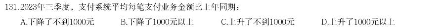

- **A.** 下降了不到1000元
- **B.** 下降了1000元以上
- **C.** 上升了不到1000元
- **D.** 上升了1000元以上

**答案：A**

### 2025 国考·地市级　第 113 题　（现期平均数）

已知2023年第五批次公示的专精特新“小巨人”企业分布于全国300个城市中,则这些城市平均每个有多少家 第五批次公示的专精特新“小巨人”非上市企业?

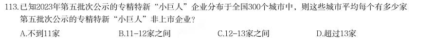

- **A.** 不到11家
- **B.** 11-12家之间
- **C.** 12-13家之间
- **D.** 超过13家

**答案：B**

### 2025 国考·地市级　第 122 题　（现期平均数）

以下城市中2023年12月平均每场电影观众人次数最多的是:

- **A.** 武汉
- **B.** 杭州
- **C.** 重庆
- **D.** 南京

**答案：A**

### 2025 国考·地市级　第 123 题　（现期平均数）

2023年12月资料中有几个城市平均每人次观众创造的票房超过40元?

- **A.** 3
- **B.** 4
- **C.** 5
- **D.** 6

**答案：B**

### 2025 国考·地市级　第 124 题　（现期平均数）

如某月北京的电影总放映场次和平均每场座位数与2023年12月相同,但上座率增加5个百分点,则该月北京将 有约多少万人次观众观影?

- **A.** 602
- **B.** 431
- **C.** 794
- **D.** 696

**答案：A**

### 2024 湖北·统一卷　第 107 题　（现期平均数）

2022年全国每万人拥有的体育场地数量约为:

- **A.** 26.2个
- **B.** 29.9个
- **C.** 34.7个
- **D.** 39.4个

**答案：B**

### 2024 湖北·统一卷　第 112 题　（现期平均数）

表格所列国家中,2022年全球创新指数排名前五位国家的平均创新指数是:

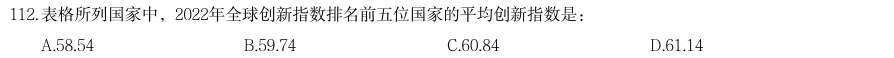

- **A.** 58.54
- **B.** 59.74
- **C.** 60.84
- **D.** 61.14

**答案：D**

### 2024 湖北·统一卷　第 118 题　（现期平均数）

2022年不同机构每只存续理财产品平均存续金额从大到小排前三名的是:

- **A.** 大型银行、理财公司、城商行
- **B.** 理财公司、大型银行、城商行
- **C.** 大型银行、理财公司、股份制银行
- **D.** 理财公司、大型银行、股份制银行

**答案：D**

### 2024 湖北·统一卷　第 122 题　（现期平均数）

相比2021年,2022年我国废纸平均回收价格(平均回收价格 ):

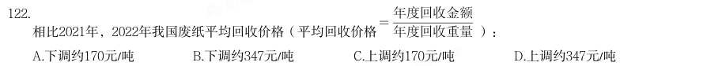

- **A.** 下调约170元/吨
- **B.** 下调约347元/吨
- **C.** 上调约170元/吨
- **D.** 上调约347元/吨

**答案：A**

### 2024 广东·统一卷　第 82 题　（现期平均数）

2022年,G省平均每件法律援助案件帮助受援群众( )。

- **A.** 小于1.1人
- **B.** 在1.1到1.2人之间
- **C.** 在1.2到1.3人之间
- **D.** 大于1.3

**答案：B**

### 2024 国考·副省级　第 123 题　（现期平均数）

2018~2022年,我国马铃薯单位面积产量同比增长的年份有几个?

- **A.** 2
- **B.** 3
- **C.** 4
- **D.** 5

**答案：D**

### 2024 国考·副省级　第 128 题　（现期平均数）

2022年新增投运的电化学储能电站中,平均每个大型电站的能量约是中型电站的多少倍?

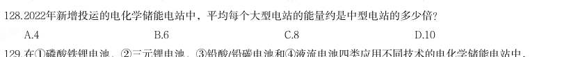

- **A.** 4
- **B.** 6
- **C.** 8
- **D.** 10

**答案：D**

### 2024 国考·地市级　第 129 题　（现期平均数）

如2022年内每个月移动电话用户数增量和蜂窝物联网终端用户数增量均为固定值,则2022年蜂窝物联网终端用 户数第一次超过移动电话用户数是在哪个季度?

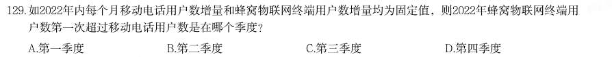

- **A.** 第一季度
- **B.** 第二季度
- **C.** 第三季度
- **D.** 第四季度

**答案：C**

### 2023 湖北·统一卷　第 112 题　（现期平均数）

下列折线图中,最能准确反映2013~2021 年全国城市人均日生活用水量同比增长率变 化情况的是:

- **A.** 
- **B.** 
- **C.** 
- **D.** 

**答案：A**

### 2023 广东·县级　第 92 题　（现期平均数）

2022 年,除其他用品及服务外,我国城乡居民人均消费支出最少的类别是( )。

- **A.** 衣着
- **B.** 生活用品及服务
- **C.** 教育文化娱乐
- **D.** 医疗保健

**答案：A**

### 2023 广东·县级　第 93 题　（平均数增长率）

2022 年,全国居民人均收支盈余比上一年( )。(注:收支盈余=收入-消费支出)

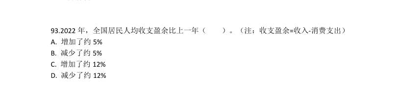

- **A.** 增加了约5%
- **B.** 减少了约5%
- **C.** 增加了约12%
- **D.** 减少了约12%

**答案：C**

### 2023 国考·行政执法　第 118 题　（现期平均数）

如用求各市算术平均值的方式计算全省数值,则2021年四季度Z省中心城市道路汽车前排驾乘人员安全带使用 率比上季度:

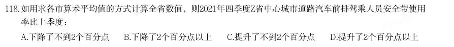

- **A.** 下降了不到2个百分点
- **B.** 下降了2个百分点以上
- **C.** 提升了不到2个百分点
- **D.** 提升了2个百分点以上

**答案：D**

### 2023 国考·行政执法　第 122 题　（现期平均数）

2017-2021年,我国木材进口平均单价高于400美元/吨的年份有几个?

- **A.** 4
- **B.** 3
- **C.** 2
- **D.** 1

**答案：B**

### 2022 广东·乡镇　第 89 题　（现期平均数）

2020 年,平均每个村委会下辖的村民小组约( )个。

- **A.** 3.5
- **B.** 5.5
- **C.** 7.5
- **D.** 9.5

**答案：C**

### 2022 广东·乡镇　第 97 题　（现期平均数）

2020 年,全国社区卫生服务中心平均每名医师全年担负诊疗人次比全国农村乡镇卫生院的约多( )人 次。

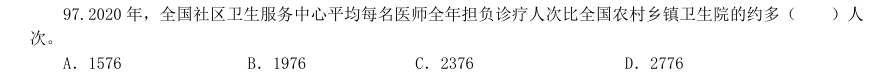

- **A.** 1576
- **B.** 1976
- **C.** 2376
- **D.** 2776

**答案：暂缺**

### 2022 广东·乡镇　第 98 题　（现期平均数）

2020 年,平均每个乡镇床位数约为每个街道床位数的( )倍。

- **A.** 0.5
- **B.** 2
- **C.** 3
- **D.** 4

**答案：暂缺**

### 2022 广东·县级　第 97 题　（现期平均数）

2019 年,平均每架次完成运输飞行时长最长的是:

- **A.** 国内航线
- **B.** 港澳台航线
- **C.** 国际航线
- **D.** 全行业运输航空公司

**答案：暂缺**

### 2022 国考·副省级　第 126 题　（平均数增长率）

28.6%和8.7%。按此价格测算,2020 年全省农户种植玉米、稻谷扣除成本前的产值分别为957.1 元/亩、 1520.7 元/亩,分别比上年增长33.4%、8.9%。 (单选题)2019 年,H 省秋粮稻谷的平均生产成本约为多少元/亩?

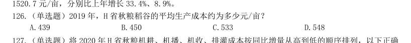

- **A.** 439
- **B.** 450
- **C.** 533
- **D.** 548

**答案：D**

### 2022 国考·副省级　第 128 题　（现期平均数）

(单选题)2020 年,H 省秋粮玉米和稻谷的亩产与上年相比:

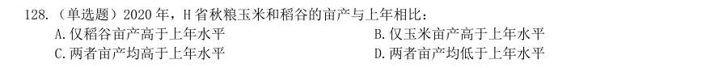

- **A.** 仅稻谷亩产高于上年水平
- **B.** 仅玉米亩产高于上年水平
- **C.** 两者亩产均高于上年水平
- **D.** 两者亩产均低于上年水平

**答案：C**

### 2022 国考·副省级　第 129 题　（现期平均数）

(单选题)如种植收益=产值-生产成本,则2020 年H 省秋粮稻谷平均每亩的种植收益约是玉米的多少 倍?

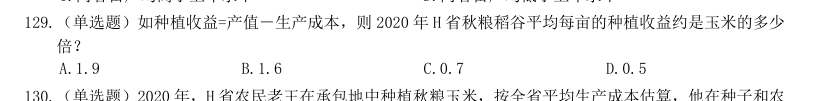

- **A.** 1.9
- **B.** 1.6
- **C.** 0.7
- **D.** 0.5

**答案：A**

### 2022 国考·副省级　第 130 题　（现期平均数）

(单选题)2020 年,H 省农民老王在承包地中种植秋粮玉米,按全省平均生产成本估算,他在种子和农 药上需要花费2000 元。如亦按全省平均生产成本估算,他需要花费的人工成本在以下哪个范围内?

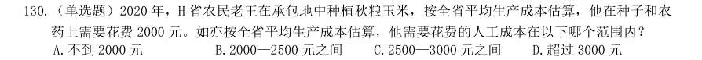

- **A.** 不到2000 元
- **B.** 2000—2500 元之间
- **C.** 2500—3000 元之间
- **D.** 超过3000 元

**答案：C**

### 2022 国考·地市级　第 111 题　（平均数增长率）

2019 年,H 省秋粮稻谷的平均生产成本约为多少元/亩?

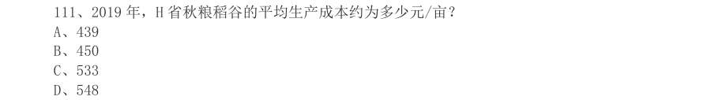

- **A.** 439
- **B.** 450
- **C.** 533
- **D.** 548

**答案：D**

### 2022 国考·地市级　第 113 题　（现期平均数）

2020 年,H 省秋粮玉米和稻谷的亩产与上年相比:

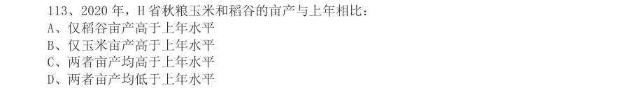

- **A.** 仅稻谷亩产高于上年水平
- **B.** 仅玉米亩产高于上年水平
- **C.** 两者亩产均高于上年水平
- **D.** 两者亩产均低于上年水平

**答案：C**

### 2022 国考·地市级　第 114 题　（现期平均数）

如种植收益=产值-生产成本,则2020 年H 省秋粮稻谷平均每亩的种植收益约是玉米的多 少倍?

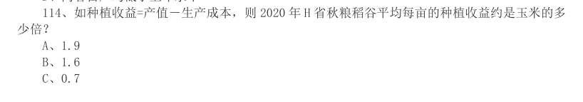

- **A.** 1.9
- **B.** 1.6
- **C.** 0.7
- **D.** 0.5

**答案：A**

### 2022 国考·地市级　第 115 题　（现期平均数）

2020 年,H 省农民老王在承包地中种植秋粮玉米,按全省平均生产成本估算,他在种子和 农药上需要花费2000 元。如亦按全省平均生产成本估算,他需要花费的人工成本在以下哪个范围内?

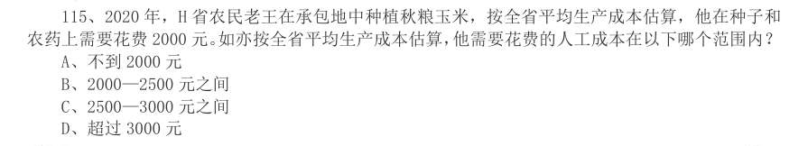

- **A.** 不到2000 元
- **B.** 2000—2500 元之间
- **C.** 2500—3000 元之间
- **D.** 超过3000 元

**答案：C**

### 2022 国考·行政执法　第 126 题　（基期平均数）
> 材料：15.4 万名,同比分别上升60.4%、80.6%和146.5%。2021 年5 月,全国共立电信网络诈骗案件8.46 万 起,与4 月相比下降14.3%。 2021 年1—5 月,全国拦截诈骗电话6.1 亿次,拦截诈骗短信9.1 亿条,封堵诈骗网址82.1 万个。 1—5 月公安部日均下发预警指令5.2 万条。 2021 年1—5 月,全国共成功劝阻771 万名群众免于受骗,紧急止付涉案资金2654 亿元,为群众挽回 经济损失991 亿元。…

2021 年1—5 月,全国公安机关捣毁境内诈骗窝点6500 余个,共破获被骗百万元以上案件881 起,同 比上升160.5%;先后组织20 余次集中收网行动,抓获犯罪嫌疑人2421 名,打掉技术开发平台,网络引流 推广、虚拟货币洗钱等团伙380 余个。 2020 年10 月至2021 年5 月,全国公安机关会同检察、法院、通讯、金融等部门,共打掉“两卡”违 法犯罪团伙1.5 万个,缴获涉诈电话卡373.3 万张、银行卡56.6 万张,惩戒“两卡”失信人员17.3 万 名,整治违规行业网点、机构1.8 万家。 (单选题)2020 年1—5 月,全国平均每月打掉电信网络诈骗犯罪团伙:

- **A.** 不到1000 个
- **B.** 1000—2000 个之间
- **C.** 2000—4000 个之间
- **D.** 4000 个以上

**答案：B**

### 2022 国考·行政执法　第 128 题　（现期平均数）

(单选题)2021 年1—5 月,全国平均每天拦截诈骗短信约多少万条?

- **A.** 545
- **B.** 571
- **C.** 603
- **D.** 659

**答案：C**

### 2021 广东·乡镇　第 92 题　（现期平均数）

2020 年前三季度,G 省下列行业中,平均每个企业产值最高的是( )。

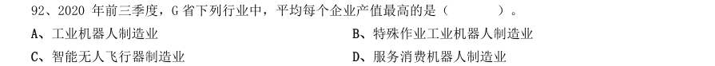

- **A.** 工业机器人制造业
- **B.** 特殊作业工业机器人制造业
- **C.** 智能无人飞行器制造业
- **D.** 服务消费机器人制造业

**答案：暂缺**

### 2021 国考·副省级　第 116 题　（现期平均数）

2019 年,平均每个综合类直排海污染物排口排放污水量约是工业类的多少倍?

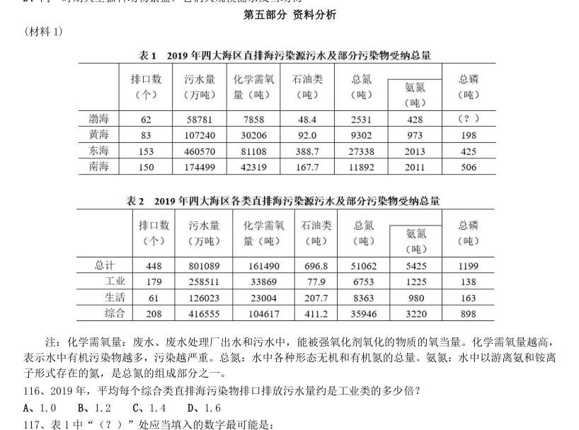

- **A.** 1.0
- **B.** 1.2
- **C.** 1.4
- **D.** 1.6

**答案：暂缺**

### 2021 国考·副省级　第 118 题　（现期平均数）

2019 年,平均每个直排海污染物排口排放石油类污染物的量最大的海区是:

- **A.** 东海
- **B.** 南海
- **C.** 渤海
- **D.** 黄海

**答案：暂缺**

### 2021 国考·副省级　第 131 题　（现期平均数）
> 材料：2020 年1—2 月,我国境内投资者共对全球147 个国家和地区的1733 家境外企业进行了非金融类直接投资, 累计实现投资1078.6 亿元人民币,同比增长1.8%。对外承包工程完成营业额1080 亿元人民币,同比下降9.5%, 新签合同额2150.3 亿元人民币,同比增长38.3%。对外劳务合作派出各类劳务人员3.9 万人,同比减少2.9 万 人,2 月末在外各类劳务人员77.8 万人。 2020 年1—2 月,我国对外投资合作主要呈现以下特点: 一是对“一带一路”投资…

2020 年1—2 月,我国境内投资者对每个当期内产生非金融类直接投资的境外企业的非金融类直接投资额 均值约为多少亿元人民币?

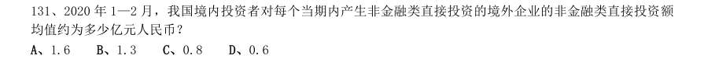

- **A.** 1.6
- **B.** 1.3
- **C.** 0.8
- **D.** 0.6

**答案：暂缺**

### 2021 国考·副省级　第 134 题　（现期平均数）

如2020 年1—2 月人民币与美元的汇率稳定为7 元人民币兑换1 美元,则同期对外承包工程新签合同额在 5000 万美元以上的项目的平均新签合同额在以下哪个范围内?

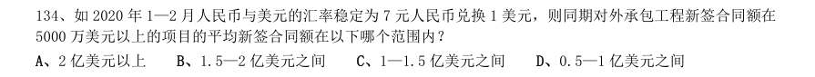

- **A.** 2 亿美元以上
- **B.** 1.5—2 亿美元之间
- **C.** 1—1.5 亿美元之间
- **D.** 0.5—1 亿美元之间

**答案：暂缺**

### 2021 国考·地市级　第 118 题　（现期平均数）

以下城市中,2019 年末平均每条运营的地铁线路配属地铁列车数最多的是:

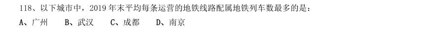

- **A.** 广州
- **B.** 武汉
- **C.** 成都
- **D.** 南京

**答案：C**

### 2021 国考·地市级　第 124 题　（现期平均数）

截至2019 年末,全国平均每个已竣工的残疾人综合服务设施建设规模约是已竣工残疾人康复设施的多少 倍?

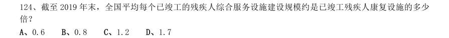

- **A.** 0.6
- **B.** 0.8
- **C.** 1.2
- **D.** 1.7

**答案：A**

### 2020 广东·县级　第 86 题　（现期平均数）
> 材料：材料1 社会保险包括了养老保险,工伤保险,医疗生育保险等,是社会保障体系的重要组成部分。其在整个社会保 障体系中居于核心地位,社会保险是一种缴费型的社会保障,资金主要由用人单位和劳动者缴纳(一般而言,各 类社会保险的缴纳费用 缴费基数 缴纳比例),政府财政给予补贴并承担最终责任。 在经历了一段时间的摸索后,我国的社会保障制度在上世纪90 年代进入了创新式的改革、发展时期。1995 年3 月1 日,国务院发出《关于深化企业职工养老保险制度改革的通知》,确定了社会统筹与个人账户相…

一般来说,社保管理部门会根据当地上一年社会平均工资来确定当年的社保缴费基数上限,两者比值相对固 定。下列选项中,B 市这一比值与其他年份差别最大的是( )。

- **A.** 1999 年
- **B.** 2004 年
- **C.** 2014 年
- **D.** 2019 年

**答案：暂缺**

### 2020 广东·县级　第 88 题　（现期平均数）

在B 市某企业工作的小王,2019 年月平均工资为10161 元,如果该企业将养老保险缴费基数下限调整为小 王的实际月平均工资,则该企业全年将增加支出约( )元。

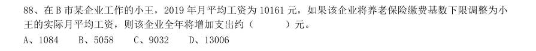

- **A.** 1084
- **B.** 5058
- **C.** 9032
- **D.** 13006

**答案：暂缺**

### 2020 广东·县级　第 89 题　（现期平均数）

以下最有可能符合B 市1998-2018 年社会平均工资增长率变化情况的曲线是( )。

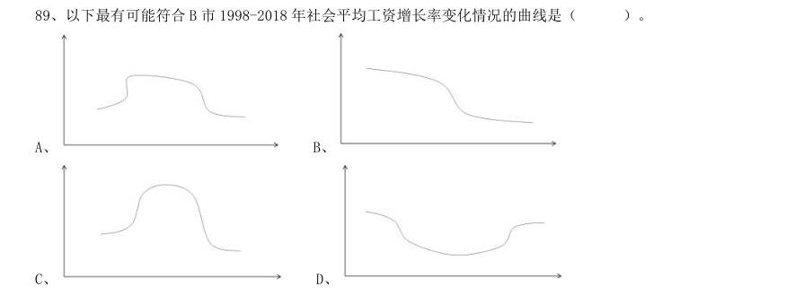

- **A.** 
- **B.** 
- **C.** 
- **D.** 

**答案：暂缺**

### 2020 广东·综合行政能力测验　第 97 题　（现期平均数）

2018 年,广东社会消费品零售总额同比增幅较全国平均水平约( )。

- **A.** 高0.1 个百分点
- **B.** 低0.2 个百分点
- **C.** 低4.6 个百分点
- **D.** 高4.8 个百分点

**答案：B**

### 2020 国考·地市级　第 111 题　（现期平均数）

析、比较、计算和判断处理。 (二) 图1 2010-2018 年我国海洋主题公园年末数量及全年游客规模 图2 2010-2018 年我国海洋主题公园收入构成 2018 年我国平均每家海洋主题公园全年游客规模比2010 年:

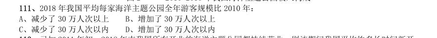

- **A.** 减少了30 万人次以上
- **B.** 增加了30 万人次以上
- **C.** 减少了30 万人次以内
- **D.** 增加了30 万人次以内

**答案：D**

### 2020 国考·地市级　第 112 题　（现期平均数）

已知2011 年初~2018 年末我国所有开业的海洋主题公园都持续营业,则该期间我国平均约多长时间新开 一家海洋主题公园?

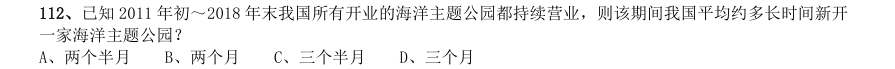

- **A.** 两个半月
- **B.** 两个月
- **C.** 三个半月
- **D.** 三个月

**答案：A**

### 2020 国考·地市级　第 114 题　（现期平均数）

2016 年我国海洋主题公园平均每名游客创造的门票收入比非门票收入多约多少元?

- **A.** 42
- **B.** 48
- **C.** 30
- **D.** 36

**答案：D**

### 2020 国考·地市级　第 119 题　（现期平均数）

2018 年中国平均每块集成电路出口单价比上年:

- **A.** 下降了30%以上
- **B.** 上升了30%以上
- **C.** 下降了30%以内
- **D.** 上升了30%以内

**答案：D**

### 2020 国考·省级　第 122 题　（现期平均数）

2007~2018 年间,全国茶园面积首次超过200 万公顷的年份,当年茶园单位面积茶叶产量比上年:

- **A.** 下降了10%以上
- **B.** 下降了不到10%
- **C.** 增加了10%以上
- **D.** 增加了不到10%

**答案：D**

### 2020 国考·省级　第 123 题　（现期平均数）

2018 年全国产茶省份中,有几个省份的茶园单位面积茶叶产量高于1 吨/公顷?

- **A.** 5
- **B.** 4
- **C.** 7
- **D.** 6

**答案：A**

### 2020 国考·省级　第 129 题　（现期平均数）

2018 年中国平均每块集成电路出口单价比上年:

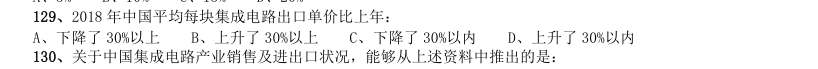

- **A.** 下降了30%以上
- **B.** 上升了30%以上
- **C.** 下降了30%以内
- **D.** 上升了30%以内

**答案：D**

### 2020 国考·省级　第 133 题　（现期平均数）

2018 年前三季度,平均每万元社会物流总额产生的物流费用比上年同期:

- **A.** 上升了不到1%
- **B.** 上升了1% 以上
- **C.** 下降了不到1%
- **D.** 下降了1% 以上

**答案：C**
