# 资料分析 · 基期量计算 · 2000 年代真题

> 所属考点：[ZL-BASE](../ZL-BASE-基期量计算.md)　｜　本片 140 题

### 2009 湖北·统一卷　第 103 题　（基期量计算（综合））

2008 年7 月农村各类商品零售价格与上年同月相比上涨的有:

- **A.** 11 种
- **B.** 12 种
- **C.** 13 种
- **D.** 14 种

**答案：暂缺**

### 2009 湖北·统一卷　第 106 题　（已知现期与增长率求基期）
> 材料：2007 年前三季度,我国全社会固定资产投资91529 亿元,同比增长25.7%。其中,城镇固定资产投资78 247 亿元,增长26.4%;农村投资13 282 亿元,增长21.2%。在城镇投资中.国有及国有控股完成投资33 951 亿元,增长16.2%∶房地产开发完成投资16 814 亿元,增长30.3%。从项目隶属关系看,中央项目投资7749 亿元,同比增长15.4%;地方项目投资70 497 亿元,增长27.8%。从产业看,第一、二、三产业分别完成投 资938 亿元、3…

其中,国内贷 款增长14.5%,利用外资增长15.5%,自筹资金增长32.2%。 2006 年前三季度城镇固定资产投资是:

- **A.** 60479 亿元
- **B.** 61904 亿元
- **C.** 69104 亿元
- **D.** 72815 亿元

**答案：暂缺**

### 2009 湖北·统一卷　第 116 题　（基期量计算（综合））
> 材料：2007 年末全国就业人员76990 万人,比上年末增加590 万人。…

2007 年我国第三产业就业人员比第二产业约多多少万人:

- **A.** 1600
- **B.** 4100
- **C.** 4300
- **D.** 10800

**答案：C**

### 2009 湖北·统一卷　第 119 题　（基期量计算（综合））

从以上图表中无法得到的推论是:

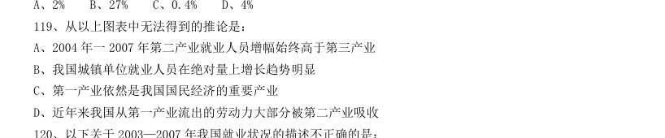

- **A.** 2004 年一2007 年第二产业就业人员增幅始终高于第三产业
- **B.** 我国城镇单位就业人员在绝对量上增长趋势明显
- **C.** 第一产业依然是我国国民经济的重要产业
- **D.** 近年来我国从第一产业流出的劳动力大部分被第二产业吸收

**答案：B**

### 2009 广东·统一卷　第 88 题　（基期量计算（综合））

2005 年广东省生产总值位列第一,高于第三位多少亿元:

- **A.** 6552.58
- **B.** 2633.97
- **C.** 3575.36
- **D.** 4005.46

**答案：暂缺**

### 2009 广东·统一卷　第 91 题　（基期量比较）

根据下表完成以下各题。 下列年份中,财政拨款用于地质勘查投资的增长幅度最大的是:

- **A.** 2002 年
- **B.** 2004 年
- **C.** 2005 年
- **D.** 2008 年

**答案：暂缺**

### 2009 广东·统一卷　第 96 题　（基期量计算（综合））

根据下列图表,完成以下各题。 2007 年我国大陆地区对美国的货物进出口总额为:

- **A.** 2523 亿美元
- **B.** 3337 亿美元
- **C.** 3021 亿美元
- **D.** 814 亿美元

**答案：暂缺**

### 2009 广东·统一卷　第 97 题　（基期量比较）

2008 年对主要国家和地区货物进出口贸易逆差额(进口额-出口额)最大的国家(地区)是:

- **A.** 欧盟
- **B.** 美国
- **C.** 韩国
- **D.** 中国台湾

**答案：暂缺**

### 2009 国考·统一卷　第 121 题　（基期量计算（综合））
> 材料：根据资料所提供的信息进行分析、比较、计算和判断处理。…

1~8 月空气合格天数超过20 天的月份有多少个:

- **A.** 4
- **B.** 5
- **C.** 6
- **D.** 7

**答案：B**

### 2009 国考·统一卷　第 126 题　（基期量计算（综合））

全国农村外出从业的女性劳动力约有多少万人:

- **A.** 4744
- **B.** 5397
- **C.** 9901
- **D.** 13178

**答案：A**

### 2009 国考·统一卷　第 127 题　（基期量计算（综合））

表中“?”处的数值应为:

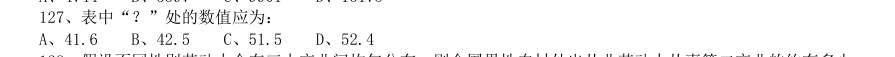

- **A.** 41.6
- **B.** 42.5
- **C.** 51.5
- **D.** 52.4

**答案：C**

### 2009 国考·统一卷　第 128 题　（基期量计算（综合））

假设不同性别劳动力会在三大产业间均匀分布,则全国男性农村外出从业劳动力从事第二产业的约有多少 万人:

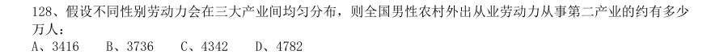

- **A.** 3416
- **B.** 3736
- **C.** 4342
- **D.** 4782

**答案：D**

### 2009 国考·统一卷　第 129 题　（基期量计算（综合））

关于农村外出从业劳动力的描述,无法从上述资料中推出的是:

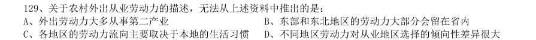

- **A.** 外出劳动力大多从事第二产业
- **B.** 东部和东北地区的劳动力大部分会留在省内
- **C.** 各地区的劳动力流向主要取决于本地的生活习惯
- **D.** 不同地区劳动力对从业地区选择的倾向性差异很大

**答案：C**

### 2009 国考·统一卷　第 131 题　（基期量比较）

某港口2007 年生产统计表 月份 港口货物吞吐量(万吨) 港口集装箱吞吐量(万TEU) 本月数 累计 本月数 累计 本年 上年同期 比上年同期 本年 上年同期 比上年同期 872.1 872.1 8.4 8.4 806.7 1678.8 5.9 14.3 905.5 2584.3 2379.6 8.6% 7.5 21.8 15.6 39.7% 912.8 3497.1 3244.2 7.8% 8.6 30.4 21.8 39.4% 990.3 4487.4 4139.1 8.4% 8.4 38.8 27.1 43.2% 927.5 5414.9 4898.7 10.5% 8.9 47.7 33.0 44.5% 918.2 6333.1 5653.6 12.0% 8.8 56.5 39.1 44.5% 929.1 7262.2 6448.9 12.6% 9.8 66.3 45.5 45.7% 904.5 8166.7 7221.5 13.1% 9.9 76.2 53.2 43.5% 871.1 9037.8 8133.6 11.1% 10.1 86.3 62.0 39.2% 905.2 9943.0 9121.9 9.0% 9.8 96.1 71.8 33.8% 916.1 10859.1 10088.8 7.6% 9.6 105.7 80.0 32.1% 2007 年该港口货物吞吐量最高的季度是:

- **A.** 第一季度
- **B.** 第二季度
- **C.** 第三季度
- **D.** 第四季度

**答案：B**

### 2009 国考·统一卷　第 132 题　（基期量计算（综合））

2006 年4 月到2007 年12 月间,港口货物吞吐量高于900 万吨的月份有多少个:

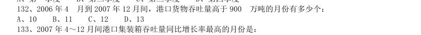

- **A.** 10
- **B.** 11
- **C.** 12
- **D.** 13

**答案：C**

### 2008 湖北·统一卷　第 117 题　（基期量比较）

该市儿童在食品消费比例支出最大的是:

- **A.** 婴儿期
- **B.** 幼儿期
- **C.** 学龄前期
- **D.** 学龄期

**答案：A**

### 2008 湖北·统一卷　第 118 题　（基期量比较）

该市儿童在服装消费比例支出最大的是:

- **A.** 婴儿期
- **B.** 幼儿期
- **C.** 学龄前期
- **D.** 学龄期

**答案：D**

### 2008 湖北·统一卷　第 127 题　（基期量比较）

上表中,城乡居民收入差额最大的年份为:

- **A.** 2002 年
- **B.** 1999 年
- **C.** 2000 年
- **D.** 2003 年

**答案：D**

### 2008 湖北·统一卷　第 131 题　（基期量计算（综合））

根据2002 年欧盟各国GDP 值比例图,西班牙的排名为( )。

- **A.** 第5
- **B.** 第6
- **C.** 第7
- **D.** 第8

**答案：A**

### 2008 广东·统一卷　第 86 题　（基期量计算（综合））
> 材料：(共30 题,参考时限35 分钟) 本部分包括四种类型的题目: 然后要求考生在备选答案中找出一对与之在逻辑关系上最为贴近和相似的词。 46 报纸:新闻 A 电影:电影院 B 报刊亭 :报纸 C 杂志 :广告 D 信封:信纸 47 酒:杯 A 饭:桶 B 水:井 C 菜:筐 D 汤:碗 48 军官:上校 A 教师:教授 B 警察:狱警 C 工人:经理 D 白酒:红酒 49 鼓掌:握手 A 胆怯:心细 B 登高:看清 C 写字:洗脸 D 奔腾:奔驰 50 生命:童年 A 蛾:蛹 …

2005 年广东省特色产业基地的工业总产值是多少? A4930 亿元 B4098 亿元 C3929 亿元 D2145 亿元

> （本题为图形题，选项为图片，见原卷）

**答案：暂缺**

### 2008 广东·统一卷　第 96 题　（基期量计算（综合））

10000 20000 30000 40000 50000 60000 万户 2003年 2005年 2007年 2003年-2007年末电话用户情况示意图 固定电话年末用户 移动电话年末用户 (统计数据来源于《2007 年中国国民经济统计公报》) 2003 年至2007 年间,我国固定电话用户与移动电话用户数量最接近的年份是( )。

- **A.** 2003 年
- **B.** 2004 年
- **C.** 2005 年
- **D.** 2006 年

**答案：暂缺**

### 2008 广东·统一卷　第 100 题　（基期量计算（综合））

根据所给材料,下列推断不正确的一项是( )

- **A.** 2004 年以来,我国移动电话用户年新增量均高于固定电话用户年新增量
- **B.** 预计到2010 年,移动电话用户数将大大高于固定电话用户量
- **C.** 2003 年以来,我国固定电话用户数呈逐年减少的趋势
- **D.** 2006 年,我国固定电话用户数达历史最高水平

**答案：暂缺**

### 2008 国考·统一卷　第 123 题　（已知现期与增长率求基期）

2006 年,年印刷量在10 亿对开张以上的企业中,印刷量增长5%以上,且低于10%的企业有多少家:

- **A.** 3
- **B.** 4
- **C.** 5
- **D.** 8

**答案：B**

### 2008 国考·统一卷　第 125 题　（已知现期与增长率求基期）

（本题题干为图形/公式，文字层无题干，图见原卷）

> （本题为图形题，选项为图片，见原卷）

**答案：B**

### 2008 国考·统一卷　第 127 题　（基期量计算（综合））

1990-2002 年间,当地人民食物获取状况恶化的地区是:

- **A.** 拉丁美洲和加勒比
- **B.** 南亚
- **C.** 撒哈拉以南非洲
- **D.** 西亚

**答案：D**

### 2008 国考·统一卷　第 128 题　（基期量计算（综合））

按1990-2002 年间的发展趋势,有几个地区将能够达到或超过2015 年发展中地区(总体)的目标水平:

- **A.** 3 个
- **B.** 4 个
- **C.** 5 个
- **D.** 6 个

**答案：B**

### 2008 国考·统一卷　第 130 题　（基期量计算（综合））

下列说法中,不能从图示信息中获得支持的是: I.1992-2002 年间,北非饥饿人口的数量并没有因人口总量的变化而变化 II.1992-2002 年间,东南亚和南亚地区的饥饿人口比例基本能反映发展中地区的总体概况 III.1992-2002 年间,发展中地区的饥饿人口主要集中在南亚地区和撒哈拉以南非洲地区 IV.1992-2002 年间,东亚地区在改善人民饥饿状况的工作方面最为突出

- **A.** I
- **B.** II 和III
- **C.** I 和III
- **D.** I 和IV

**答案：C**

### 2008 国考·统一卷　第 131 题　（基期量计算（综合））
> 材料：某市2005 年就该市城镇居民和农民参加体育锻炼及其影响因素,开展了一项调查。调查结束后按城乡、性 别分别进行了统计,统计结果如下两张表所示。…

表1:2005 年某市城镇居民和农民参加体育锻炼项目情况统计(%) 城镇 农村 男 女 武术健身气功 6.0 2.1 4.7 5.9 健身操舞秧歌 12.8 8.0 3.8 20.1 健美力量练习 7.3 5.8 8.5 5.4 自行车 23.8 21.0 24.7 21.8 登山 14.9 10.4 14.4 13.8 球类 16.8 37.9 19.9 步行 63.7 72.3 57.9 72.7 游泳 17.6 4.1 16.4 13.9 跑步 23.8 25.9 29.2 19.1 其他 13.3 9.5 11.9 13.3 表2:2005 年某市城镇居民和农民参加体育锻炼的影响因素(%) 城镇 农村 男 女 缺乏组织 8.8 3.6 7.0 7.4 缺乏指导 7.8 4.7 7.1 6.8 缺乏场地设施 13.2 8.0 12.1 14.1 工作忙、缺少时间 21.8 21.5 32.7 24.6 家务忙、缺少时间 9.2 20.8 17.6 10.5 体力工作多,不用参加 3.4 15.9 7.8 11.8 惰性 4.9 7.5 15.9 6.7 没兴趣 1.4 9.1 6.8 6.1 在各项体育项目的普及程度上,农村与城镇相比:

- **A.** 登山高于城镇
- **B.** 步行低于城镇
- **C.** 自行车高于城镇
- **D.** 健身操舞秧歌低于城镇

**答案：D**

### 2008 国考·统一卷　第 132 题　（基期量计算（综合））

与男性相比,在女性中更普及的两个体育项目是:

- **A.** 球类步行
- **B.** 跑步游泳
- **C.** 步行健身操舞秧歌
- **D.** 健身操舞秧歌跑步

**答案：C**

### 2008 国考·统一卷　第 134 题　（基期量计算（综合））

无法从表2 获得支持的判断是:

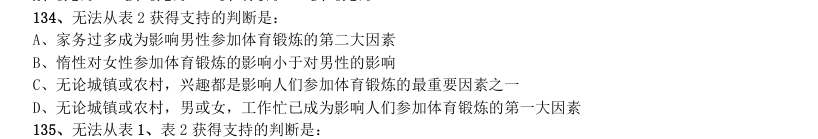

- **A.** 家务过多成为影响男性参加体育锻炼的第二大因素
- **B.** 惰性对女性参加体育锻炼的影响小于对男性的影响
- **C.** 无论城镇或农村,兴趣都是影响人们参加体育锻炼的最重要因素之一
- **D.** 无论城镇或农村,男或女,工作忙已成为影响人们参加体育锻炼的第一大因素

**答案：C**

### 2008 国考·统一卷　第 135 题　（基期量计算（综合））

无法从表1、表2 获得支持的判断是:

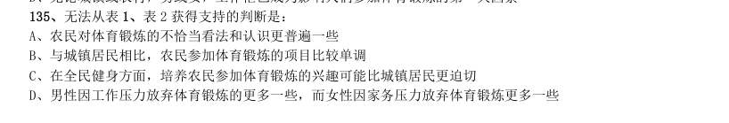

- **A.** 农民对体育锻炼的不恰当看法和认识更普遍一些
- **B.** 与城镇居民相比,农民参加体育锻炼的项目比较单调
- **C.** 在全民健身方面,培养农民参加体育锻炼的兴趣可能比城镇居民更迫切
- **D.** 男性因工作压力放弃体育锻炼的更多一些,而女性因家务压力放弃体育锻炼更多一些

**答案：D**

### 2008 国考·统一卷　第 137 题　（已知现期与增长率求基期）

2001 到2005 年间,完全符合曲线所显示的经济发展趋势的国家和地区有:

- **A.** 2 个
- **B.** 3 个
- **C.** 4 个
- **D.** 5 个

**答案：B**

### 2008 国考·统一卷　第 140 题　（已知现期与增长量求基期）

能从表1、表2 获得支持的说法是: I.整个世界的财富越来越集中到少数几个发达国家中 II.传统的世界经济强国在世界经济中的排名和地位已经发生了根本性变化 III.主要的发展中国家在世界经济中扮演着越来越重要的角色

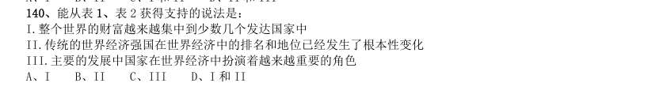

- **A.** I
- **B.** II
- **C.** III
- **D.** I 和II

**答案：C**

### 2007 广东·统一卷　第 86 题　（基期量计算（综合））
> 材料：针对下列文字、图或表回答问题。你应根据资料提供的信息进行分析、比较、计算和处理。共15 题,每题 l 分,共15 分。 根据下列文字资料,回答86~90 题。 2006 年,广东城镇单位从业人数创历史新高,2006 年从业人数比上年底增加50。17 万人,比1995 年高峰 期的911.90 万人还多42.54 万人。2006 年末企业从业人员达到696.33 万人,比上年底增加42.45 万 人,而同期事业、机关单位的从业人员为258.11 万人,比上年底增加7.72 万人…

2005 年底广东城镇单位从业人员约为多少人?( )

- **A.** 954.44 万
- **B.** 919.53 万
- **C.** 911.90 万D.904.27 万

**答案：暂缺**

### 2007 广东·统一卷　第 88 题　（基期量计算（综合））

2006 年全省其他各种经济从业人员数量比2005 年多多少人?( )

- **A.** 46.28 万
- **B.** 42.45 万C.42.54 万D.31.09 万

**答案：暂缺**

### 2007 广东·统一卷　第 89 题　（基期量计算（综合））

根据上述材料,在吸引劳动力就业方面,表现最不突出的是( )。

- **A.** 国有企业
- **B.** 城镇集体经济
- **C.** 非公有制经济
- **D.** 制造业

**答案：暂缺**

### 2007 广东·统一卷　第 90 题　（基期量计算（综合））

以下说法不符合上述材料的一项是( )。

- **A.** 2006 年广东城镇单位从业人员已创出历史新高
- **B.** 2006 年非公有制企业成为吸纳劳动力就业的主渠道
- **C.** 2006 年企业从业人员的增长高于事业、机关单位D。2006 年广东制造业从业人员占城镇从业人员的一半以上

**答案：暂缺**

### 2007 广东·统一卷　第 93 题　（基期量比较）

表一:2004 年广东高技术行业科技人才资源配置情况表 企业数 (个) 有科技 活动 有 R8LD 活动 有科技 机构 从业人 员年平 均人数 (万人) 科技活 动人员 (万人) 科学家 工程师 R&D 人 贝 总计 80 8.11 6.34 5.O5 医药制造业 7.46 0.55 0.34 0.24 航空航天器制造业 O 0.31 0.O3 0.O3 0.O3 电子及通信设备制造 业 136.85 5.24 4.33 3.48 计算机及办公设备制 造业 44.48 1.97 1.41 1-13 医疗设备及仪器仪表 制造业 4.73 0.32 0.24 0.16 表二:2004 年广东高技术产业中大中型工业企业科技活动情况 科技活动 人员合计 (万人) 科学家工 程师 科技活动 经费内部 支出总额 (亿元) R&D 经费 内部支出 新产品开 发经费支 出 新产品产 值(亿元) 拥有发 明专利 数(件) 高技术产业 总数 8.11 6.34 1 36.25 127.78 68.29 1508.98 1747 大中型企业 6.53 5.20 124.O3 117.14 64.19 1502.85 1407 91.2004 年,广东高技术行业企业中科学家工程师占科技活动人员的比例最高的行业是( )。

- **A.** 电子及通信设备制造业
- **B.** 医药制造业
- **C.** 航空航天器制造业
- **D.** 计算机及办公设备制造业

**答案：暂缺**

### 2007 广东·统一卷　第 99 题　（基期量计算（综合））

根据上图,下列关于我国农村用电发电情况的表述,正确的一项是( )。

- **A.** 2000 至2005 年问,我国农村装机容量逐年增加
- **B.** 2000 至2005 年间,我国农村用电量增长了195.44 亿千瓦时
- **C.** 2000 至2005 年间,我国农村发电量越来越能够满足用电量的需求
- **D.** 2000 至2005 年问,我国农村用电量增速逐年减慢

**答案：暂缺**

### 2007 国考·统一卷　第 125 题　（已知现期与增长率求基期）

下列说法肯定正确地是:

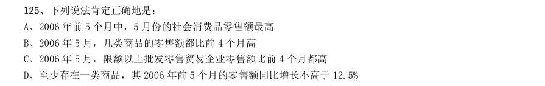

- **A.** 2006 年前5 个月中,5 月份的社会消费品零售额最高
- **B.** 2006 年5 月,几类商品的零售额都比前4 个月高
- **C.** 2006 年5 月,限额以上批发零售贸易企业零售额比前4 个月都高
- **D.** 至少存在一类商品,其2006 年前5 个月的零售额同比增长不高于12.5%

**答案：D**

### 2007 国考·统一卷　第 126 题　（基期量计算（综合））

下列行业中,每单位取水量中耗水量最少的是:

- **A.** 林牧渔畜
- **B.** 工业
- **C.** 居民生活
- **D.** 生态环境

**答案：A**

### 2007 国考·统一卷　第 127 题　（基期量比较）

下列省份中,每单位耗水量所需取水量最少的是:

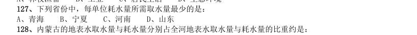

- **A.** 青海
- **B.** 宁夏
- **C.** 河南
- **D.** 山东

**答案：D**

### 2007 国考·统一卷　第 131 题　（已知现期与增长率求基期）
> 材料：2005 年全国专利审查与专利代理业务研讨会宣布,预计在“十一五”期间,我国专利申请总量将达346 万 件,其中发明专利申请总量将达到140 万件,实用新型专利申请总量将达到89 万件,外观设计专利申请总量将 达到117 万件。 据介绍,我国专利审批总体能力在“十五”期间大幅提高,审查周期大幅缩短。发明专利人均待审量由“十 五"初期(2001 年)的154 件下降到“十五”末期(2005 年)的85 件,平均结案周期从“十五”初期的53 个月缩短 至“十五”末期的24 个月。…

其中,2004 年共受理专利申请35.38 万件,同比 增长14.7%;2004 年共授予专利19.02 万件,同比增长4.4%。我国的实用新型专利、外观设计专利和商标的年 申请量已经跃居世界第一,其中90%以上为国内申请。 与2003 年相比,2004 年我国专利的授予比例(授予比例=专利申请授予量/专利申请受理量):

- **A.** 提高了5.3 个百分点
- **B.** 降低了5.3 个百分点
- **C.** 提高了9.5 个百分点
- **D.** 降低了9.5 个百分点

**答案：B**

### 2007 国考·统一卷　第 132 题　（基期量计算（综合））

1985 年4 月1 日至2005 年8 月31 日,我国受理的专利申请中,最后约58.5 万件专利的受理历时:

- **A.** 15 个月
- **B.** 14 个月
- **C.** 10 个月
- **D.** 8 个月

**答案：A**

### 2007 国考·统一卷　第 138 题　（已知现期与增长率求基期）

与亚洲相比,整个欧洲的啤酒消费量:

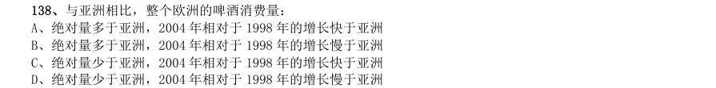

- **A.** 绝对量多于亚洲,2004 年相对于1998 年的增长快于亚洲
- **B.** 绝对量多于亚洲,2004 年相对于1998 年的增长慢于亚洲
- **C.** 绝对量少于亚洲,2004 年相对于1998 年的增长快于亚洲
- **D.** 绝对量少于亚洲,2004 年相对于1998 年的增长慢于亚洲

**答案：B**

### 2006 广东·统一卷　第 86 题　（已知现期与增长率求基期）
> 材料：(共15题,参考时限15分钟) 针对下例文字、表或图回答问题。你应根据资料提供的信息进行分析、比较、计算、处理。 共15题, 每题1分,共15分。 根据下列文字资料,回答86~90 题。 据统计,今年5月份全国基本型乘用车产销21.19万辆和22.13万辆,比去年同期分别增长1.86%和 26.0%;运动型多用途乘用车产销1.43万辆和1.52万辆,降幅不大;交叉型乘用车本月产销6.60万辆和6.85 万辆,分别比上月下降14.2%和2.8%;多功能乘用车产销降幅最大,本月产…

1至 5月,基本型乘用车累计产销99.10万辆和96.93万辆,产量同比下降 2.73%,销量同比增长1.07%; 多功能乘用车累计产销6.11万辆和5.71万辆,同比增长31.20%和 31.54%;运动型多用途乘用车累计产销 6.46万辆和6.54万辆,同比下降16.00%和10.25%;交叉型乘用车累计产销36.77万辆和37.41万辆,同比增长 6.02%和 10.29%。 去年 5月份全国乘用车销量最大的车型的销量是( )。

- **A.** 21.19万辆
- **B.** 20.80万辆
- **C.** 17.56万辆
- **D.** 101.80万辆

**答案：暂缺**

### 2006 广东·统一卷　第 87 题　（基期量比较）

今年5月份全国乘用车销量最大的车型是( )

- **A.** 基本型乘用车
- **B.** 交叉型乘用车
- **C.** 多功能乘用车D.运动型多用途乘用车

**答案：暂缺**

### 2006 广东·统一卷　第 90 题　（基期量计算（综合））

根据上述资料,以下表述准确的一项是( )。

- **A.** 与去年相比,全国今年1至5月基本型乘用车产、销量有不同程度的增长
- **B.** 今年1至5月份全国运动型多用途乘用车产、销量都低于去年同期
- **C.** 去年5月全国交叉型乘用车产、销量都低于今年5月
- **D.** 今年4月全国基本型乘用车产、销量都略高于5月

**答案：暂缺**

### 2006 广东·统一卷　第 91 题　（基期量计算（综合））

我国农村劳动力情况表 单位:万人 2003 年,我国总人口约为多少人?( )

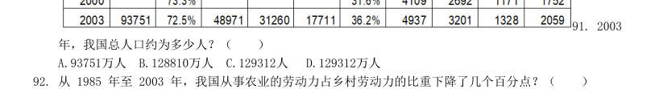

- **A.** 93751万人
- **B.** 128810万人
- **C.** 129312人
- **D.** 129312万人

**答案：暂缺**

### 2006 广东·统一卷　第 93 题　（基期量计算（综合））

根据上表,从 1985 年至 2003 年,从事非农劳动的比例上升最快的行业是( )。

- **A.** 工业
- **B.** 建筑业
- **C.** 交通业
- **D.** 商饮业

**答案：暂缺**

### 2006 广东·统一卷　第 96 题　（基期量比较）

2000—2004 年我国大中型企业专利申请及拥有量统计图(单位:件) 2004 年我国部分省、市大中型工业企业专利申请及拥有量统计表 单位:件 地区 专利申请量(件) 发明专利申请量(件) 发明专利拥有量(件) 北京 天津 上海 浙江 江苏 黑龙江 山东 广东 四川 陕西 青海 2000年至 2004年,我国大中型工业企业发明专利申请数占专利申请数比重最大的年份是( )。

- **A.** 2001年
- **B.** 2002年
- **C.** 2003年
- **D.** 2004年

**答案：暂缺**

### 2006 广东·统一卷　第 99 题　（基期量计算（综合））

根据以上统计信息,下列关于我国大中型工业企业专利情况的表述,错误的一项是( )。

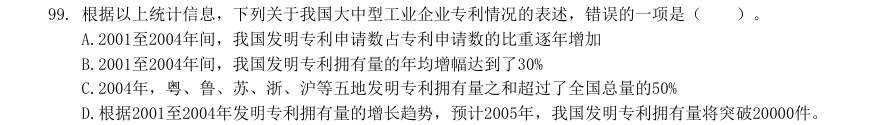

- **A.** 2001至2004年间,我国发明专利申请数占专利申请数的比重逐年增加
- **B.** 2001至2004年间,我国发明专利拥有量的年均增幅达到了30%
- **C.** 2004年,粤、鲁、苏、浙、沪等五地发明专利拥有量之和超过了全国总量的50%
- **D.** 根据2001至2004年发明专利拥有量的增长趋势,预计2005年,我国发明专利拥有量将突破20000件。

**答案：暂缺**

### 2006 国考·统一卷　第 116 题　（基期量计算（综合））
> 材料：资料分析(共20 题,参考时限20 分钟) 所给出的图、表或一段文字均有5 个问题要你回答。你应根据资料提供的信息进行分析、比 较、计算和判断处理。 请开始答题: 一、根据下表回答116~120 题。…

2000 年至2004 年全国大中型工业企业部分科技指标情况表 单位 2000 年 2001 年 2002 年 2003 年 2004 年 企业总数 个 22276 21776 22904 23096 22276 设有科技机构企业的比重 % 28.4 26.2 25.3 24.9 科技人员 万人 145.4 138.7 136.8 136.7 141.1 科技人员占从业人员的比例 % 4.6 4.78 4.88 4.5 科技经费 亿元 665.4 922.81 1046.65 1213.03 1588.61 科技经费占销售额的比例 % 1.35 1.65 1.67 1.73 1.65 2004 年全国大中型工业企业的销售额约为( )。

- **A.** 96279 亿元
- **B.** 80241 亿元
- **C.** 10375 亿元
- **D.** 10026 亿元

**答案：A**

### 2006 国考·统一卷　第 118 题　（基期量计算（综合））

全国大中型工业企业的从业人员数量最多的年份是( )。

- **A.** 2001 年
- **B.** 2002 年
- **C.** 2003 年
- **D.** 2004 年

**答案：D**

### 2006 国考·统一卷　第 119 题　（基期量计算（综合））

全国设有科技机构的企业的数量的变化趋势是( )。

- **A.** 一直上升
- **B.** 一直下降
- **C.** 先上升后下降
- **D.** 先下降后上升

**答案：B**

### 2006 国考·统一卷　第 131 题　（基期量计算（综合））
> 材料：四、根据下列文字回答131~135 题。 2003 年国家财政科技拨款额达975.5 亿元,比上年增加159.3 亿元,增长19.5%,占国家财 政支出的比重为4.0%。在国家财政科技拨款中,中央财政科技拨款为639.9 亿元,比上年增长 25.2%,占中央财政支出的比重为8.6%;地方财政科技拨款为335 6 亿元,比上年增长10%, 占地方财政支出的比重为1.9%。…

2003 年国家财政支出总额为( )。

- **A.** 24387.5 亿元
- **B.** 5002.6 亿元
- **C.** 3979.6 亿元
- **D.** 816.3 亿元

**答案：A**

### 2006 国考·统一卷　第 132 题　（基期量计算（综合））

2003 年中央财政支出与地方财政支出之比约为( )。

- **A.** 1∶6.87
- **B.** 6.87∶1
- **C.** 1∶2.37
- **D.** 2.37∶1

**答案：C**

### 2006 国考·统一卷　第 135 题　（基期量计算（综合））

根据文中划线部分内容,可以求出的选项为( )。 [1]2002 年各类企业科技活动经费支出 [2]2003 年全国总科技活动经费支出 [3]2002 年全国总科技活动经费支出

- **A.** [1]
- **B.** [1]与[2]
- **C.** [2]与[3]
- **D.** [1]、[2]与[3]

**答案：B**

### 2005 广东·统一卷　第 97 题　（基期量比较）

1997 年参与城市最低生活保障的人数比1996 年提高了几个百分点?

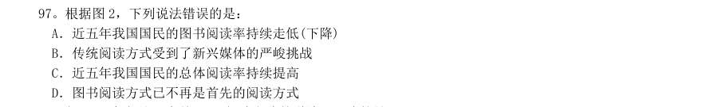

- **A.** 84.9
- **B.** 87.9
- **C.** 3.5
- **D.** 3

**答案：暂缺**

### 2005 国考·统一卷　第 119 题　（基期量计算（综合））

如果数据中的在校生不包括毕业生,那么2002 年高校共约招了( )。

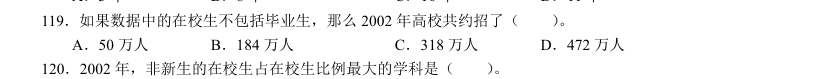

- **A.** 50 万人
- **B.** 184 万人
- **C.** 318 万人
- **D.** 472 万人

**答案：C**

### 2005 国考·统一卷　第 121 题　（已知现期与增长率求基期）
> 材料：环渤海经济区正逐步成为引人注目的经济增长第三极,而京津冀在环渤海经济区占有举足轻重的位 置。但以北京、天津为核心的京津冀城市群分布比较散乱,彼此间的空间联系松散且薄弱,重复建设问 题比较严重,资源浪费现象普遍存在。2003 年,北京、天津两市人均GDP 分别超过或接近3 万元,城 镇居民可支配收入均高于全国平均水平,而河北人均GDP 刚刚突破1 万元,城镇居民可支配收入7239 元,比全国平均水平低14.6%,比北京市低近一半;从市场开放度看,京津两市由于享受开放城市、 沿海…

2003 年京津冀的经济实力比较 地区 人均 GDP(元) 经济增 长率(%) 城镇人均可支 配收入(元) 三个产业结构比 固定资产投资 增长率(%) 进出口增 长率(%) 北京市 36613 10.5 13883 2.60:36.0:61.4 18.9 30.4 天津市 28574 14.5 10313 3.70:50.8:45.5 20.9 28.7 河北省 10513 11.6 15.0:51.5:33.5 22.9 34.7 从上述材料中无法得知的是( )。

- **A.** 京津冀的产业联系不紧密
- **B.** 京津冀的城市布局不合理
- **C.** 京津冀的重复建设严重
- **D.** 京津冀的经济水平落差大

**答案：A**

### 2005 国考·统一卷　第 123 题　（已知现期与增长率求基期）

如果天津市2002 年的固定资产投资为5000 万元,且2004 年的固定资产投资和2003 年保持同比 增长,则天津市在2004 年的固定资产投资额约为( )。

- **A.** 6200 万元
- **B.** 6800 万元
- **C.** 7300 万元
- **D.** 7900 万元

**答案：C**

### 2005 国考·统一卷　第 124 题　（基期量计算（综合））

就河北省而言,要想加快京津冀经济一体化进程,河北省单方面无法做到的是( )。

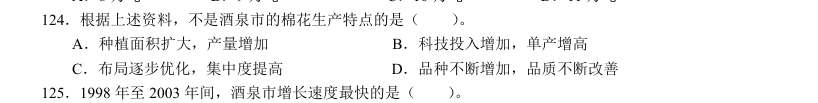

- **A.** 尽快提高经济实力
- **B.** 合理形成各区域的职能分工
- **C.** 大力发展工业制造业
- **D.** 尽快发展壮大民间投资

**答案：B**

### 2005 国考·统一卷　第 126 题　（基期量计算（综合））

1993-2003 年某国国内生产总值指数 年 份 国民生产总值 国内生产总值 第一产业 第二产业 第三产业 人均国内生产总值 108.7 108.7 102.0 115.8 104.9 106.8 98.4 98.4 98.2 97.5 100.4 96.9 107.6 107.6 97.8 113.3 109.5 106.2 111.7 111.7 104.1 115.0 113.7 110.2 107.6 107.6 106.1 108.2 107.8 106.1 107.8 107.8 98.5 113.6 105.9 106.5 105.2 105.2 107.0 101.9 110.4 103.9 109.3 109.1 111.5 105.6 113.0 107.5 111.1 110.9 108.3 110.4 115.2 109.3 115.3 115.2 112.9 114.5 119.4 113.7 113.2 113.5 101.8 118.6 118.3 111.9 说明:本题中指数的计算方法为:当年的数值与上一年数值的比乘以100。举例来说,假设第一年的数值为m,第二年的数值为n,则第二 年的指数为100×(n/m)。 假设1995 年的国内生产总值为200 亿,那么1996 年的国内生产总值为( )。

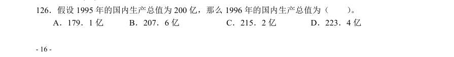

- **A.** 179.1 亿
- **B.** 207.6 亿
- **C.** 215.2 亿
- **D.** 223.4 亿

**答案：D**

### 2005 国考·统一卷　第 130 题　（基期量计算（综合））

下面不正确的叙述是( )。

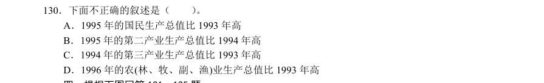

- **A.** 1995 年的国民生产总值比1993 年高
- **B.** 1995 年的第二产业生产总值比1994 年高
- **C.** 1994 年的第三产业生产总值比1993 年高
- **D.** 1996 年的农(林、牧、副、渔)业生产总值比1993 年高

**答案：D**

### 2005 国考·统一卷　第 131 题　（基期量计算（综合））

2003 年部分城市日照时数 北京的日照时数超过200 小时的月份有( )。

- **A.** 8 个
- **B.** 9 个
- **C.** 10 个
- **D.** 11 个

**答案：A**

### 2005 国考·统一卷　第 132 题　（基期量比较）

哈尔滨日照最多和最低月份的日照时数的比值最接近( )。

- **A.** 2.5
- **B.** 3.0
- **C.** 3.2
- **D.** 3.8

**答案：C**

### 2005 国考·统一卷　第 133 题　（基期量比较）

在5 月至7 月的三个月中,日照时数之和最大的城市是( )。

- **A.** 北京
- **B.** 哈尔滨
- **C.** 上海
- **D.** 拉萨

**答案：B**

### 2005 国考·统一卷　第 134 题　（基期量比较）

上海日照时数相差最大的两个月是( )。

- **A.** 1 月和3 月
- **B.** 2 月和5 月
- **C.** 2 月和7 月
- **D.** 10 月和12 月

**答案：C**

### 2004 广东·统一卷　第 88 题　（基期量计算（综合））

从上述资料中,能推出的是:

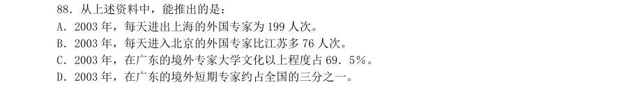

> （本题为图形题，选项为图片，见原卷）

**答案：暂缺**

### 2004 广东·统一卷　第 89 题　（基期量计算（综合））

城镇居民生活小康标准的五个方面不包括:

- **A.** 社会保障水平
- **B.** 物质生活
- **C.** 文教娱乐
- **D.** 人口素质

**答案：暂缺**

### 2004 广东·统一卷　第 92 题　（基期量计算（综合））

我国出口额和进口额增长最快的年份分别是:

- **A.** 1999 年和2000 年
- **B.** 都是2000 年
- **C.** 1999 年和2001 年
- **D.** 2001 年和2002 年

**答案：暂缺**

### 2004 广东·统一卷　第 94 题　（基期量比较）

下列哪一年我国大陆的贸易顺差最大?

- **A.** 1998 年
- **B.** 1999 年 C2000 年
- **D.** 2001 年

**答案：暂缺**

### 2004 广东·统一卷　第 95 题　（基期量计算（综合））

如果2003 年的进口总额和出口总额都稳定增长,?进出口总额最接近下列哪一项?

- **A.** 4000 和4500 亿美
- **B.** 3200 和3500 亿美元
- **C.** 3000 和3700 亿美元
- **D.** 3500 和4000 亿美元

**答案：暂缺**

### 2004 广东·统一卷　第 97 题　（基期量计算（综合））

2002 年该地区的GDP 为:

- **A.** 33.23 亿元
- **B.** 32.15 亿元
- **C.** 45.94 亿元
- **D.** 7.05 亿元

**答案：暂缺**

### 2004 广东·统一卷　第 99 题　（基期量计算（综合））

2002 年该地区出口额和实际利用外资之间的差额约为:

- **A.** 6.09 亿美元
- **B.** 5 亿美元
- **C.** 2.14 亿美元
- **D.** 0.35 亿美元

**答案：暂缺**

### 2004 广东·统一卷　第 100 题　（基期量计算（综合））

下列陈述中表达错误的一项是:

- **A.** 该地区出口保持了旺盛的势头
- **B.** 该地区固定资产投资开始逐渐回落
- **C.** 图中所示各项生产产值均呈现了上涨趋势
- **D.** 该地区各项收入均呈现了上涨趋势

**答案：暂缺**

### 2004 国考·A卷　第 89 题　（已知现期与增长率求基期）

从上表可以看出,广东省最重视的投资是( )。

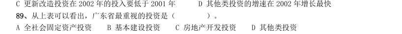

- **A.** 全社会固定资产投资
- **B.** 基本建设投资
- **C.** 房地产开发投资
- **D.** 其他类投资

**答案：C**

### 2004 国考·A卷　第 91 题　（已知现期与增长率求基期）

如果1998 年基本建设投资为5 亿元,则2000 年的基本建设投资为( )。

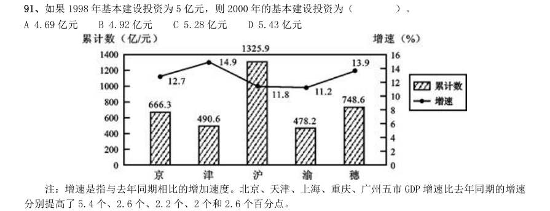

- **A.** 4.69 亿元
- **B.** 4.92 亿元
- **C.** 5.28 亿元
- **D.** 5.43 亿元

**答案：D**

### 2004 国考·A卷　第 92 题　（已知现期与增长率求基期）

分别提高了5.4 个、2.6 个、2.2 个、2 个和2.6 个百分点。 2003 年第一季度GDP 总量增长最快的城市是( )。

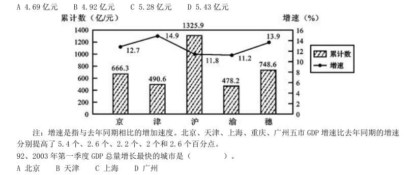

- **A.** 北京
- **B.** 天津
- **C.** 上海
- **D.** 广州

**答案：B**

### 2004 国考·A卷　第 95 题　（已知现期与增长率求基期）

2001 年同期GDP 总量位居第一和最后的两个城市分别是( )。

- **A.** 上海和天津
- **B.** 上海和重庆
- **C.** 北京和广州
- **D.** 北京和天津

**答案：A**

### 2004 国考·A卷　第 99 题　（已知现期与增长率求基期）

与去年6 月相比,下降的指数是( )。

- **A.** 竣工面积分类指数
- **B.** 资金来源分类指数
- **C.** 新开工面积分类指数
- **D.** 土地开发面积分类指数

**答案：D**

### 2004 国考·A卷　第 104 题　（基期量计算（综合））

2000 年北京批发零售业的零售额为1025.5 亿元,比上海少( )。

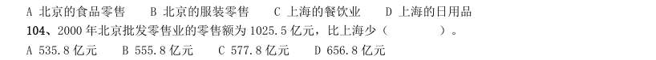

- **A.** 535.8 亿元
- **B.** 555.8 亿元
- **C.** 577.8 亿元
- **D.** 656.8 亿元

**答案：B**

### 2004 国考·B卷　第 86 题　（已知现期与增长量求基期）

在2002 年年末电话用户比上年末增加的数量接近( )。

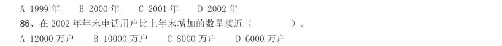

- **A.** 12000 万户
- **B.** 10000 万户
- **C.** 8000 万户
- **D.** 6000 万户

**答案：B**

### 2004 国考·B卷　第 87 题　（已知现期与增长率求基期）

如果增长趋势与上年保持一致,预计2003 年年末移动电话用户约为( )。

- **A.** 21000 万户
- **B.** 23000 万户
- **C.** 25000 万户
- **D.** 29000 万户

**答案：D**

### 2004 国考·B卷　第 88 题　（已知现期与增长量求基期）

下列哪一项说法不正确?( )

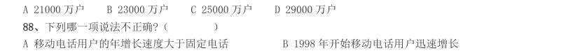

- **A.** 移动电话用户的年增长速度大于固定电话
- **B.** 1998 年开始移动电话用户迅速增长
- **C.** 移动电话和固定电话的增长最多的都是2000 年
- **D.** 2000 年后固定电话的增长速度有所下降

**答案：C**

### 2004 国考·B卷　第 89 题　（基期量计算（综合））

若2002 年年末全国人口数约是13 亿,则当时全国电话的普及率接近( )。

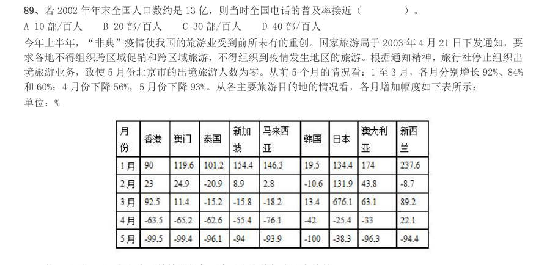

- **A.** 10 部/百人
- **B.** 20 部/百人
- **C.** 30 部/百人
- **D.** 40 部/百人

**答案：C**

### 2004 国考·B卷　第 90 题　（已知现期与增长率求基期）

从各主要旅游目的地的情况看,各月增加幅度如下表所示: 单位:% 从1 月到5 月,北京市出境旅游相邻两个月间变化幅度最大的是( )。

- **A.** 1 月至2 月
- **B.** 2 月至3 月
- **C.** 3 月至4 月
- **D.** 4 月至5 月

**答案：D**

### 2004 国考·B卷　第 91 题　（基期量计算（综合））

从表中数据看,前5 个月北京出境旅游受“非典”疫情持续影响最长的国家或地区是( )。

- **A.** 泰国
- **B.** 香港
- **C.** 澳门
- **D.** 日本

**答案：A**

### 2004 国考·B卷　第 92 题　（已知现期与增长率求基期）

下列哪项描述不正确?( ) A 5 月份北京到新西兰的旅游人数百分比降低幅度最大B 北京到香港和到澳门旅游的人数均是3 月比2 月多 C “非典”疫情对北京五月份出境旅游影响最大 D 5 月北京市出境到各国旅游的人数都是负增长

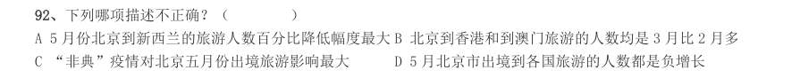

> （本题为图形题，选项为图片，见原卷）

**答案：A**

### 2004 国考·B卷　第 93 题　（基期量比较）

1 月到5 月,北京出境旅游变化幅度最大的目的地国家或地区是( )。

- **A.** 香港
- **B.** 韩国
- **C.** 日本
- **D.** 澳大利亚

**答案：C**

### 2004 国考·B卷　第 94 题　（基期量计算（综合））

1 月到5 月,北京市出境旅游的人数变化趋势一致的国家组合是( )。

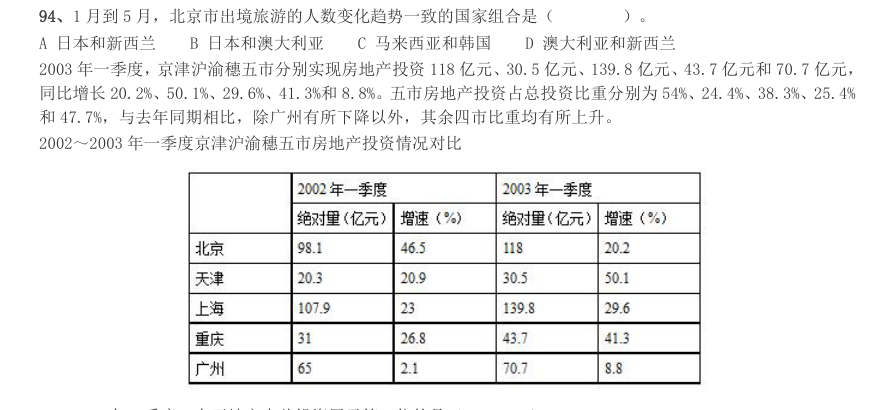

- **A.** 日本和新西兰
- **B.** 日本和澳大利亚
- **C.** 马来西亚和韩国
- **D.** 澳大利亚和新西兰

**答案：B**

### 2004 国考·B卷　第 95 题　（已知现期与增长率求基期）

同比增长20.2%、50.1%、29.6%、41.3%和8.8%。五市房地产投资占总投资比重分别为54%、24.4%、38.3%、25.4% 和47.7%,与去年同期相比,除广州有所下降以外,其余四市比重均有所上升。 2002~2003 年一季度京津沪渝穗五市房地产投资情况对比 2003 年一季度,在五地市中总投资居于第三位的是( )。

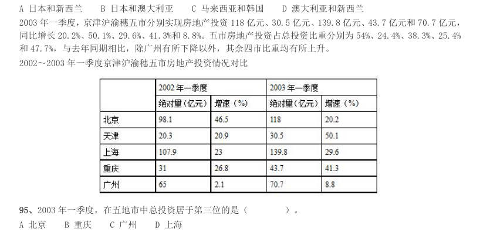

- **A.** 北京
- **B.** 重庆
- **C.** 广州
- **D.** 上海

**答案：B**

### 2004 国考·B卷　第 97 题　（已知现期与增长率求基期）

从表格分析,下面哪种说法是正确的?( )

- **A.** 重庆的房地产投资增加幅度最大
- **B.** 北京在投资增长的绝对量上处于最领先位置
- **C.** 广州的房地产投资趋于平稳
- **D.** 上海房地产市场投资最大

**答案：D**

### 2004 国考·B卷　第 99 题　（已知现期与增长量求基期）

2003 年一季度房地产投资绝对量增加最多的是( )。

- **A.** 北京
- **B.** 天津
- **C.** 重庆
- **D.** 上海

**答案：D**

### 2004 国考·B卷　第 100 题　（基期量计算（综合））
> 材料：民生活水平小康实现程度达到94.3%。在12 项小康指标中有10 项达到或者基本达到小康初始水平。但是还有两 项指标,即文化教育娱乐支出比重和人均绿地面积与小康标准有一定差距。…

下列表述不正确的是( )。

- **A.** 截至1999 年我国城镇居民生活水平小康实现程度达到94.3%
- **B.** 城市小康各项指标的发展水平不均衡,但均已达到小康标准
- **C.** 我国小康实现程度存在地区差异
- **D.** 我国小康实现程度存在指标差异

**答案：B**

### 2004 国考·B卷　第 102 题　（基期量计算（综合））

从上述资料中,能推出的是( )。

- **A.** 地理环境的差异是小康实现程度差异的原因
- **B.** 东部地区比中、西部地区小康水平实际增长值低
- **C.** 东部地区比中、西部地区小康水平实现程度高
- **D.** 小康标准的5 个方面均有3 项不同的指标

**答案：C**

### 2004 国考·B卷　第 103 题　（基期量计算（综合））

城镇居民生活小康标准的五个方面不包括( )。

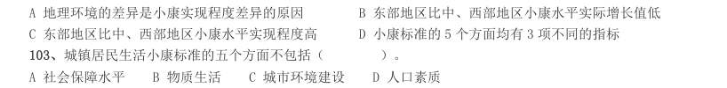

- **A.** 社会保障水平
- **B.** 物质生活
- **C.** 城市环境建设
- **D.** 人口素质

**答案：C**

### 2003 国考·A卷　第 111 题　（基期量计算（综合））
> 材料：(共20 题,参考时限20 分钟) 所给出的图、表或一段文字均有5 个问题要你回答。你应根据资料提供的信息进行分析、比较、计算和判 断处理。 请开始答题: 一、根据下表回答问题。…

某地区劳动力文化程度的资料如下:(单位:万人)分组合计文盲小学初中高中大专本科及以上男性 3452711712060912 女性40548228903063 总计75075345210901515(注:学习年限标准:文盲,0 年;小学,6 年;初中,9 年;高中,12 年;大专,15 年;本科及以上,16 年) 该地区每万人劳动力中,大专及以上文化程度的人数是多少?( )。

- **A.** 350 人/万人
- **B.** 400 人/万人
- **C.** 450 人/万人D.500 人/万人

**答案：B**

### 2003 国考·A卷　第 112 题　（基期量计算（综合））

根据上表所示,男女比例最为均衡的是哪种文化程度人群?( )。

- **A.** 文盲
- **B.** 小学
- **C.** 初中
- **D.** 高中

**答案：C**

### 2003 国考·A卷　第 114 题　（基期量计算（综合））

若使该地区劳动力文化程度资料更直观地呈现,那么选择哪一种图最好?( )。

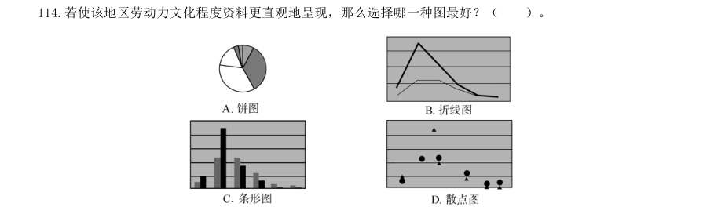

> （本题为图形题，选项为图片，见原卷）

**答案：C**

### 2003 国考·A卷　第 115 题　（已知现期与增长量求基期）

当地政府计划将该地区劳动力资源当中高中及以上文化程度的人数比例由原来的6∶1∶1 调整为5∶3∶2,假 设该地区高中文化程度的人数不变,则大专、本科及以上两种文化程度的人数应分别增加多少万人?( )。

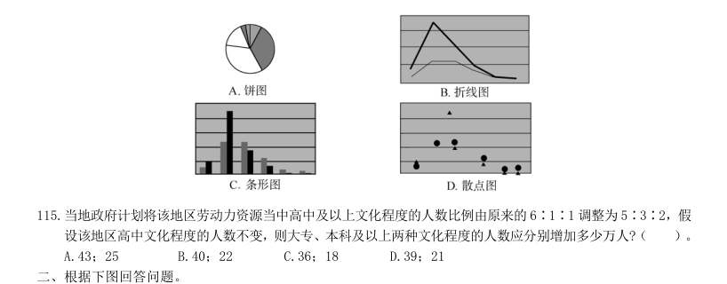

- **A.** 43;25
- **B.** 40;22
- **C.** 36;18
- **D.** 39;21

**答案：D**

### 2003 国考·A卷　第 121 题　（基期量计算（综合））

如果中国网民的总人数为2 250 万,那么41 岁以上的网民约有多少万人?( )。

- **A.** 100
- **B.** 200
- **C.** 300
- **D.** 400

**答案：B**

### 2003 国考·A卷　第 124 题　（基期量计算（综合））

18 岁以下的网民人数与下列哪个年龄段的最接近?( )。

- **A.** 18~24
- **B.** 25~30
- **C.** 31~40
- **D.** 41~50

**答案：C**

### 2003 国考·A卷　第 125 题　（基期量比较）
> 材料：网民人数随着学历升高而变化的趋势大致符合下列哪幅图?( )。 四、根据下列文字资料回答问题。 2002 年1~6 月,我国通信业务收入完成2 189.4 亿元,比上年同期增长15.6%,增幅是同期国内生产总 值的两倍。其中,邮政完成247.4 亿元,增长8.5%;电信完成1 942.1 亿元,增长16.6%。各项业务中,国 内长途业务收入222 亿元,同比下降0.2%;国际业务收入36.8 亿元,下降17.6%;移动通信收入920.6 亿 元,增长24%;本地网通信收入565…

其中,固定电话用户新增1 990.9 万户,达到1.99 亿户;移动电话用户新增3 135.7 万户,达 到1.76 亿户。固定电话用户中,城市电话用户新增1 385.2 万户,达到1.25 亿户;农村电话用户新增605.7 万户,达到7 411.4 万户。电话用户中,东、中、西部地区各为1.95 亿户、1.1 亿户和0.7 亿户,分别占52%、 29.3%和18.7%。全国电话普及率达到30.2 部/百人,比上年末提高4.3 个百分点;移动电话普及率达到13.86 部/百人,比上年末提高2.7 个百分点。

> （本题为图形题，选项为图片，见原卷）

**答案：D**

### 2003 国考·B卷　第 115 题　（基期量计算（综合））

除未分类的商品之外,进口金额比出口金额高的类别有( )。

- **A.** 6 类
- **B.** 5 类
- **C.** 4 类
- **D.** 3 类

**答案：A**

### 2003 国考·B卷　第 116 题　（基期量计算（综合））

此表主要是介绍世界主要地区90 年代中期( )。

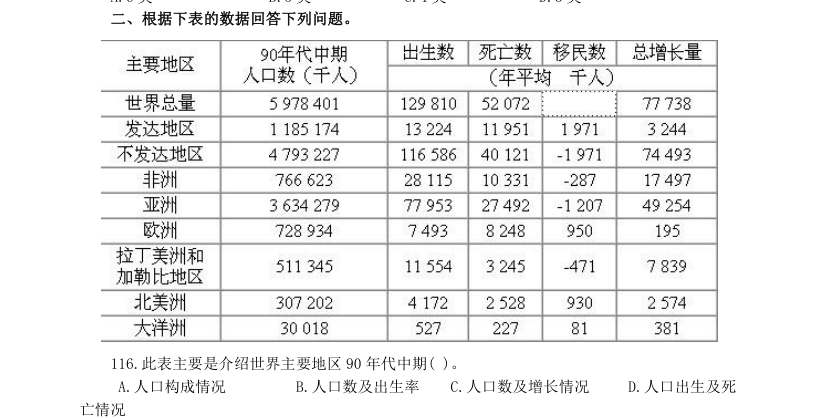

- **A.** 人口构成情况
- **B.** 人口数及出生率
- **C.** 人口数及增长情况
- **D.** 人口出生及死

**答案：暂缺**

### 2003 国考·B卷　第 122 题　（已知现期与增长量求基期）

根据资料所提供的信息,2001 年在京务工经商人员的数量比1997 年是( )。

- **A.** 增加了
- **B.** 下降了
- **C.** 相关不大
- **D.** 很接近

**答案：A**

### 2003 国考·B卷　第 124 题　（基期量计算（综合））

短期留京(三个月以下)的人口大约比1997 年( )。

- **A.** 增加了8 万人
- **B.** 增加了3 万人
- **C.** 减少了5 万人
- **D.** 减少了8 万人

**答案：D**

### 2003 国考·B卷　第 125 题　（已知现期与增长量求基期）

从第四部分的资料中,我们能看出( )。

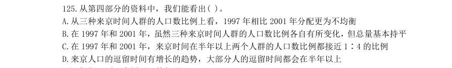

- **A.** 从三种来京时间人群的人口数比例上看,1997 年相比2001 年分配更为不均衡
- **B.** 在1997 年和2001 年,虽然三种来京时间人群的人口数比例各自有所变化,但总量基本持平
- **C.** 在1997 年和2001 年,来京时间在半年以上两个人群的人口数比例都接近1∶4 的比例
- **D.** 来京人口的逗留时间有增长的趋势,大部分人的逗留时间都会在半年以上

**答案：D**

### 2003 国考·B卷　第 129 题　（已知现期与增长量求基期）

2000 年与1997 年相比高新技术产业生产值总额增加最多的是( )。

- **A.** 电子与信息
- **B.** 生物及医药物品
- **C.** 新材料
- **D.** 光机电一体化

**答案：A**

### 2003 国考·B卷　第 130 题　（基期量计算（综合））

如果1997 年生物及医药物品的产值是3 亿元,则同年光机电一体化的产值最接近( )。

- **A.** 1 亿元
- **B.** 1.2 亿元
- **C.** 1.6 亿元
- **D.** 1.8 亿元

**答案：D**

### 2002 国考·A卷　第 118 题　（已知现期与增长率求基期）

单选、 已知1999 年国内生产总值为8.5 万亿元,在这几年中国内生产总值增长最快的年度是:

- **A.** 1995-1996
- **B.** 1996-1997
- **C.** 1997-1998
- **D.** 1998-1999

**答案：A**

### 2002 国考·A卷　第 119 题　（已知现期与增长率求基期）

单选、 如果1999 年财政支出规模为14%,则几年中国财政支出增长最快的年度是:

- **A.** 1995-1996
- **B.** 1996-1997
- **C.** 1997-1998
- **D.** 1998-1999

**答案：C**

### 2002 国考·A卷　第 120 题　（基期量比较）

单选、 财政支出规模(财政支出/国内生产总值)的变动表应该是: 121:单选、 从2000 年开始,对全球经济最不恰当的描述是:

- **A.** 大部分国家和地区经济增长缓慢
- **B.** 整体增长速度减慢,由此可能进入全球经济衰退期
- **C.** 中国和印度等发展中国家的经济发展速度超过传统的发达国家,成为全球经济发展的亮点
- **D.** 发展中国家的经济形势要明显好于发达国家

**答案：C**

### 2002 国考·A卷　第 122 题　（已知现期与增长率求基期）

单选、 经济增长最为缓慢的组织或者国家是:

- **A.** 美国
- **B.** 欧元区
- **C.** 日本
- **D.** 俄罗斯

**答案：C**

### 2002 国考·A卷　第 123 题　（已知现期与增长率求基期）

单选、 从上面的数据表可以得出:

- **A.** 美国的经济经过短暂的衰退后,会马上繁荣起来
- **B.** 日本将很快(在一至两年内)走出经济衰退期
- **C.** 七国集团的经济规模大于其他国家和组织的总和
- **D.** 经济转型国家的经济形势可能趋于稳定

**答案：D**

### 2002 国考·A卷　第 125 题　（已知现期与增长率求基期）
> 材料：单选、 下列最能描述三年间的全球经济走势的图表是: 据一份研究报告测算,1997 年我国实现国内生产总值74 772.4 亿元,其中公有经济实现56676.2 亿元, 非公有制实现18096.2 亿元,分别占整个国民经济的75.8%和24.2%。在公有经济中,国有经济实现31295.6 亿 元,集体经济实现25380.6 亿元,分别占国民经济的 41.9%和33.9%,在混合所有制经济中,公有制经济实现 增加值6517.1 亿元,占国内生产总值的8.7%,其中国有成分4860…

126:单选、 改革开放以来至1997 年,各种经济成分中增长最快的是( )。

- **A.** 国有经济
- **B.** 集体经济
- **C.** 非公有制经济
- **D.** 不能确定

**答案：A**

### 2002 国考·A卷　第 128 题　（基期量计算（综合））

单选、 从上面材料中可以得出( )。

- **A.** 我国所有制结构经过调整逐步趋于完善,出现多种经济成分共同发展的局面
- **B.** 公有制经济比非公有制经济增长得快
- **C.** 非国有经济比国有经济增长得慢
- **D.** 混合所有制经济增长最慢

**答案：A**

### 2001 国考·统一卷　第 92 题　（基期量计算（综合））

从上述阐述中可以得出( )。

- **A.** 全国普通中小学办学条件进一步得到改善
- **B.** 普通初中比小学理科实验设备达标比例上升得慢
- **C.** 小学比普通初中分组实验条件达标比例上升得快
- **D.** 普通初中比小学图书藏量达标率上升得慢

**答案：A**

### 2001 国考·统一卷　第 93 题　（基期量计算（综合））

在改革办学条件方面亟待解决的问题是( )。

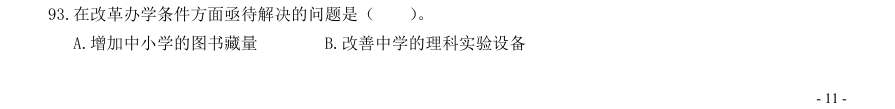

- **A.** 增加中小学的图书藏量
- **B.** 改善中学的理科实验设备
- **C.** 改善小学的分组实验条件
- **D.** 以上三项都不是

**答案：D**

### 2001 国考·统一卷　第 95 题　（基期量计算（综合））

1998 年,全国普通中小学校舍建筑面积中危房约是多少万平方米?( )。

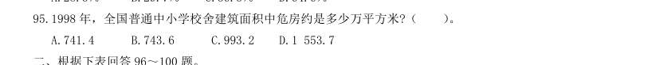

- **A.** 741.4
- **B.** 743.6
- **C.** 993.2
- **D.** 1 553.7

**答案：C**

### 2001 国考·统一卷　第 96 题　（已知现期与增长量求基期）

某航空公司1990~1991 年收到乘客投诉统计资料(%) 分 类 1990 年 1991 年 航班误点 20.0 22.1 行李差错 18.3 21.8 服务质量差 13.1 11.3 乘客超载 10.5 11.8 理赔问题 10.1 8.1 票价问题 6.4 6.0 订票与确认问题 5.8 5.6 饮食问题 3.3 2.3 吸烟 3.2 2.9 广告 1.2 1.1 信誉问题 1.0 0.8 特殊乘客 0.9 0.9 其他 6.2 5.3 100.0 100.0 收到投诉总件数 22 988 件 13 278 件 该公司1990 年接到有关票价的投诉意见的件数大约为( )。

- **A.** 220
- **B.** 860
- **C.** 1 200
- **D.** 1 500

**答案：C**

### 2001 国考·统一卷　第 98 题　（已知现期与增长量求基期）

从1990 年到1991 年,公司改进最明显的是( )。

- **A.** 服务质量
- **B.** 理赔
- **C.** 饮食
- **D.** 信誉

**答案：C**

### 2001 国考·统一卷　第 100 题　（已知现期与增长量求基期）

下面的陈述哪项可以从统计资料表中得出?( )。 I.在1990 年及1991 年中,乘客关于航班误点、行李差错及服务质量三项的投诉意见超过全部投诉意见 的50%。 II.特殊乘客的投诉意见数量1991 年与1990 年的相比没有变化。 III.与1990 年相比,1991 年有关航班误点的投诉意见的数量增加了。

- **A.** 只有第I项
- **B.** 只有第II项
- **C.** I项与III项
- **D.** 全部三项

**答案：A**

### 2001 国考·统一卷　第 102 题　（基期量计算（综合））

1997 年该地区一般职员的人数超过熟练操作工种的人数为( )。

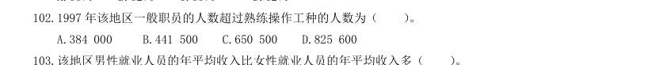

- **A.** 384 000
- **B.** 441 500
- **C.** 650 500
- **D.** 825 600

**答案：B**

### 2001 国考·统一卷　第 104 题　（基期量计算（综合））

该地区女性公务员的人数约为( )。

- **A.** 3.2 万人
- **B.** 4.5 万人
- **C.** 6.1 万人
- **D.** 7.5 万人

**答案：B**

### 2001 国考·统一卷　第 106 题　（基期量计算（综合））

哪一年进出口总额突破20 亿元?( )。

- **A.** 1985 年
- **B.** 1986 年
- **C.** 1987 年
- **D.** 1988 年

**答案：C**

### 2001 国考·统一卷　第 107 题　（基期量计算（综合））

图中所显示的该国外贸状况有几年是出口额超过进口额5 亿元以上的?( )。

- **A.** 9 年
- **B.** 7 年
- **C.** 6 年
- **D.** 5 年

**答案：B**

### 2001 国考·统一卷　第 108 题　（基期量计算（综合））

1974 年至1990 年的进口年增长额大约是( )。

- **A.** 0.47 亿元
- **B.** 0.75 亿元
- **C.** 1.12 亿元
- **D.** 1.23 亿元

**答案：A**

### 2000 国考·统一卷　第 81 题　（基期量计算（综合））

如 甲城喜欢X 节目的占30%,喜欢Y 节目的占70%,无人喜欢Z 节目;而丙城20%喜欢X 节目,50%喜欢Y 节目, 30%喜欢Z 节目。 戊城中学生最喜欢的节目是( )。

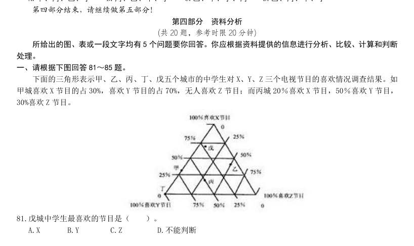

- **A.** X
- **B.** Y
- **C.** Z
- **D.** 不能判断

**答案：A**

### 2000 国考·统一卷　第 82 题　（基期量计算（综合））

甲城中学生与丁城中学生共同特点是( )。

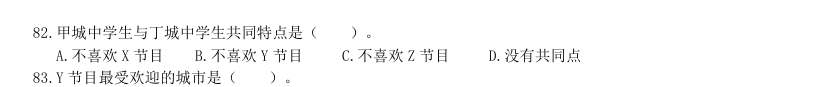

- **A.** 不喜欢X 节目
- **B.** 不喜欢Y 节目
- **C.** 不喜欢Z 节目
- **D.** 没有共同点

**答案：C**

### 2000 国考·统一卷　第 83 题　（基期量计算（综合））

Y 节目最受欢迎的城市是( )。

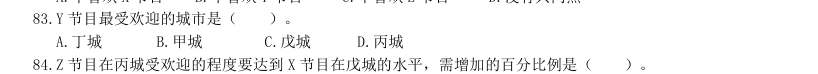

- **A.** 丁城
- **B.** 甲城
- **C.** 戊城
- **D.** 丙城

**答案：A**

### 2000 国考·统一卷　第 85 题　（基期量计算（综合））

就X、Y、Z 三个节目比较而言,最受该五个城市中学生欢迎的节目是( )。

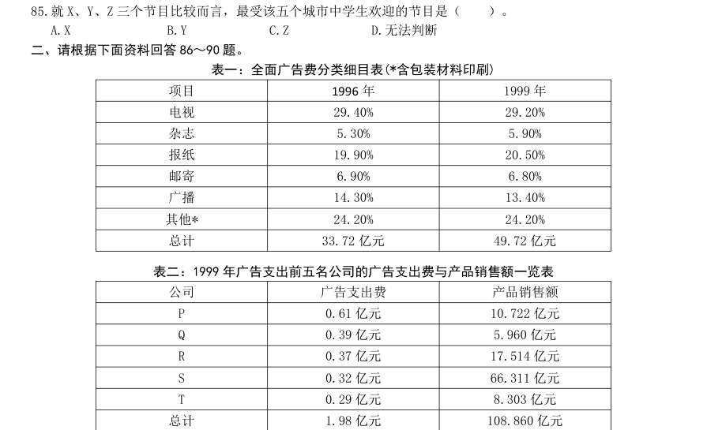

- **A.** X
- **B.** Y
- **C.** Z
- **D.** 无法判断

**答案：B**

### 2000 国考·统一卷　第 86 题　（基期量比较）

表一:全面广告费分类细目表(*含包装材料印刷) 项目 1996 年 1999 年 电视 29.40% 29.20% 杂志 5.30% 5.90% 报纸 19.90% 20.50% 邮寄 6.90% 6.80% 广播 14.30% 13.40% 其他* 24.20% 24.20% 总计 33.72 亿元 49.72 亿元 表二:1999 年广告支出前五名公司的广告支出费与产品销售额一览表 公司 广告支出费 产品销售额 P 0.61 亿元 10.722 亿元 Q 0.39 亿元 5.960 亿元 R 0.37 亿元 17.514 亿元 S 0.32 亿元 66.311 亿元 T 0.29 亿元 8.303 亿元 总计 1.98 亿元 108.860 亿元 1999 年广告费支出最大的五个公司中哪一个公司的广告支出比(广告支出/销售额)最小?( )。

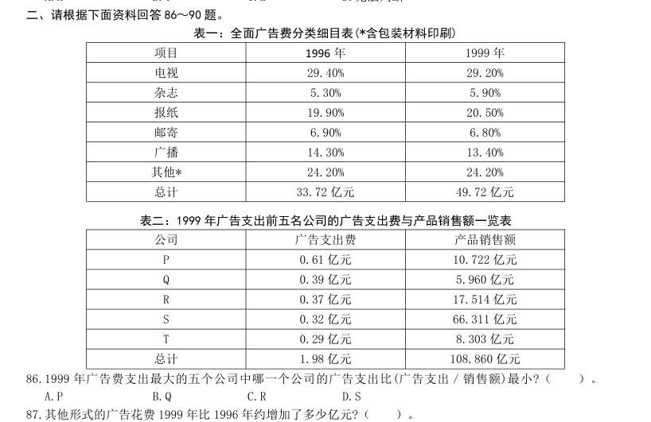

- **A.** P
- **B.** Q
- **C.** R
- **D.** S

**答案：D**

### 2000 国考·统一卷　第 89 题　（基期量计算（综合））

1999 年通过邮寄形式的广告费用约为( )。

- **A.** 340 000 元
- **B.** 3 400 000 元
- **C.** 34 000 000 元
- **D.** 340 000 000 元

**答案：暂缺**

### 2000 国考·统一卷　第 91 题　（基期量计算（综合））

前十届奥运会的统计情况 次 第 会址 年度 男子比 赛场数 男运动 员数 女子比赛 场数 女运 动员 数 参加国家 总数 运动项 目总数 雅典 巴黎 圣路易斯 伦敦 斯德哥尔摩 安特卫普 巴黎 阿姆斯特丹 洛杉矶 柏林 运动项目最多的年度男子比赛场数为( )。

- **A.** 3
- **B.** 19
- **C.** 29
- **D.** 63

**答案：B**

### 2000 国考·统一卷　第 93 题　（已知现期与增长量求基期）

第6 届奥运会与第5 届奥运会相比,最大特点是( )。

- **A.** 男子比赛场数增加最多
- **B.** 参加运动员人数增加最多
- **C.** 女子运动员数增加最多
- **D.** 运动项目总数增加最多

**答案：D**

### 2000 国考·统一卷　第 95 题　（已知现期与增长率求基期）

在巴黎举行的两届奥运会中,增长比率最大的是( )。

- **A.** 女子比赛场数
- **B.** 参加国家总数
- **C.** 参加运动员总数
- **D.** 女运动员总数

**答案：D**

### 2000 国考·统一卷　第 99 题　（基期量计算（综合））
> 材料：20 世纪70 年代,在世界新发现的大油田中,海上油田有31 个,约占51.7%。在新增加的地质储量中,海 洋占42%。海上钻井平台总数为7 021 座,其中美国有1 079 座,委内瑞拉有5 033 座,苏联有840 座。1977 年, 近海油田有500 个,产量4.6 亿吨,占世界总产量的15.6%。 96.70 年代世界新发现的大油田共有( )。 A.31 个 B.29 个 C.91 个 D.60 个 97.70 年代美国海上钻井平台数约占世界总数的比例是( )。 A.…

A.苏联 B.委内瑞拉 C.美国 D.未知 1977 年世界石油总产量是多少亿吨?( )。

- **A.** 4.6
- **B.** 29.5
- **C.** 34.1
- **D.** 10.7

**答案：B**
