# 资料分析 · 基期量计算 · 2010 年代真题

> 所属考点：[ZL-BASE](../ZL-BASE-基期量计算.md)　｜　本片 190 题

### 2019 湖北·统一卷　第 106 题　（已知现期与增长量求基期）
> 材料：析、比较、计算和判断处理。 (一)根据以下资料,回答下列问题。 2017 年我国成年国民图书阅读率为 ,比上年增加0.3 个百分点;报纸阅读率为 ,比上年降低2.1 个百分点;期刊阅读率为 ,比上年增加1 个百分点。 2017 年我国成年国民数字化阅读方式(网络在线阅读、手机阅读、电子阅读器阅读、平板电脑阅读等)的接 触率为 。…

2016 年我国成年国民报纸阅读率比期刊阅读率高:

- **A.** 11.1 个百分点
- **B.** 12.3 个百分点
- **C.** 15.4 个百分点
- **D.** 17.5 个百分点

**答案：C**

### 2019 湖北·统一卷　第 113 题　（基期量计算（综合））

2016 年我国二孩出生人口约为:

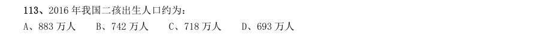

- **A.** 883 万人
- **B.** 742 万人
- **C.** 718 万人
- **D.** 693 万人

**答案：C**

### 2019 湖北·统一卷　第 121 题　（已知现期与增长率求基期）

(注:顺差是指在国际收支上,一定时期内收入大于支出的差额;逆差指的是在国际收支上,一定时期内支出大 于收入的差额;表中同比数据为正的代表同比增长,同比数据为负的代表同比下降) 2011 年至2017 年,我国服务进出口逆差最大的年份是:

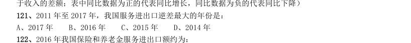

- **A.** 2017 年
- **B.** 2016 年
- **C.** 2015 年
- **D.** 2014 年

**答案：A**

### 2019 湖北·统一卷　第 122 题　（已知现期与增长率求基期）

2016 年我国保险和养老金服务进出口额约为:

- **A.** 857 亿元人民币
- **B.** 1112 亿元人民币
- **C.** 1134 亿元人民币
- **D.** 1158 亿元人民币

**答案：C**

### 2019 湖北·选调　第 116 题　（已知现期与增长率求基期）
> 材料：自改革开放以来,外商在华投资势头良好。今年两会期间,《中华人民共和国外商投资法(草案)》成为重 要议题。2018 年,外商直接在华投资(非金融类)新设立企业60533 家。外商直接在华投资金额8856 亿元,折 1350 亿美元。其中“一带一路"沿线国家对华直接投资新设立企业4479 家,对华直接投资424 亿元。全年高技 术制造业实际使用外资(非金融类)898 亿元,增长35.1%。…

2018 年,我国对外非金融类直接投资7974 亿元,同比下降1.6%,其中对“一带一路沿线国家非金融类直接 投资156 亿美元,同比增长8.9%。 2018 年,在非金融领域,我国对外直接投资额和外商在华直接投资额之比约为:

- **A.** 10:9
- **B.** 9:10
- **C.** 9:8
- **D.** 8:9

**答案：B**

### 2019 湖北·选调　第 118 题　（基期量比较）

下列行业中,2018 年我国对外非金融类直接投资额与外商在华投资额差值最大的是:

- **A.** 批发和零售业
- **B.** 电力、热力、燃气及水生产和供应业
- **C.** 租赁和商务服务业
- **D.** 交通运输、仓储和邮政业

**答案：C**

### 2019 湖北·选调　第 122 题　（基期量计算（综合））

2017 年,我国软件和信息技术服务业从业人员人数约为多少万人?

- **A.** 701
- **B.** 652
- **C.** 633
- **D.** 618

**答案：D**

### 2019 湖北·选调　第 125 题　（已知现期与增长率求基期）

下列不能根据所给资料推出的是:

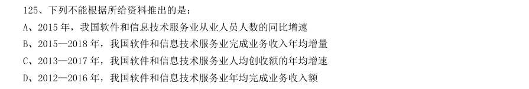

- **A.** 2015 年,我国软件和信息技术服务业从业人员人数的同比增速
- **B.** 2015—2018 年,我国软件和信息技术服务业完成业务收入年均增量
- **C.** 2013—2017 年,我国软件和信息技术服务业人均创收额的年均增速
- **D.** 2012—2016 年,我国软件和信息技术服务业年均完成业务收入额

**答案：D**

### 2019 广东·乡镇　第 81 题　（基期量计算（综合））

料提供的信息进行分析、比较、计算和判断处理。 (一) 过去5 年,我国统筹开展交通扶贫和“四好农村路工作”,农村基础设施更加完善,服务乡村振兴成效显著。 2014~2018 年,全国新改建农村公路里程共计( )万公里。

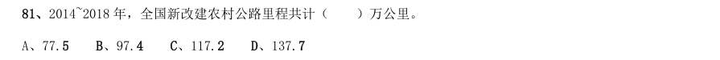

- **A.** 77.5
- **B.** 97.4
- **C.** 117.2
- **D.** 137.7

**答案：暂缺**

### 2019 广东·乡镇　第 82 题　（已知现期与增长量求基期）

2015~2018 年,全国新改建农村公路里程较上年增加最多的一年是( )。

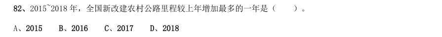

- **A.** 2015
- **B.** 2016
- **C.** 2017
- **D.** 2018

**答案：暂缺**

### 2019 广东·乡镇　第 86 题　（已知现期与增长率求基期）
> 材料：党的十八大以来,脱贫工作取得巨大成效,全国农村贫困人口大幅减少。截至2018 年末,全国农村贫困人 口从2012 年末的9899 万人减少至1660 万人;农村贫困发生率从2012 年的 下降至 ,累计下降8.5 个百 分点。…

2012—2018 年全国农村贫困人口和贫困发生率 2018 年,贫困地区农村居民人均可支配收入10371 元,扣除价格因素,实际增长 ,实际增速高出全国农 村居民人均可支配收入实际增速1.7 个百分点,圆满完成增长幅度高于全国增速的年度目标任务。 从2012 年末到2018 年末,全国农村贫困人口数减少了( )万人。

- **A.** 6239
- **B.** 7239
- **C.** 8239
- **D.** 9230

**答案：暂缺**

### 2019 广东·乡镇　第 87 题　（基期量计算（综合））

2013—2018 年,全国农村贫困发生率较上年下降最多的是( )年。

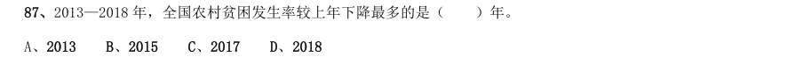

- **A.** 2013
- **B.** 2015
- **C.** 2017
- **D.** 2018

**答案：暂缺**

### 2019 广东·乡镇　第 89 题　（基期量比较）

2018 年,我国贫困地区农村居民收入来源中,最高的是( )。

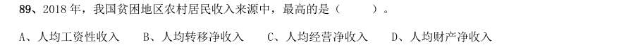

- **A.** 人均工资性收入
- **B.** 人均转移净收入
- **C.** 人均经营净收入
- **D.** 人均财产净收入

**答案：暂缺**

### 2019 广东·乡镇　第 93 题　（基期量计算（综合））

2015-2018 年,B 省新登记个体工商户最多的是( )年。

- **A.** 2015
- **B.** 2016
- **C.** 2017
- **D.** 2018

**答案：暂缺**

### 2019 广东·乡镇　第 94 题　（已知现期与增长量求基期）

2018 年,B 省租赁和商务服务业新登记企业数较上年增加约( )万户。

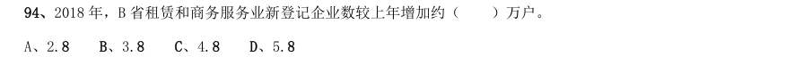

- **A.** 2.8
- **B.** 3.8
- **C.** 4.8
- **D.** 5.8

**答案：暂缺**

### 2019 广东·乡镇　第 96 题　（已知现期与增长量求基期）
> 材料：近年来,A 省大力发展绿色无公害农业。2017 年,A 省农药使用总量580 万吨,与2016 年相比减少 ;单 位耕地面积农药使用量为1.47 千克/亩。…

全省新增申报无公害农产品产地认定221 个,产品362 个,新增绿色食品33 个,认证有机食品60 个。全省 “三品一标”总数达2570 个,其中:无公害农产品1710 个,绿色食品745 个,有机农产品87 个,农产品地理标 志28 个,无公害农产品种植面积总计达1050 万亩,生产总量970 多万吨。 2014-2017 年A 省无公害农产品生产情况 2017 年,A 省“三品一标”总数较上年增加了( )个。

- **A.** 8
- **B.** 9
- **C.** 10
- **D.** 11

**答案：暂缺**

### 2019 广东·乡镇　第 98 题　（基期量计算（综合））

2017 年,A 省单位耕地面积农药使用量比2015 年约( )。

- **A.** 增加
- **B.** 下降
- **C.** 增加
- **D.** 下降

**答案：暂缺**

### 2019 广东·县级　第 88 题　（基期量计算（综合））

2015—2018 年,A 省新登记市场主体数年增长约( )万户。

- **A.** 15.1
- **B.** 23.2
- **C.** 30.3
- **D.** 36.4

**答案：暂缺**

### 2019 广东·县级　第 89 题　（已知现期与增长量求基期）

2018 年,租赁和商务服务业新登记企业数较上年增加约( )万户。

- **A.** 2.8
- **B.** 3.8
- **C.** 4.8
- **D.** 5.8

**答案：暂缺**

### 2019 广东·县级　第 94 题　（基期量比较）

2018 年,我国贫困地区农村居民收入来源中,最高的是( )。

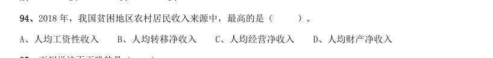

- **A.** 人均工资性收入
- **B.** 人均转移净收入
- **C.** 人均经营净收入
- **D.** 人均财产净收入

**答案：暂缺**

### 2019 广东·县级　第 98 题　（基期量计算（综合））

第三产业用电 城乡居民生活用电 2018 年,我国发电总量约为( )万亿千瓦时。

- **A.** 1.87
- **B.** 3.70
- **C.** 5.84
- **D.** 7.00

**答案：暂缺**

### 2019 广东·选调　第 66 题　（已知现期与增长量求基期）

2016 年末,我国铁路路网密度是( )公里/万平方公里。

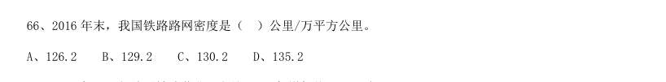

- **A.** 126.2
- **B.** 129.2
- **C.** 130.2
- **D.** 135.2

**答案：B**

### 2019 广东·选调　第 67 题　（已知现期与增长率求基期）

2017 年,西部地区铁路营业里程比2016 年增加约( )公里。

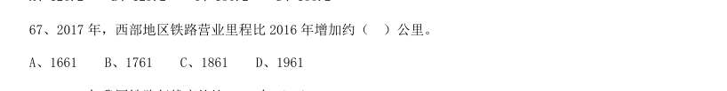

- **A.** 1661
- **B.** 1761
- **C.** 1861
- **D.** 1961

**答案：A**

### 2019 广东·选调　第 68 题　（基期量计算（综合））

2017 年我国铁路复线率约比2016 年( )。

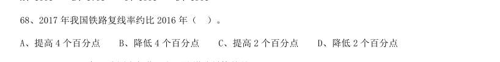

- **A.** 提高4 个百分点
- **B.** 降低4 个百分点
- **C.** 提高2 个百分点
- **D.** 降低2 个百分点

**答案：C**

### 2019 广东·选调　第 74 题　（基期量比较）

2017 年上半年,我国文化及相关产业营业收入最高的行业是( )。

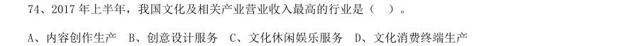

- **A.** 内容创作生产
- **B.** 创意设计服务
- **C.** 文化休闲娱乐服务
- **D.** 文化消费终端生产

**答案：A**

### 2019 广东·选调　第 76 题　（已知现期与增长量求基期）

根据下列材料,回答76~80 题: 与2012 年相比,2013 年下列社会服务机构中单位数增加最多的是( )。

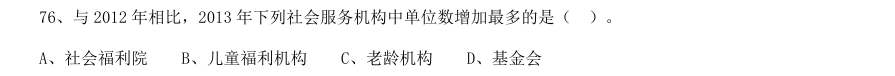

- **A.** 社会福利院
- **B.** 儿童福利机构
- **C.** 老龄机构
- **D.** 基金会

**答案：D**

### 2019 广东·选调　第 77 题　（已知现期与增长量求基期）

2015 年,社会服务机构单位数比2011 年增加约( )万个。

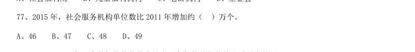

- **A.** 46
- **B.** 47
- **C.** 48
- **D.** 49

**答案：B**

### 2019 国考·地市级　第 117 题　（基期量计算（综合））

“十二五”(2011~2015 年)期间,全国二手车总计交易约多少亿辆?

- **A.** 0.46
- **B.** 0.50
- **C.** 0.38
- **D.** 0.42

**答案：D**

### 2019 国考·地市级　第 119 题　（已知现期与增长量求基期）

2015 年全国二手车交易总金额比2014 年:

- **A.** 减少了不到100 亿元
- **B.** 减少了100 亿元以上
- **C.** 增长了100 亿元以上
- **D.** 增长了不到100 亿元

**答案：A**

### 2019 国考·地市级　第 122 题　（基期量计算（综合））

2018 年第一季度全国处理钓鱼网站总数:

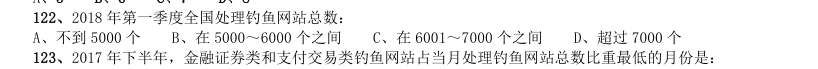

- **A.** 不到5000 个
- **B.** 在5000~6000 个之间
- **C.** 在6001~7000 个之间
- **D.** 超过7000 个

**答案：C**

### 2019 国考·省级　第 124 题　（已知现期与增长量求基期）

2015 年全国二手车交易总金额比2014 年:

- **A.** 减少了不到100 亿元
- **B.** 减少了100 亿元以上
- **C.** 增长了100 亿元以上
- **D.** 增长了不到100 亿元

**答案：A**

### 2019 国考·省级　第 126 题　（基期量计算（综合））

(三) 2018 年第一季度全国处理钓鱼网站总数:

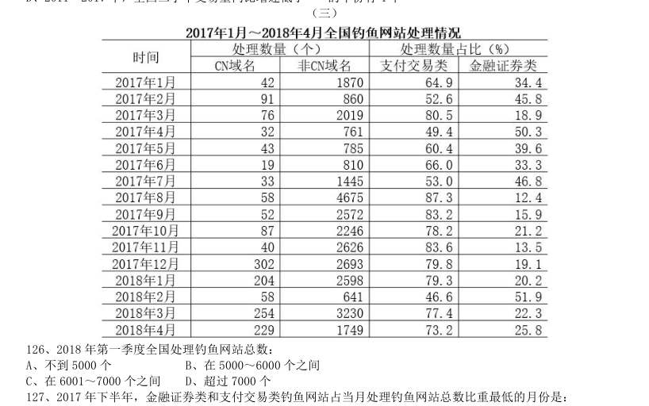

- **A.** 不到5000 个
- **B.** 在5000~6000 个之间
- **C.** 在6001~7000 个之间
- **D.** 超过7000 个

**答案：C**

### 2018 湖北·统一卷　第 110 题　（基期量比较）

2017 年上半年,全国居民消费支出主要数据按消费类别分。下列哪一个经济指标值最大?

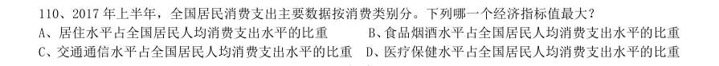

- **A.** 居住水平占全国居民人均消费支出水平的比重
- **B.** 食品烟酒水平占全国居民人均消费支出水平的比重
- **C.** 交通通信水平占全国居民人均消费支出水平的比重
- **D.** 医疗保健水平占全国居民人均消费支出水平的比重

**答案：B**

### 2018 湖北·统一卷　第 123 题　（已知现期与增长率求基期）

2016 年5 月,银行业金融机构总资产金额为多少万亿元?

- **A.** 167
- **B.** 207
- **C.** 247
- **D.** 287

**答案：B**

### 2018 湖北·统一卷　第 124 题　（基期量计算（综合））

根据所给资料,2017 年5 月:

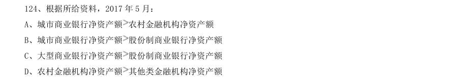

- **A.** 城市商业银行净资产额农村金融机构净资产额
- **B.** 城市商业银行净资产额股份制商业银行净资产额
- **C.** 大型商业银行净资产额股份制商业银行净资产额
- **D.** 农村金融机构净资产额

**答案：C**

### 2018 广东·统一卷　第 87 题　（基期量计算（综合））

2016 年,该市生产总值比2012 年约多( )亿元。

- **A.** 350
- **B.** 430
- **C.** 500
- **D.** 660

**答案：暂缺**

### 2018 广东·统一卷　第 89 题　（基期量计算（综合））

2016 年,该市R&D 人员中,本科学历的人数为( )。

- **A.** 1216
- **B.** 1517
- **C.** 2791
- **D.** 4007

**答案：暂缺**

### 2018 广东·统一卷　第 91 题　（基期量计算（综合））

2017 年,第四季度岗位空缺与求职人数比率较第三季度上升了( )。

- **A.** 0.03
- **B.** 0.06
- **C.** 0.09
- **D.** 0.12

**答案：暂缺**

### 2018 广东·统一卷　第 93 题　（基期量计算（综合））

2017 年第四季度求职人数比2016 年第四季度下降了约( )。

- **A.** 
- **B.** 
- **C.** 
- **D.** 

**答案：暂缺**

### 2018 广东·统一卷　第 94 题　（基期量计算（综合））

2015—2017 年,人力资源市场供给最能满足市场需求的是( )。

- **A.** 2015 年第三季度
- **B.** 2016 年第二季度
- **C.** 2017 年第一季度
- **D.** 2017 年第四季度

**答案：暂缺**

### 2018 广东·统一卷　第 96 题　（已知现期与增长率求基期）

2010—2016 年,全省医疗卫生机构数同比上一年增长率最高的是( )年。

- **A.** 2012
- **B.** 2013
- **C.** 2014
- **D.** 2016

**答案：暂缺**

### 2018 国考·副省级　第 116 题　（基期量计算（综合））

2016 年全球贸易总额约为多少万亿美元?

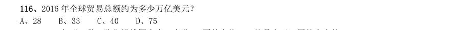

- **A.** 28
- **B.** 33
- **C.** 40
- **D.** 75

**答案：B**

### 2018 国考·副省级　第 118 题　（基期量比较）

“一带一路”沿线主要区域中,2016 年进口额与出口额数值相差最大的是:

- **A.** 东南亚11 国
- **B.** 南亚8 国
- **C.** 西亚、北非19 国
- **D.** 东欧20 国

**答案：D**

### 2018 国考·副省级　第 123 题　（已知现期与增长率求基期）

如按2016 年移动出行市场同比增长趋势估算,2018 年该市场规模将为:

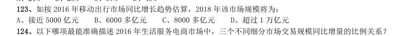

- **A.** 接近5000 亿元
- **B.** 6000 多亿元
- **C.** 8000 多亿元
- **D.** 超过1 万亿元

**答案：C**

### 2018 国考·副省级　第 127 题　（基期量计算（综合））

2016 年,全国公园绿地面积约为多少万公顷?

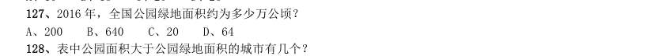

- **A.** 200
- **B.** 640
- **C.** 20
- **D.** 64

**答案：D**

### 2018 国考·副省级　第 128 题　（基期量计算（综合））

表中公园面积大于公园绿地面积的城市有几个?

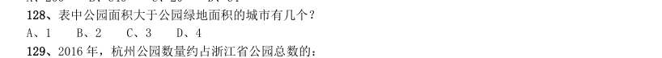

- **A.** 1
- **B.** 2
- **C.** 3
- **D.** 4

**答案：B**

### 2018 国考·地市级　第 111 题　（基期量计算（综合））

2016 年全球贸易总额约为多少万亿美元?

- **A.** 28
- **B.** 33
- **C.** 40
- **D.** 75

**答案：B**

### 2018 国考·地市级　第 122 题　（基期量计算（综合））

2016 年,全国公园绿地面积约为多少万公顷?

- **A.** 200
- **B.** 640
- **C.** 20
- **D.** 64

**答案：D**

### 2018 国考·地市级　第 123 题　（基期量计算（综合））

表中公园面积大于公园绿地面积的城市有几个?

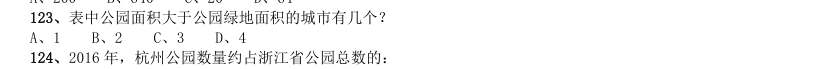

- **A.** 1
- **B.** 2
- **C.** 3
- **D.** 4

**答案：B**

### 2017 湖北·统一卷　第 106 题　（已知现期与增长率求基期）
> 材料：和判断处理。 (一) 2016 年6 月份,我国社会消费品零售总额26857 亿元,同比增长 ,环比增长 。其中,限 额以上单位消费品零售额13006 亿元,同比增长 。 2016 年1~6 月份,我国社会消费品零售总额156138 亿元,同比增长 。其中,限额以上单位消费品零售额 71075 亿元,同比增长 。 按经营单位所在地分,2016 年6 月份,城镇消费品零售额23082 亿元,同比增长 ;乡村消费品零售额3775 亿元,同比增长 。1~6 月份,城镇消费品零售额1…

其中,实物商品网上零售额18143 亿元,同比 增长 。 2016 年5 月份,全国社会消费品零售总额约为:

- **A.** 24594 亿元
- **B.** 24283 亿元
- **C.** 26612 亿元
- **D.** 27104 亿元

**答案：C**

### 2017 湖北·统一卷　第 114 题　（基期量计算（综合））

2015 年一般公共预算收入与GDP 的比值大于 的省(市)有:

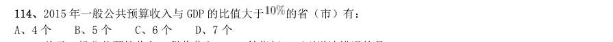

- **A.** 4 个
- **B.** 5 个
- **C.** 6 个
- **D.** 7 个

**答案：B**

### 2017 湖北·统一卷　第 116 题　（已知现期与增长率求基期）
> 材料：根据以下资料,回答116~120 题。 2015 年国家自然科学基金委全年共接收173017 项各类申请,同比增长约 ,择优资助各类项目40668 项,比 上年增加1579 项,资助直接费用218.8 亿元,平均资助强度(资助直接费用与资助项数的比值)53.8 万元,各项工 作取得新进展新成效。 在研究项目系列方面,面上项目资助16709 项,比上年增加1709 项,占总项数的 ,直接费用102.41 亿元, 平均资助率(资助项目占接收申请项目的比重) ,同比下降2.5 个百…

2014 年国家自然科学基金委共接收青年科学基金的申请数约为:

- **A.** 5.1 万份
- **B.** 5.9 万份
- **C.** 6.5 万份
- **D.** 6.9 万份

**答案：C**

### 2017 湖北·统一卷　第 122 题　（已知现期与增长率求基期）

2015 年,全国建立的慈善超市较2014 年约:

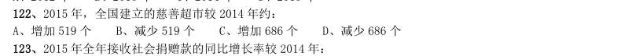

- **A.** 增加519 个
- **B.** 减少519 个
- **C.** 增加686 个
- **D.** 减少686 个

**答案：B**

### 2017 湖北·统一卷　第 124 题　（基期量比较）

下面哪一张图能正确反映2011~2015 年民政部门接收捐赠衣被数量的变化?

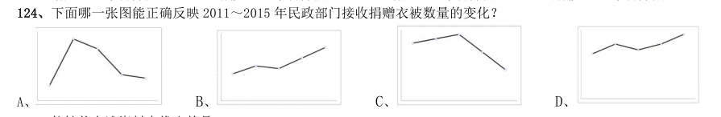

- **A.** 
- **B.** 
- **C.** 
- **D.** 

**答案：A**

### 2017 广东·统一卷　第 94 题　（基期量计算（综合））

根据资料可知:

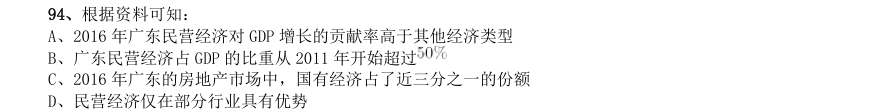

- **A.** 2016 年广东民营经济对GDP 增长的贡献率高于其他经济类型
- **B.** 广东民营经济占GDP 的比重从2011 年开始超过
- **C.** 2016 年广东的房地产市场中,国有经济占了近三分之一的份额
- **D.** 民营经济仅在部分行业具有优势

**答案：暂缺**

### 2017 广东·统一卷　第 100 题　（基期量计算（综合））

根据资料可知:

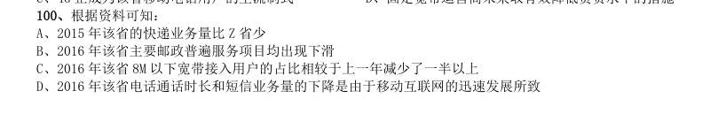

- **A.** 2015 年该省的快递业务量比Z 省少
- **B.** 2016 年该省主要邮政普遍服务项目均出现下滑
- **C.** 2016 年该省8M 以下宽带接入用户的占比相较于上一年减少了一半以上
- **D.** 2016 年该省电话通话时长和短信业务量的下降是由于移动互联网的迅速发展所致

**答案：暂缺**

### 2017 国考·副省级　第 117 题　（基期量计算（综合））

“十二五”期间,该市粮食总产量在以下哪个范围?

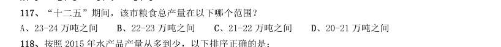

- **A.** 23-24 万吨之间
- **B.** 22-23 万吨之间
- **C.** 21-22 万吨之间
- **D.** 20-21 万吨之间

**答案：C**

### 2017 国考·副省级　第 129 题　（已知现期与增长率求基期）

2014 年我国钟表行业贸易顺差约为多少亿美元?

- **A.** 27
- **B.** 25
- **C.** 23
- **D.** 18

**答案：D**

### 2017 国考·副省级　第 134 题　（基期量计算（综合））

2001~2015 年间,新能源汽车五种技术专利申请数均高于上年的年份有多少个?

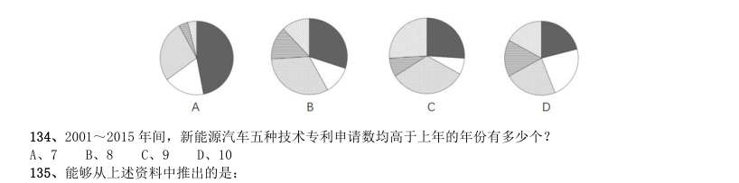

- **A.** 7
- **B.** 8
- **C.** 9
- **D.** 10

**答案：B**

### 2017 国考·地市级　第 112 题　（基期量计算（综合））

“十二五”期间,该市粮食总产量在以下哪个范围?

- **A.** 23-24 万吨之间
- **B.** 22-23 万吨之间
- **C.** 21-22 万吨之间
- **D.** 20-21 万吨之间

**答案：C**

### 2017 国考·地市级　第 124 题　（已知现期与增长率求基期）

2014 年我国钟表行业贸易顺差约为多少亿美元?

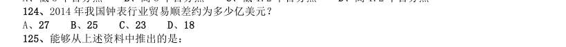

- **A.** 27
- **B.** 25
- **C.** 23
- **D.** 18

**答案：D**

### 2016 湖北·统一卷　第 106 题　（已知现期与增长率求基期）
> 材料：理。 一、根据以下资枓,回答下列题。 2015 年1-3 月,国有企业营业总收入103155.5 亿元,同比下降6%。其中,中央企业收入63191.3 亿元,同 比下降7%。地方国有企业收入39964.2 亿元,同比下降4.2%。 1-3 月,国有企业营业总成本100345.5 亿元,同比下降5.1%,其中销售费用、管理费用和财务费用同比分 别下降2.9%、増长2.3%和增长7.3%。其中,中央企业成本60216.5 亿元,同比下降6.4%;地方国有企业成本 40129 亿元…

地方国有企业资产总额 500217.1 亿元,同比增长13.8%;负债总额322462.3 亿元,同比増长13.7%;所有者权益为177754.7 亿元,同 比增长13.9%。 2014 年1-3 月,国有企业营业总收入最接近:

- **A.** 10.5 万亿元
- **B.** 11 万亿元
- **C.** 11.5 万亿元
- **D.** 12 万亿元

**答案：B**

### 2016 湖北·统一卷　第 111 题　（基期量计算（综合））

2014 年1~10 月我国货物运输总量为多少亿吨?

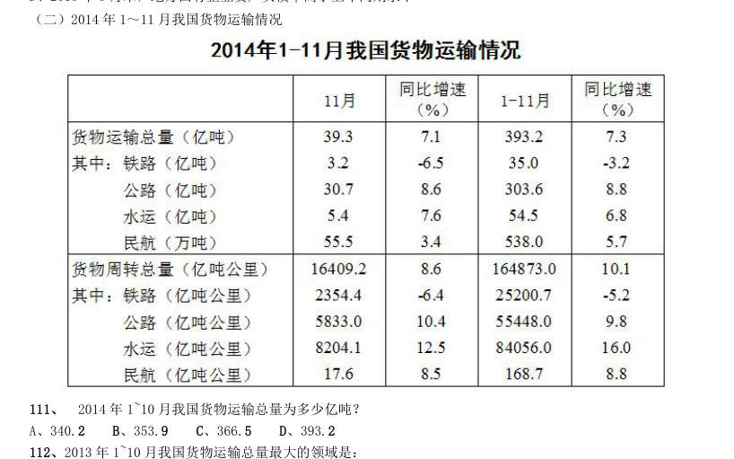

- **A.** 340.2
- **B.** 353.9
- **C.** 366.5
- **D.** 393.2

**答案：B**

### 2016 湖北·统一卷　第 112 题　（已知现期与增长率求基期）

2013 年1~10 月我国货物运输总量最大的领域是:

- **A.** 水运
- **B.** 民航
- **C.** 铁路
- **D.** 公路

**答案：D**

### 2016 湖北·统一卷　第 117 题　（基期量计算（综合））

2015 年2 月,消费者对快递业务的全部申诉量约为

- **A.** 1.96 万件
- **B.** 2.36 万件
- **C.** 1.96 亿件
- **D.** 2.36 亿件

**答案：A**

### 2016 湖北·统一卷　第 121 题　（基期量计算（综合））

2014 年下半年全国租赁贸易进出口总额约为多少亿美元?

- **A.** 55
- **B.** 62
- **C.** 67
- **D.** 74

**答案：C**

### 2016 广东·乡镇　第 87 题　（基期量计算（综合））

第二批示范片的自然村中,实现通自来水的约有( )个。

- **A.** 256
- **B.** 262
- **C.** 267
- **D.** 273

**答案：暂缺**

### 2016 广东·乡镇　第 88 题　（基期量比较）

首批示范片的自然村中,完成率最高的是( )。

- **A.** 村庄环境卫生
- **B.** 自来水建设
- **C.** 村巷道硬底化建设
- **D.** 群众参与共谋共建情况

**答案：暂缺**

### 2016 广东·乡镇　第 89 题　（基期量比较）

第一、二批示范片的自然村中,完成率差距最大的是( )。

- **A.** 村庄规划编制
- **B.** 村庄环境卫生
- **C.** 自来水建设
- **D.** 群众参与共谋共建情况

**答案：暂缺**

### 2016 广东·乡镇　第 90 题　（基期量计算（综合））

下列说法有误的是( )。

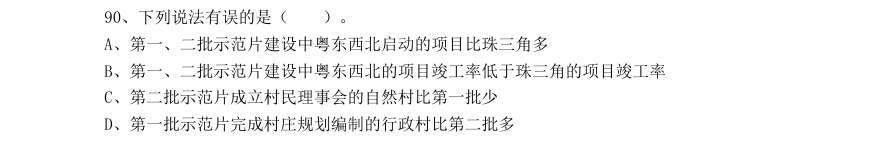

- **A.** 第一、二批示范片建设中粤东西北启动的项目比珠三角多
- **B.** 第一、二批示范片建设中粤东西北的项目竣工率低于珠三角的项目竣工率
- **C.** 第二批示范片成立村民理事会的自然村比第一批少
- **D.** 第一批示范片完成村庄规划编制的行政村比第二批多

**答案：暂缺**

### 2016 广东·乡镇　第 91 题　（已知现期与增长率求基期）

根据下列资料,回答91~95 题: 2011—2014 年,新型农村合作医疗基金支出同比增长幅度最高的是( )年。

- **A.** 2011
- **B.** 2012
- **C.** 2013
- **D.** 2014

**答案：暂缺**

### 2016 广东·乡镇　第 94 题　（基期量计算（综合））

2010—2014 年,参加新型农村合作医疗人数最多的一年比人数最少的一年多了( )亿。

- **A.** 0.31
- **B.** 0.34
- **C.** 0.65
- **D.** 1

**答案：暂缺**

### 2016 广东·乡镇　第 95 题　（基期量计算（综合））

下列说法有误的是( )。

- **A.** 新型农村合作医疗基金支出逐年增加
- **B.** 参加新型农村合作医疗人数最少的一年也是人均筹资最多的一年
- **C.** 新型农村合作医疗参与率最高的是2013 年
- **D.** 参加新型农村合作医疗人数最多的是2010 年

**答案：暂缺**

### 2016 广东·乡镇　第 98 题　（基期量计算（综合））

2011 年的总人口中,“65 岁及以上”的人口比“0-14 岁”的人口大约多( )万人。

- **A.** 7910
- **B.** 8850
- **C.** 9320
- **D.** 9970

**答案：暂缺**

### 2016 广东·乡镇　第 100 题　（基期量计算（综合））

根据资料,我们可以得知( )。

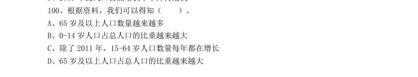

- **A.** 65 岁及以上人口数量越来越多
- **B.** 0-14 岁人口占总人口的比重越来越大
- **C.** 除了2011 年,15-64 岁人口数量每年都在增长
- **D.** 65 岁及以上人口占总人口的比重越来越大

**答案：暂缺**

### 2016 广东·县级　第 90 题　（基期量计算（综合））

根据资料,我们可以得知( )。

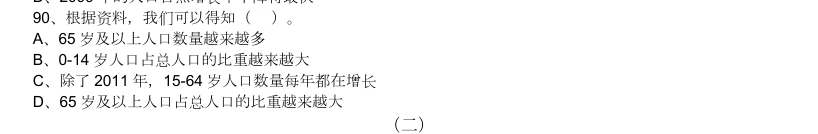

- **A.** 65 岁及以上人口数量越来越多
- **B.** 0-14 岁人口占总人口的比重越来越大
- **C.** 除了2011 年,15-64 岁人口数量每年都在增长
- **D.** 65 岁及以上人口占总人口的比重越来越大

**答案：暂缺**

### 2016 广东·县级　第 91 题　（基期量计算（综合））

2013 年,批发业法人企业比零售业多( )个。

- **A.** 7023
- **B.** 7158
- **C.** 8281
- **D.** 11241

**答案：暂缺**

### 2016 广东·县级　第 92 题　（基期量计算（综合））

零售业期末商品库存额最多的年份是( )年。

- **A.** 2011
- **B.** 2012
- **C.** 2013
- **D.** 2014

**答案：暂缺**

### 2016 广东·县级　第 93 题　（基期量比较）

与2013 年相比,下列指标在2014 年增长额最小的是( )。

- **A.** 批发业出口额
- **B.** 批发业进口额
- **C.** 零售业商品购进额
- **D.** 零售业商品销售额

**答案：暂缺**

### 2016 广东·县级　第 94 题　（基期量比较）

以下各项中两个指标之间差额最大的是( )。

- **A.** 2014 年批发业期末商品库存额与零售业期末商品库存额
- **B.** 2013 年批发业进口额与出口额
- **C.** 2012 年批发和零售业商品销售额与商品购进额
- **D.** 2011 年批发和零售业进口额与出口额

**答案：暂缺**

### 2016 广东·县级　第 96 题　（基期量计算（综合））
> 材料：2000 年、2005 年、2010 年我国普通高中专任教师总人数分别为756850 人、1299460 人、1518194 人。其 中,女性人数分别为273110 人、558625 人、723566 人。…

2000 年,我国31-45 岁普通高中专任教师中,共有( )人未评职称。

- **A.** 68253
- **B.** 33193
- **C.** 989
- **D.** 612

**答案：暂缺**

### 2016 广东·县级　第 98 题　（基期量计算（综合））

2010 年,我国41-45 岁的普通高中专任教师中,至少约有( )万人在2000 年还不是普通高中专任教 师。

- **A.** 5
- **B.** 8
- **C.** 18
- **D.** 16

**答案：暂缺**

### 2016 国考·副省级　第 116 题　（基期量计算（综合））

要你回答,请你根据资料所提供的信息进行分析、比较、计算和判断处理。 (一)下表是某旅游网站上推荐的从M 地到N 地的机票价格(5 月30 日)及在线支付的优惠活动。 5 月30 日早晨,王先生由于记错了时间,10:30 到达机场时,所购班次的飞机已经起飞。幸运的是隔天同 一班次的机票还有售,且价钱不变,于是在窗口办理了改签,加上之前网上订票的费用,王先生一共花费了900 多元,他所购买的最可能是哪个班次的机票?( )

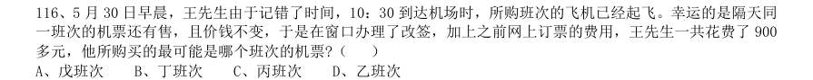

- **A.** 戊班次
- **B.** 丁班次
- **C.** 丙班次
- **D.** 乙班次

**答案：C**

### 2016 国考·副省级　第 117 题　（基期量比较）

由上述资料可知,以下哪个班次起飞前退票手续费率最高?( )

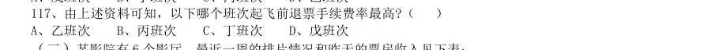

- **A.** 乙班次
- **B.** 丙班次
- **C.** 丁班次
- **D.** 戊班次

**答案：C**

### 2016 国考·副省级　第 118 题　（基期量比较）

影院一天总共放映x 场,其中某部电影放y 场,排片率就是y/x×100%,那么四部影片中排片率最高的影 片是哪部?( )

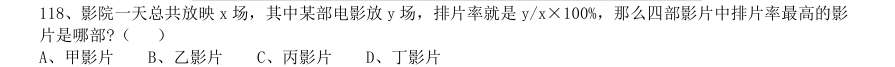

- **A.** 甲影片
- **B.** 乙影片
- **C.** 丙影片
- **D.** 丁影片

**答案：A**

### 2016 国考·副省级　第 120 题　（基期量计算（综合））

小张的单位离该电影院半小时路程,他每晚6:30 下班,吃晚饭需要半小时,电影院要求至少提前10 分钟 入场。按照该影院的排片表,时间上最适合他的影片是哪部?( )

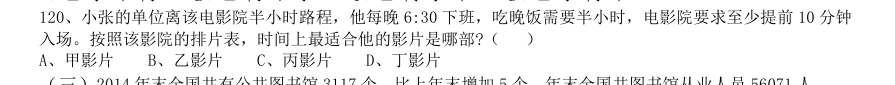

- **A.** 甲影片
- **B.** 乙影片
- **C.** 丙影片
- **D.** 丁影片

**答案：B**

### 2016 国考·副省级　第 126 题　（已知现期与增长率求基期）
> 材料：截至2014 年12 月底,全国实有各类市场主体6932.22 万户,比上年末增长14.35%,增速较上年同期增加 4.02 个百分点;注册资本(金)129.23 万亿元,比上年末增长27.70%。其中,企业1819.28 万户,个体工商户 4984.06 万户,农民专业合作社128.88 万户。 2014 年,全国新登记注册市场主体1292.5 万户,比上年同期增加160.97 万户,注册资本(金)20.66 万亿 元,比上年同期增加9.66 万亿元。其中,企业365.1 …

投资总额2763.31 亿美元,同比增长15.05%; 注册资本1796.39 亿美元,同比增长23.87%。 截至2012 年12 月底,全国实有各类市场主体户数最接近以下哪个数字?

- **A.** 6100 万
- **B.** 5500 万
- **C.** 5100 万
- **D.** 4500 万

**答案：B**

### 2016 国考·副省级　第 133 题　（基期量比较）

2014 年全国社会物流总额最高的季度是:

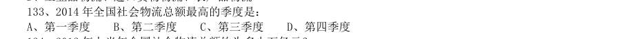

- **A.** 第一季度
- **B.** 第二季度
- **C.** 第三季度
- **D.** 第四季度

**答案：C**

### 2016 国考·副省级　第 134 题　（已知现期与增长率求基期）

2012 年上半年全国社会物流总额约为多少万亿元?

- **A.** 75
- **B.** 86
- **C.** 93
- **D.** 102

**答案：B**

### 2015 湖北·统一卷　第 106 题　（已知现期与增长率求基期）
> 材料：理。 (一) 2013 年二季度,我国税收月收入同比增速逐步提高,分别为7.9%、8.3%和12.9%。截至2013 年6 月,全国 税收总收入完成59260.61 亿元,同比增长7.9%,较上年同期回落1.9 个百分点。…

2012 年1-6 月全国税收总收入为:

- **A.** 52973.28 亿元
- **B.** 54921.79 亿元
- **C.** 56938.68 亿元
- **D.** 63942.19 亿元

**答案：B**

### 2015 湖北·统一卷　第 108 题　（已知现期与增长率求基期）

2011 年1—6 月全国关税收入约:

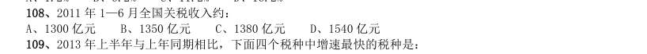

- **A.** 1300 亿元
- **B.** 1350 亿元
- **C.** 1380 亿元
- **D.** 1540 亿元

**答案：B**

### 2015 湖北·统一卷　第 111 题　（基期量计算（综合））
> 材料：经过50 多年的发展,我国台湾地区资本市场建立起由“证券交易所集中市场—上柜市场—兴柜市场”构成的完 善成熟的多层级资本市场体系。今年由于金融海啸、欧债危机等因素影响,台湾多层次资本市场总体成交值从 2010 至2012 年连续3 年下降,2012 年较2011 年衰退23.38%。周转率也呈现逐年下降趋势,2012 年证券交易所 几种市场周转率为97%,上柜市场周转率为175%,兴柜市场周转率为27%。 台湾资本市场第一层次是证券交易所集中市场。在准入门槛方面,台湾证交所要…

2012 年,台湾某企业实收资本额为2 亿新台币,该企业最近2 个年度会计报表获利能力均为3%,该企业最 适合进入台湾哪个层次资本市场:

- **A.** 证券交易所集中市场
- **B.** 上柜市场
- **C.** 兴柜市场
- **D.** 无法进入

**答案：B**

### 2015 湖北·统一卷　第 112 题　（基期量计算（综合））

2012 年世界交易所联合会(WFE)会员总市值为:

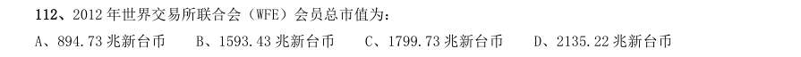

- **A.** 894.73 兆新台币
- **B.** 1593.43 兆新台币
- **C.** 1799.73 兆新台币
- **D.** 2135.22 兆新台币

**答案：B**

### 2015 湖北·统一卷　第 114 题　（已知现期与增长率求基期）

2011 年台湾三个层次资本市场的总成交值为:

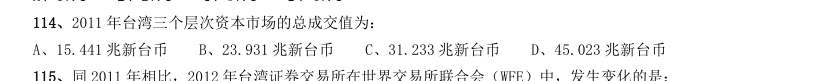

- **A.** 15.441 兆新台币
- **B.** 23.931 兆新台币
- **C.** 31.233 兆新台币
- **D.** 45.023 兆新台币

**答案：C**

### 2015 湖北·统一卷　第 115 题　（基期量计算（综合））

同2011 年相比,2012 年台湾证券交易所在世界交易所联合会(WFE)中,发生变化的是:

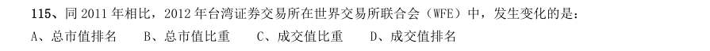

- **A.** 总市值排名
- **B.** 总市值比重
- **C.** 成交值比重
- **D.** 成交值排名

**答案：C**

### 2015 湖北·统一卷　第 116 题　（已知现期与增长率求基期）
> 材料：2012 年末,中国大陆总人口135404 万人,全年出生人口1635 万人,死亡人口966 万人。从性别结构看,男性 人口69395 万人,同比增加327 万人,女性人口66009 万人,同比增加342 万人;从城乡结构看,城镇人口71182 万人,同比增加2103 万人;乡镇人口64222 万人,同比减少1434 万人。 2012 年末全国就业人员76704 万人,比上年末增加284 万人。其中城镇就业人员37102 万人,比上年末增加1188 万人;乡村就业人员3960…

其中本地农民工9925 万人,增长5.4%; 外出农民工16336 万人,增长3.0%。 2011 年中国大陆总人口是:

- **A.** 133769 万人
- **B.** 136370 万人
- **C.** 134735 万人
- **D.** 136103 万人

**答案：C**

### 2015 湖北·统一卷　第 117 题　（已知现期与增长量求基期）

相较于2011 年,2012 年乡村就业人员的变化为:

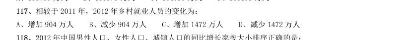

- **A.** 增加904 万人
- **B.** 减少904 万人
- **C.** 增加1472 万人
- **D.** 减少1472 万人

**答案：B**

### 2015 湖北·统一卷　第 120 题　（基期量计算（综合））

2012 年,中国大陆1-14 岁(含不满15 周岁)的人口数量为:

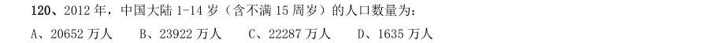

- **A.** 20652 万人
- **B.** 23922 万人
- **C.** 22287 万人
- **D.** 1635 万人

**答案：A**

### 2015 湖北·统一卷　第 121 题　（已知现期与增长率求基期）
> 材料：2012 年,全国国内旅游人数29.57 亿人次,比上年增长12.0%。其中,城镇居民19.33 亿人次。2012 年,全国 国内旅游收入22706.22 亿元人民币,比上年增长17.6%。…

2011 年,全国国内旅游收入约为:

- **A.** 15247.11 亿元人民币
- **B.** 17354.03 亿元人民币
- **C.** 18642.37 亿元人民币
- **D.** 19308.01 亿元人民币

**答案：D**

### 2015 湖北·统一卷　第 124 题　（已知现期与增长率求基期）

2011 年,除美国、加拿大以外的美洲国家游客入境旅游人数约为:

- **A.** 13.8 万人次
- **B.** 23.8 万人次
- **C.** 33.8 万人次
- **D.** 43.8 万人次

**答案：C**

### 2015 广东·乡镇　第 89 题　（基期量比较）

年,电话用户数与上年差距最大的年份是:

- **A.** 2009 年
- **B.** 2010 年
- **C.** 2013 年
- **D.** 2014 年

**答案：暂缺**

### 2015 广东·乡镇　第 96 题　（基期量计算（综合））
> 材料：2013 年全年,我国出口苹果数量为994664.1 吨,同比增长1.9%,金额为10.3 亿美元,同比增长 7.3%。 2013 年12 月,我国出口苹果数量为117478.4 吨,比11 月下降8.0%,金额为1.2 亿美元,比11 月下降7.7%,同比出口数量增长2.6%,金额增长12.5%。…

2013 年 月,我国对各大洲出口苹果数量最多的是:

- **A.** 亚洲
- **B.** 非洲
- **C.** 欧洲
- **D.** 北美洲

**答案：暂缺**

### 2015 广东·县级　第 87 题　（基期量比较）

2014 年 月,我国3G 手机和4G 手机出货量相差最大,最小在月份分别是:

- **A.** 1 月、8 月
- **B.** 2 月、8 月
- **C.** 1 月、7 月
- **D.** 2 月、7 月

**答案：暂缺**

### 2015 广东·县级　第 96 题　（基期量计算（综合））

珠江水系2014 年货运量比2013 年多多少亿吨:

- **A.** 0.5
- **B.** 0.9
- **C.** 1.2
- **D.** 1.7

**答案：暂缺**

### 2015 广东·县级　第 97 题　（基期量比较）

珠江水系2014 年客运量与2013 年相差最大的是:

- **A.** 一季度
- **B.** 二季度
- **C.** 三季度
- **D.** 四季度

**答案：暂缺**

### 2015 国考·副省级　第 121 题　（已知现期与增长率求基期）
> 材料：19.4%,26.4%,分别高出全国7.9、8.4、14.2 个百分点。该省工业企业主营业务收入占全国工业的3.7%,比上 年提高0.3 个百分点,百户重点企业主营业务收入、税金、利润分别增长10.2%、11.1%、20.8%,分别占全省工 业的29.5%、51%、27.6% (二)根据以下资料,回答121-125题。 。 2013 年,汽车工业实现主营业务收入4538 亿元,增长23.1%;实现利润416.6 亿元,增长19.9%;税金225.3 亿元,增长50%。销售利润…

其中,电气机械(家 电)利润增长38.5%,专用设备利润增长22.1%,船舶行业利润增长18.9%。 2013 年全国工业企业主营业务收入约为多少万亿元:

- **A.** 84
- **B.** 90
- **C.** 97
- **D.** 102

**答案：D**

### 2015 国考·副省级　第 126 题　（基期量比较）

2014 年1~5 月,表中四项软件业务收入之和最高的东北地区副省级城市是:

- **A.** 大连
- **B.** 长春
- **C.** 沈阳
- **D.** 哈尔滨

**答案：A**

### 2015 国考·副省级　第 128 题　（基期量计算（综合））

2014 年1-5 月,副省级城市哪项软件业务完成收入之和低于该业务全国总收入的一半。

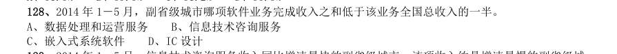

- **A.** 数据处理和运营服务
- **B.** 信息技术咨询服务
- **C.** 嵌入式系统软件
- **D.** IC 设计

**答案：D**

### 2014 湖北·统一卷　第 112 题　（基期量比较）

图中一次能源消费量与生产量差值最大的一年,该差值为多少亿吨标准煤?

- **A.** 2.9
- **B.** 3.0
- **C.** 3.1
- **D.** 3.2

**答案：D**

### 2014 湖北·统一卷　第 113 题　（已知现期与增长率求基期）

2009—2012 年间全国商品进出口总额最高年份,矿产品进出口总额比上年:

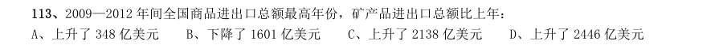

- **A.** 上升了348 亿美元
- **B.** 下降了1601 亿美元
- **C.** 上升了2138 亿美元
- **D.** 上升了2446 亿美元

**答案：A**

### 2014 湖北·统一卷　第 120 题　（已知现期与增长率求基期）

以下关于该省2012 年规模以上工业发展状况的描述与资料相符的是:

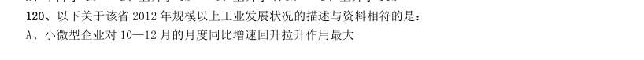

- **A.** 小微型企业对10—12 月的月度同比增速回升拉升作用最大
- **B.** 全年小微型企业增加值同比增量低于中型企业
- **C.** 规模以上工业企业主营业务利润率高于上年水平
- **D.** 第三季度大型企业工业增加值同比增速高于其他两类企业

**答案：A**

### 2014 湖北·统一卷　第 123 题　（基期量比较）

以下各月中,哪个月全行业保险赔付支出额与保险保费收入额比值最低?

- **A.** 1 月
- **B.** 2 月
- **C.** 3 月
- **D.** 4 月

**答案：A**

### 2014 广东·乡镇　第 86 题　（基期量计算（综合））
> 材料：(材料1) 城市社区卫生服务中心和农村乡镇卫生院是我国卫生体系的重要组成部分。…

2011 年底,社区卫生服务中心的机构数量和乡镇卫生院相比:

- **A.** 社区卫生服务中心多
- **B.** 乡镇卫生院多
- **C.** 两者一样多
- **D.** 无法比较

**答案：暂缺**

### 2014 广东·乡镇　第 88 题　（基期量计算（综合））

2011 年底,我国社区卫生服务中心从业人员中,不是卫生技术人员的有:

- **A.** 48790
- **B.** 52424
- **C.** 57438
- **D.** 69873

**答案：暂缺**

### 2014 广东·乡镇　第 90 题　（基期量计算（综合））

2011 年底,城市每千人口卫生技术人员数比农村每千人口卫生技术人员数( )人。

- **A.** 多4.79
- **B.** 少4.79
- **C.** 多3.87
- **D.** 少3.87

**答案：暂缺**

### 2014 广东·乡镇　第 91 题　（已知现期与增长率求基期）

据统计,2013 年我省完成货运量305830 万吨,比上年增长14.8%;完成货运周转量12407.08 亿吨公里, 比上年增长26.9%。 2013 年,我省各类运输业务货运量完成最多的是:

- **A.** 铁路
- **B.** 公路
- **C.** 水路
- **D.** 管道

**答案：暂缺**

### 2014 广东·乡镇　第 92 题　（基期量计算（综合））

2013 年,我省各类运输业货物周转量比上年出现下降的运输业有( )个。

- **A.** 4
- **B.** 3
- **C.** 2
- **D.** 1

**答案：暂缺**

### 2014 广东·乡镇　第 93 题　（基期量计算（综合））

2012 年,我省完成货物周转量约( )亿吨公里。

- **A.** 8907
- **B.** 9777
- **C.** 10198
- **D.** 11764

**答案：暂缺**

### 2014 广东·乡镇　第 95 题　（基期量计算（综合））

2012 年,全省运输业货运量中水路完成的比例,比货物周转量中水路完成的比例约低( )个百分点。

- **A.** 52
- **B.** 46
- **C.** 50
- **D.** 48

**答案：暂缺**

### 2014 广东·县级　第 86 题　（已知现期与增长率求基期）
> 材料：(材料1) 改革开放三十多年以来,广东经济发展连上新台阶,综合实力不断实现大跨越。1979~2012 年,世界经济 年均增长速度为2.8%,中国增速为9.8%,广东增速则达13.3%。持续较快的经济增速,推动广东经济总量不 断跃上新台阶。自1989 年开始,广东GDP 总量(国内生产总值)在全国一直保持首位,到2012 年已连续24 年居全国第一,占全国经济总量比重在1/10 至1/8 之间。 2012 年,民营经济达29319.97 亿元,占GDP 比重为51.4%;民营经…

1979~2012 年,广东经济年均增速约为世界经济增速的( )倍。

- **A.** 1.4
- **B.** 3.5
- **C.** 4.8
- **D.** 10.5

**答案：暂缺**

### 2014 广东·县级　第 87 题　（基期量计算（综合））

2012 年,广东税收总额约为( )亿元。

- **A.** 12273
- **B.** 13173
- **C.** 19312
- **D.** 57043

**答案：暂缺**

### 2014 广东·县级　第 91 题　（基期量比较）
> 材料：2013 年,我国研究生招生61.1 万人。在校研究生179.4 万人,毕业生51.4 万人。普通本专科在校生 2468.1 万人,毕业生638.7 万人。…

2013 年,招生人数和毕业生人数相差最小的教育层次是:

- **A.** 研究生
- **B.** 普通本专科
- **C.** 中等职业教育
- **D.** 普通高中

**答案：暂缺**

### 2014 广东·县级　第 93 题　（基期量计算（综合））

我国普通本专科、中等职业教育及普通高中招生人数总和最多的年份是( )年。

- **A.** 2009
- **B.** 2010
- **C.** 2011
- **D.** 2012

**答案：暂缺**

### 2014 广东·县级　第 97 题　（基期量计算（综合））

2013 年,广东第三产业完成投资( )亿元。

- **A.** 354.14
- **B.** 7446.06
- **C.** 15058.33
- **D.** 22858.53

**答案：暂缺**

### 2014 国考·统一卷　第 121 题　（基期量计算（综合））
> 材料：根据以下资料,回答121—125 题。 2012 年第三季度全国100 个城市的公共就业服务机构市场中,用人单位通过公共就业服务机构招聘各类人 员约643.3 万人,进入市场的求职者约610 万人,岗位空缺与求职人数比率比上年同期上升了1%。上年同期这 100 个城市中,用人单位通过公共就业服务机构招聘各类人员约577.9 万人。…

2012 年第三季度全国十个城市岗位需求和求职信息 与2011 年同期比,2012 年第三季度全国100 个城市调查的公共就业服务机构市场供求中,进入市场的求 职者人数:

- **A.** 高于上年同期
- **B.** 低于上年同期
- **C.** 与上年同期持平
- **D.** 无法推出

**答案：A**

### 2014 国考·统一卷　第 122 题　（基期量计算（综合））

2012 年第三季度全国100 个城市,求职的新成长失业青年中,应届高校毕业生人数约为:

- **A.** 66 万
- **B.** 71 万
- **C.** 76 万
- **D.** 81 万

**答案：C**

### 2014 国考·统一卷　第 124 题　（基期量比较）

2012 年第三季度全国十个城市中,岗位空缺大于求职人数缺口的最大的前三个职业,在半数以上城市中出 现过的是:

- **A.** 推销展销人员
- **B.** 治安保卫人员
- **C.** 机械冷加工人员
- **D.** 餐厅服务员、厨工

**答案：A**

### 2014 国考·统一卷　第 134 题　（基期量计算（综合））

下列哪一张图能反映2012 年清洁能源机组并网容量中水电、核电和新能源发电的构成:

> （本题为图形题，选项为图片，见原卷）

**答案：D**

### 2013 湖北·统一卷　第 135 题　（基期量计算（综合））

2011 年 月,全国造船完工总量为多少万载重吨?

- **A.** 4315
- **B.** 3845
- **C.** 4312
- **D.** 3855

**答案：B**

### 2013 湖北·统一卷　第 140 题　（基期量计算（综合））

2011 年7 月产量低于上半年月均产量的是:

- **A.** 电
- **B.** 钢材
- **C.** 水泥
- **D.** 乙烯

**答案：D**

### 2013 湖北·统一卷　第 142 题　（基期量计算（综合））

2010 年 月中,汽车单月产量超过150 万辆的月份有多少个?

- **A.** 4
- **B.** 5
- **C.** 6
- **D.** 7

**答案：C**

### 2013 湖北·统一卷　第 152 题　（已知现期与增长量求基期）

该市主要农副产品与上年相比,产量变化绝对值最小的是:

- **A.** 肉类
- **B.** 禽蛋
- **C.** 水产品
- **D.** 牛奶

**答案：B**

### 2013 广东·一卷　第 87 题　（基期量计算（综合））

根据上述资料,2011 年油料播种面积约为多少万亩:

- **A.** 90
- **B.** 100
- **C.** 110
- **D.** 120

**答案：暂缺**

### 2013 广东·一卷　第 88 题　（基期量计算（综合））

2012 年粮食和蔬菜播种总面积:

- **A.** 超过600 万亩
- **B.** 同比增长超过40%
- **C.** 约占该地区农作物总播种面积的35%
- **D.** 比棉花的播种面积少近200 万亩

**答案：暂缺**

### 2013 广东·一卷　第 89 题　（基期量计算（综合））

2012 年水稻播种面积比2011 年大约少多少万亩:

- **A.** 2.21
- **B.** 2.33
- **C.** 2.72
- **D.** 2.88

**答案：暂缺**

### 2013 广东·一卷　第 92 题　（基期量比较）

在下列时间的分配上,城镇居民和农村居民差异最大的一项是:

- **A.** 工作活动
- **B.** 家庭经营活动
- **C.** 交通活动
- **D.** 个人生活必需时间

**答案：暂缺**

### 2013 广东·一卷　第 93 题　（基期量计算（综合））

在个人生活必需时间的分配上,城镇居民比农村居民耗用时间多的活动项目共多少项:

- **A.** 1
- **B.** 2
- **C.** 3
- **D.** 4

**答案：暂缺**

### 2013 广东·一卷　第 94 题　（基期量计算（综合））

根据上表,可以推断该市城镇居民与农村居民的人数比是:

- **A.** 2:1
- **B.** 3:2
- **C.** 4:3
- **D.** 无法推断

**答案：暂缺**

### 2013 广东·一卷　第 97 题　（基期量计算（综合））

2012 年该市文化产业总产值比2008 年大约提高了多少个百分点:

- **A.** 7
- **B.** 6
- **C.** 5
- **D.** 4

**答案：暂缺**

### 2013 广东·一卷　第 98 题　（基期量计算（综合））

2008 年至2012 年间,该市文化产业总产值增长最快的年份是:

- **A.** 2008 年
- **B.** 2009 年
- **C.** 2011 年
- **D.** 2012 年

**答案：暂缺**

### 2013 广东·三卷　第 86 题　（基期量计算（综合））

如果该网站日均登陆流量为6 万人,则平均每日首选生活频道的用户约为( )人(不 考虑同一用户反复登陆该网站的情况)。

- **A.** 331
- **B.** 1260
- **C.** 3310
- **D.** 12600

**答案：暂缺**

### 2013 广东·三卷　第 87 题　（基期量计算（综合））

本次调查中,首选频道为体育频道的51 岁及以上用户一共约有( )名:

- **A.** 10
- **B.** 18
- **C.** 47
- **D.** 99

**答案：暂缺**

### 2013 广东·三卷　第 88 题　（基期量计算（综合））

与该网站21―30 岁的用户相比,该网站31 岁及以上用户普遍对( )更感兴趣。

- **A.** 文化频道
- **B.** 音乐频道
- **C.** 新闻频道
- **D.** 科技频道

**答案：暂缺**

### 2013 广东·三卷　第 89 题　（基期量计算（综合））

如果有企业在该网站上播放广告,企业产品定位是31—40 岁的人群,那么它播放广告 的频道应该首选:

- **A.** 音乐频道
- **B.** 生活频道
- **C.** 新闻频道
- **D.** 体育频道

**答案：暂缺**

### 2013 广东·三卷　第 92 题　（基期量计算（综合））

与2002 年相比,2011 年( )地区的城市综合竞争力前200 名的城市数量下降最为 显著。

- **A.** 环渤海
- **B.** 东南
- **C.** 中部
- **D.** 西南

**答案：暂缺**

### 2013 广东·三卷　第 93 题　（基期量计算（综合））

2011 年,城市综合竞争力前50 名中的特大型城市,至少有( )个位于东南地区:

- **A.** 11
- **B.** 13
- **C.** 18
- **D.** 无法判断

**答案：暂缺**

### 2013 广东·三卷　第 94 题　（基期量比较）

十年间,与其他规模的城市相比,( )在各个排名档次内的城市数量变化幅度最小。

- **A.** 特大型城市
- **B.** 大型城市
- **C.** 中等城市
- **D.** 小城市

**答案：暂缺**

### 2013 广东·三卷　第 95 题　（基期量计算（综合））

根据资料,以下有关2011 年城市综合竞争力排名的描述无法判断的是:

- **A.** 排名第101—200 名的城市主要为大城市和中等城市
- **B.** 排名第101—200 名的城市有以上集中在中部地区
- **C.** 与十年前相比,西南和东南地区均有城市跌出城市综合竞争力前50 名
- **D.** 排名前200 名的城市中,近

**答案：暂缺**

### 2013 广东·三卷　第 96 题　（基期量计算（综合））
> 材料：(三) 2012 年,某省加大扶持贫困残疾人力度,财政投入扶贫资金3816.3 万元,比上年大幅增长 18%,扶持贫困残疾人员56561 人,脱贫35110 人,享受优惠政策的贫困残疾人117727 人,比上 年增加3%。 截止2012 年底,城镇残疾人员安排就业人数共227192 人,其中,集中就业25135 人,按比 例就业合计 91384 人,个体及其他形式就业110673 人。农村残疾人实际就业630900 人,其中, 从事农业生产活动515278 人,从事其他形式就…

2012 年,该市城镇残疾人就业形式主要为:

- **A.** 集中就业
- **B.** 按比例就业
- **C.** 从事农业生产活动
- **D.** 个体及其他形式就业

**答案：暂缺**

### 2013 广东·三卷　第 98 题　（基期量计算（综合））

2011 年全省、市、县、乡级残联实有人员( )人:

- **A.** 5001
- **B.** 4931
- **C.** 4776
- **D.** 3758

**答案：暂缺**

### 2013 国考·统一卷　第 130 题　（基期量计算（综合））

关于这534 家公司在2011 年第一季度营业状况的描述与资料相符的是:

- **A.** 所有公司净利润之和比2010 年第四季度有所上升
- **B.** 超过1/4 的净利润来自中小企业板公司
- **C.** 平均每家钢铁板块公司的存货高于534 家公司的平均水平
- **D.** 平均每家建筑机械类公司的营业收入高于534 家公司的平均水平

**答案：A**

### 2013 国考·统一卷　第 132 题　（基期量计算（综合））

2008~2011 年从事建筑业、批发零售业、居民服务和其他服务业的农民工人数总和超过从事制造业的农民 工人数的年份有:

- **A.** 1 个
- **B.** 2 个
- **C.** 3 个
- **D.** 4 个

**答案：C**

### 2012 湖北·统一卷　第 103 题　（基期量比较）

2005—2010 年股票、基金交易的户均交易量最大的是哪个年份:

- **A.** 2007
- **B.** 2008
- **C.** 2009
- **D.** 2010

**答案：C**

### 2012 湖北·统一卷　第 106 题　（已知现期与增长率求基期）

同比增长2.0%。 该省2011 年12 月及全年接待过夜旅客人数 该省2011 年12 月及全年接待过夜游客的旅游收入情况 2010 年该省接待过夜游客的旅游总收入约为:

- **A.** 25 亿元
- **B.** 258 亿元
- **C.** 298 亿元
- **D.** 408 亿元

**答案：B**

### 2012 湖北·统一卷　第 112 题　（已知现期与增长率求基期）

2007—2011 年我国全年货物出口额与上一年相比增长超过30%的年份有几个:

- **A.** 1 个
- **B.** 2 个
- **C.** 3 个
- **D.** 4 个

**答案：A**

### 2012 湖北·统一卷　第 114 题　（基期量比较）

表中所列举的国家和地区中,2011 年我国货物进出口贸易差额最大的是:

- **A.** 欧盟
- **B.** 中国香港
- **C.** 美国
- **D.** 中国台湾

**答案：B**

### 2012 湖北·统一卷　第 117 题　（已知现期与增长率求基期）

2010 年,我国水产品产量大约达到多少万吨:

- **A.** 1500
- **B.** 3800
- **C.** 5000
- **D.** 5300

**答案：D**

### 2012 广东·统一卷　第 89 题　（基期量计算（综合））

可由上表得出的一项是:

- **A.** 2005 年至2011 年,消费支出逐年增长
- **B.** 2005 年至2010 年,服务性消费支出均未达到消费支出的三分之一
- **C.** 在外饮食服务费在2011 年首次超过教育费用
- **D.** 2010 年的交通工具服务支出比2005 年翻了两番

**答案：暂缺**

### 2012 广东·统一卷　第 91 题　（基期量计算（综合））
> 材料：根据下列资料,完成各题。 2011 年,G 省交通运输生产持续平稳增长。全年客运总量522002.45 万人,比上年增长11.8%,增幅同比回 落2.9 个百分比。旅客周转总量3852.66 亿人公里,比上年增长15.3%,增幅同比回落1.4 个百分比。分运 输方式看,铁路客运量和旅客周转量分别为17778.00 万人和506.00 亿人公里,比上年分别增长18.9%和 10.9%;公路客运量和旅客周转量分别为493618.00 万人和2082.68 亿人公里,比上年分别增长…

2009 年客运总量约为多少万人:

- **A.** 407068
- **B.** 428748
- **C.** 455102
- **D.** 479340

**答案：暂缺**

### 2012 国考·统一卷　第 116 题　（已知现期与增长率求基期）
> 材料：根据资料所提供的信息进行分析、比较、计算和判断处理。 (一)根据以下资料,完成各题。 2010 年,某省广电实际总收入为145.83 亿元,同比增长32.07%。其中,广告收入为67.08 亿元,同比增 长25.88%;有线网络收入为45.38 亿元,同比增长26.35%;其他收入为33.37 亿元,同比增长57.3%。 2010 年,该省广电收入中,省级收入为65.32 亿元比上年增加15.5 亿元;地市级收入为41.61 亿元,比 上年增加13.39 亿元;县级收入为38…

2009 年,该省的有线网络收入约为多少亿元:

- **A.** 21
- **B.** 36
- **C.** 57
- **D.** 110

**答案：B**

### 2012 国考·统一卷　第 124 题　（基期量计算（综合））

2010 年,京津冀经济圈的哪一经济指标值居三大经济圈之首:

- **A.** 实际利用外资占全国比重
- **B.** 进出口贸易额占全国比重
- **C.** 固定资产投资增长速度
- **D.** 第一产业值增长速度

**答案：C**

### 2012 国考·统一卷　第 125 题　（基期量计算（综合））

能够出上述资料中推出的是:

- **A.** 产业结构越向第三产业倾斜的经济圈,进出口贸易额增长越迅速
- **B.** 地区生产总值越高的经济圈,其地区生产总值增长速度越低
- **C.** 社会消费品零售额越高的经济圈,进出口贸易额越高
- **D.** 固定资产投资越高的经济圈,实际利用外资额越低

**答案：A**

### 2012 国考·统一卷　第 126 题　（已知现期与增长量求基期）

根据"十一五"规划,2010 年底全国高速公路里程应达到多少万公里:

- **A.** 5
- **B.** 5.5
- **C.** 6
- **D.** 6.5

**答案：D**

### 2012 国考·统一卷　第 127 题　（基期量计算（综合））

2010 年底,高速公路里程超过全国总里程5%省份有几个:

- **A.** 5
- **B.** 6
- **C.** 7
- **D.** 8

**答案：A**

### 2012 国考·统一卷　第 128 题　（基期量计算（综合））

2005 年底,全国高速公路里程为多少万公里:

- **A.** 2.46
- **B.** 3.89
- **C.** 4.09
- **D.** 4.53

**答案：C**

### 2012 国考·统一卷　第 131 题　（已知现期与增长率求基期）
> 材料：2010 年,我国进出口贸易总额为29727.6 亿美元,同比增长34.7%。 2010 年,我国机电产品出口9334.3 亿美元,同比增长30.9%;高新技术产品出口4924.1 亿美元,同比增长 30.7%。船舶、汽车零部件出口保持较快增长,其中船舶出口同比增长44.5%。汽车零部件出口同比增长44.1%。 2010 年,机电产品进口额达到6603.1 亿美元,同比增长34.4%,高新技术产品进口额达到4126.7 亿美元, 同比增长33.2%。…

2010 年我国进出口贸易情况 2009 年我国进出口贸易总额约多少万亿美元:

- **A.** 1.6
- **B.** 2.2
- **C.** 2.6
- **D.** 3.0

**答案：B**

### 2011 湖北·统一卷　第 109 题　（基期量计算（综合））

2010 年1~3 月,法国纺织品及原料的进口额约为多少亿美元:

- **A.** 70.3
- **B.** 67.8
- **C.** 99.1
- **D.** 108.3

**答案：A**

### 2011 湖北·统一卷　第 112 题　（已知现期与增长量求基期）

下列作物2009 年比2008 年增产量最多的是:

- **A.** 糖蔗
- **B.** 粮食
- **C.** 蔬菜
- **D.** 水果

**答案：C**

### 2011 湖北·统一卷　第 119 题　（基期量计算（综合））

该省2010 年社会消费品零售总额是:

- **A.** 13482.4 亿元
- **B.** 11959.6 亿元
- **C.** 14852.6 亿元
- **D.** 16347.2 亿元

**答案：A**

### 2011 广东·统一卷　第 86 题　（基期量比较）

根据资料所提供的信息进行分析、比较、计算和判断处理。 (一) 根据下列资料,回答问题 2002-2005 年,我国的贸易顺差额(出口—进口)最小的年份是:

- **A.** 2002 年
- **B.** 2003 年
- **C.** 2004 年
- **D.** 2005 年

**答案：暂缺**

### 2011 广东·统一卷　第 91 题　（基期量计算（综合））

苏、浙、粤、闽、鲁五省主要农产品产量统计表单位:万吨 哪省的粮食产量最多:

- **A.** 广东省
- **B.** 江苏省
- **C.** 福建省
- **D.** 山东省

**答案：暂缺**

### 2011 广东·统一卷　第 92 题　（基期量计算（综合））

福建省的糖料产量在这五省中居第几:

- **A.** 3
- **B.** 4
- **C.** 5
- **D.** 6

**答案：暂缺**

### 2011 广东·统一卷　第 93 题　（基期量计算（综合））

蔬菜产量最多的省份与蔬菜产量最少的省份的蔬菜产量之比为多少:

- **A.** 6.5
- **B.** 4.6
- **C.** 3.2
- **D.** 5.6

**答案：暂缺**

### 2011 广东·统一卷　第 94 题　（基期量计算（综合））

广东省有几项农产品在这五个省中排在第一:

- **A.** 1
- **B.** 2
- **C.** 3
- **D.** 4

**答案：暂缺**

### 2011 广东·统一卷　第 95 题　（基期量计算（综合））

广东省不出产什么农产品:

- **A.** 粮食
- **B.** 油料
- **C.** 棉花
- **D.** 糖料

**答案：暂缺**

### 2011 广东·统一卷　第 96 题　（基期量计算（综合））
> 材料：1949 年以来,我国人力资本存量形成受到两次大的破坏和冲断。第一次是反右,大跃进经济崩溃期间, 在校生数由1960 年的10963 万人,下降到1962 年的7480 万人,其中中专生由222 万人下降到54 万人;第 二次是“文革”动乱期间,估计有70--80 万人未能受到大学教育,超过1 亿中小学生受到质量很低的教育, 几百万知识分子无法工作和科研。全国12 岁以上人口平均文化程度由1964 年的2.34 仅上升到1982 年的 4.61,不足小学毕业程度。…

请根据上述资料回答下列第(1)----(5)题: 1962 年,我国在校生数多少人:

- **A.** 10963 万人
- **B.** 7480 万人
- **C.** 222 万人
- **D.** 54 万人

**答案：暂缺**

### 2011 广东·统一卷　第 97 题　（基期量计算（综合））

1960 年,我国在校中专生有多少人:

- **A.** 10963 万人
- **B.** 7840 万人
- **C.** 222 万人
- **D.** 54 万人

**答案：暂缺**

### 2011 广东·统一卷　第 98 题　（基期量计算（综合））

1960 年到1962 年间,我国在校中专生下降了多少人:

- **A.** 222 万人
- **B.** 54 万人
- **C.** 168 万人
- **D.** 276 万人

**答案：暂缺**

### 2011 广东·统一卷　第 100 题　（基期量计算（综合））

有多少人由于"文革"未能受到大学教育:

- **A.** 168 万人
- **B.** 70~80 万人
- **C.** 几百万人

**答案：暂缺**

### 2011 国考·统一卷　第 121 题　（已知现期与增长率求基期）

下列四种谷物中,2008 年与2000 年相比全世界增产量最多的是:

- **A.** 稻谷
- **B.** 小麦
- **C.** 玉米
- **D.** 大豆

**答案：C**

### 2010 湖北·统一卷　第 96 题　（已知现期与增长率求基期）

根据以下资料,完成各题。 “家电下乡”产品销售额下降最多的是几月份:

- **A.** 8 月
- **B.** 9 月
- **C.** 10 月
- **D.** 11 月

**答案：B**

### 2010 广东·统一卷　第 74 题　（基期量计算（综合））

根据资料,下列各项无法确定的是:

- **A.** 2008 年,潮州陶瓷企业工业产值远大于该市皮鞋企业
- **B.** 2008 年,广东省产业转移工业园区吸纳的外地劳动力约为6.46 万人
- **C.** 广东14 个欠发达地市都有产业转移工业园
- **D.** 2008 年广州规模以上皮鞋企业的工业产值比清远同类企业的工业产值高

**答案：暂缺**

### 2010 广东·统一卷　第 75 题　（已知现期与增长率求基期）
> 材料：根据下列资料和图形,完成各题。 2008 年各级财政共支出城市低保资金393.4 亿元,比上年增长41.8%,保障了2330 多万城镇贫困人口 的基本生活。得到最低生活保障人员中:在职人员82.2 万人,占总人数的3.5%,灵活就业人员381.7 万人, 占总人数的1.3%,老年人316.7 万人,占总人数的13.6%,登记失业人员564.3 万人,占总人数的24.3%, 未登记失业人员402.2 万人,占总人数的17.2%。在校生358.1 万人,占总人数的15.3%,其他…

比上年增长109.6%。 2008 年农村最低生活保障人数比2001 年将近翻了多少番:

- **A.** 15
- **B.** 14
- **C.** 5
- **D.** 4

**答案：暂缺**

### 2010 国考·统一卷　第 92 题　（基期量计算（综合））

2009 年3 月份轿车销量约为多少万辆:

- **A.** 64
- **B.** 59
- **C.** 54
- **D.** 50

**答案：暂缺**

### 2010 国考·统一卷　第 93 题　（基期量计算（综合））

2008 年4 月,SUV 销量比MPV 销量约:

- **A.** 少2.3 万辆
- **B.** 多2.3 万辆
- **C.** 少3.4 万辆
- **D.** 多3.4 万辆

**答案：暂缺**

### 2010 国考·统一卷　第 96 题　（已知现期与增长率求基期）
> 材料：2008 年,某省农产品进出口贸易总额为7.15 亿美元,比上年增长25.2%。其中,出口额为5.02 亿美元,增 长22.1%;进口额为2.13 亿美元,增长33.2%。农产品进出口贸易额占全省对外贸易总额的4.5%。出口额居前5 位的产品为蔬菜、畜产品、水果、粮食和茶叶,而绿茶出口额占茶叶出口额的四分之三。全省农产品对东欧、非 洲、拉美等国家和地区的市场进一步开拓,出口额比上一年进一步增长。…

其中,对美国的出口额增长16.0%;对 日本的出口额增长7.3%;对韩国的出口额增长59.8%;对东盟的出口额增长58.6%。 2008 年,该省的对外贸易总额约为多少亿美元:

- **A.** 158.89
- **B.** 134.66
- **C.** 91.78
- **D.** 79.25

**答案：A**

### 2010 国考·统一卷　第 97 题　（基期量计算（综合））

2008 年,该省的绿茶出口额约为多少万美元:

- **A.** 4387
- **B.** 3080
- **C.** 2255
- **D.** 1307

**答案：B**

### 2010 国考·统一卷　第 101 题　（基期量计算（综合））

2007 年,下列国家(地区)中人口最少的是:

- **A.** 中国香港
- **B.** 哥斯达黎加
- **C.** 新加坡
- **D.** 多米尼加

**答案：B**

### 2010 国考·统一卷　第 102 题　（基期量比较）

资料中失业率最高与最低的国家(地区),其幸福指数相差:

- **A.** 22.1
- **B.** 28.5
- **C.** 27.4
- **D.** 31.4

**答案：C**

### 2010 国考·统一卷　第 105 题　（基期量计算（综合））

下列说法与资料相符的有几个: 1.国民生产总值小于1000 亿美元的国家(地区),幸福指数均高于其他国家(地区); 2.人口过亿的国家(地区)失业率越低,幸福指数越高; 3.比中国内地失业率低的国家(地区),幸福指数均低于中国内地; 4.人均国民生产总值超过2 万美元的国家(地区),幸福指数均低于其他国家(地区)。

- **A.** 0
- **B.** 1
- **C.** 2
- **D.** 3

**答案：C**
