# 资料分析 · 基期量计算 · 2020 年代真题

> 所属考点：[ZL-BASE](../ZL-BASE-基期量计算.md)　｜　本片 125 题

### 2026 广东·统一卷　第 77 题　（已知现期与增长量求基期）

根据资料,国家标准物质数量快速增长的原因不包括( )。

- **A.** 用途广泛
- **B.** 需求大幅增加
- **C.** 产业链完整
- **D.** 政策支持

**答案：C**

### 2026 广东·统一卷　第 78 题　（基期量计算（综合））

截至2024年末,市场监管总局累计批准建立国家标准物质( )项。

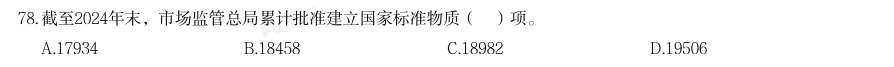

- **A.** 17934
- **B.** 18458
- **C.** 18982
- **D.** 19506

**答案：B**

### 2026 广东·统一卷　第 80 题　（基期量计算（综合））

下列选项中,最有可能准确反映2025年上半年我国新建标准物质地域分布情况的是( )。

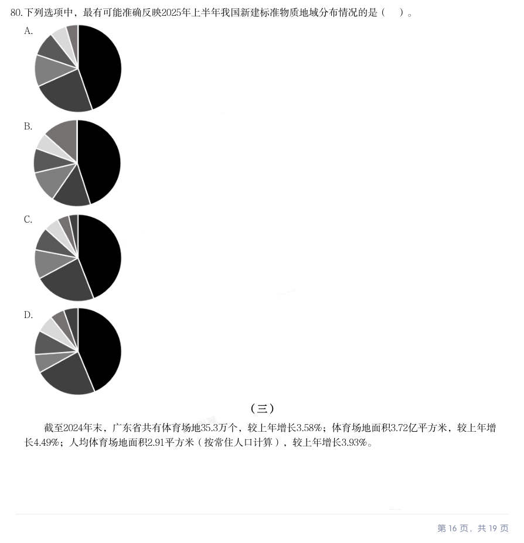

- **A.** 
- **B.** 
- **C.** 
- **D.** 

**答案：A**

### 2026 广东·统一卷　第 81 题　（已知现期与增长率求基期）

(三) 截至2024年末,广东省共有体育场地35.3万个,较上年增长3.58%;体育场地面积3.72亿平方米,较上年增 长4.49%;人均体育场地面积2.91平方米(按常住人口计算),较上年增长3.93%。 · 本试卷由粉笔用户上岸张同学66生成 2024年,广东省体育场地数量增加约( )万个。

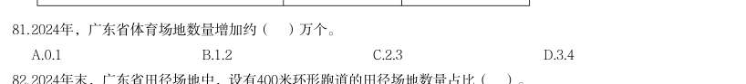

- **A.** 0.1
- **B.** 1.2
- **C.** 2.3
- **D.** 3.4

**答案：暂缺**

### 2026 广东·统一卷　第 83 题　（基期量计算（综合））

2024年末,广东省足球、篮球、排球“三大球”场地面积约为( )亿平方米。

- **A.** 0.10
- **B.** 0.11
- **C.** 1.04
- **D.** 1.10

**答案：D**

### 2026 广东·统一卷　第 86 题　（已知现期与增长量求基期）
> 材料：(四) 新中国成立以来,我国的城镇化建设不断推进,城市规模不断扩大,综合实力显著增强,基础设施持续改 善,城市更加宜业宜居。 从城市数量看,1948年末,我国城市共有58个,新中国成立后,大批县城改设为城市。1949年末,全国城 市共有129个,其中,地级以上城市68个,县级市61个,建制镇2000个左右。改革开放前,我国的城镇化经历 了一段比较曲折的发展历程,小城市和小城镇发展缓慢。1978年末,全国城市共有193个,其中,地级以上城 · 本试卷由粉笔用户上岸张同学66生成…

根据材料,下列时间段我国常住人口城镇化率增加最多的是:

- **A.** 1957—1978年
- **B.** 1978—1995年
- **C.** 1995—2011年
- **D.** 2011—2023年

**答案：C**

### 2026 国考·副省级　第 116 题　（基期量计算（综合））

信息进行分析、比较、计算和判断处理。 (一) 2025 年一季度全国期货市场成交额约为多少万亿元?

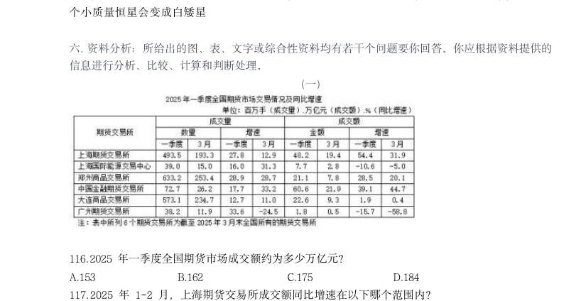

- **A.** 153
- **B.** 162
- **C.** 175
- **D.** 184

**答案：B**

### 2026 国考·副省级　第 118 题　（基期量计算（综合））

全国2025 年3 月成交量超过一季度月均成交量的期货交易所有几个?

- **A.** 5
- **B.** 4
- **C.** 3
- **D.** 2

**答案：A**

### 2026 国考·副省级　第 119 题　（基期量计算（综合））

2024 年一季度,郑州商品交易所成交量比大连商品交易所:

- **A.** 多不到0.5 亿手
- **B.** 少不到0.5 亿手
- **C.** 多0.5 亿手以上
- **D.** 少0.5 亿手以上

**答案：B**

### 2026 国考·副省级　第 121 题　（基期量计算（综合））

2024 年,全国基本医疗保险统筹基金支出金额超过收入金额的月份有几个?

- **A.** 4
- **B.** 5
- **C.** 6
- **D.** 7

**答案：B**

### 2026 国考·副省级　第 122 题　（基期量计算（综合））

2024 年,全国基本医疗保险统筹基金累计收入第一次超过1.5 万亿元是在几月?

- **A.** 5 月
- **B.** 6 月
- **C.** 7 月
- **D.** 8 月

**答案：C**

### 2026 国考·副省级　第 123 题　（基期量比较）

2024 年,全国城乡居民基本医疗保险统筹基金收入最高的季度是:

- **A.** 一季度
- **B.** 二季度
- **C.** 三季度
- **D.** 四季度

**答案：D**

### 2026 国考·副省级　第 131 题　（已知现期与增长率求基期）
> 材料：2024 年,我国对联合国定义的45 个最不发达国家(以下简称最不发达国家)进出口 14230.2 亿元人民币,占同期我国外贸进出口总值的3.2%。其中出口8664.6 亿元,同比(下同) 增长4.3%;进口5565.5 亿元,增长12.8%。 2024 年,我国对最不发达国家出口机电产品3942.2 亿元,增长13.5%。其中出口船舶690.8 亿元,增长65.9%,主要出口至全球第一大船旗国利比里亚。出口金额654.3 亿元,增长67%; 出口工程机械、火车分别为165.…

12 月,我国自最不发达国家进口512.7 亿元,增长18.1%,其中自刚果民主共和国、几内亚、 老挝、赞比亚分别进口156.3 亿元,54.7 亿元,35.6 亿元,33.9 亿元,分别增长84.6%,40.3%, 25.7%、127.27%。 2024 年,我国外贸进出口总值在以下哪个范围内?

- **A.** 不到44 万亿元
- **B.** 44 万亿元~45 万亿元之间
- **C.** 45 万亿元~46 万亿元之间
- **D.** 超过46 万亿元

**答案：B**

### 2026 国考·副省级　第 134 题　（基期量计算（综合））

2023 年1~11 月,我国对最不发达国家月均进口值约为多少亿元?

- **A.** 395
- **B.** 409
- **C.** 468
- **D.** 502

**答案：B**

### 2026 国考·副省级　第 135 题　（基期量计算（综合））

关于2024 年我国进出口情况,能根据上述资料推出的是:

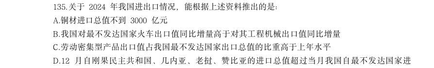

- **A.** 铜材进口总值不到3000 亿元
- **B.** 我国对最不发达国家火车出口值同比增量高于对其工程机械出口值同比增量
- **C.** 劳动密集型产品出口值占我国最不发达国家出口总值的比重高于上年水平
- **D.** 12 月自刚果民主共和国、几内亚、老挝、赞比亚的进口总值超过当月我国自最不发达国家进

**答案：D**

### 2026 国考·地市级　第 111 题　（已知现期与增长率求基期）

) A.下降了20%以 2024 年上半年,中国医药保健品进出口贸易顺差(出口额-进口额)比上年同期: 上 B.下降了不到20% C.上升了20%以上 D.上升了不到20%

> （本题为图形题，选项为图片，见原卷）

**答案：C**

### 2026 国考·地市级　第 116 题　（基期量计算（综合））
> 材料：绿证是对可再生能源绿色电力颁发的具有独特标识代码的电子证书,1 个绿证单位对应 1000 千瓦时可再生能源电量。2024 年全国核发绿证47.34 亿个,其中可交易绿证31.58 亿个。 截至2024 年12 月底全国累计核发绿证49.55 亿个,其中可交易绿证33.79 亿个。 2024 年,全国集中式项目核发绿证46.77 亿个。…

2024 年,全国核发的不可交易绿证对应约多少万亿千瓦时可再生能源电量?

- **A.** 1.6
- **B.** 3.2
- **C.** 7.9
- **D.** 15.8

**答案：A**

### 2026 国考·地市级　第 126 题　（基期量计算（综合））
> 材料：2024 年,我国对联合国定义的45 个最不发达国家(以下简称最不发达国家)进出口 14230.2 亿元人民币,占同期我国外贸进出口总值的3.2%。其中出口8664.6 亿元,同比(下同) 增长4.3%;进口5565.5 亿元,增长12.8%。 2024 年,我国对最不发达国家出口机电产品3942.2 亿元,增长13.5%。其中出口船舶690.8 亿元,增长65.9%,主要出口至全球第一大船旗国利比里亚。出口金额654.3 亿元,增长67%; 出口工程机械、火车分别为165.…

2024 年,我国外贸进出口总值在以下哪个范围内?

> （本题为图形题，选项为图片，见原卷）

**答案：B**

### 2026 国考·地市级　第 129 题　（基期量计算（综合））

2023 年1~11 月,我国对最不发达国家月均进口值约为多少亿元? B.409 C.468 D.502

> （本题为图形题，选项为图片，见原卷）

**答案：B**

### 2026 国考·行政执法　第 130 题　（基期量计算（综合））

以下柱状图反映了2025 年清明假期、“五一”假期和端午假期,Y 省接待游客哪一指标 的变化情况(横轴位置表示数值为0)?

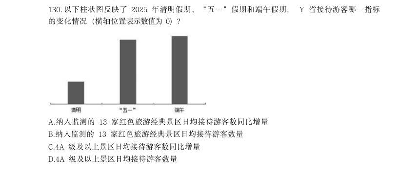

- **A.** 纳入监测的13 家红色旅游经典景区日均接待游客数同比增量
- **B.** 纳入监测的13 家红色旅游经典景区日均接待游客数量
- **C.** 4A 级及以上景区日均接待游客数同比增量
- **D.** 4A 级及以上景区日均接待游客数量

**答案：A**

### 2025 湖北·统一卷　第 104 题　（基期量计算（综合））
> 材料：进行分析、比较、计算和判断处理。 2023年,我国数字经济规模持续扩大。数字经济核心产业增加值超过12万亿元,约占GDP的10%。电子信 息制造业增加值同比增长3.4%;电信业务收入1.68万亿元;互联网业务收入1.75万亿元;软件业务收入12.33万 亿元。以云计算、大数据、物联网等为代表的新兴业务中,云计算、大数据业务收入同比增长37.5%,物联网 业务收入同比增长20.3%。高技术制造业、高技术服务业投资分别同比增长9.9%、11.4%。高技术制造业中,计 算机、通信和…

C.每一物种的生产或捕获方法的差异,会给气候变化带来很大不同 D.鼓励以海产的“蓝色”饮食替代其他动物蛋白,或可帮助应对气候变化 某市举办智能数控技能大赛、小周、小吴、小郑、小王、小钱进入了决赛。比赛后,有记者询问他们的感受, 他们回答如下: 小周:小郑整场发挥得都很好,我觉得冠军非他莫属; 小吴:我觉得冠军一定会在我、小周、小钱三人之中产生; 小郑:我自我感觉不好,这次与冠军无缘了; 小钱:我连季军都拿不到; 小王:我不会是亚军。 已知本次比赛产生了冠军、亚军、季军各一人,且在五人中只有一个人的回答与比赛结果相符。那么,获得亚 军的是:

- **A.** 小王
- **B.** 小吴
- **C.** 小郑
- **D.** 小钱

**答案：暂缺**

### 2025 湖北·统一卷　第 106 题　（基期量计算（综合））

2022年我国软件业务收入在以下哪个范围:

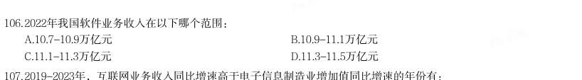

- **A.** 10.7-10.9万亿元
- **B.** 10.9-11.1万亿元
- **C.** 11.1-11.3万亿元
- **D.** 11.3-11.5万亿元

**答案：暂缺**

### 2025 湖北·统一卷　第 114 题　（基期量计算（综合））
> 材料：下列饼状图可以描述表1中2023年上半年各板块新上市公司数量占比情况的是: 2023年,我国制浆造纸及纸制品全行业完成纸浆、纸及纸板和纸制品产量合计29139万吨,同比增长 2.63%。其中纸及纸板产量12965万吨,与2022年的12425万吨相比同比增长4.35%,增速比2022年扩大了1.71个 百分点。 2023年,全国纸及纸板消费量13165万吨,同比增长6.14%,增速比2022年扩大了8.08个百分点;人均年消 费量93.37千克,同比增长6.30%。 2023…

我国有18个省(区、市)纸及纸板产量超过100万吨,产量合计12597万吨,占全国纸及纸板总 产量的97.16%。

- **A.** 
- **B.** 
- **C.** 
- **D.** 

**答案：暂缺**

### 2025 湖北·统一卷　第 116 题　（基期量计算（综合））
> 材料：2023年全国著作权(包括作品著作权、计算机软件著作权、著作权质权)登记总量达8923901件,同比增 长40.46%,增速比上年同期增加39个百分点。根据各省、自治区、直辖市版权局和中国版权保护中心作品登记 信息统计,2023年全国共完成作品著作权登记6428277件,同比增长42.30%,登记量前五位的分别是:北京市 1101072件,同比增加53802件;山东省873826件,同比增加619459件;福建省710648件,同比增加424814件; 中国版权保护中心493…

2021年全国纸及纸板产量约为:

- **A.** 11715万吨
- **B.** 12105万吨
- **C.** 12762万吨
- **D.** 13227万吨

**答案：暂缺**

### 2025 湖北·统一卷　第 121 题　（基期量计算（综合））

2021年全国著作权登记总量约为:

- **A.** 626万件
- **B.** 656万件
- **C.** 685万件
- **D.** 728万件

**答案：暂缺**

### 2025 湖北·统一卷　第 123 题　（基期量计算（综合））

2022年美术作品、摄影作品、文字作品的著作权登记量共约:

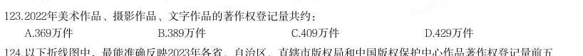

- **A.** 369万件
- **B.** 389万件
- **C.** 409万件
- **D.** 429万件

**答案：暂缺**

### 2025 湖北·统一卷　第 125 题　（基期量计算（综合））

不能从上述资料中推出的是:

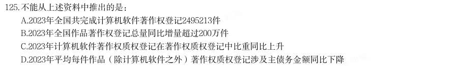

- **A.** 2023年全国共完成计算机软件著作权登记2495213件
- **B.** 2023年全国作品著作权登记总量同比增量超过200万件
- **C.** 2023年计算机软件著作权质权登记在著作权质权登记中比重同比上升
- **D.** 2023年平均每件作品(除计算机软件之外)著作权质权登记涉及主债务金额同比下降

**答案：暂缺**

### 2025 广东·统一卷　第 71 题　（基期量计算（综合））
> 材料：【认准淘宝店铺:通关达人资料库】公考,事业编,遴选,考研,一站式备考,持续更新 应根据资料提供的信息进行分析、比较、计算和判断处理。 2013~2023年,中国深入推进能源生产和消费方式变革,能源绿色低碳发展实现历史性突破。2023年,清 洁能源消费占比26.4%,较2013年提高10.9个百分点,煤炭消费比率累计下降12.1个百分点,发电总装机容量达 29.2亿千瓦。其中,清洁能源发电装机容量达17亿千瓦,清洁能源发电约3.8万亿千瓦,占总发电量的39.7%, 比2013年…

2023年1~11月,G省社会消费品零售额约为( )万亿元。

- **A.** 4.34
- **B.** 4.43
- **C.** 4.54
- **D.** 4.63

**答案：暂缺**

### 2025 广东·统一卷　第 75 题　（基期量计算（综合））

根据资料,以下说法有误的是( )。

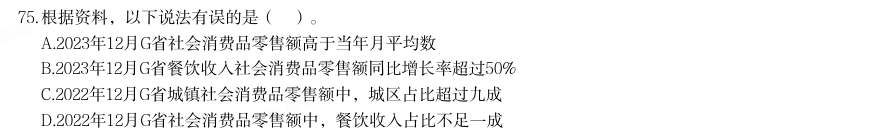

- **A.** 2023年12月G省社会消费品零售额高于当年月平均数
- **B.** 2023年12月G省餐饮收入社会消费品零售额同比增长率超过50%
- **C.** 2022年12月G省城镇社会消费品零售额中,城区占比超过九成
- **D.** 2022年12月G省社会消费品零售额中,餐饮收入占比不足一成

**答案：暂缺**

### 2025 广东·统一卷　第 76 题　（基期量计算（综合））
> 材料：【认准淘宝店铺:通关达人资料库】公考,事业编,遴选,考研,一站式备考,持续更新 中国能源转型为全球能源转型作出重要贡献,2023年中国能源转型投资达6760亿美元,是全球能源转型投 资最多的国家。十年来,中国向全球提供优质的清洁能源产品和服务,有力促进全球风电,光伏成本大幅下 降,中国与100多个国家和地区开展绿色能源项目合作,2023年出口风电光伏产品助力其他国家减排二氧化碳 约8.1亿吨。中国新能源产业丰富了全球供给,缓解了全球通胀压力,助力全球应对气候变化和绿色转型。…

以下判断正确的是( )。

- **A.** 我国清洁能源消费比重已经超过煤炭消费比重
- **B.** 我国清洁能源发电装机容量不到发电总装机容量的一半
- **C.** 我国清洁能源发电量占总发电量的比重较10年前翻了一番
- **D.** 我国总发电量超过9万亿千瓦时

**答案：暂缺**

### 2025 广东·统一卷　第 77 题　（基期量计算（综合））

根据资料,以下说法有误的是( )。

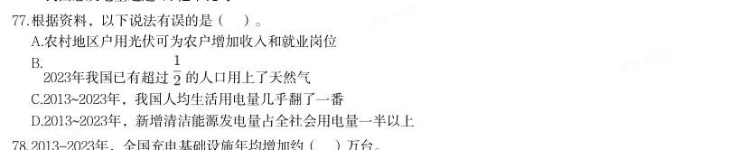

- **A.** 农村地区户用光伏可为农户增加收入和就业岗位
- **B.** 

**答案：暂缺**

### 2025 广东·统一卷　第 79 题　（基期量计算（综合））

中国新能源产业对世界的影响,主要包括( )。 1丰富全球供给 2缓解全球通胀压力 3应对气候变化和绿色转型 4支撑经济社会高质量发展

- **A.** 123
- **B.** 134
- **C.** 234
- **D.** 1234

**答案：暂缺**

### 2025 国考·副省级　第 116 题　（基期量计算（综合））

分析、比较、计算和判断处理。 (一) 截至2023年末,我国集成电路布图设计登记累计申请93147件,发证72378件,2024年1-4月,我国集成电 路布图设计登记申请3503件,发证4189件。 截至2014年末,我国集成电路布图设计登记累计申请量在以下哪个范围内?

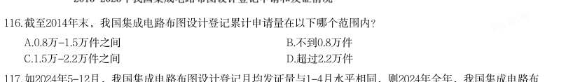

- **A.** 0.8万-1.5万件之间
- **B.** 不到0.8万件
- **C.** 1.5万-2.2万件之间
- **D.** 超过2.2万件

**答案：A**

### 2025 国考·副省级　第 119 题　（基期量计算（综合））

2015-2023年,我国集成电路布图设计登记当年发证量与当年申请量比值大于0.9的年份有几个?

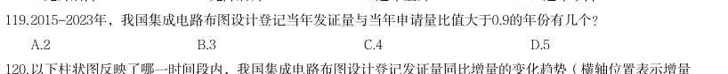

- **A.** 2
- **B.** 3
- **C.** 4
- **D.** 5

**答案：A**

### 2025 国考·副省级　第 121 题　（基期量计算（综合））

(二) 2019-2023年我国厨房小家电全品类零售总量在以下哪个范围?

- **A.** 12亿台-13亿台之间
- **B.** 13亿台-14亿台之间
- **C.** 不到12亿台
- **D.** 超过14亿台

**答案：A**

### 2025 国考·副省级　第 123 题　（基期量计算（综合））

资料所列厨房小家电品类当中,2023年零售额超过全品类零售总额10%的有几类?

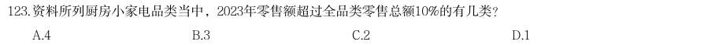

- **A.** 4
- **B.** 3
- **C.** 2
- **D.** 1

**答案：C**

### 2025 国考·副省级　第 133 题　（基期量计算（综合））

2022年三季度,人民银行清算总中心系统境内外币支付系统处理业务日均处理金额在以下哪个范围内?

- **A.** 超过80亿美元
- **B.** 70亿-80亿美元之间
- **C.** 60亿-70亿美元之间
- **D.** 不到60亿美元

**答案：B**

### 2025 国考·副省级　第 135 题　（基期量计算（综合））

关于2023年三季度支付系统运行情况,不能从上述资料中推出的是:

- **A.** 网上支付跨行清算系统处理业务平均每笔金额同比增长了5%以上
- **B.** 银联跨行支付系统处理业务金额同比增量高于城银清算支付清算系统处理业务金额同比增量
- **C.** 大额实时支付系统处理业务金额占人民银行清算总中心系统处理支付业务总金额的95%以上
- **D.** 人民币跨境支付系统处理业务笔数同比增长了40万笔以上

**答案：C**

### 2025 国考·地市级　第 115 题　（基期量比较）

以下饼状图中,最能准确反映2019-2023年五批次公示的专精特新“小巨人”上市企业中,第一批次(黑 色)、第二批次(横线)、第三批次(竖线)、第四批次(白色)和第五批次(网格)企业数量比例关系的 是:

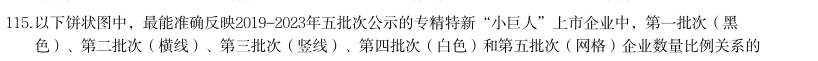

- **A.** 
- **B.** 
- **C.** 
- **D.** 

**答案：B**

### 2025 国考·地市级　第 116 题　（基期量计算（综合））

(二) 2021-2023年,Z省各年律师人数与律师事务所总数的比值:

- **A.** 先升后降
- **B.** 先降后升
- **C.** 持续下降
- **D.** 持续上升

**答案：D**

### 2025 国考·地市级　第 121 题　（基期量计算（综合））

(三) 注:上座率 2023年12月,资料中电影总放映场次最多的三个城市票房之和在以下哪个范围内?

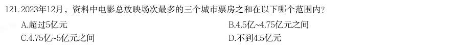

- **A.** 超过5亿元
- **B.** 4.5亿~4.75亿元之间
- **C.** 4.75亿~5亿元之间
- **D.** 不到4.5亿元

**答案：C**

### 2025 国考·地市级　第 127 题　（基期量计算（综合））

2023年一季度,东部地区外贸进口额约为多少万亿元?

- **A.** 2.2
- **B.** 2.8
- **C.** 3.4
- **D.** 4.0

**答案：C**

### 2025 国考·行政执法　第 118 题　（基期量计算（综合））

2021-2023年,Z省各年律师人数与律师事务所总数的比值:

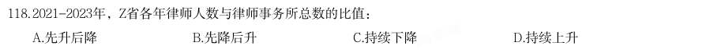

- **A.** 先升后降
- **B.** 先降后升
- **C.** 持续下降
- **D.** 持续上升

**答案：D**

### 2024 湖北·统一卷　第 106 题　（基期量计算（综合））

分析、比较、计算和判断处理。 (一) 2019~2022年全国体育场地面积增长最快的年份是:

- **A.** 2019年
- **B.** 2020年
- **C.** 2021年
- **D.** 2022年

**答案：A**

### 2024 湖北·统一卷　第 109 题　（基期量计算（综合））

2022年,按运动项目划分场地数量之和最接近全国体育场地数量25%的是:

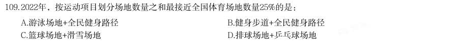

- **A.** 游泳场地+全民健身路径
- **B.** 健身步道+全民健身路径
- **C.** 篮球场地+滑雪场地
- **D.** 排球场地+乒乓球场地

**答案：D**

### 2024 湖北·统一卷　第 111 题　（基期量计算（综合））

(二) 表格所列国家中,相较于2012年,2022年全球创新指数增长最快的国家是:

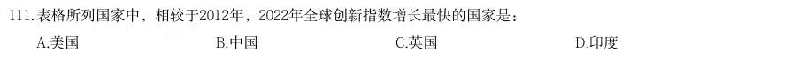

- **A.** 美国
- **B.** 中国
- **C.** 英国
- **D.** 印度

**答案：B**

### 2024 湖北·统一卷　第 117 题　（基期量计算（综合））

2021年银行机构存续的理财产品存续规模约为多少万亿元?

- **A.** 5.4
- **B.** 6.7
- **C.** 10.5
- **D.** 11.8

**答案：D**

### 2024 湖北·统一卷　第 124 题　（基期量计算（综合））

2022年我国废有色金属中废铅回收重量约为:

- **A.** 261万吨
- **B.** 275万吨
- **C.** 285万吨
- **D.** 291万吨

**答案：C**

### 2024 广东·统一卷　第 72 题　（基期量计算（综合））

2023年,全国技工院校在校生人数( )。

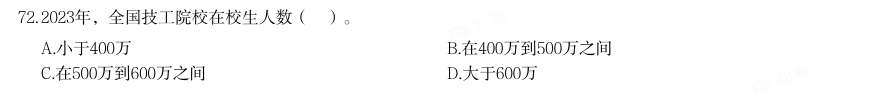

- **A.** 小于400万
- **B.** 在400万到500万之间
- **C.** 在500万到600万之间
- **D.** 大于600万

**答案：A**

### 2024 广东·统一卷　第 73 题　（基期量计算（综合））

关于广东技能人才培养,以下表述不准确的是( )。

- **A.** 注重产教融合、校企合作
- **B.** 实现教学与企业岗位无缝对接
- **C.** 精准培养产业急需人才
- **D.** 强调提升全体学生技能竞赛成绩

**答案：C**

### 2024 广东·统一卷　第 74 题　（基期量计算（综合））

以下不属于广东建设省级重点专业和特色专业所面向产业的是( )。

- **A.** 传统手工业
- **B.** 先进制造业
- **C.** 战略性新兴产业
- **D.** 现代服务业

**答案：D**

### 2024 广东·统一卷　第 75 题　（基期量计算（综合））

关于广东技工,以下说法有误的是( )。

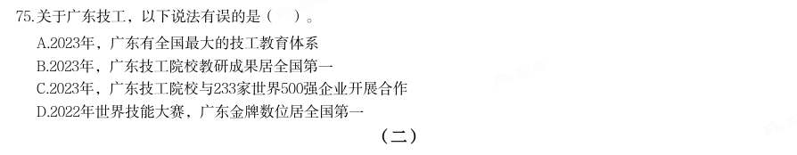

- **A.** 2023年,广东有全国最大的技工教育体系
- **B.** 2023年,广东技工院校教研成果居全国第一
- **C.** 2023年,广东技工院校与233家世界500强企业开展合作
- **D.** 2022年世界技能大赛,广东金牌数位居全国第一

**答案：A**

### 2024 广东·统一卷　第 76 题　（已知现期与增长量求基期）
> 材料：(二) 2022年,全球对外直接投资流量1.5万亿美元,比上年下降14%。其中发达经济体对外直接投资1.03万亿美 元,比上年下降17.2%;发展中经济体对外直接投资4589亿美元,比上年下降5.4%。…

2013-2022年,中国对外直接投资流量年均增加约( )亿美元。

- **A.** 55.3
- **B.** 61.4
- **C.** 67.5
- **D.** 73.6

**答案：B**

### 2024 广东·统一卷　第 87 题　（基期量计算（综合））

2020年,全国用于县域农业农村信息化建设的社会资本投入( )(假设2020年县的数量与2021年相同)。

- **A.** 不到800亿元
- **B.** 在800亿元到850亿元之间
- **C.** 在850亿元到900亿元之间
- **D.** 超过900亿元

**答案：暂缺**

### 2024 国考·副省级　第 116 题　（基期量比较）

分析、比较、计算和判断处理。 (一) 2022年,中型灌区改善灌溉面积与新增恢复灌溉面积比值最大的中部省份是:

- **A.** 山西
- **B.** 湖北
- **C.** 河南
- **D.** 江西

**答案：C**

### 2024 国考·副省级　第 121 题　（基期量比较）

(二) 2017~2022年我国马铃薯出口量最高的年份,当年出口额在这6年中排名( )。

- **A.** 第一
- **B.** 第二
- **C.** 第三
- **D.** 第四

**答案：C**

### 2024 国考·副省级　第 122 题　（基期量计算（综合））

2016~2020年,我国马铃薯总产量在以下哪个范围内?

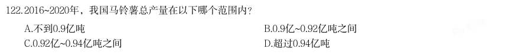

- **A.** 不到0.9亿吨
- **B.** 0.9亿~0.92亿吨之间
- **C.** 0.92亿~0.94亿吨之间
- **D.** 超过0.94亿吨

**答案：A**

### 2024 国考·副省级　第 127 题　（已知现期与增长率求基期）

2018-2022年,全国电化学储能电站年末总能量同比增长100%以上的年份有几个?

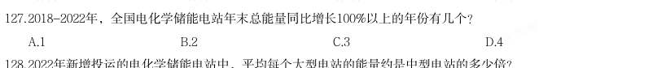

- **A.** 1
- **B.** 2
- **C.** 3
- **D.** 4

**答案：C**

### 2024 国考·地市级　第 114 题　（基期量计算（综合））

2022年,S省各级12315工作机构接收诉求量最少的季度是:

- **A.** 第一季度
- **B.** 第二季度
- **C.** 第三季度
- **D.** 第四季度

**答案：A**

### 2024 国考·地市级　第 121 题　（基期量计算（综合））

(三) 2016~2020年,我国马铃薯总产量在以下哪个范围内?

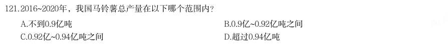

- **A.** 不到0.9亿吨
- **B.** 0.9亿~0.92亿吨之间
- **C.** 0.92亿~0.94亿吨之间
- **D.** 超过0.94亿吨

**答案：A**

### 2024 国考·地市级　第 123 题　（基期量比较）

2017~2022年我国马铃薯出口量最高的年份,当年出口额在这6年中排名( )。

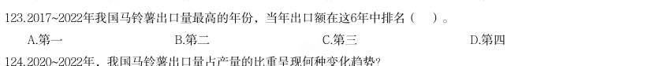

- **A.** 第一
- **B.** 第二
- **C.** 第三
- **D.** 第四

**答案：C**

### 2024 国考·地市级　第 126 题　（基期量计算（综合））

(四) 2017~2022年,全国移动数据流量业务收入总额在以下哪个范围内?

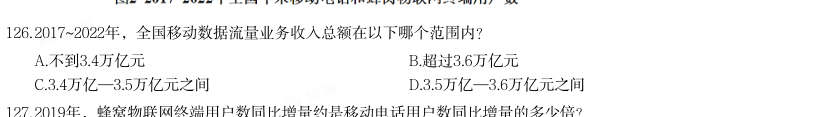

- **A.** 不到3.4万亿元
- **B.** 超过3.6万亿元
- **C.** 3.4万亿—3.5万亿元之间
- **D.** 3.5万亿—3.6万亿元之间

**答案：B**

### 2024 国考·行政执法　第 118 题　（基期量比较）

2022年,中型灌区改善灌溉面积与新增恢复灌溉面积比值最大的中部省份是:

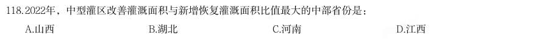

- **A.** 山西
- **B.** 湖北
- **C.** 河南
- **D.** 江西

**答案：C**

### 2024 国考·行政执法　第 128 题　（基期量计算（综合））

2022年12月,全国规模以上工业企业的1工业机器人完成产量和2服务机器人完成产量:

- **A.** 均高于1~11月的月均水平
- **B.** 均低于1~11月的月均水平
- **C.** 仅1高于1~11月的月均水平
- **D.** 仅2高于1~11月的月均水平

**答案：C**

### 2023 广东·乡镇　第 98 题　（已知现期与增长率求基期）

2022 年,表中所呈现的农村居民消费支出的类别中,同比增加超过120 元的有( ) 项。

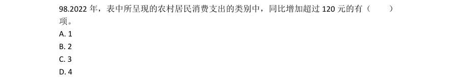

- **A.** 1
- **B.** 2
- **C.** 3
- **D.** 4

**答案：B**

### 2023 广东·县级　第 86 题　（基期量计算（综合））

2020 年,广东省省本级财政科学技术支出为( )亿元。

- **A.** 83.96
- **B.** 102.64
- **C.** 122.32
- **D.** 132.67

**答案：A**

### 2023 广东·县级　第 94 题　（基期量计算（综合））

2022 年,我国城镇居民与农村居民人数之比最接近( )。

- **A.** 2:3
- **B.** 3:2
- **C.** 3:4
- **D.** 4:3

**答案：D**

### 2023 国考·行政执法　第 116 题　（基期量计算（综合））

(二) 2021年四季度,Z省有几个市的中心城市道路机动车依法礼让率高于上季度水平?

- **A.** 5
- **B.** 6
- **C.** 7
- **D.** 8

**答案：C**

### 2023 国考·行政执法　第 119 题　（基期量比较）

如单纯从统计数据判断,则2021年四季度B市在提升中心城市道路交通守法率方面,工作相比三季度最有成效 的是:

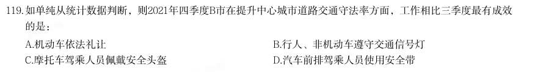

- **A.** 机动车依法礼让
- **B.** 行人、非机动车遵守交通信号灯
- **C.** 摩托车驾乘人员佩戴安全头盔
- **D.** 汽车前排驾乘人员使用安全带

**答案：A**

### 2023 国考·行政执法　第 120 题　（基期量计算（综合））

以下条形图反映了2021年四季度Z省哪个城市中心城市道路交通守法率五项指标之间的大小关系?

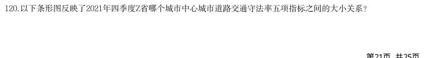

- **A.** E市
- **B.** F市
- **C.** G市
- **D.** H市

**答案：B**

### 2023 国考·行政执法　第 121 题　（基期量计算（综合））

(三) 2017-2021年,我国总计进口了约多少亿吨木材?

- **A.** 1.4
- **B.** 1.3
- **C.** 1.2
- **D.** 1.1

**答案：D**

### 2023 国考·行政执法　第 130 题　（已知现期与增长率求基期）

2020年,中国对“一带一路”沿线国家纺织品服装贸易顺差额约为多少亿美元?

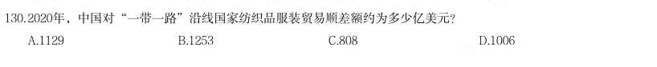

- **A.** 1129
- **B.** 1253
- **C.** 808
- **D.** 1006

**答案：C**

### 2022 广东·乡镇　第 86 题　（已知现期与增长量求基期）
> 材料：基层群众性自治组织是我国在城市和农村按居民的居住地区建立起来的居民委员会或村民委员会,是城市居 民或农村村民自我管理、自我教育、自我服务的组织。 截止2020 年底,全国基层群众性自治组织共计61.5 万个,同比减少4.35%。…

2020 年,全国基层群众性自治组织较上年减少( )万个。

- **A.** 1.4
- **B.** 2.8
- **C.** 4.2
- **D.** 5.6

**答案：B**

### 2022 广东·乡镇　第 91 题　（基期量计算（综合））

“十三五”期间,我国平均每公顷森林蓄积量达到( )立方米。

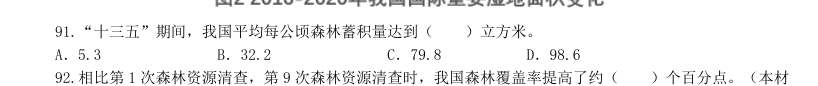

- **A.** 5.3
- **B.** 32.2
- **C.** 79.8
- **D.** 98.6

**答案：C**

### 2022 广东·乡镇　第 95 题　（已知现期与增长率求基期）

根据以上资料,下列说法不准确的是:

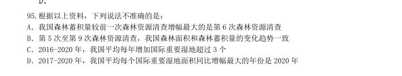

- **A.** 我国森林蓄积量较前一次森林资源清查增幅最大的是第6 次森林资源清查
- **B.** 第5 次至第9 次森林资源清查,我国森林面积和森林蓄积量的变化趋势一致
- **C.** 2016-2020 年,我国平均每年增加国际重要湿地超过3 个
- **D.** 2017-2020 年,我国平均每个国际重要湿地面积同比增幅最大的年份是2020 年

**答案：暂缺**

### 2022 广东·县级　第 90 题　（已知现期与增长率求基期）

根据以上资料,下列说法不准确的是:

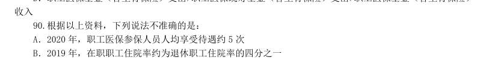

- **A.** 2020 年,职工医保参保人员人均享受待遇约5 次
- **B.** 2019 年,在职职工住院率约为退休职工住院率的四分之一
- **C.** 2020 年,三类职工医保参保人员中,灵活就业等其他人员参保人数同比增速最快
- **D.** 若职工医保个人账户收入和支出的年同比增幅保持不变,则2021 年个人账户当期结存不足2000 亿元

**答案：D**

### 2022 广东·县级　第 91 题　（基期量计算（综合））

“十三五”期间,我国平均每公顷森林蓄积量达到( )立方米。

- **A.** 5.3
- **B.** 32.2
- **C.** 79.8
- **D.** 98.6

**答案：C**

### 2022 广东·县级　第 95 题　（已知现期与增长率求基期）

根据以上资料,下列说法不准确的是:

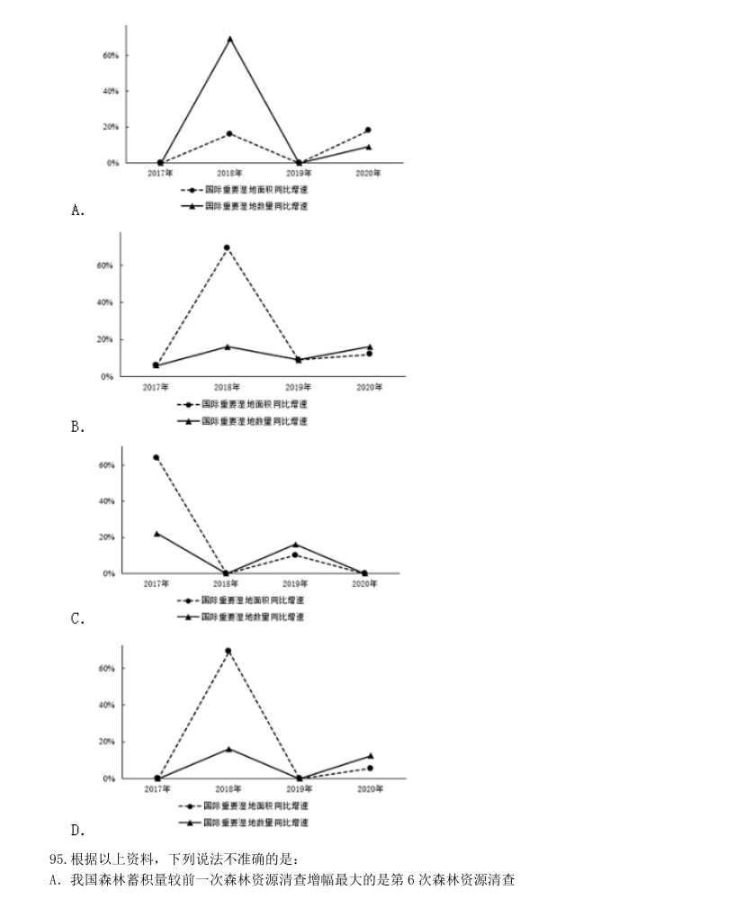

- **A.** 我国森林蓄积量较前一次森林资源清查增幅最大的是第6 次森林资源清查
- **B.** 第5 次至第9 次森林资源清查,我国森林面积和森林蓄积量的变化趋势一致
- **C.** 2016-2020 年,我国平均每年增加国际重要湿地超过3 个
- **D.** 2017-2020 年,我国平均每个国际重要湿地面积同比增幅最大的年份是2020 年

**答案：暂缺**

### 2022 广东·县级　第 100 题　（基期量计算（综合））

根据以上资料,下列说法准确的是:

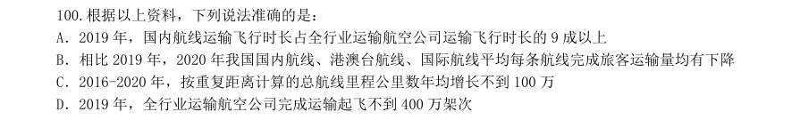

- **A.** 2019 年,国内航线运输飞行时长占全行业运输航空公司运输飞行时长的9 成以上
- **B.** 相比2019 年,2020 年我国国内航线、港澳台航线、国际航线平均每条航线完成旅客运输量均有下降
- **C.** 2016-2020 年,按重复距离计算的总航线里程公里数年均增长不到100 万
- **D.** 2019 年,全行业运输航空公司完成运输起飞不到400 万架次

**答案：暂缺**

### 2022 国考·副省级　第 116 题　（基期量计算（综合））

(单选题)2019 年,中国IC 先进封装市场规模约为多少亿元?

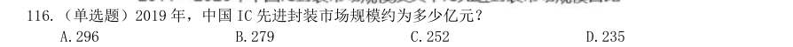

- **A.** 296
- **B.** 279
- **C.** 252
- **D.** 235

**答案：A**

### 2022 国考·副省级　第 117 题　（基期量计算（综合））

(单选题)“十三五”(2016—2020)年期间,中国IC 封装市场总规模:

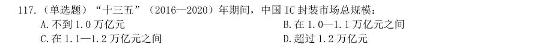

- **A.** 不到1.0 万亿元
- **B.** 在1.0—1.1 万亿元之间
- **C.** 在1.1—1.2 万亿元之间
- **D.** 超过1.2 万亿元

**答案：B**

### 2022 国考·副省级　第 121 题　（基期量计算（综合））

(单选题)表中所列食品类别中,2021 年第一季度所有抽检样本全部合格的有几类?

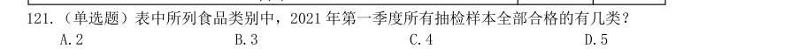

- **A.** 2
- **B.** 3
- **C.** 4
- **D.** 5

**答案：B**

### 2022 国考·副省级　第 131 题　（已知现期与增长率求基期）
> 材料：亿立方米,同比增长7.44%;中石化供应2.45 亿立方米,同比增长26.29%。从用气结构看:民用气为3.98 亿立方米,同比增长16.72%;CNG 用气0.64 亿立方米,同比下降7.25%;工业用气5.05 亿立方米,同比增 长10.75%。 2020 年,C 市天然气用量为107.47 亿立方米,同比增长3.83%。其中,中石油供应73.96 亿立方米,同 比增长1.72%;中石化供应33.51 亿立方米,同比增长8.8%。从用气结构看:民用气为33.75 亿立方米…

从用气结构看:民用气为7.78 亿立方 米,同比增长12.75%;CNG 用气1.14 亿立方米,同比增长44.3%;工业用气10.29 亿立方米,同比增长 10.17%。 (单选题)2021 年1 月,C 市天然气用量比上月:

- **A.** 增加了0.2 亿立方米以上
- **B.** 减少了不到0.2 亿立方米
- **C.** 减少了0.2 亿立方米以上
- **D.** 增加了不到0.2 亿立方米

**答案：A**

### 2022 国考·副省级　第 133 题　（已知现期与增长率求基期）

(单选题)2019—2020 年,C 市CNG 用气总量约为多少亿立方米?

- **A.** 15
- **B.** 17
- **C.** 11
- **D.** 13

**答案：A**

### 2022 国考·副省级　第 135 题　（基期量计算（综合））

(单选题)以下柱状图反映了C 市天然气2020 年12 月—2021 年2 月间哪一数值的变化趋势?

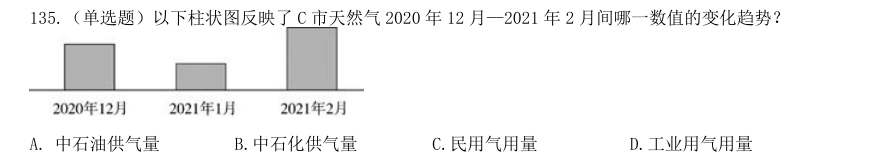

- **A.** 中石油供气量
- **B.** 中石化供气量
- **C.** 民用气用量
- **D.** 工业用气用量

**答案：B**

### 2022 国考·地市级　第 116 题　（基期量计算（综合））

2019 年,中国IC 先进封装市场规模约为多少亿元?

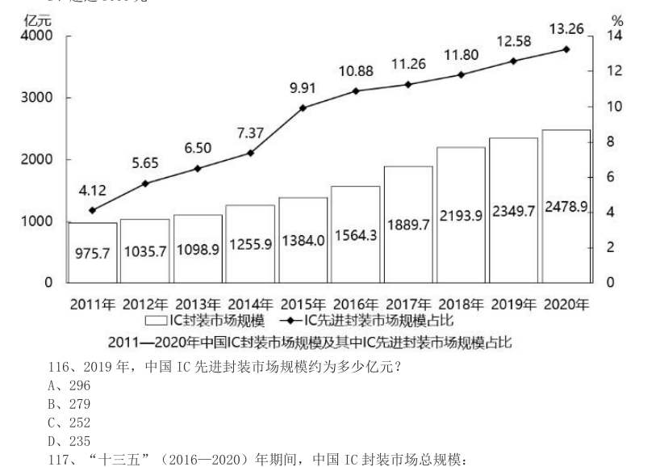

- **A.** 296
- **B.** 279
- **C.** 252
- **D.** 235

**答案：A**

### 2022 国考·地市级　第 117 题　（基期量计算（综合））

“十三五”(2016—2020)年期间,中国IC 封装市场总规模:

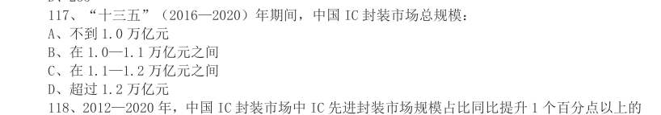

- **A.** 不到1.0 万亿元
- **B.** 在1.0—1.1 万亿元之间
- **C.** 在1.1—1.2 万亿元之间
- **D.** 超过1.2 万亿元

**答案：B**

### 2022 国考·地市级　第 121 题　（基期量计算（综合））

表中所列食品类别中,2021 年第一季度所有抽检样本全部合格的有几类?

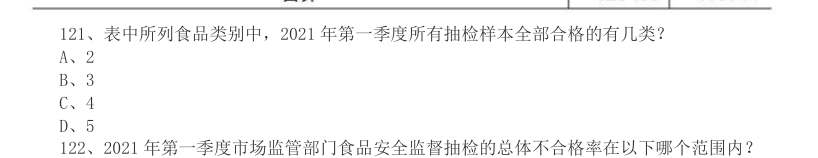

- **A.** 2
- **B.** 3
- **C.** 4
- **D.** 5

**答案：B**

### 2022 国考·地市级　第 126 题　（已知现期与增长率求基期）
> 材料：7.22 亿立方米,同比增长7.44%;中石化供应2.45 亿立方米,同比增长26.29%。从用气结构看:民用 气为3.98 亿立方米,同比增长16.72%;CNG 用气0.64 亿立方米,同比下降7.25%;工业用气5.05 亿立 方米,同比增长10.75%。 2020 年,C 市天然气用量为107.47 亿立方米,同比增长3.83%。其中,中石油供应73.96 亿立方米, 同比增长1.72%;中石化供应33.51 亿立方米,同比增长8.8%。从用气结构看:民用气为33.7…

从用气结构看:民用气为7.78 亿立方米,同比增长12.75%;CNG 用气1.14 亿立方米,同比增长44.3%;工业用气10.29 亿立方米,同 比增长10.17%。 2021 年1 月,C 市天然气用量比上月:

- **A.** 增加了0.2 亿立方米以上
- **B.** 减少了不到0.2 亿立方米
- **C.** 减少了0.2 亿立方米以上
- **D.** 增加了不到0.2 亿立方米

**答案：A**

### 2022 国考·地市级　第 128 题　（已知现期与增长率求基期）

2019—2020 年,C 市CNG 用气总量约为多少亿立方米?

- **A.** 15
- **B.** 17
- **C.** 11
- **D.** 13

**答案：A**

### 2022 国考·地市级　第 130 题　（基期量计算（综合））

以下柱状图反映了C 市天然气2020 年12 月—2021 年2 月间哪一数值的变化趋势?

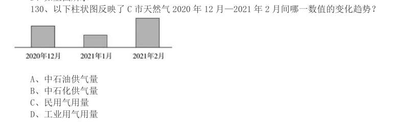

- **A.** 中石油供气量
- **B.** 中石化供气量
- **C.** 民用气用量
- **D.** 工业用气用量

**答案：B**

### 2022 国考·行政执法　第 118 题　（基期量计算（综合））

(单选题)2020 年下半年,环保举报的受理率超过75%的月份有几个?

- **A.** 3
- **B.** 4
- **C.** 5
- **D.** 6

**答案：C**

### 2022 国考·行政执法　第 119 题　（基期量计算（综合））

(单选题)如同一个月内各类举报的受理率彼此相同,则2020 年12 月通过电话的环保举报被受理的件 数在以下哪个范围内?

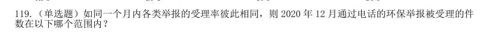

- **A.** 低于7501 件
- **B.** 7501—8500 件之间
- **C.** 8501—9500 件之间
- **D.** 高于9500 件

**答案：C**

### 2022 国考·行政执法　第 127 题　（基期量计算（综合））

(单选题)2021 年4—5 月,全国共立电信网络诈骗案件约多少万起?

- **A.** 12
- **B.** 14
- **C.** 16
- **D.** 18

**答案：D**

### 2021 广东·乡镇　第 86 题　（基期量计算（综合））

2019 年G 省平均每个农业科研和科技开发机构的高级职称人数最接近( )。

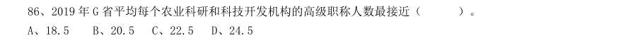

- **A.** 18.5
- **B.** 20.5
- **C.** 22.5
- **D.** 24.5

**答案：暂缺**

### 2021 广东·乡镇　第 89 题　（基期量计算（综合））

2015-2019 年,G 省农业科研和科技开发机构发表科学论文篇数最多的一年是( )。

- **A.** 2015 年
- **B.** 2016 年
- **C.** 2017 年
- **D.** 2019 年

**答案：暂缺**

### 2021 广东·乡镇　第 98 题　（基期量比较）

以下农产品类别中,2019 年上半年我国进出口总额最高的是:

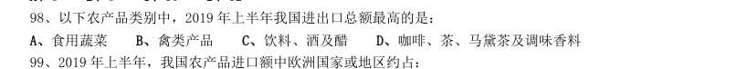

- **A.** 食用蔬菜
- **B.** 禽类产品
- **C.** 饮料、酒及醋
- **D.** 咖啡、茶、马黛茶及调味香料

**答案：暂缺**

### 2021 国考·副省级　第 117 题　（基期量计算（综合））

表1 中“(?)”处应当填入的数字最可能是:

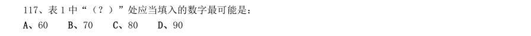

- **A.** 60
- **B.** 70
- **C.** 80
- **D.** 90

**答案：暂缺**

### 2021 国考·副省级　第 120 题　（基期量计算（综合））

关于2019 年直排海污染源状况,不能从上述资料中推出的是:

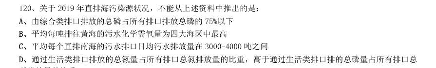

- **A.** 由综合类排口排放的总磷占所有排口排放总磷的75%以下
- **B.** 平均每吨排往黄海的污水化学需氧量为四大海区中最高
- **C.** 平均每个直排南海的污水排口日均污水排放量在3000-4000 吨之间
- **D.** 通过生活类排口排放的总氮量占所有排口总氮排放量的比重,高于通过生活类排口排的总磷量占所有排口总

**答案：暂缺**

### 2021 国考·副省级　第 132 题　（基期量计算（综合））

2019 年1—2 月,我国对外承包工程月均完成营业额比月均新签合同额:

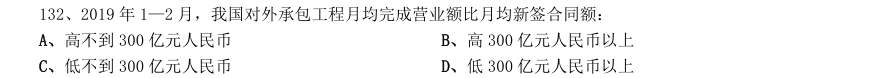

- **A.** 高不到300 亿元人民币
- **B.** 高300 亿元人民币以上
- **C.** 低不到300 亿元人民币
- **D.** 低300 亿元人民币以上

**答案：暂缺**

### 2021 国考·地市级　第 116 题　（已知现期与增长率求基期）

2014—2019 年间,全国地铁运营线路长度同比增长20%以上的年份有几个?

- **A.** 1
- **B.** 2
- **C.** 3
- **D.** 4

**答案：A**

### 2021 国考·地市级　第 123 题　（基期量计算（综合））

如提供视力残疾康复服务的残疾人康复机构中,同时提供听力言语残疾康复服务的机构比不提供该服务的 机构多20%,则2019 年末全国有多少家残疾人康复机构不提供以上两种康复服务中的任意一种?

- **A.** 不到7300 家
- **B.** 7300—7600 家之间
- **C.** 7600—7900 家之间
- **D.** 超过7900 家

**答案：B**

### 2021 国考·地市级　第 126 题　（已知现期与增长率求基期）
> 材料：2019 年上半年,我国服务进出口总额达到26124.6 亿元,同比增长2.6%。其中,出口总额9333.7 亿元,同 比增长9.0%;进口总额16790.8 亿元,同比下降0.6%。服务进出口总额占对外贸易总额的比重达到15.1%,比 2018 年全年高出0.5 个百分点。 2019 年全年,我国服务进出口总额54152.9 亿元,同比增长2.8%。其中,出口总额19564.0 亿元,同比增 长8.9%;进口总额34588.9 亿元,同比减少0.4%。 2019 年上半年,…

从具体领域看,个人文化娱乐服务,电信、 计算机和信息服务,金融服务进出口总额分别同比增长19.4%、18.9%、18.7%。 2019 年下半年,我国服务进出口贸易状况为:

- **A.** 顺差5000 亿元以内
- **B.** 顺差5000 亿元以上
- **C.** 逆差5000 亿元以内
- **D.** 逆差5000 亿元以上

**答案：D**

### 2021 国考·地市级　第 128 题　（已知现期与增长率求基期）

2018 年,我国对外贸易总额约为多少万亿元?

- **A.** 17
- **B.** 25
- **C.** 36
- **D.** 48

**答案：C**

### 2020 湖北·统一卷　第 106 题　（基期量计算（综合））

截至2017 年底,中国人工智能市场规模约为:

- **A.** 141.1 亿元
- **B.** 152.1 亿元
- **C.** 156.1 亿元
- **D.** 164.1 亿元

**答案：B**

### 2020 湖北·统一卷　第 118 题　（基期量计算（综合））

2016 年,A 市旅游服务价值年值比农林牧渔业总产值年值多:

- **A.** 494.46 亿元
- **B.** 462.79 亿元
- **C.** 441.85 亿元
- **D.** 404.35 亿元

**答案：暂缺**

### 2020 湖北·统一卷　第 121 题　（基期量计算（综合））
> 材料：2019 年6 月,全国发行地方政府债券8996 亿元,同比增长68.37%,环比增长195.63%。其中,发行一般债 券3178 亿元,同比减少28.33%,环比增长117.08%,发行专项债券5818 亿元,同比增长540.04%,环比增长 268.46%;按用途划分,发行新增债券7170 亿元,同比增长127.11%,环比增长332.71%,发行置换债券和再融 资债券1826 亿元,同比减少16.47%,环比增长31.75%。 2019 年6 月,地方政府债券平均发行期…

2019 年6 月,全国发行的地方政府债券比2018 年6 月多约:

- **A.** 6151 亿元
- **B.** 5953 亿元
- **C.** 3653 亿元
- **D.** 3043 亿元

**答案：暂缺**

### 2020 湖北·统一卷　第 122 题　（基期量计算（综合））

2018 年1 至5 月,全国发行地方政府债券约:

- **A.** 23029 亿元
- **B.** 19376 亿元
- **C.** 14109 亿元
- **D.** 8766 亿元

**答案：暂缺**

### 2020 湖北·统一卷　第 123 题　（基期量计算（综合））

2018 年6 月,发行置换债券和再融资债券约为:

- **A.** 3157 亿元
- **B.** 2186 亿元
- **C.** 1657 亿元
- **D.** 1386 亿元

**答案：暂缺**

### 2020 湖北·统一卷　第 125 题　（基期量计算（综合））

不能从上述资料推出的是:

- **A.** 截至2019 年6 月末,地方政府一般债务余额和专项债务余额都控制在限额之内
- **B.** 2019 年1 至6 月,地方政府一般债券的平均发行利率高于专项债券0.1 个百分点
- **C.** 2019 年5 月,地方政府新增债券的平均发行期限比置换债券和再融资债券短
- **D.** 2019 年地方一般债务限额比专项债务限额多25404.14 亿元

**答案：暂缺**

### 2020 广东·乡镇　第 89 题　（基期量比较）

下列选项中,城镇地区互联网普及率与农村相差最大的是:

- **A.** 2015 年
- **B.** 2016 年
- **C.** 2017 年
- **D.** 2018 年

**答案：暂缺**

### 2020 广东·乡镇　第 96 题　（基期量计算（综合））
> 材料：2019 年全国农村网络零售额从2014 年的1800 亿元增加至逾1.7 万亿元,占全国网络零售总额的16.1%, 较上年略有提升;同比增长19.1%,高于全国网络零售总额增长率2.6 个百分点。 分地区看,东、中、西部和东北地区农村网络零售额分别占全国农村网络零售额的76.6%、12.0%,9.4%和 2.0%,同比增长分别为19.8%,17.1%,17.6%和10.2%。 2019 年,电子商务进农村综合示范工作聚焦脱贫攻坚和乡村振兴,取得了阶段性成果。…

2014—2019 年间,全国农村网络零售额平均每年增长约( )亿元。

- **A.** 2183.3
- **B.** 2547.1
- **C.** 3056.6
- **D.** 3820.7

**答案：暂缺**

### 2020 广东·乡镇　第 99 题　（基期量计算（综合））

2019 年全国各类农产品中,网络零售额排名前三的农产品零售额合计约为( )亿元。

- **A.** 277.1
- **B.** 739.4
- **C.** 1073.3
- **D.** 1935.8

**答案：暂缺**

### 2020 广东·县级　第 97 题　（基期量计算（综合））

与2018 年相比,2019 年广东规模以上工业企业用水量:

- **A.** 减少了约0.8 亿立方米
- **B.** 增加了约1.8 亿立方米
- **C.** 减少了约2.8 亿立方米
- **D.** 增加了约3.8 亿立方米

**答案：暂缺**

### 2020 广东·综合行政能力测验　第 86 题　（已知现期与增长率求基期）

根据2018 年的增长率预测,2019 年我国电子政务市场的规模约为( )亿元。

- **A.** 3270
- **B.** 3370
- **C.** 3470
- **D.** 3570、

**答案：B**

### 2020 广东·综合行政能力测验　第 91 题　（已知现期与增长率求基期）
> 材料：近年来,我国海洋经济呈现总体平稳的发展态势,总量再上新台阶,产业结构不断优化,新兴产业和 新业态快速成长。 2018 年,我国主要海洋产业保持稳步增长,全年实现产值33609 亿元,比上年增长 。…

2018 年我国海洋生产总值较2015 年增加了约( )。

- **A.** 
- **B.** 
- **C.** 
- **D.** 

**答案：C**

### 2020 广东·综合行政能力测验　第 92 题　（基期量计算（综合））

2018 年,我国海洋经济发展支柱产业产值约为( )万亿元。

- **A.** 1.61
- **B.** 2.36
- **C.** 2.74
- **D.** 3.32、

**答案：C**

### 2020 广东·综合行政能力测验　第 93 题　（已知现期与增长率求基期）

2017 年,我国海洋船舶工业产值约比海洋化工业产值( )亿元。

- **A.** 少50
- **B.** 少20
- **C.** 多50
- **D.** 多20、

**答案：D**

### 2020 广东·综合行政能力测验　第 96 题　（已知现期与增长率求基期）
> 材料：018 年,广东实现地区生产总值97277.77 亿元,按可比价格计算,同比增长 ,人均生产总值为 86412 元,比全国平均水平多21891 元,按年平均汇率折算,达到13058.30 美元。全省经济运行保持在合理 区间。…

2017 年广东规模以上工业增加值约占全国的( )。

- **A.** 
- **B.** 
- **C.** 
- **D.** 

**答案：C**

### 2020 广东·综合行政能力测验　第 98 题　（已知现期与增长率求基期）

2018 年全国进出口总额较2017 年增加约( )万亿元。

- **A.** 1.2
- **B.** 2.7
- **C.** 4.2
- **D.** 5.7、

**答案：B**

### 2020 广东·综合行政能力测验　第 99 题　（已知现期与增长率求基期）

2016 年广东省三大产业结构约为( )。

- **A.** 4.2:42.6:53.2
- **B.** 4.1:41.6:54.3
- **C.** 3.9:42.2:53.9
- **D.** 无法推测

**答案：A**

### 2020 国考·地市级　第 117 题　（基期量计算（综合））

2012~2015 年,中国集成电路产业累计销售额在以下哪个范围内?

- **A.** 不到1 万亿元
- **B.** 在1~1.1 万亿元之间
- **C.** 在1.1~1.2 万亿元之间
- **D.** 超过1.2 万亿元

**答案：C**

### 2020 国考·地市级　第 127 题　（已知现期与增长量求基期）

第二段中(X)处应填入的数值最可能是:

- **A.** 15.0
- **B.** 13.7
- **C.** 17.6
- **D.** 16.3

**答案：D**

### 2020 国考·地市级　第 129 题　（基期量计算（综合））

2018 年,B 市高新技术示范区规模以上高新技术企业月均收入在以下哪个范围内?

- **A.** 超过5500 亿元
- **B.** 4500~5500 亿元之间
- **C.** 3500~4500 亿元之间
- **D.** 不到3500 亿元

**答案：B**

### 2020 国考·省级　第 124 题　（基期量比较）

2018 年茶园面积最大的4 个省份中,茶叶产量也是全国前4 名的省份有几个?

- **A.** 3
- **B.** 4
- **C.** 1
- **D.** 2

**答案：A**
