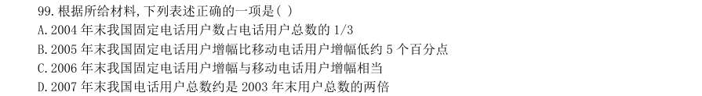
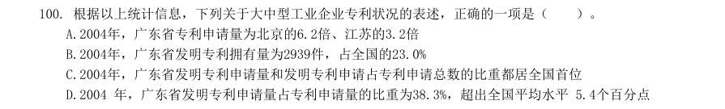
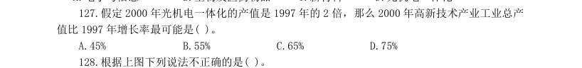

# 资料分析 · 倍数计算 · 2000 年代真题

> 所属考点：[ZL-BEI](../ZL-BEI-倍数计算.md)　｜　本片 7 题

### 2008 湖北·统一卷　第 116 题　（倍数计算（综合））
> 材料：(共20 题,参考时限20 分钟) 共20 题。针对下列文字、表或图回答问题,你应根据资料提供的信息进行分析、比较、计算、处理。 根据以下文字资料,回答116-120 题。 据某市统计,截止到2004 年底,全市16 岁以下的少年儿童总数是2272194 人,其中,学龄前期儿童为 739616 人,占其总数的33.55%。…

另据有关资料显示,在我国目前抚养一个婴儿到16 岁,农村平均需要1600 元,城市平均需要6900 元,全国平均2200 元,2004 年该市儿童消费主要体现在吃、穿、玩具等方面,不同 年龄消费费用不同:在婴儿期内食品支出占总支出的81.5%,在幼儿期内占81.2%,在学龄前期占77.9%,在 学龄期内占71.4%;在服装方面,学龄前儿童支出大体维持在总消费金额的13%左右,但进入学龄期后,占总 体的21.8%。 在我国,城市抚养一个婴儿的费用相当于农村抚养一个婴儿的( )

- **A.** 3 倍左右
- **B.** 4 倍左右
- **C.** 5 倍左右
- **D.** 2 倍左右

**答案：B**

### 2008 湖北·统一卷　第 119 题　（倍数计算（综合））

该市当年16 岁以下,学龄期以上的儿童比例是:

- **A.** 四分之一左右
- **B.** 四倍左右
- **C.** 33.55%
- **D.** 66.45%

**答案：D**

### 2008 广东·统一卷　第 99 题　（倍数计算（综合））

根据所给材料,下列表述正确的一项是( )

- **A.** 2004 年末我国固定电话用户数占电话用户总数的1/3
- **B.** 2005 年末我国固定电话用户增幅比移动电话用户增幅低约5 个百分点
- **C.** 2006 年末我国固定电话用户增幅与移动电话用户增幅相当
- **D.** 2007 年末我国电话用户总数约是2003 年末用户总数的两倍

**答案：暂缺**

### 2007 广东·统一卷　第 97 题　（倍数计算（综合））

与2000 年相比,2005 年农村装机容量提高了多少?( )

- **A.** 401 万千瓦
- **B.** 36.5%
- **C.** 57.4%D.1.4 倍

**答案：暂缺**

### 2006 广东·统一卷　第 100 题　（倍数计算（综合））

根据以上统计信息,下列关于大中型工业企业专利状况的表述,正确的一项是( )。

- **A.** 2004年,广东省专利申请量为北京的6.2倍、江苏的3.2倍
- **B.** 2004年,广东省发明专利拥有量为2939件,占全国的23.0%
- **C.** 2004年,广东省发明专利申请量和发明专利申请占专利申请总数的比重都居全国首位
- **D.** 2004 年,广东省发明专利申请量占专利申请量的比重为38.3%,超出全国平均水平 5.4个百分点

**答案：暂缺**

### 2003 国考·B卷　第 127 题　（是几倍）

假定2000 年光机电一体化的产值是1997 年的2 倍,那么2000 年高新技术产业工业总产 值比1997 年增长率最可能是( )。

- **A.** 45%
- **B.** 55%
- **C.** 65%
- **D.** 75%

**答案：C**

### 2000 国考·统一卷　第 92 题　（是几倍）

参加的运动员人数最多的一年约是参加人数最少的一年的多少倍?( )。

- **A.** 14
- **B.** 13
- **C.** 11
- **D.** 2

**答案：A**
