# 资料分析 · 倍数计算 · 2010 年代真题

> 所属考点：[ZL-BEI](../ZL-BEI-倍数计算.md)　｜　本片 28 题

> 本片子考点：是几倍 23　倍数计算（综合） 4　基期倍数 1

### 2019 湖北·统一卷　第 117 题　（倍数计算（综合））

2017 年我国马拉松赛事场次比2011 年增加了:

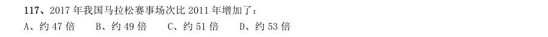

- **A.** 约47 倍
- **B.** 约49 倍
- **C.** 约51 倍
- **D.** 约53 倍

**答案：B**

### 2019 国考·地市级　第 121 题　（是几倍）

2017 年,全国处理的支付交易类钓鱼网站数量超过金融证券类钓鱼网站2 倍的月份有几个?

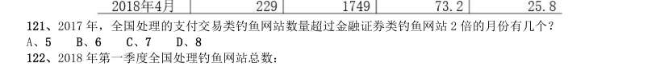

- **A.** 5
- **B.** 6
- **C.** 7
- **D.** 8

**答案：B**

### 2019 国考·地市级　第 129 题　（是几倍）

2016 年,A 省高铁客运量约是普铁(除高铁外的铁路)客运量的多少倍?

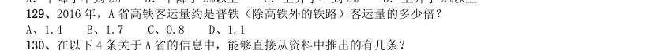

- **A.** 1.4
- **B.** 1.7
- **C.** 0.8
- **D.** 1.1

**答案：A**

### 2018 湖北·统一卷　第 121 题　（是几倍）

2017 年5 月我国股份制商业银行净资产额约是城市商业银行净资产额的多少倍?

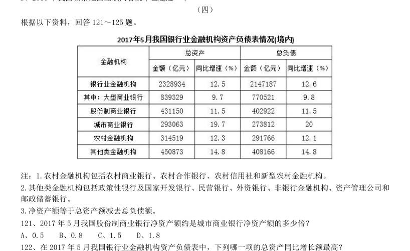

- **A.** 0.5
- **B.** 0.8
- **C.** 1.5
- **D.** 1.8

**答案：C**

### 2018 广东·统一卷　第 86 题　（是几倍）
> 材料：(一) 根据下列资料,回答86~90 题: A 市坚持发挥科技创新的引领作用,强化企业的创新主体地位,研发投入不断增加,研发人员快速增长, 创新能力持续增强,锂电池等新兴产业尤为突出。 五年来,企业创新意愿不断提升,研发投入快速增长。2016 年,该市有研究与试验发展(R&D)活动的 单位172 家,比2012 年增加26 家,R&D 经费内部支出19.55 亿元,比2012 年增加11.65 亿元,增长 ,年均增长率为 ;R&D 经费内部支出与地区生产总值之比为 ,比201…

新产品 产值达241.06 亿元,比2012 年增加219.37 亿元,增长10.1 倍。 2012 年,该市的下列各项经费支出最多的是( )。

- **A.** 规模以上工业企业R&D 经费
- **B.** 全年技术改造经费
- **C.** 引进境外技术经费
- **D.** 引进境外技术的消化吸收经费

**答案：暂缺**

### 2017 广东·统一卷　第 91 题　（是几倍）
> 材料：2016 年,广东民营经济增加值突破四万亿元。经初步核算,全年实现民营经济增加值42578.76 亿元,按可 比价计算,比上年同期增长 ,增幅高于同期GDP 增幅0.3 个百分点,其中第二产业增幅比同期GDP 第二 产业增幅高3 个百分点。民营经济占GDP 的比重为 ,比2010 年提高3.9 个百分点,占比逐年提高;对 GDP 增长的贡献率为 ,同比提高1.3 个百分点,拉动GDP 增速达4.2 个百分点,民营经济的作用不断提 升,是广东经济增长的主力军。…

分行业看,民营经济发展速度快于全部经济类型的行业有工业、金融业和其他服务业,其中民营工业实现增 加值15898.95 亿元,同比增长 ,比全部经济类型工业快3.3 个百分点;民营经济占全部经济类型比重较 大的行业有农林牧渔业、住宿餐饮业、批发零售业和房地产业,分别为 、 、 和 ;民营 经济对GDP 贡献率较大的行业有工业、其他服务业,分别为 、 。 【注释】 生产总值(GDP):指按市场价格计算的一个地区所有常住单位在一定时期内生产活动的最终成果。从价格形 态看,它是所有常住单位的增加值之和。 增加值:总产出减去中间投入后的余额,反映一定时期内各部门、各单位生产经营活动的最终成果,也就是 本部门、本单位对生产总值提供的份额。 2016 年广东民营经济第二产业实现的增加值约是第一产业的多少倍?

- **A.** 4.11
- **B.** 4.32
- **C.** 4.77
- **D.** 5.17

**答案：暂缺**

### 2017 广东·统一卷　第 97 题　（是几倍）

2015 年该省报纸的订销完成量约是杂志的多少倍?

- **A.** 12.3
- **B.** 13.9
- **C.** 15.1
- **D.** 16.7

**答案：暂缺**

### 2017 广东·统一卷　第 99 题　（倍数计算（综合））

根据资料,下列选项无法得出的是:

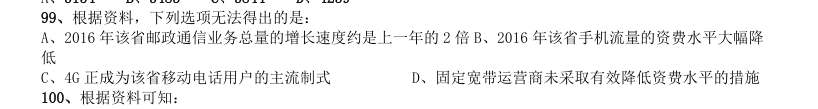

> （本题为图形题，选项为图片，见原卷）

**答案：暂缺**

### 2017 国考·副省级　第 132 题　（是几倍）

“十二五”期间整车制造专利申请总数约是“十五”期间总数的多少倍?

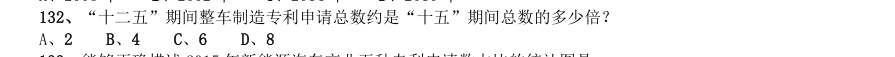

- **A.** 2
- **B.** 4
- **C.** 6
- **D.** 8

**答案：C**

### 2016 国考·副省级　第 122 题　（是几倍）

2014 年,公共图书馆电子图书藏量增长册数约是图书总藏量增长册数的多少倍?

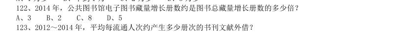

- **A.** 3
- **B.** 2
- **C.** 8
- **D.** 5

**答案：A**

### 2015 广东·乡镇　第 88 题　（是几倍）

2014 年,移动电话用户数量是固定电话用户数的多少倍:

- **A.** 2
- **B.** 3
- **C.** 4
- **D.** 5

**答案：暂缺**

### 2015 广东·乡镇　第 92 题　（是几倍）

2013 年乘用车销量约是商用车销量的多少倍?

- **A.** 4.0
- **B.** 4.4
- **C.** 5.0
- **D.** 5.2

**答案：暂缺**

### 2015 广东·县级　第 92 题　（是几倍）

2013 年乘用车销量约是商用车销量的多少倍?

- **A.** 4.0
- **B.** 4.4
- **C.** 5.0
- **D.** 5.2

**答案：暂缺**

### 2015 国考·副省级　第 129 题　（是几倍）

2014 年1~5 月,信息技术咨询服务收入同比增速最快的副省级城市,该项收入约是增速最慢的副省级城 市的多少倍:

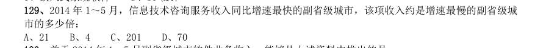

- **A.** 21
- **B.** 4
- **C.** 201
- **D.** 70

**答案：A**

### 2015 国考·副省级　第 135 题　（是几倍）

能够给从上述资料中推出的是:

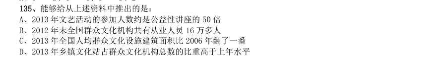

- **A.** 2013 年文艺活动的参加人数约是公益性讲座的50 倍
- **B.** 2012 年末全国群众文化机构共有从业人员16 万多人
- **C.** 2013 年全国人均群众文化设施建筑面积比2006 年翻了一番
- **D.** 2013 年乡镇文化站占群众文化机构总数的比重高于上年水平

**答案：A**

### 2015 国考·地市级　第 130 题　（是几倍）

能够给从上述资料中推出的是:

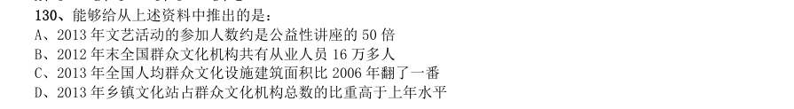

- **A.** 2013 年文艺活动的参加人数约是公益性讲座的50 倍
- **B.** 2012 年末全国群众文化机构共有从业人员16 万多人
- **C.** 2013 年全国人均群众文化设施建筑面积比2006 年翻了一番
- **D.** 2013 年乡镇文化站占群众文化机构总数的比重高于上年水平

**答案：A**

### 2014 湖北·统一卷　第 106 题　（是几倍）
> 材料：理。 (一) 2013 年3 月末,金融机构人民币各项贷款余额65.76 万亿元,同比增长14.9%,增速比上年同期低0.8 个百 分点。 2013 年3 月末,主要金融机构及小型农村金融机构,外资银行人民币小微企业贷款余额11.78 万亿元,同 比增长13.5%,比全部企业贷款余额增速高1.2 个百分点。 2013 年3 月末,主要金融机构本外币工业中长期贷款余额6.46 万亿元,同比增长3.2%。其中,轻工业中长 期贷款余额6824 亿元,同比增长7.6%;重工业中长期贷…

2013 年3 月末,金融机构人民币各项贷款余额约是2011 年同期的多少倍?

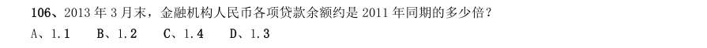

- **A.** 1.1
- **B.** 1.2
- **C.** 1.4
- **D.** 1.3

**答案：D**

### 2014 湖北·统一卷　第 114 题　（是几倍）

2008—2012 年间,全国石油消费量超过全国石油产量2 倍的年份有几个?

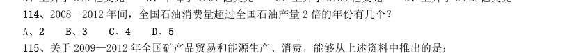

- **A.** 2
- **B.** 3
- **C.** 4
- **D.** 5

**答案：C**

### 2014 广东·乡镇　第 87 题　（是几倍）

2011 年底,乡镇卫生院从业人员约为社区卫生服务中心从业人员的( )倍。

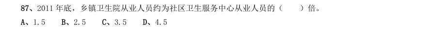

- **A.** 1.5
- **B.** 2.5
- **C.** 3.5
- **D.** 4.5

**答案：暂缺**

### 2014 广东·县级　第 96 题　（是几倍）

2013 年,广东固定资产投资总量迈上新台阶,共完成22858.53 亿元,增长18.3%,比2012 年加快2.8 个 百分点。其中,城镇投资18907.34 亿元,增长18.6%;农村投资3951.19 亿元,增长17.0%。 2013 年,广东城镇投资约为农村投资的多少倍?

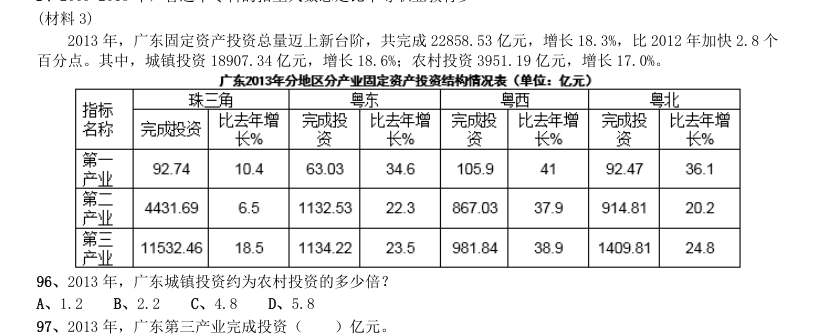

- **A.** 1.2
- **B.** 2.2
- **C.** 4.8
- **D.** 5.8

**答案：暂缺**

### 2014 国考·统一卷　第 123 题　（是几倍）

2012 年第三季度全国十个城市中,第三产业需求岗位数超过第二产业2 倍的城市共有:

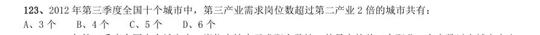

- **A.** 3 个
- **B.** 4 个
- **C.** 5 个
- **D.** 6 个

**答案：D**

### 2013 湖北·统一卷　第 137 题　（是几倍）

2011 年 月,全国手持出口船舶订单约为新承接出口船舶订单的多少倍?

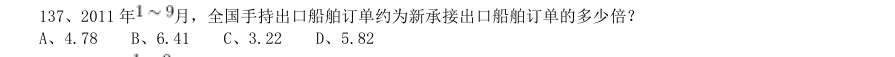

- **A.** 4.78
- **B.** 6.41
- **C.** 3.22
- **D.** 5.82

**答案：B**

### 2012 广东·统一卷　第 95 题　（倍数计算（综合））

可由以上资料得出的一项是:

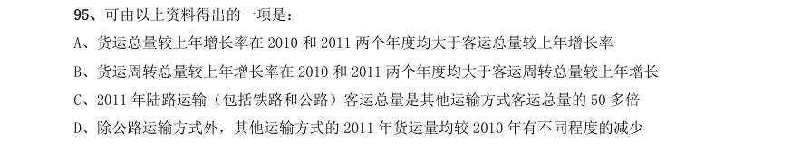

- **A.** 货运总量较上年增长率在2010 和2011 两个年度均大于客运总量较上年增长率
- **B.** 货运周转总量较上年增长率在2010 和2011 两个年度均大于客运周转总量较上年增长
- **C.** 2011 年陆路运输(包括铁路和公路)客运总量是其他运输方式客运总量的50 多倍
- **D.** 除公路运输方式外,其他运输方式的2011 年货运量均较2010 年有不同程度的减少

**答案：暂缺**

### 2011 国考·统一卷　第 124 题　（是几倍）

2000 年,表中所列四国玉米的最高产量约是最低产量的多少倍:

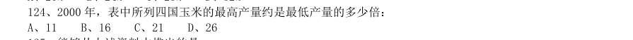

- **A.** 11
- **B.** 16
- **C.** 21
- **D.** 26

**答案：C**

### 2011 国考·统一卷　第 126 题　（基期倍数）
> 材料：2010 年上半年,全国原油产量为9848 万吨,同比增长5.3%,上年同期为下降1%。进口原油11797 万吨(海 关统计),增长30.2%。原油加工量20586 万吨,增长17.9%,增速同比加快16.4 个百分点。成品油产量中,汽 油产量增长6%,增速同比减缓7.9 个百分点;柴油产量增长28.1%,增速同比加快15.8 个百分点。 据行业统计,2010 年上半年成品油表观消费量10963 万吨,同比增长12.5%。其中,一、二季度分别增长 16.3%和9.2%。 20…

其中,石油 天然气开采业利润1319 亿元,同比增长1.67 倍,上年同期为下降75.8%,炼油行业利润326 亿元,同比下降25.7%, 上年同期为增长1.8 倍。 2010 年上半年全国原油产量比2008 年同期约增长了:

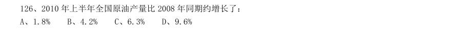

- **A.** 1.8%
- **B.** 4.2%
- **C.** 6.3%
- **D.** 9.6%

**答案：B**

### 2010 湖北·统一卷　第 100 题　（是几倍）

与 月相比,12 月“家电下乡”产品中销售量增加一倍以上的产品有多少种:

- **A.** 1 种
- **B.** 2 种
- **C.** 3 种
- **D.** 4 种

**答案：B**

### 2010 广东·统一卷　第 80 题　（倍数计算（综合））

根据下列表格,完成各题。 某省环境统计公报(2004~2008 年) 2008 年工业固体废物综合利用量大约是2004 年的:

- **A.** 1.7 倍
- **B.** 2 倍
- **C.** 2.3 倍
- **D.** 2.6 倍

**答案：暂缺**

### 2010 国考·统一卷　第 108 题　（是几倍）

2008 年1-5 月,移动电话长途通话时长约是固定传统长途电话通话时长的多少倍:

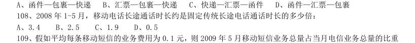

- **A.** 3.4
- **B.** 2.5
- **C.** 1.9
- **D.** 0.5

**答案：C**
