# 资料分析 · 倍数计算 · 2020 年代真题

> 所属考点：[ZL-BEI](../ZL-BEI-倍数计算.md)　｜　本片 16 题

### 2024 广东·统一卷　第 88 题　（是几倍）

2021年,东部地区县域农业农村信息化建设社会资本投入约是中、西部地区之和的( )倍。

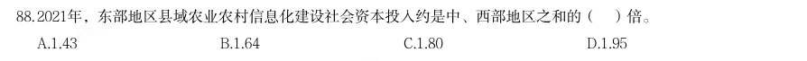

- **A.** 1.43
- **B.** 1.64
- **C.** 1.80
- **D.** 1.95

**答案：暂缺**

### 2024 国考·副省级　第 118 题　（是几倍）

2022年,中部六省中型灌区新增恢复灌溉面积是东北三省的:

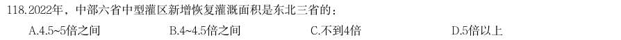

- **A.** 4.5~5倍之间
- **B.** 4~4.5倍之间
- **C.** 不到4倍
- **D.** 5倍以上

**答案：A**

### 2024 国考·地市级　第 115 题　（是几倍）

关于2022年S省各级12315工作机构接收诉求状况,不能从上述资料中推出的是:

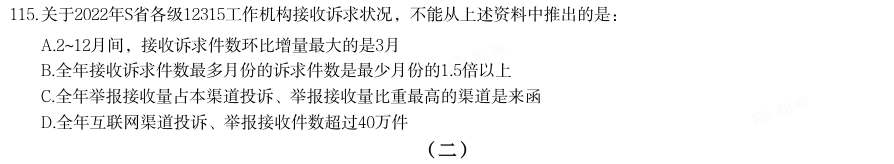

- **A.** 2~12月间,接收诉求件数环比增量最大的是3月
- **B.** 全年接收诉求件数最多月份的诉求件数是最少月份的1.5倍以上
- **C.** 全年举报接收量占本渠道投诉、举报接收量比重最高的渠道是来函
- **D.** 全年互联网渠道投诉、举报接收件数超过40万件

**答案：C**

### 2024 国考·地市级　第 127 题　（是几倍）

2019年,蜂窝物联网终端用户数同比增量约是移动电话用户数同比增量的多少倍?

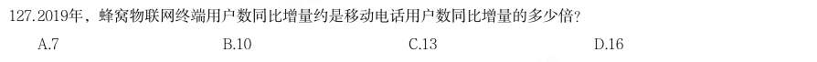

- **A.** 7
- **B.** 10
- **C.** 13
- **D.** 16

**答案：B**

### 2024 国考·行政执法　第 116 题　（是几倍）

(二) 2022年,中部六省中型灌区新增恢复灌溉面积是东北三省的:

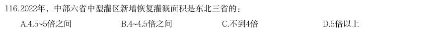

- **A.** 4.5~5倍之间
- **B.** 4~4.5倍之间
- **C.** 不到4倍
- **D.** 5倍以上

**答案：A**

### 2024 国考·行政执法　第 126 题　（是几倍）
> 材料：(四) 2023年3月,全国规模以上工业企业的工业机器人完成产量4.4万套,服务机器人完成产量70万套。2023年 1~3月全国规模以上工业企业的工业机器人累计完成产量10.4万套,服务机器人累计完成产量145万套。 2023年3月,我国机器人设备出口金额0.7亿美元,较上年增长110.3%,进口金额2.4亿美元,较上年增长 68.5%。2023年1~3月我国机器人设备累计出口金额1.9亿美元,较上年增长62.1%,累计进口金额6.9亿美元,较 上年增长55.1%。 2022…

2023年1~2月,全国规模以上工业企业的服务机器人完成产量约是工业机器人完成产量的多少倍?

- **A.** 12.5
- **B.** 14.0
- **C.** 15.9
- **D.** 18.1

**答案：A**

### 2023 广东·县级　第 96 题　（是几倍）
> 材料：五年来,我国积极推进网络强国和数字中国建设,着力深化数字经济与实体经济融合,为打造数字 经济新优势、增强经济发展新动能提供有力支撑。2022 年,我国电信业务收入累计完成1.58 万亿元, 比上年增长8%,较2018 年增长超2800 亿元。 2022 年移动数据流量业务收入6397 亿元,比上年增长0.3%,在电信业务收入中占比约为40.5%。 数据中心、云计算、大数据、物联网等新兴业务快速发展,对我国电信业务拉动作用持续增强。202 2 年新兴业务收入达3072 亿元,在…

其中,数据 中心、云计算、大数据、物联网业务比上年分别增长11.5%、118.2%、58%和24.7%。 2022 年我国电信业务收入约为2018 年的( )倍。

- **A.** 1.1
- **B.** 1.2
- **C.** 1.3
- **D.** 1.4

**答案：B**

### 2022 广东·乡镇　第 90 题　（是几倍）

根据所给材料,下列说法最准确的是:

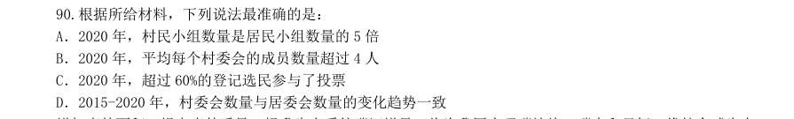

- **A.** 2020 年,村民小组数量是居民小组数量的5 倍
- **B.** 2020 年,平均每个村委会的成员数量超过4 人
- **C.** 2020 年,超过60%的登记选民参与了投票
- **D.** 2015-2020 年,村委会数量与居委会数量的变化趋势一致

**答案：B**

### 2022 广东·乡镇　第 100 题　（倍数计算（综合））

根据所给材料,下列说法最不准确的是:

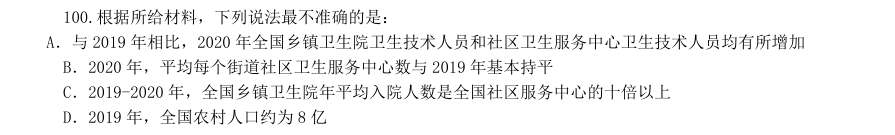

- **A.** 与2019 年相比,2020 年全国乡镇卫生院卫生技术人员和社区卫生服务中心卫生技术人员均有所增加
- **B.** 2020 年,平均每个街道社区卫生服务中心数与2019 年基本持平
- **C.** 2019-2020 年,全国乡镇卫生院年平均入院人数是全国社区服务中心的十倍以上
- **D.** 2019 年,全国农村人口约为8 亿

**答案：暂缺**

### 2022 广东·县级　第 98 题　（是几倍）

2016-2020 年,国内航线条数比国际航线条数多4 倍以上的年份有:

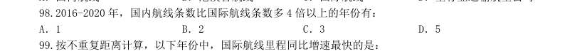

- **A.** 1
- **B.** 2
- **C.** 3
- **D.** 5

**答案：暂缺**

### 2022 国考·副省级　第 123 题　（是几倍）

(单选题)2021 年第一季度市场监管部门食品安全监督抽检量最多的3 个食品类别,同期抽检不合格量 约是其余所有类别抽检不合格量的多少倍?

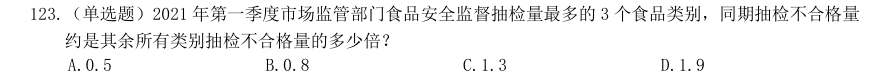

- **A.** 0.5
- **B.** 0.8
- **C.** 1.3
- **D.** 1.9

**答案：D**

### 2022 国考·地市级　第 123 题　（是几倍）

2021 年第一季度市场监管部门食品安全监督抽检量最多的3 个食品类别,同期抽检不合格 量约是其余所有类别抽检不合格量的多少倍?

- **A.** 0.5
- **B.** 0.8
- **C.** 1.3
- **D.** 1.9

**答案：D**

### 2022 国考·行政执法　第 129 题　（是几倍）

(单选题)2021 年1—5 月,全国紧急止付涉案资金金额约是为群众挽回经济损失金额的多少倍?

- **A.** 2.7
- **B.** 2.4
- **C.** 2.1
- **D.** 1.8

**答案：A**

### 2020 湖北·统一卷　第 109 题　（是几倍）

图2 中排名第二的省份,其人工智能企业数量的个数约是排名后四位的数量之和的多少倍?

- **A.** 11.3
- **B.** 12.3
- **C.** 12.8
- **D.** 13.3

**答案：暂缺**

### 2020 湖北·统一卷　第 112 题　（是几倍）

2019 年5 月,平台受理量排名第二的省份约是排名第九的省份的多少倍?

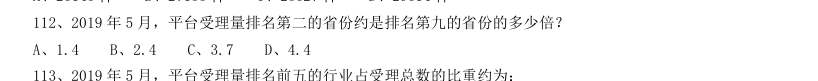

- **A.** 1.4
- **B.** 2.4
- **C.** 3.7
- **D.** 4.4

**答案：暂缺**

### 2020 广东·县级　第 87 题　（是几倍）

根据行业的风险性质不同,工伤保险缴费的比例也不同。假如B 市某企业所属行业类别的工伤保险缴费比例 一直为 (职工个人不缴纳工伤保险费用),在按照工伤基数下限为其员工缴纳工伤保险的情况下,2019 年 每名员工缴纳的工伤保险金额约为10 年前的( )倍。

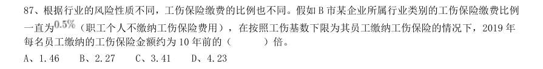

- **A.** 1.46
- **B.** 2.27
- **C.** 3.41
- **D.** 4.23

**答案：暂缺**
