# 资料分析 · 比重计算与比较 · 2000 年代真题

> 所属考点：[ZL-BILI](../ZL-BILI-比重计算与比较.md)　｜　本片 55 题

> 本片子考点：现期比重 53　两期比重差 2

### 2009 湖北·统一卷　第 118 题　（现期比重）

2007 年末城镇就业人员中私营个体就业人员所占比重比2006 年末增加了约:

- **A.** 2%
- **B.** 27%
- **C.** 0.4%
- **D.** 4%

**答案：A**

### 2009 广东·统一卷　第 89 题　（现期比重）

2006 年广东省房地产投资占全社会固定资产投资比重比2005 年:

- **A.** 增加了约1 个百分点
- **B.** 降低了约1 个百分点
- **C.** 增加了约1.5 个百分点
- **D.** 降低了约1.5 个百分点

**答案：暂缺**

### 2009 广东·统一卷　第 98 题　（现期比重）

2007 年对东盟的进口额占当年进口额的比重约是:

- **A.** 7.7%
- **B.** 11.3%
- **C.** 23%
- **D.** 34%

**答案：暂缺**

### 2009 国考·统一卷　第 124 题　（现期比重）

第二季度与第一季度相比,空气达标天数的比重:

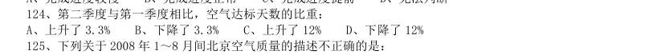

- **A.** 上升了3.3%
- **B.** 下降了3.3%
- **C.** 上升了12%
- **D.** 下降了12%

**答案：D**

### 2009 国考·统一卷　第 139 题　（现期比重）

2006 年技术秘密合同成交金额占全国技术合同总成交金额的比重是多少:

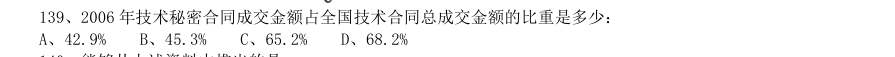

- **A.** 42.9%
- **B.** 45.3%
- **C.** 65.2%
- **D.** 68.2%

**答案：A**

### 2008 湖北·统一卷　第 121 题　（现期比重）

行业 700 强企业 研发投入比 重(%) 投入最多的2 家 公司占行业总投 入的比重(%) 行业 700 强企业 研发投入 比重(%) 投入最多的2 家 公司占行业总投 入的比重(%) IT 硬件 21.7 航空及国 防 3.9 汽车 化学 4.8 生物制药 17.5 电信 2.2 电子电气 10.4 保健品 2.2 IT 软件及计 算机服务 6.4 其他 资料显示,2003 年全球研发投入700 强企业高度密集于哪四个行业?

- **A.** IT 硬件、汽车、保健品、电信
- **B.** IT 硬件、电子电气、工程、化学
- **C.** IT 硬件、汽车、生物制药、电子电气
- **D.** 汽车、生物制药、电子电气、其他

**答案：C**

### 2008 湖北·统一卷　第 124 题　（现期比重）

从研发经费投入最多的2 家公司占行业总投入的比重数据看,行业投入经费高度集中于大型公司的是:

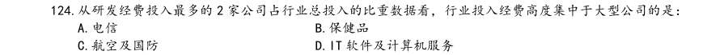

- **A.** 电信
- **B.** 保健品
- **C.** 航空及国防
- **D.** IT 软件及计算机服务

**答案：A**

### 2008 湖北·统一卷　第 128 题　（现期比重）

2001 年城乡居民收入年增额的比重为:

- **A.** 2.9
- **B.** 2.79
- **C.** 0.11
- **D.** 5.1

**答案：D**

### 2008 湖北·统一卷　第 132 题　（现期比重）

荷兰的GDP 总量占欧盟GDP 总量的( )。

- **A.** 2.0%
- **B.** 4.8%
- **C.** 7.3%
- **D.** 13.8%

**答案：B**

### 2008 湖北·统一卷　第 133 题　（现期比重）

德、法、英三国GDP 总量占欧盟GDP 总量的( )。

- **A.** 48.4%
- **B.** 53.8%
- **C.** 55.2%
- **D.** 58.1%

**答案：D**

### 2008 广东·统一卷　第 87 题　（现期比重）

2006 年广东省特色产业基地的高新技术产品产值约占特色产业基地工业总产值的比重是多少? A38.5% B33.5% C30% D20.3%

> （本题为图形题，选项为图片，见原卷）

**答案：暂缺**

### 2008 广东·统一卷　第 88 题　（现期比重）

根据上述材料,2006 年特色产业基地占当地工业总产值比重最高的是

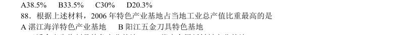

- **A.** 湛江海洋特色产业基地
- **B.** 阳江五金刀具特色基地
- **C.** 云浮禽畜生物制品特色产业基地
- **D.** 肇庆金属新材料产业基地

**答案：暂缺**

### 2008 广东·统一卷　第 89 题　（现期比重）

2006 年,广东省高新技术产品产值占全省工业总产值的比重约是多少? A38.5% B32.9% C30.4% D20.3%

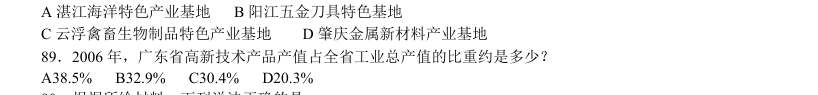

> （本题为图形题，选项为图片，见原卷）

**答案：暂缺**

### 2008 广东·统一卷　第 90 题　（现期比重）

根据所给材料,下列说法正确的是 A2006 年,肇庆市高新技术企业总数19 家 B2006 年,阳江五金刀具厂产值占阳江市工业总产值的31% C2006 年,云浮禽畜生物制品特色产业基地总产值占该市总产值的38.5% D2006 年,湛江海洋特色产业基地的工业总产值,占该市生产总值的比重小于33% 根据下表回答91~95 题 表一 部分省主要年份GDP 总量及劳动报酬占GDP 比重 1995 年 2000 年 2005 年 2006 年 GDP (亿元) 劳动报酬 比重 (%) GDP (亿元) 劳动报酬 GDP (亿元) 劳动报酬 GDP (亿元) 劳动报酬 广东 5733.97 49.4 9506.04 45.5 21707.28 39.5 25968.5 38.7 江苏 5155.74 47.1 8582.73 45.8 18272.12 40.9 21548.3 40.7 山东 5002.74 46.0 8542.44 47.9 18468.30 35.3 21846.7 34.4 浙江 3524.79 42.9 6036.34 43.1 13365.00 39.7 15649.0 40.3 表二 广东省与部分省2006 年分行业劳动报酬占GDP 比重(单位:%) 广东 江苏 山东 浙江 GDP 38.7 40.7 34.4 40.3 第一产业 99.3 88.1 95.9

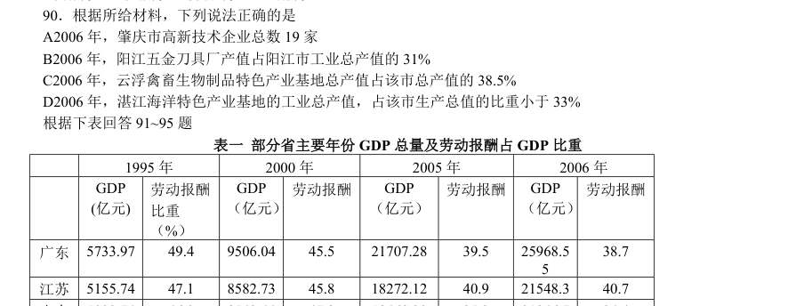

> （本题为图形题，选项为图片，见原卷）

**答案：暂缺**

### 2008 国考·统一卷　第 122 题　（现期比重）

2005 年,年印刷量在5 亿对开张以上的企业中,印刷量增长率为负的企业所占比例是:

- **A.** 16.6%
- **B.** 32.3%
- **C.** 35.0%
- **D.** 38.3%

**答案：C**

### 2008 国考·统一卷　第 133 题　（现期比重）

根据表2,在被调查的全体人群中,选择“缺乏组织”的人占全体人群的比例可能是:

- **A.** 5.2%
- **B.** 6.2%
- **C.** 7.1%
- **D.** 8.2%

**答案：C**

### 2008 国考·统一卷　第 136 题　（现期比重）

表1:2001 至2005 年世界主要国家和地区经济增长率比较(%) 国家和地区 2001 年 2002 年 2003 年 2004 年 2005 年 2001 至2005 年 平均增长率 世界总计 2.4 3.0 4.1 5.3 4.9 4.0 发达国家和地区 1.2 1.5 1.9 3.2 2.6 2.1 美国 0.8 1.6 2.5 3.9 3.2 2.4 欧盟 2.0 1.3 1.4 2.4 1.8 1.8 日本 0.2 -0.3 1.8 2.3 2.6 1.4 发展中国家和地区 4.1 4.8 6.7 7.7 7.4 6.3 中国 7.5 8.3 10.0 10.1 10.2 9.5 印度 3.9 4.7 7.2 8.0 8.5 6.4 俄罗斯 5.1 4.7 7.3 7.2 6.4 6.1 巴西 1.3 1.9 0.5 4.9 2.3 2.2 马来西亚 0.3 4.4 5.5 7.2 5.2 4.5 亚洲四小龙 中国香港 0.5 1.9 3.2 8.6 7.3 4.3 中国台湾 -2.2 4.2 3.4 6.1 4.1 3.1 韩国 3.8 7.0 3.1 4.7 4.0 4.5 新加坡 -1.9 3.2 2.9 8.7 6.4 3.9 表2:2001 至2005 年国内生产总值居世界前10 位国家比较(亿美元) 位次 2001 年 2005 年 国家和地区 国内生 产总值 占世界的比 重(%) 国家和地区 国内生 产总值 占世界的比 重(%) 世界总计 315750 世界总计 443849 美国 100759 31.9 美国 124551 28.1 日本 41624 13.2 日本 45059 10.2 德国 18913 6.0 德国 27819 6.3 英国 14313 4.5 中国 22289 5.0 法国 13398 4.2 英国 21926 4.9 中国 13248 4.2 法国 21102 4.8 意大利 10904 3.5 意大利 17230 3.9 加拿大 2.2 西班牙 11237 2.5 墨西哥 2.0 加拿大 11152 2.5 西班牙 1.9 巴西 1.8 2005 年和2001 年相比较,国内生产总值占世界比重变化幅度最大的国家是:

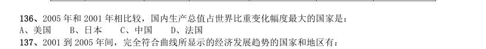

- **A.** 美国
- **B.** 日本
- **C.** 中国
- **D.** 法国

**答案：A**

### 2007 广东·统一卷　第 87 题　（现期比重）

2005 年,广东事业、机关单位的从业人员占城镇从业人员的比例是多少?( )

- **A.** 27.69%
- **B.** 7.72%
- **C.** 28.30%
- **D.** 27.0%

**答案：暂缺**

### 2007 广东·统一卷　第 96 题　（现期比重）

2000 年至2005 年,我国农村发电量占用电量比重最大的年份是( )。

- **A.** 2000 年
- **B.** 2001 年
- **C.** 2003 年D.2005 年

**答案：暂缺**

### 2007 国考·统一卷　第 121 题　（两期比重差）
> 材料：根据资料所提供的信息进行分析、比较、计算和判断处理。 (一) 2006 年五月份北京市消费品市场较为活跃,实现社会消费品零售额272.2 亿元,创今年历史第二高,据统 计,1~5 月份全市累计实现社会消费品零售额1312.7 亿元,比去年同期增长12.5%。 汽车销售继续支持北京消费品市场的繁荣。5 月份,全市机动车类销售量为5.4 万辆,同比增长23.9%,据 对限额以上批发零售贸易企业统计,汽车类商品当月实现零售额32.3 亿元,占限额以上批发零售贸易企业零售 额比重的2…

同时由于季节变换和节日商家促销的共同作用,家电销售大幅增长,限额以上批发零售家用电 器和音像器材类商品零售额同比增长13.6%。 北京市2006 年5 月份限额以上批发零售贸易企业社会消费品零售额占社会消费品零售总额的百分比约为:

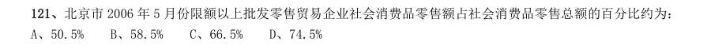

- **A.** 50.5%
- **B.** 58.5%
- **C.** 66.5%
- **D.** 74.5%

**答案：B**

### 2007 国考·统一卷　第 123 题　（现期比重）

2006 年5 月份,限额以上批发零售贸易企业中,家具类商品零售额占家具类和建筑及装潢材料类商品零售 额的比例是:

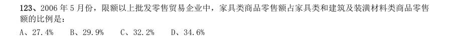

- **A.** 27.4%
- **B.** 29.9%
- **C.** 32.2%
- **D.** 34.6%

**答案：A**

### 2007 国考·统一卷　第 128 题　（现期比重）

内蒙古的地表水取水量与耗水量分别占全河地表水取水量与耗水量的比重约是:

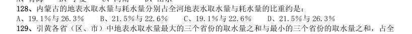

- **A.** 19.1%与26.3%
- **B.** 21.5%与22.6%
- **C.** 19.1%与22.6%
- **D.** 21.5%与26.3%

**答案：B**

### 2007 国考·统一卷　第 129 题　（现期比重）

引黄各省(区、市)中地表水取水量最大的三个省份的取水量之和与最小的三个省份的取水量之和,占全 河地表水取水量的比重分别约是:

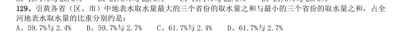

- **A.** 59.7%与2.4%
- **B.** 59.7%与2.7%
- **C.** 61.7%与2.4%
- **D.** 61.7%与2.7%

**答案：B**

### 2007 国考·统一卷　第 134 题　（现期比重）

下列说法正确的有: 1预计“十一五"期间,外观设计专利申请总量将占到专利申请总量的1/3 强 2“十五”末期平均结案周期不到“十五”初期的一半 31985 年4 月1 日至2005 年8 月31 间,我国专利的授予比例超过了50% 41985 年4 月1 日至2005 年8 月31 日间,我国受理的专利申请中,第二个100 万件所用时间不到总时间的20%

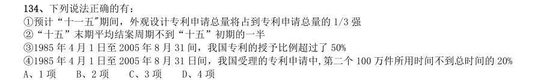

- **A.** 1 项
- **B.** 2 项
- **C.** 3 项
- **D.** 4 项

**答案：C**

### 2007 国考·统一卷　第 136 题　（现期比重）

从1998 年到2004 年,美洲地区啤酒消费量占世界啤酒消费总量的比重:

- **A.** 下降了3 个百分点
- **B.** 下降了2 个百分点
- **C.** 下降了1 个百分点
- **D.** 上升了1 个百分点

**答案：A**

### 2007 国考·统一卷　第 137 题　（现期比重）

1998 年至2004 年啤酒消费量增长最快的两个地区,其啤酒消费量2004 年占世界啤酒消费量的比重约是:

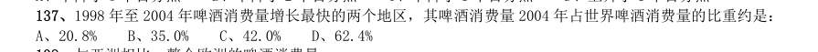

- **A.** 20.8%
- **B.** 35.0%
- **C.** 42.0%
- **D.** 62.4%

**答案：C**

### 2006 广东·统一卷　第 88 题　（现期比重）

今年5月份全国多功能乘用车的产量占1至5月份总产量的( )。

- **A.** 20.13%
- **B.** 22.14%
- **C.** 17.95%
- **D.** 21.38%

**答案：暂缺**

### 2006 广东·统一卷　第 92 题　（现期比重）

从 1985 年至 2003 年,我国从事农业的劳动力占乡村劳动力的比重下降了几个百分点?( )

- **A.** 7.3
- **B.** 10.2
- **C.** 18.1
- **D.** 36.2

**答案：暂缺**

### 2006 广东·统一卷　第 94 题　（现期比重）

从上表数据可以看出,在非农劳动力中,2000 年从事商饮行业的比重约是 1990 年的多少倍?( )

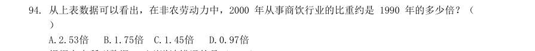

- **A.** 2.53倍
- **B.** 1.75倍
- **C.** 1.45倍
- **D.** 0.97倍

**答案：暂缺**

### 2006 广东·统一卷　第 97 题　（现期比重）

根据上表,2004年我国大中型工业企业发明专利申请量占专利申请量比重最高的地区是( )。

- **A.** 北京
- **B.** 天津
- **C.** 上海
- **D.** 广东

**答案：暂缺**

### 2006 国考·统一卷　第 122 题　（现期比重）

该市2005 年6 月人身险保费收入占总保费收入的比重与2003 年同期相比( )。

- **A.** 约增加了3%
- **B.** 约减少了3%
- **C.** 约增加了6%
- **D.** 约减少了6%

**答案：B**

### 2006 国考·统一卷　第 124 题　（现期比重）

2003 年6 月,该市哪一种保险的保费收入占总保费收入的比重相对2002 年6 月有最大增 长?( )

- **A.** 财产险
- **B.** 人身险
- **C.** 健康险和意外伤害险
- **D.** 无法判断

**答案：C**

### 2006 国考·统一卷　第 127 题　（现期比重）

从上表数据可以看出,无线广播中新闻节目时间占自办节目时间的比例约是电视播映中 新闻节目时间占自办节目时间的比例的( )。

- **A.** 1.93 倍
- **B.** 1.53 倍
- **C.** 1.03 倍
- **D.** 0.97 倍

**答案：B**

### 2006 国考·统一卷　第 129 题　（现期比重）

在电视自办节目时间中占比例最大的节目种类是( )。

- **A.** 新闻节目
- **B.** 专题节目
- **C.** 文艺节目
- **D.** 服务性节目

**答案：C**

### 2006 国考·统一卷　第 134 题　（现期比重）

2003 年国家财政科技拨款额约占全国总科技活动经费支出的( )。

- **A.** 43.1%
- **B.** 63.1%
- **C.** 77.1%
- **D.** 83.1%

**答案：B**

### 2005 广东·统一卷　第 94 题　（现期比重）

2002 年,广东高技术产业专利授权数占全国的百分之几?

- **A.** 22%
- **B.** 30%
- **C.** 47.65%
- **D.** 73.87%

**答案：暂缺**

### 2005 国考·统一卷　第 120 题　（现期比重）

2002 年,非新生的在校生占在校生比例最大的学科是( )。

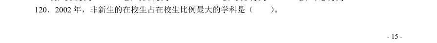

- **A.** 哲学
- **B.** 历史学
- **C.** 法学
- **D.** 经济学

**答案：B**

### 2003 国考·A卷　第 117 题　（现期比重）

从1970 年到1990 年,用水量占总用水量百分比减少了的是( )。 I.发电用水。 II.其他工业用水。 III.灌溉用水。

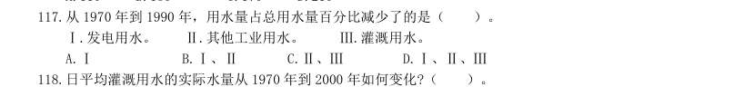

- **A.** I
- **B.** I、II
- **C.** II、III
- **D.** I、II、III

**答案：C**

### 2003 国考·A卷　第 123 题　（现期比重）

下列说法中哪些正确?( )。 I.本科以上(含本科)的网民比本科以下的网民多。 II.25~30 岁的网民比31~40 岁的网民多。 III.本科学历的网民所占的比例最高。

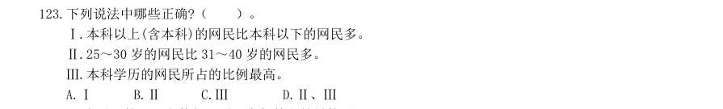

- **A.** I
- **B.** II
- **C.** III
- **D.** II、III

**答案：D**

### 2003 国考·A卷　第 126 题　（两期比重差）

占整个电信业务收入比重最大的业务在2002 年上半年中与去年同期相比变化情况是( )。

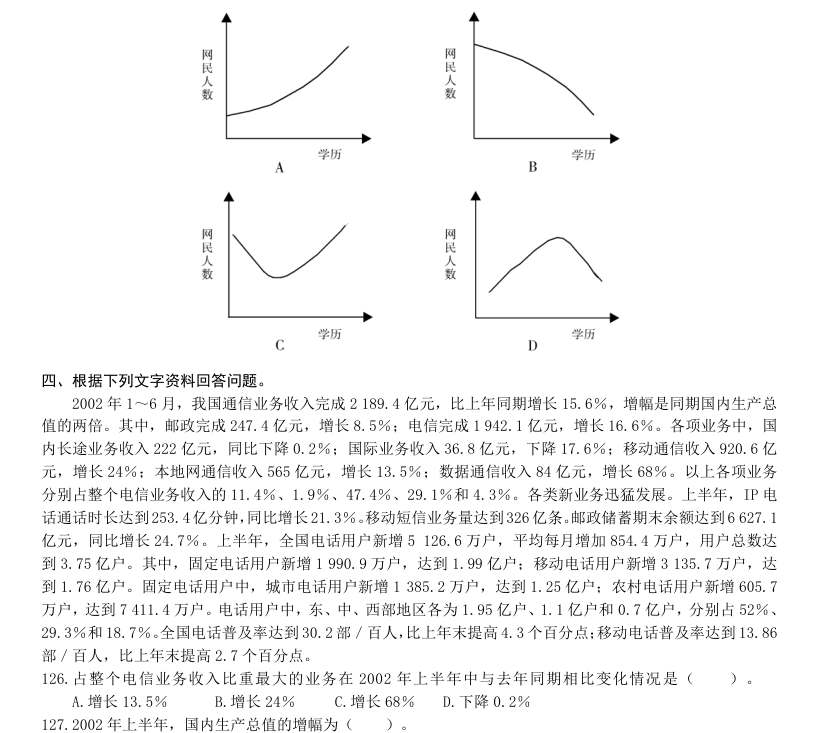

- **A.** 增长13.5%
- **B.** 增长24%
- **C.** 增长68%
- **D.** 下降0.2%

**答案：B**

### 2003 国考·B卷　第 113 题　（现期比重）

下图中的阴影部分能够体现机械及运输设备出口金额占出口总金额比例的是( )。

> （本题为图形题，选项为图片，见原卷）

**答案：B**

### 2003 国考·B卷　第 114 题　（现期比重）

矿物燃料、润滑油及有关原料进口金额占初级产品进口金额的大致比例为( )。

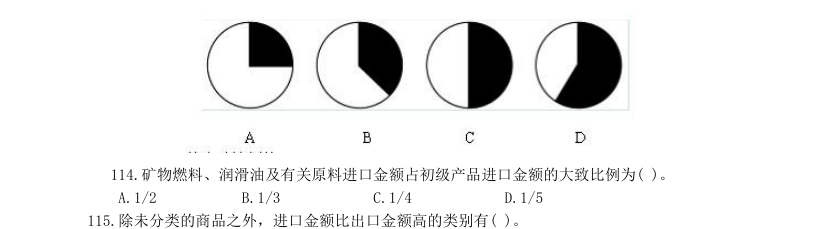

- **A.** 1/2
- **B.** 1/3
- **C.** 1/4
- **D.** 1/5

**答案：B**

### 2003 国考·B卷　第 121 题　（现期比重）
> 材料：2001 年北京外来人口主要数据 人口总量:全市在京居住一天以上的外来人口为328.1 万人,比1997 年增加98.2 万人。 年龄构成:0~14 岁人口占7.4%;1997 年为6.7%;15~59 岁人口占90.8%,比1997 年的91.4% 下降了0.6 个百分点,其中15~39 岁人口占80.1%,比1997 年下降了0.1 个百分点;60 岁以上人 口比1997 年的1.9%下降了0.1 个百分点。 在京状况:务工经商人员占78.1%,比1997 年下降了0.6…

来京时间:来京三个月以下的人口占15.5%,比1997 年下降10.2 个百分点;来京三个月至半 年的占4.4%,比1997 年下降6.3 个百分点;来京半年以上的占80.1%,比1997 年上升了16.5 个百 分点。 人口增加最少(但也没有减少)的可能是以下哪一类人?( )。

- **A.** 15~59 岁
- **B.** 60 岁以上
- **C.** 探亲访友、因公出差
- **D.** 来京三个月至半年

**答案：暂缺**

### 2003 国考·B卷　第 123 题　（现期比重）

与1997 年相比,2001 年占总人口比例数量为稳定的两个年龄段的人口共约多少万人?( )。

- **A.** 210
- **B.** 240
- **C.** 270
- **D.** 310

**答案：C**

### 2003 国考·B卷　第 126 题　（现期比重）

从上图可以看出1997 年与2000 年相比,产值比重减少最多的产业是( )。

- **A.** 电子与信息
- **B.** 生物及医药物品
- **C.** 新材料
- **D.** 光机电一体化

**答案：B**

### 2002 国考·A卷　第 129 题　（现期比重）

单选、 下面哪项陈述可以从上面材料中得出( )。 I.公有经济实现的国民生产总值中包括混合所有制经济中 公有成分实现的增加值;II.改革开放以来,各种经济成分都有发展,它们占国内生产总值的比重都有所增加; III.非公有制经济已成为我国社会主义市场经济的重要组成部分。

- **A.** 只有第I项
- **B.** 只有第II项
- **C.** I项和II项
- **D.** 全部三项

**答案：A**

### 2002 国考·A卷　第 130 题　（现期比重）

单选、 如果下面的圆图代表1997 年的国内生产总值,圆圈中阴影所占比重最接近非公有制经济的比例的是

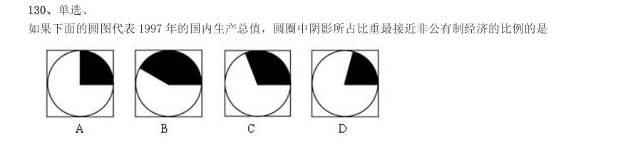

> （本题为图形题，选项为图片，见原卷）

**答案：A**

### 2001 国考·统一卷　第 91 题　（现期比重）
> 材料：资料分析(共20 题,参考时限15 分钟) 所给出的图、表或一段文字均有5 个问题要你回答。你应根据资料提供的信息进行分析、比较、计算和判 断处理。 一、根据下列文字资料回答91~95 题。 根据教育部《1999 年全国教育事业发展统计公报》,全国普通中小学校舍建筑面积为104 070 万平方米, 比上年增加4 747 万平方米。其中危房741.4 万平方米,危房率比上年下降0.3 个百分点。普通初中理科实验 设备、分组实验条件和图书藏量达标学校占初中总校数的比例分别是:71…

与1998 年相比,1999 年小学理科实验设备、分组实验条件和图书藏量达标学校占小学总校数的比例增长 最快的是( )。

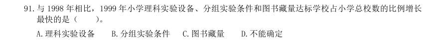

- **A.** 理科实验设备
- **B.** 分组实验条件
- **C.** 图书藏量
- **D.** 不能确定

**答案：C**

### 2001 国考·统一卷　第 94 题　（现期比重）

1998 年,普通初中分组实验条件达标学校占初中总校数的比例比小学分组实验条件达标学校占小学总校数 的比例多出( )。

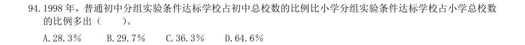

- **A.** 28.3%
- **B.** 29.7%
- **C.** 36.3%
- **D.** 64.6%

**答案：A**

### 2001 国考·统一卷　第 99 题　（现期比重）

如果下面的圆图代表1991 年乘客投诉意见的总数,圆图中阴影所占的比例哪一个最接近“航班误点”的比 例?( )。 A B C D

> （本题为图形题，选项为图片，见原卷）

**答案：C**

### 2001 国考·统一卷　第 101 题　（现期比重）

1997 年对某地区人员的职业、性别及工资收入进行调查得到如下资料: 该地区男性就业人员在全部就职人员中所占比例约为( )。

- **A.** 38%
- **B.** 52%
- **C.** 58%
- **D.** 62%

**答案：D**

### 2001 国考·统一卷　第 105 题　（现期比重）

下面哪项陈述可以从资料中得出?( )。 I.专业辅助人员中男性所占比例不到l/3。 II.女性公务员是女性保安类人员的3 倍。 III.男性技术人员的平均年收入不如女性公务员的平均年收入高。

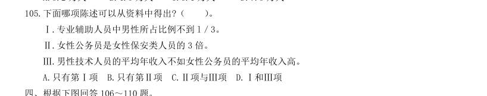

- **A.** 只有第I项
- **B.** 只有第II项
- **C.** II项与III项
- **D.** I和III项

**答案：D**

### 2000 国考·统一卷　第 88 题　（现期比重）

1999 年广告费支出最大的五个公司的广告花费额约占当年广告费总额的( )。

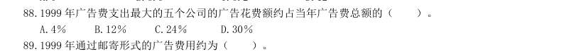

- **A.** 4%
- **B.** 12%
- **C.** 24%
- **D.** 30%

**答案：A**

### 2000 国考·统一卷　第 90 题　（现期比重）

如果1999 年全部广告费的0.2%用于包装材料的印刷,那么此项支出约占其他形式类的广告支出的百分比为 ( )。

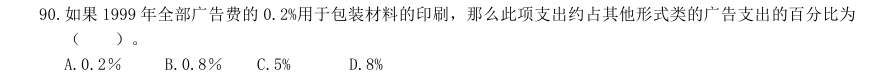

- **A.** 0.2%
- **B.** 0.8%
- **C.** 5%
- **D.** 8%

**答案：B**

### 2000 国考·统一卷　第 94 题　（现期比重）

女运动员人数占全体运动员人数比例最大的年度是( )。

- **A.** 1936 年
- **B.** 1932 年
- **C.** 1928 年
- **D.** 1900 年

**答案：C**
