# 资料分析 · 比重计算与比较 · 2010 年代真题

> 所属考点：[ZL-BILI](../ZL-BILI-比重计算与比较.md)　｜　本片 88 题

### 2019 湖北·统一卷　第 114 题　（基期比重）

2016 年山东、广东和河南三省出生人口之和占当年全国出生人口的比重约为:

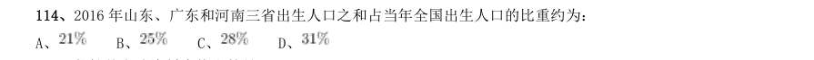

- **A.** 
- **B.** 
- **C.** 
- **D.** 

**答案：B**

### 2019 湖北·统一卷　第 116 题　（现期比重）
> 材料：2017 年全国举办马拉松赛事达1102 场,其中,中国田径协会举办的A 类赛事223 场,B 类赛事33 场。2017 年马拉松赛事的参与人次达到了498 万人次,2016 年、2015 年马拉松赛事的参与人次分别为280 万人次、150 万人次。 2017 年全年马拉松直接从业人口数72 万,间接从业人口数200 万。年度产业总规模达700 亿元,比去年同 期增长约 ,中国田径协会设置的发展目标是到2020 年,全国马拉松规模赛事超过1900 场,其中中国田径协 会认证赛…

2017 年中国田径协会举办的A 类与B 类赛事占全国马拉松赛事的比例约为:

- **A.** 
- **B.** 
- **C.** 
- **D.** 

**答案：B**

### 2019 广东·乡镇　第 84 题　（现期比重）

2018 年,全国通硬化路面的乡镇占全国乡镇比例与2014 年相比( )个百分点。

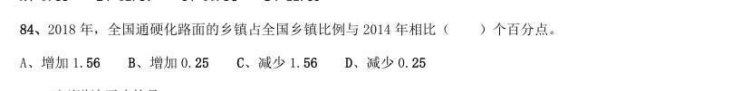

- **A.** 增加1.56
- **B.** 增加0.25
- **C.** 减少1.56
- **D.** 减少0.25

**答案：暂缺**

### 2019 广东·乡镇　第 88 题　（现期比重）

2018 年,我国贫困地区农村居民人均工资性收入约占人均可支配收入的( )。

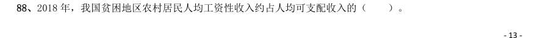

- **A.** 
- **B.** 
- **C.** 
- **D.** 

**答案：暂缺**

### 2019 广东·乡镇　第 92 题　（现期比重）

2018 年,B 省第三产业新登记市场主体约占全省实有各类市场主体的( )。

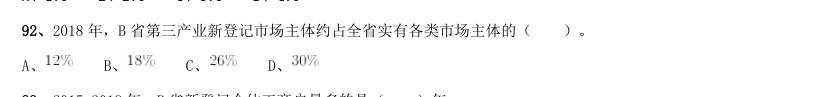

- **A.** 
- **B.** 
- **C.** 
- **D.** 

**答案：暂缺**

### 2019 广东·县级　第 96 题　（两期比重差）
> 材料：2018 年,我国全社会用电量68449 亿千瓦时,同比增长 ,增幅同比提高1.9 个百分点。具体来看,第 一产业用电量728 亿千瓦时,同比增长 ;第二产业用电量47235 亿千瓦时,同比增长 ;第三产业用电 量10801 亿千瓦时,同比增长 ;城乡居民生活用电量9685 亿千瓦时,同比增长 。…

2018 年,我国可再生能源发电量达1.87 万亿千瓦时,同比增长约1700 亿千瓦时;可再生能源发电量占全 年发电总量比重为 ,同比上升0.2 个百分点。 2018 年,我国全社会用电量较2016 年增加了约( )。

- **A.** 
- **B.** 
- **C.** 
- **D.** 

**答案：暂缺**

### 2019 广东·思维能力测验　第 20 题　（现期比重）

某市城市规划设计院的一项调查显示,该市中心城区范围内的全部自行车道,56%被机动车停车占用, 75%有效宽度不足。为了使自行车能够重新在当地中心城区范围内正常行驶,有人建议应当重新规划并加宽自行 车道。 以下最无法质疑上述建议的是()。

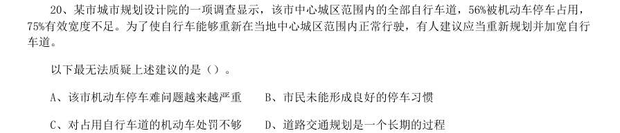

- **A.** 该市机动车停车难问题越来越严重
- **B.** 市民未能形成良好的停车习惯
- **C.** 对占用自行车道的机动车处罚不够
- **D.** 道路交通规划是一个长期的过程

**答案：D**

### 2019 广东·思维能力测验　第 35 题　（现期比重）

过去3 年中,某企业生产所需原材料的平均价格增长了20%,但原材料成本占总成本的比例并没有发 生变化。因此,该企业的生产总成本在过去3 年内同样增长了20%。 上述推论最可能基于的假设是该企业()。

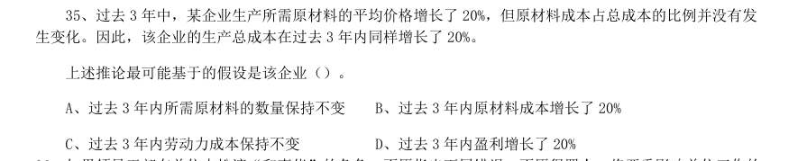

- **A.** 过去3 年内所需原材料的数量保持不变
- **B.** 过去3 年内原材料成本增长了20%
- **C.** 过去3 年内劳动力成本保持不变
- **D.** 过去3 年内盈利增长了20%

**答案：A**

### 2019 广东·选调　第 78 题　（现期比重）

2012—2015 年,老龄机构单位数占社会服务机构单位数的比重最大的是( )。

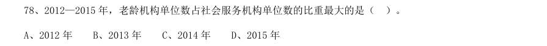

- **A.** 2012 年
- **B.** 2013 年
- **C.** 2014 年
- **D.** 2015 年

**答案：A**

### 2019 国考·地市级　第 123 题　（现期比重）

2017 年下半年,金融证券类和支付交易类钓鱼网站占当月处理钓鱼网站总数比重最低的月份是:

- **A.** 8 月
- **B.** 9 月
- **C.** 10 月
- **D.** 11 月

**答案：D**

### 2019 国考·地市级　第 126 题　（比重升降判断）
> 材料：2017 年,A 省完成邮电业务总量6065.71 亿元。其中,电信业务总量3575.86 亿元,同比增长75.8%;邮政 业务总量2489.85 亿元,增长32.0%。 2017 年,A 省移动电话期末用户1.48 亿户,比上年末增长3.1%。其中,4G 期末用户达1.18 亿户,比上年 末增长29.3%。互联网宽带接入期末用户3128 万户,比上年末增长9.9%。移动互联网期末用户1.31 亿户,比上 年末增长13.9%,移动互联网接入流量同比增长158.8%。 2017…

高铁客运量和旅客周转量分别占铁路旅客运输总量的62.7%和54.3%,比重比上年分别提高4.3 个和3.9 个百分 点。 2017 年A 省邮电业务总量同比增速在以下哪个范围之内?

- **A.** 低于25%
- **B.** 25%~50%之间
- **C.** 50%~75%之间
- **D.** 超过75%

**答案：C**

### 2019 国考·地市级　第 127 题　（基期比重）

2017 年A 省快递业务中,业务量占总业务量比重高于上年水平的分类是:

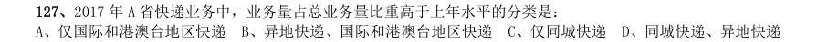

- **A.** 仅国际和港澳台地区快递
- **B.** 异地快递、国际和港澳台地区快递
- **C.** 仅同城快递
- **D.** 同城快递、异地快递

**答案：B**

### 2019 国考·地市级　第 130 题　（现期比重）

在以下4 条关于A 省的信息中,能够直接从资料中推出的有几条? 12017 年非4G 移动电话用户全年增量 22017 年移动互联网用户日均增量 32015 年客运总量 42017 年铁路旅客运输总量占客运总量比重

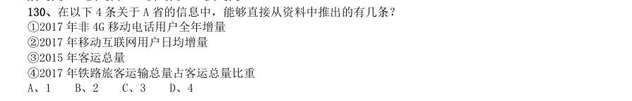

- **A.** 1
- **B.** 2
- **C.** 3
- **D.** 4

**答案：D**

### 2018 湖北·统一卷　第 112 题　（现期比重）

2017 年第一季度,该省占农林牧渔业增加值比重超过三成的包括:

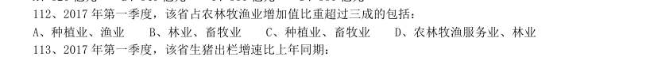

- **A.** 种植业、渔业
- **B.** 林业、畜牧业
- **C.** 种植业、畜牧业
- **D.** 农林牧渔服务业、林业

**答案：C**

### 2018 湖北·统一卷　第 116 题　（现期比重）
> 材料：根据以下材料,回答116~120 题。 2016 年,我国全年完成邮电业务收入总量43344 亿元,比上年增长52.7%。其中,邮政业务收入7397 亿 元,增长45.7%;电信业务总量35948 亿元,增长54.2%。邮政业全年完成邮政函件业务36.2 亿件,包裹业务 0.3 亿件,快递业务量312.8 亿件;快递业务收入总量3974 亿元。电信业全年新增移动电话交换机容量7318 万户,达到218384 万户。2016 年来全国电话用户总数152856 万户(电话包括固定…

软件信息技术服务业完成软件业务收入48511 亿元,比上年增长14.9%。 2016 年我国快递业务收入总量占邮电业务收入总量的比重为:

- **A.** 8.17%
- **B.** 9.17%
- **C.** 10.17%
- **D.** 11.17%

**答案：B**

### 2018 湖北·统一卷　第 117 题　（现期比重）

2016 年末,全国固定电话用户占电话用户总数的比重为:

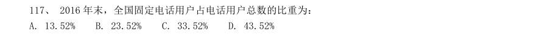

- **A.** 13.52%
- **B.** 23.52%
- **C.** 33.52%
- **D.** 43.52%

**答案：A**

### 2018 广东·统一卷　第 99 题　（现期比重）

2012—2016 年,全省医疗卫生机构卫生技术人员中注册护士所占比率最高的一年比例约为( )。

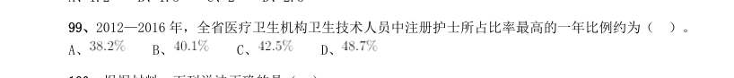

- **A.** 
- **B.** 
- **C.** 
- **D.** 

**答案：暂缺**

### 2018 国考·副省级　第 119 题　（现期比重）

2016 年,蒙古GDP 约占全球总体GDP 的:

- **A.** 0.61‰
- **B.** 1.56‰
- **C.** 0.06‰
- **D.** 0.16‰

**答案：D**

### 2018 国考·副省级　第 122 题　（基期比重）

2015 年第四季度在线餐饮外卖市场交易规模占全年交易规模的比重约为:

- **A.** 21%
- **B.** 28%
- **C.** 37%
- **D.** 49%

**答案：B**

### 2018 国考·副省级　第 129 题　（现期比重）

2016 年,杭州公园数量约占浙江省公园总数的:

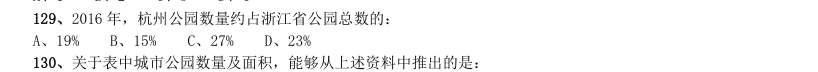

- **A.** 19%
- **B.** 15%
- **C.** 27%
- **D.** 23%

**答案：A**

### 2018 国考·副省级　第 132 题　（现期比重）

设2017 年1~2 月出口船完工量占全国造船完工量比重为X,同期出口船承接订单量占全国承接新船订单 量比重为Y,2 月末手持出口船订单量占全国手持船舶订单量比重为Z,则有:

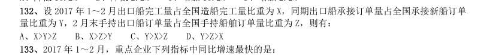

- **A.** X>Y>Z
- **B.** X>Z>Y
- **C.** Y>X>Z
- **D.** Y>Z>X

**答案：B**

### 2018 国考·副省级　第 134 题　（现期比重）

2017 年1~2 月,非重点企业出口船完工量约占全国出口船完工量的:

- **A.** 2%
- **B.** 5%
- **C.** 95%
- **D.** 98%

**答案：A**

### 2018 国考·地市级　第 114 题　（现期比重）

2016 年,蒙古GDP 约占全球总体GDP 的:

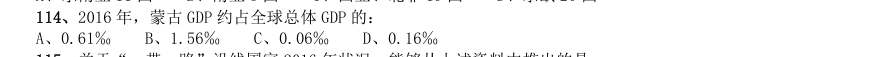

- **A.** 0.61‰
- **B.** 1.56‰
- **C.** 0.06‰
- **D.** 0.16‰

**答案：D**

### 2018 国考·地市级　第 124 题　（现期比重）

2016 年,杭州公园数量约占浙江省公园总数的:

- **A.** 19%
- **B.** 15%
- **C.** 27%
- **D.** 23%

**答案：A**

### 2018 国考·地市级　第 127 题　（现期比重）

设2017 年1~2 月出口船完工量占全国造船完工量比重为 ,同期出口船承接订单量占全国承接新船订单量 比重为 ,2 月末手持出口船订单量占全国手持船舶订单量比重为 ,则有:

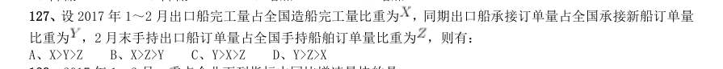

- **A.** X>Y>Z
- **B.** X>Z>Y
- **C.** Y>X>Z
- **D.** Y>Z>X

**答案：B**

### 2017 湖北·统一卷　第 112 题　（现期比重）

2015 年税收收入占一般公共预算收入比重最大的是:

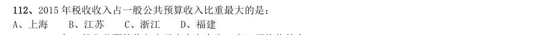

- **A.** 上海
- **B.** 江苏
- **C.** 浙江
- **D.** 福建

**答案：A**

### 2017 湖北·统一卷　第 117 题　（现期比重）

2015 年面上项目资助项数占总资助项数的比重较上一年增加约:

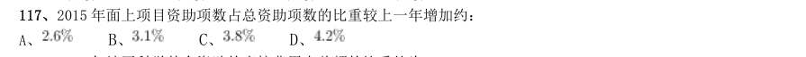

- **A.** 
- **B.** 
- **C.** 
- **D.** 

**答案：A**

### 2017 湖北·统一卷　第 118 题　（现期比重）

2015 年地区科学基金资助的直接费用占总额的比重约为:

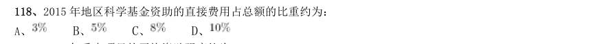

- **A.** 
- **B.** 
- **C.** 
- **D.** 

**答案：B**

### 2017 湖北·统一卷　第 121 题　（两期比重差）
> 材料：根据以下资料,回答121~125 题。 2015 年全国共建立社会捐助工作站、点和慈善超市3.0 万个,比上一年减少0.2 万个,其中:慈善超市9654 个, 同比下降 。全年共接收社会捐赠款654.5 亿元,其中:民政部门接收社会各界捐款44.2 亿元,各类社会组织接 收捐款610.3 亿元。全年民政部门接收捐赠衣被4537.0 万件,捐赠物资价值折合人民币5.2 亿元。…

全年有1838.4 万 人次困难群众受益,同比增长 ,增长率较上一年下降27.5 个百分点。全年有934.6 万人次在社会服务领域提供 了2700.7 万小时的志愿服务,同比减少10.4 万小时。 2012~2015 年社会组织接收社会捐赠款占总捐赠款的比重最高的是:

- **A.** 2012 年
- **B.** 2013 年
- **C.** 2014 年
- **D.** 2015 年

**答案：D**

### 2017 广东·统一卷　第 92 题　（现期比重）

2016 年广东民营经济中第三产业所占的比重相比2015 年大约:

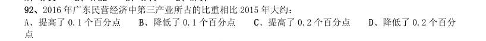

- **A.** 提高了0.1 个百分点
- **B.** 降低了0.1 个百分点
- **C.** 提高了0.2 个百分点
- **D.** 降低了0.2 个百分

**答案：暂缺**

### 2017 广东·统一卷　第 93 题　（现期比重）

2015 年广东民营工业实现的增加值约占当年GDP 的:

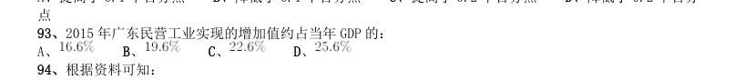

- **A.** 
- **B.** 
- **C.** 
- **D.** 

**答案：暂缺**

### 2017 广东·统一卷　第 96 题　（现期比重）
> 材料：2016 年,某省完成邮政通信业务总量6886.15 亿元,同比增长 ,增幅比上年提高27.4 个百分点。其中, 完成邮政业务总量1879.99 亿元,增长 ,增幅提高11.0 个百分点;完成通信业务总量5006.16 亿元, 增长 ,增幅提高33.2 个百分点。 2016 年,该省完成快递业务量76.72 亿件,同比增长 ,占全国快递业务量的比重达到 ,比排名第 二的Z 省多16.80 亿件。 2016 年,该省电话用户数为1.69 亿,其中固定电话用户数为2609.7 万…

2016 年该省完成的通信业务总量占邮政通信业务总量的比重相比2014 年大约:

- **A.** 提高了0.6 个百分点
- **B.** 降低了0.6 个百分点
- **C.** 提高了1.9 个百分点
- **D.** 降低了1.9 个百分

**答案：暂缺**

### 2017 国考·副省级　第 122 题　（现期比重）

2014 年末,我国一、二、三级文物总量占全部文物藏品的比重最接近以下哪个数字?

- **A.** 8%
- **B.** 10%
- **C.** 14%
- **D.** 54%

**答案：B**

### 2017 国考·副省级　第 124 题　（现期比重）

2008~2014 年间,文物机构参观者中未成年人占比超过三成的年份有几个?

- **A.** 1
- **B.** 2
- **C.** 3
- **D.** 4

**答案：A**

### 2017 国考·副省级　第 126 题　（两期比重差）
> 材料：2015 年我国钟表全行业实现工业总产值约675 亿元,同比增长3.2%,增速比上年同期提高1.7 个百分点。 全行业全年生产手表10.7 亿只,同比增长3.9%,完成产值约417 亿元,同比增长4.3%,增速提高1.9 个 百分点;生产时钟(含钟心)5.2 亿只,同比下降3.7%,完成产值162 亿元,同比下降4.7%,降幅扩大1.3 个百分点;钟表零配件、定时器及其他计时仪器产值96 亿元,同比增长14.3%,增速基本保持上年水平。 2015 年我国钟表行业规模以上工业企…

2015 年我国钟表行业海关进出口总额为92.5 亿美元,同比增长4%,完成出口总额为57.7 亿美元,同比增 长8.3%,进口额34.8 亿美元。出口总额中加工贸易额占47%,较上年缩小2 个百分点。 2015 年我国钟表全行业生产时钟(含钟心)的产值与2013 年相比约:

- **A.** 上升了11%
- **B.** 下降了11%
- **C.** 上升了8%
- **D.** 下降了8%

**答案：D**

### 2017 国考·副省级　第 133 题　（现期比重）

能够正确描述2015 年新能源汽车产业五种专利申请数占比的统计图是:

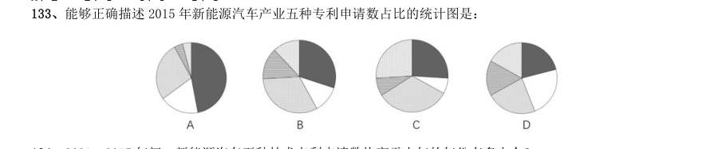

> （本题为图形题，选项为图片，见原卷）

**答案：B**

### 2016 湖北·统一卷　第 107 题　（两期比重差）

2015 年1-3 月,在销售费用、管理费用和财务费用中,占国有企业营业总成本的比重同比上升的有几项?

- **A.** 0
- **B.** 1
- **C.** 2
- **D.** 3

**答案：D**

### 2016 湖北·统一卷　第 108 题　（基期比重）

2015 年3 月末,中央企业所有者权益占国有企业总体比重比上年同期约:

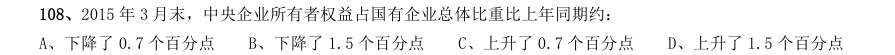

- **A.** 下降了0.7 个百分点
- **B.** 下降了1.5 个百分点
- **C.** 上升了0.7 个百分点
- **D.** 上升了1.5 个百分点

**答案：A**

### 2016 湖北·统一卷　第 113 题　（基期比重）

2013 年11 月我国货物周转总量中,水运周转量占比在以下哪个范围之内?

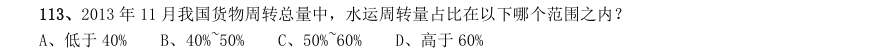

- **A.** 低于40%
- **B.** 40%~50%
- **C.** 50%~60%
- **D.** 高于60%

**答案：B**

### 2016 湖北·统一卷　第 114 题　（基期比重）

哪些运输方式在2014 年11 月的货物运输量占当月货物运输总量的比重超过上年同期水平?

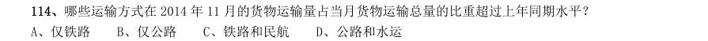

- **A.** 仅铁路
- **B.** 仅公路
- **C.** 铁路和民航
- **D.** 公路和水运

**答案：D**

### 2016 广东·乡镇　第 92 题　（现期比重）

2010—2014 年,开展新型农村合作医疗的县(市、区)数量占县级区划数90%以上的年份有 ( )个。

- **A.** 1
- **B.** 2
- **C.** 3
- **D.** 4

**答案：暂缺**

### 2016 广东·县级　第 99 题　（现期比重）

我国普通高中专任教师中,以下年龄组女性所占比重最大的是( )。

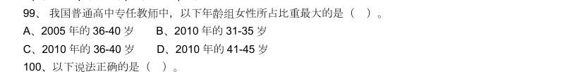

- **A.** 2005 年的36-40 岁
- **B.** 2010 年的31-35 岁
- **C.** 2010 年的36-40 岁
- **D.** 2010 年的41-45 岁

**答案：暂缺**

### 2016 国考·副省级　第 127 题　（现期比重）

2014 年,全国新登记注册市场主体中个体工商户所占比重约为:

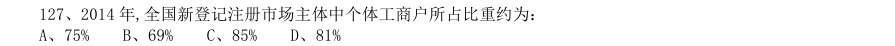

- **A.** 75%
- **B.** 69%
- **C.** 85%
- **D.** 81%

**答案：B**

### 2016 国考·副省级　第 132 题　（现期比重）

2013、2014 年占全国社会物流总额比重均高于上一年水平的分类包括:

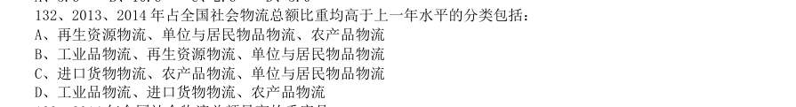

- **A.** 再生资源物流、单位与居民物品物流、农产品物流
- **B.** 工业品物流、再生资源物流、单位与居民物品物流
- **C.** 进口货物物流、农产品物流、单位与居民物品物流
- **D.** 工业品物流、进口货物物流、农产品物流

**答案：B**

### 2016 国考·地市级　第 113 题　（比重计算（综合））
> 材料：根据资料所提供的信息进行分析、比较、计算和判断处理。 一、根据以下资料,回答111~115 题。 2014 年全国棉花播种面积4219.1 千公顷,比2013 年减少2.9%。棉花总产量616.1 万吨,比2013 年减产2.2%。…

2014 年全国棉花单位面积产量比上年约:

- **A.** 2
- **B.** 3
- **C.** 4
- **D.** 5

**答案：C**

### 2015 湖北·统一卷　第 107 题　（现期比重）

2013 年上半年,房产税、城镇土地使用税及契税等三项增收之和占全国税收增收比重为:

- **A.** 1.2%
- **B.** 6.2%
- **C.** 11.2%
- **D.** 16.2%

**答案：D**

### 2015 湖北·统一卷　第 122 题　（现期比重）

2012 年,农村居民国内旅游人数占全国国内旅游人数的比例约为:

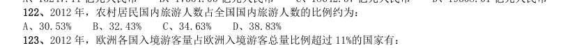

- **A.** 30.53%
- **B.** 32.43%
- **C.** 34.63%
- **D.** 38.83%

**答案：C**

### 2015 湖北·统一卷　第 123 题　（现期比重）

2012 年,欧洲各国入境游客量占欧洲入境游客总量比例超过11%的国家有:

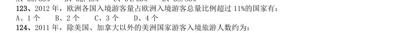

- **A.** 1 个
- **B.** 2 个
- **C.** 3 个
- **D.** 4 个

**答案：B**

### 2015 广东·乡镇　第 91 题　（现期比重）
> 材料：(二) 2014 年,全国汽车产销分别是2372 万辆和2349 万辆,同比增长7.3%和6.9%。汽车销售排名前十 位的企业集团销售合计为2107.7 万辆,比上年同期增长8.9%,高于全行业增速2 个百分点。 2014 年乘用车销售1970 万辆,比上年同期增长9.89%。其中轿车增速放缓,SUV、MPV 依旧保持高 速增长,交叉型乘用车则继续下降。乘用车分车型看:轿车销售1238 万辆,同比增长3.1%;SUV 销售 为408 万辆,同比增长36.4%;MPV 销量为1…

2014 年汽车销量排名前十位的企业集团销量占汽车销售总量的:

- **A.** 89.7%
- **B.** 88.9%
- **C.** 73.4%
- **D.** 67.5%

**答案：暂缺**

### 2015 广东·乡镇　第 99 题　（现期比重）

2013 年 月我国出口苹果金额约占2013 年全年的:

- **A.** 66%
- **B.** 79%
- **C.** 88%
- **D.** 93%

**答案：暂缺**

### 2015 广东·县级　第 88 题　（比重升降判断）

2014 年 月,我国2G 手机出货量所占比例与上月相比有所上升的月份共有多少个:

- **A.** 2
- **B.** 4
- **C.** 7
- **D.** 8

**答案：暂缺**

### 2015 国考·副省级　第 127 题　（现期比重）

2014 年前5 个月完成收入排名前三的软件业务,同期完成收入占我国软件业务总收入的比重约为:

- **A.** 61.8%
- **B.** 69.6%
- **C.** 81.2%
- **D.** 86.5%

**答案：B**

### 2014 湖北·统一卷　第 107 题　（比重升降判断）

2013 年3 月末,轻工业中长期贷款余额占工业中长期贷款余额总体的比重与上年相比:

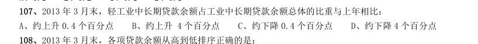

- **A.** 约上升0.4 个百分点
- **B.** 约上升4 个百分点
- **C.** 约下降0.4 个百分点
- **D.** 约下降4 个百分点

**答案：A**

### 2014 湖北·统一卷　第 124 题　（比重升降判断）

在寿险、健康险和人身意外伤害险中,有几类险种在2013 年5 月的保险赔付支出额占全行业保险赔付支出 总额的比重高于上年同期水平?

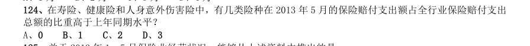

- **A.** 0
- **B.** 1
- **C.** 2
- **D.** 3

**答案：B**

### 2014 广东·乡镇　第 89 题　（现期比重）

2011 年底,社区卫生服务中心和乡镇卫生院的卫生技术人数数量之和占全部卫生技术人员总数的:

- **A.** 17.5%
- **B.** 18.6%
- **C.** 19.8%
- **D.** 20.3%

**答案：暂缺**

### 2014 国考·统一卷　第 132 题　（基期比重）

2012 年清洁能源机组并网容量占当年并网机组总容量的比重比上年:

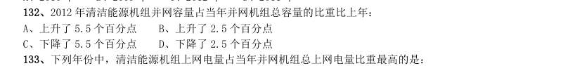

- **A.** 上升了5.5 个百分点
- **B.** 上升了2.5 个百分点
- **C.** 下降了5.5 个百分点
- **D.** 下降了2.5 个百分点

**答案：B**

### 2014 国考·统一卷　第 133 题　（现期比重）

下列年份中,清洁能源机组上网电量占当年并网机组总上网电量比重最高的是:

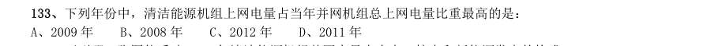

- **A.** 2009 年
- **B.** 2008 年
- **C.** 2012 年
- **D.** 2011 年

**答案：C**

### 2013 湖北·统一卷　第 136 题　（现期比重）

2011 年 月,新承接出口船舶订单在全国造船完工总量的比重约为?

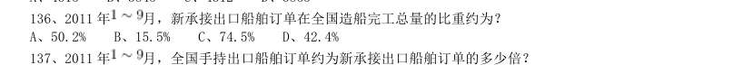

- **A.** 50.2%
- **B.** 15.5%
- **C.** 74.5%
- **D.** 42.4%

**答案：D**

### 2013 湖北·统一卷　第 138 题　（比重升降判断）

2011 年 月,全国规模以上船舶工业企业完成出口交货值占全国规模以上船舶企业工业总产值中的比重 与2010 年该比重相比,下降了约几个百分点?

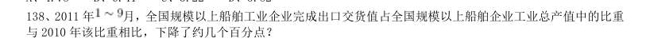

- **A.** 3
- **B.** 4
- **C.** 5
- **D.** 6

**答案：A**

### 2013 湖北·统一卷　第 141 题　（比重升降判断）

2011 年7 月轿车产量占汽车产量的比重与上年同期相比:

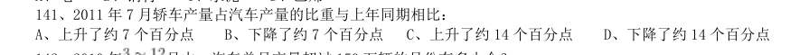

- **A.** 上升了约7 个百分点
- **B.** 下降了约7 个百分点
- **C.** 上升了约14 个百分点
- **D.** 下降了约14 个百分点

**答案：A**

### 2013 湖北·统一卷　第 145 题　（两期比重差）
> 材料：2011 年上半年,我国软件产业实现软件业务收入8065 亿元,同比增长29.3%,增速比去年同期高0.2 个百 分点;实现利润103 亿元,同比增长3.49%。其中,6 月份完成软件业务收入1828 亿元,同比增长32.9%,增速 比5 月份回升3.6 个百分点。 上半年,信息技术咨询服务、数据处理和营运服务实现收入761 和1073 亿元,同比增长36.5%和34.5,分 别高出全行业7.2 和5.2 个百分点;嵌入式系统软件实现收入1443 亿元,同比增长33.8%,增…

IC 设计增长放缓,上半年实现收入248 亿元,同比增长13.7%,低于去年同期20 个百分点以上。 2011 年6 月份我国软件业务收入占上半年的总值比重约为:

- **A.** 22.7%
- **B.** 24.6%
- **C.** 26.5%
- **D.** 29.1%

**答案：A**

### 2013 湖北·统一卷　第 148 题　（基期比重）

2011 年上半年收入占整个软件产业的比重高于上年同期水平的是:

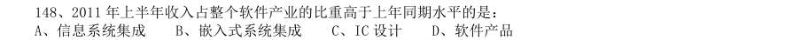

- **A.** 信息系统集成
- **B.** 嵌入式系统集成
- **C.** IC 设计
- **D.** 软件产品

**答案：B**

### 2013 国考·统一卷　第 123 题　（现期比重）

2011 年,发现违法但未立案的违法用地行为占发现违法用地行为总数的比重约为多少:

- **A.** 59.5%
- **B.** 40.5%
- **C.** 38.5%
- **D.** 61.5%

**答案：B**

### 2013 国考·统一卷　第 124 题　（现期比重）

下列年份中,本期结案中涉及的耕地面积占结案涉及土地面积比重最高的是:

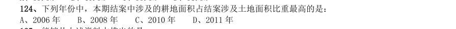

- **A.** 2006 年
- **B.** 2008 年
- **C.** 2010 年
- **D.** 2011 年

**答案：A**

### 2013 国考·统一卷　第 133 题　（现期比重）

2008—2011 年农民工从事交通运输、仓储和邮政业的比重变化趋势符合:

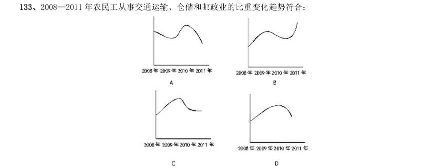

> （本题为图形题，选项为图片，见原卷）

**答案：D**

### 2013 国考·统一卷　第 134 题　（基期比重）

2011 年在中部地区务工的农民工占农民工总人数的比重,较上一年约增加:

- **A.** 0.6%
- **B.** 3.7%
- **C.** 6.2%
- **D.** 12.5%

**答案：A**

### 2012 湖北·统一卷　第 108 题　（基期比重）

2011 年12 月该省入境外国旅游者占全年入境外国旅游者的比重,较上年约增加:

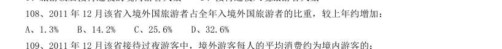

- **A.** 1.3%
- **B.** 14.2%
- **C.** 25.6%
- **D.** 32.6%

**答案：A**

### 2012 湖北·统一卷　第 113 题　（现期比重）

下列最能体现2011 年我国对欧盟出口额占全年出口额比重的图例是:

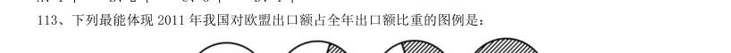

> （本题为图形题，选项为图片，见原卷）

**答案：B**

### 2012 湖北·统一卷　第 119 题　（基期比重）

2010 年,我国猪肉产量占肉类总产量的比重约为:

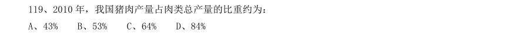

- **A.** 43%
- **B.** 53%
- **C.** 64%
- **D.** 84%

**答案：C**

### 2012 广东·统一卷　第 86 题　（现期比重）

根据资料所提供的信息进行分析、比较、计算和判断处理。 (一) 根据下表,完成各题。 服务性消费支出占消费支出的比例最高的年份是多少年:

- **A.** 2005
- **B.** 2006
- **C.** 2007
- **D.** 2008

**答案：暂缺**

### 2012 广东·统一卷　第 87 题　（比重升降判断）

2010 年与2005 年相比,交通工具服务支出占服务性消费支出的比重提高了约:

- **A.** 2%
- **B.** 4%
- **C.** 6%
- **D.** 8%

**答案：暂缺**

### 2012 广东·统一卷　第 93 题　（现期比重）

2010 年铁路客运量占全年客运总量的比重约为:

- **A.** 3%
- **B.** 5%
- **C.** 7%
- **D.** 9%

**答案：暂缺**

### 2012 国考·统一卷　第 117 题　（现期比重）

2009 年,该省广告收入占广电总收入的比重约为:

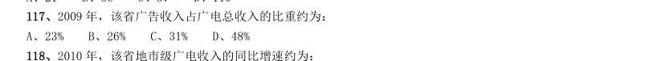

- **A.** 23%
- **B.** 26%
- **C.** 31%
- **D.** 48%

**答案：D**

### 2012 国考·统一卷　第 122 题　（现期比重）

2010 年,珠三角地区第二产业产值占国内生产总值的比重为:

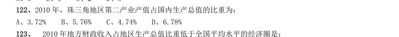

- **A.** 3.72%
- **B.** 5.76%
- **C.** 4.74%
- **D.** 6.78%

**答案：C**

### 2012 国考·统一卷　第 123 题　（现期比重）

2010 年地方财政收入占地区生产总值比重低于全国平均水平的经济圈是:

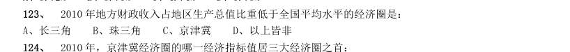

- **A.** 长三角
- **B.** 珠三角
- **C.** 京津冀
- **D.** 以上皆非

**答案：B**

### 2012 国考·统一卷　第 129 题　（现期比重）

2010 年底,图2 中11 省拥有高速公路的里程约占同期全国总里程的:

- **A.** 49%
- **B.** 57%
- **C.** 62%
- **D.** 70%

**答案：B**

### 2012 国考·统一卷　第 132 题　（基期比重）

2010 年高新技术产品出口额占到出口总额的比重与上年相比约:

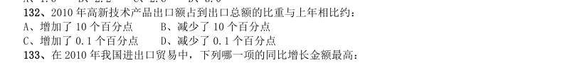

- **A.** 增加了10 个百分点
- **B.** 减少了10 个百分点
- **C.** 增加了0.1 个百分点
- **D.** 减少了0.1 个百分点

**答案：D**

### 2011 湖北·统一卷　第 113 题　（现期比重）

2009 年,海水养殖业产量占水产品养殖业产量的比重为:

- **A.** 33.4%
- **B.** 77.5%
- **C.** 60.8%
- **D.** 43.7%

**答案：D**

### 2011 国考·统一卷　第 123 题　（现期比重）

2000 年,中国稻谷产量占世界稻谷产量的比重约为:

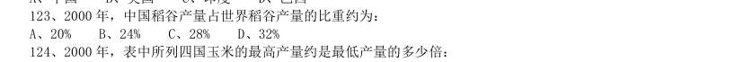

- **A.** 20%
- **B.** 24%
- **C.** 28%
- **D.** 32%

**答案：D**

### 2011 国考·统一卷　第 129 题　（现期比重）

2009 年 月,石油天然气开采业利润占石油石化行业实现利润的比重约为:

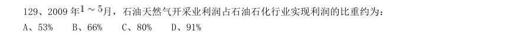

- **A.** 53%
- **B.** 66%
- **C.** 80%
- **D.** 91%

**答案：A**

### 2011 国考·统一卷　第 133 题　（现期比重）

2010 年一季度,我国与美国水产品进出口贸易额占我国水产品进出口贸易总额的比重约为:

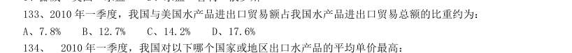

- **A.** 7.8%
- **B.** 12.7%
- **C.** 14.2%
- **D.** 17.6%

**答案：C**

### 2010 湖北·统一卷　第 91 题　（比重升降判断）
> 材料：理。 (一) 根据以下资料,完成各题。 2009 年,中国农业生产在国家继续加大支农政策力度的作用下,克服不利气候条件的影响,实现了稳步的增长。 据国家统计局公布的统计数据显示,2009 年第一产业增加值35477 亿元(包括农林牧渔服务业),比上年实际增 长4.2%。第一产业增加值占国内生产总值的比重为10.6%,比上年下降0.1 个百分点。在农、林、牧、渔业增 加值中,农业增加值19699 亿元,实际增长3.1%;林业增加值1581 亿元,实际增长6.0%;畜牧业增加值达…

第一产业内部,农业比重比上年提高 1.6 个百分点;林业比重为4.5%,渔业比重为7.9%,均比上年略有提高;畜牧业比重为27.2%,比上年下降2.4 个百分点。 2009 年国内生产总值是多少亿元:

- **A.** 376056
- **B.** 334689
- **C.** 333156
- **D.** 185840

**答案：B**

### 2010 湖北·统一卷　第 93 题　（现期比重）

2009 年,第一产业内部农业增加值所占的比重是:

- **A.** 41.4%
- **B.** 51.5%
- **C.** 55.5%
- **D.** 58.6%

**答案：C**

### 2010 广东·统一卷　第 70 题　（比重升降判断）
> 材料：根据资料所提供的信息进行分析、比较、计算和判断处理。 (一) 根据下列资料,完成各题。 2004 年,广东省委省政府首次提出珠江三角与山区及东西两翼共建产业转移工业园,截至2009 年4 月, 广东全省已认定产业转移园32 个,14 个欠发达地市已至少有一个产业转移园,至2008 年底,广东省29 个 产业转移园已投入开发资金111.38 亿元,入园项目(含意向)973 个。总投资1156 亿元,已动工建设项目 611 个,投资额542.2 亿元 。园区已投入生产的企业200…

佛山从48.8%下降至35.1%下 降13.7 个百分点,下降幅度最大,而珠江三角地区外围的清远陶瓷生产增加较快,比重从1.1%上升到5.7%;梅 州从28.9%上升到43.7%,增加幅度最大。 2007 年广东省产业转移工业园实现工业总产值为多少亿元:

- **A.** 64.8
- **B.** 62.5
- **C.** 60.7
- **D.** 57.6

**答案：暂缺**

### 2010 广东·统一卷　第 71 题　（现期比重）

截至2008 年底,广东省产业转移工业园已动工建设项目的个数占入围项目总数的比重以及已投资 占总投资额的比重分别是:

- **A.** 62.8%,46.9%
- **B.** 62.8%,52.7%
- **C.** 60.9%,46.9%
- **D.** 60.9%,,52.7%

**答案：暂缺**

### 2010 广东·统一卷　第 82 题　（现期比重）

工业烟尘排放量占烟尘排放总量的比重最低的年份是:

- **A.** 2005 年
- **B.** 2006 年
- **C.** 2007 年
- **D.** 2008 年

**答案：暂缺**

### 2010 国考·统一卷　第 91 题　（现期比重）
> 材料：根据资料所提供的信息进行分析、比较、计算和判断处理。 (一)根据以下资料,完成各题。 中国汽车工业协会发布的2009 年4 月份中国汽车产销数据显示,在其他国家汽车销售进一步疲软的情况下, 国内乘用车销量却持续上升,当月销量已达83.1 万辆,比3 月份增长7.59%,同比增长37.37%。 乘用车细分为基本型乘用车(轿车)、多功能车(MPV)、运动型多用途车(SUV)和交叉型乘用车。其中, 轿车销量比三月份增长8.3%,同比增长33.04%;MPV 销量比3 月份下降3.5…

轿车、MPV、SUV、 和交叉型乘用车销量占4 月份乘用车总销量的比重分别为71%、2%、6%和21%。 与上年同期相比,2009 年4 月份乘用车销量约增长了多少万辆:

- **A.** 13.2
- **B.** 22.6
- **C.** 31.1
- **D.** 40.4

**答案：暂缺**

### 2010 国考·统一卷　第 109 题　（现期比重）

假如平均每条移动短信的业务费用为0.1 元,则2009 年5 月移动短信业务总量占当月电信业务总量的比重 约为:

- **A.** 2.8%
- **B.** 3.0%
- **C.** 3.2%
- **D.** 6.4%

**答案：B**
