# 资料分析 · 比重计算与比较 · 2020 年代真题

> 所属考点：[ZL-BILI](../ZL-BILI-比重计算与比较.md)　｜　本片 78 题

> 本片子考点：现期比重 63　两期比重差 15

### 【2026 国考（地市级）·第 128 题】GK-2026-ds-X128　比重计算与比较｜现期比重
> 材料：2024 年,我国对联合国定义的45 个最不发达国家(以下简称最不发达国家)进出口 14230.2 亿元人民币,占同期我国外贸进出口总值的3.2%。其中出口8664.6 亿元,同比(下同) 增长4.3%;进口5565.5 亿元,增长12.8%。 2024 年,我国对最不发达国家出口机电产品3942.2 亿元,增长13.5%。其中出口船舶690.8 亿元,增长65.9%,主要出口至全球第一大船旗国利比里亚。出口金额654.3 亿元,增长67%; 出口工程机械、火车分别为165.…

A.9.5% B.8.5% C.7.5% D.10.5% 下列饼状图,最能准确反映2024 年我国自最不发达国家进口值中,铜材(黑色),原油 (横线),金属矿砂(白色)和其他(竖线)进口值占比关系的是:

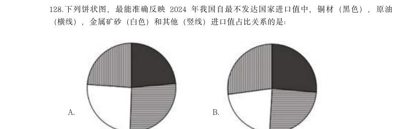

- **A.** 
- **B.** 
- **C.** 
- **D.** 

**答案：B**

### 【2026 国考（行政执法）·第 124 题】GK-2026-zf-X124　比重计算与比较｜现期比重
> 材料：科幻产业包括科幻阅读、科幻影视、科幻游戏、科幻衍生品、科幻文旅五大领域。2024年,我国科幻产业总营收1089.6 亿元。…

2022~2024 年,科幻文旅营收额占科幻产业营收额的比重超过20%的年份仅包括:

- **A.** 2023 和2024 年
- **B.** 2023 年
- **C.** 2022 和2024 年
- **D.** 2022 年

**答案：A**

### 【2025 湖北省考·第 122 题】HB-2025-ty-X122　比重计算与比较｜现期比重
> 材料：2023年全国著作权(包括作品著作权、计算机软件著作权、著作权质权)登记总量达8923901件,同比增长40.46%,增速比上年同期增加39个百分点。根据各省、自治区、直辖市版权局和中国版权保护中心作品登记信息统计,2023年全国共完成作品著作权登记6428277件,同比增长42.30%,登记量前五位的分别是:北京市1101072件,同比增加53802件;山东省873826件,同比增加619459件;福建省710648件,同比增加424814件; 中国版权保护中心493070…

2022年北京市作品著作权登记量约占同年全国作品著作权登记总量的:

- **A.** 10%
- **B.** 13%
- **C.** 18%
- **D.** 23%

**答案：该题答案缺失，见原卷**

### 【2025 广东省考·第 73 题】GD-2025-ty-X073　比重计算与比较｜现期比重
> 材料：。 2013~2023年,中国深入推进能源生产和消费方式变革,能源绿色低碳发展实现历史性突破。2023年,清 洁能源消费占比26.4%,较2013年提高10.9个百分点,煤炭消费比率累计下降12.1个百分点,发电总装机容量达 29.2亿千瓦。其中,清洁能源发电装机容量达17亿千瓦,清洁能源发电约3.8万亿千瓦,占总发电量的39.7%, 比2013年提高约15个百分点。十年来,新增清洁能源发电量占全社会用电增量一半以上。 中国能源转型支撑经济社会高质量发展。十年来,能源领域固定…

2023年,G省城镇社会消费品零售额约占社会消费品零售额的( )。

- **A.** 79.8%
- **B.** 83.4%
- **C.** 87.1%
- **D.** 90.0%

**答案：该题答案缺失，见原卷**

### 【2025 广东省考·第 83 题】GD-2025-ty-X083　比重计算与比较｜现期比重
> 材料：2023年,G省博物馆系统落实国家文物局、G省人民政府关于推进文物事业高质量发展战略合作协议,锚定博物馆事业高质量发展任务,全省博物馆事业发展取得明显成效。 截至2023年来,G省备案博物馆385家。其中,国有博物馆257家,非国有博物馆128家。国有博物馆中,文物系统国有博物馆227家,行业国有博物馆30家。G省国家一、二、三级博物馆共82家,数量位居全国第二。…

2023年,G省文物系统国有博物馆约占国有博物馆总量的( )。

- **A.** 55%
- **B.** 66%
- **C.** 77%
- **D.** 88%

**答案：该题答案缺失，见原卷**

### 【2025 国考（副省级）·第 122 题】GK-2025-fs-X122　比重计算与比较｜现期比重

2019-2023年,我国厨房小家电全品类零售额中线上零售额占比超过75%的年份有几个?

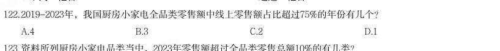

- **A.** 4
- **B.** 3
- **C.** 2
- **D.** 1

**答案：B**

### 【2025 国考（副省级）·第 129 题】GK-2025-fs-X129　比重计算与比较｜现期比重

表中所列赛区中,参加第15届CMC决赛人数占当届决赛总人数的:

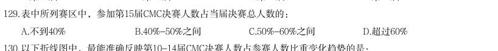

- **A.** 不到40%
- **B.** 40%-50%之间
- **C.** 50%-60%之间
- **D.** 超过60%

**答案：C**

### 【2025 国考（副省级）·第 130 题】GK-2025-fs-X130　比重计算与比较｜现期比重

以下折线图中,最能准确反映第10-14届CMC决赛人数占参赛人数比重变化趋势的是:

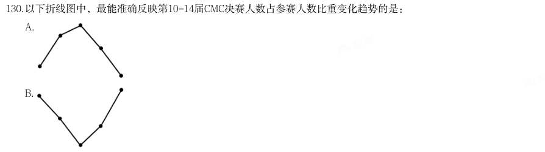

- **A.** 
- **B.** 
- **C.** 
- **D.** 

**答案：B**

### 【2025 国考（副省级）·第 132 题】GK-2025-fs-X132　比重计算与比较｜两期比重差
> 材料：2023年三季度,支付系统共处理支付业务3358.88亿笔,金额3151.37万亿元,同比分别增长12.59%和 6.97%。 三季度,人民银行清算总中心系统共处理支付业务54.79亿笔,金额2379.52万亿元,同比分别增长0.92%和 9.53%,其中,大额实时支付系统处理业务9518.17万笔,同比下降10.39%,金额2254.07万亿元,同比增长 9.72%;小额批量支付系统处理业务11.51亿笔,金额46.69万亿元,同比分别增长5.73%和10.03%;网上支付…

2023年三季度,人民银行清算总中心系统处理支付业务中,小额批量支付系统处理业务笔数的占比同比:

- **A.** 下降了2个百分点以上
- **B.** 下降了不到2个百分点
- **C.** 上升了2个百分点以上
- **D.** 上升了不到2个百分点

**答案：D**

### 【2025 国考（地市级）·第 111 题】GK-2025-ds-X111　比重计算与比较｜现期比重

分析、比较、计算和判断处理。 (一) 2019-2023年,有几个城市五批次累计公示的专精特新“小巨人”上市企业数量占全国的比重超过5%?

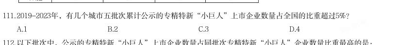

- **A.** 1
- **B.** 2
- **C.** 3
- **D.** 4

**答案：C**

### 【2025 国考（地市级）·第 112 题】GK-2025-ds-X112　比重计算与比较｜现期比重

以下批次中,公示的专精特新“小巨人”上市企业数量占同批次专精特新“小巨人”企业数量比重最高的是:

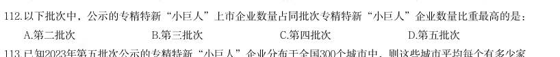

- **A.** 第二批次
- **B.** 第三批次
- **C.** 第四批次
- **D.** 第五批次

**答案：A**

### 【2025 国考（地市级）·第 114 题】GK-2025-ds-X114　比重计算与比较｜现期比重

2019-2023年,北京、上海、广州、深圳4个城市五批次累计公示的专精特新“小巨人”企业数量之和约占全国 总数的:

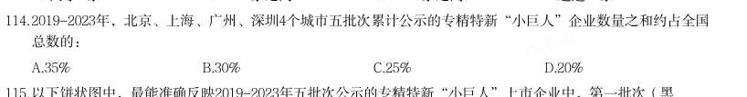

- **A.** 35%
- **B.** 30%
- **C.** 25%
- **D.** 20%

**答案：D**

### 【2025 国考（地市级）·第 126 题】GK-2025-ds-X126　比重计算与比较｜现期比重
> 材料：2023年一季度,我国外贸进出口总额为9.89万亿元,同比增加0.45万亿元。其中,东部地区进出口7.75万亿 元,同比增长2.9%;中西部、东北地区分别进出口1.84万亿元、2975.4亿元,同比分别增长12.6%、9.4%。 2月份,东部地区进出口同比增速由1月份的下降11.1%转为增长7%,3月份增速扩大至15.8%。一季度有进 出口实绩企业数量38.7万家,同比增长5.2%。一季度,东部地区出口高技术产品7741.7亿元,同比增长9.8%, 占东部地区出口额比重为17…

以下饼状图中,最能准确反映2023年一季度我国外贸进出口总额中,东部地区(白色)、中西部地区(斜线) 和东北地区(黑色)外贸进出口额占比关系的是:

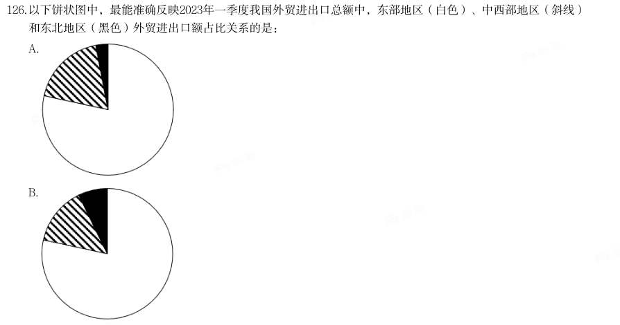

- **A.** 
- **B.** 
- **C.** 
- **D.** 

**答案：A**

### 【2025 国考（地市级）·第 128 题】GK-2025-ds-X128　比重计算与比较｜两期比重差
> 材料：2023年一季度,我国外贸进出口总额为9.89万亿元,同比增加0.45万亿元。其中,东部地区进出口7.75万亿 元,同比增长2.9%;中西部、东北地区分别进出口1.84万亿元、2975.4亿元,同比分别增长12.6%、9.4%。 2月份,东部地区进出口同比增速由1月份的下降11.1%转为增长7%,3月份增速扩大至15.8%。一季度有进 出口实绩企业数量38.7万家,同比增长5.2%。一季度,东部地区出口高技术产品7741.7亿元,同比增长9.8%, 占东部地区出口额比重为17…

2023年一季度,中西部地区对“一带一路”沿线国家进出口贸易额同比增量约占同期中西部地区外贸进出口总 额同比增量的:

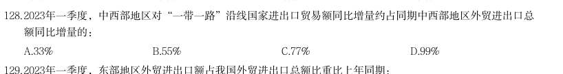

- **A.** 33%
- **B.** 55%
- **C.** 77%
- **D.** 99%

**答案：D**

### 【2025 国考（地市级）·第 129 题】GK-2025-ds-X129　比重计算与比较｜两期比重差
> 材料：2023年一季度,我国外贸进出口总额为9.89万亿元,同比增加0.45万亿元。其中,东部地区进出口7.75万亿 元,同比增长2.9%;中西部、东北地区分别进出口1.84万亿元、2975.4亿元,同比分别增长12.6%、9.4%。 2月份,东部地区进出口同比增速由1月份的下降11.1%转为增长7%,3月份增速扩大至15.8%。一季度有进 出口实绩企业数量38.7万家,同比增长5.2%。一季度,东部地区出口高技术产品7741.7亿元,同比增长9.8%, 占东部地区出口额比重为17…

2023年一季度,东部地区外贸进出口额占我国外贸进出口总额比重比上年同期:

- **A.** 上升了5个百分点以上
- **B.** 上升了不到5个百分点
- **C.** 下降了5个百分点以上
- **D.** 下降了不到5个百分点

**答案：D**

### 【2025 国考（行政执法）·第 121 题】GK-2025-zf-X121　比重计算与比较｜现期比重

(三) 2019-2023年,有几个城市五批次累计公示的专精特新“小巨人”上市企业数量占全国的比重超过5%?

- **A.** 1
- **B.** 2
- **C.** 3
- **D.** 4

**答案：C**

### 【2024 湖北省考·第 108 题】HB-2024-ty-X108　比重计算与比较｜现期比重

2022年,按体育场地类型的数量,从大到小排位第二的约占全国体育场地数量的:

- **A.** 5.4%
- **B.** 23.2%
- **C.** 29.6%
- **D.** 62.1%

**答案：C**

### 【2024 广东省考·第 77 题】GD-2024-ty-X077　比重计算与比较｜现期比重
> 材料：2022年,全球对外直接投资流量1.5万亿美元,比上年下降14%。其中发达经济体对外直接投资1.03万亿美 元,比上年下降17.2%;发展中经济体对外直接投资4589亿美元,比上年下降5.4%。…

与2021年相比,2022年中国对外直接投资流量在全球中的占比( )。

- **A.** 增加了不到3个百分点
- **B.** 增加了超过3个百分点
- **C.** 减少了不到3个百分点
- **D.** 减少了超过3个百分点

**答案：A**

### 【2024 广东省考·第 83 题】GD-2024-ty-X083　比重计算与比较｜现期比重
> 材料：自2022年1月1日《中华人民共和国法律援助法》施行以来,我国法律援助覆盖面不断扩大、服务水平显著 提升。据统计,2022年全国法律援助机构共组织办理法律援助案件137万余件,值班律师提供法律帮助95万余 件,为1980万余人次提供法律咨询,提供法律咨询人次同比增加约5%。…

2018-2022年,行政案件在G省法律援助案件中占比最高的年份是( )。

- **A.** 2018年
- **B.** 2019年
- **C.** 2020年
- **D.** 2021年

**答案：A**

### 【2024 国考（副省级）·第 117 题】GK-2024-fs-X117　比重计算与比较｜现期比重

2022年,中部六省中型灌区新增节水能力占全国中型灌区的:

- **A.** 不到三成
- **B.** 一半以上
- **C.** 三成多
- **D.** 四成多

**答案：C**

### 【2024 国考（副省级）·第 119 题】GK-2024-fs-X119　比重计算与比较｜两期比重差

2022年全国粮食产量同比增加368万吨。如全国中型灌区新增粮食生产能力均得到充分利用,则中部六省中型 灌区新增粮食生产能力对全国粮食增产的贡献占比为:

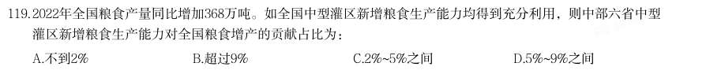

- **A.** 不到2%
- **B.** 超过9%
- **C.** 2%~5%之间
- **D.** 5%~9%之间

**答案：B**

### 【2024 国考（副省级）·第 120 题】GK-2024-fs-X120　比重计算与比较｜现期比重

在资料所给中型灌区续建配套与节水改造项目成效的4个指标中,东北三省占全国比重超过10%的指标有几个?

- **A.** 1
- **B.** 2
- **C.** 3
- **D.** 4

**答案：B**

### 【2024 国考（副省级）·第 124 题】GK-2024-fs-X124　比重计算与比较｜现期比重

2020~2022年,我国马铃薯出口量占产量的比重呈现何种变化趋势?

- **A.** 持续上升
- **B.** 持续下降
- **C.** 先降后升
- **D.** 先升后降

**答案：C**

### 【2024 国考（副省级）·第 126 题】GK-2024-fs-X126　比重计算与比较｜现期比重
> 材料：截至2022年末,全国累计投运各类电化学储能电站(包括大、中、小型电站)472座,总能量14.05GWh。 其中大型电站26座,总能量5.99GWh;中型电站275座,总能量7.23GWh。2022年新增投运电化学储能电站194 座,总能量达7.86GWh。其中大型电站19座,总能量4.64GWh;中型电站114座,总能量2.92GWh。…

2022年末累计投运的各类电化学储能电站中,锂离子电池电站435座,总能量占比达到89.2%(磷酸铁锂电 池占88.7%,三元锂电池和钛酸锂电池分别占0.3%和0.2%),铅酸/铅碳电池总能量占比4.0%,液流电池总能量 占比3.7%。在新增投运的电化学储能电站中,锂离子电池总能量占比达到86.5%,全部为磷酸铁锂电池。此 外,铅酸/铅碳电池总能量占2.7%,液流电池总能量占5.6%。 截至2021年末全国累计投运的各类电化学储能电站总数中,小型电站数量占比约为:

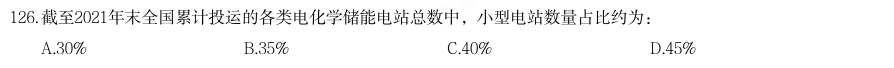

- **A.** 30%
- **B.** 35%
- **C.** 40%
- **D.** 45%

**答案：C**

### 【2024 国考（副省级）·第 129 题】GK-2024-fs-X129　比重计算与比较｜现期比重
> 材料：截至2022年末,全国累计投运各类电化学储能电站(包括大、中、小型电站)472座,总能量14.05GWh。 其中大型电站26座,总能量5.99GWh;中型电站275座,总能量7.23GWh。2022年新增投运电化学储能电站194 座,总能量达7.86GWh。其中大型电站19座,总能量4.64GWh;中型电站114座,总能量2.92GWh。…

在1磷酸铁锂电池、2三元锂电池、3铅酸/铅碳电池和4液流电池四类应用不同技术的电化学储能电站中, 2022年末累计投运电站总能量占各类电化学储能电站总能量比重高于2021年末水平的是:

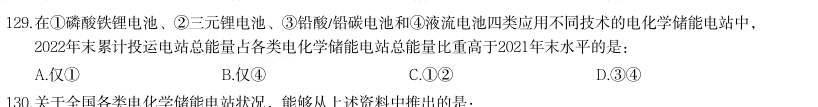

- **A.** 仅1
- **B.** 仅4
- **C.** 12
- **D.** 34

**答案：B**

### 【2024 国考（副省级）·第 132 题】GK-2024-fs-X132　比重计算与比较｜现期比重
> 材料：2022年,京津冀地区生产总值合计10.0万亿元,是2013年的1.8倍。其中,北京、河北跨越4万亿元量级, 均为4.2万亿元,分别是2013年的2.0倍和1.7倍;天津1.6万亿元,是2013年的1.6倍。京津冀第一产业、第二产 业、第三产业增加值占生产总值比重构成由2013年的6.2:35.7:58.1变化为2022年的4.8:29.6:65.6。京津冀 三地第三产业增加值占生产总值比重分别为83.8%、61.3%和49.4%,较2013年分别提高4.3、7.2和8.4个…

2013年,北京第三产业增加值占其生产总值比重比天津高多少个百分点?

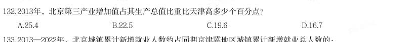

- **A.** 25.4
- **B.** 22.5
- **C.** 19.6
- **D.** 16.7

**答案：A**

### 【2024 国考（副省级）·第 133 题】GK-2024-fs-X133　比重计算与比较｜现期比重
> 材料：2022年,京津冀地区生产总值合计10.0万亿元,是2013年的1.8倍。其中,北京、河北跨越4万亿元量级, 均为4.2万亿元,分别是2013年的2.0倍和1.7倍;天津1.6万亿元,是2013年的1.6倍。京津冀第一产业、第二产 业、第三产业增加值占生产总值比重构成由2013年的6.2:35.7:58.1变化为2022年的4.8:29.6:65.6。京津冀 三地第三产业增加值占生产总值比重分别为83.8%、61.3%和49.4%,较2013年分别提高4.3、7.2和8.4个…

2013—2022年,北京城镇累计新增就业人数约占同期京津冀地区城镇累计新增就业总人数的:

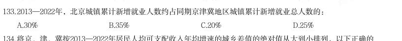

- **A.** 30%
- **B.** 35%
- **C.** 20%
- **D.** 25%

**答案：C**

### 【2024 国考（地市级）·第 112 题】GK-2024-ds-X112　比重计算与比较｜现期比重
> 材料：2022年,S省各级12315工作机构共接收诉求220.4万件,同比增长21.41%。其中,投诉55.6万件、举报26.3万件、咨询138.5万件,比上一年分别增加14.0万件、8.9万件、16.0万件。…

2022年,S省各级12315工作机构热线电话投诉接收件数占投诉总件数的比重比热线电话举报接收件数占举报总 件数的比重:

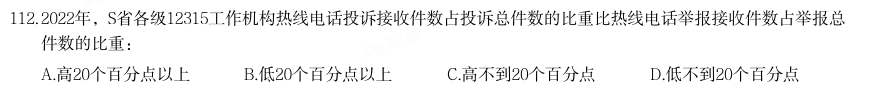

- **A.** 高20个百分点以上
- **B.** 低20个百分点以上
- **C.** 高不到20个百分点
- **D.** 低不到20个百分点

**答案：A**

### 【2024 国考（行政执法）·第 117 题】GK-2024-zf-X117　比重计算与比较｜现期比重

2022年,中部六省中型灌区新增节水能力占全国中型灌区的:

- **A.** 不到三成
- **B.** 一半以上
- **C.** 三成多
- **D.** 四成多

**答案：C**

### 【2024 国考（行政执法）·第 129 题】GK-2024-zf-X129　比重计算与比较｜现期比重
> 材料：2023年3月,全国规模以上工业企业的工业机器人完成产量4.4万套,服务机器人完成产量70万套。2023年 1~3月全国规模以上工业企业的工业机器人累计完成产量10.4万套,服务机器人累计完成产量145万套。 2023年3月,我国机器人设备出口金额0.7亿美元,较上年增长110.3%,进口金额2.4亿美元,较上年增长 68.5%。2023年1~3月我国机器人设备累计出口金额1.9亿美元,较上年增长62.1%,累计进口金额6.9亿美元,较 上年增长55.1%。 2022年12月…

已知2022年1~11月我国高新技术产品进出口总额约为14544亿美元,则同期我国工业机器人设备累计进出口总 额约占高新技术产品累计进出口总额的:

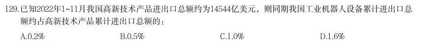

- **A.** 0.2%
- **B.** 0.5%
- **C.** 1.0%
- **D.** 1.6%

**答案：A**

### 【2023 广东省考（县级）·第 88 题】GD-2023-xj-X088　比重计算与比较｜现期比重
> 材料：2021 年,广东省财政科学技术支出为982.76 亿元,占当年全省财政一般公共预算支出的比重为5.4%。其中,省本级财政科学技术支出为102.05 亿元,占省本级财政一般公共预算支出的比重为6.6%,同比增加0.84 个百分点。珠江三角洲核心区财政科学技术支出845.09 亿元,同比增长2.6%。…

2021 年,广东省省本级财政一般公共预算支出在全省财政一般公共预算支出中的比重 ( )。

- **A.** 小于5%
- **B.** 在5%~10%之间
- **C.** 在10%~15%之间
- **D.** 大于15%

**答案：B**

### 【2023 广东省考（县级）·第 91 题】GD-2023-xj-X091　比重计算与比较｜现期比重
> 材料：2022 年,全国居民人均可支配收入36883 元,比上年增长(以下如无特别说明,均为同比名义 增长)5.0%。分城乡看,城镇居民人均可支配收入49283 元,增长3.9%;农村居民人均可支配收入 20133 元,增长6.3%。 按收入来源分,2022 年,全国居民人均工资性收入20590 元,增长4.9%;人均经营性收入61 75 元,增长4.8%;人均财产净收入3227 元,增长4.9%;人均转移净收入6892 元,增长5.5%。 2022 年,全国居民人均消费支出245…

分城乡看,城镇居民人均消费支 出30391 元,增长0.3%;农村居民人均消费支出16632 元,增长4.5%。 2022 年,农村居民人均可支配收入中,所占比例明显高于城镇居民的是( )。

- **A.** 工资性收入
- **B.** 经营净收入
- **C.** 财产净收入
- **D.** 转移净收入

**答案：B**

### 【2023 广东省考（县级）·第 97 题】GD-2023-xj-X097　比重计算与比较｜现期比重
> 材料：五年来,我国积极推进网络强国和数字中国建设,着力深化数字经济与实体经济融合,为打造数字 经济新优势、增强经济发展新动能提供有力支撑。2022 年,我国电信业务收入累计完成1.58 万亿元, 比上年增长8%,较2018 年增长超2800 亿元。 2022 年移动数据流量业务收入6397 亿元,比上年增长0.3%,在电信业务收入中占比约为40.5%。 数据中心、云计算、大数据、物联网等新兴业务快速发展,对我国电信业务拉动作用持续增强。202 2 年新兴业务收入达3072 亿元,在…

与2021 年相比,2022 年我国移动数据流量业务收入在电信业务收入中的占比( )。

- **A.** 增加了约3 个百分点
- **B.** 减少了约3 个百分点
- **C.** 增加了约13 个百分点
- **D.** 减少了约13 个百分点

**答案：B**

### 【2023 广东省考（县级）·第 98 题】GD-2023-xj-X098　比重计算与比较｜现期比重
> 材料：五年来,我国积极推进网络强国和数字中国建设,着力深化数字经济与实体经济融合,为打造数字 经济新优势、增强经济发展新动能提供有力支撑。2022 年,我国电信业务收入累计完成1.58 万亿元, 比上年增长8%,较2018 年增长超2800 亿元。 2022 年移动数据流量业务收入6397 亿元,比上年增长0.3%,在电信业务收入中占比约为40.5%。 数据中心、云计算、大数据、物联网等新兴业务快速发展,对我国电信业务拉动作用持续增强。202 2 年新兴业务收入达3072 亿元,在…

2021-2022 年间,我国新兴业务收入增加值约占我国电信业务收入增加值的( )。

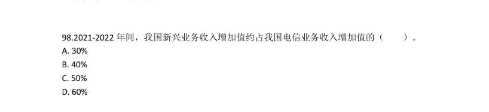

- **A.** 30%
- **B.** 40%
- **C.** 50%
- **D.** 60%

**答案：D**

### 【2023 广东省考（县级）·第 100 题】GD-2023-xj-X100　比重计算与比较｜现期比重
> 材料：五年来,我国积极推进网络强国和数字中国建设,着力深化数字经济与实体经济融合,为打造数字 经济新优势、增强经济发展新动能提供有力支撑。2022 年,我国电信业务收入累计完成1.58 万亿元, 比上年增长8%,较2018 年增长超2800 亿元。 2022 年移动数据流量业务收入6397 亿元,比上年增长0.3%,在电信业务收入中占比约为40.5%。 数据中心、云计算、大数据、物联网等新兴业务快速发展,对我国电信业务拉动作用持续增强。202 2 年新兴业务收入达3072 亿元,在…

以下最有可能准确反映该年度各类业务在电信业务收入中占比的是( )。

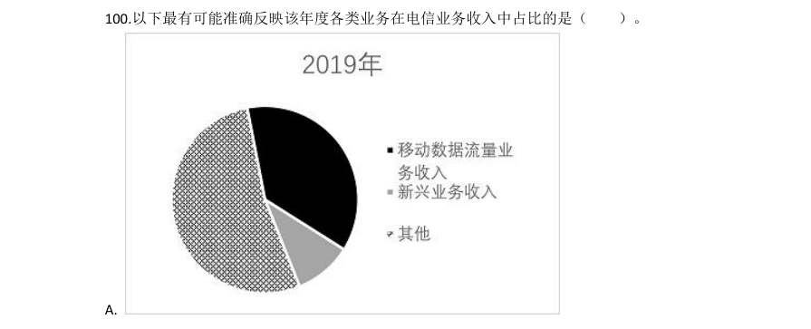

- **A.** 
- **B.** 
- **C.** 
- **D.** 

**答案：该题答案缺失，见原卷**

### 【2023 国考（行政执法）·第 111 题】GK-2023-zf-X111　比重计算与比较｜现期比重

你应根据 资料提供的信息进行分析、比较、计算和判断处理。 (一) 2021年,表中所列省市集成电路产量约占全国总产量的:

- **A.** 80%
- **B.** 84%
- **C.** 88%
- **D.** 92%

**答案：D**

### 【2023 国考（行政执法）·第 123 题】GK-2023-zf-X123　比重计算与比较｜现期比重

2021年,松木、冷杉和针叶木材进口量之和占当年我国木材进口总量的:

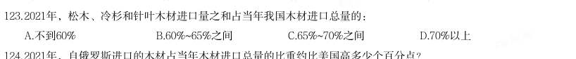

- **A.** 不到60%
- **B.** 60%~65%之间
- **C.** 65%~70%之间
- **D.** 70%以上

**答案：B**

### 【2023 国考（行政执法）·第 124 题】GK-2023-zf-X124　比重计算与比较｜现期比重

2021年,自俄罗斯进口的木材占当年木材进口总量的比重约比美国高多少个百分点?

- **A.** 44
- **B.** 50
- **C.** 32
- **D.** 38

**答案：A**

### 【2023 国考（行政执法）·第 127 题】GK-2023-zf-X127　比重计算与比较｜现期比重
> 材料：2021年,全国纺织品服装出口3155亿美元,同比增长8.4%。其中,纺织品出口1452.2亿美元,同比下降 5.6%,较2019年增长22.0%;服装出口1702.8亿美元,同比增长24.0%,较2019年增长16.0%。其中,针织服装 及衣着附件出口864.8亿美元,同比增长39.0%;梭织服装及衣着附件出口701.2亿美元,同比增长12.6%。 2021年,中国对美国、东盟、欧盟和日本的纺织品服装出口合计1724.9亿美元。其中,对美国出口额为 563.5亿美元,同比增…

2021年,全国针织、梭织服装及衣着附件总出口额约占纺织品服装出口总额的:

- **A.** 55%
- **B.** 50%
- **C.** 45%
- **D.** 40%

**答案：B**

### 【2023 国考（行政执法）·第 129 题】GK-2023-zf-X129　比重计算与比较｜现期比重
> 材料：2021年,全国纺织品服装出口3155亿美元,同比增长8.4%。其中,纺织品出口1452.2亿美元,同比下降 5.6%,较2019年增长22.0%;服装出口1702.8亿美元,同比增长24.0%,较2019年增长16.0%。其中,针织服装 及衣着附件出口864.8亿美元,同比增长39.0%;梭织服装及衣着附件出口701.2亿美元,同比增长12.6%。 2021年,中国对美国、东盟、欧盟和日本的纺织品服装出口合计1724.9亿美元。其中,对美国出口额为 563.5亿美元,同比增…

2020年中国出口的纺织制品总额中,防疫类口罩出口额占比约为:

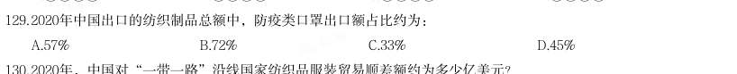

- **A.** 57%
- **B.** 72%
- **C.** 33%
- **D.** 45%

**答案：A**

### 【2022 广东省考（乡镇）·第 87 题】GD-2022-xz-X087　比重计算与比较｜现期比重
> 材料：基层群众性自治组织是我国在城市和农村按居民的居住地区建立起来的居民委员会或村民委员会,是城市居 民或农村村民自我管理、自我教育、自我服务的组织。 截止2020 年底,全国基层群众性自治组织共计61.5 万个,同比减少4.35%。…

相较2019 年,2020 年村委会占基层群众性自治组织的比重:

- **A.** 降低了约1.26 个百分点
- **B.** 提高了约1.26 个百分点
- **C.** 降低了约12.6 个百分点
- **D.** 提高了约12.6 个百分点

**答案：A**

### 【2022 广东省考（乡镇）·第 92 题】GD-2022-xz-X092　比重计算与比较｜现期比重
> 材料：增加森林面积、提高森林质量、提升生态系统碳汇增量,将为我国实现碳达峰、碳中和目标、维护全球生态安全做出巨大贡献。1973 年,我国开展了第一次森林资源清查。目前已完成第9 次森林资源清查,我国森林面积和森林蓄积量连续30 年保持“双增长”。“十三五”时期,我国累计造林5.45 亿亩,森林覆盖率达到23.04%,森林蓄积量为175.6 亿立方米,森林面积达到2.2 亿公顷(1 公顷为15 亩)。湿地保护率达到52%,治理沙化土地1.5 亿亩。…

相比第1 次森林资源清查,第9 次森林资源清查时,我国森林覆盖率提高了约( )个百分点。(本材 料中森林覆盖率为森林面积占国土面积的百分比)

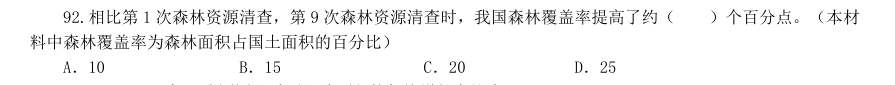

- **A.** 10
- **B.** 15
- **C.** 20
- **D.** 25

**答案：A**

### 【2022 广东省考（乡镇）·第 99 题】GD-2022-xz-X099　比重计算与比较｜现期比重
> 材料：近年来,全国基层卫生服务能力稳步提升,居民健康水平进一步提高。2020 年,我国农村乡镇卫生院卫生人员数达148.1 万人,比上年增加3.6 万人,社区卫生人员数达52.1 万人,比上年增加3.3 万人。…

2020 年,全国农村乡镇卫生院卫生人员中,执业(助理)医师占比约为:

- **A.** 25%
- **B.** 30%
- **C.** 35%
- **D.** 40%

**答案：该题答案缺失，见原卷**

### 【2022 广东省考（县级）·第 87 题】GD-2022-xj-X087　比重计算与比较｜现期比重
> 材料：2020 年,全国职工基本医疗保险(以下简称职工医保)参保人数持续增加,基金收支规模基本稳定。参加职 工医保34455 万人,比上年同比增加1530 万人。其中在职职工25429 万人,比上年增长5.0%;退休职工9026 万 人,比上年增长3.7%。企业、机关事业、灵活就业等其他人员三类参保人员(包括在职职工和退休人员)分别为 23317 万人、6387 万人、4751 万人,分别比上年增加1050 万人、155 万人、325 万人。 受新冠肺炎疫情影响,2020 年2-7…

2020 年,灵活就业等其他人员参保人数占职工医保参保总人数的比例约为:

- **A.** 12.9%
- **B.** 13.8%
- **C.** 15.2%
- **D.** 16.1%

**答案：B**

### 【2022 广东省考（县级）·第 96 题】GD-2022-xj-X096　比重计算与比较｜两期比重差
> 材料：航线完成旅客运输量40821.30 万人次,比上年下降30.3%,其中港澳台航线完成旅客运输量96.13 万人次,比上 年下降91.3%,国际航线完成旅客运输量956.51 万人次,比上年下降87.1%。尽管如此,我国国内航空运输市场 在全球范围内恢复最快、运行最好。 2020 年,全行业运输航空公司完成运输飞行时长876.22 万小时,比上年下降28.8%。…

国内航线完成运输飞行 时长788.22 万小时,比上年下降20.5%,其中港澳台航线完成运输飞行时长3.55 万小时,比上年下降82.3%,国 际航线完成运输飞行时长87.99 万小时,比上年下降63.3%。 2020 年,全行业运输航空公司完成运输起飞371.09 万架次,比上年下降25.3%。国内航线完成运输起飞 357.29 万架次,比上年下降20.2%,其中港澳台航线完成运输起飞1.65 万架次,比上年下降80.3%,国际航线完 成运输起飞13.79 万架次,比上年下家71.8%。 相比2019 年、2020 年我国民航全行业完成旅客运输中,国内航线完成旅客运输总量占比约:

- **A.** 降低了9%
- **B.** 降低了15%
- **C.** 提高了9%
- **D.** 提高了15%

**答案：该题答案缺失，见原卷**

### 【2022 国考（副省级）·第 118 题】GK-2022-fs-X118　比重计算与比较｜两期比重差

(单选题)2012—2020 年,中国IC 封装市场中IC 先进封装市场规模占比同比提升1 个百分点以上的年 份有几个?

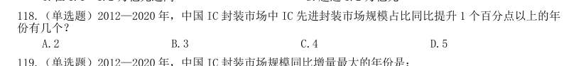

- **A.** 2
- **B.** 3
- **C.** 4
- **D.** 5

**答案：A**

### 【2022 国考（副省级）·第 120 题】GK-2022-fs-X120　比重计算与比较｜两期比重差

(单选题)已知2020 年中国IC 封装市场规模同比增长x 亿元,IC 封装市场中IC 先进封装市场规模占 比同比增长y 个百分点,而2020 年往后中国IC 封装市场规模及IC 先进封装市场规模占比每年都分别同比增 长x 亿元和y 个百分点,则到“十四五”最后一年(2025 年),中国IC 先进封装市场规模将达到多少亿元?

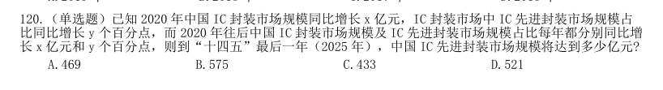

- **A.** 469
- **B.** 575
- **C.** 433
- **D.** 521

**答案：D**

### 【2022 国考（副省级）·第 132 题】GK-2022-fs-X132　比重计算与比较｜两期比重差
> 材料：亿立方米,同比增长7.44%;中石化供应2.45 亿立方米,同比增长26.29%。从用气结构看:民用气为3.98 亿立方米,同比增长16.72%;CNG 用气0.64 亿立方米,同比下降7.25%;工业用气5.05 亿立方米,同比增 长10.75%。 2020 年,C 市天然气用量为107.47 亿立方米,同比增长3.83%。其中,中石油供应73.96 亿立方米,同 比增长1.72%;中石化供应33.51 亿立方米,同比增长8.8%。从用气结构看:民用气为33.75 亿立方米…

(单选题)2020 年,中石化供气量占C 市天然气用量的比重比上年:

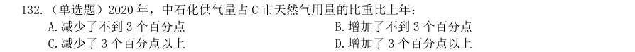

- **A.** 减少了不到3 个百分点
- **B.** 增加了不到3 个百分点
- **C.** 减少了3 个百分点以上
- **D.** 增加了3 个百分点以上

**答案：B**

### 【2022 国考（地市级）·第 118 题】GK-2022-ds-X118　比重计算与比较｜两期比重差

2012—2020 年,中国IC 封装市场中IC 先进封装市场规模占比同比提升1 个百分点以上的 年份有几个?

- **A.** 2
- **B.** 3
- **C.** 4
- **D.** 5

**答案：A**

### 【2022 国考（地市级）·第 120 题】GK-2022-ds-X120　比重计算与比较｜两期比重差

已知2020 年中国IC 封装市场规模同比增长x 亿元,IC 封装市场中IC 先进封装市场规模 占比同比增长y 个百分点,而2020 年往后中国IC 封装市场规模及IC 先进封装市场规模占比每年都 分别同比增长x 亿元和y 个百分点,则到“十四五”最后一年(2025 年),中国IC 先进封装市场规 模将达到多少亿元?

- **A.** 469
- **B.** 575
- **C.** 433
- **D.** 521

**答案：D**

### 【2022 国考（地市级）·第 127 题】GK-2022-ds-X127　比重计算与比较｜两期比重差
> 材料：7.22 亿立方米,同比增长7.44%;中石化供应2.45 亿立方米,同比增长26.29%。从用气结构看:民用 气为3.98 亿立方米,同比增长16.72%;CNG 用气0.64 亿立方米,同比下降7.25%;工业用气5.05 亿立 方米,同比增长10.75%。 2020 年,C 市天然气用量为107.47 亿立方米,同比增长3.83%。其中,中石油供应73.96 亿立方米, 同比增长1.72%;中石化供应33.51 亿立方米,同比增长8.8%。从用气结构看:民用气为33.7…

2020 年,中石化供气量占C 市天然气用量的比重比上年:

- **A.** 减少了不到3 个百分点
- **B.** 增加了不到3 个百分点
- **C.** 减少了3 个百分点以上
- **D.** 增加了3 个百分点以上

**答案：B**

### 【2022 国考（行政执法）·第 117 题】GK-2022-zf-X117　比重计算与比较｜现期比重
> 材料：下降10.3%。其中,受理量23792 件,较11 月减少6316 件;因举报线索不详或不属于生态环境部门职责范围而未受理7364 件,较11 月减少3119 件。…

(单选题)2020 年1—4 月,通过微信举报的件数占当月环保举报件数比重最高的月份是:

- **A.** 1 月
- **B.** 2 月
- **C.** 3 月
- **D.** 4 月

**答案：B**

### 【2021 广东省考（乡镇）·第 87 题】GD-2021-xz-X087　比重计算与比较｜现期比重
> 材料：级职称。全省共有农村科普示范基地554 个、科普示范街道(乡镇)145 个、科普示范社区(村)1341 个。…

2018 年,G 省农业科研和科技开发机构从事科技活动人员数占职工人数比重约为( )。

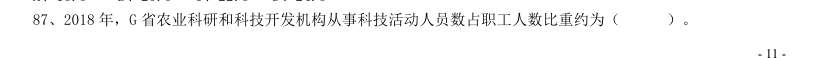

- **A.** 60%
- **B.** 70%
- **C.** 80%
- **D.** 90%

**答案：该题答案缺失，见原卷**

### 【2021 广东省考（乡镇）·第 96 题】GD-2021-xz-X096　比重计算与比较｜两期比重差
> 材料：2020 年上半年,我国农产品进出口总额达1159.0 亿美元。农产品进口额为807.5 亿美元,同比增长13.2%。 受新冠肺炎疫情影响,我国农产品出口额同比下降3.8%,为351.5 亿元。 在我国的农产品进口中,除大洋洲农产品进口额同比下降1.9 个百分点外,其余各大洲的农产品进口额均有 所增加;欧洲国家或地区农产品进口额增幅最大,达28.4%。农产品出口中,对亚洲国家或地区的出口额最高, 达229.7 亿美元,较2019 年同期下降了3.7 个百分点。 随着我国居民饮…

2020 年上半年畜类产品进口额同比增 长43.2%,对农产品进口额的增长贡献超7 成。我国农产品出口最多的两大类别分别是食用蔬菜和水、海产品, 合计出口额达93.6 亿美元,占农产品出口总额的26.6%。 2020 年上半年,我国农产品进出口额同比增长约:

- **A.** 2.5%
- **B.** 5.0%
- **C.** 7.5%
- **D.** 10.0%

**答案：该题答案缺失，见原卷**

### 【2021 广东省考（乡镇）·第 99 题】GD-2021-xz-X099　比重计算与比较｜现期比重
> 材料：2020 年上半年,我国农产品进出口总额达1159.0 亿美元。农产品进口额为807.5 亿美元,同比增长13.2%。 受新冠肺炎疫情影响,我国农产品出口额同比下降3.8%,为351.5 亿元。 在我国的农产品进口中,除大洋洲农产品进口额同比下降1.9 个百分点外,其余各大洲的农产品进口额均有 所增加;欧洲国家或地区农产品进口额增幅最大,达28.4%。农产品出口中,对亚洲国家或地区的出口额最高, 达229.7 亿美元,较2019 年同期下降了3.7 个百分点。 随着我国居民饮…

2019 年上半年,我国农产品进口额中欧洲国家或地区约占:

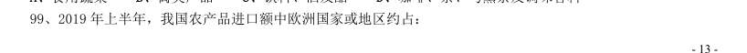

- **A.** 13.3%
- **B.** 16.6%
- **C.** 18.8%
- **D.** 21.1%

**答案：该题答案缺失，见原卷**

### 【2021 国考（副省级）·第 119 题】GK-2021-fs-X119　比重计算与比较｜现期比重
> 材料：(材料1)注:化学需氧量:废水、废水处理厂出水和污水中,能被强氧化剂氧化的物质的氧当量。化学需氧量越高,表示水中有机污染物越多,污染越严重。总氮:水中各种形态无机和有机氮的总量。氨氮:水中以游离氨和铵离子形式存在的氮,是总氮的组成部分之一。…

2019 年直排渤海的污染物中,氨氮占总氮的比重约比直排黄海的污染物中该比重:

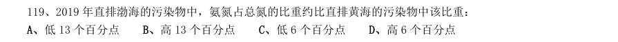

- **A.** 低13 个百分点
- **B.** 高13 个百分点
- **C.** 低6 个百分点
- **D.** 高6 个百分点

**答案：该题答案缺失，见原卷**

### 【2021 国考（副省级）·第 133 题】GK-2021-fs-X133　比重计算与比较｜两期比重差
> 材料：2020 年1—2 月,我国境内投资者共对全球147 个国家和地区的1733 家境外企业进行了非金融类直接投资, 累计实现投资1078.6 亿元人民币,同比增长1.8%。对外承包工程完成营业额1080 亿元人民币,同比下降9.5%, 新签合同额2150.3 亿元人民币,同比增长38.3%。对外劳务合作派出各类劳务人员3.9 万人,同比减少2.9 万 人,2 月末在外各类劳务人员77.8 万人。 2020 年1—2 月,我国对外投资合作主要呈现以下特点: 一是对“一带一路”投资…

2020 年1—2 月,租赁和商务服务业对外投资额占对境外企业非金融类直接投资额的比重比上年同期约:

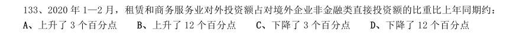

- **A.** 上升了3 个百分点
- **B.** 上升了12 个百分点
- **C.** 下降了3 个百分点
- **D.** 下降了12 个百分点

**答案：该题答案缺失，见原卷**

### 【2021 国考（地市级）·第 117 题】GK-2021-ds-X117　比重计算与比较｜现期比重
> 材料：(材料2)2019 年全国地铁运营线路长度达5181 公里,占城轨交通运营线路总里程的76.8%。 2019 年末,我国城轨交通配属地铁列车6178 列,全年实现地铁客运量227.76 亿人次。 注:除客运量为全年数值外,其余指标为年末时点值。…

2019 年,直辖市(北京、天津、上海、重庆)地铁客运量占全国地铁客运总量的比重在以下哪个范围内?

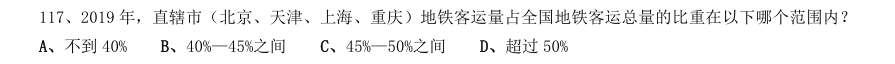

- **A.** 不到40%
- **B.** 40%—45%之间
- **C.** 45%—50%之间
- **D.** 超过50%

**答案：A**

### 【2021 国考（地市级）·第 122 题】GK-2021-ds-X122　比重计算与比较｜现期比重
> 材料：截至2019 年末,全国已有残疾人康复机构9775 个,比2018 年增长739 个。…

2019 年末,提供肢体残疾康复服务的康复机构的数量占全国残疾人康复机构总数的比重,比提供精神残疾 康复服务的康复机构的数量占全国残疾人康复机构总数的比重高约多少个百分点?

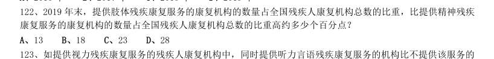

- **A.** 13
- **B.** 18
- **C.** 23
- **D.** 28

**答案：C**

### 【2021 国考（地市级）·第 129 题】GK-2021-ds-X129　比重计算与比较｜现期比重
> 材料：2019 年上半年,我国服务进出口总额达到26124.6 亿元,同比增长2.6%。其中,出口总额9333.7 亿元,同 比增长9.0%;进口总额16790.8 亿元,同比下降0.6%。服务进出口总额占对外贸易总额的比重达到15.1%,比 2018 年全年高出0.5 个百分点。 2019 年全年,我国服务进出口总额54152.9 亿元,同比增长2.8%。其中,出口总额19564.0 亿元,同比增 长8.9%;进口总额34588.9 亿元,同比减少0.4%。 2019 年上半年,…

2019 年,我国知识密集型服务出口额占服务出口额比重:

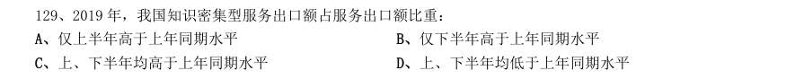

- **A.** 仅上半年高于上年同期水平
- **B.** 仅下半年高于上年同期水平
- **C.** 上、下半年均高于上年同期水平
- **D.** 上、下半年均低于上年同期水平

**答案：C**

### 【2020 湖北省考·第 113 题】HB-2020-ty-X113　比重计算与比较｜现期比重
> 材料：2019 年5 月,全国12358 价格监管平台受理价格举报、投诉、咨询共计37576 件,同比下降40.70%,环比 下降9.31%。…

2019 年5 月,平台受理量排名前五的行业占受理总数的比重约为:

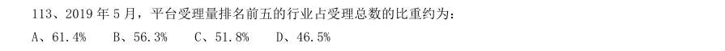

- **A.** 61.4%
- **B.** 56.3%
- **C.** 51.8%
- **D.** 46.5%

**答案：该题答案缺失，见原卷**

### 【2020 湖北省考·第 116 题】HB-2020-ty-X116　比重计算与比较｜现期比重

2016 年,A 市直接经济价值年值占现代农业生态服务价值年值的比重为:

- **A.** 8.24%
- **B.** 11.23%
- **C.** 13.59%
- **D.** 15.46%

**答案：该题答案缺失，见原卷**

### 【2020 湖北省考·第 117 题】HB-2020-ty-X117　比重计算与比较｜现期比重

能够正确描述2017 年A 市间接经济价值年值中三个指标占比的统计图是:

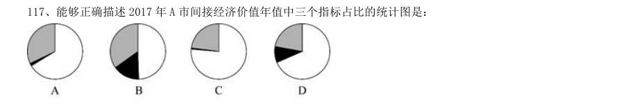

> （本题为图形题，选项为图片，见原卷）

**答案：该题答案缺失，见原卷**

### 【2020 广东省考（乡镇）·第 86 题】GD-2020-xz-X086　比重计算与比较｜现期比重
> 材料：(材料1) 近年来,我国大力推动农村互联网建设,目前已初步建成融合、泛在、安全、绿色的宽带网络环境,基本 实现“城市光纤到楼到户,农村宽带进乡入村”。2019 年,我国已建成全球最大规模光纤和移动通信网络,行 政村通光纤和4G 比例均超过98%。…

调查显示,截至2020 年3 月,我国网民规模为9.04 亿人,其中农村网民规 模为2.55 亿人,较2018 年12 月增长14.9%,城镇网民规模为6.49 亿人,占网民整体的71.8%,较2018 年12 月增长4200 万。 我国农村地区互联网普及率为46.2%,较2018 年12 月提升7.8 个百分点,其余年份详情如下: 2020 年3 月,农村网民规模约占我国网民整体的:

- **A.** 20.2%
- **B.** 22.4%
- **C.** 28.2%
- **D.** 38.3%

**答案：该题答案缺失，见原卷**

### 【2020 广东省考（乡镇）·第 92 题】GD-2020-xz-X092　比重计算与比较｜现期比重
> 材料：2019 年我国农民工规模继续扩大,总量达到29077 万人,同比增长0.8%。其中,本地农民工11652 万人, 比上年增加82 万人;外出农民工17425 万人,比上年增加159 万人。外出农民工中,在省内就业的农民工 9917 万人,比上年增加245 万人;跨省流动农民工7508 万人,比上年减少86 万人。 从收入看,农民工集中就业的六大行业月均收入均稳定增长。2019 年农民工月均收入约4000 元,其中外 出农民工月均收入4427 元,比上年增加320 元;本地农…

2018 年,省内就业农民工的数量约占外出农民工的:

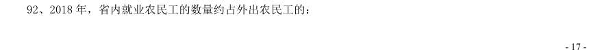

- **A.** 36%
- **B.** 46%
- **C.** 56%
- **D.** 66%

**答案：该题答案缺失，见原卷**

### 【2020 广东省考（乡镇）·第 97 题】GD-2020-xz-X097　比重计算与比较｜现期比重
> 材料：2019 年全国农村网络零售额从2014 年的1800 亿元增加至逾1.7 万亿元,占全国网络零售总额的16.1%, 较上年略有提升;同比增长19.1%,高于全国网络零售总额增长率2.6 个百分点。 分地区看,东、中、西部和东北地区农村网络零售额分别占全国农村网络零售额的76.6%、12.0%,9.4%和 2.0%,同比增长分别为19.8%,17.1%,17.6%和10.2%。 2019 年,电子商务进农村综合示范工作聚焦脱贫攻坚和乡村振兴,取得了阶段性成果。…

2018 年,东、中、西部和东北地区农村网络零售额占全国农村网络零售额的比重分别为:

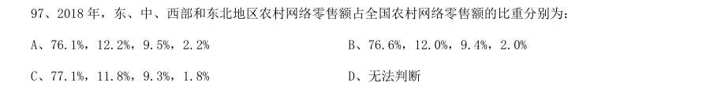

- **A.** 76.1%,12.2%,9.5%,2.2%
- **B.** 76.6%,12.0%,9.4%,2.0%
- **C.** 77.1%,11.8%,9.3%,1.8%
- **D.** 无法判断

**答案：该题答案缺失，见原卷**

### 【2020 广东省考（县级）·第 92 题】GD-2020-xj-X092　比重计算与比较｜现期比重
> 材料：2019 年我国农民工规模继续扩大,总量达到29077 万人,同比增长0.8%。其中,本地农民工11652 万人, 比上年增加82 万人;外出农民工17425 万人,比上年增加159 万人。外出农民工中,在省内就业的农民工9917 万人,比上年增加245 万人;跨省流动农民工7508 万人,比上年减少86 万人。 从收入看,农民工集中就业的六大行业月均收入均稳定增长。2019 年农民工月均收入约4000 元,其中外出 农民工月均收入4427 元,比上年增加320 元;本地农民…

2018 年,省内就业农民工的数量约占外出农民工的:

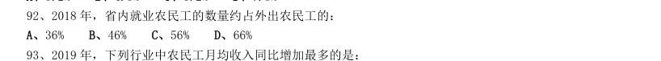

- **A.** 36%
- **B.** 46%
- **C.** 56%
- **D.** 66%

**答案：该题答案缺失，见原卷**

### 【2020 广东省考（县级）·第 96 题】GD-2020-xj-X096　比重计算与比较｜现期比重
> 材料：2019 年,广东规模以上工业企业用水量39.54 亿立方米,分水种看,自来水用水量最大,达35.67 亿立方 米,占全部用水量的90.2%;地表淡水用水量2.52 亿立方米,地下淡水0.03 亿立方米,其他水1.32 亿立方米。 分地区看,珠三角地区用水量达29.85 亿立方米,占比超75%。 2019 年,广东规模以上工业企业重复用水量为147.10 亿立方米,比上年增长2.5%,重复用水率提高到78.8% (注:重复用水率=重复用水量/(用水量+重复用水量))。分行业看…

整体而言,在全省规模以上工业企业中,重复用水量普及面窄且重复用水率较低的问题值得关注。有重复用 水的企业只有3573 家,只占全省规模以上工业企业的7.0%,说明九成多企业无重复用水。重复用水量超过1000 万立方米以上的企业88 家,仅占重复用水量的96.2%,主要集中在石油化工、电厂和钢铁厂等少数大型企业中, 重复用水应用领域明显较窄。 2019 年广东规模以上工业企业用水量中,地表与地下淡水量约占:

- **A.** 4.7%
- **B.** 6.4%
- **C.** 8.1%
- **D.** 9.8%

**答案：该题答案缺失，见原卷**

### 【2020 广东省考（县级）·第 99 题】GD-2020-xj-X099　比重计算与比较｜现期比重
> 材料：2019 年,广东规模以上工业企业用水量39.54 亿立方米,分水种看,自来水用水量最大,达35.67 亿立方 米,占全部用水量的90.2%;地表淡水用水量2.52 亿立方米,地下淡水0.03 亿立方米,其他水1.32 亿立方米。 分地区看,珠三角地区用水量达29.85 亿立方米,占比超75%。 2019 年,广东规模以上工业企业重复用水量为147.10 亿立方米,比上年增长2.5%,重复用水率提高到78.8% (注:重复用水率=重复用水量/(用水量+重复用水量))。分行业看…

2018 年电力、冶金和石油石化行业以外的其他行业的重复用水量约占广东规模以上工业企业重复用水量的:

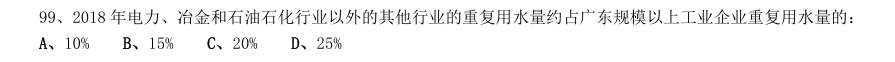

- **A.** 10%
- **B.** 15%
- **C.** 20%
- **D.** 25%

**答案：该题答案缺失，见原卷**

### 【2020 广东省考（综合行政能力测验）·第 87 题】GD-2020-zh-X087　比重计算与比较｜现期比重
> 材料：近年来,随着互联网、云计算、大数据以及社交媒体应用的快速发展,我国电子政务也发展迅速。 2018 年我国电子政务市场规模3106.9 亿元,同比2017 年的2861.8 亿元增长了。 我国电子政务市场主要有硬件、网络设备、软件以及服务等四个细分市场。近年来,我国电子政务市场整体呈现硬件市场规模占比不断下降,而软件及服务市场占比不断上升的趋势。…

2018 年,中国电子政务四个细分市场中,占比最大的是( )。

- **A.** 硬件市场
- **B.** 网络设备市场
- **C.** 软件市场
- **D.** 服务市场

**答案：A**

### 【2020 广东省考（综合行政能力测验）·第 88 题】GD-2020-zh-X088　比重计算与比较｜现期比重
> 材料：近年来,随着互联网、云计算、大数据以及社交媒体应用的快速发展,我国电子政务也发展迅速。 2018 年我国电子政务市场规模3106.9 亿元,同比2017 年的2861.8 亿元增长了。 我国电子政务市场主要有硬件、网络设备、软件以及服务等四个细分市场。近年来,我国电子政务市场整体呈现硬件市场规模占比不断下降,而软件及服务市场占比不断上升的趋势。…

下列选项能够正确反映当年四个细分市场占比的是( )。

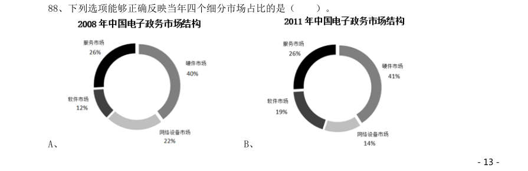

- **A.** 
- **B.** 
- **C.** 
- **D.** 

**答案：C**

### 【2020 广东省考（综合行政能力测验）·第 100 题】GD-2020-zh-X100　比重计算与比较｜两期比重差
> 材料：018 年,广东实现地区生产总值97277.77 亿元,按可比价格计算,同比增长 ,人均生产总值为 86412 元,比全国平均水平多21891 元,按年平均汇率折算,达到13058.30 美元。全省经济运行保持在合理 区间。…

1234描述的均为客观事实,其中能够从材料中得出的有( )。 12018 年广东省GDP 占全国比重较2017 年有所增加 22018 年全年人民币兑美元平均汇率约为6.6、32018 年中国总人口约为13.95 亿 4以可比价格计算,2017 年广东省GDP 同比增长率达7.5%

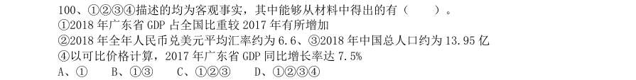

- **A.** 1
- **B.** 13
- **C.** 123
- **D.** 1234

**答案：B**

### 【2020 国考（地市级）·第 116 题】GK-2020-ds-X116　比重计算与比较｜现期比重

2018 年中国进出口贸易总额为4.62 万亿美元,其中集成电路进出口贸易额占比:

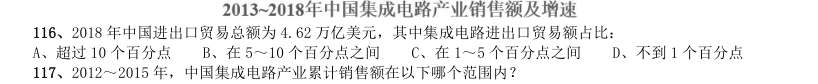

- **A.** 超过10 个百分点
- **B.** 在5~10 个百分点之间
- **C.** 在1~5 个百分点之间
- **D.** 不到1 个百分点

**答案：B**

### 【2020 国考（地市级）·第 121 题】GK-2020-ds-X121　比重计算与比较｜现期比重

2018 年中国在线旅游收入约占旅游业总收入的:

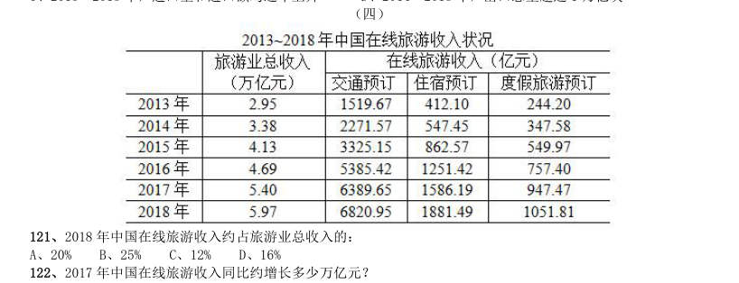

- **A.** 20%
- **B.** 25%
- **C.** 12%
- **D.** 16%

**答案：D**

### 【2020 国考（地市级）·第 123 题】GK-2020-ds-X123　比重计算与比较｜现期比重

中国在线旅游收入中,2014 年占中国旅游业总收入比重高于上年水平的包括:

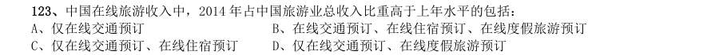

- **A.** 仅在线交通预订
- **B.** 在线交通预订、在线住宿预订、在线度假旅游预订
- **C.** 仅在线交通预订、在线住宿预订
- **D.** 仅在线交通预订、在线度假旅游预订

**答案：B**

### 【2020 国考（地市级）·第 126 题】GK-2020-ds-X126　比重计算与比较｜两期比重差
> 材料：2018 年,B 市新经济实现增加值10057.4 亿元,比上年增长9.3%,占全市地区生产总值的比重为33.2%,比 上年提高0.4 个百分点。全年全市新设立的企业中,信息服务业、科技服务业企业合计达到70661 家,占比为 38.5%,注册资本达到7311.4 亿元,同比增长13.5%。 2018 年,B 市高技术产业实现增加值6976.8 亿元,比上年增长9.4%,占地区生产总值的比重为23.0%,比 上年提高0.2 个百分点。战略性新兴产业实现增加值4893.4 亿元…

2018 年,B 市高新技术示范区规模以上高新技术企业实现技术收入10629.4 亿元,比上年增长13.4%,占高 新技术示范区规模以上高新技术企业总收入的比重为18.1%,比上年提高1.8 个百分点。 2018 年B 市平均每家新设立的信息服务业、科技服务业企业注册资本:

- **A.** 在1000~1100 万元之间
- **B.** 超过1100 万元
- **C.** 不到900 万元
- **D.** 在900~1000 万元之间

**答案：A**

### 【2020 国考（省级）·第 116 题】GK-2020-sj-X116　比重计算与比较｜现期比重

析、比较、计算和判断处理。 2018 年中国在线旅游收入约占旅游业总收入的:

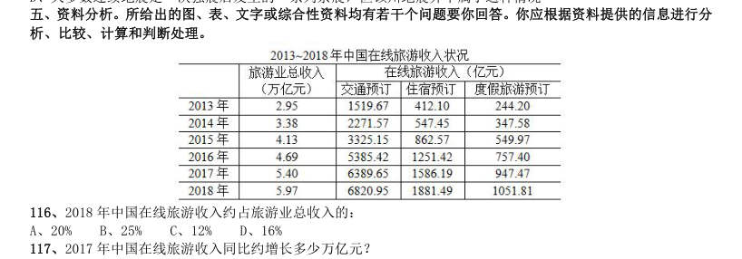

- **A.** 20%
- **B.** 25%
- **C.** 12%
- **D.** 16%

**答案：D**

### 【2020 国考（省级）·第 132 题】GK-2020-sj-X132　比重计算与比较｜现期比重
> 材料：中,工业品物流总额16636.15 亿元,同比增长0.2%,增速比上半年放缓2.1 个百分点;外部流入(含进口)货 物物流总额17357.31 亿元,同比增长12.1%,增速比上半年加快0.8 个百分点;农产品物流总额875.06 亿元, 同比增长11.6%,增速比上半年加快0.5 个百分点;单位与居民物品物流总额457.86 亿元,同比增长40.7%,增 速比上半年放缓3 个百分点;再生资源物流总额30.88 亿元,同比下降7.0%,降幅比上半年扩大4.3 个百分点。 20…

在工业品物流、外部流入(含进口)货物物流、农产品物流、单位与居民物品物流和再生资源物流中,2018 年前三季度物流总额占社会物流总额的比重高于上年水平的有几类?

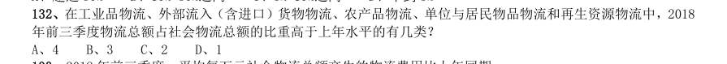

- **A.** 4
- **B.** 3
- **C.** 2
- **D.** 1

**答案：B**
