# 资料分析 · 综合分析 · 2000 年代真题

> 所属考点：[ZL-COMP](../ZL-COMP-综合分析.md)　｜　本片 188 题

> 本片子考点：综合分析（综合） 97　比重 29　增长率 28　平均数 11　基期量 7　年均增长率 6　增长量 5　倍数 4

### 【2009 湖北省考·第 105 题】HB-2009-ty-X105　综合分析｜平均数

下列关于2008 年7 月商品价格的描述正确的是:

- **A.** 饮料、烟酒在城市的价格更高
- **B.** 燃料价格涨幅对商品零售价格整体上涨的贡献最大
- **C.** 只有体育娱乐用品的价格走势在城乡是相反的
- **D.** 城市中西药品及医疗保健用品涨幅最接近全国商品零售价格平均涨幅

**答案：该题答案缺失，见原卷**

### 【2009 湖北省考·第 106 题】HB-2009-ty-X106　综合分析｜综合分析（综合）
> 材料：2007 年前三季度,我国全社会固定资产投资91529 亿元,同比增长25.7%。其中,城镇固定资产投资78 247 亿元,增长26.4%;农村投资13 282 亿元,增长21.2%。在城镇投资中.国有及国有控股完成投资33 951 亿元,增长16.2%∶房地产开发完成投资16 814 亿元,增长30.3%。从项目隶属关系看,中央项目投资7749 亿元,同比增长15.4%;地方项目投资70 497 亿元,增长27.8%。从产业看,第一、二、三产业分别完成投 资938 亿元、3…

其中,国内贷 款增长14.5%,利用外资增长15.5%,自筹资金增长32.2%。 2006 年前三季度城镇固定资产投资是:

- **A.** 60479 亿元
- **B.** 61904 亿元
- **C.** 69104 亿元
- **D.** 72815 亿元

**答案：该题答案缺失，见原卷**

### 【2009 湖北省考·第 108 题】HB-2009-ty-X108　综合分析｜增长率
> 材料：2007 年前三季度,我国全社会固定资产投资91529 亿元,同比增长25.7%。其中,城镇固定资产投资78 247 亿元,增长26.4%;农村投资13 282 亿元,增长21.2%。在城镇投资中.国有及国有控股完成投资33 951 亿元,增长16.2%∶房地产开发完成投资16 814 亿元,增长30.3%。从项目隶属关系看,中央项目投资7749 亿元,同比增长15.4%;地方项目投资70 497 亿元,增长27.8%。从产业看,第一、二、三产业分别完成投 资938 亿元、3…

就2007 年前三季度而言,下面说法正确的是:

- **A.** 第二产业投资增长率高于第一、第三产业投资增长率
- **B.** 第三产业投资增长额大于第一、第二产业投资增长额
- **C.** 第一、第二产业的投资总值要超过第三产业
- **D.** 上述说法都不正确

**答案：该题答案缺失，见原卷**

### 【2009 湖北省考·第 109 题】HB-2009-ty-X109　综合分析｜增长率
> 材料：2007 年前三季度,我国全社会固定资产投资91529 亿元,同比增长25.7%。其中,城镇固定资产投资78 247 亿元,增长26.4%;农村投资13 282 亿元,增长21.2%。在城镇投资中.国有及国有控股完成投资33 951 亿元,增长16.2%∶房地产开发完成投资16 814 亿元,增长30.3%。从项目隶属关系看,中央项目投资7749 亿元,同比增长15.4%;地方项目投资70 497 亿元,增长27.8%。从产业看,第一、二、三产业分别完成投 资938 亿元、3…

下列说法与资料相符的是:

- **A.** 与其他行业相比,2007 年前三季度有色金属投资增长率最大
- **B.** 2006 年前三季度,非金属矿制品投资已经超过铁路运输业投资
- **C.** 2007 年前三季度石油和天然气业的投资额度已经超过煤炭开采及洗选业投资
- **D.** 2007 年前三季度黑色金属矿工业增长率超过石油和天然气行业增长率

**答案：该题答案缺失，见原卷**

### 【2009 湖北省考·第 110 题】HB-2009-ty-X110　综合分析｜平均数
> 材料：2007 年前三季度,我国全社会固定资产投资91529 亿元,同比增长25.7%。其中,城镇固定资产投资78 247 亿元,增长26.4%;农村投资13 282 亿元,增长21.2%。在城镇投资中.国有及国有控股完成投资33 951 亿元,增长16.2%∶房地产开发完成投资16 814 亿元,增长30.3%。从项目隶属关系看,中央项目投资7749 亿元,同比增长15.4%;地方项目投资70 497 亿元,增长27.8%。从产业看,第一、二、三产业分别完成投 资938 亿元、3…

关于2007 年前三季度,城镇50 万元以上的项目,下面说法正确的是:

- **A.** 施工项目增加个数小于新开工项目增加个数
- **B.** 新开工项目平均每个项目投资858 万元
- **C.** 平均每个新开工项目的金额大于施工项目平均金额
- **D.** 施工项目增速大于新开工项目增速

**答案：该题答案缺失，见原卷**

### 【2009 湖北省考·第 115 题】HB-2009-ty-X115　综合分析｜比重

下列说法与资料相符的是:

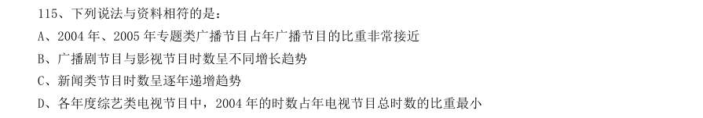

- **A.** 2004 年、2005 年专题类广播节目占年广播节目的比重非常接近
- **B.** 广播剧节目与影视节目时数呈不同增长趋势
- **C.** 新闻类节目时数呈逐年递增趋势
- **D.** 各年度综艺类电视节目中,2004 年的时数占年电视节目总时数的比重最小

**答案：A**

### 【2009 湖北省考·第 116 题】HB-2009-ty-X116　综合分析｜基期量
> 材料：2007 年末全国就业人员76990 万人,比上年末增加590 万人。其中,第一产业就业人员31444 万人,占全国就业人员的40.8%;第二产业20629 万人,占26.8%;第三产业24917 万人,占32.4%。年末城镇就业人员29350 万人,比上年末净增加1040 万人。其中,城镇单位就业人员12024 万人,比上年末增加311 万人;城镇私营个体就业人员7 891 万人,比上年末增加924 万人。在城镇单位就业人员中,在岗职工11427 万人,比上年末增加266 …

其中,第一产业就业人员31444 万人,占全国 就业人员的40.8%;第二产业20629 万人,占26.8%;第三产业24917 万人,占32.4%。年末城镇就业人员 29350 万人,比上年末净增加1040 万人。其中,城镇单位就业人员12024 万人,比上年末增加311 万人;城 镇私营个体就业人员7 891 万人,比上年末增加924 万人。在城镇单位就业人员中,在岗职工11427 万人,比 上年末增加266 万人。 2007 年我国第三产业就业人员比第二产业约多多少万人:

- **A.** 1600
- **B.** 4100
- **C.** 4300
- **D.** 10800

**答案：C**

### 【2009 湖北省考·第 119 题】HB-2009-ty-X119　综合分析｜增长率
> 材料：2007 年末全国就业人员76990 万人,比上年末增加590 万人。其中,第一产业就业人员31444 万人,占全国就业人员的40.8%;第二产业20629 万人,占26.8%;第三产业24917 万人,占32.4%。年末城镇就业人员29350 万人,比上年末净增加1040 万人。其中,城镇单位就业人员12024 万人,比上年末增加311 万人;城镇私营个体就业人员7 891 万人,比上年末增加924 万人。在城镇单位就业人员中,在岗职工11427 万人,比上年末增加266 …

从以上图表中无法得到的推论是:

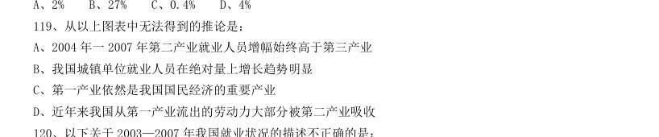

- **A.** 2004 年一2007 年第二产业就业人员增幅始终高于第三产业
- **B.** 我国城镇单位就业人员在绝对量上增长趋势明显
- **C.** 第一产业依然是我国国民经济的重要产业
- **D.** 近年来我国从第一产业流出的劳动力大部分被第二产业吸收

**答案：B**

### 【2009 湖北省考·第 120 题】HB-2009-ty-X120　综合分析｜年均增长率
> 材料：2007 年末全国就业人员76990 万人,比上年末增加590 万人。其中,第一产业就业人员31444 万人,占全国就业人员的40.8%;第二产业20629 万人,占26.8%;第三产业24917 万人,占32.4%。年末城镇就业人员29350 万人,比上年末净增加1040 万人。其中,城镇单位就业人员12024 万人,比上年末增加311 万人;城镇私营个体就业人员7 891 万人,比上年末增加924 万人。在城镇单位就业人员中,在岗职工11427 万人,比上年末增加266 …

以下关于2003—2007 年我国就业状况的描述不正确的是:

- **A.** 2003—2007 年间全国就业人员数年均增长率约为0.85%
- **B.** 2006 年末城镇单位就业人员中在岗职工比重超过95.1%
- **C.** 2007 年和2003 年相比城镇就业人数约增长了14.6%
- **D.** 2007 年比2005 年第一产业就业人数减少4%,绝对量减少3033 万人

**答案：D**

### 【2009 广东省考·第 88 题】GD-2009-ty-X088　综合分析｜综合分析（综合）
> 材料：有多个问题,请你根据资料所提供的信息进行分析、比较、计算和判断处理。 (一) 根据下列资料,回答问题。 据初步测算,2006 年广东完成生产总值25968.55 亿元,比上年增长14.1%,经济总量继续 列全国第一位置。其中,第一产业增长3.8%,第二产业增长16.9%,第三产业增长12.2%。与此 同时,鲁、苏、浙、沪也稳定协调发展,其中山东、江苏赶超步伐不减,增速分别高广东0.6 个 和0.8 个百分点。山东完成生产总值21846.71 亿元,增长14.7%;江苏完成生产…

2005 年广东省生产总值位列第一,高于第三位多少亿元:

- **A.** 6552.58
- **B.** 2633.97
- **C.** 3575.36
- **D.** 4005.46

**答案：该题答案缺失，见原卷**

### 【2009 广东省考·第 90 题】GD-2009-ty-X090　综合分析｜增长率
> 材料：有多个问题,请你根据资料所提供的信息进行分析、比较、计算和判断处理。 (一) 根据下列资料,回答问题。 据初步测算,2006 年广东完成生产总值25968.55 亿元,比上年增长14.1%,经济总量继续 列全国第一位置。其中,第一产业增长3.8%,第二产业增长16.9%,第三产业增长12.2%。与此 同时,鲁、苏、浙、沪也稳定协调发展,其中山东、江苏赶超步伐不减,增速分别高广东0.6 个 和0.8 个百分点。山东完成生产总值21846.71 亿元,增长14.7%;江苏完成生产…

下列说法正确的是:

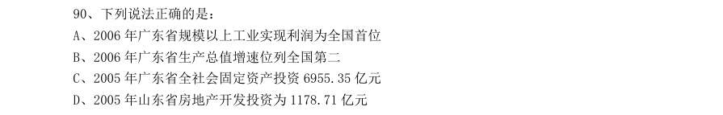

- **A.** 2006 年广东省规模以上工业实现利润为全国首位
- **B.** 2006 年广东省生产总值增速位列全国第二
- **C.** 2005 年广东省全社会固定资产投资6955.35 亿元
- **D.** 2005 年山东省房地产开发投资为1178.71 亿元

**答案：该题答案缺失，见原卷**

### 【2009 广东省考·第 91 题】GD-2009-ty-X091　综合分析｜综合分析（综合）

根据下表完成以下各题。 下列年份中,财政拨款用于地质勘查投资的增长幅度最大的是:

- **A.** 2002 年
- **B.** 2004 年
- **C.** 2005 年
- **D.** 2008 年

**答案：该题答案缺失，见原卷**

### 【2009 广东省考·第 95 题】GD-2009-ty-X095　综合分析｜比重

下列说法正确的是:

- **A.** 这八年来,财政拨款用于地质勘查投资的资金逐年上升
- **B.** 与2003 年相比,2007 年社会投资用于地质勘查投资的比重增加了
- **C.** 社会投资用于地质勘查投资的增长幅度从2001-2007 年一直高于财政拨款的增长幅度
- **D.** 2004 年财政拨款用于地质勘查投资比2002 年增长了约12.7%

**答案：该题答案缺失，见原卷**

### 【2009 广东省考·第 96 题】GD-2009-ty-X096　综合分析｜综合分析（综合）

根据下列图表,完成以下各题。 2007 年我国大陆地区对美国的货物进出口总额为:

- **A.** 2523 亿美元
- **B.** 3337 亿美元
- **C.** 3021 亿美元
- **D.** 814 亿美元

**答案：该题答案缺失，见原卷**

### 【2009 广东省考·第 97 题】GD-2009-ty-X097　综合分析｜综合分析（综合）

2008 年对主要国家和地区货物进出口贸易逆差额(进口额-出口额)最大的国家(地区)是:

- **A.** 欧盟
- **B.** 美国
- **C.** 韩国
- **D.** 中国台湾

**答案：该题答案缺失，见原卷**

### 【2009 广东省考·第 100 题】GD-2009-ty-X100　综合分析｜增长率

下列说法中,不正确的是:

- **A.** 与上年相比,我国大陆地区对外进出口总额的增加额在2007 年达到最大
- **B.** 与上年相比,2008 年我国大陆地区对主要国家和地区货物进出口总额增长率都超过10%
- **C.** 2008 年,我国大陆地区对主要国家和地区货物出口额总共约为11305 亿美元
- **D.** 2004-2008 年,我国大陆地区的进口额和出口额都呈现出上升趋势

**答案：该题答案缺失，见原卷**

### 【2009 国考·第 121 题】GK-2009-ty-X121　综合分析｜综合分析（综合）
> 材料：在2008 年8 月8 日至24 日奥运会期间,北京市的空气质量不仅天天达标,而且有10 天达到一级,全面兑现了对奥运会空气质量的承诺。下图是2008 年1~8 月北京市大气质量检测情况,图中一、二、三、四级是空气质量等级。一级空气质量最好,一级和二级都是质量达标天气。2008 年北京的空气质量控制目标是全年达标天数累计达256 天。…

(一)根据所给图表、文字资料完成各题。 在2008 年8 月8 日至24 日奥运会期间,北京市的空气质量不仅天天达标,而且有10 天达到一级,全面兑 现了对奥运会空气质量的承诺。下图是2008 年1~8 月北京市大气质量检测情况,图中一、二、三、四级是空 气质量等级。一级空气质量最好,一级和二级都是质量达标天气。2008 年北京的空气质量控制目标是全年达标 天数累计达256 天。 1~8 月空气合格天数超过20 天的月份有多少个:

- **A.** 4
- **B.** 5
- **C.** 6
- **D.** 7

**答案：B**

### 【2009 国考·第 125 题】GK-2009-ty-X125　综合分析｜综合分析（综合）
> 材料：在2008 年8 月8 日至24 日奥运会期间,北京市的空气质量不仅天天达标,而且有10 天达到一级,全面兑现了对奥运会空气质量的承诺。下图是2008 年1~8 月北京市大气质量检测情况,图中一、二、三、四级是空气质量等级。一级空气质量最好,一级和二级都是质量达标天气。2008 年北京的空气质量控制目标是全年达标天数累计达256 天。…

下列关于2008 年1~8 月间北京空气质量的描述不正确的是:

- **A.** 3~5 月的空气质量较差
- **B.** 各月份空气质量相差不大
- **C.** 8 月是空气质量最好的一个月
- **D.** 有一个月的空气质量达标天数少于15 天

**答案：B**

### 【2009 国考·第 126 题】GK-2009-ty-X126　综合分析｜综合分析（综合）
> 材料：2006 年,全国农村外出从业劳动力中,男性劳动力8434 万人,占64%,从年龄构成上看,20 岁以下占16.1%,21~30 岁占36.5%;31~40 岁占29.5%;41~50 岁占12.8%;51 岁以上占5.1%。从文化程度看,文盲占1.2%;小学文化程度占18.7%;初中文化程度占70.1%;高中文化程度占8.7%;大专及以上文化程度占1.3%。…

全国农村外出从业的女性劳动力约有多少万人:

- **A.** 4744
- **B.** 5397
- **C.** 9901
- **D.** 13178

**答案：A**

### 【2009 国考·第 127 题】GK-2009-ty-X127　综合分析｜综合分析（综合）
> 材料：2006 年,全国农村外出从业劳动力中,男性劳动力8434 万人,占64%,从年龄构成上看,20 岁以下占16.1%,21~30 岁占36.5%;31~40 岁占29.5%;41~50 岁占12.8%;51 岁以上占5.1%。从文化程度看,文盲占1.2%;小学文化程度占18.7%;初中文化程度占70.1%;高中文化程度占8.7%;大专及以上文化程度占1.3%。…

表中“?”处的数值应为:

- **A.** 41.6
- **B.** 42.5
- **C.** 51.5
- **D.** 52.4

**答案：C**

### 【2009 国考·第 128 题】GK-2009-ty-X128　综合分析｜综合分析（综合）
> 材料：2006 年,全国农村外出从业劳动力中,男性劳动力8434 万人,占64%,从年龄构成上看,20 岁以下占16.1%,21~30 岁占36.5%;31~40 岁占29.5%;41~50 岁占12.8%;51 岁以上占5.1%。从文化程度看,文盲占1.2%;小学文化程度占18.7%;初中文化程度占70.1%;高中文化程度占8.7%;大专及以上文化程度占1.3%。…

假设不同性别劳动力会在三大产业间均匀分布,则全国男性农村外出从业劳动力从事第二产业的约有多少 万人:

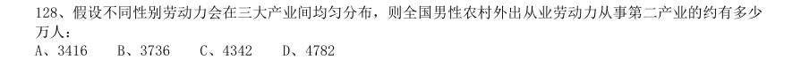

- **A.** 3416
- **B.** 3736
- **C.** 4342
- **D.** 4782

**答案：D**

### 【2009 国考·第 129 题】GK-2009-ty-X129　综合分析｜综合分析（综合）
> 材料：2006 年,全国农村外出从业劳动力中,男性劳动力8434 万人,占64%,从年龄构成上看,20 岁以下占16.1%,21~30 岁占36.5%;31~40 岁占29.5%;41~50 岁占12.8%;51 岁以上占5.1%。从文化程度看,文盲占1.2%;小学文化程度占18.7%;初中文化程度占70.1%;高中文化程度占8.7%;大专及以上文化程度占1.3%。…

关于农村外出从业劳动力的描述,无法从上述资料中推出的是:

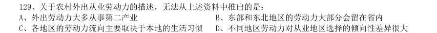

- **A.** 外出劳动力大多从事第二产业
- **B.** 东部和东北地区的劳动力大部分会留在省内
- **C.** 各地区的劳动力流向主要取决于本地的生活习惯
- **D.** 不同地区劳动力对从业地区选择的倾向性差异很大

**答案：C**

### 【2009 国考·第 130 题】GK-2009-ty-X130　综合分析｜综合分析（综合）
> 材料：2006 年,全国农村外出从业劳动力中,男性劳动力8434 万人,占64%,从年龄构成上看,20 岁以下占16.1%,21~30 岁占36.5%;31~40 岁占29.5%;41~50 岁占12.8%;51 岁以上占5.1%。从文化程度看,文盲占1.2%;小学文化程度占18.7%;初中文化程度占70.1%;高中文化程度占8.7%;大专及以上文化程度占1.3%。…

关于农村外出从业劳动力的描述,能够从上述资料中推出的是:

- **A.** 东北地区劳动力对从业地的选择差异最小
- **B.** 超过7500 万男性劳动力为高中以下文化程度
- **C.** 中西部地区劳动力大部分流向东部和东北地区
- **D.** 大专及以上文化程度仅占1.3%,说明高学历的劳动力多数都在家从业

**答案：A**

### 【2009 国考·第 131 题】GK-2009-ty-X131　综合分析｜基期量
> 材料：某港口2007 年生产统计表月份港口货物吞吐量(万吨)港口集装箱吞吐量(万TEU)本月数累计本月数累计本年上年同期比上年同期本年上年同期比上年同期…

某港口2007 年生产统计表 月份 港口货物吞吐量(万吨) 港口集装箱吞吐量(万TEU) 本月数 累计 本月数 累计 本年 上年同期 比上年同期 本年 上年同期 比上年同期 872.1 872.1 8.4 8.4 806.7 1678.8 5.9 14.3 905.5 2584.3 2379.6 8.6% 7.5 21.8 15.6 39.7% 912.8 3497.1 3244.2 7.8% 8.6 30.4 21.8 39.4% 990.3 4487.4 4139.1 8.4% 8.4 38.8 27.1 43.2% 927.5 5414.9 4898.7 10.5% 8.9 47.7 33.0 44.5% 918.2 6333.1 5653.6 12.0% 8.8 56.5 39.1 44.5% 929.1 7262.2 6448.9 12.6% 9.8 66.3 45.5 45.7% 904.5 8166.7 7221.5 13.1% 9.9 76.2 53.2 43.5% 871.1 9037.8 8133.6 11.1% 10.1 86.3 62.0 39.2% 905.2 9943.0 9121.9 9.0% 9.8 96.1 71.8 33.8% 916.1 10859.1 10088.8 7.6% 9.6 105.7 80.0 32.1% 2007 年该港口货物吞吐量最高的季度是:

- **A.** 第一季度
- **B.** 第二季度
- **C.** 第三季度
- **D.** 第四季度

**答案：B**

### 【2009 国考·第 132 题】GK-2009-ty-X132　综合分析｜综合分析（综合）
> 材料：某港口2007 年生产统计表月份港口货物吞吐量(万吨)港口集装箱吞吐量(万TEU)本月数累计本月数累计本年上年同期比上年同期本年上年同期比上年同期…

2006 年4 月到2007 年12 月间,港口货物吞吐量高于900 万吨的月份有多少个:

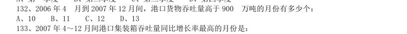

- **A.** 10
- **B.** 11
- **C.** 12
- **D.** 13

**答案：C**

### 【2009 国考·第 135 题】GK-2009-ty-X135　综合分析｜年均增长率
> 材料：某港口2007 年生产统计表月份港口货物吞吐量(万吨)港口集装箱吞吐量(万TEU)本月数累计本月数累计本年上年同期比上年同期本年上年同期比上年同期…

能够从上述资料中推出的是:

- **A.** 2006 年第一季度,月均港口货物吞吐量超过800 万吨
- **B.** 2007 年第一季度,港口集装箱吞吐量高于全年平均水平
- **C.** 2006 年4~12 月间港口集装箱吞吐量低于6 万吨的月份有3 个
- **D.** 2007 年第四季度的所有月份港口货物吞吐量均比上一年同期有所下降

**答案：D**

### 【2009 国考·第 137 题】GK-2009-ty-X137　综合分析｜年均增长率
> 材料：全国2007 年认定登记的技术合同共计220868 项,同比增长7%,总成交金额2226 亿元,同比增长22.44%; 平均每项技术合同成交金额突破百万元大关,达到100.78 万元。 2007 年全国共签订技术开发合同73320 项,成交金额876 亿元,分别比上年增长了13.5% 和22.2%;共签订 技术转让合同11474 项,成交金额420 亿元,成交金额同比增长30.8%;技术服务和技术咨询合同成交金额分 别为840 亿元和90 亿元,分别比上年增长了20.9% 和…

根据图 所提供的信息,以下关于全国合同成交金额的描述正确的是:

- **A.** 1997 年至2007 年间,年增长率逐年提高
- **B.** 1997 年至2007 年间,年增长金额逐年递增
- **C.** 1996 年至2007 年的年平均成交金额约为800 亿元
- **D.** 2007 年的成交金额未能实现比1996 年翻三番的目标

**答案：D**

### 【2009 国考·第 138 题】GK-2009-ty-X138　综合分析｜比重
> 材料：全国2007 年认定登记的技术合同共计220868 项,同比增长7%,总成交金额2226 亿元,同比增长22.44%; 平均每项技术合同成交金额突破百万元大关,达到100.78 万元。 2007 年全国共签订技术开发合同73320 项,成交金额876 亿元,分别比上年增长了13.5% 和22.2%;共签订 技术转让合同11474 项,成交金额420 亿元,成交金额同比增长30.8%;技术服务和技术咨询合同成交金额分 别为840 亿元和90 亿元,分别比上年增长了20.9% 和…

下列关于2006 年技术开发、技术转让、技术咨询和技术服务等四类合同占全国成交金额比重的图形,描述 正确的是:

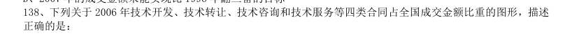

> （本题为图形题，选项为图片，见原卷）

**答案：B**

### 【2009 国考·第 140 题】GK-2009-ty-X140　综合分析｜平均数
> 材料：在2008 年8 月8 日至24 日奥运会期间,北京市的空气质量不仅天天达标,而且有10 天达到一级,全面兑现了对奥运会空气质量的承诺。下图是2008 年1~8 月北京市大气质量检测情况,图中一、二、三、四级是空气质量等级。一级空气质量最好,一级和二级都是质量达标天气。2008 年北京的空气质量控制目标是全年达标天数累计达256 天。 月空气合格天数超过20 天的月份有多少个:A、4B、5C、6D、7月间,月平均空气质量合格天数约为多少天:A、22B、24C、26D、2812…

能够从上述资料中推出的是:

- **A.** 计算机软件著作权合同平均每项的成交金额是所有技术合同中最高的
- **B.** 2007 年技术服务和技术咨询合同总数不到全国认定的技术合同总数的一半
- **C.** 如果保持2007 年的增速,全国技术合同成交总金额将在2010 年突破3500 亿元
- **D.** 2007 年技术开发、技术转让、技术咨询、技术服务的成交金额同比增长都超过10%

**答案：C**

### 【2008 湖北省考·第 117 题】HB-2008-ty-X117　综合分析｜综合分析（综合）
> 材料：共20 题。针对下列文字、表或图回答问题,你应根据资料提供的信息进行分析、比较、计算、处理。 根据以下文字资料,回答116-120 题。 据某市统计,截止到2004 年底,全市16 岁以下的少年儿童总数是2272194 人,其中,学龄前期儿童为 739616 人,占其总数的33.55%。…

该市儿童在食品消费比例支出最大的是:

- **A.** 婴儿期
- **B.** 幼儿期
- **C.** 学龄前期
- **D.** 学龄期

**答案：A**

### 【2008 湖北省考·第 118 题】HB-2008-ty-X118　综合分析｜综合分析（综合）
> 材料：共20 题。针对下列文字、表或图回答问题,你应根据资料提供的信息进行分析、比较、计算、处理。 根据以下文字资料,回答116-120 题。 据某市统计,截止到2004 年底,全市16 岁以下的少年儿童总数是2272194 人,其中,学龄前期儿童为 739616 人,占其总数的33.55%。…

该市儿童在服装消费比例支出最大的是:

- **A.** 婴儿期
- **B.** 幼儿期
- **C.** 学龄前期
- **D.** 学龄期

**答案：D**

### 【2008 湖北省考·第 122 题】HB-2008-ty-X122　综合分析｜综合分析（综合）
> 材料：行业700 强企业研发投入比重(%)投入最多的2 家公司占行业总投入的比重(%)行业700 强企业研发投入比重(%)投入最多的2 家公司占行业总投入的比重(%)IT 硬件航空及国防汽车化学生物制药电信电子电气保健品IT 软件及计算机服务其他…

由资料显示,以下说法不正确的是:

- **A.** 生物制药研发投入高于保健品投入15.3 个百分点
- **B.** 生物制药研发投入要低于IT 硬件4.2 个百分点
- **C.** 电信研发投入与保健品研发投入比例持平
- **D.** 化学研发投入低于电子电气研发投入6 个百分点

**答案：该题答案缺失，见原卷**

### 【2008 湖北省考·第 123 题】HB-2008-ty-X123　综合分析｜比重
> 材料：行业700 强企业研发投入比重(%)投入最多的2 家公司占行业总投入的比重(%)行业700 强企业研发投入比重(%)投入最多的2 家公司占行业总投入的比重(%)IT 硬件航空及国防汽车化学生物制药电信电子电气保健品IT 软件及计算机服务其他…

下列有关IT 硬件研发投入说法不正确的是:

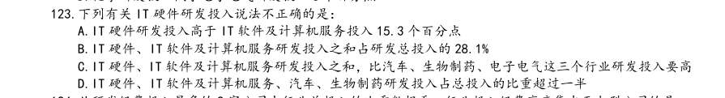

- **A.** IT 硬件研发投入高于IT 软件及计算机服务投入15.3 个百分点
- **B.** IT 硬件、IT 软件及计算机服务研发投入之和占研发总投入的28.1%
- **C.** IT 硬件、IT 软件及计算机服务研发投入之和,比汽车、生物制药、电子电气这三个行业研发投入要高
- **D.** IT 硬件、IT 软件及计算机服务、汽车、生物制药研发投入占总投入的比重超过一半

**答案：C**

### 【2008 湖北省考·第 125 题】HB-2008-ty-X125　综合分析｜综合分析（综合）
> 材料：行业700 强企业研发投入比重(%)投入最多的2 家公司占行业总投入的比重(%)行业700 强企业研发投入比重(%)投入最多的2 家公司占行业总投入的比重(%)IT 硬件航空及国防汽车化学生物制药电信电子电气保健品IT 软件及计算机服务其他…

根据所给数据资料,可以推出的选项为: [1]全球研发支出最多的企业基本上都是高科技企业 [2]2003 年全球研发支出最多的700 家企业高度密集于IT、汽车、生物制药、电子电气等行业 [3]前2 强公司的研发投入占电信行业研发总经费支出的“半壁江山”

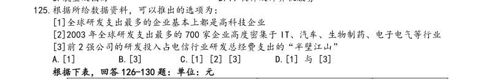

- **A.** [1]
- **B.** [3]
- **C.** [1] [2] [3]
- **D.** [1] 与[3]

**答案：该题答案缺失，见原卷**

### 【2008 湖北省考·第 127 题】HB-2008-ty-X127　综合分析｜综合分析（综合）

上表中,城乡居民收入差额最大的年份为:

- **A.** 2002 年
- **B.** 1999 年
- **C.** 2000 年
- **D.** 2003 年

**答案：D**

### 【2008 湖北省考·第 130 题】HB-2008-ty-X130　综合分析｜平均数

根据上表,下列叙述正确的是:

- **A.** 1978-2003 年,城市居民人均可支配收入各年增长率是递增趋势
- **B.** 1990-2003 年,农村居民人均纯收入呈递增趋势
- **C.** 城市居民人均可支配收入年增长率始终高于农村居民人均纯收入年增长率
- **D.** 1978-2003 年,城乡居民收入比率年递增趋势

**答案：该题答案缺失，见原卷**

### 【2008 湖北省考·第 131 题】HB-2008-ty-X131　综合分析｜综合分析（综合）

根据2002 年欧盟各国GDP 值比例图,西班牙的排名为( )。

- **A.** 第5
- **B.** 第6
- **C.** 第7
- **D.** 第8

**答案：A**

### 【2008 湖北省考·第 135 题】HB-2008-ty-X135　综合分析｜综合分析（综合）

从上图可以推出的结论是( )。 I. 瑞典与比利时的GDP 总量相差最少 II. 前五名之外的其他国家的GDP 总量小于德、法两国GDP 总量之和 III. 英国GDP 总量比德国GDP 总量少的比例小于丹麦GDP 总量比瑞典GDP 总量少的比例

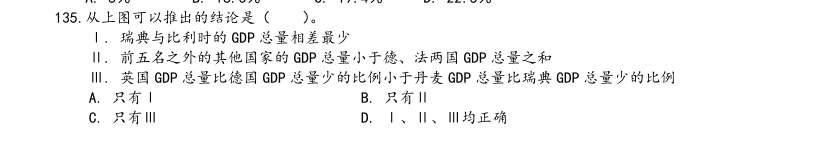

- **A.** 只有I
- **B.** 只有II
- **C.** 只有III
- **D.** I、II、III均正确

**答案：该题答案缺失，见原卷**

### 【2008 广东省考·第 86 题】GD-2008-ty-X086　综合分析｜综合分析（综合）
> 材料：“十五”以来,广东省的产业集群发展迅速,特色产业已成为广东省经济持续高速增长的新亮点。据统计,2006 年广东省特色产业基地工业产值达4930 亿元,约占全省工业总产值的10%;基地的高新技术产品产值1650 亿元,占全省高新技术产品产值的11%。全省特色产业基地的经济增长幅度,明显高于当地经济增长的平均幅度。2006 年,广东省特色产业基地的工业总产值,比2005 年增长20.3%。与此同时,各特色产业基地占地经济总量的比重逐步加大,有些基地已占到当地工业总产值的30%以上…

2005 年广东省特色产业基地的工业总产值是多少? A4930 亿元 B4098 亿元 C3929 亿元 D2145 亿元

> （本题为图形题，选项为图片，见原卷）

**答案：该题答案缺失，见原卷**

### 【2008 广东省考·第 94 题】GD-2008-ty-X094　综合分析｜比重
> 材料：“十五”以来,广东省的产业集群发展迅速,特色产业已成为广东省经济持续高速增长的新亮点。据统计,2006 年广东省特色产业基地工业产值达4930 亿元,约占全省工业总产值的10%;基地的高新技术产品产值1650 亿元,占全省高新技术产品产值的11%。全省特色产业基地的经济增长幅度,明显高于当地经济增长的平均幅度。2006 年,广东省特色产业基地的工业总产值,比2005 年增长20.3%。与此同时,各特色产业基地占地经济总量的比重逐步加大,有些基地已占到当地工业总产值的30%以上…

粤、鲁、苏、浙四省份比较，下列说法正确的是（ ）。

- **A.** 广东建筑业从业人员人均劳动报酬高于山东同行
- **B.** 四省份从事第一产业的劳动者报酬比从事其他行业的人员高
- **C.** 与其他行业相比，房地产从业人员工资最低
- **D.** 广东省金融业劳动报酬占GDP 比重比山东高

**答案：该题答案缺失，见原卷**

### 【2008 广东省考·第 95 题】GD-2008-ty-X095　综合分析｜比重
> 材料：A 广东 B 江苏 C 山东 D 浙江 93.2006 年广东省第三产业劳动报酬占GDP 比重比江苏省少多少?( ) A.6.8 个百分点 B.2.3 个百分点 C.2 个百分点 D.1.6 个百分点 94.粤、鲁、苏、浙四省份比较,下列说法正确的是( )。…

A.广东建筑业从业人员人均劳动报酬高于山东同行 B.四省份从事第一产业的劳动者报酬比从事其他行业的人员高 C.与其他行业相比,房地产从业人员工资最低 D.广东省金融业劳动报酬占GDP 比重比山东高 根据所给资料,下列表述不正确的是( )。

- **A.** 1995 年以来,各省GDP 总量呈上升趋势
- **B.** 与三年相比,2006 年GDP 增加最快的省份是江苏省
- **C.** 2006 年,各省第一产业劳动报酬占GDP 比重远高于其他行业
- **D.** 总体来说,1995 年以来,各省劳动报酬占GDP 比重呈下降趋势

**答案：该题答案缺失，见原卷**

### 【2008 广东省考·第 96 题】GD-2008-ty-X096　综合分析｜综合分析（综合）
> 材料：万户2003年2005年2007年2003年-2007年末电话用户情况示意图固定电话年末用户移动电话年末用户(统计数据来源于《2007 年中国国民经济统计公报》)…

10000 20000 30000 40000 50000 60000 万户 2003年 2005年 2007年 2003年-2007年末电话用户情况示意图 固定电话年末用户 移动电话年末用户 (统计数据来源于《2007 年中国国民经济统计公报》) 2003 年至2007 年间,我国固定电话用户与移动电话用户数量最接近的年份是( )。

- **A.** 2003 年
- **B.** 2004 年
- **C.** 2005 年
- **D.** 2006 年

**答案：该题答案缺失，见原卷**

### 【2008 广东省考·第 100 题】GD-2008-ty-X100　综合分析｜增长量
> 材料：万户2003年2005年2007年2003年-2007年末电话用户情况示意图固定电话年末用户移动电话年末用户(统计数据来源于《2007 年中国国民经济统计公报》)…

根据所给材料,下列推断不正确的一项是( )

- **A.** 2004 年以来,我国移动电话用户年新增量均高于固定电话用户年新增量
- **B.** 预计到2010 年,移动电话用户数将大大高于固定电话用户量
- **C.** 2003 年以来,我国固定电话用户数呈逐年减少的趋势
- **D.** 2006 年,我国固定电话用户数达历史最高水平

**答案：该题答案缺失，见原卷**

### 【2008 国考·第 123 题】GK-2008-ty-X123　综合分析｜综合分析（综合）
> 材料：根据所给图表、文字资料完成各题。 以2004 年为例,年印刷量在10 亿对开张以上的企业有30 家,其中印刷量增长的企业占90%,而且全部增 长5%以上,增长率达两位数的企业占66.67%。年印刷量在5 亿至10 亿对开张之间的企业有26 家,其中印刷 量增长的有25 家,增长率达到两位数的有19 家。 到了2005 年,年印刷量在10 亿对开张以上的企业有29 家,其中印刷量增长的有17 家,增长5%以上的有 11 家,而保持两位数增长的有8 家。印刷量减少的企业有11 家…

2006 年,年印刷量在10 亿对开张以上的企业中,印刷量增长5%以上,且低于10%的企业有多少家:

- **A.** 3
- **B.** 4
- **C.** 5
- **D.** 8

**答案：B**

### 【2008 国考·第 124 题】GK-2008-ty-X124　综合分析｜年均增长率
> 材料：根据所给图表、文字资料完成各题。 以2004 年为例,年印刷量在10 亿对开张以上的企业有30 家,其中印刷量增长的企业占90%,而且全部增 长5%以上,增长率达两位数的企业占66.67%。年印刷量在5 亿至10 亿对开张之间的企业有26 家,其中印刷 量增长的有25 家,增长率达到两位数的有19 家。 到了2005 年,年印刷量在10 亿对开张以上的企业有29 家,其中印刷量增长的有17 家,增长5%以上的有 11 家,而保持两位数增长的有8 家。印刷量减少的企业有11 家…

以下关于1994 至2006 年年印刷量、年增长率的说法中,正确的是:

- **A.** 年平均增长率在10%以上
- **B.** 年增长量最多的是2001 年
- **C.** 年增长率大于10%有8 个年份
- **D.** 1998 年的年增长量不到2002 年的一半

**答案：A**

### 【2008 国考·第 125 题】GK-2008-ty-X125　综合分析｜增长率

（本题题干为图形/公式，文字层无题干，图见原卷）

> （本题为图形题，选项为图片，见原卷）

**答案：B**

### 【2008 国考·第 127 题】GK-2008-ty-X127　综合分析｜综合分析（综合）

1990-2002 年间,当地人民食物获取状况恶化的地区是:

- **A.** 拉丁美洲和加勒比
- **B.** 南亚
- **C.** 撒哈拉以南非洲
- **D.** 西亚

**答案：D**

### 【2008 国考·第 128 题】GK-2008-ty-X128　综合分析｜综合分析（综合）

按1990-2002 年间的发展趋势,有几个地区将能够达到或超过2015 年发展中地区(总体)的目标水平:

- **A.** 3 个
- **B.** 4 个
- **C.** 5 个
- **D.** 6 个

**答案：B**

### 【2008 国考·第 130 题】GK-2008-ty-X130　综合分析｜综合分析（综合）

下列说法中,不能从图示信息中获得支持的是: I.1992-2002 年间,北非饥饿人口的数量并没有因人口总量的变化而变化 II.1992-2002 年间,东南亚和南亚地区的饥饿人口比例基本能反映发展中地区的总体概况 III.1992-2002 年间,发展中地区的饥饿人口主要集中在南亚地区和撒哈拉以南非洲地区 IV.1992-2002 年间,东亚地区在改善人民饥饿状况的工作方面最为突出

- **A.** I
- **B.** II 和III
- **C.** I 和III
- **D.** I 和IV

**答案：C**

### 【2008 国考·第 131 题】GK-2008-ty-X131　综合分析｜综合分析（综合）
> 材料：某市2005 年就该市城镇居民和农民参加体育锻炼及其影响因素,开展了一项调查。调查结束后按城乡、性 别分别进行了统计,统计结果如下两张表所示。…

表1:2005 年某市城镇居民和农民参加体育锻炼项目情况统计(%) 城镇 农村 男 女 武术健身气功 6.0 2.1 4.7 5.9 健身操舞秧歌 12.8 8.0 3.8 20.1 健美力量练习 7.3 5.8 8.5 5.4 自行车 23.8 21.0 24.7 21.8 登山 14.9 10.4 14.4 13.8 球类 16.8 37.9 19.9 步行 63.7 72.3 57.9 72.7 游泳 17.6 4.1 16.4 13.9 跑步 23.8 25.9 29.2 19.1 其他 13.3 9.5 11.9 13.3 表2:2005 年某市城镇居民和农民参加体育锻炼的影响因素(%) 城镇 农村 男 女 缺乏组织 8.8 3.6 7.0 7.4 缺乏指导 7.8 4.7 7.1 6.8 缺乏场地设施 13.2 8.0 12.1 14.1 工作忙、缺少时间 21.8 21.5 32.7 24.6 家务忙、缺少时间 9.2 20.8 17.6 10.5 体力工作多,不用参加 3.4 15.9 7.8 11.8 惰性 4.9 7.5 15.9 6.7 没兴趣 1.4 9.1 6.8 6.1 在各项体育项目的普及程度上,农村与城镇相比:

- **A.** 登山高于城镇
- **B.** 步行低于城镇
- **C.** 自行车高于城镇
- **D.** 健身操舞秧歌低于城镇

**答案：D**

### 【2008 国考·第 132 题】GK-2008-ty-X132　综合分析｜综合分析（综合）
> 材料：某市2005 年就该市城镇居民和农民参加体育锻炼及其影响因素,开展了一项调查。调查结束后按城乡、性 别分别进行了统计,统计结果如下两张表所示。…

与男性相比,在女性中更普及的两个体育项目是:

- **A.** 球类步行
- **B.** 跑步游泳
- **C.** 步行健身操舞秧歌
- **D.** 健身操舞秧歌跑步

**答案：C**

### 【2008 国考·第 134 题】GK-2008-ty-X134　综合分析｜比重
> 材料：某市2005 年就该市城镇居民和农民参加体育锻炼及其影响因素,开展了一项调查。调查结束后按城乡、性 别分别进行了统计,统计结果如下两张表所示。…

无法从表2 获得支持的判断是:

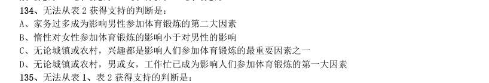

- **A.** 家务过多成为影响男性参加体育锻炼的第二大因素
- **B.** 惰性对女性参加体育锻炼的影响小于对男性的影响
- **C.** 无论城镇或农村,兴趣都是影响人们参加体育锻炼的最重要因素之一
- **D.** 无论城镇或农村,男或女,工作忙已成为影响人们参加体育锻炼的第一大因素

**答案：C**

### 【2008 国考·第 135 题】GK-2008-ty-X135　综合分析｜比重
> 材料：某市2005 年就该市城镇居民和农民参加体育锻炼及其影响因素,开展了一项调查。调查结束后按城乡、性 别分别进行了统计,统计结果如下两张表所示。…

无法从表1、表2 获得支持的判断是:

- **A.** 农民对体育锻炼的不恰当看法和认识更普遍一些
- **B.** 与城镇居民相比,农民参加体育锻炼的项目比较单调
- **C.** 在全民健身方面,培养农民参加体育锻炼的兴趣可能比城镇居民更迫切
- **D.** 男性因工作压力放弃体育锻炼的更多一些,而女性因家务压力放弃体育锻炼更多一些

**答案：D**

### 【2008 国考·第 137 题】GK-2008-ty-X137　综合分析｜增长率
> 材料：表1:2001 至2005 年世界主要国家和地区经济增长率比较(%)国家和地区2001 年2002 年2003 年2004 年2005 年2001 至2005 年平均增长率世界总计发达国家和地区美国欧盟日本发展中国家和地区中国印度俄罗斯巴西马来西亚亚洲四小龙中国香港中国台湾韩国新加坡表2:2001 至2005 年国内生产总值居世界前10 位国家比较(亿美元)位次2001 年2005 年国家和地区国内生产总值占世界的比重(%)国家和地区国内生产总值占世界的比重(%)世界总计世界…

2001 到2005 年间,完全符合曲线所显示的经济发展趋势的国家和地区有:

- **A.** 2 个
- **B.** 3 个
- **C.** 4 个
- **D.** 5 个

**答案：B**

### 【2008 国考·第 138 题】GK-2008-ty-X138　综合分析｜比重
> 材料：表1:2001 至2005 年世界主要国家和地区经济增长率比较(%)国家和地区2001 年2002 年2003 年2004 年2005 年2001 至2005 年平均增长率世界总计发达国家和地区美国欧盟日本发展中国家和地区中国印度俄罗斯巴西马来西亚亚洲四小龙中国香港中国台湾韩国新加坡表2:2001 至2005 年国内生产总值居世界前10 位国家比较(亿美元)位次2001 年2005 年国家和地区国内生产总值占世界的比重(%)国家和地区国内生产总值占世界的比重(%)世界总计世界…

下面描述不正确的是:

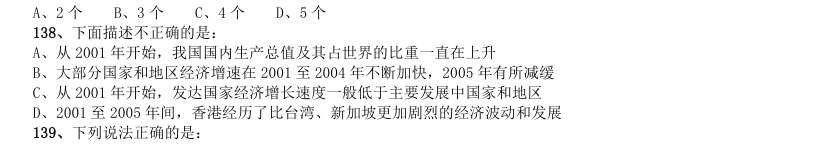

- **A.** 从2001 年开始,我国国内生产总值及其占世界的比重一直在上升
- **B.** 大部分国家和地区经济增速在2001 至2004 年不断加快,2005 年有所减缓
- **C.** 从2001 年开始,发达国家经济增长速度一般低于主要发展中国家和地区
- **D.** 2001 至2005 年间,香港经历了比台湾、新加坡更加剧烈的经济波动和发展

**答案：D**

### 【2008 国考·第 139 题】GK-2008-ty-X139　综合分析｜比重
> 材料：表1:2001 至2005 年世界主要国家和地区经济增长率比较(%)国家和地区2001 年2002 年2003 年2004 年2005 年2001 至2005 年平均增长率世界总计发达国家和地区美国欧盟日本发展中国家和地区中国印度俄罗斯巴西马来西亚亚洲四小龙中国香港中国台湾韩国新加坡表2:2001 至2005 年国内生产总值居世界前10 位国家比较(亿美元)位次2001 年2005 年国家和地区国内生产总值占世界的比重(%)国家和地区国内生产总值占世界的比重(%)世界总计世界…

下列说法正确的是: I.2001 至2005 年间,与主要发展中国家相比,亚洲四小龙的经济增长相对放慢 II.2001 至2005 年间,日本经济开始摆脱“停滞”状态,经济形势逐渐好转 III.2001 至2005 年间,国内生产总值在世界排名的变化趋势和其占世界比重的变化趋势是一致的

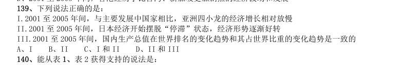

- **A.** I
- **B.** II
- **C.** I 和II
- **D.** II 和III

**答案：C**

### 【2008 国考·第 140 题】GK-2008-ty-X140　综合分析｜比重
> 材料：表1:2001 至2005 年世界主要国家和地区经济增长率比较(%)国家和地区2001 年2002 年2003 年2004 年2005 年2001 至2005 年平均增长率世界总计发达国家和地区美国欧盟日本发展中国家和地区中国印度俄罗斯巴西马来西亚亚洲四小龙中国香港中国台湾韩国新加坡表2:2001 至2005 年国内生产总值居世界前10 位国家比较(亿美元)位次2001 年2005 年国家和地区国内生产总值占世界的比重(%)国家和地区国内生产总值占世界的比重(%)世界总计世界…

能从表1、表2 获得支持的说法是: I.整个世界的财富越来越集中到少数几个发达国家中 II.传统的世界经济强国在世界经济中的排名和地位已经发生了根本性变化 III.主要的发展中国家在世界经济中扮演着越来越重要的角色

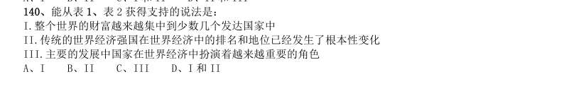

- **A.** I
- **B.** II
- **C.** III
- **D.** I 和II

**答案：C**

### 【2007 广东省考·第 86 题】GD-2007-ty-X086　综合分析｜比重
> 材料：86~90 题。 2006 年,广东城镇单位从业人数创历史新高,2006 年从业人数比上年底增加50。17 万人,比1995 年高峰 期的911.90 万人还多42.54 万人。2006 年末企业从业人员达到696.33 万人,比上年底增加42.45 万 人,而同期事业、机关单位的从业人员为258.11 万人,比上年底增加7.72 万人。…

2006 年末,全省城镇 单位从业人员按经济类型分,国有经济为383.78 万人,占总体的40.3%,城镇集体经济、其他各种经济 从业人员分别占总体的7.0%、52.6%,各比重依次与上年相比,国有经济略增0.3 个百分点,集体经 济下降0.6 个百分点,其他各种经济提升2.2 个百分点。广东制造业从业人员2006 年的人数已发展到 359.98 万人,占总体的41.0%,比上年增加了1.2 个百分点。 2005 年底广东城镇单位从业人员约为多少人?( )

- **A.** 954.44 万
- **B.** 919.53 万
- **C.** 911.90 万D.904.27 万

**答案：该题答案缺失，见原卷**

### 【2007 广东省考·第 88 题】GD-2007-ty-X088　综合分析｜综合分析（综合）
> 材料：86~90 题。 2006 年,广东城镇单位从业人数创历史新高,2006 年从业人数比上年底增加50。17 万人,比1995 年高峰 期的911.90 万人还多42.54 万人。2006 年末企业从业人员达到696.33 万人,比上年底增加42.45 万 人,而同期事业、机关单位的从业人员为258.11 万人,比上年底增加7.72 万人。…

2006 年全省其他各种经济从业人员数量比2005 年多多少人?( )

- **A.** 46.28 万
- **B.** 42.45 万C.42.54 万D.31.09 万

**答案：该题答案缺失，见原卷**

### 【2007 广东省考·第 89 题】GD-2007-ty-X089　综合分析｜综合分析（综合）
> 材料：86~90 题。 2006 年,广东城镇单位从业人数创历史新高,2006 年从业人数比上年底增加50。17 万人,比1995 年高峰 期的911.90 万人还多42.54 万人。2006 年末企业从业人员达到696.33 万人,比上年底增加42.45 万 人,而同期事业、机关单位的从业人员为258.11 万人,比上年底增加7.72 万人。…

根据上述材料,在吸引劳动力就业方面,表现最不突出的是( )。

- **A.** 国有企业
- **B.** 城镇集体经济
- **C.** 非公有制经济
- **D.** 制造业

**答案：该题答案缺失，见原卷**

### 【2007 广东省考·第 90 题】GD-2007-ty-X090　综合分析｜综合分析（综合）
> 材料：86~90 题。 2006 年,广东城镇单位从业人数创历史新高,2006 年从业人数比上年底增加50。17 万人,比1995 年高峰 期的911.90 万人还多42.54 万人。2006 年末企业从业人员达到696.33 万人,比上年底增加42.45 万 人,而同期事业、机关单位的从业人员为258.11 万人,比上年底增加7.72 万人。…

以下说法不符合上述材料的一项是( )。

- **A.** 2006 年广东城镇单位从业人员已创出历史新高
- **B.** 2006 年非公有制企业成为吸纳劳动力就业的主渠道
- **C.** 2006 年企业从业人员的增长高于事业、机关单位D。2006 年广东制造业从业人员占城镇从业人员的一半以上

**答案：该题答案缺失，见原卷**

### 【2007 广东省考·第 93 题】GD-2007-ty-X093　综合分析｜综合分析（综合）
> 材料：(个)活动R8LD活动机构员年平均人数(万人)动人员(万人)工程师人贝总计5.O5…

表一:2004 年广东高技术行业科技人才资源配置情况表 企业数 (个) 有科技 活动 有 R8LD 活动 有科技 机构 从业人 员年平 均人数 (万人) 科技活 动人员 (万人) 科学家 工程师 R&D 人 贝 总计 80 8.11 6.34 5.O5 医药制造业 7.46 0.55 0.34 0.24 航空航天器制造业 O 0.31 0.O3 0.O3 0.O3 电子及通信设备制造 业 136.85 5.24 4.33 3.48 计算机及办公设备制 造业 44.48 1.97 1.41 1-13 医疗设备及仪器仪表 制造业 4.73 0.32 0.24 0.16 表二:2004 年广东高技术产业中大中型工业企业科技活动情况 科技活动 人员合计 (万人) 科学家工 程师 科技活动 经费内部 支出总额 (亿元) R&D 经费 内部支出 新产品开 发经费支 出 新产品产 值(亿元) 拥有发 明专利 数(件) 高技术产业 总数 8.11 6.34 1 36.25 127.78 68.29 1508.98 1747 大中型企业 6.53 5.20 124.O3 117.14 64.19 1502.85 1407 91.2004 年,广东高技术行业企业中科学家工程师占科技活动人员的比例最高的行业是( )。

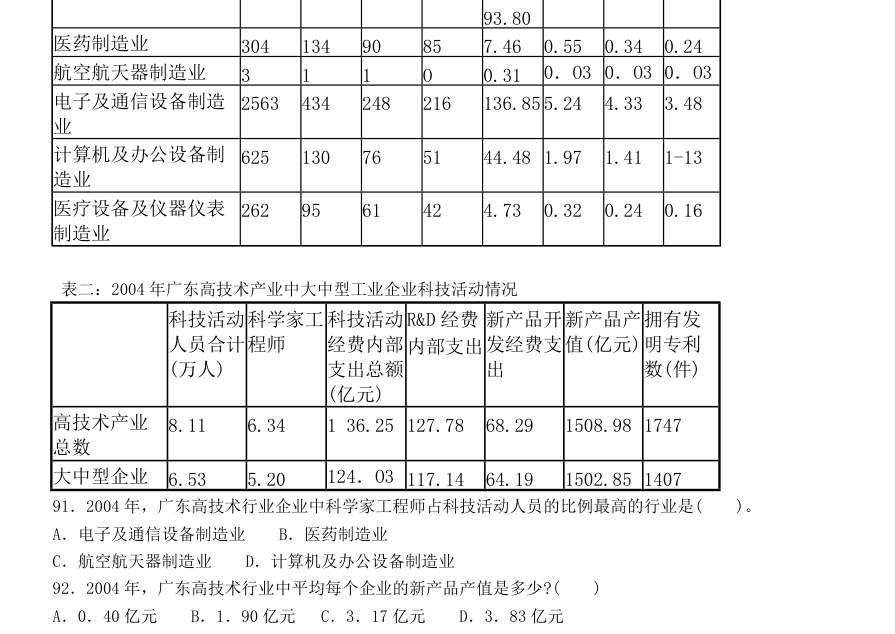

- **A.** 电子及通信设备制造业
- **B.** 医药制造业
- **C.** 航空航天器制造业
- **D.** 计算机及办公设备制造业

**答案：该题答案缺失，见原卷**

### 【2007 广东省考·第 95 题】GD-2007-ty-X095　综合分析｜综合分析（综合）
> 材料：(个)活动R8LD活动机构员年平均人数(万人)动人员(万人)工程师人贝总计5.O5…

根据上表所列数据,下列说法正确的是( )。

- **A.** 广东高科技产业中的大中型工业企业拥有发明专利数为1747 件
- **B.** 广东高科技产业中的大中型工业企业产品开发经费支出占高技术产业总数的99.6%
- **C.** 航空航天器制造业新产品产值少于6.13 亿元
- **D.** 大中型工业企业在科技资源投入、产出以及拥有自主知识产权方面都发挥着中坚力量的重要作用

**答案：该题答案缺失，见原卷**

### 【2007 广东省考·第 99 题】GD-2007-ty-X099　综合分析｜增长率

根据上图,下列关于我国农村用电发电情况的表述,正确的一项是( )。

- **A.** 2000 至2005 年问,我国农村装机容量逐年增加
- **B.** 2000 至2005 年间,我国农村用电量增长了195.44 亿千瓦时
- **C.** 2000 至2005 年间,我国农村发电量越来越能够满足用电量的需求
- **D.** 2000 至2005 年问,我国农村用电量增速逐年减慢

**答案：该题答案缺失，见原卷**

### 【2007 国考·第 124 题】GK-2007-ty-X124　综合分析｜平均数
> 材料：2006 年五月份北京市消费品市场较为活跃,实现社会消费品零售额272.2 亿元,创今年历史第二高,据统 计,1~5 月份全市累计实现社会消费品零售额1312.7 亿元,比去年同期增长12.5%。 汽车销售继续支持北京消费品市场的繁荣。5 月份,全市机动车类销售量为5.4 万辆,同比增长23.9%,据 对限额以上批发零售贸易企业统计,汽车类商品当月实现零售额32.3 亿元,占限额以上批发零售贸易企业零售 额比重的20.3%。 据对限额以上批发零售贸易企业统计。5 月份,家具类…

下列说法正确的是: I.2006 年1-5 月份北京市每月平均社会消费品零售额比去年同期增长12.5% II.2006 年5 月份家具类、建筑及装潢材料类、家电类限额以上批发零售贸易企业零售额的增长率相比较,建筑 及装潢材料类增长最快 III.2005 年北京市机动车类销售量约为4.36 万辆

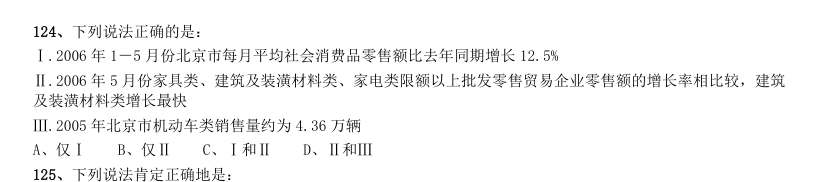

- **A.** 仅I
- **B.** 仅II
- **C.** I和II
- **D.** II和III

**答案：C**

### 【2007 国考·第 125 题】GK-2007-ty-X125　综合分析｜增长率
> 材料：2006 年五月份北京市消费品市场较为活跃,实现社会消费品零售额272.2 亿元,创今年历史第二高,据统 计,1~5 月份全市累计实现社会消费品零售额1312.7 亿元,比去年同期增长12.5%。 汽车销售继续支持北京消费品市场的繁荣。5 月份,全市机动车类销售量为5.4 万辆,同比增长23.9%,据 对限额以上批发零售贸易企业统计,汽车类商品当月实现零售额32.3 亿元,占限额以上批发零售贸易企业零售 额比重的20.3%。 据对限额以上批发零售贸易企业统计。5 月份,家具类…

下列说法肯定正确地是:

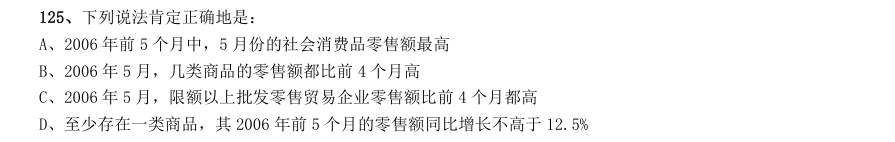

- **A.** 2006 年前5 个月中,5 月份的社会消费品零售额最高
- **B.** 2006 年5 月,几类商品的零售额都比前4 个月高
- **C.** 2006 年5 月,限额以上批发零售贸易企业零售额比前4 个月都高
- **D.** 至少存在一类商品,其2006 年前5 个月的零售额同比增长不高于12.5%

**答案：D**

### 【2007 国考·第 126 题】GK-2007-ty-X126　综合分析｜综合分析（综合）

下列行业中,每单位取水量中耗水量最少的是:

- **A.** 林牧渔畜
- **B.** 工业
- **C.** 居民生活
- **D.** 生态环境

**答案：A**

### 【2007 国考·第 127 题】GK-2007-ty-X127　综合分析｜综合分析（综合）

下列省份中,每单位耗水量所需取水量最少的是:

- **A.** 青海
- **B.** 宁夏
- **C.** 河南
- **D.** 山东

**答案：D**

### 【2007 国考·第 130 题】GK-2007-ty-X130　综合分析｜比重

下列说法正确的是:

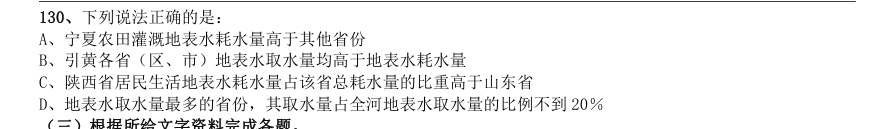

- **A.** 宁夏农田灌溉地表水耗水量高于其他省份
- **B.** 引黄各省(区、市)地表水取水量均高于地表水耗水量
- **C.** 陕西省居民生活地表水耗水量占该省总耗水量的比重高于山东省
- **D.** 地表水取水量最多的省份,其取水量占全河地表水取水量的比例不到20%

**答案：C**

### 【2007 国考·第 131 题】GK-2007-ty-X131　综合分析｜综合分析（综合）
> 材料：2005 年全国专利审查与专利代理业务研讨会宣布,预计在“十一五”期间,我国专利申请总量将达346 万 件,其中发明专利申请总量将达到140 万件,实用新型专利申请总量将达到89 万件,外观设计专利申请总量将 达到117 万件。 据介绍,我国专利审批总体能力在“十五”期间大幅提高,审查周期大幅缩短。发明专利人均待审量由“十 五"初期(2001 年)的154 件下降到“十五”末期(2005 年)的85 件,平均结案周期从“十五”初期的53 个月缩短 至“十五”末期的24 个月。…

其中,2004 年共受理专利申请35.38 万件,同比 增长14.7%;2004 年共授予专利19.02 万件,同比增长4.4%。我国的实用新型专利、外观设计专利和商标的年 申请量已经跃居世界第一,其中90%以上为国内申请。 与2003 年相比,2004 年我国专利的授予比例(授予比例=专利申请授予量/专利申请受理量):

- **A.** 提高了5.3 个百分点
- **B.** 降低了5.3 个百分点
- **C.** 提高了9.5 个百分点
- **D.** 降低了9.5 个百分点

**答案：B**

### 【2007 国考·第 132 题】GK-2007-ty-X132　综合分析｜综合分析（综合）
> 材料：2005 年全国专利审查与专利代理业务研讨会宣布,预计在“十一五”期间,我国专利申请总量将达346 万 件,其中发明专利申请总量将达到140 万件,实用新型专利申请总量将达到89 万件,外观设计专利申请总量将 达到117 万件。 据介绍,我国专利审批总体能力在“十五”期间大幅提高,审查周期大幅缩短。发明专利人均待审量由“十 五"初期(2001 年)的154 件下降到“十五”末期(2005 年)的85 件,平均结案周期从“十五”初期的53 个月缩短 至“十五”末期的24 个月。…

1985 年4 月1 日至2005 年8 月31 日,我国受理的专利申请中,最后约58.5 万件专利的受理历时:

- **A.** 15 个月
- **B.** 14 个月
- **C.** 10 个月
- **D.** 8 个月

**答案：A**

### 【2007 国考·第 135 题】GK-2007-ty-X135　综合分析｜平均数
> 材料：2005 年全国专利审查与专利代理业务研讨会宣布,预计在“十一五”期间,我国专利申请总量将达346 万 件,其中发明专利申请总量将达到140 万件,实用新型专利申请总量将达到89 万件,外观设计专利申请总量将 达到117 万件。 据介绍,我国专利审批总体能力在“十五”期间大幅提高,审查周期大幅缩短。发明专利人均待审量由“十 五"初期(2001 年)的154 件下降到“十五”末期(2005 年)的85 件,平均结案周期从“十五”初期的53 个月缩短 至“十五”末期的24 个月。…

下列说法正确的是:

- **A.** 我国的专利审批总体能力已居世界前列
- **B.** 目前我国的各项专利年申请量均已跃居世界第一
- **C.** “十五”末期,我国的专利在提交申请后两年内都可完成审查
- **D.** 若同比增长不变,2005 年全年我国的专利申请量将超过40 万

**答案：D**

### 【2007 国考·第 138 题】GK-2007-ty-X138　综合分析｜增长率

与亚洲相比,整个欧洲的啤酒消费量:

- **A.** 绝对量多于亚洲,2004 年相对于1998 年的增长快于亚洲
- **B.** 绝对量多于亚洲,2004 年相对于1998 年的增长慢于亚洲
- **C.** 绝对量少于亚洲,2004 年相对于1998 年的增长快于亚洲
- **D.** 绝对量少于亚洲,2004 年相对于1998 年的增长慢于亚洲

**答案：B**

### 【2007 国考·第 139 题】GK-2007-ty-X139　综合分析｜比重

关于啤酒消费量,下列说法错误的是:

- **A.** 六年来世界啤酒消费总量的增长超过了10%
- **B.** 北美洲和西欧啤酒消费量的差距在六年间缩小了
- **C.** 亚洲的啤酒消费量始终占到了世界啤酒消费总量的四分之一强
- **D.** 无论是啤酒消费绝对量还是占世界啤酒消费总量的比重,北美都有所增长

**答案：D**

### 【2007 国考·第 140 题】GK-2007-ty-X140　综合分析｜增长率

若中国1998 年的啤酒消费量为205 亿升,2004 年的啤酒消费量为291 亿升,则下列说法一定正确的是:

- **A.** 中国的啤酒消费量增长率亚洲最高
- **B.** 中国的啤酒消费增长占到亚洲啤酒消费增长的90%以上
- **C.** 除中国外,任一亚洲国家,其六年来的啤酒消费量增长不可能超过3 亿升
- **D.** 中国六年间啤酒消费增长量比2004 年非洲和大洋洲的啤酒消费量的总和还要多

**答案：B**

### 【2006 广东省考·第 86 题】GD-2006-ty-X086　综合分析｜基期量
> 材料：86~90 题。 据统计,今年5月份全国基本型乘用车产销21.19万辆和22.13万辆,比去年同期分别增长1.86%和 26.0%;运动型多用途乘用车产销1.43万辆和1.52万辆,降幅不大;交叉型乘用车本月产销6.60万辆和6.85 万辆,分别比上月下降14.2%和2.8%;多功能乘用车产销降幅最大,本月产销1.23万辆1.24万辆。…

1至 5月,基本型乘用车累计产销99.10万辆和96.93万辆,产量同比下降 2.73%,销量同比增长1.07%; 多功能乘用车累计产销6.11万辆和5.71万辆,同比增长31.20%和 31.54%;运动型多用途乘用车累计产销 6.46万辆和6.54万辆,同比下降16.00%和10.25%;交叉型乘用车累计产销36.77万辆和37.41万辆,同比增长 6.02%和 10.29%。 去年 5月份全国乘用车销量最大的车型的销量是( )。

- **A.** 21.19万辆
- **B.** 20.80万辆
- **C.** 17.56万辆
- **D.** 101.80万辆

**答案：该题答案缺失，见原卷**

### 【2006 广东省考·第 87 题】GD-2006-ty-X087　综合分析｜现期量
> 材料：86~90 题。 据统计,今年5月份全国基本型乘用车产销21.19万辆和22.13万辆,比去年同期分别增长1.86%和 26.0%;运动型多用途乘用车产销1.43万辆和1.52万辆,降幅不大;交叉型乘用车本月产销6.60万辆和6.85 万辆,分别比上月下降14.2%和2.8%;多功能乘用车产销降幅最大,本月产销1.23万辆1.24万辆。…

今年5月份全国乘用车销量最大的车型是( )

- **A.** 基本型乘用车
- **B.** 交叉型乘用车
- **C.** 多功能乘用车D.运动型多用途乘用车

**答案：该题答案缺失，见原卷**

### 【2006 广东省考·第 90 题】GD-2006-ty-X090　综合分析｜基期量
> 材料：86~90 题。 据统计,今年5月份全国基本型乘用车产销21.19万辆和22.13万辆,比去年同期分别增长1.86%和 26.0%;运动型多用途乘用车产销1.43万辆和1.52万辆,降幅不大;交叉型乘用车本月产销6.60万辆和6.85 万辆,分别比上月下降14.2%和2.8%;多功能乘用车产销降幅最大,本月产销1.23万辆1.24万辆。…

根据上述资料,以下表述准确的一项是( )。

- **A.** 与去年相比,全国今年1至5月基本型乘用车产、销量有不同程度的增长
- **B.** 今年1至5月份全国运动型多用途乘用车产、销量都低于去年同期
- **C.** 去年5月全国交叉型乘用车产、销量都低于今年5月
- **D.** 今年4月全国基本型乘用车产、销量都略高于5月

**答案：该题答案缺失，见原卷**

### 【2006 广东省考·第 91 题】GD-2006-ty-X091　综合分析｜综合分析（综合）

我国农村劳动力情况表 单位:万人 2003 年,我国总人口约为多少人?( )

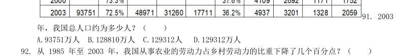

- **A.** 93751万人
- **B.** 128810万人
- **C.** 129312人
- **D.** 129312万人

**答案：该题答案缺失，见原卷**

### 【2006 广东省考·第 93 题】GD-2006-ty-X093　综合分析｜综合分析（综合）

根据上表,从 1985 年至 2003 年,从事非农劳动的比例上升最快的行业是( )。

- **A.** 工业
- **B.** 建筑业
- **C.** 交通业
- **D.** 商饮业

**答案：该题答案缺失，见原卷**

### 【2006 广东省考·第 95 题】GD-2006-ty-X095　综合分析｜比重

根据上表所列数据,下列说法错误的是( )。

- **A.** 乡村人口总人口比重不断下降
- **B.** 乡村人口中农业劳动力的比重不断下降
- **C.** 从事非农劳动的乡村人口不断上升
- **D.** 在非农劳动人口中,从事工业、建筑、交通、商饮行业的比例都有不同程度的上升

**答案：该题答案缺失，见原卷**

### 【2006 广东省考·第 96 题】GD-2006-ty-X096　综合分析｜比重
> 材料：2000—2004 年我国大中型企业专利申请及拥有量统计图(单位:件)2004 年我国部分省、市大中型工业企业专利申请及拥有量统计表单位:件地区专利申请量(件)发明专利申请量(件)发明专利拥有量(件)北京天津上海浙江江苏黑龙江山东广东四川陕西青海…

2000—2004 年我国大中型企业专利申请及拥有量统计图(单位:件) 2004 年我国部分省、市大中型工业企业专利申请及拥有量统计表 单位:件 地区 专利申请量(件) 发明专利申请量(件) 发明专利拥有量(件) 北京 天津 上海 浙江 江苏 黑龙江 山东 广东 四川 陕西 青海 2000年至 2004年,我国大中型工业企业发明专利申请数占专利申请数比重最大的年份是( )。

- **A.** 2001年
- **B.** 2002年
- **C.** 2003年
- **D.** 2004年

**答案：该题答案缺失，见原卷**

### 【2006 广东省考·第 99 题】GD-2006-ty-X099　综合分析｜年均增长率
> 材料：2000—2004 年我国大中型企业专利申请及拥有量统计图(单位:件)2004 年我国部分省、市大中型工业企业专利申请及拥有量统计表单位:件地区专利申请量(件)发明专利申请量(件)发明专利拥有量(件)北京天津上海浙江江苏黑龙江山东广东四川陕西青海…

根据以上统计信息,下列关于我国大中型工业企业专利情况的表述,错误的一项是( )。

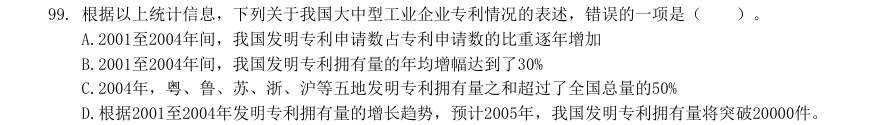

- **A.** 2001至2004年间,我国发明专利申请数占专利申请数的比重逐年增加
- **B.** 2001至2004年间,我国发明专利拥有量的年均增幅达到了30%
- **C.** 2004年,粤、鲁、苏、浙、沪等五地发明专利拥有量之和超过了全国总量的50%
- **D.** 根据2001至2004年发明专利拥有量的增长趋势,预计2005年,我国发明专利拥有量将突破20000件。

**答案：该题答案缺失，见原卷**

### 【2006 国考·第 116 题】GK-2006-ty-X116　综合分析｜比重
> 材料：2000 年至2004 年全国大中型工业企业部分科技指标情况表单位2000 年2001 年2002 年2003 年2004 年企业总数个设有科技机构企业的比重科技人员万人科技人员占从业人员的比例科技经费亿元科技经费占销售额的比例…

2000 年至2004 年全国大中型工业企业部分科技指标情况表 单位 2000 年 2001 年 2002 年 2003 年 2004 年 企业总数 个 22276 21776 22904 23096 22276 设有科技机构企业的比重 % 28.4 26.2 25.3 24.9 科技人员 万人 145.4 138.7 136.8 136.7 141.1 科技人员占从业人员的比例 % 4.6 4.78 4.88 4.5 科技经费 亿元 665.4 922.81 1046.65 1213.03 1588.61 科技经费占销售额的比例 % 1.35 1.65 1.67 1.73 1.65 2004 年全国大中型工业企业的销售额约为( )。

- **A.** 96279 亿元
- **B.** 80241 亿元
- **C.** 10375 亿元
- **D.** 10026 亿元

**答案：A**

### 【2006 国考·第 118 题】GK-2006-ty-X118　综合分析｜比重
> 材料：2000 年至2004 年全国大中型工业企业部分科技指标情况表单位2000 年2001 年2002 年2003 年2004 年企业总数个设有科技机构企业的比重科技人员万人科技人员占从业人员的比例科技经费亿元科技经费占销售额的比例…

全国大中型工业企业的从业人员数量最多的年份是( )。

- **A.** 2001 年
- **B.** 2002 年
- **C.** 2003 年
- **D.** 2004 年

**答案：D**

### 【2006 国考·第 119 题】GK-2006-ty-X119　综合分析｜比重
> 材料：2000 年至2004 年全国大中型工业企业部分科技指标情况表单位2000 年2001 年2002 年2003 年2004 年企业总数个设有科技机构企业的比重科技人员万人科技人员占从业人员的比例科技经费亿元科技经费占销售额的比例…

全国设有科技机构的企业的数量的变化趋势是( )。

- **A.** 一直上升
- **B.** 一直下降
- **C.** 先上升后下降
- **D.** 先下降后上升

**答案：B**

### 【2006 国考·第 120 题】GK-2006-ty-X120　综合分析｜比重
> 材料：2000 年至2004 年全国大中型工业企业部分科技指标情况表单位2000 年2001 年2002 年2003 年2004 年企业总数个设有科技机构企业的比重科技人员万人科技人员占从业人员的比例科技经费亿元科技经费占销售额的比例…

下列说法正确的是( )。

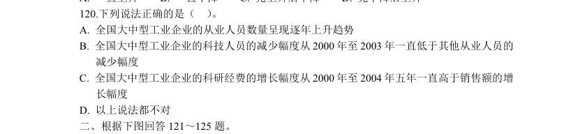

- **A.** 全国大中型工业企业的从业人员数量呈现逐年上升趋势
- **B.** 全国大中型工业企业的科技人员的减少幅度从2000 年至2003 年一直低于其他从业人员的减少幅度
- **C.** 全国大中型工业企业的科研经费的增长幅度从2000 年至2004 年五年一直高于销售额的增长幅度
- **D.** 以上说法都不对

**答案：B**

### 【2006 国考·第 125 题】GK-2006-ty-X125　综合分析｜平均数

根据四年来该市保费收入的变化,可以推出( )。 [1]该市的人均收入有较大增长 [2]人们的保险和理财意识不断增强 [3]人们对于人身险的投入明显高于对于其他险种的投入

- **A.** [1]
- **B.** [3]
- **C.** [1]与[2]
- **D.** [2]与[3]

**答案：B**

### 【2006 国考·第 130 题】GK-2006-ty-X130　综合分析｜年均增长率
> 材料：2004 年广播、电视宣传基本情况表项目节目套数(套)播出时间(小时/日)自办节目时间(小时/日)新闻节目专题节目教育节目文艺节目服务性节目无线广播合计中央台和国际台地方台电视播映合计中央台地方台…

根据上表所列数据,下列说法错误的是( )。

- **A.** 中央电视台只播自办节目
- **B.** 地方电视台播自办节目的时间占总播出时间的70%以上
- **C.** 地方电视台2004 年全年平均每套节目播出自办教育节目0213 小时
- **D.** 地方无线广播电台2004 年平均每天每套节目播出自办教育节目0

**答案：C**

### 【2006 国考·第 131 题】GK-2006-ty-X131　综合分析｜比重
> 材料：2003 年国家财政科技拨款额达975.5 亿元,比上年增加159.3 亿元,增长19.5%,占国家财 政支出的比重为4.0%。在国家财政科技拨款中,中央财政科技拨款为639.9 亿元,比上年增长 25.2%,占中央财政支出的比重为8.6%;地方财政科技拨款为335 6 亿元,比上年增长10%, 占地方财政支出的比重为1.9%。…

分执行部门看,各类企业科技活动经费支出为960.2 亿元,比上 年增长21.9%;国有独立核算的科研院所科技活动经费支出399.0 亿元,比上年增长13.6%;高 等学校科技活动经费支出162.3 亿元,比上年增长24.4%,高等学校科技活动经费支出占全国总 科技活动经费支出的比重为10.5%。各类企业科技活动经费支出占全国总科技活动经费支出的比 重比上年提高了1.2 个百分点。 2003 年国家财政支出总额为( )。

- **A.** 24387.5 亿元
- **B.** 5002.6 亿元
- **C.** 3979.6 亿元
- **D.** 816.3 亿元

**答案：A**

### 【2006 国考·第 132 题】GK-2006-ty-X132　综合分析｜综合分析（综合）
> 材料：2003 年国家财政科技拨款额达975.5 亿元,比上年增加159.3 亿元,增长19.5%,占国家财 政支出的比重为4.0%。在国家财政科技拨款中,中央财政科技拨款为639.9 亿元,比上年增长 25.2%,占中央财政支出的比重为8.6%;地方财政科技拨款为335 6 亿元,比上年增长10%, 占地方财政支出的比重为1.9%。…

2003 年中央财政支出与地方财政支出之比约为( )。

- **A.** 1∶6.87
- **B.** 6.87∶1
- **C.** 1∶2.37
- **D.** 2.37∶1

**答案：C**

### 【2006 国考·第 135 题】GK-2006-ty-X135　综合分析｜比重
> 材料：2003 年国家财政科技拨款额达975.5 亿元,比上年增加159.3 亿元,增长19.5%,占国家财 政支出的比重为4.0%。在国家财政科技拨款中,中央财政科技拨款为639.9 亿元,比上年增长 25.2%,占中央财政支出的比重为8.6%;地方财政科技拨款为335 6 亿元,比上年增长10%, 占地方财政支出的比重为1.9%。…

根据文中划线部分内容,可以求出的选项为( )。 [1]2002 年各类企业科技活动经费支出 [2]2003 年全国总科技活动经费支出 [3]2002 年全国总科技活动经费支出

- **A.** [1]
- **B.** [1]与[2]
- **C.** [2]与[3]
- **D.** [1]、[2]与[3]

**答案：B**

### 【2005 广东省考·第 86 题】GD-2005-ty-X086　综合分析｜平均数
> 材料：86—90 题: 2004 年,广东国民经济保持平稳快速的发展势头,尤其是二、三产业的快速发展为广东城镇居民收入增 加奠定了基础。调查资料显示,2004 年广东城镇居民人均可支配收入 13 627.65 元,比上年增长10.1%,人均消费陛支出10694.79 元,增长11.0%。按家庭人口计算,广 东城镇居民人均工薪收入1l 646.42 元,增长11.8%。2004 年广东城镇居民家庭八大类消费支出除了家 庭设备用品及服务支出下降9.9%外,其他七类支出都有不同程度的增长…

2004 年占总调查户数10%的最低收入户(简称低 收入户)家庭人均可支配收入3720.10 元,增长仅7.3%。 根据上述材料,下列推断不正确的是:

- **A.** 二、三产业的快速发展是城镇居民收入增加的原因之一
- **B.** 工薪收入仍是居民家庭收入增长的主要动力
- **C.** 2004 年低收入户的收入增长速度相对较低
- **D.** 2004 年城镇职工平均月工资额为1136 元

**答案：该题答案缺失，见原卷**

### 【2005 广东省考·第 91 题】GD-2005-ty-X091　综合分析｜倍数
> 材料：表 1:2002 年全国与部分省市高技术产业基本情况表 2:2002 年全国与部分省市高技术产业科技活动情况企业数(个)当年家总产主值(亿元)增加值(亿元)销售收入(亿元)利润(亿元)全国广东江苏上海北京天津浙江福建山东…

表 1:2002 年全国与部分省市高技术产业基本情况 表 2:2002 年全国与部分省市高技术产业科技活动情况 根据表l,下列表述不正确的是:

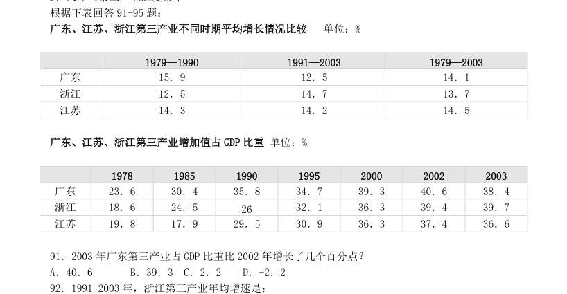

- **A.** 2002 年,广东高技术产业利润173.57 亿元,为江苏的2.4 倍
- **B.** 2002 年,广东共有高技术企业2031 家,占全国的17.8%
- **C.** 2002 年,广东高技术产业实现总产值4 532.33 亿元,占全国的30.0%
- **D.** 2002 年,广东高技术产业的增加值率(增加值/当年价总产值)为22.0%,与高技术企业规模遥遥领

**答案：该题答案缺失，见原卷**

### 【2005 广东省考·第 92 题】GD-2005-ty-X092　综合分析｜倍数
> 材料：表 1:2002 年全国与部分省市高技术产业基本情况表 2:2002 年全国与部分省市高技术产业科技活动情况企业数(个)当年家总产主值(亿元)增加值(亿元)销售收入(亿元)利润(亿元)全国广东江苏上海北京天津浙江福建山东…

根据表2,下列表述不正确的是:

- **A.** 2002 年,全国拥有科技人员共27.4 万人
- **B.** 广东高技术产业投入科技经费相当于上海的2.8 倍
- **C.** 广东高技术产业拥有的专利授权数居全国第一位
- **D.** 2002 年,广东高技术产业科技人员占全国的15.4%

**答案：该题答案缺失，见原卷**

### 【2005 广东省考·第 96 题】GD-2005-ty-X096　综合分析｜综合分析（综合）

图1 企业数 (个) 当年家总产 主值(亿元) 增加值 (亿元) 销售收入 (亿元) 利润(亿元) 全国 11333 15099.29 3768.58 14614.25 741.07 广东 4532.33 998.68 4359.79 173.57 江苏 1846.04 468.68 1789.83 72.22 上海 1427.85 274.78 1451.84 54.65 北京 1090.59 241.85 1121.91 79.62 天津 934.00 274.44 953.28 51.01 浙江 760.90 191.08 730.04 64.46 福建 748.05 180.32 723.70 48.26 山东 655.36 176.76 646.92 27.13 根据图1,下列说法错误的是:

- **A.** 认为读书越来越重要的比例比2001 年降低了
- **B.** 认为读书从来不重要的比例降低了
- **C.** 认为读书越来越不重要的比例与2001 年基本持平
- **D.** 有10.4%的人认为2003 年与两年前相比没有什么变化

**答案：该题答案缺失，见原卷**

### 【2005 广东省考·第 97 题】GD-2005-ty-X097　综合分析｜综合分析（综合）

1997 年参与城市最低生活保障的人数比1996 年提高了几个百分点?

- **A.** 84.9
- **B.** 87.9
- **C.** 3.5
- **D.** 3

**答案：该题答案缺失，见原卷**

### 【2005 广东省考·第 98 题】GD-2005-ty-X098　综合分析｜倍数

A.近五年我国国民的图书阅读率持续走低(下降) B.传统阅读方式受到了新兴媒体的严峻挑战 C.近五年我国国民的总体阅读率持续提高 D.图书阅读方式已不再是首先的阅读方式 与2001 年相比,有关2003 阅读方式的说法,正确的是:

- **A.** 有16.2%的人不读书
- **B.** 有18.3%的人经常上网
- **C.** 图书阅读率是电子出版物使用率的3.7 倍
- **D.** 图书阅读率是电子出版物使用率的2.8 倍

**答案：该题答案缺失，见原卷**

### 【2005 广东省考·第 100 题】GD-2005-ty-X100　综合分析｜综合分析（综合）

根据图1、图2,下列说法不正确的是:

- **A.** 越来越多的人对读书的重要性的认识在近两年没有什么变化
- **B.** 2003 年,有51.7%的人经常阅读
- **C.** 总体来讲,人们对读书的作用持肯定态度
- **D.** 2003 年,有87.7%的人认为读书的作用对于个人的发展越来越重要了

**答案：该题答案缺失，见原卷**

### 【2005 国考·第 119 题】GK-2005-ty-X119　综合分析｜综合分析（综合）
> 材料：2001 年、2002 年全国高等学校各学科学生数(单位:千人)2001 年2002 年毕业生在校生毕业生在校生哲学经济学法学教育学文学历史学理学工学农学医学管理学合计…

如果数据中的在校生不包括毕业生,那么2002 年高校共约招了( )。

- **A.** 50 万人
- **B.** 184 万人
- **C.** 318 万人
- **D.** 472 万人

**答案：C**

### 【2005 国考·第 121 题】GK-2005-ty-X121　综合分析｜平均数
> 材料：环渤海经济区正逐步成为引人注目的经济增长第三极,而京津冀在环渤海经济区占有举足轻重的位 置。但以北京、天津为核心的京津冀城市群分布比较散乱,彼此间的空间联系松散且薄弱,重复建设问 题比较严重,资源浪费现象普遍存在。2003 年,北京、天津两市人均GDP 分别超过或接近3 万元,城 镇居民可支配收入均高于全国平均水平,而河北人均GDP 刚刚突破1 万元,城镇居民可支配收入7239 元,比全国平均水平低14.6%,比北京市低近一半;从市场开放度看,京津两市由于享受开放城市、 沿海…

2003 年京津冀的经济实力比较 地区 人均 GDP(元) 经济增 长率(%) 城镇人均可支 配收入(元) 三个产业结构比 固定资产投资 增长率(%) 进出口增 长率(%) 北京市 36613 10.5 13883 2.60:36.0:61.4 18.9 30.4 天津市 28574 14.5 10313 3.70:50.8:45.5 20.9 28.7 河北省 10513 11.6 15.0:51.5:33.5 22.9 34.7 从上述材料中无法得知的是( )。

- **A.** 京津冀的产业联系不紧密
- **B.** 京津冀的城市布局不合理
- **C.** 京津冀的重复建设严重
- **D.** 京津冀的经济水平落差大

**答案：A**

### 【2005 国考·第 122 题】GK-2005-ty-X122　综合分析｜平均数
> 材料：环渤海经济区正逐步成为引人注目的经济增长第三极,而京津冀在环渤海经济区占有举足轻重的位 置。但以北京、天津为核心的京津冀城市群分布比较散乱,彼此间的空间联系松散且薄弱,重复建设问 题比较严重,资源浪费现象普遍存在。2003 年,北京、天津两市人均GDP 分别超过或接近3 万元,城 镇居民可支配收入均高于全国平均水平,而河北人均GDP 刚刚突破1 万元,城镇居民可支配收入7239 元,比全国平均水平低14.6%,比北京市低近一半;从市场开放度看,京津两市由于享受开放城市、 沿海…

京津冀三个地区中,2003 年城镇人均可支配收入占人均GDP 的比例由大到小排序正确的是( )。

- **A.** 北京市、天津市、河北省
- **B.** 北京市、河北省、天津市
- **C.** 河北省、天津市、北京市
- **D.** 河北省、北京市、天津市

**答案：D**

### 【2005 国考·第 123 题】GK-2005-ty-X123　综合分析｜综合分析（综合）
> 材料：环渤海经济区正逐步成为引人注目的经济增长第三极,而京津冀在环渤海经济区占有举足轻重的位 置。但以北京、天津为核心的京津冀城市群分布比较散乱,彼此间的空间联系松散且薄弱,重复建设问 题比较严重,资源浪费现象普遍存在。2003 年,北京、天津两市人均GDP 分别超过或接近3 万元,城 镇居民可支配收入均高于全国平均水平,而河北人均GDP 刚刚突破1 万元,城镇居民可支配收入7239 元,比全国平均水平低14.6%,比北京市低近一半;从市场开放度看,京津两市由于享受开放城市、 沿海…

如果天津市2002 年的固定资产投资为5000 万元,且2004 年的固定资产投资和2003 年保持同比 增长,则天津市在2004 年的固定资产投资额约为( )。

- **A.** 6200 万元
- **B.** 6800 万元
- **C.** 7300 万元
- **D.** 7900 万元

**答案：C**

### 【2005 国考·第 124 题】GK-2005-ty-X124　综合分析｜综合分析（综合）
> 材料：环渤海经济区正逐步成为引人注目的经济增长第三极,而京津冀在环渤海经济区占有举足轻重的位 置。但以北京、天津为核心的京津冀城市群分布比较散乱,彼此间的空间联系松散且薄弱,重复建设问 题比较严重,资源浪费现象普遍存在。2003 年,北京、天津两市人均GDP 分别超过或接近3 万元,城 镇居民可支配收入均高于全国平均水平,而河北人均GDP 刚刚突破1 万元,城镇居民可支配收入7239 元,比全国平均水平低14.6%,比北京市低近一半;从市场开放度看,京津两市由于享受开放城市、 沿海…

就河北省而言,要想加快京津冀经济一体化进程,河北省单方面无法做到的是( )。

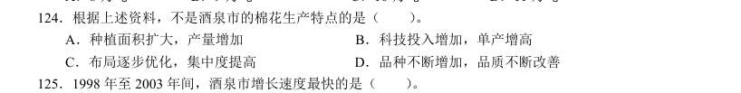

- **A.** 尽快提高经济实力
- **B.** 合理形成各区域的职能分工
- **C.** 大力发展工业制造业
- **D.** 尽快发展壮大民间投资

**答案：B**

### 【2005 国考·第 126 题】GK-2005-ty-X126　综合分析｜平均数
> 材料：1993-2003 年某国国内生产总值指数年份国民生产总值国内生产总值第一产业第二产业第三产业人均国内生产总值说明:本题中指数的计算方法为:当年的数值与上一年数值的比乘以100。举例来说,假设第一年的数值为m,第二年的数值为n,则第二年的指数为100×(n/m)。…

1993-2003 年某国国内生产总值指数 年 份 国民生产总值 国内生产总值 第一产业 第二产业 第三产业 人均国内生产总值 108.7 108.7 102.0 115.8 104.9 106.8 98.4 98.4 98.2 97.5 100.4 96.9 107.6 107.6 97.8 113.3 109.5 106.2 111.7 111.7 104.1 115.0 113.7 110.2 107.6 107.6 106.1 108.2 107.8 106.1 107.8 107.8 98.5 113.6 105.9 106.5 105.2 105.2 107.0 101.9 110.4 103.9 109.3 109.1 111.5 105.6 113.0 107.5 111.1 110.9 108.3 110.4 115.2 109.3 115.3 115.2 112.9 114.5 119.4 113.7 113.2 113.5 101.8 118.6 118.3 111.9 说明:本题中指数的计算方法为:当年的数值与上一年数值的比乘以100。举例来说,假设第一年的数值为m,第二年的数值为n,则第二 年的指数为100×(n/m)。 假设1995 年的国内生产总值为200 亿,那么1996 年的国内生产总值为( )。

- **A.** 179.1 亿
- **B.** 207.6 亿
- **C.** 215.2 亿
- **D.** 223.4 亿

**答案：D**

### 【2005 国考·第 130 题】GK-2005-ty-X130　综合分析｜综合分析（综合）
> 材料：1993-2003 年某国国内生产总值指数年份国民生产总值国内生产总值第一产业第二产业第三产业人均国内生产总值说明:本题中指数的计算方法为:当年的数值与上一年数值的比乘以100。举例来说,假设第一年的数值为m,第二年的数值为n,则第二年的指数为100×(n/m)。…

下面不正确的叙述是( )。

- **A.** 1995 年的国民生产总值比1993 年高
- **B.** 1995 年的第二产业生产总值比1994 年高
- **C.** 1994 年的第三产业生产总值比1993 年高
- **D.** 1996 年的农(林、牧、副、渔)业生产总值比1993 年高

**答案：D**

### 【2005 国考·第 131 题】GK-2005-ty-X131　综合分析｜综合分析（综合）

2003 年部分城市日照时数 北京的日照时数超过200 小时的月份有( )。

- **A.** 8 个
- **B.** 9 个
- **C.** 10 个
- **D.** 11 个

**答案：A**

### 【2005 国考·第 132 题】GK-2005-ty-X132　综合分析｜综合分析（综合）

哈尔滨日照最多和最低月份的日照时数的比值最接近( )。

- **A.** 2.5
- **B.** 3.0
- **C.** 3.2
- **D.** 3.8

**答案：C**

### 【2005 国考·第 133 题】GK-2005-ty-X133　综合分析｜综合分析（综合）

在5 月至7 月的三个月中,日照时数之和最大的城市是( )。

- **A.** 北京
- **B.** 哈尔滨
- **C.** 上海
- **D.** 拉萨

**答案：B**

### 【2005 国考·第 134 题】GK-2005-ty-X134　综合分析｜综合分析（综合）

上海日照时数相差最大的两个月是( )。

- **A.** 1 月和3 月
- **B.** 2 月和5 月
- **C.** 2 月和7 月
- **D.** 10 月和12 月

**答案：C**

### 【2005 国考·第 135 题】GK-2005-ty-X135　综合分析｜综合分析（综合）

针对上图日照数据,下面说法不正确的是( )。

- **A.** 拉萨日照最高月份的日照时数少于哈尔滨最高月份的日照时数
- **B.** 上海6 月份的日照时数少于北京4 月份的日照时数
- **C.** 上述四城市中,每月日照时数差别最小的是拉萨
- **D.** 10 月份,各个城市的日照时数差别最小

**答案：D**

### 【2004 广东省考·第 87 题】GD-2004-ty-X087　综合分析｜增长率
> 材料：一个图、表或一段文字均有几个问题要你回答。你应根据资料提供的信息进行分析、比 较、计算、 处理。共15 题,每题1 分,共15 分。 [例题]根据下表,回答1~2题 博物馆四个入口处自动计数器的读数 自动计数器在不 时间的读数(人数) 入口(时间) 7:00 8:00 9:00 10:00 11:00 1从早上7:00 到11:00 通过入口1 进入博物馆的参观人数是( )。 A.580 B.94 C.1374 D.1594 2在早上7:00 至8:00 之间,通过人数最多的…

从上述资料中,不能推出的是:

- **A.** 1996 至1998 年间,中、西部地区小康实现程度的增幅高于东部。
- **B.** 1996 至1998 年间,中、西部经济的发展速度快于东部。
- **C.** 1996 至1998 年间,东部地区小康实现程度略有下降。
- **D.** 1996 至1998 年间,西部地区小康实现程度增幅高于中部。

**答案：该题答案缺失，见原卷**

### 【2004 广东省考·第 88 题】GD-2004-ty-X088　综合分析｜综合分析（综合）
> 材料：一个图、表或一段文字均有几个问题要你回答。你应根据资料提供的信息进行分析、比 较、计算、 处理。共15 题,每题1 分,共15 分。 [例题]根据下表,回答1~2题 博物馆四个入口处自动计数器的读数 自动计数器在不 时间的读数(人数) 入口(时间) 7:00 8:00 9:00 10:00 11:00 1从早上7:00 到11:00 通过入口1 进入博物馆的参观人数是( )。 A.580 B.94 C.1374 D.1594 2在早上7:00 至8:00 之间,通过人数最多的…

从上述资料中,能推出的是:

> （本题为图形题，选项为图片，见原卷）

**答案：该题答案缺失，见原卷**

### 【2004 广东省考·第 89 题】GD-2004-ty-X089　综合分析｜综合分析（综合）
> 材料：一个图、表或一段文字均有几个问题要你回答。你应根据资料提供的信息进行分析、比 较、计算、 处理。共15 题,每题1 分,共15 分。 [例题]根据下表,回答1~2题 博物馆四个入口处自动计数器的读数 自动计数器在不 时间的读数(人数) 入口(时间) 7:00 8:00 9:00 10:00 11:00 1从早上7:00 到11:00 通过入口1 进入博物馆的参观人数是( )。 A.580 B.94 C.1374 D.1594 2在早上7:00 至8:00 之间,通过人数最多的…

城镇居民生活小康标准的五个方面不包括:

- **A.** 社会保障水平
- **B.** 物质生活
- **C.** 文教娱乐
- **D.** 人口素质

**答案：该题答案缺失，见原卷**

### 【2004 广东省考·第 91 题】GD-2004-ty-X091　综合分析｜增长率

根据上述材料,下列说法不正确的是:

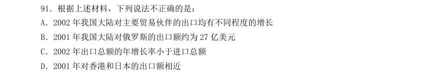

- **A.** 2002 年我国大陆对主要贸易伙伴的出口均有不同程度的增长
- **B.** 2001 年我国大陆对俄罗斯的出口额约为27 亿美元
- **C.** 2002 年出口总额的年增长率小于进口总额
- **D.** 2001 年对香港和日本的出口额相近

**答案：该题答案缺失，见原卷**

### 【2004 广东省考·第 92 题】GD-2004-ty-X092　综合分析｜增长率

我国出口额和进口额增长最快的年份分别是:

- **A.** 1999 年和2000 年
- **B.** 都是2000 年
- **C.** 1999 年和2001 年
- **D.** 2001 年和2002 年

**答案：该题答案缺失，见原卷**

### 【2004 广东省考·第 94 题】GD-2004-ty-X094　综合分析｜综合分析（综合）

下列哪一年我国大陆的贸易顺差最大?

- **A.** 1998 年
- **B.** 1999 年 C2000 年
- **D.** 2001 年

**答案：该题答案缺失，见原卷**

### 【2004 广东省考·第 95 题】GD-2004-ty-X095　综合分析｜综合分析（综合）

如果2003 年的进口总额和出口总额都稳定增长,?进出口总额最接近下列哪一项?

- **A.** 4000 和4500 亿美
- **B.** 3200 和3500 亿美元
- **C.** 3000 和3700 亿美元
- **D.** 3500 和4000 亿美元

**答案：该题答案缺失，见原卷**

### 【2004 广东省考·第 97 题】GD-2004-ty-X097　综合分析｜综合分析（综合）

2002 年该地区的GDP 为:

- **A.** 33.23 亿元
- **B.** 32.15 亿元
- **C.** 45.94 亿元
- **D.** 7.05 亿元

**答案：该题答案缺失，见原卷**

### 【2004 广东省考·第 99 题】GD-2004-ty-X099　综合分析｜综合分析（综合）

2002 年该地区出口额和实际利用外资之间的差额约为:

- **A.** 6.09 亿美元
- **B.** 5 亿美元
- **C.** 2.14 亿美元
- **D.** 0.35 亿美元

**答案：该题答案缺失，见原卷**

### 【2004 广东省考·第 100 题】GD-2004-ty-X100　综合分析｜综合分析（综合）

下列陈述中表达错误的一项是:

- **A.** 该地区出口保持了旺盛的势头
- **B.** 该地区固定资产投资开始逐渐回落
- **C.** 图中所示各项生产产值均呈现了上涨趋势
- **D.** 该地区各项收入均呈现了上涨趋势

**答案：该题答案缺失，见原卷**

### 【2004 国考（A卷）·第 88 题】GK-2004-a-X088　综合分析｜增长率

下面的描述不正确的是( )。

- **A.** 全社会固定资产投资逐年递增
- **B.** 基本建设投资在2000 年的投入要低于1999 年
- **C.** 更新改造投资在2002 年的投入要低于2001 年
- **D.** 其他类投资的增速在2002 年增长最快

**答案：C**

### 【2004 国考（A卷）·第 89 题】GK-2004-a-X089　综合分析｜增长率

从上表可以看出,广东省最重视的投资是( )。

- **A.** 全社会固定资产投资
- **B.** 基本建设投资
- **C.** 房地产开发投资
- **D.** 其他类投资

**答案：C**

### 【2004 国考（A卷）·第 91 题】GK-2004-a-X091　综合分析｜增长率

如果1998 年基本建设投资为5 亿元,则2000 年的基本建设投资为( )。

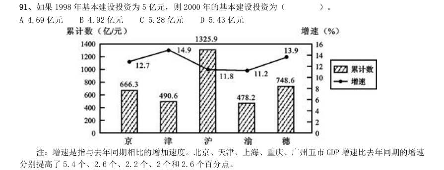

- **A.** 4.69 亿元
- **B.** 4.92 亿元
- **C.** 5.28 亿元
- **D.** 5.43 亿元

**答案：D**

### 【2004 国考（A卷）·第 92 题】GK-2004-a-X092　综合分析｜增长率
> 材料：注:增速是指与去年同期相比的增加速度。北京、天津、上海、重庆、广州五市GDP 增速比去年同期的增速分别提高了5.4 个、2.6 个、2.2 个、2 个和2.6 个百分点。…

分别提高了5.4 个、2.6 个、2.2 个、2 个和2.6 个百分点。 2003 年第一季度GDP 总量增长最快的城市是( )。

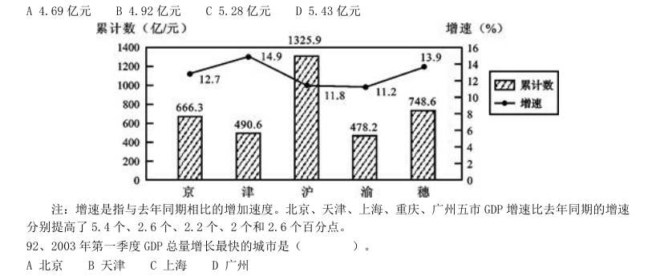

- **A.** 北京
- **B.** 天津
- **C.** 上海
- **D.** 广州

**答案：B**

### 【2004 国考（A卷）·第 104 题】GK-2004-a-X104　综合分析｜综合分析（综合）

2000 年北京批发零售业的零售额为1025.5 亿元,比上海少( )。

- **A.** 535.8 亿元
- **B.** 555.8 亿元
- **C.** 577.8 亿元
- **D.** 656.8 亿元

**答案：B**

### 【2004 国考（B卷）·第 88 题】GK-2004-b-X088　综合分析｜增长量

下列哪一项说法不正确?( )

- **A.** 移动电话用户的年增长速度大于固定电话
- **B.** 1998 年开始移动电话用户迅速增长
- **C.** 移动电话和固定电话的增长最多的都是2000 年
- **D.** 2000 年后固定电话的增长速度有所下降

**答案：C**

### 【2004 国考（B卷）·第 89 题】GK-2004-b-X089　综合分析｜综合分析（综合）

若2002 年年末全国人口数约是13 亿,则当时全国电话的普及率接近( )。

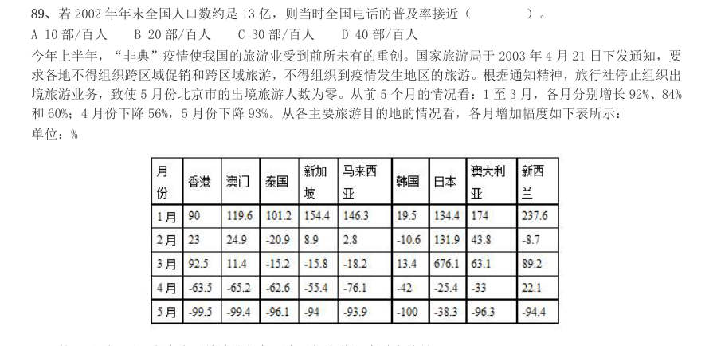

- **A.** 10 部/百人
- **B.** 20 部/百人
- **C.** 30 部/百人
- **D.** 40 部/百人

**答案：C**

### 【2004 国考（B卷）·第 90 题】GK-2004-b-X090　综合分析｜综合分析（综合）
> 材料：今年上半年,“非典”疫情使我国的旅游业受到前所未有的重创。国家旅游局于2003 年4 月21 日下发通知,要求各地不得组织跨区域促销和跨区域旅游,不得组织到疫情发生地区的旅游。根据通知精神,旅行社停止组织出境旅游业务,致使5 月份北京市的出境旅游人数为零。从前5 个月的情况看:1 至3 月,各月分别增长92%、84%和60%;4 月份下降56%,5 月份下降93%。从各主要旅游目的地的情况看,各月增加幅度如下表所示:单位:%…

从各主要旅游目的地的情况看,各月增加幅度如下表所示: 单位:% 从1 月到5 月,北京市出境旅游相邻两个月间变化幅度最大的是( )。

- **A.** 1 月至2 月
- **B.** 2 月至3 月
- **C.** 3 月至4 月
- **D.** 4 月至5 月

**答案：D**

### 【2004 国考（B卷）·第 91 题】GK-2004-b-X091　综合分析｜综合分析（综合）
> 材料：今年上半年,“非典”疫情使我国的旅游业受到前所未有的重创。国家旅游局于2003 年4 月21 日下发通知,要求各地不得组织跨区域促销和跨区域旅游,不得组织到疫情发生地区的旅游。根据通知精神,旅行社停止组织出境旅游业务,致使5 月份北京市的出境旅游人数为零。从前5 个月的情况看:1 至3 月,各月分别增长92%、84%和60%;4 月份下降56%,5 月份下降93%。从各主要旅游目的地的情况看,各月增加幅度如下表所示:单位:%…

从表中数据看,前5 个月北京出境旅游受“非典”疫情持续影响最长的国家或地区是( )。

- **A.** 泰国
- **B.** 香港
- **C.** 澳门
- **D.** 日本

**答案：A**

### 【2004 国考（B卷）·第 92 题】GK-2004-b-X092　综合分析｜增长率
> 材料：今年上半年,“非典”疫情使我国的旅游业受到前所未有的重创。国家旅游局于2003 年4 月21 日下发通知,要求各地不得组织跨区域促销和跨区域旅游,不得组织到疫情发生地区的旅游。根据通知精神,旅行社停止组织出境旅游业务,致使5 月份北京市的出境旅游人数为零。从前5 个月的情况看:1 至3 月,各月分别增长92%、84%和60%;4 月份下降56%,5 月份下降93%。从各主要旅游目的地的情况看,各月增加幅度如下表所示:单位:%…

下列哪项描述不正确?( ) A 5 月份北京到新西兰的旅游人数百分比降低幅度最大B 北京到香港和到澳门旅游的人数均是3 月比2 月多 C “非典”疫情对北京五月份出境旅游影响最大 D 5 月北京市出境到各国旅游的人数都是负增长

> （本题为图形题，选项为图片，见原卷）

**答案：A**

### 【2004 国考（B卷）·第 93 题】GK-2004-b-X093　综合分析｜综合分析（综合）
> 材料：今年上半年,“非典”疫情使我国的旅游业受到前所未有的重创。国家旅游局于2003 年4 月21 日下发通知,要求各地不得组织跨区域促销和跨区域旅游,不得组织到疫情发生地区的旅游。根据通知精神,旅行社停止组织出境旅游业务,致使5 月份北京市的出境旅游人数为零。从前5 个月的情况看:1 至3 月,各月分别增长92%、84%和60%;4 月份下降56%,5 月份下降93%。从各主要旅游目的地的情况看,各月增加幅度如下表所示:单位:%…

1 月到5 月,北京出境旅游变化幅度最大的目的地国家或地区是( )。

- **A.** 香港
- **B.** 韩国
- **C.** 日本
- **D.** 澳大利亚

**答案：C**

### 【2004 国考（B卷）·第 94 题】GK-2004-b-X094　综合分析｜综合分析（综合）
> 材料：今年上半年,“非典”疫情使我国的旅游业受到前所未有的重创。国家旅游局于2003 年4 月21 日下发通知,要求各地不得组织跨区域促销和跨区域旅游,不得组织到疫情发生地区的旅游。根据通知精神,旅行社停止组织出境旅游业务,致使5 月份北京市的出境旅游人数为零。从前5 个月的情况看:1 至3 月,各月分别增长92%、84%和60%;4 月份下降56%,5 月份下降93%。从各主要旅游目的地的情况看,各月增加幅度如下表所示:单位:%…

1 月到5 月,北京市出境旅游的人数变化趋势一致的国家组合是( )。

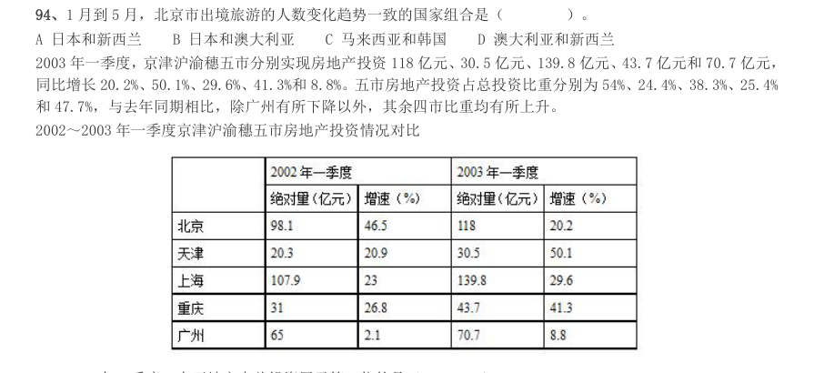

- **A.** 日本和新西兰
- **B.** 日本和澳大利亚
- **C.** 马来西亚和韩国
- **D.** 澳大利亚和新西兰

**答案：B**

### 【2004 国考（B卷）·第 95 题】GK-2004-b-X095　综合分析｜比重
> 材料：2003 年一季度,京津沪渝穗五市分别实现房地产投资118 亿元、30.5 亿元、139.8 亿元、43.7 亿元和70.7 亿元,同比增长20.2%、50.1%、29.6%、41.3%和8.8%。五市房地产投资占总投资比重分别为54%、24.4%、38.3%、25.4%和47.7%,与去年同期相比,除广州有所下降以外,其余四市比重均有所上升。 2002~2003 年一季度京津沪渝穗五市房地产投资情况对比…

同比增长20.2%、50.1%、29.6%、41.3%和8.8%。五市房地产投资占总投资比重分别为54%、24.4%、38.3%、25.4% 和47.7%,与去年同期相比,除广州有所下降以外,其余四市比重均有所上升。 2002~2003 年一季度京津沪渝穗五市房地产投资情况对比 2003 年一季度,在五地市中总投资居于第三位的是( )。

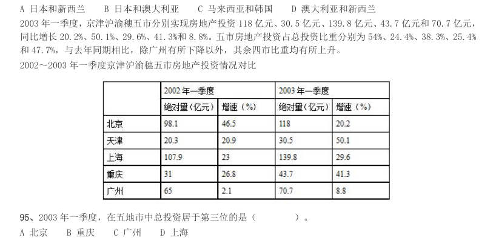

- **A.** 北京
- **B.** 重庆
- **C.** 广州
- **D.** 上海

**答案：B**

### 【2004 国考（B卷）·第 97 题】GK-2004-b-X097　综合分析｜增长率
> 材料：2003 年一季度,京津沪渝穗五市分别实现房地产投资118 亿元、30.5 亿元、139.8 亿元、43.7 亿元和70.7 亿元,同比增长20.2%、50.1%、29.6%、41.3%和8.8%。五市房地产投资占总投资比重分别为54%、24.4%、38.3%、25.4%和47.7%,与去年同期相比,除广州有所下降以外,其余四市比重均有所上升。 2002~2003 年一季度京津沪渝穗五市房地产投资情况对比…

从表格分析,下面哪种说法是正确的?( )

- **A.** 重庆的房地产投资增加幅度最大
- **B.** 北京在投资增长的绝对量上处于最领先位置
- **C.** 广州的房地产投资趋于平稳
- **D.** 上海房地产市场投资最大

**答案：D**

### 【2004 国考（B卷）·第 99 题】GK-2004-b-X099　综合分析｜增长量
> 材料：2003 年一季度,京津沪渝穗五市分别实现房地产投资118 亿元、30.5 亿元、139.8 亿元、43.7 亿元和70.7 亿元,同比增长20.2%、50.1%、29.6%、41.3%和8.8%。五市房地产投资占总投资比重分别为54%、24.4%、38.3%、25.4%和47.7%,与去年同期相比,除广州有所下降以外,其余四市比重均有所上升。 2002~2003 年一季度京津沪渝穗五市房地产投资情况对比…

2003 年一季度房地产投资绝对量增加最多的是( )。

- **A.** 北京
- **B.** 天津
- **C.** 重庆
- **D.** 上海

**答案：D**

### 【2004 国考（B卷）·第 100 题】GK-2004-b-X100　综合分析｜比重
> 材料：民生活水平小康实现程度达到94.3%。在12 项小康指标中有10 项达到或者基本达到小康初始水平。但是还有两 项指标,即文化教育娱乐支出比重和人均绿地面积与小康标准有一定差距。…

从5 个方面来看,经济发展、物质生 活和人口素质三个方面小康实现程度已经达到100%;精神生活水平和社会保障水平两个方面指标分别只达到 86.7%和75.6%。各地区城市小康实现程度也存在较大差距。三大地带相比,1998 年实现程度综合得分仍然差异 较大,中、西部比东部分别低7.9 个百分点和12.97 个百分点。但与1996 年相比,东部地区小康实现程度由91.87% 降低到91.70%;中、西部实现程度分别由79.8%和74.47%提高到83.80%和78.73%。 下列表述不正确的是( )。

- **A.** 截至1999 年我国城镇居民生活水平小康实现程度达到94.3%
- **B.** 城市小康各项指标的发展水平不均衡,但均已达到小康标准
- **C.** 我国小康实现程度存在地区差异
- **D.** 我国小康实现程度存在指标差异

**答案：B**

### 【2004 国考（B卷）·第 101 题】GK-2004-b-X101　综合分析｜增长率
> 材料：民生活水平小康实现程度达到94.3%。在12 项小康指标中有10 项达到或者基本达到小康初始水平。但是还有两 项指标,即文化教育娱乐支出比重和人均绿地面积与小康标准有一定差距。…

从上述资料中,不能推出的是( )。

- **A.** 1996 至1998 年间,中、西部地区小康实现程度的增幅高于东部
- **B.** 1996 至1998 年间,中、西部经济的发展速度快于东部
- **C.** 1996 至1998 年间,东部地区小康实现程度略有下降
- **D.** 1996 至1998 年间,西部地区小康实现程度增幅高于中部

**答案：B**

### 【2004 国考（B卷）·第 102 题】GK-2004-b-X102　综合分析｜综合分析（综合）
> 材料：民生活水平小康实现程度达到94.3%。在12 项小康指标中有10 项达到或者基本达到小康初始水平。但是还有两 项指标,即文化教育娱乐支出比重和人均绿地面积与小康标准有一定差距。…

从上述资料中,能推出的是( )。

- **A.** 地理环境的差异是小康实现程度差异的原因
- **B.** 东部地区比中、西部地区小康水平实际增长值低
- **C.** 东部地区比中、西部地区小康水平实现程度高
- **D.** 小康标准的5 个方面均有3 项不同的指标

**答案：C**

### 【2004 国考（B卷）·第 103 题】GK-2004-b-X103　综合分析｜综合分析（综合）
> 材料：民生活水平小康实现程度达到94.3%。在12 项小康指标中有10 项达到或者基本达到小康初始水平。但是还有两 项指标,即文化教育娱乐支出比重和人均绿地面积与小康标准有一定差距。…

城镇居民生活小康标准的五个方面不包括( )。

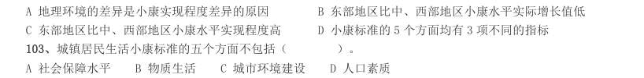

- **A.** 社会保障水平
- **B.** 物质生活
- **C.** 城市环境建设
- **D.** 人口素质

**答案：C**

### 【2003 国考（A卷）·第 111 题】GK-2003-a-X111　综合分析｜比重
> 材料：某地区劳动力文化程度的资料如下:(单位:万人)分组合计文盲小学初中高中大专本科及以上男性3452711712060912 女性40548228903063 总计75075345210901515(注:学习年限标准:文盲,0 年;小学,6年;初中,9 年;高中,12 年;大专,15 年;本科及以上,16 年)…

某地区劳动力文化程度的资料如下:(单位:万人)分组合计文盲小学初中高中大专本科及以上男性 3452711712060912 女性40548228903063 总计75075345210901515(注:学习年限标准:文盲,0 年;小学,6 年;初中,9 年;高中,12 年;大专,15 年;本科及以上,16 年) 该地区每万人劳动力中,大专及以上文化程度的人数是多少?( )。

- **A.** 350 人/万人
- **B.** 400 人/万人
- **C.** 450 人/万人D.500 人/万人

**答案：B**

### 【2003 国考（A卷）·第 112 题】GK-2003-a-X112　综合分析｜综合分析（综合）
> 材料：某地区劳动力文化程度的资料如下:(单位:万人)分组合计文盲小学初中高中大专本科及以上男性3452711712060912 女性40548228903063 总计75075345210901515(注:学习年限标准:文盲,0 年;小学,6年;初中,9 年;高中,12 年;大专,15 年;本科及以上,16 年)…

根据上表所示,男女比例最为均衡的是哪种文化程度人群?( )。

- **A.** 文盲
- **B.** 小学
- **C.** 初中
- **D.** 高中

**答案：C**

### 【2003 国考（A卷）·第 114 题】GK-2003-a-X114　综合分析｜综合分析（综合）
> 材料：某地区劳动力文化程度的资料如下:(单位:万人)分组合计文盲小学初中高中大专本科及以上男性3452711712060912 女性40548228903063 总计75075345210901515(注:学习年限标准:文盲,0 年;小学,6年;初中,9 年;高中,12 年;大专,15 年;本科及以上,16 年)…

若使该地区劳动力文化程度资料更直观地呈现,那么选择哪一种图最好?( )。

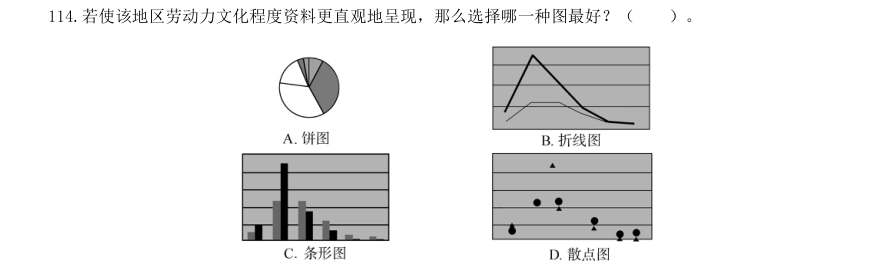

> （本题为图形题，选项为图片，见原卷）

**答案：C**

### 【2003 国考（A卷）·第 115 题】GK-2003-a-X115　综合分析｜综合分析（综合）
> 材料：某地区劳动力文化程度的资料如下:(单位:万人)分组合计文盲小学初中高中大专本科及以上男性3452711712060912 女性40548228903063 总计75075345210901515(注:学习年限标准:文盲,0 年;小学,6年;初中,9 年;高中,12 年;大专,15 年;本科及以上,16 年)111.该地区每万人劳动力中,大专及以上文化程度的人数是多少?()。 A.350 人/万人B.400 人/万人C.450 人/万人D.500 人/万人112.根据上表所示,…

当地政府计划将该地区劳动力资源当中高中及以上文化程度的人数比例由原来的6∶1∶1 调整为5∶3∶2,假 设该地区高中文化程度的人数不变,则大专、本科及以上两种文化程度的人数应分别增加多少万人?( )。

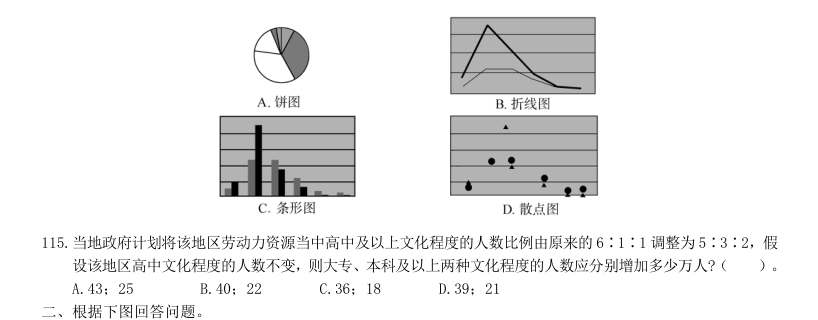

- **A.** 43;25
- **B.** 40;22
- **C.** 36;18
- **D.** 39;21

**答案：D**

### 【2003 国考（A卷）·第 121 题】GK-2003-a-X121　综合分析｜综合分析（综合）
> 材料：某地区劳动力文化程度的资料如下:(单位:万人)分组合计文盲小学初中高中大专本科及以上男性3452711712060912 女性40548228903063 总计75075345210901515(注:学习年限标准:文盲,0 年;小学,6年;初中,9 年;高中,12 年;大专,15 年;本科及以上,16 年)111.该地区每万人劳动力中,大专及以上文化程度的人数是多少?()。 A.350 人/万人B.400 人/万人C.450 人/万人D.500 人/万人112.根据上表所示,…

如果中国网民的总人数为2 250 万,那么41 岁以上的网民约有多少万人?( )。

- **A.** 100
- **B.** 200
- **C.** 300
- **D.** 400

**答案：B**

### 【2003 国考（A卷）·第 124 题】GK-2003-a-X124　综合分析｜综合分析（综合）
> 材料：某地区劳动力文化程度的资料如下:(单位:万人)分组合计文盲小学初中高中大专本科及以上男性3452711712060912 女性40548228903063 总计75075345210901515(注:学习年限标准:文盲,0 年;小学,6年;初中,9 年;高中,12 年;大专,15 年;本科及以上,16 年)111.该地区每万人劳动力中,大专及以上文化程度的人数是多少?()。 A.350 人/万人B.400 人/万人C.450 人/万人D.500 人/万人112.根据上表所示,…

18 岁以下的网民人数与下列哪个年龄段的最接近?( )。

- **A.** 18~24
- **B.** 25~30
- **C.** 31~40
- **D.** 41~50

**答案：C**

### 【2003 国考（A卷）·第 125 题】GK-2003-a-X125　综合分析｜基期量
> 材料：网民人数随着学历升高而变化的趋势大致符合下列哪幅图?( )。 四、根据下列文字资料回答问题。 2002 年1~6 月,我国通信业务收入完成2 189.4 亿元,比上年同期增长15.6%,增幅是同期国内生产总 值的两倍。其中,邮政完成247.4 亿元,增长8.5%;电信完成1 942.1 亿元,增长16.6%。各项业务中,国 内长途业务收入222 亿元,同比下降0.2%;国际业务收入36.8 亿元,下降17.6%;移动通信收入920.6 亿 元,增长24%;本地网通信收入565…

其中,固定电话用户新增1 990.9 万户,达到1.99 亿户;移动电话用户新增3 135.7 万户,达 到1.76 亿户。固定电话用户中,城市电话用户新增1 385.2 万户,达到1.25 亿户;农村电话用户新增605.7 万户,达到7 411.4 万户。电话用户中,东、中、西部地区各为1.95 亿户、1.1 亿户和0.7 亿户,分别占52%、 29.3%和18.7%。全国电话普及率达到30.2 部/百人,比上年末提高4.3 个百分点;移动电话普及率达到13.86 部/百人,比上年末提高2.7 个百分点。

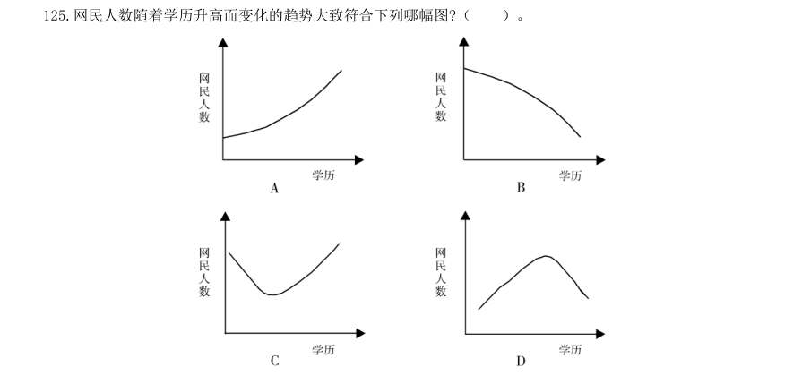

> （本题为图形题，选项为图片，见原卷）

**答案：D**

### 【2003 国考（A卷）·第 128 题】GK-2003-a-X128　综合分析｜比重
> 材料：某地区劳动力文化程度的资料如下:(单位:万人)分组合计文盲小学初中高中大专本科及以上男性3452711712060912 女性40548228903063 总计75075345210901515(注:学习年限标准:文盲,0 年;小学,6年;初中,9 年;高中,12 年;大专,15 年;本科及以上,16 年)111.该地区每万人劳动力中,大专及以上文化程度的人数是多少?()。 A.350 人/万人B.400 人/万人C.450 人/万人D.500 人/万人112.根据上表所示,…

下列说法中正确的是( )。 I.业务收入增长最快的是数据通信,但其占整个电信业务收入比重还不足5%。 II.农村电话用户新增数量比城市电话用户新增数量大。 III.东部的固定电话用户数比中部和西部的总和还多。

- **A.** I
- **B.** II
- **C.** II、III
- **D.** I、III

**答案：D**

### 【2003 国考（A卷）·第 130 题】GK-2003-a-X130　综合分析｜基期量
> 材料：某地区劳动力文化程度的资料如下:(单位:万人)分组合计文盲小学初中高中大专本科及以上男性3452711712060912 女性40548228903063 总计75075345210901515(注:学习年限标准:文盲,0 年;小学,6年;初中,9 年;高中,12 年;大专,15 年;本科及以上,16 年)111.该地区每万人劳动力中,大专及以上文化程度的人数是多少?()。 A.350 人/万人B.400 人/万人C.450 人/万人D.500 人/万人112.根据上表所示,…

下列说法中不正确的是( )。

- **A.** 国际业务收入与去年同期相比有所下降
- **B.** IP 电话通话时长同比增长超过20%
- **C.** 邮政业务收入同比增长24.7%
- **D.** 移动电话普及率有一定提高

**答案：C**

### 【2003 国考（B卷）·第 111 题】GK-2003-b-X111　综合分析｜增长率

(共20 题,参考时限20 分钟) 一、根据下表回答问题。 2002 年1 月中国进出口商品构成表 单位:亿美元 在进口商品中,按照增幅从高到低排列(未分类商品除外),排在第4 位的是( )。

- **A.** 化学成品及有关产品
- **B.** 饮料及烟类
- **C.** 机械及运输设备
- **D.** 食品及

**答案：A**

### 【2003 国考（B卷）·第 112 题】GK-2003-b-X112　综合分析｜增长率

下列说法中正确的是( )。 I.饮料及烟类虽然进口的增幅最大,但所占进口金额的比例最小; II.除未分类商品之外,出口商品增幅最高的前三类都是工业制品; III.无论出口还是进口,都是工业制品的金额远远超过初级产品。

- **A.** I
- **B.** I、II
- **C.** II、III
- **D.** I、II、III

**答案：C**

### 【2003 国考（B卷）·第 115 题】GK-2003-b-X115　综合分析｜综合分析（综合）
> 材料：2002 年1 月中国进出口商品构成表单位:亿美元111.在进口商品中,按照增幅从高到低排列(未分类商品除外),排在第4 位的是( )。 A.化学成品及有关产品B.饮料及烟类C.机械及运输设备D.食品及活动物112.下列说法中正确的是( )。 I.饮料及烟类虽然进口的增幅最大,但所占进口金额的比例最小; II.除未分类商品之外,出口商品增幅最高的前三类都是工业制品; III.无论出口还是进口,都是工业制品的金额远远超过初级产品。 A.IB.I、IIC.II、IIID.I、II…

除未分类的商品之外,进口金额比出口金额高的类别有( )。

- **A.** 6 类
- **B.** 5 类
- **C.** 4 类
- **D.** 3 类

**答案：A**

### 【2003 国考（B卷）·第 116 题】GK-2003-b-X116　综合分析｜综合分析（综合）

此表主要是介绍世界主要地区90 年代中期( )。

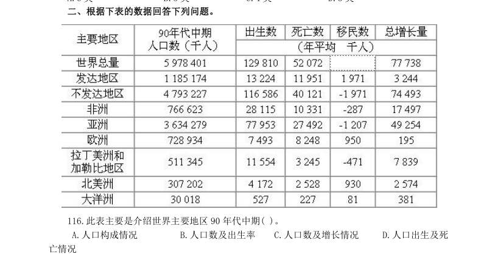

- **A.** 人口构成情况
- **B.** 人口数及出生率
- **C.** 人口数及增长情况
- **D.** 人口出生及死

**答案：该题答案缺失，见原卷**

### 【2003 国考（B卷）·第 120 题】GK-2003-b-X120　综合分析｜综合分析（综合）

下列句子表述正确的是( )。

- **A.** 非洲每年死亡的人数是最多的
- **B.** 欧洲和北美洲人不移民其他地区
- **C.** 大洋洲最有可能出现人口负增长
- **D.** 发达地区人口数量呈增长趋势

**答案：D**

### 【2003 国考（B卷）·第 122 题】GK-2003-b-X122　综合分析｜综合分析（综合）
> 材料：2001 年北京外来人口主要数据 人口总量:全市在京居住一天以上的外来人口为328.1 万人,比1997 年增加98.2 万人。 年龄构成:0~14 岁人口占7.4%;1997 年为6.7%;15~59 岁人口占90.8%,比1997 年的91.4% 下降了0.6 个百分点,其中15~39 岁人口占80.1%,比1997 年下降了0.1 个百分点;60 岁以上人 口比1997 年的1.9%下降了0.1 个百分点。 在京状况:务工经商人员占78.1%,比1997 年下降了0.6…

根据资料所提供的信息,2001 年在京务工经商人员的数量比1997 年是( )。

- **A.** 增加了
- **B.** 下降了
- **C.** 相关不大
- **D.** 很接近

**答案：A**

### 【2003 国考（B卷）·第 124 题】GK-2003-b-X124　综合分析｜综合分析（综合）
> 材料：2001 年北京外来人口主要数据 人口总量:全市在京居住一天以上的外来人口为328.1 万人,比1997 年增加98.2 万人。 年龄构成:0~14 岁人口占7.4%;1997 年为6.7%;15~59 岁人口占90.8%,比1997 年的91.4% 下降了0.6 个百分点,其中15~39 岁人口占80.1%,比1997 年下降了0.1 个百分点;60 岁以上人 口比1997 年的1.9%下降了0.1 个百分点。 在京状况:务工经商人员占78.1%,比1997 年下降了0.6…

短期留京(三个月以下)的人口大约比1997 年( )。

- **A.** 增加了8 万人
- **B.** 增加了3 万人
- **C.** 减少了5 万人
- **D.** 减少了8 万人

**答案：D**

### 【2003 国考（B卷）·第 125 题】GK-2003-b-X125　综合分析｜综合分析（综合）
> 材料：2001 年北京外来人口主要数据 人口总量:全市在京居住一天以上的外来人口为328.1 万人,比1997 年增加98.2 万人。 年龄构成:0~14 岁人口占7.4%;1997 年为6.7%;15~59 岁人口占90.8%,比1997 年的91.4% 下降了0.6 个百分点,其中15~39 岁人口占80.1%,比1997 年下降了0.1 个百分点;60 岁以上人 口比1997 年的1.9%下降了0.1 个百分点。 在京状况:务工经商人员占78.1%,比1997 年下降了0.6…

从第四部分的资料中,我们能看出( )。

- **A.** 从三种来京时间人群的人口数比例上看,1997 年相比2001 年分配更为不均衡
- **B.** 在1997 年和2001 年,虽然三种来京时间人群的人口数比例各自有所变化,但总量基本持平
- **C.** 在1997 年和2001 年,来京时间在半年以上两个人群的人口数比例都接近1∶4 的比例
- **D.** 来京人口的逗留时间有增长的趋势,大部分人的逗留时间都会在半年以上

**答案：D**

### 【2003 国考（B卷）·第 128 题】GK-2003-b-X128　综合分析｜比重

根据上图下列说法不正确的是( )。

- **A.** 2000 年新材料的产值约为1997 年的1.8 倍
- **B.** 2000 年高新技术产业的各项产值比重大多有所变化
- **C.** 电子与信息产业仍然占有很大的比重
- **D.** 电子与信息产业的产值两年相比可能一样

**答案：该题答案缺失，见原卷**

### 【2003 国考（B卷）·第 129 题】GK-2003-b-X129　综合分析｜增长量

2000 年与1997 年相比高新技术产业生产值总额增加最多的是( )。

- **A.** 电子与信息
- **B.** 生物及医药物品
- **C.** 新材料
- **D.** 光机电一体化

**答案：A**

### 【2003 国考（B卷）·第 130 题】GK-2003-b-X130　综合分析｜综合分析（综合）

如果1997 年生物及医药物品的产值是3 亿元,则同年光机电一体化的产值最接近( )。

- **A.** 1 亿元
- **B.** 1.2 亿元
- **C.** 1.6 亿元
- **D.** 1.8 亿元

**答案：D**

### 【2002 国考（A卷）·第 118 题】GK-2002-a-X118　综合分析｜增长率

单选、 已知1999 年国内生产总值为8.5 万亿元,在这几年中国内生产总值增长最快的年度是:

- **A.** 1995-1996
- **B.** 1996-1997
- **C.** 1997-1998
- **D.** 1998-1999

**答案：A**

### 【2002 国考（A卷）·第 119 题】GK-2002-a-X119　综合分析｜增长率

单选、 如果1999 年财政支出规模为14%,则几年中国财政支出增长最快的年度是:

- **A.** 1995-1996
- **B.** 1996-1997
- **C.** 1997-1998
- **D.** 1998-1999

**答案：C**

### 【2002 国考（A卷）·第 120 题】GK-2002-a-X120　综合分析｜综合分析（综合）

单选、 财政支出规模(财政支出/国内生产总值)的变动表应该是: 121:单选、 从2000 年开始,对全球经济最不恰当的描述是:

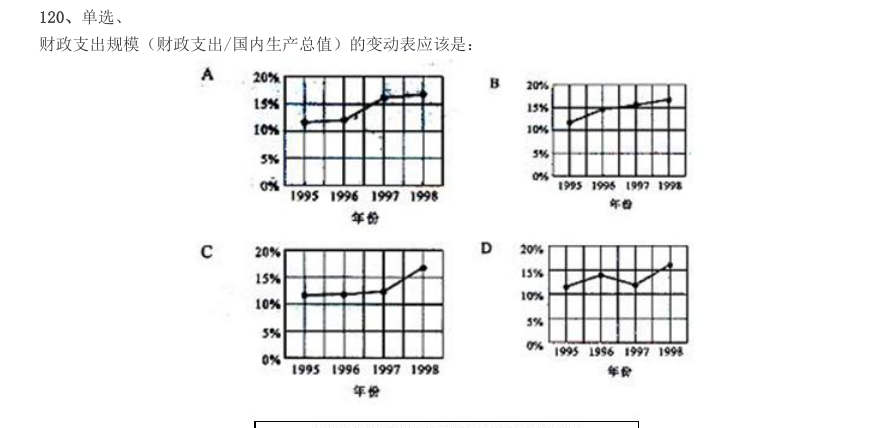

- **A.** 大部分国家和地区经济增长缓慢
- **B.** 整体增长速度减慢,由此可能进入全球经济衰退期
- **C.** 中国和印度等发展中国家的经济发展速度超过传统的发达国家,成为全球经济发展的亮点
- **D.** 发展中国家的经济形势要明显好于发达国家

**答案：C**

### 【2002 国考（A卷）·第 122 题】GK-2002-a-X122　综合分析｜增长率

单选、 经济增长最为缓慢的组织或者国家是:

- **A.** 美国
- **B.** 欧元区
- **C.** 日本
- **D.** 俄罗斯

**答案：C**

### 【2002 国考（A卷）·第 123 题】GK-2002-a-X123　综合分析｜增长率

单选、 从上面的数据表可以得出:

- **A.** 美国的经济经过短暂的衰退后,会马上繁荣起来
- **B.** 日本将很快(在一至两年内)走出经济衰退期
- **C.** 七国集团的经济规模大于其他国家和组织的总和
- **D.** 经济转型国家的经济形势可能趋于稳定

**答案：D**

### 【2002 国考（A卷）·第 125 题】GK-2002-a-X125　综合分析｜增长率
> 材料：单选、 下列最能描述三年间的全球经济走势的图表是: 据一份研究报告测算,1997 年我国实现国内生产总值74 772.4 亿元,其中公有经济实现56676.2 亿元, 非公有制实现18096.2 亿元,分别占整个国民经济的75.8%和24.2%。在公有经济中,国有经济实现31295.6 亿 元,集体经济实现25380.6 亿元,分别占国民经济的 41.9%和33.9%,在混合所有制经济中,公有制经济实现 增加值6517.1 亿元,占国内生产总值的8.7%,其中国有成分4860…

126:单选、 改革开放以来至1997 年,各种经济成分中增长最快的是( )。

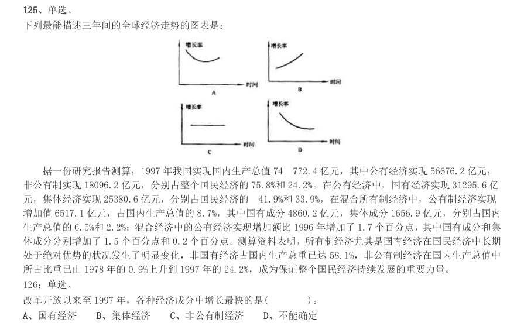

- **A.** 国有经济
- **B.** 集体经济
- **C.** 非公有制经济
- **D.** 不能确定

**答案：A**

### 【2002 国考（A卷）·第 128 题】GK-2002-a-X128　综合分析｜比重
> 材料：单选、 下列最能描述三年间的全球经济走势的图表是: 据一份研究报告测算,1997 年我国实现国内生产总值74 772.4 亿元,其中公有经济实现56676.2 亿元, 非公有制实现18096.2 亿元,分别占整个国民经济的75.8%和24.2%。在公有经济中,国有经济实现31295.6 亿 元,集体经济实现25380.6 亿元,分别占国民经济的 41.9%和33.9%,在混合所有制经济中,公有制经济实现 增加值6517.1 亿元,占国内生产总值的8.7%,其中国有成分4860…

单选、 从上面材料中可以得出( )。

- **A.** 我国所有制结构经过调整逐步趋于完善,出现多种经济成分共同发展的局面
- **B.** 公有制经济比非公有制经济增长得快
- **C.** 非国有经济比国有经济增长得慢
- **D.** 混合所有制经济增长最慢

**答案：A**

### 【2001 国考·第 92 题】GK-2001-ty-X092　综合分析｜基期量
> 材料：根据教育部《1999 年全国教育事业发展统计公报》,全国普通中小学校舍建筑面积为104 070 万平方米, 比上年增加4 747 万平方米。其中危房741.4 万平方米,危房率比上年下降0.3 个百分点。普通初中理科实验 设备、分组实验条件和图书藏量达标学校占初中总校数的比例分别是:71.5%、68.3%和73.4%,分别比上 年提高3.2、3.7 和4.3 个百分点。小学理科实验设备、分组实验条件和图书藏量达标学校占小学总校数的比 例分别是:44.4%、38.6%和63%,…

从上述阐述中可以得出( )。

- **A.** 全国普通中小学办学条件进一步得到改善
- **B.** 普通初中比小学理科实验设备达标比例上升得慢
- **C.** 小学比普通初中分组实验条件达标比例上升得快
- **D.** 普通初中比小学图书藏量达标率上升得慢

**答案：A**

### 【2001 国考·第 93 题】GK-2001-ty-X093　综合分析｜综合分析（综合）
> 材料：根据教育部《1999 年全国教育事业发展统计公报》,全国普通中小学校舍建筑面积为104 070 万平方米, 比上年增加4 747 万平方米。其中危房741.4 万平方米,危房率比上年下降0.3 个百分点。普通初中理科实验 设备、分组实验条件和图书藏量达标学校占初中总校数的比例分别是:71.5%、68.3%和73.4%,分别比上 年提高3.2、3.7 和4.3 个百分点。小学理科实验设备、分组实验条件和图书藏量达标学校占小学总校数的比 例分别是:44.4%、38.6%和63%,…

在改革办学条件方面亟待解决的问题是( )。

- **A.** 增加中小学的图书藏量
- **B.** 改善中学的理科实验设备
- **C.** 改善小学的分组实验条件
- **D.** 以上三项都不是

**答案：D**

### 【2001 国考·第 95 题】GK-2001-ty-X095　综合分析｜综合分析（综合）
> 材料：根据教育部《1999 年全国教育事业发展统计公报》,全国普通中小学校舍建筑面积为104 070 万平方米, 比上年增加4 747 万平方米。其中危房741.4 万平方米,危房率比上年下降0.3 个百分点。普通初中理科实验 设备、分组实验条件和图书藏量达标学校占初中总校数的比例分别是:71.5%、68.3%和73.4%,分别比上 年提高3.2、3.7 和4.3 个百分点。小学理科实验设备、分组实验条件和图书藏量达标学校占小学总校数的比 例分别是:44.4%、38.6%和63%,…

1998 年,全国普通中小学校舍建筑面积中危房约是多少万平方米?( )。

- **A.** 741.4
- **B.** 743.6
- **C.** 993.2
- **D.** 1 553.7

**答案：C**

### 【2001 国考·第 96 题】GK-2001-ty-X096　综合分析｜比重
> 材料：某航空公司1990~1991 年收到乘客投诉统计资料(%)分类1990 年1991 年航班误点行李差错服务质量差乘客超载理赔问题票价问题订票与确认问题饮食问题吸烟广告信誉问题特殊乘客其他收到投诉总件数22 988 件13 278 件…

某航空公司1990~1991 年收到乘客投诉统计资料(%) 分 类 1990 年 1991 年 航班误点 20.0 22.1 行李差错 18.3 21.8 服务质量差 13.1 11.3 乘客超载 10.5 11.8 理赔问题 10.1 8.1 票价问题 6.4 6.0 订票与确认问题 5.8 5.6 饮食问题 3.3 2.3 吸烟 3.2 2.9 广告 1.2 1.1 信誉问题 1.0 0.8 特殊乘客 0.9 0.9 其他 6.2 5.3 100.0 100.0 收到投诉总件数 22 988 件 13 278 件 该公司1990 年接到有关票价的投诉意见的件数大约为( )。

- **A.** 220
- **B.** 860
- **C.** 1 200
- **D.** 1 500

**答案：D**

### 【2001 国考·第 98 题】GK-2001-ty-X098　综合分析｜综合分析（综合）
> 材料：某航空公司1990~1991 年收到乘客投诉统计资料(%)分类1990 年1991 年航班误点行李差错服务质量差乘客超载理赔问题票价问题订票与确认问题饮食问题吸烟广告信誉问题特殊乘客其他收到投诉总件数22 988 件13 278 件…

从1990 年到1991 年,公司改进最明显的是( )。

- **A.** 服务质量
- **B.** 理赔
- **C.** 饮食
- **D.** 信誉

**答案：C**

### 【2001 国考·第 100 题】GK-2001-ty-X100　综合分析｜综合分析（综合）
> 材料：根据教育部《1999 年全国教育事业发展统计公报》,全国普通中小学校舍建筑面积为104 070 万平方米,比上年增加4 747 万平方米。其中危房741.4 万平方米,危房率比上年下降0.3 个百分点。普通初中理科实验设备、分组实验条件和图书藏量达标学校占初中总校数的比例分别是:71.5%、68.3%和73.4%,分别比上年提高3.2、3.7 和4.3 个百分点。小学理科实验设备、分组实验条件和图书藏量达标学校占小学总校数的比例分别是:44.4%、38.6%和63%,分别比上…

下面的陈述哪项可以从统计资料表中得出?( )。 I.在1990 年及1991 年中,乘客关于航班误点、行李差错及服务质量三项的投诉意见超过全部投诉意见 的50%。 II.特殊乘客的投诉意见数量1991 年与1990 年的相比没有变化。 III.与1990 年相比,1991 年有关航班误点的投诉意见的数量增加了。

- **A.** 只有第I项
- **B.** 只有第II项
- **C.** I项与III项
- **D.** 全部三项

**答案：A**

### 【2001 国考·第 102 题】GK-2001-ty-X102　综合分析｜综合分析（综合）

1997 年该地区一般职员的人数超过熟练操作工种的人数为( )。

- **A.** 384 000
- **B.** 441 500
- **C.** 650 500
- **D.** 825 600

**答案：B**

### 【2001 国考·第 104 题】GK-2001-ty-X104　综合分析｜综合分析（综合）

该地区女性公务员的人数约为( )。

- **A.** 3.2 万人
- **B.** 4.5 万人
- **C.** 6.1 万人
- **D.** 7.5 万人

**答案：B**

### 【2001 国考·第 106 题】GK-2001-ty-X106　综合分析｜综合分析（综合）

哪一年进出口总额突破20 亿元?( )。

- **A.** 1985 年
- **B.** 1986 年
- **C.** 1987 年
- **D.** 1988 年

**答案：C**

### 【2001 国考·第 107 题】GK-2001-ty-X107　综合分析｜综合分析（综合）

图中所显示的该国外贸状况有几年是出口额超过进口额5 亿元以上的?( )。

- **A.** 9 年
- **B.** 7 年
- **C.** 6 年
- **D.** 5 年

**答案：B**

### 【2001 国考·第 108 题】GK-2001-ty-X108　综合分析｜综合分析（综合）

1974 年至1990 年的进口年增长额大约是( )。

- **A.** 0.47 亿元
- **B.** 0.75 亿元
- **C.** 1.12 亿元
- **D.** 1.23 亿元

**答案：A**

### 【2000 国考·第 81 题】GK-2000-ty-X081　综合分析｜综合分析（综合）
> 材料：处理。 下面的三角形表示甲、乙、丙、丁、戊五个城市的中学生对X、Y、Z 三个电视节目的喜欢情况调查结果。如甲城喜欢X 节目的占30%,喜欢Y 节目的占70%,无人喜欢Z 节目;而丙城20%喜欢X 节目,50%喜欢Y 节目,30%喜欢Z 节目。…

如 甲城喜欢X 节目的占30%,喜欢Y 节目的占70%,无人喜欢Z 节目;而丙城20%喜欢X 节目,50%喜欢Y 节目, 30%喜欢Z 节目。 戊城中学生最喜欢的节目是( )。

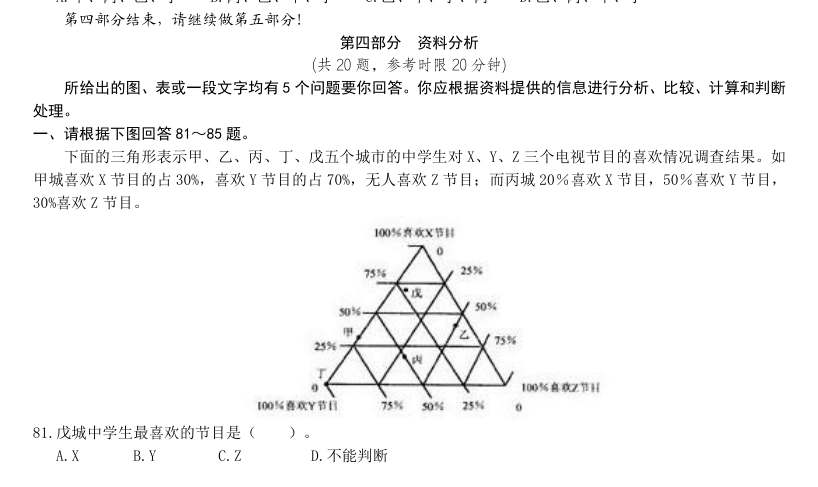

- **A.** X
- **B.** Y
- **C.** Z
- **D.** 不能判断

**答案：A**

### 【2000 国考·第 82 题】GK-2000-ty-X082　综合分析｜综合分析（综合）
> 材料：处理。 下面的三角形表示甲、乙、丙、丁、戊五个城市的中学生对X、Y、Z 三个电视节目的喜欢情况调查结果。如甲城喜欢X 节目的占30%,喜欢Y 节目的占70%,无人喜欢Z 节目;而丙城20%喜欢X 节目,50%喜欢Y 节目,30%喜欢Z 节目。…

甲城中学生与丁城中学生共同特点是( )。

- **A.** 不喜欢X 节目
- **B.** 不喜欢Y 节目
- **C.** 不喜欢Z 节目
- **D.** 没有共同点

**答案：C**

### 【2000 国考·第 83 题】GK-2000-ty-X083　综合分析｜综合分析（综合）
> 材料：处理。 下面的三角形表示甲、乙、丙、丁、戊五个城市的中学生对X、Y、Z 三个电视节目的喜欢情况调查结果。如甲城喜欢X 节目的占30%,喜欢Y 节目的占70%,无人喜欢Z 节目;而丙城20%喜欢X 节目,50%喜欢Y 节目,30%喜欢Z 节目。…

Y 节目最受欢迎的城市是( )。

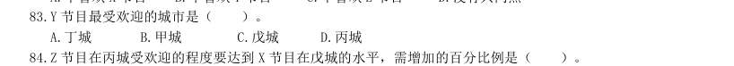

- **A.** 丁城
- **B.** 甲城
- **C.** 戊城
- **D.** 丙城

**答案：A**

### 【2000 国考·第 85 题】GK-2000-ty-X085　综合分析｜综合分析（综合）
> 材料：处理。 下面的三角形表示甲、乙、丙、丁、戊五个城市的中学生对X、Y、Z 三个电视节目的喜欢情况调查结果。如甲城喜欢X 节目的占30%,喜欢Y 节目的占70%,无人喜欢Z 节目;而丙城20%喜欢X 节目,50%喜欢Y 节目,30%喜欢Z 节目。…

就X、Y、Z 三个节目比较而言,最受该五个城市中学生欢迎的节目是( )。

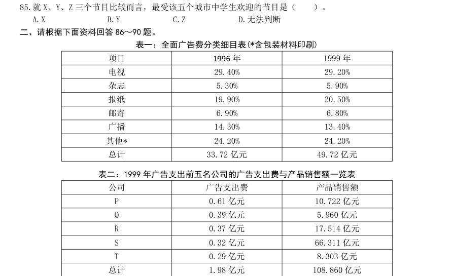

- **A.** X
- **B.** Y
- **C.** Z
- **D.** 无法判断

**答案：B**

### 【2000 国考·第 86 题】GK-2000-ty-X086　综合分析｜倍数
> 材料：表一:全面广告费分类细目表(*含包装材料印刷)项目1996 年1999 年电视杂志报纸邮寄广播其他*总计33.72 亿元49.72 亿元表二:1999 年广告支出前五名公司的广告支出费与产品销售额一览表公司广告支出费产品销售额P0.61 亿元10.722 亿元Q0.39 亿元5.960 亿元R0.37 亿元17.514 亿元S0.32 亿元66.311 亿元T0.29 亿元8.303 亿元总计1.98 亿元108.860 亿元…

表一:全面广告费分类细目表(*含包装材料印刷) 项目 1996 年 1999 年 电视 29.40% 29.20% 杂志 5.30% 5.90% 报纸 19.90% 20.50% 邮寄 6.90% 6.80% 广播 14.30% 13.40% 其他* 24.20% 24.20% 总计 33.72 亿元 49.72 亿元 表二:1999 年广告支出前五名公司的广告支出费与产品销售额一览表 公司 广告支出费 产品销售额 P 0.61 亿元 10.722 亿元 Q 0.39 亿元 5.960 亿元 R 0.37 亿元 17.514 亿元 S 0.32 亿元 66.311 亿元 T 0.29 亿元 8.303 亿元 总计 1.98 亿元 108.860 亿元 1999 年广告费支出最大的五个公司中哪一个公司的广告支出比(广告支出/销售额)最小?( )。

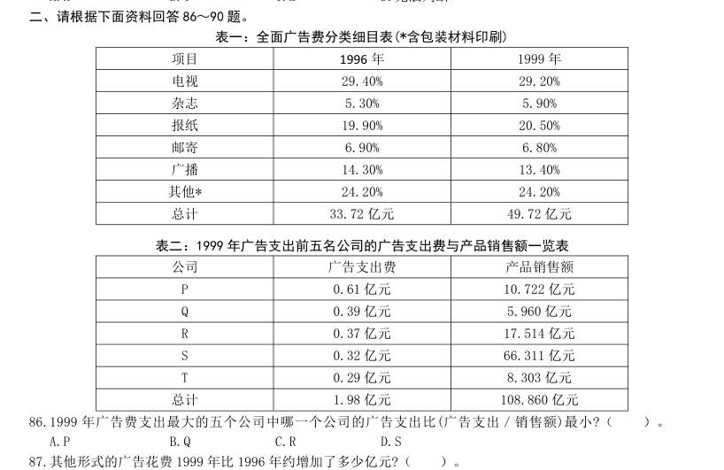

- **A.** P
- **B.** Q
- **C.** R
- **D.** S

**答案：D**

### 【2000 国考·第 89 题】GK-2000-ty-X089　综合分析｜综合分析（综合）
> 材料：表一:全面广告费分类细目表(*含包装材料印刷)项目1996 年1999 年电视杂志报纸邮寄广播其他*总计33.72 亿元49.72 亿元表二:1999 年广告支出前五名公司的广告支出费与产品销售额一览表公司广告支出费产品销售额P0.61 亿元10.722 亿元Q0.39 亿元5.960 亿元R0.37 亿元17.514 亿元S0.32 亿元66.311 亿元T0.29 亿元8.303 亿元总计1.98 亿元108.860 亿元…

1999 年通过邮寄形式的广告费用约为( )。

- **A.** 340 000 元
- **B.** 3 400 000 元
- **C.** 34 000 000 元
- **D.** 340 000 000 元

**答案：该题答案缺失，见原卷**

### 【2000 国考·第 91 题】GK-2000-ty-X091　综合分析｜综合分析（综合）
> 材料：前十届奥运会的统计情况次第会址年度男子比赛场数男运动员数女子比赛场数女运动员数参加国家总数运动项目总数雅典巴黎圣路易斯伦敦斯德哥尔摩安特卫普巴黎阿姆斯特丹洛杉矶柏林…

前十届奥运会的统计情况 次 第 会址 年度 男子比 赛场数 男运动 员数 女子比赛 场数 女运 动员 数 参加国家 总数 运动项 目总数 雅典 巴黎 圣路易斯 伦敦 斯德哥尔摩 安特卫普 巴黎 阿姆斯特丹 洛杉矶 柏林 运动项目最多的年度男子比赛场数为( )。

- **A.** 3
- **B.** 19
- **C.** 29
- **D.** 63

**答案：B**

### 【2000 国考·第 93 题】GK-2000-ty-X093　综合分析｜增长量
> 材料：前十届奥运会的统计情况次第会址年度男子比赛场数男运动员数女子比赛场数女运动员数参加国家总数运动项目总数雅典巴黎圣路易斯伦敦斯德哥尔摩安特卫普巴黎阿姆斯特丹洛杉矶柏林…

第6 届奥运会与第5 届奥运会相比,最大特点是( )。

- **A.** 男子比赛场数增加最多
- **B.** 参加运动员人数增加最多
- **C.** 女子运动员数增加最多
- **D.** 运动项目总数增加最多

**答案：D**

### 【2000 国考·第 95 题】GK-2000-ty-X095　综合分析｜综合分析（综合）
> 材料：前十届奥运会的统计情况次第会址年度男子比赛场数男运动员数女子比赛场数女运动员数参加国家总数运动项目总数雅典巴黎圣路易斯伦敦斯德哥尔摩安特卫普巴黎阿姆斯特丹洛杉矶柏林…

在巴黎举行的两届奥运会中,增长比率最大的是( )。

- **A.** 女子比赛场数
- **B.** 参加国家总数
- **C.** 参加运动员总数
- **D.** 女运动员总数

**答案：D**

### 【2000 国考·第 99 题】GK-2000-ty-X099　综合分析｜综合分析（综合）
> 材料：20 世纪70 年代,在世界新发现的大油田中,海上油田有31 个,约占51.7%。在新增加的地质储量中,海 洋占42%。海上钻井平台总数为7 021 座,其中美国有1 079 座,委内瑞拉有5 033 座,苏联有840 座。1977 年, 近海油田有500 个,产量4.6 亿吨,占世界总产量的15.6%。 96.70 年代世界新发现的大油田共有( )。 A.31 个 B.29 个 C.91 个 D.60 个 97.70 年代美国海上钻井平台数约占世界总数的比例是( )。 A.…

A.苏联 B.委内瑞拉 C.美国 D.未知 1977 年世界石油总产量是多少亿吨?( )。

- **A.** 4.6
- **B.** 29.5
- **C.** 34.1
- **D.** 10.7

**答案：B**
