# 资料分析 · 综合分析 · 2010 年代真题

> 所属考点：[ZL-COMP](../ZL-COMP-综合分析.md)　｜　本片 343 题

> 本片子考点：综合分析（综合） 136　比重 52　增长率 51　平均数 47　基期量 18　年均增长率 17　倍数 11　增长量 9

### 【2019 湖北省考·第 106 题】HB-2019-ty-X106　综合分析｜平均数
> 材料：2017 年我国成年国民图书阅读率为 ,比上年增加0.3 个百分点;报纸阅读率为 ,比上年降低2.1 个百分点;期刊阅读率为 ,比上年增加1 个百分点。 2017 年我国成年国民数字化阅读方式(网络在线阅读、手机阅读、电子阅读器阅读、平板电脑阅读等)的接 触率为 。…

其中,网络在线阅读接触率为 ,比上年增加4.4 个百分点;手机阅读接触率为 ,比上 年增加4.9 个百分点;电子阅读器阅读接触率为 ,比上年增加6.5 个百分点;平板电脑阅读接触率为 , 比上年增加2.2 个百分点。 传统纸质媒介中,2017 年我国成年国民人均每天阅读纸质图书时长为20.38 分钟,人均每天阅读报纸时长 为12.00 分钟,人均每天阅读期刊时长为6.88 分钟。 2016 年我国成年国民报纸阅读率比期刊阅读率高:

- **A.** 11.1 个百分点
- **B.** 12.3 个百分点
- **C.** 15.4 个百分点
- **D.** 17.5 个百分点

**答案：C**

### 【2019 湖北省考·第 108 题】HB-2019-ty-X108　综合分析｜基期量
> 材料：2017 年我国成年国民图书阅读率为 ,比上年增加0.3 个百分点;报纸阅读率为 ,比上年降低2.1 个百分点;期刊阅读率为 ,比上年增加1 个百分点。 2017 年我国成年国民数字化阅读方式(网络在线阅读、手机阅读、电子阅读器阅读、平板电脑阅读等)的接 触率为 。…

2016 年我国成年国民数字化阅读四个方式的接触率按从高到低排列正确的是:

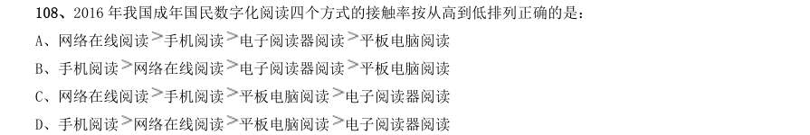

- **A.** 网络在线阅读手机阅读电子阅读器阅读平板电脑阅读
- **B.** 手机阅读网络在线阅读电子阅读器阅读平板电脑阅读
- **C.** 网络在线阅读手机阅读平板电脑阅读电子阅读器阅读
- **D.** 手机阅读

**答案：D**

### 【2019 湖北省考·第 110 题】HB-2019-ty-X110　综合分析｜平均数
> 材料：2017 年我国成年国民图书阅读率为 ,比上年增加0.3 个百分点;报纸阅读率为 ,比上年降低2.1 个百分点;期刊阅读率为 ,比上年增加1 个百分点。 2017 年我国成年国民数字化阅读方式(网络在线阅读、手机阅读、电子阅读器阅读、平板电脑阅读等)的接 触率为 。…

能够从上述资料中推出的是:

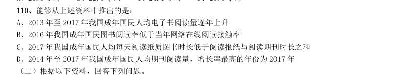

- **A.** 2013 年至2017 年我国成年国民人均电子书阅读量逐年上升
- **B.** 2016 年我国成年国民图书阅读率低于当年网络在线阅读接触率
- **C.** 2017 年我国成年国民人均每天阅读纸质图书时长低于阅读报纸与阅读期刊时长之和
- **D.** 2014 年至2017 年我国成年国民人均期刊阅读量,增长率最高的年份为2017 年

**答案：D**

### 【2019 湖北省考·第 113 题】HB-2019-ty-X113　综合分析｜比重
> 材料：2014 年我国实施“单独两孩”生育政策,出生人口1687 万人,比上年增加47 万人。2016 年实施“全面 两孩”生育政策,出生人口1786 万人,比上年增加131 万人;出生率与“十二五”时期年平均出生率相比,提 高了0.84 个千分点。2017 年我国出生人口1723 万人,虽然比上年减少63 万人,但比“十二五”时期年平均 出生人口多出79 万人;出生率为 ,比上一年降低0.52 个千分点。2017 年二孩数量进一步上升至883 万 人,二孩占全部出生人口的比重达到…

2016 年我国二孩出生人口约为:

- **A.** 883 万人
- **B.** 742 万人
- **C.** 718 万人
- **D.** 693 万人

**答案：C**

### 【2019 湖北省考·第 115 题】HB-2019-ty-X115　综合分析｜倍数
> 材料：2014 年我国实施“单独两孩”生育政策,出生人口1687 万人,比上年增加47 万人。2016 年实施“全面 两孩”生育政策,出生人口1786 万人,比上年增加131 万人;出生率与“十二五”时期年平均出生率相比,提 高了0.84 个千分点。2017 年我国出生人口1723 万人,虽然比上年减少63 万人,但比“十二五”时期年平均 出生人口多出79 万人;出生率为 ,比上一年降低0.52 个千分点。2017 年二孩数量进一步上升至883 万 人,二孩占全部出生人口的比重达到…

能够从上述资料中推出的是:

- **A.** 2016、2017 两年山东出生人口数量均超过当年全国出生人口数量的
- **B.** 2016 年广东出生人口数量超过2017 年湖北出生人口数量的2 倍
- **C.** 2017 年出生人口增量超过5 万的省份只有3 个
- **D.** 2017 年出生人口比2013 年增长超过

**答案：D**

### 【2019 湖北省考·第 120 题】HB-2019-ty-X120　综合分析｜比重
> 材料：2017 年全国举办马拉松赛事达1102 场,其中,中国田径协会举办的A 类赛事223 场,B 类赛事33 场。2017 年马拉松赛事的参与人次达到了498 万人次,2016 年、2015 年马拉松赛事的参与人次分别为280 万人次、150 万人次。 2017 年全年马拉松直接从业人口数72 万,间接从业人口数200 万。年度产业总规模达700 亿元,比去年同 期增长约 ,中国田径协会设置的发展目标是到2020 年,全国马拉松规模赛事超过1900 场,其中中国田径协 会认证赛…

能够从上述资料中推出的是:

- **A.** 2017 年马拉松运动年度产业规模比2016 年多200 亿元
- **B.** 2017 年参加中国田径协会认证赛事的全国跑者数量少于75 万人
- **C.** 2011 年至2016 年我国马拉松赛事场次之和超过2017 年赛事场次的
- **D.** 在2016 年与2017 年马拉松规模赛事数量上,江苏省、北京市都有进入前三名

**答案：C**

### 【2019 湖北省考·第 121 题】HB-2019-ty-X121　综合分析｜综合分析（综合）
> 材料：(注:顺差是指在国际收支上,一定时期内收入大于支出的差额;逆差指的是在国际收支上,一定时期内支出大于收入的差额;表中同比数据为正的代表同比增长,同比数据为负的代表同比下降)…

(注:顺差是指在国际收支上,一定时期内收入大于支出的差额;逆差指的是在国际收支上,一定时期内支出大 于收入的差额;表中同比数据为正的代表同比增长,同比数据为负的代表同比下降) 2011 年至2017 年,我国服务进出口逆差最大的年份是:

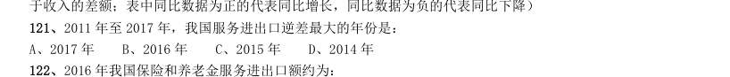

- **A.** 2017 年
- **B.** 2016 年
- **C.** 2015 年
- **D.** 2014 年

**答案：A**

### 【2019 湖北省考·第 122 题】HB-2019-ty-X122　综合分析｜增长率
> 材料：(注:顺差是指在国际收支上,一定时期内收入大于支出的差额;逆差指的是在国际收支上,一定时期内支出大于收入的差额;表中同比数据为正的代表同比增长,同比数据为负的代表同比下降)…

2016 年我国保险和养老金服务进出口额约为:

- **A.** 857 亿元人民币
- **B.** 1112 亿元人民币
- **C.** 1134 亿元人民币
- **D.** 1158 亿元人民币

**答案：C**

### 【2019 湖北省考·第 124 题】HB-2019-ty-X124　综合分析｜综合分析（综合）
> 材料：(注:顺差是指在国际收支上,一定时期内收入大于支出的差额;逆差指的是在国际收支上,一定时期内支出大于收入的差额;表中同比数据为正的代表同比增长,同比数据为负的代表同比下降)…

下列关于2016 年进口额大小排序错误的是:

- **A.** 旅行运输其他商业服务
- **B.** 知识产权使用费建筑运输
- **C.** 运输金融服务加工服务
- **D.** 建筑

**答案：B**

### 【2019 湖北省考·第 125 题】HB-2019-ty-X125　综合分析｜比重
> 材料：(注:顺差是指在国际收支上,一定时期内收入大于支出的差额;逆差指的是在国际收支上,一定时期内支出大于收入的差额;表中同比数据为正的代表同比增长,同比数据为负的代表同比下降)…

加工服务 能够从上述资料中推出的是:

- **A.** 2011 年至2017 年,我国进出口总是出现逆差
- **B.** 2016 年我国建筑服务进出口实现顺差1039 亿元人民币
- **C.** 2017 年我国服务进出口中,其他商业服务进出口实现的顺差最多
- **D.** 2017 年我国服务进出口中,别处未提及的政府服务进出口占比最小

**答案：C**

### 【2019 湖北省考（选调）·第 116 题】HB-2019-xd-X116　综合分析｜现期量
> 材料：自改革开放以来,外商在华投资势头良好。今年两会期间,《中华人民共和国外商投资法(草案)》成为重 要议题。2018 年,外商直接在华投资(非金融类)新设立企业60533 家。外商直接在华投资金额8856 亿元,折 1350 亿美元。其中“一带一路"沿线国家对华直接投资新设立企业4479 家,对华直接投资424 亿元。全年高技 术制造业实际使用外资(非金融类)898 亿元,增长35.1%。…

2018 年,我国对外非金融类直接投资7974 亿元,同比下降1.6%,其中对“一带一路沿线国家非金融类直接 投资156 亿美元,同比增长8.9%。 2018 年,在非金融领域,我国对外直接投资额和外商在华直接投资额之比约为:

- **A.** 10:9
- **B.** 9:10
- **C.** 9:8
- **D.** 8:9

**答案：B**

### 【2019 湖北省考（选调）·第 118 题】HB-2019-xd-X118　综合分析｜综合分析（综合）
> 材料：自改革开放以来,外商在华投资势头良好。今年两会期间,《中华人民共和国外商投资法(草案)》成为重 要议题。2018 年,外商直接在华投资(非金融类)新设立企业60533 家。外商直接在华投资金额8856 亿元,折 1350 亿美元。其中“一带一路"沿线国家对华直接投资新设立企业4479 家,对华直接投资424 亿元。全年高技 术制造业实际使用外资(非金融类)898 亿元,增长35.1%。…

下列行业中,2018 年我国对外非金融类直接投资额与外商在华投资额差值最大的是:

- **A.** 批发和零售业
- **B.** 电力、热力、燃气及水生产和供应业
- **C.** 租赁和商务服务业
- **D.** 交通运输、仓储和邮政业

**答案：C**

### 【2019 湖北省考（选调）·第 119 题】HB-2019-xd-X119　综合分析｜增长率
> 材料：自改革开放以来,外商在华投资势头良好。今年两会期间,《中华人民共和国外商投资法(草案)》成为重 要议题。2018 年,外商直接在华投资(非金融类)新设立企业60533 家。外商直接在华投资金额8856 亿元,折 1350 亿美元。其中“一带一路"沿线国家对华直接投资新设立企业4479 家,对华直接投资424 亿元。全年高技 术制造业实际使用外资(非金融类)898 亿元,增长35.1%。…

将下列行业中2018 年外商直接在华非金融类投资额按增幅从大到小排序,正确的是:

- **A.** 农林牧渔业>电力、热力、燃气及水生产和供应业>批发和零售业
- **B.** 房地产业>电力、热力、燃气及水生产和供应业>制造业
- **C.** 信息传输、软件和信息技术服务业>房地产业>制造业
- **D.** 农林牧渔业>批发和零售业>交通运输、仓储和邮政业

**答案：B**

### 【2019 湖北省考（选调）·第 120 题】HB-2019-xd-X120　综合分析｜比重
> 材料：自改革开放以来,外商在华投资势头良好。今年两会期间,《中华人民共和国外商投资法(草案)》成为重 要议题。2018 年,外商直接在华投资(非金融类)新设立企业60533 家。外商直接在华投资金额8856 亿元,折 1350 亿美元。其中“一带一路"沿线国家对华直接投资新设立企业4479 家,对华直接投资424 亿元。全年高技 术制造业实际使用外资(非金融类)898 亿元,增长35.1%。…

下列说法正确的是:

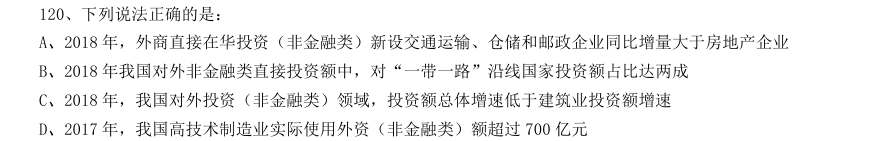

- **A.** 2018 年,外商直接在华投资(非金融类)新设交通运输、仓储和邮政企业同比增量大于房地产企业
- **B.** 2018 年我国对外非金融类直接投资额中,对“一带一路”沿线国家投资额占比达两成
- **C.** 2018 年,我国对外投资(非金融类)领域,投资额总体增速低于建筑业投资额增速
- **D.** 2017 年,我国高技术制造业实际使用外资(非金融类)额超过700 亿元

**答案：C**

### 【2019 湖北省考（选调）·第 122 题】HB-2019-xd-X122　综合分析｜平均数
> 材料：2018 年,我国软件和信息技术服务业运行态势良好,收入和效益增长较快,吸纳就业人数稳定增长。2018年,全国软件和信息技术服务业规模以上企业3.78 万家,累计完成软件业务收入63061 亿元,软件和信息技术服务业实现利润总额8079 亿元,同比增长9.7%,从业人数比上年增加25 万人。…

2017 年,我国软件和信息技术服务业从业人员人数约为多少万人?

- **A.** 701
- **B.** 652
- **C.** 633
- **D.** 618

**答案：D**

### 【2019 湖北省考（选调）·第 125 题】HB-2019-xd-X125　综合分析｜年均增长率
> 材料：2018 年,我国软件和信息技术服务业运行态势良好,收入和效益增长较快,吸纳就业人数稳定增长。2018年,全国软件和信息技术服务业规模以上企业3.78 万家,累计完成软件业务收入63061 亿元,软件和信息技术服务业实现利润总额8079 亿元,同比增长9.7%,从业人数比上年增加25 万人。…

下列不能根据所给资料推出的是:

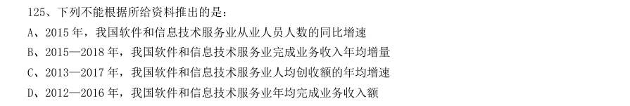

- **A.** 2015 年,我国软件和信息技术服务业从业人员人数的同比增速
- **B.** 2015—2018 年,我国软件和信息技术服务业完成业务收入年均增量
- **C.** 2013—2017 年,我国软件和信息技术服务业人均创收额的年均增速
- **D.** 2012—2016 年,我国软件和信息技术服务业年均完成业务收入额

**答案：D**

### 【2019 广东省考（乡镇）·第 81 题】GD-2019-xz-X081　综合分析｜综合分析（综合）
> 材料：过去5 年,我国统筹开展交通扶贫和“四好农村路工作”,农村基础设施更加完善,服务乡村振兴成效显著。…

料提供的信息进行分析、比较、计算和判断处理。 (一) 过去5 年,我国统筹开展交通扶贫和“四好农村路工作”,农村基础设施更加完善,服务乡村振兴成效显著。 2014~2018 年,全国新改建农村公路里程共计( )万公里。

- **A.** 77.5
- **B.** 97.4
- **C.** 117.2
- **D.** 137.7

**答案：该题答案缺失，见原卷**

### 【2019 广东省考（乡镇）·第 85 题】GD-2019-xz-X085　综合分析｜综合分析（综合）
> 材料：过去5 年,我国统筹开展交通扶贫和“四好农村路工作”,农村基础设施更加完善,服务乡村振兴成效显著。…

下列说法正确的是:

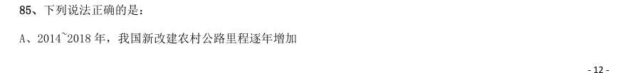

- **A.** 2014~2018 年,我国新改建农村公路里程逐年增加
- **B.** 2014~2018 年,我国农村公路总里程逐年增加
- **C.** 2014~2018 年,通硬化路面的乡镇占全国乡镇的比例逐年提高
- **D.** 2014~2018 年,通公路的建制村占全国建制村的比例逐年提高

**答案：该题答案缺失，见原卷**

### 【2019 广东省考（乡镇）·第 86 题】GD-2019-xz-X086　综合分析｜平均数
> 材料：党的十八大以来,脱贫工作取得巨大成效,全国农村贫困人口大幅减少。截至2018 年末,全国农村贫困人 口从2012 年末的9899 万人减少至1660 万人;农村贫困发生率从2012 年的 下降至 ,累计下降8.5 个百 分点。…

2012—2018 年全国农村贫困人口和贫困发生率 2018 年,贫困地区农村居民人均可支配收入10371 元,扣除价格因素,实际增长 ,实际增速高出全国农 村居民人均可支配收入实际增速1.7 个百分点,圆满完成增长幅度高于全国增速的年度目标任务。 从2012 年末到2018 年末,全国农村贫困人口数减少了( )万人。

- **A.** 6239
- **B.** 7239
- **C.** 8239
- **D.** 9230

**答案：该题答案缺失，见原卷**

### 【2019 广东省考（乡镇）·第 89 题】GD-2019-xz-X089　综合分析｜平均数
> 材料：党的十八大以来,脱贫工作取得巨大成效,全国农村贫困人口大幅减少。截至2018 年末,全国农村贫困人 口从2012 年末的9899 万人减少至1660 万人;农村贫困发生率从2012 年的 下降至 ,累计下降8.5 个百 分点。…

2018 年,我国贫困地区农村居民收入来源中,最高的是( )。

- **A.** 人均工资性收入
- **B.** 人均转移净收入
- **C.** 人均经营净收入
- **D.** 人均财产净收入

**答案：该题答案缺失，见原卷**

### 【2019 广东省考（乡镇）·第 90 题】GD-2019-xz-X090　综合分析｜年均增长率
> 材料：党的十八大以来,脱贫工作取得巨大成效,全国农村贫困人口大幅减少。截至2018 年末,全国农村贫困人 口从2012 年末的9899 万人减少至1660 万人;农村贫困发生率从2012 年的 下降至 ,累计下降8.5 个百 分点。…

下列说法不正确的是( )。

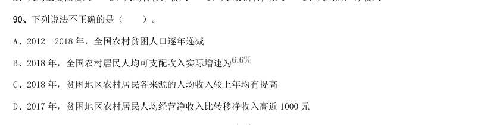

- **A.** 2012—2018 年,全国农村贫困人口逐年递减
- **B.** 2018 年,全国农村居民人均可支配收入实际增速为
- **C.** 2018 年,贫困地区农村居民各来源的人均收入较上年均有提高
- **D.** 2017 年,贫困地区农村居民人均经营净收入比转移净收入高近1000 元

**答案：该题答案缺失，见原卷**

### 【2019 广东省考（乡镇）·第 93 题】GD-2019-xz-X093　综合分析｜综合分析（综合）
> 材料：近年来,B 省营商环境不断优化,市场活力不断增强,新登记市场主体都保持较快增长势头。2018 年,全省 新登记市场主体229.74 万户,日均新登记市场主体6294 户,同比增长 。 全省产业结构也进一步调整优化,新登记市场主体主要集中在第三产业。2018 年,全省三大产业新登记市场 主体分别为第一产业2.02 万户,第二产业24.01 万户,第三产业203.71 万户。截止2018 年12 月末,全省三大产 业的实有各类市场主体户数分别为9.83 万户,157.38 万户,…

2015-2018 年,B 省新登记个体工商户最多的是( )年。

- **A.** 2015
- **B.** 2016
- **C.** 2017
- **D.** 2018

**答案：该题答案缺失，见原卷**

### 【2019 广东省考（乡镇）·第 95 题】GD-2019-xz-X095　综合分析｜综合分析（综合）
> 材料：近年来,B 省营商环境不断优化,市场活力不断增强,新登记市场主体都保持较快增长势头。2018 年,全省 新登记市场主体229.74 万户,日均新登记市场主体6294 户,同比增长 。 全省产业结构也进一步调整优化,新登记市场主体主要集中在第三产业。2018 年,全省三大产业新登记市场 主体分别为第一产业2.02 万户,第二产业24.01 万户,第三产业203.71 万户。截止2018 年12 月末,全省三大产 业的实有各类市场主体户数分别为9.83 万户,157.38 万户,…

下列说法正确的是( )。

- **A.** 2015-2018 年,B 省新登记农民专业合作社数量逐年增加
- **B.** 2015-2018 年,B 省新登记个体工商户均多于新登记企业数
- **C.** 选项缺失
- **D.** 选项缺失

**答案：该题答案缺失，见原卷**

### 【2019 广东省考（乡镇）·第 96 题】GD-2019-xz-X096　综合分析｜基期量
> 材料：近年来,A 省大力发展绿色无公害农业。2017 年,A 省农药使用总量580 万吨,与2016 年相比减少 ;单 位耕地面积农药使用量为1.47 千克/亩。…

全省新增申报无公害农产品产地认定221 个,产品362 个,新增绿色食品33 个,认证有机食品60 个。全省 “三品一标”总数达2570 个,其中:无公害农产品1710 个,绿色食品745 个,有机农产品87 个,农产品地理标 志28 个,无公害农产品种植面积总计达1050 万亩,生产总量970 多万吨。 2014-2017 年A 省无公害农产品生产情况 2017 年,A 省“三品一标”总数较上年增加了( )个。

- **A.** 8
- **B.** 9
- **C.** 10
- **D.** 11

**答案：该题答案缺失，见原卷**

### 【2019 广东省考（乡镇）·第 98 题】GD-2019-xz-X098　综合分析｜综合分析（综合）
> 材料：近年来,A 省大力发展绿色无公害农业。2017 年,A 省农药使用总量580 万吨,与2016 年相比减少 ;单 位耕地面积农药使用量为1.47 千克/亩。…

2017 年,A 省单位耕地面积农药使用量比2015 年约( )。

- **A.** 增加
- **B.** 下降
- **C.** 增加
- **D.** 下降

**答案：该题答案缺失，见原卷**

### 【2019 广东省考（乡镇）·第 100 题】GD-2019-xz-X100　综合分析｜平均数
> 材料：近年来,A 省大力发展绿色无公害农业。2017 年,A 省农药使用总量580 万吨,与2016 年相比减少 ;单 位耕地面积农药使用量为1.47 千克/亩。…

下列说法不正确的是( )。

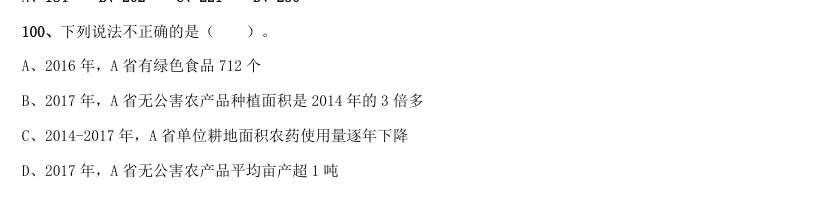

- **A.** 2016 年,A 省有绿色食品712 个
- **B.** 2017 年,A 省无公害农产品种植面积是2014 年的3 倍多
- **C.** 2014-2017 年,A 省单位耕地面积农药使用量逐年下降
- **D.** 2017 年,A 省无公害农产品平均亩产超1 吨

**答案：该题答案缺失，见原卷**

### 【2019 广东省考（县级）·第 88 题】GD-2019-xj-X088　综合分析｜综合分析（综合）
> 材料：近年来,A 省新登记市场主体保持较快增长势头。全省实有各类市场主体从2015 年的775.95 万户增长到 2018 年的1146.13 万户。2018 年,全省新登记市场主体229.74 万户,日均新登记市场主体6294 户,同比增长 。…

2015—2018 年,A 省新登记市场主体数年增长约( )万户。

- **A.** 15.1
- **B.** 23.2
- **C.** 30.3
- **D.** 36.4

**答案：该题答案缺失，见原卷**

### 【2019 广东省考（县级）·第 90 题】GD-2019-xj-X090　综合分析｜综合分析（综合）
> 材料：近年来,A 省新登记市场主体保持较快增长势头。全省实有各类市场主体从2015 年的775.95 万户增长到 2018 年的1146.13 万户。2018 年,全省新登记市场主体229.74 万户,日均新登记市场主体6294 户,同比增长 。…

根据材料,以下说法不正确的是( )。

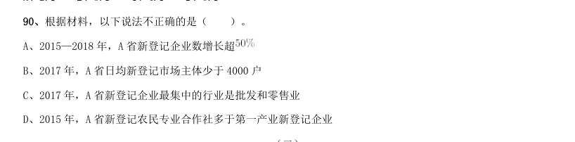

- **A.** 2015—2018 年,A 省新登记企业数增长超
- **B.** 2017 年,A 省日均新登记市场主体少于4000 户
- **C.** 2017 年,A 省新登记企业最集中的行业是批发和零售业
- **D.** 2015 年,A 省新登记农民专业合作社多于第一产业新登记企业

**答案：该题答案缺失，见原卷**

### 【2019 广东省考（县级）·第 94 题】GD-2019-xj-X094　综合分析｜平均数
> 材料：党的十八大以来,脱贫工作取得巨大成效,全国农村贫困人口大幅减少。截至2018 年末,全国农村贫困人 口从2012 年末的9899 万人减少至1660 万人;农村贫困发生率从2012 年的 下降至 ,累计下降8.5 个 百分点。…

2018 年,我国贫困地区农村居民收入来源中,最高的是( )。

- **A.** 人均工资性收入
- **B.** 人均转移净收入
- **C.** 人均经营净收入
- **D.** 人均财产净收入

**答案：该题答案缺失，见原卷**

### 【2019 广东省考（县级）·第 95 题】GD-2019-xj-X095　综合分析｜年均增长率
> 材料：党的十八大以来,脱贫工作取得巨大成效,全国农村贫困人口大幅减少。截至2018 年末,全国农村贫困人 口从2012 年末的9899 万人减少至1660 万人;农村贫困发生率从2012 年的 下降至 ,累计下降8.5 个 百分点。…

下列说法不正确的是( )。

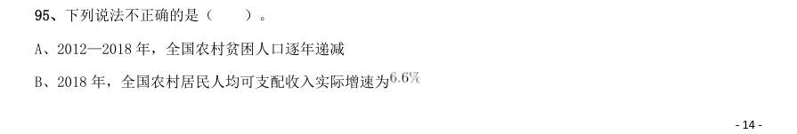

- **A.** 2012—2018 年,全国农村贫困人口逐年递减
- **B.** 2018 年,全国农村居民人均可支配收入实际增速为
- **C.** 2018 年,贫困地区农村居民各来源的人均收入较上年均有提高
- **D.** 2017 年,贫困地区农村居民人均经营净收入比转移净收入高近1000 元

**答案：该题答案缺失，见原卷**

### 【2019 广东省考（县级）·第 97 题】GD-2019-xj-X097　综合分析｜综合分析（综合）
> 材料：2018 年,我国全社会用电量68449 亿千瓦时,同比增长 ,增幅同比提高1.9 个百分点。具体来看,第 一产业用电量728 亿千瓦时,同比增长 ;第二产业用电量47235 亿千瓦时,同比增长 ;第三产业用电 量10801 亿千瓦时,同比增长 ;城乡居民生活用电量9685 亿千瓦时,同比增长 。…

2017 年,我国三大产业及城乡居民生活用电量大小排序正确的是( )。

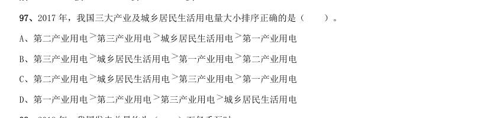

- **A.** 第二产业用电第三产业用电城乡居民生活用电第一产业用电
- **B.** 第三产业用电城乡居民生活用电第一产业用电第二产业用电
- **C.** 第二产业用电城乡居民生活用电第三产业用电第一产业用电
- **D.** 第一产业用电

**答案：该题答案缺失，见原卷**

### 【2019 广东省考（县级）·第 98 题】GD-2019-xj-X098　综合分析｜综合分析（综合）
> 材料：2018 年,我国全社会用电量68449 亿千瓦时,同比增长 ,增幅同比提高1.9 个百分点。具体来看,第 一产业用电量728 亿千瓦时,同比增长 ;第二产业用电量47235 亿千瓦时,同比增长 ;第三产业用电 量10801 亿千瓦时,同比增长 ;城乡居民生活用电量9685 亿千瓦时,同比增长 。…

第三产业用电 城乡居民生活用电 2018 年,我国发电总量约为( )万亿千瓦时。

- **A.** 1.87
- **B.** 3.70
- **C.** 5.84
- **D.** 7.00

**答案：该题答案缺失，见原卷**

### 【2019 广东省考（县级）·第 100 题】GD-2019-xj-X100　综合分析｜倍数
> 材料：2018 年,我国全社会用电量68449 亿千瓦时,同比增长 ,增幅同比提高1.9 个百分点。具体来看,第 一产业用电量728 亿千瓦时,同比增长 ;第二产业用电量47235 亿千瓦时,同比增长 ;第三产业用电 量10801 亿千瓦时,同比增长 ;城乡居民生活用电量9685 亿千瓦时,同比增长 。…

根据以上材料,下列说法不正确的是( )。

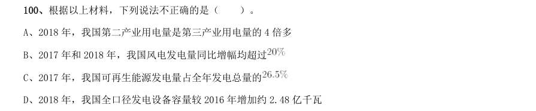

- **A.** 2018 年,我国第二产业用电量是第三产业用电量的4 倍多
- **B.** 2017 年和2018 年,我国风电发电量同比增幅均超过
- **C.** 2017 年,我国可再生能源发电量占全年发电总量的
- **D.** 2018 年,我国全口径发电设备容量较2016 年增加约2.48 亿千瓦

**答案：该题答案缺失，见原卷**

### 【2019 广东省考（选调）·第 66 题】GD-2019-xd-X066　综合分析｜基期量
> 材料：项。 2017 年末,全国铁路营业里程达到12.7 万公里,比上年增长,其中高铁营业里程2.5 万公里。全国铁路路网密度132.2 公里/万平方公里,比上年增加3.0 公里/万平方公里。其中复线里程7.2 万公里,复线率(铁路复线里程占铁路营业里程的比重),电气化里程8.7 万公里,电化率(铁路电气化里程占铁路营业里程的比重)。西部地区铁路营业里程5.2 万公里,比上年增长。…

2016 年末,我国铁路路网密度是( )公里/万平方公里。

- **A.** 126.2
- **B.** 129.2
- **C.** 130.2
- **D.** 135.2

**答案：B**

### 【2019 广东省考（选调）·第 67 题】GD-2019-xd-X067　综合分析｜增长量
> 材料：项。 2017 年末,全国铁路营业里程达到12.7 万公里,比上年增长,其中高铁营业里程2.5 万公里。全国铁路路网密度132.2 公里/万平方公里,比上年增加3.0 公里/万平方公里。其中复线里程7.2 万公里,复线率(铁路复线里程占铁路营业里程的比重),电气化里程8.7 万公里,电化率(铁路电气化里程占铁路营业里程的比重)。西部地区铁路营业里程5.2 万公里,比上年增长。…

2017 年,西部地区铁路营业里程比2016 年增加约( )公里。

- **A.** 1661
- **B.** 1761
- **C.** 1861
- **D.** 1961

**答案：A**

### 【2019 广东省考（选调）·第 68 题】GD-2019-xd-X068　综合分析｜比重
> 材料：项。 2017 年末,全国铁路营业里程达到12.7 万公里,比上年增长,其中高铁营业里程2.5 万公里。全国铁路路网密度132.2 公里/万平方公里,比上年增加3.0 公里/万平方公里。其中复线里程7.2 万公里,复线率(铁路复线里程占铁路营业里程的比重),电气化里程8.7 万公里,电化率(铁路电气化里程占铁路营业里程的比重)。西部地区铁路营业里程5.2 万公里,比上年增长。…

2017 年我国铁路复线率约比2016 年( )。

- **A.** 提高4 个百分点
- **B.** 降低4 个百分点
- **C.** 提高2 个百分点
- **D.** 降低2 个百分点

**答案：C**

### 【2019 广东省考（选调）·第 70 题】GD-2019-xd-X070　综合分析｜增长率
> 材料：项。 2017 年末,全国铁路营业里程达到12.7 万公里,比上年增长,其中高铁营业里程2.5 万公里。全国铁路路网密度132.2 公里/万平方公里,比上年增加3.0 公里/万平方公里。其中复线里程7.2 万公里,复线率(铁路复线里程占铁路营业里程的比重),电气化里程8.7 万公里,电化率(铁路电气化里程占铁路营业里程的比重)。西部地区铁路营业里程5.2 万公里,比上年增长。…

以下说法不正确的是( )。

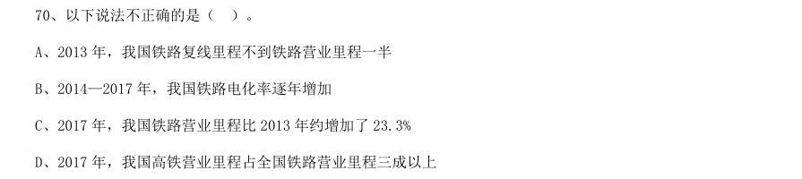

- **A.** 2013 年,我国铁路复线里程不到铁路营业里程一半
- **B.** 2014—2017 年,我国铁路电化率逐年增加
- **C.** 2017 年,我国铁路营业里程比2013 年约增加了23.3%
- **D.** 2017 年,我国高铁营业里程占全国铁路营业里程三成以上

**答案：D**

### 【2019 广东省考（选调）·第 74 题】GD-2019-xd-X074　综合分析｜综合分析（综合）
> 材料：对全国规模以上文化及相关产业5.9 万家企业的调查显示,2018 年上半年,上述企业实现营业收入42227 亿元,比上年同期增长 ,继续保持较快增长。 文化及相关产业9 个行业的营业收入均实现增长。其中,新闻信息服务营业收入3744 亿元,比上年同期增 长 ;创意设计服务5143 亿元,增长 ;内容创作生产8820 亿元,增长 ;文化传播渠道4501 亿 元,增长 ;文化辅助生产和中介服务7783 亿元,增长 ;文化消费终端生产7911 亿元,增长 ; 文化投资运营349 亿…

2017 年上半年,我国文化及相关产业营业收入最高的行业是( )。

- **A.** 内容创作生产
- **B.** 创意设计服务
- **C.** 文化休闲娱乐服务
- **D.** 文化消费终端生产

**答案：A**

### 【2019 广东省考（选调）·第 75 题】GD-2019-xd-X075　综合分析｜比重
> 材料：对全国规模以上文化及相关产业5.9 万家企业的调查显示,2018 年上半年,上述企业实现营业收入42227 亿元,比上年同期增长 ,继续保持较快增长。 文化及相关产业9 个行业的营业收入均实现增长。其中,新闻信息服务营业收入3744 亿元,比上年同期增 长 ;创意设计服务5143 亿元,增长 ;内容创作生产8820 亿元,增长 ;文化传播渠道4501 亿 元,增长 ;文化辅助生产和中介服务7783 亿元,增长 ;文化消费终端生产7911 亿元,增长 ; 文化投资运营349 亿…

以下说法不正确的是( )。

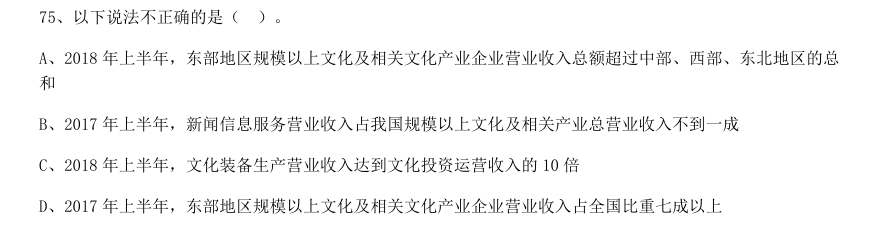

- **A.** 2018 年上半年,东部地区规模以上文化及相关文化产业企业营业收入总额超过中部、西部、东北地区的总和
- **B.** 2017 年上半年,新闻信息服务营业收入占我国规模以上文化及相关产业总营业收入不到一成
- **C.** 2018 年上半年,文化装备生产营业收入达到文化投资运营收入的10 倍
- **D.** 2017 年上半年,东部地区规模以上文化及相关文化产业企业营业收入占全国比重七成以上

**答案：C**

### 【2019 广东省考（选调）·第 76 题】GD-2019-xd-X076　综合分析｜增长量

根据下列材料,回答76~80 题: 与2012 年相比,2013 年下列社会服务机构中单位数增加最多的是( )。

- **A.** 社会福利院
- **B.** 儿童福利机构
- **C.** 老龄机构
- **D.** 基金会

**答案：D**

### 【2019 广东省考（选调）·第 77 题】GD-2019-xd-X077　综合分析｜增长量

2015 年,社会服务机构单位数比2011 年增加约( )万个。

- **A.** 46
- **B.** 47
- **C.** 48
- **D.** 49

**答案：B**

### 【2019 广东省考（选调）·第 80 题】GD-2019-xd-X080　综合分析｜年均增长率

以下说法不正确的是( )。

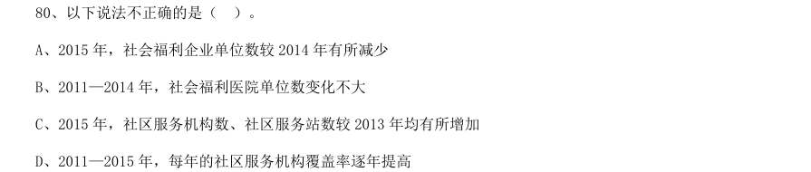

- **A.** 2015 年,社会福利企业单位数较2014 年有所减少
- **B.** 2011—2014 年,社会福利医院单位数变化不大
- **C.** 2015 年,社区服务机构数、社区服务站数较2013 年均有所增加
- **D.** 2011—2015 年,每年的社区服务机构覆盖率逐年提高

**答案：D**

### 【2019 国考（地市级）·第 115 题】GK-2019-ds-X115　综合分析｜平均数
> 材料：111、2017 年第三季度,全国平均每吨进口药品单价约为多少万美元? A、2B、19C、8D、96112、2017 年下半年,全国进口药品数量同比增速低于上月水平的月份有几个? A、2B、3C、4D、5113、2016 年5 月,全国进口药品金额环比增速:A、超过100%B、在40%~100%之间C、在0%~40%之间D、低于0%114、以下折线图中,能准确反映2017 年第四季度各月全国进口药品金额环比增长率的是:…

能够从上述资料中推出的是:

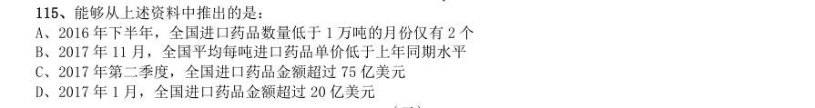

- **A.** 2016 年下半年,全国进口药品数量低于1 万吨的月份仅有2 个
- **B.** 2017 年11 月,全国平均每吨进口药品单价低于上年同期水平
- **C.** 2017 年第二季度,全国进口药品金额超过75 亿美元
- **D.** 2017 年1 月,全国进口药品金额超过20 亿美元

**答案：B**

### 【2019 国考（地市级）·第 117 题】GK-2019-ds-X117　综合分析｜综合分析（综合）
> 材料：2017 年全国二手车累计交易量为1240 万辆,同比增长19.3%;二手车交易额为8092.7 亿元,同比增长34%。 2017 年12 月,全国二手车市场交易量为123 万辆,交易量环比上升7.4%,上年同期交易量为108 万辆。…

“十二五”(2011~2015 年)期间,全国二手车总计交易约多少亿辆?

- **A.** 0.46
- **B.** 0.50
- **C.** 0.38
- **D.** 0.42

**答案：D**

### 【2019 国考（地市级）·第 119 题】GK-2019-ds-X119　综合分析｜平均数
> 材料：2017 年全国二手车累计交易量为1240 万辆,同比增长19.3%;二手车交易额为8092.7 亿元,同比增长34%。 2017 年12 月,全国二手车市场交易量为123 万辆,交易量环比上升7.4%,上年同期交易量为108 万辆。…

2015 年全国二手车交易总金额比2014 年:

- **A.** 减少了不到100 亿元
- **B.** 减少了100 亿元以上
- **C.** 增长了100 亿元以上
- **D.** 增长了不到100 亿元

**答案：A**

### 【2019 国考（地市级）·第 120 题】GK-2019-ds-X120　综合分析｜平均数
> 材料：2017 年全国二手车累计交易量为1240 万辆,同比增长19.3%;二手车交易额为8092.7 亿元,同比增长34%。 2017 年12 月,全国二手车市场交易量为123 万辆,交易量环比上升7.4%,上年同期交易量为108 万辆。…

能够从上述资料中推出的是:

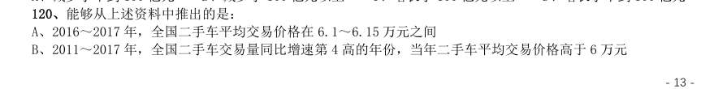

- **A.** 2016~2017 年,全国二手车平均交易价格在6.1~6.15 万元之间
- **B.** 2011~2017 年,全国二手车交易量同比增速第4 高的年份,当年二手车平均交易价格高于6 万元
- **C.** 2011~2017 年,全国二手车交易量同比增长量最高的年份其增长量是最低年份的9 倍多
- **D.** 2011~2017 年,全国二手车交易量同比增速低于10%的年份有4 个

**答案：C**

### 【2019 国考（地市级）·第 122 题】GK-2019-ds-X122　综合分析｜综合分析（综合）

2018 年第一季度全国处理钓鱼网站总数:

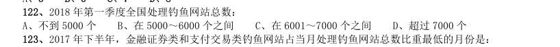

- **A.** 不到5000 个
- **B.** 在5000~6000 个之间
- **C.** 在6001~7000 个之间
- **D.** 超过7000 个

**答案：C**

### 【2019 国考（地市级）·第 125 题】GK-2019-ds-X125　综合分析｜基期量
> 材料：111、2017 年第三季度,全国平均每吨进口药品单价约为多少万美元? A、2B、19C、8D、96112、2017 年下半年,全国进口药品数量同比增速低于上月水平的月份有几个? A、2B、3C、4D、5113、2016 年5 月,全国进口药品金额环比增速:A、超过100%B、在40%~100%之间C、在0%~40%之间D、低于0%114、以下折线图中,能准确反映2017 年第四季度各月全国进口药品金额环比增长率的是:115、能够从上述资料中推出的是:A、2016 年下半年,…

能够从上述资料中推出的是:

- **A.** 2018 年3 月全国支付交易类钓鱼网站处理数量超过2500 个
- **B.** 2017 年第一季度全国CN 域名钓鱼网站处理数量占同期钓鱼网站处理总数的一成以上
- **C.** 2018 年2 月全国支付交易类钓鱼网站处理数量环比下降了不到50%
- **D.** 2017 年全国处理的CN 域名钓鱼网站中,超过了一半的网站是在12 月处理的

**答案：A**

### 【2019 国考（省级）·第 120 题】GK-2019-sj-X120　综合分析｜平均数
> 材料：116、2017 年第三季度,全国平均每吨进口药品单价约为多少万美元? A、2B、19C、8D、96117、2016 年5 月,全国进口药品金额环比增速:A、超过100%B、在40%~100%之间C、在0%~40%之间D、低于0%118、2017 年下半年,全国进口药品数量同比增速低于上月水平的月份有几个? A、2B、3C、4D、5119、以下折线图中,能准确反映2017 年第四季度各月全国进口药品金额环比增长率的是:…

能够从上述资料中推出的是:

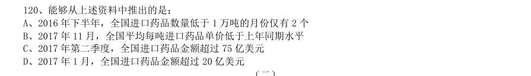

- **A.** 2016 年下半年,全国进口药品数量低于1 万吨的月份仅有2 个
- **B.** 2017 年11 月,全国平均每吨进口药品单价低于上年同期水平
- **C.** 2017 年第二季度,全国进口药品金额超过75 亿美元
- **D.** 2017 年1 月,全国进口药品金额超过20 亿美元

**答案：B**

### 【2019 国考（省级）·第 124 题】GK-2019-sj-X124　综合分析｜平均数
> 材料：2017 年全国二手车累计交易量为1240 万辆,同比增长19.3%;二手车交易额为8092.7 亿元,同比增长34%。2017年12 月,全国二手车市场交易量为123 万辆,交易量环比上升7.4%,上年同期交易量为108 万辆。…

2015 年全国二手车交易总金额比2014 年:

- **A.** 减少了不到100 亿元
- **B.** 减少了100 亿元以上
- **C.** 增长了100 亿元以上
- **D.** 增长了不到100 亿元

**答案：A**

### 【2019 国考（省级）·第 125 题】GK-2019-sj-X125　综合分析｜平均数
> 材料：2017 年全国二手车累计交易量为1240 万辆,同比增长19.3%;二手车交易额为8092.7 亿元,同比增长34%。2017年12 月,全国二手车市场交易量为123 万辆,交易量环比上升7.4%,上年同期交易量为108 万辆。…

能够从上述资料中推出的是:

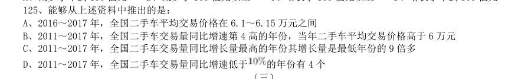

- **A.** 2016~2017 年,全国二手车平均交易价格在6.1~6.15 万元之间
- **B.** 2011~2017 年,全国二手车交易量同比增速第4 高的年份,当年二手车平均交易价格高于6 万元
- **C.** 2011~2017 年,全国二手车交易量同比增长量最高的年份其增长量是最低年份的9 倍多
- **D.** 2011~2017 年,全国二手车交易量同比增速低于

**答案：C**

### 【2019 国考（省级）·第 126 题】GK-2019-sj-X126　综合分析｜综合分析（综合）

(三) 2018 年第一季度全国处理钓鱼网站总数:

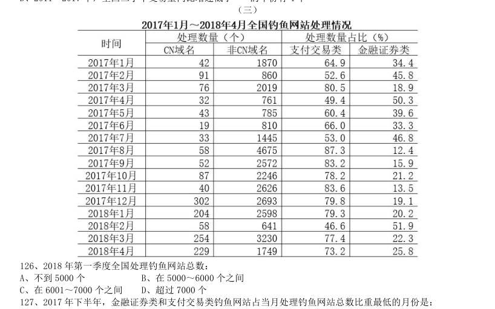

- **A.** 不到5000 个
- **B.** 在5000~6000 个之间
- **C.** 在6001~7000 个之间
- **D.** 超过7000 个

**答案：C**

### 【2019 国考（省级）·第 130 题】GK-2019-sj-X130　综合分析｜基期量
> 材料：116、2017 年第三季度,全国平均每吨进口药品单价约为多少万美元? A、2B、19C、8D、96117、2016 年5 月,全国进口药品金额环比增速:A、超过100%B、在40%~100%之间C、在0%~40%之间D、低于0%118、2017 年下半年,全国进口药品数量同比增速低于上月水平的月份有几个? A、2B、3C、4D、5119、以下折线图中,能准确反映2017 年第四季度各月全国进口药品金额环比增长率的是:120、能够从上述资料中推出的是:A、2016 年下半年,…

能够从上述资料中推出的是:

- **A.** 2018 年3 月全国支付交易类钓鱼网站处理数量超过2500 个
- **B.** 2017 年第一季度全国CN 域名钓鱼网站处理数量占同期钓鱼网站处理总数的一成以上
- **C.** 2018 年2 月全国支付交易类钓鱼网站处理数量环比下降了不到50%
- **D.** 2017 年全国处理的CN 域名钓鱼网站中,超过了一半的网站是在12 月处理的

**答案：A**

### 【2018 湖北省考·第 109 题】HB-2018-ty-X109　综合分析｜平均数
> 材料：2017 年上半年,全国居民人均可支配收入12932 元,比上年同期名义增长8.8%,其中,城镇居民人均可 支配收入18322 元,增长8.1%(以下如无特别说明,均为同比名义增长);农村居民人均可支配收入6562 元, 增长8.5%。…

关于2017 年上半年全国居民收入和消费支出主要数据情况,下列说法正确的是:

- **A.** 生活用品及服务消费支出水平不足交通通信消费支出水平的二分之一
- **B.** 城镇居民人均可支配收入超过农村居民人均可支配收入的3 倍
- **C.** 人均财产净收入同比增长率低于人均经营净收入同比增长率
- **D.** 居住消费支出同比增长率高于医疗保健消费支出同比增长率

**答案：A**

### 【2018 湖北省考·第 110 题】HB-2018-ty-X110　综合分析｜比重
> 材料：2017 年上半年,全国居民人均可支配收入12932 元,比上年同期名义增长8.8%,其中,城镇居民人均可 支配收入18322 元,增长8.1%(以下如无特别说明,均为同比名义增长);农村居民人均可支配收入6562 元, 增长8.5%。…

2017 年上半年,全国居民消费支出主要数据按消费类别分。下列哪一个经济指标值最大?

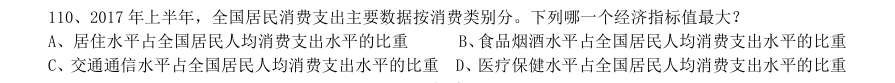

- **A.** 居住水平占全国居民人均消费支出水平的比重
- **B.** 食品烟酒水平占全国居民人均消费支出水平的比重
- **C.** 交通通信水平占全国居民人均消费支出水平的比重
- **D.** 医疗保健水平占全国居民人均消费支出水平的比重

**答案：B**

### 【2018 湖北省考·第 114 题】HB-2018-ty-X114　综合分析｜增长率
> 材料：根据以下资料,回答111~115 题。 2017 年第一季度,某省农林牧渔业增加值361.78 亿元元,比上年同期增长5.9%,高于上年同期0.2 个百 分点。具体情况如下: 该省种植业增加值119.21 亿元,比上年同期增长8.2%,其中蔬菜种植面积358.80 万亩,比上年同期增 加18.23 万亩,蔬菜产量471.42 万吨,增长7.5%;茶叶种植面积679.53 万亩,比上年同期增加19.79 万亩, 茶叶产量2.30 万吨,增长19.49%。 该省林业增加值34.8…

2017 年第一季度,下列产业增加值同比增速从快到慢排序正确的是:

- **A.** 畜牧业>渔业>种植业>林业
- **B.** 畜牧业>种植业>林业>渔业
- **C.** 渔业>林业>种植业>畜牧业
- **D.** 林业>种植业>渔业>畜牧业

**答案：D**

### 【2018 湖北省考·第 115 题】HB-2018-ty-X115　综合分析｜增长率
> 材料：根据以下资料,回答111~115 题。 2017 年第一季度,某省农林牧渔业增加值361.78 亿元元,比上年同期增长5.9%,高于上年同期0.2 个百 分点。具体情况如下: 该省种植业增加值119.21 亿元,比上年同期增长8.2%,其中蔬菜种植面积358.80 万亩,比上年同期增 加18.23 万亩,蔬菜产量471.42 万吨,增长7.5%;茶叶种植面积679.53 万亩,比上年同期增加19.79 万亩, 茶叶产量2.30 万吨,增长19.49%。 该省林业增加值34.8…

能够从上述资料中推出或计算出的是:

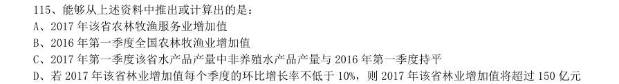

- **A.** 2017 年该省农林牧渔服务业增加值
- **B.** 2016 年第一季度全国农林牧渔业增加值
- **C.** 2017 年第一季度该省水产品产量中非养殖水产品产量与2016 年第一季度持平
- **D.** 若2017 年该省林业增加值每个季度的环比增长率不低于10%,则2017 年该省林业增加值将超过150 亿元

**答案：D**

### 【2018 湖北省考·第 120 题】HB-2018-ty-X120　综合分析｜增长率
> 材料：根据以下材料,回答116~120 题。 2016 年,我国全年完成邮电业务收入总量43344 亿元,比上年增长52.7%。其中,邮政业务收入7397 亿 元,增长45.7%;电信业务总量35948 亿元,增长54.2%。邮政业全年完成邮政函件业务36.2 亿件,包裹业务 0.3 亿件,快递业务量312.8 亿件;快递业务收入总量3974 亿元。电信业全年新增移动电话交换机容量7318 万户,达到218384 万户。2016 年来全国电话用户总数152856 万户(电话包括固定…

关于我国邮电业务情况的说明,下列说法正确的是:

- **A.** 2015 年末,我国固定互联网光纤宽带接入用户与移动宽带用户的差额低于50000 户
- **B.** 2016 年固定互联网宽带接入用户同比增长率高于移动宽带用户增长率
- **C.** 2016 年末,我国使用固定电话的总人数比移动电话的多
- **D.** 2016 年我国城市地区互联网普及率已超过一半

**答案：D**

### 【2018 湖北省考·第 123 题】HB-2018-ty-X123　综合分析｜增长率
> 材料：注:1.农村金融机构包括农村商业银行、农村合作银行、农村信用社和新型农村金融机构。 2.其他类金融机构包括政策性银行及国家开发银行、民营银行、外资银行、非银行金融机构、资产管理公司和邮政储蓄银行。 3.净资产额等于总资产额减去总负债额。…

2016 年5 月,银行业金融机构总资产金额为多少万亿元?

- **A.** 167
- **B.** 207
- **C.** 247
- **D.** 287

**答案：B**

### 【2018 湖北省考·第 124 题】HB-2018-ty-X124　综合分析｜综合分析（综合）
> 材料：注:1.农村金融机构包括农村商业银行、农村合作银行、农村信用社和新型农村金融机构。 2.其他类金融机构包括政策性银行及国家开发银行、民营银行、外资银行、非银行金融机构、资产管理公司和邮政储蓄银行。 3.净资产额等于总资产额减去总负债额。…

根据所给资料,2017 年5 月:

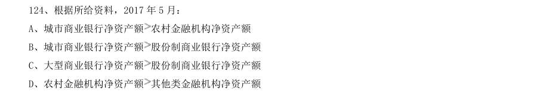

- **A.** 城市商业银行净资产额农村金融机构净资产额
- **B.** 城市商业银行净资产额股份制商业银行净资产额
- **C.** 大型商业银行净资产额股份制商业银行净资产额
- **D.** 农村金融机构净资产额

**答案：C**

### 【2018 湖北省考·第 125 题】HB-2018-ty-X125　综合分析｜增长率
> 材料：注:1.农村金融机构包括农村商业银行、农村合作银行、农村信用社和新型农村金融机构。 2.其他类金融机构包括政策性银行及国家开发银行、民营银行、外资银行、非银行金融机构、资产管理公司和邮政储蓄银行。 3.净资产额等于总资产额减去总负债额。…

关于2017 年5 月我国银行业金融机构资产负债表,下列说法正确的是:

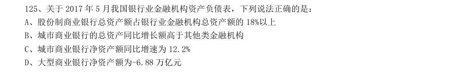

- **A.** 股份制商业银行总资产额占银行业金融机构总资产额的18%以上
- **B.** 城市商业银行的总资产同比增长额高于其他类金融机构
- **C.** 城市商业银行净资产额同比增速为12.2%
- **D.** 大型商业银行净资产额为-6.88 万亿元

**答案：A**

### 【2018 广东省考·第 87 题】GD-2018-ty-X087　综合分析｜综合分析（综合）
> 材料：A 市坚持发挥科技创新的引领作用,强化企业的创新主体地位,研发投入不断增加,研发人员快速增长, 创新能力持续增强,锂电池等新兴产业尤为突出。 五年来,企业创新意愿不断提升,研发投入快速增长。2016 年,该市有研究与试验发展(R&D)活动的 单位172 家,比2012 年增加26 家,R&D 经费内部支出19.55 亿元,比2012 年增加11.65 亿元,增长 ,年均增长率为 ;R&D 经费内部支出与地区生产总值之比为 ,比2012 年提高0.5 个百分 点。规模以上工业企…

2016 年,该市生产总值比2012 年约多( )亿元。

- **A.** 350
- **B.** 430
- **C.** 500
- **D.** 660

**答案：该题答案缺失，见原卷**

### 【2018 广东省考·第 89 题】GD-2018-ty-X089　综合分析｜综合分析（综合）
> 材料：A 市坚持发挥科技创新的引领作用,强化企业的创新主体地位,研发投入不断增加,研发人员快速增长, 创新能力持续增强,锂电池等新兴产业尤为突出。 五年来,企业创新意愿不断提升,研发投入快速增长。2016 年,该市有研究与试验发展(R&D)活动的 单位172 家,比2012 年增加26 家,R&D 经费内部支出19.55 亿元,比2012 年增加11.65 亿元,增长 ,年均增长率为 ;R&D 经费内部支出与地区生产总值之比为 ,比2012 年提高0.5 个百分 点。规模以上工业企…

2016 年,该市R&D 人员中,本科学历的人数为( )。

- **A.** 1216
- **B.** 1517
- **C.** 2791
- **D.** 4007

**答案：该题答案缺失，见原卷**

### 【2018 广东省考·第 90 题】GD-2018-ty-X090　综合分析｜年均增长率
> 材料：A 市坚持发挥科技创新的引领作用,强化企业的创新主体地位,研发投入不断增加,研发人员快速增长, 创新能力持续增强,锂电池等新兴产业尤为突出。 五年来,企业创新意愿不断提升,研发投入快速增长。2016 年,该市有研究与试验发展(R&D)活动的 单位172 家,比2012 年增加26 家,R&D 经费内部支出19.55 亿元,比2012 年增加11.65 亿元,增长 ,年均增长率为 ;R&D 经费内部支出与地区生产总值之比为 ,比2012 年提高0.5 个百分 点。规模以上工业企…

根据材料,下列说法不正确的是( )。

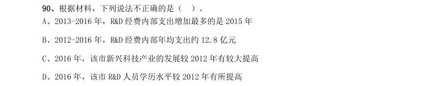

- **A.** 2013-2016 年,R&D 经费内部支出增加最多的是2015 年
- **B.** 2012-2016 年,R&D 经费内部年均支出约12.8 亿元
- **C.** 2016 年,该市新兴科技产业的发展较2012 年有较大提高
- **D.** 2016 年,该市R&D 人员学历水平较2012 年有所提高

**答案：该题答案缺失，见原卷**

### 【2018 广东省考·第 91 题】GD-2018-ty-X091　综合分析｜综合分析（综合）
> 材料：2017 年第四季度,人力资源部门对东、中、西三大区域共95 个城市的公共就业服务机构市场供求信息进行了统计分析,部分数据如下:总体而言,用人单位通过公共就业服务机构招聘各类人员约433.7 万人,进入市场的求职者约354.2 万人,岗位空缺与求职人数的比率约为1.22,比去年同期上升0.09,市场需求略大于供给。 与去年同期相比,需求人数增加15.6 万人,求职人数减少17.3 万人。与上季度相比,需求人数和求职人数分别减少了58.9 万人和73.2 万人,各下降了和。 分…

2017 年,第四季度岗位空缺与求职人数比率较第三季度上升了( )。

- **A.** 0.03
- **B.** 0.06
- **C.** 0.09
- **D.** 0.12

**答案：该题答案缺失，见原卷**

### 【2018 广东省考·第 93 题】GD-2018-ty-X093　综合分析｜综合分析（综合）
> 材料：2017 年第四季度,人力资源部门对东、中、西三大区域共95 个城市的公共就业服务机构市场供求信息进行了统计分析,部分数据如下:总体而言,用人单位通过公共就业服务机构招聘各类人员约433.7 万人,进入市场的求职者约354.2 万人,岗位空缺与求职人数的比率约为1.22,比去年同期上升0.09,市场需求略大于供给。 与去年同期相比,需求人数增加15.6 万人,求职人数减少17.3 万人。与上季度相比,需求人数和求职人数分别减少了58.9 万人和73.2 万人,各下降了和。 分…

2017 年第四季度求职人数比2016 年第四季度下降了约( )。

- **A.** 
- **B.** 
- **C.** 
- **D.** 

**答案：该题答案缺失，见原卷**

### 【2018 广东省考·第 94 题】GD-2018-ty-X094　综合分析｜综合分析（综合）
> 材料：2017 年第四季度,人力资源部门对东、中、西三大区域共95 个城市的公共就业服务机构市场供求信息进行了统计分析,部分数据如下:总体而言,用人单位通过公共就业服务机构招聘各类人员约433.7 万人,进入市场的求职者约354.2 万人,岗位空缺与求职人数的比率约为1.22,比去年同期上升0.09,市场需求略大于供给。 与去年同期相比,需求人数增加15.6 万人,求职人数减少17.3 万人。与上季度相比,需求人数和求职人数分别减少了58.9 万人和73.2 万人,各下降了和。 分…

2015—2017 年,人力资源市场供给最能满足市场需求的是( )。

- **A.** 2015 年第三季度
- **B.** 2016 年第二季度
- **C.** 2017 年第一季度
- **D.** 2017 年第四季度

**答案：该题答案缺失，见原卷**

### 【2018 广东省考·第 95 题】GD-2018-ty-X095　综合分析｜综合分析（综合）
> 材料：2017 年第四季度,人力资源部门对东、中、西三大区域共95 个城市的公共就业服务机构市场供求信息进行了统计分析,部分数据如下:总体而言,用人单位通过公共就业服务机构招聘各类人员约433.7 万人,进入市场的求职者约354.2 万人,岗位空缺与求职人数的比率约为1.22,比去年同期上升0.09,市场需求略大于供给。 与去年同期相比,需求人数增加15.6 万人,求职人数减少17.3 万人。与上季度相比,需求人数和求职人数分别减少了58.9 万人和73.2 万人,各下降了和。 分…

根据材料,下列说法正确的是( )。

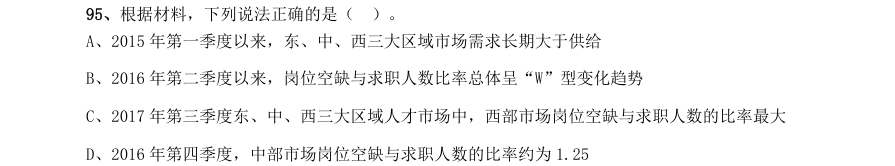

- **A.** 2015 年第一季度以来,东、中、西三大区域市场需求长期大于供给
- **B.** 2016 年第二季度以来,岗位空缺与求职人数比率总体呈“W”型变化趋势
- **C.** 2017 年第三季度东、中、西三大区域人才市场中,西部市场岗位空缺与求职人数的比率最大
- **D.** 2016 年第四季度,中部市场岗位空缺与求职人数的比率约为1.25

**答案：该题答案缺失，见原卷**

### 【2018 广东省考·第 96 题】GD-2018-ty-X096　综合分析｜增长率
> 材料：近年来,广东全省医疗卫生资源总量继续增加,医疗服务能力不断增强。截止2016 年底,全省医疗卫生机构4.91 万个,医疗卫生机构拥有床位46.5 万张,其中:医院37.2 万张,卫生院5.7 万张。医疗卫生机构卫生技术人员66.8 万人,其中:执业(助理)医师24.4 万人,注册护士28.4 万人,医护比1:1.16。…

2010—2016 年,全省医疗卫生机构数同比上一年增长率最高的是( )年。

- **A.** 2012
- **B.** 2013
- **C.** 2014
- **D.** 2016

**答案：该题答案缺失，见原卷**

### 【2018 广东省考·第 100 题】GD-2018-ty-X100　综合分析｜平均数
> 材料：近年来,广东全省医疗卫生资源总量继续增加,医疗服务能力不断增强。截止2016 年底,全省医疗卫生机构4.91 万个,医疗卫生机构拥有床位46.5 万张,其中:医院37.2 万张,卫生院5.7 万张。医疗卫生机构卫生技术人员66.8 万人,其中:执业(助理)医师24.4 万人,注册护士28.4 万人,医护比1:1.16。…

根据材料,下列说法正确的是( )。

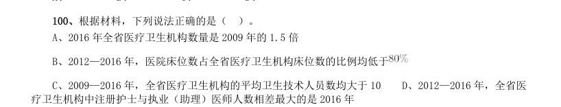

- **A.** 2016 年全省医疗卫生机构数量是2009 年的1.5 倍
- **B.** 2012—2016 年,医院床位数占全省医疗卫生机构床位数的比例均低于
- **C.** 2009—2016 年,全省医疗卫生机构的平均卫生技术人员数均大于10
- **D.** 2012—2016 年,全省医

**答案：该题答案缺失，见原卷**

### 【2018 国考（副省级）·第 116 题】GK-2018-fs-X116　综合分析｜比重
> 材料：2016 年“一带一路”沿线64 个国家GDP 之和约为12.0 万亿美元,占全球GDP 的16.0%;人口总数约为32.1 亿人,占全球总人口的43.4%;对外贸易总额(进口额+出口额)约为71885.6 亿美元,占全球贸易总额的21.7%。…

2016 年全球贸易总额约为多少万亿美元?

- **A.** 28
- **B.** 33
- **C.** 40
- **D.** 75

**答案：B**

### 【2018 国考（副省级）·第 118 题】GK-2018-fs-X118　综合分析｜综合分析（综合）
> 材料：2016 年“一带一路”沿线64 个国家GDP 之和约为12.0 万亿美元,占全球GDP 的16.0%;人口总数约为32.1 亿人,占全球总人口的43.4%;对外贸易总额(进口额+出口额)约为71885.6 亿美元,占全球贸易总额的21.7%。…

“一带一路”沿线主要区域中,2016 年进口额与出口额数值相差最大的是:

- **A.** 东南亚11 国
- **B.** 南亚8 国
- **C.** 西亚、北非19 国
- **D.** 东欧20 国

**答案：D**

### 【2018 国考（副省级）·第 120 题】GK-2018-fs-X120　综合分析｜平均数
> 材料：2016 年“一带一路”沿线64 个国家GDP 之和约为12.0 万亿美元,占全球GDP 的16.0%;人口总数约为32.1 亿人,占全球总人口的43.4%;对外贸易总额(进口额+出口额)约为71885.6 亿美元,占全球贸易总额的21.7%。…

关于“一带一路”沿线国家2016 年状况,能够从上述资料中推出的是:

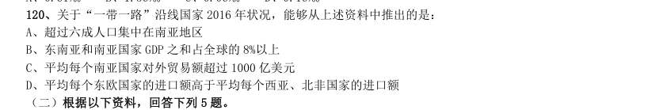

- **A.** 超过六成人口集中在南亚地区
- **B.** 东南亚和南亚国家GDP 之和占全球的8%以上
- **C.** 平均每个南亚国家对外贸易额超过1000 亿美元
- **D.** 平均每个东欧国家的进口额高于平均每个西亚、北非国家的进口额

**答案：C**

### 【2018 国考（副省级）·第 123 题】GK-2018-fs-X123　综合分析｜增长率

如按2016 年移动出行市场同比增长趋势估算,2018 年该市场规模将为:

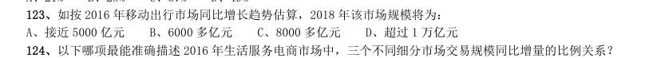

- **A.** 接近5000 亿元
- **B.** 6000 多亿元
- **C.** 8000 多亿元
- **D.** 超过1 万亿元

**答案：C**

### 【2018 国考（副省级）·第 125 题】GK-2018-fs-X125　综合分析｜倍数
> 材料：2016 年“一带一路”沿线64 个国家GDP 之和约为12.0 万亿美元,占全球GDP 的16.0%;人口总数约为32.1 亿人,占全球总人口的43.4%;对外贸易总额(进口额+出口额)约为71885.6 亿美元,占全球贸易总额的21.7%。 116、2016 年全球贸易总额约为多少万亿美元? A、28B、33C、40D、75117、2016 年“一带一路”沿线国家中,东欧20 国的人均GDP 约是中亚5 国的多少倍? A、2.5B、3.6C、5.3D、11.7118、“一…

能够从上述资料中推出的是:

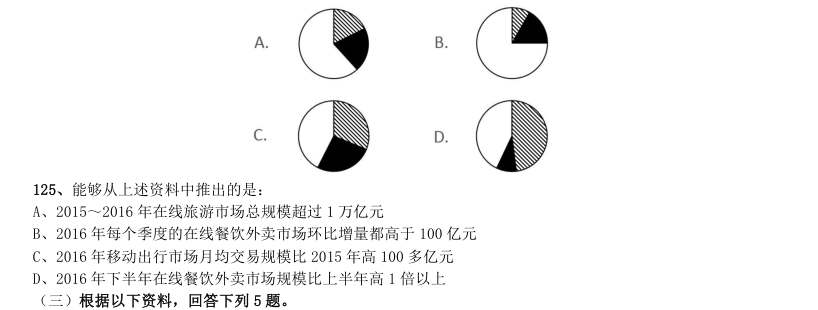

- **A.** 2015~2016 年在线旅游市场总规模超过1 万亿元
- **B.** 2016 年每个季度的在线餐饮外卖市场环比增量都高于100 亿元
- **C.** 2016 年移动出行市场月均交易规模比2015 年高100 多亿元
- **D.** 2016 年下半年在线餐饮外卖市场规模比上半年高1 倍以上

**答案：A**

### 【2018 国考（副省级）·第 127 题】GK-2018-fs-X127　综合分析｜比重
> 材料：2016 年,全国城市公园数量排名前五的省份依次是广东、浙江、江苏、山东和云南,公园数量分别为3512 个、1171 个、942 个、828 个和683 个。…

2016 年,全国公园绿地面积约为多少万公顷?

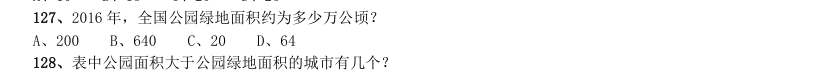

- **A.** 200
- **B.** 640
- **C.** 20
- **D.** 64

**答案：D**

### 【2018 国考（副省级）·第 128 题】GK-2018-fs-X128　综合分析｜综合分析（综合）
> 材料：2016 年,全国城市公园数量排名前五的省份依次是广东、浙江、江苏、山东和云南,公园数量分别为3512 个、1171 个、942 个、828 个和683 个。…

表中公园面积大于公园绿地面积的城市有几个?

- **A.** 1
- **B.** 2
- **C.** 3
- **D.** 4

**答案：B**

### 【2018 国考（副省级）·第 130 题】GK-2018-fs-X130　综合分析｜平均数
> 材料：2016 年,全国城市公园数量排名前五的省份依次是广东、浙江、江苏、山东和云南,公园数量分别为3512 个、1171 个、942 个、828 个和683 个。…

关于表中城市公园数量及面积,能够从上述资料中推出的是:

- **A.** 平均每个公园面积最大的城市是深圳
- **B.** 公园绿地面积最大的城市,其公园面积排第3
- **C.** 昆明市公园数量多于云南其他城市公园数量之和
- **D.** 珠海和佛山两市公园面积之和为400 多公顷

**答案：C**

### 【2018 国考（副省级）·第 135 题】GK-2018-fs-X135　综合分析｜比重
> 材料：2017 年1~2 月,全国造船完工936 万载重吨,同比增长123%;承接新船订单221 万载重吨,同比增长133%。 2 月末,手持船舶订单9207 万载重吨,同比下降22.6%,比2016 年末下降7.6%。 2017 年1~2 月,全国完工出口船907 万载重吨,同比增长127%;承接出口船订单191 万载重吨,同比增长 122%。2 月末,手持出口船订单8406 万载重吨,同比下降25.9%。 2017 年1~2 月,53 家重点监测的造船企业(以下简称重点企业)造…

能够从上述资料中推出的是:

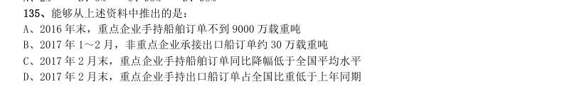

- **A.** 2016 年末,重点企业手持船舶订单不到9000 万载重吨
- **B.** 2017 年1~2 月,非重点企业承接出口船订单约30 万载重吨
- **C.** 2017 年2 月末,重点企业手持船舶订单同比降幅低于全国平均水平
- **D.** 2017 年2 月末,重点企业手持出口船订单占全国比重低于上年同期

**答案：D**

### 【2018 国考（地市级）·第 111 题】GK-2018-ds-X111　综合分析｜比重
> 材料：2016 年“一带一路”沿线64 个国家GDP 之和约为12.0 万亿美元,占全球GDP 的16.0%;人口总数约为32.1亿人,占全球总人口的43.4%;对外贸易总额(进口额+出口额)约为71885.6 亿美元,占全球贸易总额的21.7%。…

2016 年全球贸易总额约为多少万亿美元?

- **A.** 28
- **B.** 33
- **C.** 40
- **D.** 75

**答案：B**

### 【2018 国考（地市级）·第 120 题】GK-2018-ds-X120　综合分析｜倍数
> 材料：2016 年“一带一路”沿线64 个国家GDP 之和约为12.0 万亿美元,占全球GDP 的16.0%;人口总数约为32.1亿人,占全球总人口的43.4%;对外贸易总额(进口额+出口额)约为71885.6 亿美元,占全球贸易总额的21.7%。 111、2016 年全球贸易总额约为多少万亿美元? A、28B、33C、40D、75112、2016 年“一带一路”沿线国家中,东欧20 国的人均GDP 约是中亚5 国的多少倍? A、2.5B、3.6C、5.3D、11.7113、“一带…

能够从上述资料中推出的是:

- **A.** 2015~2016 年在线旅游市场总规模超过1 万亿元
- **B.** 2016 年每个季度的在线餐饮外卖市场环比增量都高于100 亿元
- **C.** 2016 年移动出行市场月均交易规模比2015 年高100 多亿元
- **D.** 2016 年下半年在线餐饮外卖市场规模比上半年高1 倍以上

**答案：A**

### 【2018 国考（地市级）·第 122 题】GK-2018-ds-X122　综合分析｜比重
> 材料：2016 年,全国城市公园数量排名前五的省份依次是广东、浙江、江苏、山东和云南,公园数量分别为3512 个、 1171 个、942 个、828 个和683 个。…

2016 年,全国公园绿地面积约为多少万公顷?

- **A.** 200
- **B.** 640
- **C.** 20
- **D.** 64

**答案：D**

### 【2018 国考（地市级）·第 123 题】GK-2018-ds-X123　综合分析｜综合分析（综合）
> 材料：2016 年,全国城市公园数量排名前五的省份依次是广东、浙江、江苏、山东和云南,公园数量分别为3512 个、 1171 个、942 个、828 个和683 个。…

表中公园面积大于公园绿地面积的城市有几个?

- **A.** 1
- **B.** 2
- **C.** 3
- **D.** 4

**答案：B**

### 【2018 国考（地市级）·第 125 题】GK-2018-ds-X125　综合分析｜平均数
> 材料：2016 年,全国城市公园数量排名前五的省份依次是广东、浙江、江苏、山东和云南,公园数量分别为3512 个、 1171 个、942 个、828 个和683 个。…

关于表中城市公园数量及面积,能够从上述资料中推出的是:

- **A.** 平均每个公园面积最大的城市是深圳
- **B.** 公园绿地面积最大的城市,其公园面积排第3
- **C.** 昆明市公园数量多于云南其他城市公园数量之和
- **D.** 珠海和佛山两市公园面积之和为400 多公顷

**答案：C**

### 【2018 国考（地市级）·第 130 题】GK-2018-ds-X130　综合分析｜比重
> 材料：2017 年1~2 月,全国造船完工936 万载重吨,同比增长123%;承接新船订单221 万载重吨,同比增长133%。 2 月末,手持船舶订单9207 万载重吨,同比下降22.6%,比2016 年末下降7.6%。 2017 年1~2 月,全国完工出口船907 万载重吨,同比增长127%;承接出口船订单191 万载重吨,同比增长 122%。2 月末,手持出口船订单8406 万载重吨,同比下降25.9%。 2017 年1~2 月,53 家重点监测的造船企业(以下简称重点企业)造…

能够从上述资料中推出的是:

- **A.** 2016 年末,重点企业手持船舶订单不到9000 万载重吨
- **B.** 2017 年1~2 月,非重点企业承接出口船订单约30 万载重吨
- **C.** 2017 年2 月末,重点企业手持船舶订单同比降幅低于全国平均水平
- **D.** 2017 年2 月末,重点企业手持出口船订单占全国比重低于上年同期

**答案：D**

### 【2017 湖北省考·第 106 题】HB-2017-ty-X106　综合分析｜基期量
> 材料：2016 年6 月份,我国社会消费品零售总额26857 亿元,同比增长 ,环比增长 。其中,限 额以上单位消费品零售额13006 亿元,同比增长 。 2016 年1~6 月份,我国社会消费品零售总额156138 亿元,同比增长 。其中,限额以上单位消费品零售额 71075 亿元,同比增长 。 按经营单位所在地分,2016 年6 月份,城镇消费品零售额23082 亿元,同比增长 ;乡村消费品零售额3775 亿元,同比增长 。1~6 月份,城镇消费品零售额134249 亿元,同比…

其中,实物商品网上零售额18143 亿元,同比 增长 。 2016 年5 月份,全国社会消费品零售总额约为:

- **A.** 24594 亿元
- **B.** 24283 亿元
- **C.** 26612 亿元
- **D.** 27104 亿元

**答案：C**

### 【2017 湖北省考·第 110 题】HB-2017-ty-X110　综合分析｜倍数
> 材料：2016 年6 月份,我国社会消费品零售总额26857 亿元,同比增长 ,环比增长 。其中,限 额以上单位消费品零售额13006 亿元,同比增长 。 2016 年1~6 月份,我国社会消费品零售总额156138 亿元,同比增长 。其中,限额以上单位消费品零售额 71075 亿元,同比增长 。 按经营单位所在地分,2016 年6 月份,城镇消费品零售额23082 亿元,同比增长 ;乡村消费品零售额3775 亿元,同比增长 。1~6 月份,城镇消费品零售额134249 亿元,同比…

关于社会消费品零售情况,能够从上述资料中推出的是:

- **A.** 2016 年1~6 月份,限额以上单位消费品零售额增速同比下滑
- **B.** 2016 年1~6 月份,乡村消费品零售额增速慢于城镇
- **C.** 2015 年1~6 月份,商品零售额超过餐饮收入的7 倍
- **D.** 2015 年1~6 月份,网络零售呈较慢增长的态势

**答案：C**

### 【2017 湖北省考·第 114 题】HB-2017-ty-X114　综合分析｜比重

2015 年一般公共预算收入与GDP 的比值大于 的省(市)有:

- **A.** 4 个
- **B.** 5 个
- **C.** 6 个
- **D.** 7 个

**答案：B**

### 【2017 湖北省考·第 115 题】HB-2017-ty-X115　综合分析｜比重

关于一般公共预算收入、税收收入、GDP 等指标,下列说法错误的是:

- **A.** 2015 年上海一般公共预算收入占GDP 的比值最高
- **B.** 2015 年江苏一般公共预算收入、税收收入、GDP 均最高
- **C.** 2015 年山东税收收入占全国税收收入的比重较江西高出以上
- **D.** 2015 年全国一般公共预算收入占GDP 的比重较2014 年有所减少

**答案：D**

### 【2017 湖北省考·第 116 题】HB-2017-ty-X116　综合分析｜平均数
> 材料：根据以下资料,回答116~120 题。 2015 年国家自然科学基金委全年共接收173017 项各类申请,同比增长约 ,择优资助各类项目40668 项,比 上年增加1579 项,资助直接费用218.8 亿元,平均资助强度(资助直接费用与资助项数的比值)53.8 万元,各项工 作取得新进展新成效。 在研究项目系列方面,面上项目资助16709 项,比上年增加1709 项,占总项数的 ,直接费用102.41 亿元, 平均资助率(资助项目占接收申请项目的比重) ,同比下降2.5 个百…

在人才项目系列方面,青年科学基金资助16155 项,比上年减少266 项,占总项数的 ,直接费用31.95 亿元, 平均资助率 ,同比下降0.7 个百分点,地区科学基金资助2829 项,比上年增加78 项,直接费用10.96 亿元, 有力推进了欠发达区域人才稳定与培养。优秀青年科学基金资助400 人,国家杰出青年科学基金资助198 人,新资助 创新研究群体项目38 项,促进了优秀人才和团队成长。 2014 年国家自然科学基金委共接收青年科学基金的申请数约为:

- **A.** 5.1 万份
- **B.** 5.9 万份
- **C.** 6.5 万份
- **D.** 6.9 万份

**答案：C**

### 【2017 湖北省考·第 120 题】HB-2017-ty-X120　综合分析｜平均数
> 材料：根据以下资料,回答116~120 题。 2015 年国家自然科学基金委全年共接收173017 项各类申请,同比增长约 ,择优资助各类项目40668 项,比 上年增加1579 项,资助直接费用218.8 亿元,平均资助强度(资助直接费用与资助项数的比值)53.8 万元,各项工 作取得新进展新成效。 在研究项目系列方面,面上项目资助16709 项,比上年增加1709 项,占总项数的 ,直接费用102.41 亿元, 平均资助率(资助项目占接收申请项目的比重) ,同比下降2.5 个百…

能够从上述资料中推出的是:

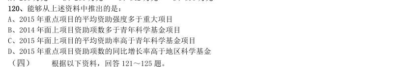

- **A.** 2015 年重点项目的平均资助强度多于重大项目
- **B.** 2014 年面上项目资助项数多于青年科学基金项目
- **C.** 2015 年面上项目的平均资助率高于青年科学基金项目
- **D.** 2015 年重点项目资助项数的同比增长率高于地区科学基金

**答案：D**

### 【2017 湖北省考·第 122 题】HB-2017-ty-X122　综合分析｜增长量
> 材料：根据以下资料,回答121~125 题。 2015 年全国共建立社会捐助工作站、点和慈善超市3.0 万个,比上一年减少0.2 万个,其中:慈善超市9654 个, 同比下降 。全年共接收社会捐赠款654.5 亿元,其中:民政部门接收社会各界捐款44.2 亿元,各类社会组织接 收捐款610.3 亿元。全年民政部门接收捐赠衣被4537.0 万件,捐赠物资价值折合人民币5.2 亿元。…

2015 年,全国建立的慈善超市较2014 年约:

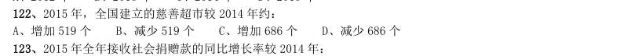

- **A.** 增加519 个
- **B.** 减少519 个
- **C.** 增加686 个
- **D.** 减少686 个

**答案：B**

### 【2017 湖北省考·第 124 题】HB-2017-ty-X124　综合分析｜综合分析（综合）
> 材料：根据以下资料,回答121~125 题。 2015 年全国共建立社会捐助工作站、点和慈善超市3.0 万个,比上一年减少0.2 万个,其中:慈善超市9654 个, 同比下降 。全年共接收社会捐赠款654.5 亿元,其中:民政部门接收社会各界捐款44.2 亿元,各类社会组织接 收捐款610.3 亿元。全年民政部门接收捐赠衣被4537.0 万件,捐赠物资价值折合人民币5.2 亿元。…

下面哪一张图能正确反映2011~2015 年民政部门接收捐赠衣被数量的变化?

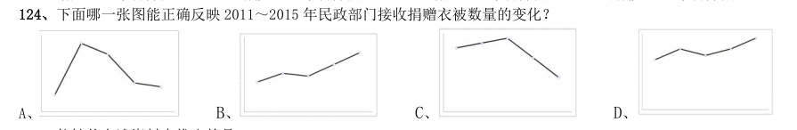

- **A.** 
- **B.** 
- **C.** 
- **D.** 

**答案：A**

### 【2017 湖北省考·第 125 题】HB-2017-ty-X125　综合分析｜增长率
> 材料：根据以下资料,回答121~125 题。 2015 年全国共建立社会捐助工作站、点和慈善超市3.0 万个,比上一年减少0.2 万个,其中:慈善超市9654 个, 同比下降 。全年共接收社会捐赠款654.5 亿元,其中:民政部门接收社会各界捐款44.2 亿元,各类社会组织接 收捐款610.3 亿元。全年民政部门接收捐赠衣被4537.0 万件,捐赠物资价值折合人民币5.2 亿元。…

能够从上述资料中推出的是:

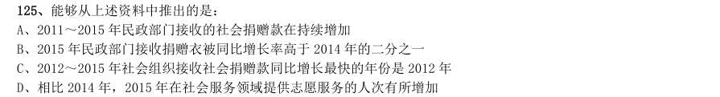

- **A.** 2011~2015 年民政部门接收的社会捐赠款在持续增加
- **B.** 2015 年民政部门接收捐赠衣被同比增长率高于2014 年的二分之一
- **C.** 2012~2015 年社会组织接收社会捐赠款同比增长最快的年份是2012 年
- **D.** 相比2014 年,2015 年在社会服务领域提供志愿服务的人次有所增加

**答案：B**

### 【2017 广东省考·第 89 题】GD-2017-ty-X089　综合分析｜综合分析（综合）
> 材料：2016 年,某省小微服务业呈现出经营平稳面、资产规模、享受税收优惠政策范围“三扩大”的特点,主 要行业实现较快增长。 2016 年,该省小微服务业样本企业实现营业收入80.1 亿元,同比增长 ,高于规模以上重点服务业 企业8.2 个百分点,增速比上年回落0.6 个百分点。经营平稳面扩大,2016 年4 季度, 的企业认为本 企业综合经营状况良好或稳定,同比提高3.3 个百分点,处于历史较高水平。 2016 年,小微服务业样本企业资产总计367 亿元,同比增长 ,户均1643…

2016 年,小微服务业的下列各行业,按营业收入同比变化量的大小排序正确的是:

- **A.** 文化、体育和娱乐业卫生和社会工作科学研究和技术服务业教育
- **B.** 文化、体育和娱乐业卫生和社会工作教育科学研究和技术服务业
- **C.** 文化、体育和娱乐业科学研究和技术服务业卫生和社会工作教育
- **D.** 卫生和社会工作

**答案：该题答案缺失，见原卷**

### 【2017 广东省考·第 90 题】GD-2017-ty-X090　综合分析｜增长量
> 材料：2016 年,某省小微服务业呈现出经营平稳面、资产规模、享受税收优惠政策范围“三扩大”的特点,主 要行业实现较快增长。 2016 年,该省小微服务业样本企业实现营业收入80.1 亿元,同比增长 ,高于规模以上重点服务业 企业8.2 个百分点,增速比上年回落0.6 个百分点。经营平稳面扩大,2016 年4 季度, 的企业认为本 企业综合经营状况良好或稳定,同比提高3.3 个百分点,处于历史较高水平。 2016 年,小微服务业样本企业资产总计367 亿元,同比增长 ,户均1643…

科学研究和技术服务业 教育 下列说法不正确的是:

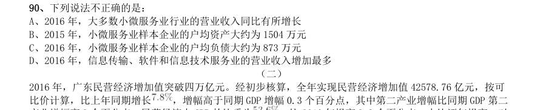

- **A.** 2016 年,大多数小微服务业行业的营业收入同比有所增长
- **B.** 2015 年,小微服务业样本企业的户均资产大约为1504 万元
- **C.** 2016 年,小微服务业样本企业的户均负债大约为873 万元
- **D.** 2016 年,信息传输、软件和信息技术服务业的营业收入增加最多

**答案：该题答案缺失，见原卷**

### 【2017 广东省考·第 94 题】GD-2017-ty-X094　综合分析｜拉动与贡献
> 材料：2016 年,广东民营经济增加值突破四万亿元。经初步核算,全年实现民营经济增加值42578.76 亿元,按可 比价计算,比上年同期增长 ,增幅高于同期GDP 增幅0.3 个百分点,其中第二产业增幅比同期GDP 第二 产业增幅高3 个百分点。民营经济占GDP 的比重为 ,比2010 年提高3.9 个百分点,占比逐年提高;对 GDP 增长的贡献率为 ,同比提高1.3 个百分点,拉动GDP 增速达4.2 个百分点,民营经济的作用不断提 升,是广东经济增长的主力军。…

根据资料可知:

- **A.** 2016 年广东民营经济对GDP 增长的贡献率高于其他经济类型
- **B.** 广东民营经济占GDP 的比重从2011 年开始超过
- **C.** 2016 年广东的房地产市场中,国有经济占了近三分之一的份额
- **D.** 民营经济仅在部分行业具有优势

**答案：该题答案缺失，见原卷**

### 【2017 广东省考·第 95 题】GD-2017-ty-X095　综合分析｜比重
> 材料：2016 年,广东民营经济增加值突破四万亿元。经初步核算,全年实现民营经济增加值42578.76 亿元,按可 比价计算,比上年同期增长 ,增幅高于同期GDP 增幅0.3 个百分点,其中第二产业增幅比同期GDP 第二 产业增幅高3 个百分点。民营经济占GDP 的比重为 ,比2010 年提高3.9 个百分点,占比逐年提高;对 GDP 增长的贡献率为 ,同比提高1.3 个百分点,拉动GDP 增速达4.2 个百分点,民营经济的作用不断提 升,是广东经济增长的主力军。…

下列说法正确的是:

- **A.** 2016 年珠三角地区民营经济占全省的比重相比2015 年提高了超过0.5 个百分点
- **B.** 2016 年广东各地区中,民营经济增速越慢的地区,当地民营经济占生产总值的比重也越低
- **C.** 2015 年珠三角地区民营经济的增加值是广东其他各地区之和的3 倍
- **D.** 2016 年广东民营经济在各行业中的发展速度都是最快的

**答案：该题答案缺失，见原卷**

### 【2017 广东省考·第 100 题】GD-2017-ty-X100　综合分析｜比重
> 材料：2016 年,某省完成邮政通信业务总量6886.15 亿元,同比增长 ,增幅比上年提高27.4 个百分点。其中, 完成邮政业务总量1879.99 亿元,增长 ,增幅提高11.0 个百分点;完成通信业务总量5006.16 亿元, 增长 ,增幅提高33.2 个百分点。 2016 年,该省完成快递业务量76.72 亿件,同比增长 ,占全国快递业务量的比重达到 ,比排名第 二的Z 省多16.80 亿件。 2016 年,该省电话用户数为1.69 亿,其中固定电话用户数为2609.7 万…

根据资料可知:

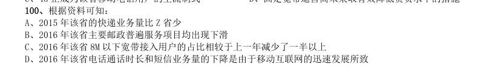

- **A.** 2015 年该省的快递业务量比Z 省少
- **B.** 2016 年该省主要邮政普遍服务项目均出现下滑
- **C.** 2016 年该省8M 以下宽带接入用户的占比相较于上一年减少了一半以上
- **D.** 2016 年该省电话通话时长和短信业务量的下降是由于移动互联网的迅速发展所致

**答案：该题答案缺失，见原卷**

### 【2017 国考（副省级）·第 117 题】GK-2017-fs-X117　综合分析｜综合分析（综合）
> 材料：理。 (一) 某市2015 年全年粮食总产量4.16 万吨,同比下降2.3%;甘蔗产量0.57 万吨,下降23.6%;油料产量0.12 万吨,增长32.4%;蔬菜产量15.79 万吨,下降3.4%;水果产量7.84 万吨,增长7.4%。 全年水产品产量29.16 万吨,同比增长3.6%,其中海洋捕捞1.09 万吨,与上年持平;海水养殖6.07 万吨, 增长89.5%;淡水捕捞0.18 万吨,增长1.1%;淡水养殖21.81 万吨,下降7.9%。…

“十二五”期间,该市粮食总产量在以下哪个范围?

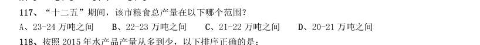

- **A.** 23-24 万吨之间
- **B.** 22-23 万吨之间
- **C.** 21-22 万吨之间
- **D.** 20-21 万吨之间

**答案：C**

### 【2017 国考（副省级）·第 118 题】GK-2017-fs-X118　综合分析｜综合分析（综合）
> 材料：理。 (一) 某市2015 年全年粮食总产量4.16 万吨,同比下降2.3%;甘蔗产量0.57 万吨,下降23.6%;油料产量0.12 万吨,增长32.4%;蔬菜产量15.79 万吨,下降3.4%;水果产量7.84 万吨,增长7.4%。 全年水产品产量29.16 万吨,同比增长3.6%,其中海洋捕捞1.09 万吨,与上年持平;海水养殖6.07 万吨, 增长89.5%;淡水捕捞0.18 万吨,增长1.1%;淡水养殖21.81 万吨,下降7.9%。…

按照2015 年水产品产量从多到少,以下排序正确的是:

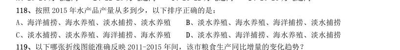

- **A.** 海洋捕捞、海水养殖、淡水捕捞、淡水养殖
- **B.** 淡水养殖、海水养殖、海洋捕捞、淡水捕捞
- **C.** 淡水捕捞、淡水养殖、海洋捕捞、海水养殖
- **D.** 淡水养殖、海洋捕捞、海水养殖、淡水捕捞

**答案：B**

### 【2017 国考（副省级）·第 120 题】GK-2017-fs-X120　综合分析｜比重
> 材料：理。 某市2015 年全年粮食总产量4.16 万吨,同比下降2.3%;甘蔗产量0.57 万吨,下降23.6%;油料产量0.12万吨,增长32.4%;蔬菜产量15.79 万吨,下降3.4%;水果产量7.84 万吨,增长7.4%。 全年水产品产量29.16 万吨,同比增长3.6%,其中海洋捕捞1.09 万吨,与上年持平;海水养殖6.07 万吨,增长89.5%;淡水捕捞0.18 万吨,增长1.1%;淡水养殖21.81 万吨,下降7.9%。 2010-2015 年某市粮食产量及其增速…

能够从上述资料中推出的是:

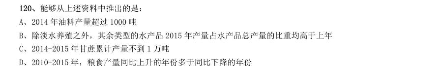

- **A.** 2014 年油料产量超过1000 吨
- **B.** 除淡水养殖之外,其余类型的水产品2015 年产量占水产品总产量的比重均高于上年
- **C.** 2014-2015 年甘蔗累计产量不到1 万吨
- **D.** 2010-2015 年,粮食产量同比上升的年份多于同比下降的年份

**答案：D**

### 【2017 国考（副省级）·第 125 题】GK-2017-fs-X125　综合分析｜年均增长率
> 材料：截至2014 年末,我国共有博物馆3658 个,占文物机构总数的43.5%。全国文化机构拥有文物藏品4063.58 万件,比上年末增加222.77 万件。其中,博物馆文物藏品2929.97 万件,文物商店文物藏品770.00 万件。文物 藏品中,一级文物9.82 万件,二级文物68.82 万件,三级文物340.51 万件。…

能够从上述资料中推出的是:

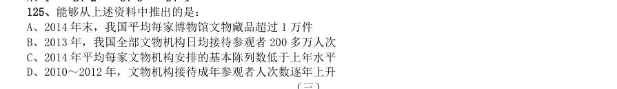

- **A.** 2014 年末,我国平均每家博物馆文物藏品超过1 万件
- **B.** 2013 年,我国全部文物机构日均接待参观者200 多万人次
- **C.** 2014 年平均每家文物机构安排的基本陈列数低于上年水平
- **D.** 2010~2012 年,文物机构接待成年参观者人次数逐年上升

**答案：B**

### 【2017 国考（副省级）·第 129 题】GK-2017-fs-X129　综合分析｜增长率
> 材料：2015 年我国钟表全行业实现工业总产值约675 亿元,同比增长3.2%,增速比上年同期提高1.7 个百分点。 全行业全年生产手表10.7 亿只,同比增长3.9%,完成产值约417 亿元,同比增长4.3%,增速提高1.9 个 百分点;生产时钟(含钟心)5.2 亿只,同比下降3.7%,完成产值162 亿元,同比下降4.7%,降幅扩大1.3 个百分点;钟表零配件、定时器及其他计时仪器产值96 亿元,同比增长14.3%,增速基本保持上年水平。 2015 年我国钟表行业规模以上工业企…

2014 年我国钟表行业贸易顺差约为多少亿美元?

- **A.** 27
- **B.** 25
- **C.** 23
- **D.** 18

**答案：D**

### 【2017 国考（副省级）·第 130 题】GK-2017-fs-X130　综合分析｜增长率
> 材料：2015 年我国钟表全行业实现工业总产值约675 亿元,同比增长3.2%,增速比上年同期提高1.7 个百分点。 全行业全年生产手表10.7 亿只,同比增长3.9%,完成产值约417 亿元,同比增长4.3%,增速提高1.9 个 百分点;生产时钟(含钟心)5.2 亿只,同比下降3.7%,完成产值162 亿元,同比下降4.7%,降幅扩大1.3 个百分点;钟表零配件、定时器及其他计时仪器产值96 亿元,同比增长14.3%,增速基本保持上年水平。 2015 年我国钟表行业规模以上工业企…

能够从上述资料中推出的是:

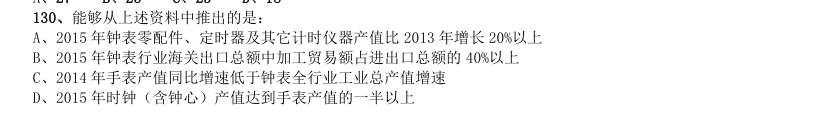

- **A.** 2015 年钟表零配件、定时器及其它计时仪器产值比2013 年增长20%以上
- **B.** 2015 年钟表行业海关出口总额中加工贸易额占进出口总额的40%以上
- **C.** 2014 年手表产值同比增速低于钟表全行业工业总产值增速
- **D.** 2015 年时钟(含钟心)产值达到手表产值的一半以上

**答案：A**

### 【2017 国考（副省级）·第 135 题】GK-2017-fs-X135　综合分析｜年均增长率
> 材料：理。 某市2015 年全年粮食总产量4.16 万吨,同比下降2.3%;甘蔗产量0.57 万吨,下降23.6%;油料产量0.12万吨,增长32.4%;蔬菜产量15.79 万吨,下降3.4%;水果产量7.84 万吨,增长7.4%。 全年水产品产量29.16 万吨,同比增长3.6%,其中海洋捕捞1.09 万吨,与上年持平;海水养殖6.07 万吨,增长89.5%;淡水捕捞0.18 万吨,增长1.1%;淡水养殖21.81 万吨,下降7.9%。 2010-2015 年某市粮食产量及其增速…

能够从上述资料中推出的是:

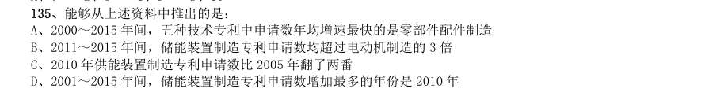

- **A.** 2000~2015 年间,五种技术专利中申请数年均增速最快的是零部件配件制造
- **B.** 2011~2015 年间,储能装置制造专利申请数均超过电动机制造的3 倍
- **C.** 2010 年供能装置制造专利申请数比2005 年翻了两番
- **D.** 2001~2015 年间,储能装置制造专利申请数增加最多的年份是2010 年

**答案：A**

### 【2017 国考（地市级）·第 112 题】GK-2017-ds-X112　综合分析｜综合分析（综合）
> 材料：理。 一、根据以下资料,回答116~120 题。 某市2015 年全年粮食总产量4.16 万吨,同比下降2.3%;甘蔗产量0.57 万吨,下降23.6%;油料产量0.12 万吨,增长32.4%;蔬菜产量15.79 万吨,下降3.4%;水果产量7.84 万吨,增长7.4%。 全年水产品产量29.16 万吨,同比增长3.6%,其中海洋捕捞1.09 万吨,与上年持平;海水养殖6.07 万吨, 增长89.5%;淡水捕捞0.18 万吨,增长1.1%;淡水养殖21.81 万吨,下降7.9…

“十二五”期间,该市粮食总产量在以下哪个范围?

- **A.** 23-24 万吨之间
- **B.** 22-23 万吨之间
- **C.** 21-22 万吨之间
- **D.** 20-21 万吨之间

**答案：C**

### 【2017 国考（地市级）·第 113 题】GK-2017-ds-X113　综合分析｜综合分析（综合）
> 材料：理。 一、根据以下资料,回答116~120 题。 某市2015 年全年粮食总产量4.16 万吨,同比下降2.3%;甘蔗产量0.57 万吨,下降23.6%;油料产量0.12 万吨,增长32.4%;蔬菜产量15.79 万吨,下降3.4%;水果产量7.84 万吨,增长7.4%。 全年水产品产量29.16 万吨,同比增长3.6%,其中海洋捕捞1.09 万吨,与上年持平;海水养殖6.07 万吨, 增长89.5%;淡水捕捞0.18 万吨,增长1.1%;淡水养殖21.81 万吨,下降7.9…

按照2015 年水产品产量从多到少,以下排序正确的是:

- **A.** 海洋捕捞、海水养殖、淡水捕捞、淡水养殖
- **B.** 淡水养殖、海水养殖、海洋捕捞、淡水捕捞
- **C.** 淡水捕捞、淡水养殖、海洋捕捞、海水养殖
- **D.** 淡水养殖、海洋捕捞、海水养殖、淡水捕捞

**答案：B**

### 【2017 国考（地市级）·第 115 题】GK-2017-ds-X115　综合分析｜比重
> 材料：理。 某市2015 年全年粮食总产量4.16 万吨,同比下降2.3%;甘蔗产量0.57 万吨,下降23.6%;油料产量0.12万吨,增长32.4%;蔬菜产量15.79 万吨,下降3.4%;水果产量7.84 万吨,增长7.4%。 全年水产品产量29.16 万吨,同比增长3.6%,其中海洋捕捞1.09 万吨,与上年持平;海水养殖6.07 万吨,增长89.5%;淡水捕捞0.18 万吨,增长1.1%;淡水养殖21.81 万吨,下降7.9%。 2010-2015 年某市粮食产量及其增速…

能够从上述资料中推出的是:

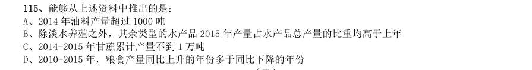

- **A.** 2014 年油料产量超过1000 吨
- **B.** 除淡水养殖之外,其余类型的水产品2015 年产量占水产品总产量的比重均高于上年
- **C.** 2014-2015 年甘蔗累计产量不到1 万吨
- **D.** 2010-2015 年,粮食产量同比上升的年份多于同比下降的年份

**答案：D**

### 【2017 国考（地市级）·第 120 题】GK-2017-ds-X120　综合分析｜年均增长率
> 材料：截至2014 年末,我国共有博物馆3658 个,占文物机构总数的43.5%。全国文化机构拥有文物藏品4063.58 万件,比上年末增加222.77 万件。其中,博物馆文物藏品2929.97 万件,文物商店文物藏品770.00 万件。文物 藏品中,一级文物9.82 万件,二级文物68.82 万件,三级文物340.51 万件。…

能够从上述资料中推出的是:

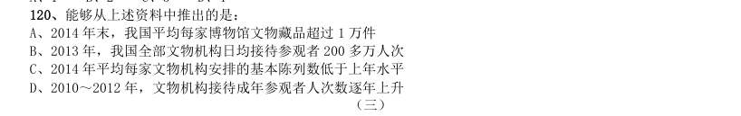

- **A.** 2014 年末,我国平均每家博物馆文物藏品超过1 万件
- **B.** 2013 年,我国全部文物机构日均接待参观者200 多万人次
- **C.** 2014 年平均每家文物机构安排的基本陈列数低于上年水平
- **D.** 2010~2012 年,文物机构接待成年参观者人次数逐年上升

**答案：B**

### 【2017 国考（地市级）·第 124 题】GK-2017-ds-X124　综合分析｜增长率
> 材料：2015 年我国钟表全行业实现工业总产值约675 亿元,同比增长3.2%,增速比上年同期提高1.7 个百分点。 全行业全年生产手表10.7 亿只,同比增长3.9%,完成产值约417 亿元,同比增长4.3%,增速提高1.9 个 百分点;生产时钟(含钟心)5.2 亿只,同比下降3.7%,完成产值162 亿元,同比下降4.7%,降幅扩大1.3 个百分点;钟表零配件、定时器及其他计时仪器产值96 亿元,同比增长14.3%,增速基本保持上年水平。 2015 年我国钟表行业规模以上工业企…

2014 年我国钟表行业贸易顺差约为多少亿美元?

- **A.** 27
- **B.** 25
- **C.** 23
- **D.** 18

**答案：D**

### 【2017 国考（地市级）·第 125 题】GK-2017-ds-X125　综合分析｜增长率
> 材料：2015 年我国钟表全行业实现工业总产值约675 亿元,同比增长3.2%,增速比上年同期提高1.7 个百分点。 全行业全年生产手表10.7 亿只,同比增长3.9%,完成产值约417 亿元,同比增长4.3%,增速提高1.9 个 百分点;生产时钟(含钟心)5.2 亿只,同比下降3.7%,完成产值162 亿元,同比下降4.7%,降幅扩大1.3 个百分点;钟表零配件、定时器及其他计时仪器产值96 亿元,同比增长14.3%,增速基本保持上年水平。 2015 年我国钟表行业规模以上工业企…

能够从上述资料中推出的是:

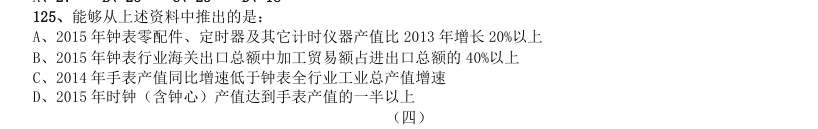

- **A.** 2015 年钟表零配件、定时器及其它计时仪器产值比2013 年增长20%以上
- **B.** 2015 年钟表行业海关出口总额中加工贸易额占进出口总额的40%以上
- **C.** 2014 年手表产值同比增速低于钟表全行业工业总产值增速
- **D.** 2015 年时钟(含钟心)产值达到手表产值的一半以上

**答案：A**

### 【2017 国考（地市级）·第 130 题】GK-2017-ds-X130　综合分析｜年均增长率
> 材料：理。 某市2015 年全年粮食总产量4.16 万吨,同比下降2.3%;甘蔗产量0.57 万吨,下降23.6%;油料产量0.12万吨,增长32.4%;蔬菜产量15.79 万吨,下降3.4%;水果产量7.84 万吨,增长7.4%。 全年水产品产量29.16 万吨,同比增长3.6%,其中海洋捕捞1.09 万吨,与上年持平;海水养殖6.07 万吨,增长89.5%;淡水捕捞0.18 万吨,增长1.1%;淡水养殖21.81 万吨,下降7.9%。 2010-2015 年某市粮食产量及其增速…

能够从上述资料中推出的是:

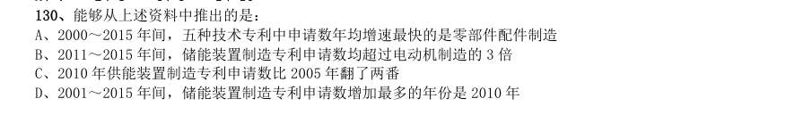

- **A.** 2000~2015 年间,五种技术专利中申请数年均增速最快的是零部件配件制造
- **B.** 2011~2015 年间,储能装置制造专利申请数均超过电动机制造的3 倍
- **C.** 2010 年供能装置制造专利申请数比2005 年翻了两番
- **D.** 2001~2015 年间,储能装置制造专利申请数增加最多的年份是2010 年

**答案：A**

### 【2016 湖北省考·第 106 题】HB-2016-ty-X106　综合分析｜基期量
> 材料：理。 一、根据以下资枓,回答下列题。 2015 年1-3 月,国有企业营业总收入103155.5 亿元,同比下降6%。其中,中央企业收入63191.3 亿元,同 比下降7%。地方国有企业收入39964.2 亿元,同比下降4.2%。 1-3 月,国有企业营业总成本100345.5 亿元,同比下降5.1%,其中销售费用、管理费用和财务费用同比分 别下降2.9%、増长2.3%和增长7.3%。其中,中央企业成本60216.5 亿元,同比下降6.4%;地方国有企业成本 40129 亿元…

地方国有企业资产总额 500217.1 亿元,同比增长13.8%;负债总额322462.3 亿元,同比増长13.7%;所有者权益为177754.7 亿元,同 比增长13.9%。 2014 年1-3 月,国有企业营业总收入最接近:

- **A.** 10.5 万亿元
- **B.** 11 万亿元
- **C.** 11.5 万亿元
- **D.** 12 万亿元

**答案：B**

### 【2016 湖北省考·第 110 题】HB-2016-ty-X110　综合分析｜基期量
> 材料：理。 一、根据以下资枓,回答下列题。 2015 年1-3 月,国有企业营业总收入103155.5 亿元,同比下降6%。其中,中央企业收入63191.3 亿元,同 比下降7%。地方国有企业收入39964.2 亿元,同比下降4.2%。 1-3 月,国有企业营业总成本100345.5 亿元,同比下降5.1%,其中销售费用、管理费用和财务费用同比分 别下降2.9%、増长2.3%和增长7.3%。其中,中央企业成本60216.5 亿元,同比下降6.4%;地方国有企业成本 40129 亿元…

能够从上述资料中推出的是:

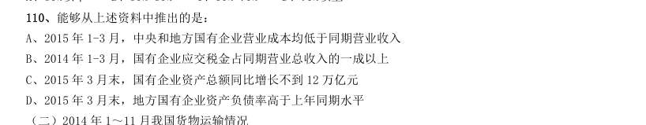

- **A.** 2015 年1-3 月,中央和地方国有企业营业成本均低于同期营业收入
- **B.** 2014 年1-3 月,国有企业应交税金占同期营业总收入的一成以上
- **C.** 2015 年3 月末,国有企业资产总额同比增长不到12 万亿元
- **D.** 2015 年3 月末,地方国有企业资产负债率高于上年同期水平

**答案：C**

### 【2016 湖北省考·第 111 题】HB-2016-ty-X111　综合分析｜综合分析（综合）

2014 年1~10 月我国货物运输总量为多少亿吨?

- **A.** 340.2
- **B.** 353.9
- **C.** 366.5
- **D.** 393.2

**答案：B**

### 【2016 湖北省考·第 112 题】HB-2016-ty-X112　综合分析｜增长率

2013 年1~10 月我国货物运输总量最大的领域是:

- **A.** 水运
- **B.** 民航
- **C.** 铁路
- **D.** 公路

**答案：D**

### 【2016 湖北省考·第 115 题】HB-2016-ty-X115　综合分析｜比重

关于2014 年1~11 月我国货物运输状况,能够从上述资料中推出的是:

- **A.** 月均货物运输量约为33 亿吨
- **B.** 每吨货物平均运输距离为500 多公里
- **C.** 铁路货运量占总体比重低于其货物周转量占总体比重
- **D.** 公路货物周转量同比增量高于水运货物周转量同比增量

**答案：C**

### 【2016 湖北省考·第 117 题】HB-2016-ty-X117　综合分析｜比重
> 材料：2015 年2 月,我国快递业务量完成8.2 亿件,同比增长18.7%;业务收入完成136.0 亿元,同比增长22.5%。 消费者对快递业务进行的申诉中,有效申诉(确定企业责任的)占总申诉量的97.6%,为消费者挽回经济损失229.8 万元。…

2015 年2 月,消费者对快递业务的全部申诉量约为

- **A.** 1.96 万件
- **B.** 2.36 万件
- **C.** 1.96 亿件
- **D.** 2.36 亿件

**答案：A**

### 【2016 湖北省考·第 118 题】HB-2016-ty-X118　综合分析｜增长率
> 材料：2015 年2 月,我国快递业务量完成8.2 亿件,同比增长18.7%;业务收入完成136.0 亿元,同比增长22.5%。 消费者对快递业务进行的申诉中,有效申诉(确定企业责任的)占总申诉量的97.6%,为消费者挽回经济损失229.8 万元。…

将4 家企业按2015 年1 月每百万件快递业务丢失损毁的有效申诉量按从高到低排序,正确的是:

- **A.** 企业2,企业1,企业3,企业4
- **B.** 企业1,企业2,企业3,企业4
- **C.** 企业2,企业1,企业4,企业3
- **D.** 企业1,企业2,企业4,企业3、119、2015 年2 月4 家企业中,有几家企业的快递服务中申诉量占

**答案：D**

### 【2016 湖北省考·第 120 题】HB-2016-ty-X120　综合分析｜倍数
> 材料：2015 年2 月,我国快递业务量完成8.2 亿件,同比增长18.7%;业务收入完成136.0 亿元,同比增长22.5%。 消费者对快递业务进行的申诉中,有效申诉(确定企业责任的)占总申诉量的97.6%,为消费者挽回经济损失229.8 万元。…

A、1 家 B、2 家 C、3 家 D、4 家 能够从上述材料推出的是:

- **A.** 2014 年2 月,全国快递业务完成量为8 亿多件
- **B.** 2015 年2 月,全国每百万件快递业务中,非有效申诉不到1 件
- **C.** 2015 年2 月,4 家企业的百万快递业务有效申诉量都高于全国水平
- **D.** 2015 年2 月,企业1 的每百万快递业务有效申诉量超过任何企业的2 倍

**答案：B**

### 【2016 湖北省考·第 121 题】HB-2016-ty-X121　综合分析｜综合分析（综合）

2014 年下半年全国租赁贸易进出口总额约为多少亿美元?

- **A.** 55
- **B.** 62
- **C.** 67
- **D.** 74

**答案：C**

### 【2016 湖北省考·第 125 题】HB-2016-ty-X125　综合分析｜比重

能够从上述资料中推出的是:

- **A.** 2015 年4 月全国租赁贸易进出口额比2013 年4 月翻了一番
- **B.** 2015 年1~4 月月均全国租赁贸易进出口额超过8 亿美元
- **C.** 2013 年8~9 月全国租赁贸易进出口额超过20 亿美元
- **D.** 表中全国租赁贸易进出口额同比下降的月份占总数的三分之一

**答案：C**

### 【2016 广东省考（乡镇）·第 87 题】GD-2016-xz-X087　综合分析｜综合分析（综合）
> 材料：从2014 年起,我省在粤东西北地区以县(市、区)为单位遴选首批14 个省级新农村连片示范建 设工程,三年将建成42 个省级新农村示范片(不含珠三角地区)。根据工作进度安排,示范片建设一 年初见成效,两年基本实现目标。与此同时,珠三角地区每年选取6 个片区开展示范片建设,为期三 年。 截至2015 年年底,全省第一、二批40 个示范片(含珠三角6 市)启动建设项目2693 个(粤东西 北1539 个,珠三角1154 个),竣工项目1711 个(粤东西北821 个,珠三角890…

第二批示范片的自然村中,实现通自来水的约有( )个。

- **A.** 256
- **B.** 262
- **C.** 267
- **D.** 273

**答案：该题答案缺失，见原卷**

### 【2016 广东省考（乡镇）·第 88 题】GD-2016-xz-X088　综合分析｜综合分析（综合）
> 材料：从2014 年起,我省在粤东西北地区以县(市、区)为单位遴选首批14 个省级新农村连片示范建 设工程,三年将建成42 个省级新农村示范片(不含珠三角地区)。根据工作进度安排,示范片建设一 年初见成效,两年基本实现目标。与此同时,珠三角地区每年选取6 个片区开展示范片建设,为期三 年。 截至2015 年年底,全省第一、二批40 个示范片(含珠三角6 市)启动建设项目2693 个(粤东西 北1539 个,珠三角1154 个),竣工项目1711 个(粤东西北821 个,珠三角890…

首批示范片的自然村中,完成率最高的是( )。

- **A.** 村庄环境卫生
- **B.** 自来水建设
- **C.** 村巷道硬底化建设
- **D.** 群众参与共谋共建情况

**答案：该题答案缺失，见原卷**

### 【2016 广东省考（乡镇）·第 89 题】GD-2016-xz-X089　综合分析｜综合分析（综合）
> 材料：从2014 年起,我省在粤东西北地区以县(市、区)为单位遴选首批14 个省级新农村连片示范建 设工程,三年将建成42 个省级新农村示范片(不含珠三角地区)。根据工作进度安排,示范片建设一 年初见成效,两年基本实现目标。与此同时,珠三角地区每年选取6 个片区开展示范片建设,为期三 年。 截至2015 年年底,全省第一、二批40 个示范片(含珠三角6 市)启动建设项目2693 个(粤东西 北1539 个,珠三角1154 个),竣工项目1711 个(粤东西北821 个,珠三角890…

第一、二批示范片的自然村中,完成率差距最大的是( )。

- **A.** 村庄规划编制
- **B.** 村庄环境卫生
- **C.** 自来水建设
- **D.** 群众参与共谋共建情况

**答案：该题答案缺失，见原卷**

### 【2016 广东省考（乡镇）·第 90 题】GD-2016-xz-X090　综合分析｜综合分析（综合）
> 材料：从2014 年起,我省在粤东西北地区以县(市、区)为单位遴选首批14 个省级新农村连片示范建 设工程,三年将建成42 个省级新农村示范片(不含珠三角地区)。根据工作进度安排,示范片建设一 年初见成效,两年基本实现目标。与此同时,珠三角地区每年选取6 个片区开展示范片建设,为期三 年。 截至2015 年年底,全省第一、二批40 个示范片(含珠三角6 市)启动建设项目2693 个(粤东西 北1539 个,珠三角1154 个),竣工项目1711 个(粤东西北821 个,珠三角890…

下列说法有误的是( )。

- **A.** 第一、二批示范片建设中粤东西北启动的项目比珠三角多
- **B.** 第一、二批示范片建设中粤东西北的项目竣工率低于珠三角的项目竣工率
- **C.** 第二批示范片成立村民理事会的自然村比第一批少
- **D.** 第一批示范片完成村庄规划编制的行政村比第二批多

**答案：该题答案缺失，见原卷**

### 【2016 广东省考（乡镇）·第 91 题】GD-2016-xz-X091　综合分析｜综合分析（综合）

根据下列资料,回答91~95 题: 2011—2014 年,新型农村合作医疗基金支出同比增长幅度最高的是( )年。

- **A.** 2011
- **B.** 2012
- **C.** 2013
- **D.** 2014

**答案：该题答案缺失，见原卷**

### 【2016 广东省考（乡镇）·第 94 题】GD-2016-xz-X094　综合分析｜综合分析（综合）

2010—2014 年,参加新型农村合作医疗人数最多的一年比人数最少的一年多了( )亿。

- **A.** 0.31
- **B.** 0.34
- **C.** 0.65
- **D.** 1

**答案：该题答案缺失，见原卷**

### 【2016 广东省考（乡镇）·第 95 题】GD-2016-xz-X095　综合分析｜平均数

下列说法有误的是( )。

- **A.** 新型农村合作医疗基金支出逐年增加
- **B.** 参加新型农村合作医疗人数最少的一年也是人均筹资最多的一年
- **C.** 新型农村合作医疗参与率最高的是2013 年
- **D.** 参加新型农村合作医疗人数最多的是2010 年

**答案：该题答案缺失，见原卷**

### 【2016 广东省考（乡镇）·第 98 题】GD-2016-xz-X098　综合分析｜综合分析（综合）

2011 年的总人口中,“65 岁及以上”的人口比“0-14 岁”的人口大约多( )万人。

- **A.** 7910
- **B.** 8850
- **C.** 9320
- **D.** 9970

**答案：该题答案缺失，见原卷**

### 【2016 广东省考（乡镇）·第 99 题】GD-2016-xz-X099　综合分析｜增长率

以下说法错误的是( )。

- **A.** 2007 年至2010 年,每年比上年增加的人口数量一直递减
- **B.** 人口自然增长率不断下降并趋于平缓
- **C.** 人口自然增长越来越少,相比2010 年,2011 年的人口增长几乎停滞
- **D.** 2009 年的人口自然增长率下降得最快

**答案：该题答案缺失，见原卷**

### 【2016 广东省考（乡镇）·第 100 题】GD-2016-xz-X100　综合分析｜比重

根据资料,我们可以得知( )。

- **A.** 65 岁及以上人口数量越来越多
- **B.** 0-14 岁人口占总人口的比重越来越大
- **C.** 除了2011 年,15-64 岁人口数量每年都在增长
- **D.** 65 岁及以上人口占总人口的比重越来越大

**答案：该题答案缺失，见原卷**

### 【2016 广东省考（县级）·第 89 题】GD-2016-xj-X089　综合分析｜增长率

以下说法错误的是( )。

- **A.** 2007 年至2010 年,每年比上年增加的人口数量一直递减
- **B.** 人口自然增长率不断下降并趋于平缓
- **C.** 人口自然增长越来越少,相比2010 年,2011 年的人口增长几乎停滞
- **D.** 2009 年的人口自然增长率下降得最快

**答案：该题答案缺失，见原卷**

### 【2016 广东省考（县级）·第 90 题】GD-2016-xj-X090　综合分析｜比重

根据资料,我们可以得知( )。

- **A.** 65 岁及以上人口数量越来越多
- **B.** 0-14 岁人口占总人口的比重越来越大
- **C.** 除了2011 年,15-64 岁人口数量每年都在增长
- **D.** 65 岁及以上人口占总人口的比重越来越大

**答案：该题答案缺失，见原卷**

### 【2016 广东省考（县级）·第 91 题】GD-2016-xj-X091　综合分析｜综合分析（综合）

2013 年,批发业法人企业比零售业多( )个。

- **A.** 7023
- **B.** 7158
- **C.** 8281
- **D.** 11241

**答案：该题答案缺失，见原卷**

### 【2016 广东省考（县级）·第 92 题】GD-2016-xj-X092　综合分析｜综合分析（综合）

零售业期末商品库存额最多的年份是( )年。

- **A.** 2011
- **B.** 2012
- **C.** 2013
- **D.** 2014

**答案：该题答案缺失，见原卷**

### 【2016 广东省考（县级）·第 93 题】GD-2016-xj-X093　综合分析｜综合分析（综合）

与2013 年相比,下列指标在2014 年增长额最小的是( )。

- **A.** 批发业出口额
- **B.** 批发业进口额
- **C.** 零售业商品购进额
- **D.** 零售业商品销售额

**答案：该题答案缺失，见原卷**

### 【2016 广东省考（县级）·第 94 题】GD-2016-xj-X094　综合分析｜综合分析（综合）

以下各项中两个指标之间差额最大的是( )。

- **A.** 2014 年批发业期末商品库存额与零售业期末商品库存额
- **B.** 2013 年批发业进口额与出口额
- **C.** 2012 年批发和零售业商品销售额与商品购进额
- **D.** 2011 年批发和零售业进口额与出口额

**答案：该题答案缺失，见原卷**

### 【2016 广东省考（县级）·第 95 题】GD-2016-xj-X095　综合分析｜增长率

以下说法正确的是( )。

- **A.** 2010-2013 年,批发业每年年末从业人数均多于零售业
- **B.** 2010-2014 年,零售业出口额逐年上升
- **C.** 相比2010 年,2013 年的零售业进口额翻了一番
- **D.** 2011-2014,批发业期末商品库存额增幅逐年收窄

**答案：该题答案缺失，见原卷**

### 【2016 广东省考（县级）·第 96 题】GD-2016-xj-X096　综合分析｜综合分析（综合）
> 材料：2000 年、2005 年、2010 年我国普通高中专任教师总人数分别为756850 人、1299460 人、1518194 人。其 中,女性人数分别为273110 人、558625 人、723566 人。…

从年龄结构看,2000 年、2005 年、2010 年31-35 岁普通高中专任教师总人数分别为185873 人、265509 人、322829 人,其中,女性人数分别为68346 人、117838 人、164175 人;36-40 岁普通高中专任教师总人 数分别为117242 人、248837 人、272313 人,其中,女性人数分别为35751 人、95566 人、122953 人;41- 45 岁普通高中专任教师总人数分别为55522 人、137235 人、239616 人,其中,女性人数分别为15728 人、 42931 人、93641 人。 2000 年,我国31-45 岁普通高中专任教师中,共有( )人未评职称。

- **A.** 68253
- **B.** 33193
- **C.** 989
- **D.** 612

**答案：该题答案缺失，见原卷**

### 【2016 广东省考（县级）·第 98 题】GD-2016-xj-X098　综合分析｜综合分析（综合）
> 材料：2000 年、2005 年、2010 年我国普通高中专任教师总人数分别为756850 人、1299460 人、1518194 人。其 中,女性人数分别为273110 人、558625 人、723566 人。…

2010 年,我国41-45 岁的普通高中专任教师中,至少约有( )万人在2000 年还不是普通高中专任教 师。

- **A.** 5
- **B.** 8
- **C.** 18
- **D.** 16

**答案：该题答案缺失，见原卷**

### 【2016 广东省考（县级）·第 100 题】GD-2016-xj-X100　综合分析｜比重
> 材料：2000 年、2005 年、2010 年我国普通高中专任教师总人数分别为756850 人、1299460 人、1518194 人。其 中,女性人数分别为273110 人、558625 人、723566 人。…

以下说法正确的是( )。

- **A.** 我国普通高中专任教师中,女性教师人数在2005 年达到顶峰后逐年减少。
- **B.** 2005 年我国36-40 岁一级普通高中专任教师中有6 万多人在2010 年评上了高级教师。
- **C.** 2000-2010 年我国普通高中专任教师人数以每年约速度增。
- **D.** 2010 年我国未评职称的普通高中专任教师占专任教师总人数的比重,比2000 年下降了近3 个百分点。

**答案：该题答案缺失，见原卷**

### 【2016 国考（副省级）·第 116 题】GK-2016-fs-X116　综合分析｜综合分析（综合）
> 材料：下表是某旅游网站上推荐的从M 地到N 地的机票价格(5 月30 日)及在线支付的优惠活动。…

要你回答,请你根据资料所提供的信息进行分析、比较、计算和判断处理。 (一)下表是某旅游网站上推荐的从M 地到N 地的机票价格(5 月30 日)及在线支付的优惠活动。 5 月30 日早晨,王先生由于记错了时间,10:30 到达机场时,所购班次的飞机已经起飞。幸运的是隔天同 一班次的机票还有售,且价钱不变,于是在窗口办理了改签,加上之前网上订票的费用,王先生一共花费了900 多元,他所购买的最可能是哪个班次的机票?( )

- **A.** 戊班次
- **B.** 丁班次
- **C.** 丙班次
- **D.** 乙班次

**答案：C**

### 【2016 国考（副省级）·第 117 题】GK-2016-fs-X117　综合分析｜综合分析（综合）
> 材料：下表是某旅游网站上推荐的从M 地到N 地的机票价格(5 月30 日)及在线支付的优惠活动。…

由上述资料可知,以下哪个班次起飞前退票手续费率最高?( )

- **A.** 乙班次
- **B.** 丙班次
- **C.** 丁班次
- **D.** 戊班次

**答案：C**

### 【2016 国考（副省级）·第 118 题】GK-2016-fs-X118　综合分析｜综合分析（综合）

影院一天总共放映x 场,其中某部电影放y 场,排片率就是y/x×100%,那么四部影片中排片率最高的影 片是哪部?( )

- **A.** 甲影片
- **B.** 乙影片
- **C.** 丙影片
- **D.** 丁影片

**答案：A**

### 【2016 国考（副省级）·第 119 题】GK-2016-fs-X119　综合分析｜平均数

如果某天一部影片的总观影人次是a,该影片所有放映场次包含的总座位数是b,那么当天上座率就是a/b ×100%,那么在昨天的四部影片里,上座率由高到低排列正确的是( )。

- **A.** 乙>丁>甲>丙
- **B.** 乙>丙>甲>丁
- **C.** 乙>丙>丁>甲
- **D.** 乙>丁>丙>甲

**答案：B**

### 【2016 国考（副省级）·第 120 题】GK-2016-fs-X120　综合分析｜综合分析（综合）

小张的单位离该电影院半小时路程,他每晚6:30 下班,吃晚饭需要半小时,电影院要求至少提前10 分钟 入场。按照该影院的排片表,时间上最适合他的影片是哪部?( )

- **A.** 甲影片
- **B.** 乙影片
- **C.** 丙影片
- **D.** 丁影片

**答案：B**

### 【2016 国考（副省级）·第 125 题】GK-2016-fs-X125　综合分析｜年均增长率
> 材料：2014 年末全国共有公共图书馆3117 个,比上年末增加5 个。年末全国共图书馆从业人员56071 人。 2014 年末全国公共图书馆实际使用房屋建筑面积1231.60 万平方米,比上年末增长6.3%;图书总藏量79092万册,比上年末增长5.6%;电子图书50674 万册,比上年末增长34.2%;阅览室座席数85.55 万个,比上年末增长5.7%。…

能够从上述资料中推出的是:

- **A.** “十一五”期间全国公共图书馆总流通人次超过15 亿
- **B.** 2014 年平均每个公共图书馆拥有二十多个阅览室座席
- **C.** 2008~2014 年间,每年平均每万人公共图书馆建筑面积同比增速均低于12%
- **D.** 2008 年人均公共图书馆建筑面积增量和人均公共图书藏量增量均低于2011 年

**答案：C**

### 【2016 国考（副省级）·第 126 题】GK-2016-fs-X126　综合分析｜增长率
> 材料：截至2014 年12 月底,全国实有各类市场主体6932.22 万户,比上年末增长14.35%,增速较上年同期增加 4.02 个百分点;注册资本(金)129.23 万亿元,比上年末增长27.70%。其中,企业1819.28 万户,个体工商户 4984.06 万户,农民专业合作社128.88 万户。 2014 年,全国新登记注册市场主体1292.5 万户,比上年同期增加160.97 万户,注册资本(金)20.66 万亿 元,比上年同期增加9.66 万亿元。其中,企业365.1 …

投资总额2763.31 亿美元,同比增长15.05%; 注册资本1796.39 亿美元,同比增长23.87%。 截至2012 年12 月底,全国实有各类市场主体户数最接近以下哪个数字?

- **A.** 6100 万
- **B.** 5500 万
- **C.** 5100 万
- **D.** 4500 万

**答案：B**

### 【2016 国考（副省级）·第 130 题】GK-2016-fs-X130　综合分析｜基期量
> 材料：截至2014 年12 月底,全国实有各类市场主体6932.22 万户,比上年末增长14.35%,增速较上年同期增加 4.02 个百分点;注册资本(金)129.23 万亿元,比上年末增长27.70%。其中,企业1819.28 万户,个体工商户 4984.06 万户,农民专业合作社128.88 万户。 2014 年,全国新登记注册市场主体1292.5 万户,比上年同期增加160.97 万户,注册资本(金)20.66 万亿 元,比上年同期增加9.66 万亿元。其中,企业365.1 …

能够从上述资料中推出的是:

- **A.** 2014 年新登记注册现代服务业企业大部分属于教育行业
- **B.** 2014 年末超过三分之―的农民专业合作社成立不满一年
- **C.** 2013 年全国实有各类市场主体注册资本(金)不足100 万亿元
- **D.** 2013 年新登记注册科学研究和技术服务业企业不到20 万户

**答案：D**

### 【2016 国考（副省级）·第 133 题】GK-2016-fs-X133　综合分析｜综合分析（综合）
> 材料：2014 年全国社会物流总额213.5 万亿元,同比增长7.9%,比上年回落1.6 个百分点。 2014 年全国社会物流总费用10.6 万亿元,同比增长6.9%。其中,运输费用5.6 万亿元,同比增长6.6%; 保管费用3.7 万亿元,同比增长7.0%;管理费用1.3 万亿元,同比增长7.9%。…

2014 年全国社会物流总额最高的季度是:

- **A.** 第一季度
- **B.** 第二季度
- **C.** 第三季度
- **D.** 第四季度

**答案：C**

### 【2016 国考（副省级）·第 134 题】GK-2016-fs-X134　综合分析｜增长率
> 材料：2014 年全国社会物流总额213.5 万亿元,同比增长7.9%,比上年回落1.6 个百分点。 2014 年全国社会物流总费用10.6 万亿元,同比增长6.9%。其中,运输费用5.6 万亿元,同比增长6.6%; 保管费用3.7 万亿元,同比增长7.0%;管理费用1.3 万亿元,同比增长7.9%。…

2012 年上半年全国社会物流总额约为多少万亿元?

- **A.** 75
- **B.** 86
- **C.** 93
- **D.** 102

**答案：B**

### 【2016 国考（副省级）·第 135 题】GK-2016-fs-X135　综合分析｜比重
> 材料：2014 年全国社会物流总额213.5 万亿元,同比增长7.9%,比上年回落1.6 个百分点。 2014 年全国社会物流总费用10.6 万亿元,同比增长6.9%。其中,运输费用5.6 万亿元,同比增长6.6%; 保管费用3.7 万亿元,同比增长7.0%;管理费用1.3 万亿元,同比增长7.9%。…

能够从上述资料中推出的是:

- **A.** 2013 年第三季度社会物流总额同比增速高于第四季度
- **B.** 2014 年每万元社会物流总额的平均管理费用低于上年水平
- **C.** 2014 年农产品物流额在社会物流总额中的比重高于一成
- **D.** 2014 年单位与居民物品物流额超过2012 年的两倍

**答案：A**

### 【2016 国考（地市级）·第 115 题】GK-2016-ds-X115　综合分析｜平均数
> 材料：2014 年全国棉花播种面积4219.1 千公顷,比2013 年减少2.9%。棉花总产量616.1 万吨,比2013 年减产2.2%。…

关于2014 年棉花生产情况,能够从上述资料中推出的是:

- **A.** 山东棉花总产量和单位面积产量均为全国第二
- **B.** 河南棉花播种面积和单位面积产量均高于湖南
- **C.** 全国播种面积比2013 年多126 千公顷
- **D.** 新疆棉花产量占全国总产量的一半以上

**答案：D**

### 【2016 国考（地市级）·第 120 题】GK-2016-ds-X120　综合分析｜年均增长率
> 材料：2014 年末全国共有公共图书馆3117 个,比上年末增加5 个。年末全国共图书馆从业人员56071 人。 2014 年末全国公共图书馆实际使用房屋建筑面积1231.60 万平方米,比上年末增长6.3%;图书总藏量79092 万 册,比上年末增长5.6%;电子图书50674 万册,比上年末增长34.2%;阅览室座席数85.55 万个,比上年末增 长5.7%。…

2014 年,全国平均每个公共图书馆月均流通人次约为:

- **A.** “十一五”期间全国公共图书馆总流通人次超过15 亿
- **B.** 2014 年平均每个公共图书馆拥有二十多个阅览室座席
- **C.** 2008~2014 年间,每年平均每万人公共图书馆建筑面积同比增速均低于12%
- **D.** 2008 年人均公共图书馆建筑面积增量和人均公共图书藏量增量均低于2011 年

**答案：C**

### 【2016 国考（地市级）·第 125 题】GK-2016-ds-X125　综合分析｜基期量
> 材料：截至2014 年12 月底,全国实有各类市场主体6932.22 万户,比上年末增长14.35%,增速较上年同期增加4.02 个百分点;注册资本(金)129.23 万亿元,比上年末增长27.70%。其中,企业1819.28 万户,个体工商户4984.06 万户,农民专业合作社128.88 万户。 2014 年,全国新登记注册市场主体1292.5 万户,比上年同期增加160.97 万户,注册资本(金)20.66 万亿元, 比上年同期增加9.66 万亿元。其中,企业365.1 万户…

能够从上述资料中推出的是:

- **A.** 2014 年新登记注册现代服务业企业大部分属于教育行业
- **B.** 2014 年末超过三分之―的农民专业合作社成立不满一年
- **C.** 2013 年全国实有各类市场主体注册资本(金)不足100 万亿元
- **D.** 2013 年新登记注册科学研究和技术服务业企业不到20 万户

**答案：D**

### 【2016 国考（地市级）·第 130 题】GK-2016-ds-X130　综合分析｜比重
> 材料：2014 年全国社会物流总额213.5 万亿元,同比增长7.9%,比上年回落1.6 个百分点。 2014 年全国社会物流总费用10.6 万亿元,同比增长6.9%。其中,运输费用5.6 万亿元,同比增长6.6%;保管 费用3.7 万亿元,同比增长7.0%;管理费用1.3 万亿元,同比增长7.9%。…

2014 年每实现100 万元的社会物流额,其运输费用平均约为多少万元?

- **A.** 2013 年第三季度社会物流总额同比增速高于第四季度
- **B.** 2014 年每万元社会物流总额的平均管理费用低于上年水平
- **C.** 2014 年农产品物流额在社会物流总额中的比重高于一成
- **D.** 2014 年单位与居民物品物流额超过2012 年的两倍

**答案：A**

### 【2015 湖北省考·第 106 题】HB-2015-ty-X106　综合分析｜增长率
> 材料：理。 (一) 2013 年二季度,我国税收月收入同比增速逐步提高,分别为7.9%、8.3%和12.9%。截至2013 年6 月,全国 税收总收入完成59260.61 亿元,同比增长7.9%,较上年同期回落1.9 个百分点。…

其中,国内增值税、企业所得 税同比分别增长6.6%和14.2%,较上年同期增速分别回落1.5 和3.1 个百分点;房产税同比增长11%,比上年同 期增速回落19.1 个百分点;进口货物增值税、消费税和关税同比分别下降17.1%和16%,比上年同期增速分别回 落24.5 和22.9 个百分点。 2012 年1-6 月全国税收总收入为:

- **A.** 52973.28 亿元
- **B.** 54921.79 亿元
- **C.** 56938.68 亿元
- **D.** 63942.19 亿元

**答案：B**

### 【2015 湖北省考·第 108 题】HB-2015-ty-X108　综合分析｜增长率
> 材料：理。 (一) 2013 年二季度,我国税收月收入同比增速逐步提高,分别为7.9%、8.3%和12.9%。截至2013 年6 月,全国 税收总收入完成59260.61 亿元,同比增长7.9%,较上年同期回落1.9 个百分点。…

2011 年1—6 月全国关税收入约:

- **A.** 1300 亿元
- **B.** 1350 亿元
- **C.** 1380 亿元
- **D.** 1540 亿元

**答案：B**

### 【2015 湖北省考·第 111 题】HB-2015-ty-X111　综合分析｜综合分析（综合）
> 材料：经过50 多年的发展,我国台湾地区资本市场建立起由“证券交易所集中市场—上柜市场—兴柜市场”构成的完 善成熟的多层级资本市场体系。今年由于金融海啸、欧债危机等因素影响,台湾多层次资本市场总体成交值从 2010 至2012 年连续3 年下降,2012 年较2011 年衰退23.38%。周转率也呈现逐年下降趋势,2012 年证券交易所 几种市场周转率为97%,上柜市场周转率为175%,兴柜市场周转率为27%。 台湾资本市场第一层次是证券交易所集中市场。在准入门槛方面,台湾证交所要…

至2012 年底,上柜公司有638 家,资本额0.667 兆新台 币,总市值1.737 兆新台币。 台湾资本市场第三层次为兴柜市场。在准入门槛方面,兴柜市场没有营业利润、资本额、设立年限的限制,只须 符合已经申报上市或上柜辅导且两家以上证券商书面推荐。至2012 年底,兴柜公司285 家,资本额0.335 兆新 台币,总市值0.538 兆新台币。 2012 年,台湾某企业实收资本额为2 亿新台币,该企业最近2 个年度会计报表获利能力均为3%,该企业最 适合进入台湾哪个层次资本市场:

- **A.** 证券交易所集中市场
- **B.** 上柜市场
- **C.** 兴柜市场
- **D.** 无法进入

**答案：B**

### 【2015 湖北省考·第 112 题】HB-2015-ty-X112　综合分析｜比重
> 材料：经过50 多年的发展,我国台湾地区资本市场建立起由“证券交易所集中市场—上柜市场—兴柜市场”构成的完 善成熟的多层级资本市场体系。今年由于金融海啸、欧债危机等因素影响,台湾多层次资本市场总体成交值从 2010 至2012 年连续3 年下降,2012 年较2011 年衰退23.38%。周转率也呈现逐年下降趋势,2012 年证券交易所 几种市场周转率为97%,上柜市场周转率为175%,兴柜市场周转率为27%。 台湾资本市场第一层次是证券交易所集中市场。在准入门槛方面,台湾证交所要…

2012 年世界交易所联合会(WFE)会员总市值为:

- **A.** 894.73 兆新台币
- **B.** 1593.43 兆新台币
- **C.** 1799.73 兆新台币
- **D.** 2135.22 兆新台币

**答案：B**

### 【2015 湖北省考·第 114 题】HB-2015-ty-X114　综合分析｜增长率
> 材料：经过50 多年的发展,我国台湾地区资本市场建立起由“证券交易所集中市场—上柜市场—兴柜市场”构成的完 善成熟的多层级资本市场体系。今年由于金融海啸、欧债危机等因素影响,台湾多层次资本市场总体成交值从 2010 至2012 年连续3 年下降,2012 年较2011 年衰退23.38%。周转率也呈现逐年下降趋势,2012 年证券交易所 几种市场周转率为97%,上柜市场周转率为175%,兴柜市场周转率为27%。 台湾资本市场第一层次是证券交易所集中市场。在准入门槛方面,台湾证交所要…

2011 年台湾三个层次资本市场的总成交值为:

- **A.** 15.441 兆新台币
- **B.** 23.931 兆新台币
- **C.** 31.233 兆新台币
- **D.** 45.023 兆新台币

**答案：C**

### 【2015 湖北省考·第 115 题】HB-2015-ty-X115　综合分析｜比重
> 材料：经过50 多年的发展,我国台湾地区资本市场建立起由“证券交易所集中市场—上柜市场—兴柜市场”构成的完 善成熟的多层级资本市场体系。今年由于金融海啸、欧债危机等因素影响,台湾多层次资本市场总体成交值从 2010 至2012 年连续3 年下降,2012 年较2011 年衰退23.38%。周转率也呈现逐年下降趋势,2012 年证券交易所 几种市场周转率为97%,上柜市场周转率为175%,兴柜市场周转率为27%。 台湾资本市场第一层次是证券交易所集中市场。在准入门槛方面,台湾证交所要…

同2011 年相比,2012 年台湾证券交易所在世界交易所联合会(WFE)中,发生变化的是:

- **A.** 总市值排名
- **B.** 总市值比重
- **C.** 成交值比重
- **D.** 成交值排名

**答案：C**

### 【2015 湖北省考·第 116 题】HB-2015-ty-X116　综合分析｜综合分析（综合）
> 材料：2012 年末,中国大陆总人口135404 万人,全年出生人口1635 万人,死亡人口966 万人。从性别结构看,男性 人口69395 万人,同比增加327 万人,女性人口66009 万人,同比增加342 万人;从城乡结构看,城镇人口71182 万人,同比增加2103 万人;乡镇人口64222 万人,同比减少1434 万人。 2012 年末全国就业人员76704 万人,比上年末增加284 万人。其中城镇就业人员37102 万人,比上年末增加1188 万人;乡村就业人员3960…

其中本地农民工9925 万人,增长5.4%; 外出农民工16336 万人,增长3.0%。 2011 年中国大陆总人口是:

- **A.** 133769 万人
- **B.** 136370 万人
- **C.** 134735 万人
- **D.** 136103 万人

**答案：C**

### 【2015 湖北省考·第 117 题】HB-2015-ty-X117　综合分析｜综合分析（综合）
> 材料：2012 年末,中国大陆总人口135404 万人,全年出生人口1635 万人,死亡人口966 万人。从性别结构看,男性 人口69395 万人,同比增加327 万人,女性人口66009 万人,同比增加342 万人;从城乡结构看,城镇人口71182 万人,同比增加2103 万人;乡镇人口64222 万人,同比减少1434 万人。 2012 年末全国就业人员76704 万人,比上年末增加284 万人。其中城镇就业人员37102 万人,比上年末增加1188 万人;乡村就业人员3960…

相较于2011 年,2012 年乡村就业人员的变化为:

- **A.** 增加904 万人
- **B.** 减少904 万人
- **C.** 增加1472 万人
- **D.** 减少1472 万人

**答案：B**

### 【2015 湖北省考·第 118 题】HB-2015-ty-X118　综合分析｜增长率
> 材料：2012 年末,中国大陆总人口135404 万人,全年出生人口1635 万人,死亡人口966 万人。从性别结构看,男性 人口69395 万人,同比增加327 万人,女性人口66009 万人,同比增加342 万人;从城乡结构看,城镇人口71182 万人,同比增加2103 万人;乡镇人口64222 万人,同比减少1434 万人。 2012 年末全国就业人员76704 万人,比上年末增加284 万人。其中城镇就业人员37102 万人,比上年末增加1188 万人;乡村就业人员3960…

2012 年中国男性人口、女性人口、城镇人口的同比增长率按大小排序正确的是:

- **A.** 城镇人口>男性人口>女性人口
- **B.** 城镇人口>女性人口>男性人口
- **C.** 女性人口>男性人口>城镇人口
- **D.** 女性人口>城镇人口>男性人口

**答案：B**

### 【2015 湖北省考·第 119 题】HB-2015-ty-X119　综合分析｜增长量
> 材料：2012 年末,中国大陆总人口135404 万人,全年出生人口1635 万人,死亡人口966 万人。从性别结构看,男性 人口69395 万人,同比增加327 万人,女性人口66009 万人,同比增加342 万人;从城乡结构看,城镇人口71182 万人,同比增加2103 万人;乡镇人口64222 万人,同比减少1434 万人。 2012 年末全国就业人员76704 万人,比上年末增加284 万人。其中城镇就业人员37102 万人,比上年末增加1188 万人;乡村就业人员3960…

根据上述资料,可以推出的是:

- **A.** 2012 年城镇男性人口数量大于城镇女性人口数量
- **B.** 2012 年本地农民工的增加量小于外出农民工的增加量
- **C.** 在不存在人口跨境流动的前提下,2026 年中国大陆人口15-59(含不满60 周岁)人数最多比2012 年多22287万人
- **D.** 2012 年乡村人口转移进城市变成城镇人口的数量最多不超过1434 万人

**答案：C**

### 【2015 湖北省考·第 120 题】HB-2015-ty-X120　综合分析｜综合分析（综合）
> 材料：2012 年末,中国大陆总人口135404 万人,全年出生人口1635 万人,死亡人口966 万人。从性别结构看,男性 人口69395 万人,同比增加327 万人,女性人口66009 万人,同比增加342 万人;从城乡结构看,城镇人口71182 万人,同比增加2103 万人;乡镇人口64222 万人,同比减少1434 万人。 2012 年末全国就业人员76704 万人,比上年末增加284 万人。其中城镇就业人员37102 万人,比上年末增加1188 万人;乡村就业人员3960…

2012 年,中国大陆1-14 岁(含不满15 周岁)的人口数量为:

- **A.** 20652 万人
- **B.** 23922 万人
- **C.** 22287 万人
- **D.** 1635 万人

**答案：A**

### 【2015 湖北省考·第 121 题】HB-2015-ty-X121　综合分析｜基期量
> 材料：2012 年,全国国内旅游人数29.57 亿人次,比上年增长12.0%。其中,城镇居民19.33 亿人次。2012 年,全国 国内旅游收入22706.22 亿元人民币,比上年增长17.6%。…

2012 年全年入境外国游客人数比上年增长0.3%,其中, 亚洲市场入境人数1664.88 万人次,与上年基本持平,占入境外国游客人数的61.2%;欧洲市场入境人数592.16 万人次,增长0.2%;美洲市场入境人数317.95 万人次,减少0.7%;大洋洲市场入境人数91.49 万人次,增长 6.5%;非洲市场入境人数52.49 万人次,增长7.4%。 2011 年,全国国内旅游收入约为:

- **A.** 15247.11 亿元人民币
- **B.** 17354.03 亿元人民币
- **C.** 18642.37 亿元人民币
- **D.** 19308.01 亿元人民币

**答案：D**

### 【2015 湖北省考·第 124 题】HB-2015-ty-X124　综合分析｜增长率
> 材料：2012 年,全国国内旅游人数29.57 亿人次,比上年增长12.0%。其中,城镇居民19.33 亿人次。2012 年,全国 国内旅游收入22706.22 亿元人民币,比上年增长17.6%。…

2011 年,除美国、加拿大以外的美洲国家游客入境旅游人数约为:

- **A.** 13.8 万人次
- **B.** 23.8 万人次
- **C.** 33.8 万人次
- **D.** 43.8 万人次

**答案：C**

### 【2015 湖北省考·第 125 题】HB-2015-ty-X125　综合分析｜增长率
> 材料：2012 年,全国国内旅游人数29.57 亿人次,比上年增长12.0%。其中,城镇居民19.33 亿人次。2012 年,全国 国内旅游收入22706.22 亿元人民币,比上年增长17.6%。…

根据上述资料,不能推出的是:

- **A.** 2012 年,韩国为我国第一大入境客源国
- **B.** 2012 年,在20 个主要客源国中,六成来自亚洲
- **C.** 2012 年,非洲地区入境游客量占入境外国游客总量的2.1%
- **D.** 2012 年,越南是入境旅游人数增长最快的客源国

**答案：C**

### 【2015 广东省考（乡镇）·第 90 题】GD-2015-xz-X090　综合分析｜增长率

年,下列说法不正确的是:

- **A.** 移动电话用户数同比增长率最高的年份是2013 年
- **B.** 固定电话用户数与上年相比减少量最大的年份是2010 年
- **C.** 移动电话用户数逐年增加
- **D.** 固定电话用户数逐年减少

**答案：该题答案缺失，见原卷**

### 【2015 广东省考（乡镇）·第 93 题】GD-2015-xz-X093　综合分析｜综合分析（综合）
> 材料：2014 年,全国汽车产销分别是2372 万辆和2349 万辆,同比增长7.3%和6.9%。汽车销售排名前十 位的企业集团销售合计为2107.7 万辆,比上年同期增长8.9%,高于全行业增速2 个百分点。 2014 年乘用车销售1970 万辆,比上年同期增长9.89%。其中轿车增速放缓,SUV、MPV 依旧保持高 速增长,交叉型乘用车则继续下降。乘用车分车型看:轿车销售1238 万辆,同比增长3.1%;SUV 销售 为408 万辆,同比增长36.4%;MPV 销量为191 万…

下列关于2014 年乘用车各车型销量同比变化幅度的大小关系,正确的是:

- **A.** MPV>SUV>交叉型>轿车
- **B.** SUV>轿车>MPV>交叉型
- **C.** SUV>交叉型>轿车>MPV
- **D.** MPV>SUV>轿车>交叉型

**答案：该题答案缺失，见原卷**

### 【2015 广东省考（乡镇）·第 95 题】GD-2015-xz-X095　综合分析｜综合分析（综合）
> 材料：2014 年,全国汽车产销分别是2372 万辆和2349 万辆,同比增长7.3%和6.9%。汽车销售排名前十 位的企业集团销售合计为2107.7 万辆,比上年同期增长8.9%,高于全行业增速2 个百分点。 2014 年乘用车销售1970 万辆,比上年同期增长9.89%。其中轿车增速放缓,SUV、MPV 依旧保持高 速增长,交叉型乘用车则继续下降。乘用车分车型看:轿车销售1238 万辆,同比增长3.1%;SUV 销售 为408 万辆,同比增长36.4%;MPV 销量为191 万…

下列说法正确的是:

- **A.** 2013 年,全国汽车产量低于销量
- **B.** 2014 年,商用车各车型销量均有所下降
- **C.** 2013 年,新能源汽车销量不足2 万辆
- **D.** 2013 年,中国品牌乘用车销售量低于德系与日系乘用车销售量之和

**答案：该题答案缺失，见原卷**

### 【2015 广东省考（乡镇）·第 96 题】GD-2015-xz-X096　综合分析｜综合分析（综合）
> 材料：2013 年全年,我国出口苹果数量为994664.1 吨,同比增长1.9%,金额为10.3 亿美元,同比增长 7.3%。 2013 年12 月,我国出口苹果数量为117478.4 吨,比11 月下降8.0%,金额为1.2 亿美元,比11 月下降7.7%,同比出口数量增长2.6%,金额增长12.5%。…

2013 年 月,我国对亚洲出口苹果数量为764096.4 吨,同比增长6.8%,对非洲出口苹果数量 为1943.9 吨,同比下降56.6%;对欧洲出口苹果数量为106279.0 吨;对南美洲出口苹果数量为711.3 吨,同比增长7.6%;对北美洲出口苹果数量为3843.3 吨,同比增长25.0%;对大洋洲出口苹果数量为 311.8 吨,同比增长48.3%。 2013 年 月,我国对各大洲出口苹果数量最多的是:

- **A.** 亚洲
- **B.** 非洲
- **C.** 欧洲
- **D.** 北美洲

**答案：该题答案缺失，见原卷**

### 【2015 广东省考（乡镇）·第 100 题】GD-2015-xz-X100　综合分析｜平均数
> 材料：2013 年全年,我国出口苹果数量为994664.1 吨,同比增长1.9%,金额为10.3 亿美元,同比增长 7.3%。 2013 年12 月,我国出口苹果数量为117478.4 吨,比11 月下降8.0%,金额为1.2 亿美元,比11 月下降7.7%,同比出口数量增长2.6%,金额增长12.5%。…

下列说法错误的是:

- **A.** 2013 年12 月我国出口苹果的平均单价低于前11 月的平均单价
- **B.** 2013 年12 月我国出口苹果的平均单价高于2012 年12 月
- **C.** 2013 年1-11 月,我国对各大洲出口苹果数量同比变化量最大的是非洲
- **D.** 2013 年1-11 月,我国对欧州出口苹果数量同比出现下降

**答案：该题答案缺失，见原卷**

### 【2015 广东省考（县级）·第 87 题】GD-2015-xj-X087　综合分析｜综合分析（综合）

2014 年 月,我国3G 手机和4G 手机出货量相差最大,最小在月份分别是:

- **A.** 1 月、8 月
- **B.** 2 月、8 月
- **C.** 1 月、7 月
- **D.** 2 月、7 月

**答案：该题答案缺失，见原卷**

### 【2015 广东省考（县级）·第 90 题】GD-2015-xj-X090　综合分析｜比重

下列说法错误的是:

- **A.** 2014 年2-12 月,我国手机出货量与上月相比有所下降的月份有5 个
- **B.** 2014 年2 月,我国2G 手机和4G 手机的出货量均为全年最低
- **C.** 2014 年7 月,我国4G 手机出货量首次超过了1500 万
- **D.** 2014 年1-12 月,我国3G 手机出货量所占比例逐月下降

**答案：该题答案缺失，见原卷**

### 【2015 广东省考（县级）·第 95 题】GD-2015-xj-X095　综合分析｜综合分析（综合）
> 材料：2014 年,全国汽车产销分别是2372 万辆和2349 万辆,同比增长7.3%和6.9%。汽车销售排名前十位的 企业集团销售合计为2107.7 万辆,比上年同期增长8.9%,高于全行业增速2 个百分点。 2014 年乘用车销售1970 万辆,比上年同期增长9.89%。其中轿车增速放缓,SUV、MPV 依旧保持高速增 长,交叉型乘用车则继续下降。乘用车分车型看:轿车销售1238 万辆,同比增长3.1%;SUV 销售为408 万辆, 同比增长36.4%;MPV 销量为191 万…

下列说法正确的是:

- **A.** 2013 年,全国汽车产量低于销量
- **B.** 2014 年,商用车各车型销量均有所下降
- **C.** 2013 年,新能源汽车销量不足2 万辆
- **D.** 2013 年,中国品牌乘用车销售量低于德系与日系乘用车销售量之和

**答案：该题答案缺失，见原卷**

### 【2015 广东省考（县级）·第 96 题】GD-2015-xj-X096　综合分析｜综合分析（综合）

珠江水系2014 年货运量比2013 年多多少亿吨:

- **A.** 0.5
- **B.** 0.9
- **C.** 1.2
- **D.** 1.7

**答案：该题答案缺失，见原卷**

### 【2015 广东省考（县级）·第 97 题】GD-2015-xj-X097　综合分析｜综合分析（综合）

珠江水系2014 年客运量与2013 年相差最大的是:

- **A.** 一季度
- **B.** 二季度
- **C.** 三季度
- **D.** 四季度

**答案：该题答案缺失，见原卷**

### 【2015 广东省考（县级）·第 100 题】GD-2015-xj-X100　综合分析｜增长率

下列说法正确的是:

- **A.** 珠江水系2014 年客运量与2013 年相差最大的季度是一季度
- **B.** 珠江水系2014 年货运周转量与2013 年相差最小的季度是一季度
- **C.** 与2013 年相比,珠江水系2014 年客运周转量增长率低于2%
- **D.** 2013 年、2014 年,珠江水系货运量、客运量的最高值都出现在四季度

**答案：该题答案缺失，见原卷**

### 【2015 国考（副省级）·第 120 题】GK-2015-fs-X120　综合分析｜平均数

能够从上述资料中推出的是:

- **A.** 2013 年各季度农村居民人均现金收入均同比增加
- **B.** 2013 年4 季度城镇人均可支配收入同比增速低于环比增速
- **C.** 2013 年1 季度城镇居民人均可支配收入环比增长了三成多
- **D.** 2013 年下半年农村居民人均现金收入比上半年多约2000 元

**答案：A**

### 【2015 国考（副省级）·第 121 题】GK-2015-fs-X121　综合分析｜综合分析（综合）
> 材料：19.4%,26.4%,分别高出全国7.9、8.4、14.2 个百分点。该省工业企业主营业务收入占全国工业的3.7%,比上 年提高0.3 个百分点,百户重点企业主营业务收入、税金、利润分别增长10.2%、11.1%、20.8%,分别占全省工 业的29.5%、51%、27.6% (二)根据以下资料,回答121-125题。 。 2013 年,汽车工业实现主营业务收入4538 亿元,增长23.1%;实现利润416.6 亿元,增长19.9%;税金225.3 亿元,增长50%。销售利润…

其中,电气机械(家 电)利润增长38.5%,专用设备利润增长22.1%,船舶行业利润增长18.9%。 2013 年全国工业企业主营业务收入约为多少万亿元:

- **A.** 84
- **B.** 90
- **C.** 97
- **D.** 102

**答案：D**

### 【2015 国考（副省级）·第 123 题】GK-2015-fs-X123　综合分析｜比重
> 材料：19.4%,26.4%,分别高出全国7.9、8.4、14.2 个百分点。该省工业企业主营业务收入占全国工业的3.7%,比上 年提高0.3 个百分点,百户重点企业主营业务收入、税金、利润分别增长10.2%、11.1%、20.8%,分别占全省工 业的29.5%、51%、27.6% (二)根据以下资料,回答121-125题。 。 2013 年,汽车工业实现主营业务收入4538 亿元,增长23.1%;实现利润416.6 亿元,增长19.9%;税金225.3 亿元,增长50%。销售利润…

2013 年该省工业企业的哪项信息,能够从上述资料中直接推出:

- **A.** 工业企业利润占全国工业企业利润总额的比重
- **B.** 船舶行业主营业务收入占机械行业的比重
- **C.** 橡胶塑料行业工业企业实现利润额
- **D.** 百户重点企业的总体销售利润率

**答案：D**

### 【2015 国考（副省级）·第 124 题】GK-2015-fs-X124　综合分析｜增长率
> 材料：19.4%,26.4%,分别高出全国7.9、8.4、14.2 个百分点。该省工业企业主营业务收入占全国工业的3.7%,比上 年提高0.3 个百分点,百户重点企业主营业务收入、税金、利润分别增长10.2%、11.1%、20.8%,分别占全省工 业的29.5%、51%、27.6% (二)根据以下资料,回答121-125题。 。 2013 年,汽车工业实现主营业务收入4538 亿元,增长23.1%;实现利润416.6 亿元,增长19.9%;税金225.3 亿元,增长50%。销售利润…

2013 年该省以下行业利润增速从高到低排序正确的是:

- **A.** 石化行业,建材行业,机械行业
- **B.** 建材行业,石化行业,机械行业
- **C.** 汽车行业,食品(含烟草)行业,钢铁行业
- **D.** 食品(含烟草)行业,钢铁行业,汽车行业

**答案：B**

### 【2015 国考（副省级）·第 125 题】GK-2015-fs-X125　综合分析｜比重
> 材料：19.4%,26.4%,分别高出全国7.9、8.4、14.2 个百分点。该省工业企业主营业务收入占全国工业的3.7%,比上 年提高0.3 个百分点,百户重点企业主营业务收入、税金、利润分别增长10.2%、11.1%、20.8%,分别占全省工 业的29.5%、51%、27.6% (二)根据以下资料,回答121-125题。 。 2013 年,汽车工业实现主营业务收入4538 亿元,增长23.1%;实现利润416.6 亿元,增长19.9%;税金225.3 亿元,增长50%。销售利润…

能够从上述资料中推出的是:

- **A.** 2012 年该省食品(含烟草)行业主营业务收入同比增速为11.6%
- **B.** 2012 年该省工业企业税金总额中,汽车行业所占比重超过15%
- **C.** 2013 年该省建材行业的销售利润率高于2012 年水平
- **D.** 2012 年该省石油加工业净亏损13.4 亿元

**答案：C**

### 【2015 国考（副省级）·第 126 题】GK-2015-fs-X126　综合分析｜综合分析（综合）
> 材料：2014 年1—5 月,我国软件和信息技术服务业实现软件业务收入13254 亿元,同比增长20.9%,比去年同期回落3.3 个百分点。其中,软件产品完成收入4141 亿元,信息系统集成服务完成收入2649.3 亿元,信息技术咨询服务完成收入1399.2 亿元,数据处理和运营服务完成收入2429.5 亿元,嵌入式系统软件完成收入2230.3亿元,IC 设计完成收入405.1 亿元。…

2014 年1~5 月,表中四项软件业务收入之和最高的东北地区副省级城市是:

- **A.** 大连
- **B.** 长春
- **C.** 沈阳
- **D.** 哈尔滨

**答案：A**

### 【2015 国考（副省级）·第 128 题】GK-2015-fs-X128　综合分析｜综合分析（综合）
> 材料：2014 年1—5 月,我国软件和信息技术服务业实现软件业务收入13254 亿元,同比增长20.9%,比去年同期回落3.3 个百分点。其中,软件产品完成收入4141 亿元,信息系统集成服务完成收入2649.3 亿元,信息技术咨询服务完成收入1399.2 亿元,数据处理和运营服务完成收入2429.5 亿元,嵌入式系统软件完成收入2230.3亿元,IC 设计完成收入405.1 亿元。…

2014 年1-5 月,副省级城市哪项软件业务完成收入之和低于该业务全国总收入的一半。

- **A.** 数据处理和运营服务
- **B.** 信息技术咨询服务
- **C.** 嵌入式系统软件
- **D.** IC 设计

**答案：D**

### 【2015 国考（副省级）·第 130 题】GK-2015-fs-X130　综合分析｜平均数
> 材料：2014 年1—5 月,我国软件和信息技术服务业实现软件业务收入13254 亿元,同比增长20.9%,比去年同期回落3.3 个百分点。其中,软件产品完成收入4141 亿元,信息系统集成服务完成收入2649.3 亿元,信息技术咨询服务完成收入1399.2 亿元,数据处理和运营服务完成收入2429.5 亿元,嵌入式系统软件完成收入2230.3亿元,IC 设计完成收入405.1 亿元。…

关于2014 年1~5 月副省级城市软件业务收入,能够从上述资料中推出的是:

- **A.** 广州市的四项业务收入在副省级城市中均排名前三
- **B.** 武汉市的四项业务收入增速均高于副省级城市平均水平
- **C.** 深圳市IC 设计业务收入超过副省级城市该项业务收入的平均水平
- **D.** 数据处理和运营服务收入与嵌入式系统软件收入最高的副省级城市是同一个

**答案：B**

### 【2015 国考（地市级）·第 115 题】GK-2015-ds-X115　综合分析｜平均数

能够从上述资料中推出的是:

- **A.** 2013 年各季度农村居民人均现金收入均同比增加
- **B.** 2013 年4 季度城镇人均可支配收入同比增速低于环比增速
- **C.** 2013 年1 季度城镇居民人均可支配收入环比增长了三成多
- **D.** 2013 年下半年农村居民人均现金收入比上半年多约2000 元

**答案：A**

### 【2015 国考（地市级）·第 118 题】GK-2015-ds-X118　综合分析｜增长率
> 材料：2013 年,某省工业企业全年实现主营业务收入37864 亿元,税金1680 亿元,利润2080 亿元,分别增长19.1%, 19.4%,26.4%,分别高出全国7.9、8.4、14.2 个百分点。该省工业企业主营业务收入占全国工业的3.7%,比上 年提高0.3 个百分点,百户重点企业主营业务收入、税金、利润分别增长10.2%、11.1%、20.8%,分别占全省工 业的29.5%、51%、27.6%。 2013 年,汽车工业实现主营业务收入4538 亿元,增长23.1%;实现…

2013 年该省以下行业利润增速从高到低排序正确的是:

- **A.** 石化行业,建材行业,机械行业
- **B.** 建材行业,石化行业,机械行业
- **C.** 汽车行业,食品(含烟草)行业,钢铁行业
- **D.** 食品(含烟草)行业,钢铁行业,汽车行业

**答案：B**

### 【2015 国考（地市级）·第 120 题】GK-2015-ds-X120　综合分析｜比重
> 材料：2013 年,某省工业企业全年实现主营业务收入37864 亿元,税金1680 亿元,利润2080 亿元,分别增长19.1%, 19.4%,26.4%,分别高出全国7.9、8.4、14.2 个百分点。该省工业企业主营业务收入占全国工业的3.7%,比上 年提高0.3 个百分点,百户重点企业主营业务收入、税金、利润分别增长10.2%、11.1%、20.8%,分别占全省工 业的29.5%、51%、27.6%。 2013 年,汽车工业实现主营业务收入4538 亿元,增长23.1%;实现…

能够从上述资料中推出的是:

- **A.** 2012 年该省食品(含烟草)行业主营业务收入同比增速为11.6%
- **B.** 2012 年该省工业企业税金总额中,汽车行业所占比重超过15%
- **C.** 2013 年该省建材行业的销售利润率高于2012 年水平
- **D.** 2012 年该省石油加工业净亏损13.4 亿元

**答案：C**

### 【2014 湖北省考·第 108 题】HB-2014-ty-X108　综合分析｜综合分析（综合）
> 材料：理。 (一) 2013 年3 月末,金融机构人民币各项贷款余额65.76 万亿元,同比增长14.9%,增速比上年同期低0.8 个百 分点。 2013 年3 月末,主要金融机构及小型农村金融机构,外资银行人民币小微企业贷款余额11.78 万亿元,同 比增长13.5%,比全部企业贷款余额增速高1.2 个百分点。 2013 年3 月末,主要金融机构本外币工业中长期贷款余额6.46 万亿元,同比增长3.2%。其中,轻工业中长 期贷款余额6824 亿元,同比增长7.6%;重工业中长期贷…

2013 年3 月末,各项贷款余额从高到低排序正确的是:

- **A.** 农户贷款余额、地产开发贷款余额、农业贷款余额
- **B.** 房产开发贷款余额、地产开发贷款余额、轻工业中长期贷款余额
- **C.** 服务业中长期贷款余额、农户贷款余额、重工业中长期贷款余额
- **D.** 重工业中长期贷款余额、轻工业中长期贷款余额、房产开发贷款余额

**答案：B**

### 【2014 湖北省考·第 110 题】HB-2014-ty-X110　综合分析｜倍数
> 材料：理。 (一) 2013 年3 月末,金融机构人民币各项贷款余额65.76 万亿元,同比增长14.9%,增速比上年同期低0.8 个百 分点。 2013 年3 月末,主要金融机构及小型农村金融机构,外资银行人民币小微企业贷款余额11.78 万亿元,同 比增长13.5%,比全部企业贷款余额增速高1.2 个百分点。 2013 年3 月末,主要金融机构本外币工业中长期贷款余额6.46 万亿元,同比增长3.2%。其中,轻工业中长 期贷款余额6824 亿元,同比增长7.6%;重工业中长期贷…

关于2013 年3 月末贷款余额的情况,能够从上述材料中推出的是:

- **A.** 全国企业贷款余额同比增长了14.7%
- **B.** 农村贷款余额比上年同期增长了3 万多亿元
- **C.** 个人购房贷款余额同比增速快于保障性住房开发贷款余额
- **D.** 服务业中长期贷款余额同比增量超过工业中长期贷款余额的3 倍

**答案：D**

### 【2014 湖北省考·第 112 题】HB-2014-ty-X112　综合分析｜综合分析（综合）
> 材料：图2008—2012 年全国一次能源、石油生产量与消费量的情况图22008—2012 年全国矿产品进出口情况…

图中一次能源消费量与生产量差值最大的一年,该差值为多少亿吨标准煤?

- **A.** 2.9
- **B.** 3.0
- **C.** 3.1
- **D.** 3.2

**答案：D**

### 【2014 湖北省考·第 115 题】HB-2014-ty-X115　综合分析｜年均增长率
> 材料：图2008—2012 年全国一次能源、石油生产量与消费量的情况图22008—2012 年全国矿产品进出口情况…

关于2009—2012 年全国矿产品贸易和能源生产、消费,能够从上述资料中推出的是:

- **A.** 石油产量年均增速超过一次能源生产量
- **B.** 矿产品进出口总额占全国商品进出口总额比重逐年递增
- **C.** 矿产品进出口总额最低的年份,一次能源消费同比增量也最低
- **D.** 平均每年一次能源生产量超过30 亿吨标准煤

**答案：D**

### 【2014 湖北省考·第 120 题】HB-2014-ty-X120　综合分析｜增长率
> 材料：2012 年,某省规模以上工业增加值10875 亿元,比上年增长7.1%,月度增速从1-2 月的2.9%回升到10-12 月的 10%以上,大型、中型和小微型企业增加值分别为3074、3217 和4584 亿元,比上年分别增长8.2%、6.8%和6.7%。 2012 年,该省规模以上工业企业主营收入56730 亿元,比上年增长3.5%,增速比全国低7.5 个百分点;利润总 额2900 亿元,比上年下降6.1%。…

以下关于该省2012 年规模以上工业发展状况的描述与资料相符的是:

- **A.** 小微型企业对10—12 月的月度同比增速回升拉升作用最大
- **B.** 全年小微型企业增加值同比增量低于中型企业
- **C.** 规模以上工业企业主营业务利润率高于上年水平
- **D.** 第三季度大型企业工业增加值同比增速高于其他两类企业

**答案：D**

### 【2014 湖北省考·第 122 题】HB-2014-ty-X122　综合分析｜增长率

2013 年3 月,人身险的三个险种保费收入环比增速排序正确的是:

- **A.** 人身意外伤害险>寿险>健康险
- **B.** 人身意外伤害险>健康险>寿险
- **C.** 健康险>人身意外伤害险>寿险
- **D.** 健康险>寿险>人身意外伤害险

**答案：B**

### 【2014 湖北省考·第 123 题】HB-2014-ty-X123　综合分析｜综合分析（综合）

以下各月中,哪个月全行业保险赔付支出额与保险保费收入额比值最低?

- **A.** 1 月
- **B.** 2 月
- **C.** 3 月
- **D.** 4 月

**答案：A**

### 【2014 湖北省考·第 125 题】HB-2014-ty-X125　综合分析｜比重

关于2013 年1—5 月保险业经营状况,能够从上述资料中推出的是:

- **A.** 5 月各类险种保费收入均低于4 月
- **B.** 4 月三个人身险种的收入均高于一季度平均水平
- **C.** 1 月人身意外伤害险收入在保费总收入中的占比不足2%
- **D.** 2 月各类险种保险赔付支出均低于1 月

**答案：C**

### 【2014 广东省考（乡镇）·第 86 题】GD-2014-xz-X086　综合分析｜综合分析（综合）
> 材料：(材料1)城市社区卫生服务中心和农村乡镇卫生院是我国卫生体系的重要组成部分。 2011 年底,我国共有社区卫生服务中心7861 家,从业人员328676 人,其中,卫生技术人员276252 人,占全国卫生技术人员总数的4.5%,占城市卫生技术人员总数的8.8%,城市每千人口卫生技术人员数为7.97 人。 2011 年底,乡镇卫生院37295 家,从业人员1165996 人,其中,卫生技术人员981227 人,占全国卫生技术人员总数的15.8%,占农村卫生技术人员总数的32.1…

2011 年底,我国共有社区卫生服务中心7861 家,从业人员328676 人,其中,卫生技术人员276252 人, 占全国卫生技术人员总数的4.5%,占城市卫生技术人员总数的8.8%,城市每千人口卫生技术人员数为7.97 人。 2011 年底,乡镇卫生院37295 家,从业人员1165996 人,其中,卫生技术人员981227 人,占全国卫生技 术人员总数的15.8%,占农村卫生技术人员总数的32.1%。农村每千人口卫生技术人员数为3.18 人。 2011 年底,社区卫生服务中心的机构数量和乡镇卫生院相比:

- **A.** 社区卫生服务中心多
- **B.** 乡镇卫生院多
- **C.** 两者一样多
- **D.** 无法比较

**答案：该题答案缺失，见原卷**

### 【2014 广东省考（乡镇）·第 88 题】GD-2014-xz-X088　综合分析｜综合分析（综合）
> 材料：(材料1)城市社区卫生服务中心和农村乡镇卫生院是我国卫生体系的重要组成部分。 2011 年底,我国共有社区卫生服务中心7861 家,从业人员328676 人,其中,卫生技术人员276252 人,占全国卫生技术人员总数的4.5%,占城市卫生技术人员总数的8.8%,城市每千人口卫生技术人员数为7.97 人。 2011 年底,乡镇卫生院37295 家,从业人员1165996 人,其中,卫生技术人员981227 人,占全国卫生技术人员总数的15.8%,占农村卫生技术人员总数的32.1…

2011 年底,我国社区卫生服务中心从业人员中,不是卫生技术人员的有:

- **A.** 48790
- **B.** 52424
- **C.** 57438
- **D.** 69873

**答案：该题答案缺失，见原卷**

### 【2014 广东省考（乡镇）·第 90 题】GD-2014-xz-X090　综合分析｜综合分析（综合）
> 材料：(材料1)城市社区卫生服务中心和农村乡镇卫生院是我国卫生体系的重要组成部分。 2011 年底,我国共有社区卫生服务中心7861 家,从业人员328676 人,其中,卫生技术人员276252 人,占全国卫生技术人员总数的4.5%,占城市卫生技术人员总数的8.8%,城市每千人口卫生技术人员数为7.97 人。 2011 年底,乡镇卫生院37295 家,从业人员1165996 人,其中,卫生技术人员981227 人,占全国卫生技术人员总数的15.8%,占农村卫生技术人员总数的32.1…

2011 年底,城市每千人口卫生技术人员数比农村每千人口卫生技术人员数( )人。

- **A.** 多4.79
- **B.** 少4.79
- **C.** 多3.87
- **D.** 少3.87

**答案：该题答案缺失，见原卷**

### 【2014 广东省考（乡镇）·第 93 题】GD-2014-xz-X093　综合分析｜综合分析（综合）
> 材料：(材料2)据统计,2013 年我省完成货运量305830 万吨,比上年增长14.8%;完成货运周转量12407.08 亿吨公里,比上年增长26.9%。…

2012 年,我省完成货物周转量约( )亿吨公里。

- **A.** 8907
- **B.** 9777
- **C.** 10198
- **D.** 11764

**答案：该题答案缺失，见原卷**

### 【2014 广东省考（乡镇）·第 95 题】GD-2014-xz-X095　综合分析｜综合分析（综合）
> 材料：(材料2)据统计,2013 年我省完成货运量305830 万吨,比上年增长14.8%;完成货运周转量12407.08 亿吨公里,比上年增长26.9%。…

2012 年,全省运输业货运量中水路完成的比例,比货物周转量中水路完成的比例约低( )个百分点。

- **A.** 52
- **B.** 46
- **C.** 50
- **D.** 48

**答案：该题答案缺失，见原卷**

### 【2014 广东省考（县级）·第 86 题】GD-2014-xj-X086　综合分析｜年均增长率
> 材料：(材料1) 改革开放三十多年以来,广东经济发展连上新台阶,综合实力不断实现大跨越。1979~2012 年,世界经济 年均增长速度为2.8%,中国增速为9.8%,广东增速则达13.3%。持续较快的经济增速,推动广东经济总量不 断跃上新台阶。自1989 年开始,广东GDP 总量(国内生产总值)在全国一直保持首位,到2012 年已连续24 年居全国第一,占全国经济总量比重在1/10 至1/8 之间。 2012 年,民营经济达29319.97 亿元,占GDP 比重为51.4%;民营经…

2012 年,广东城镇居民人均消费性支出22396.35 元,比1978 年增长55.0 倍;农村居民人均生活消费支 出7458.56 元,比1978 年增长39.3 倍。2012 年,广东城镇居民人均住宅建筑面积34.4 平方米,比1978 年 增加27.3 平方米;农村居民人均生活住房面积31.67 平方米,比1978 年增加22.9 平方米。 1979~2012 年,广东经济年均增速约为世界经济增速的( )倍。

- **A.** 1.4
- **B.** 3.5
- **C.** 4.8
- **D.** 10.5

**答案：该题答案缺失，见原卷**

### 【2014 广东省考（县级）·第 87 题】GD-2014-xj-X087　综合分析｜综合分析（综合）
> 材料：(材料1) 改革开放三十多年以来,广东经济发展连上新台阶,综合实力不断实现大跨越。1979~2012 年,世界经济 年均增长速度为2.8%,中国增速为9.8%,广东增速则达13.3%。持续较快的经济增速,推动广东经济总量不 断跃上新台阶。自1989 年开始,广东GDP 总量(国内生产总值)在全国一直保持首位,到2012 年已连续24 年居全国第一,占全国经济总量比重在1/10 至1/8 之间。 2012 年,民营经济达29319.97 亿元,占GDP 比重为51.4%;民营经…

2012 年,广东税收总额约为( )亿元。

- **A.** 12273
- **B.** 13173
- **C.** 19312
- **D.** 57043

**答案：该题答案缺失，见原卷**

### 【2014 广东省考（县级）·第 89 题】GD-2014-xj-X089　综合分析｜综合分析（综合）
> 材料：(材料1) 改革开放三十多年以来,广东经济发展连上新台阶,综合实力不断实现大跨越。1979~2012 年,世界经济 年均增长速度为2.8%,中国增速为9.8%,广东增速则达13.3%。持续较快的经济增速,推动广东经济总量不 断跃上新台阶。自1989 年开始,广东GDP 总量(国内生产总值)在全国一直保持首位,到2012 年已连续24 年居全国第一,占全国经济总量比重在1/10 至1/8 之间。 2012 年,民营经济达29319.97 亿元,占GDP 比重为51.4%;民营经…

1978 年,广东的下列四项数据由小到大排列正确的是:

- **A.** 管道输油(气)里程<铁路营业里程<民用航线里程<公路通车路程
- **B.** 管道输油(气)里程<铁路营业里程<公路通车里程<民用航线里程
- **C.** 民用航线里程<公路通车里程<管道输油(气)里程<铁路营业里程
- **D.** 民用航线里程<公路通车里程<铁路营业里程<管道输油(气)里程

**答案：该题答案缺失，见原卷**

### 【2014 广东省考（县级）·第 90 题】GD-2014-xj-X090　综合分析｜平均数
> 材料：(材料1) 改革开放三十多年以来,广东经济发展连上新台阶,综合实力不断实现大跨越。1979~2012 年,世界经济 年均增长速度为2.8%,中国增速为9.8%,广东增速则达13.3%。持续较快的经济增速,推动广东经济总量不 断跃上新台阶。自1989 年开始,广东GDP 总量(国内生产总值)在全国一直保持首位,到2012 年已连续24 年居全国第一,占全国经济总量比重在1/10 至1/8 之间。 2012 年,民营经济达29319.97 亿元,占GDP 比重为51.4%;民营经…

下列说法不正确的是( )。

- **A.** 2012 年广东民间投资占全部固定资产投资的一半以上
- **B.** 2012 年广东沿海港口货物吞吐量比1978 年大
- **C.** 1978 年广东城镇居民人均消费性支出比农村居民人均生活消费性支出高
- **D.** 1978 年广东城镇居民人均住宅建筑面积比农村人均生活住房面积大

**答案：该题答案缺失，见原卷**

### 【2014 广东省考（县级）·第 91 题】GD-2014-xj-X091　综合分析｜综合分析（综合）
> 材料：2013 年,我国研究生招生61.1 万人。在校研究生179.4 万人,毕业生51.4 万人。普通本专科在校生 2468.1 万人,毕业生638.7 万人。…

中等职业教育在校生1960.2 万人,毕业生678.1 万人。普通高中在校生 2435.9 万人,毕业生799.0 万人。初中招生1496.1 万人,在校生4440.1 万人,毕业生1561.5 万人。普通小 学招生1695.4 万人,在校生9360.5 万人,毕业生1581.1 万人。特殊教育招生6.6 万人,在校生36.8 万人, 毕业生5.1 万人。幼儿园在园幼儿3894.7 万人。 2013 年,招生人数和毕业生人数相差最小的教育层次是:

- **A.** 研究生
- **B.** 普通本专科
- **C.** 中等职业教育
- **D.** 普通高中

**答案：该题答案缺失，见原卷**

### 【2014 广东省考（县级）·第 93 题】GD-2014-xj-X093　综合分析｜综合分析（综合）
> 材料：2013 年,我国研究生招生61.1 万人。在校研究生179.4 万人,毕业生51.4 万人。普通本专科在校生 2468.1 万人,毕业生638.7 万人。…

我国普通本专科、中等职业教育及普通高中招生人数总和最多的年份是( )年。

- **A.** 2009
- **B.** 2010
- **C.** 2011
- **D.** 2012

**答案：该题答案缺失，见原卷**

### 【2014 广东省考（县级）·第 94 题】GD-2014-xj-X094　综合分析｜综合分析（综合）
> 材料：2013 年,我国研究生招生61.1 万人。在校研究生179.4 万人,毕业生51.4 万人。普通本专科在校生 2468.1 万人,毕业生638.7 万人。…

下列说法正确的是:

- **A.** 2013 年专科以上毕业生人数为638.7 万人
- **B.** 2013 年特殊教育毕业生人数多于招生人数
- **C.** 2013 年普通高中在校生人数多于其他教育层次的在校生人数
- **D.** 2013 年普通小学毕业生有80 万以上没有入读我国初中学校

**答案：该题答案缺失，见原卷**

### 【2014 广东省考（县级）·第 95 题】GD-2014-xj-X095　综合分析｜综合分析（综合）
> 材料：2013 年,我国研究生招生61.1 万人。在校研究生179.4 万人,毕业生51.4 万人。普通本专科在校生 2468.1 万人,毕业生638.7 万人。…

下列说法不正确的是:

- **A.** 2010~2013 年,普通本专科的招生人数逐年增加
- **B.** 2010~2013 年,中等职业教育的招生人数逐年减少
- **C.** 2009~2013 年,普通高中的招生人数先增加后减少
- **D.** 2009~2013 年,普通本专科的招生人数总是比中等职业教育少

**答案：该题答案缺失，见原卷**

### 【2014 广东省考（县级）·第 97 题】GD-2014-xj-X097　综合分析｜综合分析（综合）
> 材料：(材料3)2013 年,广东固定资产投资总量迈上新台阶,共完成22858.53 亿元,增长18.3%,比2012 年加快2.8 个百分点。其中,城镇投资18907.34 亿元,增长18.6%;农村投资3951.19 亿元,增长17.0%。…

2013 年,广东第三产业完成投资( )亿元。

- **A.** 354.14
- **B.** 7446.06
- **C.** 15058.33
- **D.** 22858.53

**答案：该题答案缺失，见原卷**

### 【2014 广东省考（县级）·第 99 题】GD-2014-xj-X099　综合分析｜综合分析（综合）
> 材料：(材料3)2013 年,广东固定资产投资总量迈上新台阶,共完成22858.53 亿元,增长18.3%,比2012 年加快2.8 个百分点。其中,城镇投资18907.34 亿元,增长18.6%;农村投资3951.19 亿元,增长17.0%。…

2013 年完成投资由大到小排列正确的是:

- **A.** 珠三角>粤东>粤西>粤北
- **B.** 珠三角>粤北>粤东>粤西
- **C.** 粤东>珠三角>粤西>粤北
- **D.** 粤东>珠三角>粤北>粤西

**答案：该题答案缺失，见原卷**

### 【2014 广东省考（县级）·第 100 题】GD-2014-xj-X100　综合分析｜基期量
> 材料：(材料3)2013 年,广东固定资产投资总量迈上新台阶,共完成22858.53 亿元,增长18.3%,比2012 年加快2.8 个百分点。其中,城镇投资18907.34 亿元,增长18.6%;农村投资3951.19 亿元,增长17.0%。…

下列说法不正确的是:

- **A.** 2013 年珠三角完成投资比粤东、粤西、粤北的总和大
- **B.** 2013 年珠三角完成投资比上年增长的速度快于粤东、粤西、粤北
- **C.** 2013 年第三产业完成投资比第一产业、第二产业的总和大
- **D.** 2013 年第一产业完成投资比上年增长的速度快于第二产业、第三产业

**答案：该题答案缺失，见原卷**

### 【2014 国考·第 118 题】GK-2014-ty-X118　综合分析｜平均数
> 材料：2012 年全国国道网车流量较大的地区主要集中在北京、天津、上海、江苏、浙江、广东和山东,上述省市 国道网的日平均交通量均超过2 万辆。全国国道网日平均行驶量为244883 万车公里,北京、天津、河北、山西、 上海、浙江、湖北、广东的国道年平均拥挤度均超过0.6。其中,国家高速公路日平均交通量为22181 辆,日平 均行驶量为148742 万车公里;普通国道日平均交通量为10845 辆,日平均行驶量为111164 万车公里。全国高速 公路日平均交通量为21305 辆,日平均行…

以下关于2012 年日平均行驶量由高到低排序正确的是:

- **A.** 国家高速公路—全国高速公路—普通国道
- **B.** 全国高速公路—国家高速公路—全国国道网
- **C.** 全国国道网—普通国道—国家高速公路
- **D.** 全国国道网—国家高速公路—普通国道

**答案：D**

### 【2014 国考·第 120 题】GK-2014-ty-X120　综合分析｜年均增长率
> 材料：2012 年全国国道网车流量较大的地区主要集中在北京、天津、上海、江苏、浙江、广东和山东,上述省市 国道网的日平均交通量均超过2 万辆。全国国道网日平均行驶量为244883 万车公里,北京、天津、河北、山西、 上海、浙江、湖北、广东的国道年平均拥挤度均超过0.6。其中,国家高速公路日平均交通量为22181 辆,日平 均行驶量为148742 万车公里;普通国道日平均交通量为10845 辆,日平均行驶量为111164 万车公里。全国高速 公路日平均交通量为21305 辆,日平均行…

能够从上述资料中推出的是:

- **A.** 2008—2012 年,全国国道交通繁忙程度持续增加
- **B.** 2012 年国道网日平均交通量超过2 万辆的省市最多有6 个
- **C.** 2008—2012 年,全国高速公路交通繁忙程度持续增加
- **D.** 2012 年国道年平均拥挤度超过0.6 的省市至少有8 个

**答案：D**

### 【2014 国考·第 122 题】GK-2014-ty-X122　综合分析｜综合分析（综合）
> 材料：根据以下资料,回答121—125 题。 2012 年第三季度全国100 个城市的公共就业服务机构市场中,用人单位通过公共就业服务机构招聘各类人 员约643.3 万人,进入市场的求职者约610 万人,岗位空缺与求职人数比率比上年同期上升了1%。上年同期这 100 个城市中,用人单位通过公共就业服务机构招聘各类人员约577.9 万人。…

2012 年第三季度全国100 个城市,求职的新成长失业青年中,应届高校毕业生人数约为:

- **A.** 66 万
- **B.** 71 万
- **C.** 76 万
- **D.** 81 万

**答案：C**

### 【2014 国考·第 124 题】GK-2014-ty-X124　综合分析｜综合分析（综合）
> 材料：根据以下资料,回答121—125 题。 2012 年第三季度全国100 个城市的公共就业服务机构市场中,用人单位通过公共就业服务机构招聘各类人 员约643.3 万人,进入市场的求职者约610 万人,岗位空缺与求职人数比率比上年同期上升了1%。上年同期这 100 个城市中,用人单位通过公共就业服务机构招聘各类人员约577.9 万人。…

2012 年第三季度全国十个城市中,岗位空缺大于求职人数缺口的最大的前三个职业,在半数以上城市中出 现过的是:

- **A.** 推销展销人员
- **B.** 治安保卫人员
- **C.** 机械冷加工人员
- **D.** 餐厅服务员、厨工

**答案：A**

### 【2014 国考·第 125 题】GK-2014-ty-X125　综合分析｜比重
> 材料：根据以下资料,回答121—125 题。 2012 年第三季度全国100 个城市的公共就业服务机构市场中,用人单位通过公共就业服务机构招聘各类人 员约643.3 万人,进入市场的求职者约610 万人,岗位空缺与求职人数比率比上年同期上升了1%。上年同期这 100 个城市中,用人单位通过公共就业服务机构招聘各类人员约577.9 万人。…

从上述资料能够推出的是:

- **A.** 2012 年第三季度在全国100 个城市中,进入市场的外来务工人员在新成长失业青年中所占的比重
- **B.** 2012 年第三季度在全国100 个城市中,进入市场的外来务工人员中外埠人员在求职者中所占的比重
- **C.** 2012 年第三季度在全国十个城市中,劳动力缺口最大的岗位
- **D.** 2012 年第三季度在全国十个城市中,失业人口最多的城市

**答案：B**

### 【2014 国考·第 128 题】GK-2014-ty-X128　综合分析｜增长量

2013 年1~4 月,该市电影院线票房收入同比增量从高到低排序正确的是:

- **A.** 3 月—2 月—1 月—4 月
- **B.** 4 月—2 月—1 月—3 月
- **C.** 3 月—4 月—2 月—1 月
- **D.** 4 月—3 月—1 月—2 月

**答案：A**

### 【2014 国考·第 130 题】GK-2014-ty-X130　综合分析｜增长率

关于2013 年4 月该市播放广播影视情况,能够从资料中推出的是:

- **A.** 广告收入同比上升了近两成
- **B.** 电影观众人次环比增速下降
- **C.** 电影票房收入同比增速快于其他收入
- **D.** 电影播放场次环比增速慢于同比增速

**答案：D**

### 【2014 国考·第 134 题】GK-2014-ty-X134　综合分析｜综合分析（综合）
> 材料：2008-2012 年国家电网公司机组并网容量单位:万千瓦2008-2012 年国家电网公司机组上网电量单位:亿千瓦时…

下列哪一张图能反映2012 年清洁能源机组并网容量中水电、核电和新能源发电的构成:

> （本题为图形题，选项为图片，见原卷）

**答案：D**

### 【2014 国考·第 135 题】GK-2014-ty-X135　综合分析｜年均增长率
> 材料：2012 年全国国道网车流量较大的地区主要集中在北京、天津、上海、江苏、浙江、广东和山东,上述省市国道网的日平均交通量均超过2 万辆。全国国道网日平均行驶量为244883 万车公里,北京、天津、河北、山西、上海、浙江、湖北、广东的国道年平均拥挤度均超过0.6。其中,国家高速公路日平均交通量为22181 辆,日平均行驶量为148742 万车公里;普通国道日平均交通量为10845 辆,日平均行驶量为111164 万车公里。全国高速公路日平均交通量为21305 辆,日平均行驶量为2…

关于2008~2012 年间国家电网公司清洁能源的发展,能够从资料中推出的是:

- **A.** 新能源发电机组上网电量从2011 年开始超过核电上网电量
- **B.** 水电上网电量年均增长率超过同期水电并网容量
- **C.** 新能源发电机组并网容量翻了8 番
- **D.** 核电上网电量保持持续增长

**答案：B**

### 【2013 湖北省考·第 135 题】HB-2013-ty-X135　综合分析｜综合分析（综合）
> 材料：2011 年月,全国造船完工5101 万载重吨,同比增长,9 月当月完工786 万载重吨,环比增长新承接船舶订单规模2902 万载重吨,同比下降,手持船舶订单规模16886 万载重吨,同比下降,比2010 年底下降。 月,全国规模以上船舶工业企业1526 家,完成工业总产值5734 亿元,同比增长。 月,全国规模以上船舶工业企业实现主营业务收入4383 亿元,同比增长。受成本上涨、低价船交付比例增大等因素影响,船舶工业利润增幅出现回落。 月,船舶企业实现利润总额328 亿元,…

2011 年 月,全国造船完工总量为多少万载重吨?

- **A.** 4315
- **B.** 3845
- **C.** 4312
- **D.** 3855

**答案：B**

### 【2013 湖北省考·第 139 题】HB-2013-ty-X139　综合分析｜平均数
> 材料：2011 年月,全国造船完工5101 万载重吨,同比增长,9 月当月完工786 万载重吨,环比增长新承接船舶订单规模2902 万载重吨,同比下降,手持船舶订单规模16886 万载重吨,同比下降,比2010 年底下降。 月,全国规模以上船舶工业企业1526 家,完成工业总产值5734 亿元,同比增长。 月,全国规模以上船舶工业企业实现主营业务收入4383 亿元,同比增长。受成本上涨、低价船交付比例增大等因素影响,船舶工业利润增幅出现回落。 月,船舶企业实现利润总额328 亿元,…

下列说法中正确的是:

- **A.** 与手持船舶订单相比,2011 年1~9 月新承接船舶订单规模比去年同期下降更多
- **B.** 2011 年1~8 月,全国规模以上船舶工业企业主营业务收入占有船舶工业总产值的76.4%
- **C.** 2009 年1~8 月,船舶企业实现利润总额约为199 亿元
- **D.** 2011 年1~9 月,我国船舶行业月平均承接船舶订单规模低于94 万吨

**答案：C**

### 【2013 湖北省考·第 140 题】HB-2013-ty-X140　综合分析｜平均数

2011 年7 月产量低于上半年月均产量的是:

- **A.** 电
- **B.** 钢材
- **C.** 水泥
- **D.** 乙烯

**答案：D**

### 【2013 湖北省考·第 142 题】HB-2013-ty-X142　综合分析｜综合分析（综合）

2010 年 月中,汽车单月产量超过150 万辆的月份有多少个?

- **A.** 4
- **B.** 5
- **C.** 6
- **D.** 7

**答案：C**

### 【2013 湖北省考·第 144 题】HB-2013-ty-X144　综合分析｜增长率

以下说法与资料相符的是:

- **A.** 表中产品2011 年7 月产量同比增速均慢于上半年
- **B.** 2011 年7 月,十种有色金属同比上年同期增产9.8 万吨
- **C.** 2009 年11 月,汽车日均产量超过4 万辆
- **D.** 2010 年汽车产量最低的季度是一季度

**答案：C**

### 【2013 湖北省考·第 149 题】HB-2013-ty-X149　综合分析｜增长率
> 材料：2011 年上半年,我国软件产业实现软件业务收入8065 亿元,同比增长29.3%,增速比去年同期高0.2 个百 分点;实现利润103 亿元,同比增长3.49%。其中,6 月份完成软件业务收入1828 亿元,同比增长32.9%,增速 比5 月份回升3.6 个百分点。 上半年,信息技术咨询服务、数据处理和营运服务实现收入761 和1073 亿元,同比增长36.5%和34.5,分 别高出全行业7.2 和5.2 个百分点;嵌入式系统软件实现收入1443 亿元,同比增长33.8%,增…

以下说法与资料相符的是:

- **A.** 2011 年5 月份我国软件产业实现软件业务收入同比增长28.2%
- **B.** 2011 年3 月份我国软件产业实现软件业务收入高于4 月份
- **C.** 2011 年上半年信息技术服务实现收入超过1800 亿元
- **D.** 2010 年上半年IC 设计实现收入同比增速为6.3%

**答案：C**

### 【2013 湖北省考·第 154 题】HB-2013-ty-X154　综合分析｜平均数
> 材料：某市2010 年全年实现农业增加值124.3 亿元,比上年下降1.6%。粮食播种面积22.3 万公顷,比上年减少 0.3 万公顷;粮食产量115.7 万吨,比上年下降7.3%。 全市农业观光园1303 个,比上年增加9 个;观光园总收入17.8 亿元,比上年增长16.7%。民俗旅游实际经 营户7979 户,比上年减少726 户;民俗旅游总收入7.3 亿元,增长20.7%。种业收入14.6 亿元,比上年增长13.5%。…

以下说法与资料相符的是:

- **A.** 2010 年该市粮食产量不到蔬菜产量的三分之一
- **B.** 2010 年该市主要农副产品产量均有所下降
- **C.** 2009 年该市观光园数量为1312 个
- **D.** 2010 年该市单位面积粮食产量比上年有所下降

**答案：D**

### 【2013 广东省考（一卷）·第 87 题】GD-2013-1-X087　综合分析｜综合分析（综合）
> 材料：2012 年,某地区农作物播种总面积达到1625.55 万亩,同比增长4.6%。其中,粮食和蔬菜播种面积大幅增长, 分别为459.40 万亩、109.06 万亩,同比增长32.7%和30.5%;棉花、油料和甜菜播种面积下降,分别为 698.52 万亩、103.42 万亩、30.45 万亩,同比下降17.3%、5.7%和18.2%。粮食作物中,小麦295.61 万亩, 同比增长67.7%;玉米93.77 万亩,同比增长3.1%;大豆21.51 万亩,同比增长76.6%;水稻32…

根据上述资料,2011 年油料播种面积约为多少万亩:

- **A.** 90
- **B.** 100
- **C.** 110
- **D.** 120

**答案：该题答案缺失，见原卷**

### 【2013 广东省考（一卷）·第 88 题】GD-2013-1-X088　综合分析｜综合分析（综合）
> 材料：2012 年,某地区农作物播种总面积达到1625.55 万亩,同比增长4.6%。其中,粮食和蔬菜播种面积大幅增长, 分别为459.40 万亩、109.06 万亩,同比增长32.7%和30.5%;棉花、油料和甜菜播种面积下降,分别为 698.52 万亩、103.42 万亩、30.45 万亩,同比下降17.3%、5.7%和18.2%。粮食作物中,小麦295.61 万亩, 同比增长67.7%;玉米93.77 万亩,同比增长3.1%;大豆21.51 万亩,同比增长76.6%;水稻32…

2012 年粮食和蔬菜播种总面积:

- **A.** 超过600 万亩
- **B.** 同比增长超过40%
- **C.** 约占该地区农作物总播种面积的35%
- **D.** 比棉花的播种面积少近200 万亩

**答案：该题答案缺失，见原卷**

### 【2013 广东省考（一卷）·第 89 题】GD-2013-1-X089　综合分析｜综合分析（综合）
> 材料：2012 年,某地区农作物播种总面积达到1625.55 万亩,同比增长4.6%。其中,粮食和蔬菜播种面积大幅增长, 分别为459.40 万亩、109.06 万亩,同比增长32.7%和30.5%;棉花、油料和甜菜播种面积下降,分别为 698.52 万亩、103.42 万亩、30.45 万亩,同比下降17.3%、5.7%和18.2%。粮食作物中,小麦295.61 万亩, 同比增长67.7%;玉米93.77 万亩,同比增长3.1%;大豆21.51 万亩,同比增长76.6%;水稻32…

2012 年水稻播种面积比2011 年大约少多少万亩:

- **A.** 2.21
- **B.** 2.33
- **C.** 2.72
- **D.** 2.88

**答案：该题答案缺失，见原卷**

### 【2013 广东省考（一卷）·第 90 题】GD-2013-1-X090　综合分析｜倍数
> 材料：2012 年,某地区农作物播种总面积达到1625.55 万亩,同比增长4.6%。其中,粮食和蔬菜播种面积大幅增长, 分别为459.40 万亩、109.06 万亩,同比增长32.7%和30.5%;棉花、油料和甜菜播种面积下降,分别为 698.52 万亩、103.42 万亩、30.45 万亩,同比下降17.3%、5.7%和18.2%。粮食作物中,小麦295.61 万亩, 同比增长67.7%;玉米93.77 万亩,同比增长3.1%;大豆21.51 万亩,同比增长76.6%;水稻32…

根据上述资料,以下说法正确的一项是:

- **A.** 农作物播种面积的同比增长,主要是因为粮食作物和蔬菜播种面积的增加
- **B.** 由于种植面积的减少,2012 年水稻产量必然会减少
- **C.** 粮食作物的种植是该地区最主要的农业生产项目
- **D.** 2011 年番茄播种面积是辣椒播种面积的近两倍

**答案：该题答案缺失，见原卷**

### 【2013 广东省考（一卷）·第 91 题】GD-2013-1-X091　综合分析｜平均数

2012 年某市居民人均日常时间利用情况如下表所示,根据图表回答下列问题: 该市居民各项活动占用时间最多的是:

- **A.** 工作时间
- **B.** 个人生活必需时间
- **C.** 家务劳动时间
- **D.** 可以自由支配的时间

**答案：该题答案缺失，见原卷**

### 【2013 广东省考（一卷）·第 92 题】GD-2013-1-X092　综合分析｜综合分析（综合）

在下列时间的分配上,城镇居民和农村居民差异最大的一项是:

- **A.** 工作活动
- **B.** 家庭经营活动
- **C.** 交通活动
- **D.** 个人生活必需时间

**答案：该题答案缺失，见原卷**

### 【2013 广东省考（一卷）·第 93 题】GD-2013-1-X093　综合分析｜综合分析（综合）

在个人生活必需时间的分配上,城镇居民比农村居民耗用时间多的活动项目共多少项:

- **A.** 1
- **B.** 2
- **C.** 3
- **D.** 4

**答案：该题答案缺失，见原卷**

### 【2013 广东省考（一卷）·第 94 题】GD-2013-1-X094　综合分析｜综合分析（综合）

根据上表,可以推断该市城镇居民与农村居民的人数比是:

- **A.** 2:1
- **B.** 3:2
- **C.** 4:3
- **D.** 无法推断

**答案：该题答案缺失，见原卷**

### 【2013 广东省考（一卷）·第 95 题】GD-2013-1-X095　综合分析｜平均数

根据上表,以下说法正确的一项是:

- **A.** 人们平均每天约40%的时间用于工作
- **B.** 农村居民人均每天比城镇居民节约交通时间21 分钟
- **C.** 农村居民家庭经营活动平均耗时约占工作时间的1/5
- **D.** 农村居民人均每天比城镇居民睡眠多一个小时

**答案：该题答案缺失，见原卷**

### 【2013 广东省考（一卷）·第 96 题】GD-2013-1-X096　综合分析｜增长率

.根据上图,2008 年至2012 年间,下列说法正确的是:

- **A.** 该市文化产业从业人口逐年增长
- **B.** 该市文化产业总产值年增长率逐年提高
- **C.** 该市文化产业总产值最高的年份是2012 年
- **D.** 该市文化产业从业人口增长最快的年份是2011 年

**答案：该题答案缺失，见原卷**

### 【2013 广东省考（一卷）·第 97 题】GD-2013-1-X097　综合分析｜综合分析（综合）

2012 年该市文化产业总产值比2008 年大约提高了多少个百分点:

- **A.** 7
- **B.** 6
- **C.** 5
- **D.** 4

**答案：该题答案缺失，见原卷**

### 【2013 广东省考（一卷）·第 98 题】GD-2013-1-X098　综合分析｜增长率

2008 年至2012 年间,该市文化产业总产值增长最快的年份是:

- **A.** 2008 年
- **B.** 2009 年
- **C.** 2011 年
- **D.** 2012 年

**答案：该题答案缺失，见原卷**

### 【2013 广东省考（一卷）·第 100 题】GD-2013-1-X100　综合分析｜增长率

根据上图,下列说法正确的是:

- **A.** 五年间,约有1200 人新加入到该市文化产业工作中来
- **B.** 五年间,该市文化产业从业人口数的变化趋势与总产值的变化趋势基本一致
- **C.** 五年间,该市文化产业从业人口数量的增长速度整体要慢于文化产业总产值的增速
- **D.** 该市的文化产业从业人口数量的增长是该市文化产业增长的主要推动因素

**答案：该题答案缺失，见原卷**

### 【2013 广东省考（三卷）·第 86 题】GD-2013-3-X086　综合分析｜平均数
> 材料：为了解网站对不同年龄段用户群体的吸引力,某综合网站随机调查了3000 名该网站的用户,主要调查内容为用户在该网站首选阅读的频道(下简称首选频道)。 各个首选频道的用户群体中不同年龄段人数的比例(单位:%)注:假设本次调查能够代表该网站用户的真实阅读情况。…

如果该网站日均登陆流量为6 万人,则平均每日首选生活频道的用户约为( )人(不 考虑同一用户反复登陆该网站的情况)。

- **A.** 331
- **B.** 1260
- **C.** 3310
- **D.** 12600

**答案：该题答案缺失，见原卷**

### 【2013 广东省考（三卷）·第 87 题】GD-2013-3-X087　综合分析｜综合分析（综合）
> 材料：为了解网站对不同年龄段用户群体的吸引力,某综合网站随机调查了3000 名该网站的用户,主要调查内容为用户在该网站首选阅读的频道(下简称首选频道)。 各个首选频道的用户群体中不同年龄段人数的比例(单位:%)注:假设本次调查能够代表该网站用户的真实阅读情况。…

本次调查中,首选频道为体育频道的51 岁及以上用户一共约有( )名:

- **A.** 10
- **B.** 18
- **C.** 47
- **D.** 99

**答案：该题答案缺失，见原卷**

### 【2013 广东省考（三卷）·第 88 题】GD-2013-3-X088　综合分析｜综合分析（综合）
> 材料：为了解网站对不同年龄段用户群体的吸引力,某综合网站随机调查了3000 名该网站的用户,主要调查内容为用户在该网站首选阅读的频道(下简称首选频道)。 各个首选频道的用户群体中不同年龄段人数的比例(单位:%)注:假设本次调查能够代表该网站用户的真实阅读情况。…

与该网站21―30 岁的用户相比,该网站31 岁及以上用户普遍对( )更感兴趣。

- **A.** 文化频道
- **B.** 音乐频道
- **C.** 新闻频道
- **D.** 科技频道

**答案：该题答案缺失，见原卷**

### 【2013 广东省考（三卷）·第 89 题】GD-2013-3-X089　综合分析｜综合分析（综合）
> 材料：为了解网站对不同年龄段用户群体的吸引力,某综合网站随机调查了3000 名该网站的用户,主要调查内容为用户在该网站首选阅读的频道(下简称首选频道)。 各个首选频道的用户群体中不同年龄段人数的比例(单位:%)注:假设本次调查能够代表该网站用户的真实阅读情况。…

如果有企业在该网站上播放广告,企业产品定位是31—40 岁的人群,那么它播放广告 的频道应该首选:

- **A.** 音乐频道
- **B.** 生活频道
- **C.** 新闻频道
- **D.** 体育频道

**答案：该题答案缺失，见原卷**

### 【2013 广东省考（三卷）·第 90 题】GD-2013-3-X090　综合分析｜综合分析（综合）
> 材料：为了解网站对不同年龄段用户群体的吸引力,某综合网站随机调查了3000 名该网站的用户,主要调查内容为用户在该网站首选阅读的频道(下简称首选频道)。 各个首选频道的用户群体中不同年龄段人数的比例(单位:%)注:假设本次调查能够代表该网站用户的真实阅读情况。…

根据上述资料,下列说法正确的是:

- **A.** 该网站科技频道对31 岁以上用户的吸引力远大于该频道的20 岁及以下用户的吸引力
- **B.** 20 岁及以下用户已经成为该网站继21―30 岁用户之后的第二大用户群
- **C.** 在该网站所有频道中,41―50 岁用户数量均大于51 岁及以上用户数量
- **D.** 与其他频道相比,该网站的文化频道对21―30 岁用户的吸引力最低

**答案：该题答案缺失，见原卷**

### 【2013 广东省考（三卷）·第 92 题】GD-2013-3-X092　综合分析｜综合分析（综合）
> 材料：城市综合竞争力十年间(2002 年-2011 年)的区域变化(单位:个)城市综合竞争力十年间(2002 年—2011 年)不同规模城市数量变化(单位:个)…

与2002 年相比,2011 年( )地区的城市综合竞争力前200 名的城市数量下降最为 显著。

- **A.** 环渤海
- **B.** 东南
- **C.** 中部
- **D.** 西南

**答案：该题答案缺失，见原卷**

### 【2013 广东省考（三卷）·第 93 题】GD-2013-3-X093　综合分析｜综合分析（综合）
> 材料：城市综合竞争力十年间(2002 年-2011 年)的区域变化(单位:个)城市综合竞争力十年间(2002 年—2011 年)不同规模城市数量变化(单位:个)…

2011 年,城市综合竞争力前50 名中的特大型城市,至少有( )个位于东南地区:

- **A.** 11
- **B.** 13
- **C.** 18
- **D.** 无法判断

**答案：该题答案缺失，见原卷**

### 【2013 广东省考（三卷）·第 94 题】GD-2013-3-X094　综合分析｜综合分析（综合）
> 材料：城市综合竞争力十年间(2002 年-2011 年)的区域变化(单位:个)城市综合竞争力十年间(2002 年—2011 年)不同规模城市数量变化(单位:个)…

十年间,与其他规模的城市相比,( )在各个排名档次内的城市数量变化幅度最小。

- **A.** 特大型城市
- **B.** 大型城市
- **C.** 中等城市
- **D.** 小城市

**答案：该题答案缺失，见原卷**

### 【2013 广东省考（三卷）·第 95 题】GD-2013-3-X095　综合分析｜综合分析（综合）
> 材料：城市综合竞争力十年间(2002 年-2011 年)的区域变化(单位:个)城市综合竞争力十年间(2002 年—2011 年)不同规模城市数量变化(单位:个)…

根据资料,以下有关2011 年城市综合竞争力排名的描述无法判断的是:

- **A.** 排名第101—200 名的城市主要为大城市和中等城市
- **B.** 排名第101—200 名的城市有以上集中在中部地区
- **C.** 与十年前相比,西南和东南地区均有城市跌出城市综合竞争力前50 名
- **D.** 排名前200 名的城市中,近

**答案：该题答案缺失，见原卷**

### 【2013 广东省考（三卷）·第 96 题】GD-2013-3-X096　综合分析｜基期量
> 材料：2012 年,某省加大扶持贫困残疾人力度,财政投入扶贫资金3816.3 万元,比上年大幅增长 18%,扶持贫困残疾人员56561 人,脱贫35110 人,享受优惠政策的贫困残疾人117727 人,比上 年增加3%。 截止2012 年底,城镇残疾人员安排就业人数共227192 人,其中,集中就业25135 人,按比 例就业合计 91384 人,个体及其他形式就业110673 人。农村残疾人实际就业630900 人,其中, 从事农业生产活动515278 人,从事其他形式就业115…

其中,已纳入最低生活保障的残疾人共有221132 人,五保供养18146 人,临 时救济32719 人,定期补助67078 人。 截止2012 年底,省、市、县、乡级残联实有人员5591 人,比上年增加11.8%,全省21 个地 级市中的 3 个地级市与121 个县(市、区)中的61 个县(市、区)配备了残疾人领导干部,全 省1589 个乡镇街道中已建残联1547 个;全省19435 个村(社区)中已建残协10537 个。 2012 年,该市城镇残疾人就业形式主要为:

- **A.** 集中就业
- **B.** 按比例就业
- **C.** 从事农业生产活动
- **D.** 个体及其他形式就业

**答案：该题答案缺失，见原卷**

### 【2013 广东省考（三卷）·第 98 题】GD-2013-3-X098　综合分析｜综合分析（综合）
> 材料：2012 年,某省加大扶持贫困残疾人力度,财政投入扶贫资金3816.3 万元,比上年大幅增长 18%,扶持贫困残疾人员56561 人,脱贫35110 人,享受优惠政策的贫困残疾人117727 人,比上 年增加3%。 截止2012 年底,城镇残疾人员安排就业人数共227192 人,其中,集中就业25135 人,按比 例就业合计 91384 人,个体及其他形式就业110673 人。农村残疾人实际就业630900 人,其中, 从事农业生产活动515278 人,从事其他形式就业115…

2011 年全省、市、县、乡级残联实有人员( )人:

- **A.** 5001
- **B.** 4931
- **C.** 4776
- **D.** 3758

**答案：该题答案缺失，见原卷**

### 【2013 广东省考（三卷）·第 99 题】GD-2013-3-X099　综合分析｜综合分析（综合）
> 材料：2012 年,某省加大扶持贫困残疾人力度,财政投入扶贫资金3816.3 万元,比上年大幅增长 18%,扶持贫困残疾人员56561 人,脱贫35110 人,享受优惠政策的贫困残疾人117727 人,比上 年增加3%。 截止2012 年底,城镇残疾人员安排就业人数共227192 人,其中,集中就业25135 人,按比 例就业合计 91384 人,个体及其他形式就业110673 人。农村残疾人实际就业630900 人,其中, 从事农业生产活动515278 人,从事其他形式就业115…

以下有关纳入各类生活保障范围的城镇残疾人和农村残疾人人数的说法,错误的是:

- **A.** 无论在城镇还是在农村,领取定期补助的残疾人数数量都高于领取临时救济的残疾人数量
- **B.** 无论在城镇还是农村,最低生活保障都是当地残疾人生活保障的主要形式
- **C.** 在所有被纳入生活保障范围的城镇残疾人群中,集中供养者的比例高于享受生活保障的农村残疾人中五保供养者的比例
- **D.** 在所有被纳入生活保障范围的城镇残疾人群中,享受定期补助的人数比例高于农村

**答案：该题答案缺失，见原卷**

### 【2013 广东省考（三卷）·第 100 题】GD-2013-3-X100　综合分析｜综合分析（综合）
> 材料：2012 年,某省加大扶持贫困残疾人力度,财政投入扶贫资金3816.3 万元,比上年大幅增长 18%,扶持贫困残疾人员56561 人,脱贫35110 人,享受优惠政策的贫困残疾人117727 人,比上 年增加3%。 截止2012 年底,城镇残疾人员安排就业人数共227192 人,其中,集中就业25135 人,按比 例就业合计 91384 人,个体及其他形式就业110673 人。农村残疾人实际就业630900 人,其中, 从事农业生产活动515278 人,从事其他形式就业115…

根据上述资料,以下说法正确的是:

- **A.** 全省县(市、区)配备残疾人领导干部的情况要比地级市普遍
- **B.** 全省乡镇各街道已建残联的比例要比农村(社区)已建残联的比例低
- **C.** 全省区县接近2 成的重度残疾人参加了新农保
- **D.** 全省城镇残疾人被纳入最低生活保障范围的比例低于农村

**答案：该题答案缺失，见原卷**

### 【2013 国考·第 116 题】GK-2013-ty-X116　综合分析｜比重
> 材料：2011 年前十一个月,某省高新技术产业完成总产值3763.00 亿元,实现增加值896.31 亿元。增加值同比增长30.74%,比规模以上工业增加值高11.64 个百分点,占规模以上工业增加值的比重达到25.32%。高新技术产业各领域的增加值如下图所示:高新技术产业各领域增加值饼形图(单位:亿元)…

根据资料所提供的信息进行分析、比较、计算和判断处理。 (一) 2011 年前十一个月,某省高新技术产业完成总产值3763.00 亿元,实现增加值896.31 亿元。增加值同比增 长30.74%,比规模以上工业增加值高11.64 个百分点,占规模以上工业增加值的比重达到25.32%。高新技术产 业各领域的增加值如下图所示: 高新技术产业各领域增加值饼形图(单位:亿元) 2011 年前十一个月,该省规模以上工业增加值同比增长约为多少:

- **A.** 11.64%
- **B.** 19.10%
- **C.** 30.74%
- **D.** 42.38%

**答案：B**

### 【2013 国考·第 120 题】GK-2013-ty-X120　综合分析｜比重
> 材料：2011 年前十一个月,某省高新技术产业完成总产值3763.00 亿元,实现增加值896.31 亿元。增加值同比增长30.74%,比规模以上工业增加值高11.64 个百分点,占规模以上工业增加值的比重达到25.32%。高新技术产业各领域的增加值如下图所示:高新技术产业各领域增加值饼形图(单位:亿元)…

关于该省高新技术产业各领域增加值情况,下列说法错误的是:

- **A.** 生物医药和医疗器械领域的增加值超过全省高新技术产业增加值的1/6
- **B.** 光机电一体领域与新材料领域增加值之和大约是全省高新技术产业增加值的1/2
- **C.** 航空航天领域实现的增加值可能不到全省高新技术产业增加值的1/3
- **D.** 生物医药和医疗器械领域与电子信息领域增加值之和不到全省高新技术产业增加值的1/4

**答案：D**

### 【2013 国考·第 125 题】GK-2013-ty-X125　综合分析｜增长率
> 材料：2011 年发现违法用地行为7.0 万件,涉及土地5.0 万公顷(耕地1.8 万公顷),同比分别上升5.8%、11.0% (耕地下降2.4%)。…

能够从上述资料中推出的是:

- **A.** 2006—2011 年,违法用地案件查处中收缴土地面积逐年减少
- **B.** 2006—2011 年,违法用地案件查处中罚没款的变化趋势与收缴土地面积变化趋势完全一致
- **C.** 2011 年发现违法用地行为涉及土地面积中非耕地面积同比上升约20%
- **D.** 2006 年立案涉及的土地面积略小于2010 年与2011 年立案涉及土地面积之和

**答案：C**

### 【2013 国考·第 130 题】GK-2013-ty-X130　综合分析｜平均数
> 材料：截至2011 年4 月21 日22 时,沪深两市已有534 家上市公司公布第一季度财报。这534 家公司实现营业总 收入4572.78 亿元,同比增长30.74%;实现净利润336.7 亿元,同比增长30.52%。不过,一季度销售收入和净 利润环比则有所下降,其中营业总收入环比下降12%,净利润环比下降25%,这534 家公司2011 年一季度存货 6167.68 亿元,较上年年末增长10%。 已公布一季度的创业板公司有71 家,实现营业收入80.08 亿元,同比增长73.6…

关于这534 家公司在2011 年第一季度营业状况的描述与资料相符的是:

- **A.** 所有公司净利润之和比2010 年第四季度有所上升
- **B.** 超过1/4 的净利润来自中小企业板公司
- **C.** 平均每家钢铁板块公司的存货高于534 家公司的平均水平
- **D.** 平均每家建筑机械类公司的营业收入高于534 家公司的平均水平

**答案：C**

### 【2013 国考·第 132 题】GK-2013-ty-X132　综合分析｜比重
> 材料：2011 年全国农民工总量达到25278 万人,比上年增加1055 万人,增长4.4%。农民工从业仍以制造业、建筑 业和服务业为主,从事建筑业的比重明显提高。从农民工的就业地区来看,2011 年在东部地区务工的农民工16537 万人,比上年增加324 万人;在中部地区务工的农民工4438 万人,比上年增加334 万人,增长8.1%;在西部地 区务工的农民工4215 万人,比上年增加370 万人,增长9.6%。…

2008~2011 年从事建筑业、批发零售业、居民服务和其他服务业的农民工人数总和超过从事制造业的农民 工人数的年份有:

- **A.** 1 个
- **B.** 2 个
- **C.** 3 个
- **D.** 4 个

**答案：C**

### 【2013 国考·第 135 题】GK-2013-ty-X135　综合分析｜比重
> 材料：2011 年前十一个月,某省高新技术产业完成总产值3763.00 亿元,实现增加值896.31 亿元。增加值同比增长30.74%,比规模以上工业增加值高11.64 个百分点,占规模以上工业增加值的比重达到25.32%。高新技术产业各领域的增加值如下图所示:高新技术产业各领域增加值饼形图(单位:亿元)116、2011 年前十一个月,该省规模以上工业增加值同比增长约为多少:A、11.64%B、19.10%C、30.74%D、42.38%117、2010 年前十一个月,该省规模以上…

能够从上述资料中推出的是:

- **A.** 2008—2011 年我国从事住宿餐饮业的农民工比重持续上升
- **B.** 2010 年在东部地区务工的农民工人数超过西部和中部总和的两倍
- **C.** 2008 年农民工从事交通运输、仓储和邮政业的人数多于批发零售业
- **D.** 2011 年农民工在中部地区从事建筑业、批发零售业、居民服务和其他服务业的比重均超过全国平均水平

**答案：B**

### 【2012 湖北省考·第 103 题】HB-2012-ty-X103　综合分析｜平均数

2005—2010 年股票、基金交易的户均交易量最大的是哪个年份:

- **A.** 2007
- **B.** 2008
- **C.** 2009
- **D.** 2010

**答案：C**

### 【2012 湖北省考·第 105 题】HB-2012-ty-X105　综合分析｜倍数

能够从上述资料中推出的是:

- **A.** 每年获得的人身险保费收入约为财产险保费收入的2—3 倍,因此获得人身险给付的人数比获得财产险赔款的人数更多
- **B.** 2008 年出现股票、基金交易量同比下降约为60%,而期货交易量同比增长约为90%
- **C.** 2005-2010 年,2010 年的财产险保费收入和人身险保险费收入增长最快,2008 年的财产险赔款支出最接近人身险给付支出
- **D.** 2005-2010 年,该市的证券营业部数量逐年增加,2010 年末比2005 年末增加了27 家

**答案：B**

### 【2012 湖北省考·第 106 题】HB-2012-ty-X106　综合分析｜增长率
> 材料：2011 年某省接待过夜游客总量再次实现突破,达到3001.34 万人次,同比增长16.0%,实现旅游收入324.04亿元,同比增长25.8%。12 月份宾馆平均开房率为74.02%。同比增长0.06%;全年累计宾馆平均开房率为62.37%。 同比增长2.0%。 该省2011 年12 月及全年接待过夜旅客人数该省2011 年12 月及全年接待过夜游客的旅游收入情况…

同比增长2.0%。 该省2011 年12 月及全年接待过夜旅客人数 该省2011 年12 月及全年接待过夜游客的旅游收入情况 2010 年该省接待过夜游客的旅游总收入约为:

- **A.** 25 亿元
- **B.** 258 亿元
- **C.** 298 亿元
- **D.** 408 亿元

**答案：B**

### 【2012 湖北省考·第 110 题】HB-2012-ty-X110　综合分析｜平均数
> 材料：2011 年某省接待过夜游客总量再次实现突破,达到3001.34 万人次,同比增长16.0%,实现旅游收入324.04亿元,同比增长25.8%。12 月份宾馆平均开房率为74.02%。同比增长0.06%;全年累计宾馆平均开房率为62.37%。 同比增长2.0%。 该省2011 年12 月及全年接待过夜旅客人数该省2011 年12 月及全年接待过夜游客的旅游收入情况…

能够从上述资料中推出的是:

- **A.** 2011 年该省旅游饭店接待过夜游客人次超过社会旅馆的3 倍
- **B.** 2010 年12 月该省过夜入境游客中台湾同胞人次多于香港同胞
- **C.** 2011 年12 月台湾同胞到该省过夜旅游人次高于前11 个月的平均值
- **D.** 2011 年到该省消费的游客中,境外游客消费增长速度高于境内游客

**答案：C**

### 【2012 湖北省考·第 112 题】HB-2012-ty-X112　综合分析｜增长率
> 材料：2011 年我国全年货物进出口总额36421 亿美元,比上年增长22.5%。其中,出口18986 亿美元,增长20.3%; 进口中17435 亿美元,增长24.9%。进出口差额(出口值与进口值差额的绝对值)1551 亿美元,比上年减少265亿美元。 2011 年对主要国家和地区进出口额及其增长速度…

2007—2011 年我国全年货物出口额与上一年相比增长超过30%的年份有几个:

- **A.** 1 个
- **B.** 2 个
- **C.** 3 个
- **D.** 4 个

**答案：A**

### 【2012 湖北省考·第 114 题】HB-2012-ty-X114　综合分析｜综合分析（综合）
> 材料：某市证券行业主要经济数据某市保险行业主要经济数据101、到2010 年末,股民资金开户数比2005 年末增长了大约:A、90%B、98%C、100%D、101%102、2005—2010 年股票、基金交易量同比增长的年份共有几个:A、1 个B、2 个C、3 个D、4 个103、2005—2010 年股票、基金交易的户均交易量最大的是哪个年份:A、2007B、2008C、2009D、2010104、2005—2010 年财产险每年赔款支出与保费收入之比大约在什么范围内:A、10…

表中所列举的国家和地区中,2011 年我国货物进出口贸易差额最大的是:

- **A.** 欧盟
- **B.** 中国香港
- **C.** 美国
- **D.** 中国台湾

**答案：B**

### 【2012 湖北省考·第 115 题】HB-2012-ty-X115　综合分析｜比重
> 材料：某市证券行业主要经济数据某市保险行业主要经济数据101、到2010 年末,股民资金开户数比2005 年末增长了大约:A、90%B、98%C、100%D、101%102、2005—2010 年股票、基金交易量同比增长的年份共有几个:A、1 个B、2 个C、3 个D、4 个103、2005—2010 年股票、基金交易的户均交易量最大的是哪个年份:A、2007B、2008C、2009D、2010104、2005—2010 年财产险每年赔款支出与保费收入之比大约在什么范围内:A、10…

能够从上述资料中推出的是:

- **A.** 与上一年相比,2011 年我国全年货物出口额占进出口总额的比重上升
- **B.** 2006—2011 年我国货物进出口总额逐年增加
- **C.** 2011 年我国对俄罗斯进口增长金额低于我国对韩国进口增长金额
- **D.** 2011 年大陆对中国台湾贸易总额与上一年相比增长18%

**答案：C**

### 【2012 湖北省考·第 117 题】HB-2012-ty-X117　综合分析｜基期量
> 材料：2006 年至2011 年全年我国农村居民人均纯收入分别为3587 元、4140 元、4761 元、5153 元、5919 元、 6977 元;城镇居民人均可支配收入分别为11759 元、13786 元、15781 元、17175 元、19109 元、21810 元。 2000 年至2011 年全年我国粮食产量分别为49804 万吨、50160 万吨、52871 万吨、53082 万吨、54648 万 吨、57121 万吨。 与2010 年相比,2011 年全年粮食种植面积1…

2010 年,我国水产品产量大约达到多少万吨:

- **A.** 1500
- **B.** 3800
- **C.** 5000
- **D.** 5300

**答案：D**

### 【2012 湖北省考·第 120 题】HB-2012-ty-X120　综合分析｜平均数
> 材料：2006 年至2011 年全年我国农村居民人均纯收入分别为3587 元、4140 元、4761 元、5153 元、5919 元、 6977 元;城镇居民人均可支配收入分别为11759 元、13786 元、15781 元、17175 元、19109 元、21810 元。 2000 年至2011 年全年我国粮食产量分别为49804 万吨、50160 万吨、52871 万吨、53082 万吨、54648 万 吨、57121 万吨。 与2010 年相比,2011 年全年粮食种植面积1…

根据上述资料,下列说法错误的是:

- **A.** 2011 年末,我国参加城镇居民基本医疗保险人数约占参加城镇基本医疗保险人数的46.7%
- **B.** 2011 年棉花、油料、糖料的总种植面积比上年增加约13 万公顷
- **C.** 2011 年前三个季度,开展了新型农村合作医疗工作的县(市、区)中,人均基金支出大约为130 元
- **D.** 2006 年至2011 年,我国城镇居民人均可支配收入增长比农村居民人均纯收入增长慢

**答案：C**

### 【2012 广东省考·第 89 题】GD-2012-ty-X089　综合分析｜综合分析（综合）

可由上表得出的一项是:

- **A.** 2005 年至2011 年,消费支出逐年增长
- **B.** 2005 年至2010 年,服务性消费支出均未达到消费支出的三分之一
- **C.** 在外饮食服务费在2011 年首次超过教育费用
- **D.** 2010 年的交通工具服务支出比2005 年翻了两番

**答案：该题答案缺失，见原卷**

### 【2012 广东省考·第 90 题】GD-2012-ty-X090　综合分析｜比重

下列说法不正确的是:

- **A.** 2005 年至2009 年,教育费用占服务性消费支出的比重逐年下降
- **B.** 2005 年至2009 年,在外饮食费占服务性消费支出的比重逐年上升
- **C.** 2006 年至2010 年,通信服务费占服务性消费支出的比重逐年下降
- **D.** 2006 年至2010 年,文化娱乐服务费占服务性消费支出的比重逐年上升

**答案：该题答案缺失，见原卷**

### 【2012 广东省考·第 91 题】GD-2012-ty-X091　综合分析｜增长率
> 材料：根据下列资料,完成各题。 2011 年,G 省交通运输生产持续平稳增长。全年客运总量522002.45 万人,比上年增长11.8%,增幅同比回 落2.9 个百分比。旅客周转总量3852.66 亿人公里,比上年增长15.3%,增幅同比回落1.4 个百分比。分运 输方式看,铁路客运量和旅客周转量分别为17778.00 万人和506.00 亿人公里,比上年分别增长18.9%和 10.9%;公路客运量和旅客周转量分别为493618.00 万人和2082.68 亿人公里,比上年分别增长…

货物周转总量7105.95 亿 吨公里,比上年增长19.8%,增幅同比提高0.1 个百分点,公路货运量和周转量增幅分别比上年提高4.7 个 和7 个百分点,其他运输方式增幅较上年则呈现不同程度的回落:其中,航空和铁路回落幅度较大,主要是 2010 年航空新增两架货运专机和高铁投入运营后,比2009 年增幅基数偏高所致。 2009 年客运总量约为多少万人:

- **A.** 407068
- **B.** 428748
- **C.** 455102
- **D.** 479340

**答案：该题答案缺失，见原卷**

### 【2012 广东省考·第 94 题】GD-2012-ty-X094　综合分析｜增长率
> 材料：根据下列资料,完成各题。 2011 年,G 省交通运输生产持续平稳增长。全年客运总量522002.45 万人,比上年增长11.8%,增幅同比回 落2.9 个百分比。旅客周转总量3852.66 亿人公里,比上年增长15.3%,增幅同比回落1.4 个百分比。分运 输方式看,铁路客运量和旅客周转量分别为17778.00 万人和506.00 亿人公里,比上年分别增长18.9%和 10.9%;公路客运量和旅客周转量分别为493618.00 万人和2082.68 亿人公里,比上年分别增长…

下列增长率由小到大排列正确的一项是:

- **A.** 2010 年货运总量的年增长率<2011 年公路客运量的年增长率<2011 年旅客周转总量的年增长率<2010 年货物周转总量的年增长率
- **B.** 2011 年公路客运量的年增长率<2010 年货运总量的年增长率<2011 年旅客周转总量的年增长率<2010 年货物周转总量的年增长率
- **C.** 2011 年旅客周转总量的年增长率<2011 年公路客运量的年增长率<2010 年货运总量的年增长率<2010 年货物周转总量的年增长率
- **D.** 2010 年货运总量的年增长率<2010 年货物周转总量的年增长率<2011 年旅客周转总量的年增长率

**答案：该题答案缺失，见原卷**

### 【2012 广东省考·第 99 题】GD-2012-ty-X099　综合分析｜平均数
> 材料：根据资料,完成下面各题。 全国艺术表演团体机构与人员情况图全国艺术表演团体赴农村演出情况图2010 年全国艺术表演团体分地区情况表…

下列说法正确的是:

- **A.** 2008 年至2010 年,从业人员数的增长率一直高于机构数的增长率
- **B.** 2008 年至2010 年,农村演出场次的增长率一直低于观众人次的增长率
- **C.** 2008 年至2010 年,平均每个机构的从业人员数逐年增加
- **D.** 2008 年至2010 年,平均每场农村演出的观众人数逐年减少

**答案：该题答案缺失，见原卷**

### 【2012 广东省考·第 100 题】GD-2012-ty-X100　综合分析｜平均数
> 材料：根据资料,完成下面各题。 全国艺术表演团体机构与人员情况图全国艺术表演团体赴农村演出情况图2010 年全国艺术表演团体分地区情况表…

下列说法错误的是:

- **A.** 2010 年,平均每场次演出的观众人次最多的地区是中部
- **B.** 2010 年,东部地区的机构数量接近全国的三分之一
- **C.** 2010 年,中部地区的演出场次比其他地区的总和还多
- **D.** 2010 年,每个机构的平均演出收入最少的地区是中部

**答案：该题答案缺失，见原卷**

### 【2012 国考·第 116 题】GK-2012-ty-X116　综合分析｜基期量
> 材料：根据以下资料,完成各题。 2010 年,某省广电实际总收入为145.83 亿元,同比增长32.07%。其中,广告收入为67.08 亿元,同比增 长25.88%;有线网络收入为45.38 亿元,同比增长26.35%;其他收入为33.37 亿元,同比增长57.3%。 2010 年,该省广电收入中,省级收入为65.32 亿元比上年增加15.5 亿元;地市级收入为41.61 亿元,比 上年增加13.39 亿元;县级收入为38.90 亿元,比上年增加6.52 亿元。 2010 年该省各…

西部地区12.67 亿元,同比增长80.86%,该地区的市均收入为2.53 亿元,上年同期为1.4 亿元。 截止2010 年底,该省有线电视用户数为1885.88 万户,比上年末净增161.7 万户。其中有线数字电视用户为 1007.8 万户,比上年末净增277.58 万户。 2009 年,该省的有线网络收入约为多少亿元:

- **A.** 21
- **B.** 36
- **C.** 57
- **D.** 110

**答案：B**

### 【2012 国考·第 120 题】GK-2012-ty-X120　综合分析｜比重
> 材料：根据以下资料,完成各题。 2010 年,某省广电实际总收入为145.83 亿元,同比增长32.07%。其中,广告收入为67.08 亿元,同比增 长25.88%;有线网络收入为45.38 亿元,同比增长26.35%;其他收入为33.37 亿元,同比增长57.3%。 2010 年,该省广电收入中,省级收入为65.32 亿元比上年增加15.5 亿元;地市级收入为41.61 亿元,比 上年增加13.39 亿元;县级收入为38.90 亿元,比上年增加6.52 亿元。 2010 年该省各…

关于该省广电收入的情况,下列说法正确的是:

- **A.** 2010 年,省级广电收入同比增长金额低于县级
- **B.** 2010 年,东部地区广电收入超过中部地区的3 倍
- **C.** 2009 年,中部地区市均广电收入约是西部地区的3 倍
- **D.** 2010 年,有线电视用户中有线数字电视用户的比重不足一半

**答案：C**

### 【2012 国考·第 124 题】GK-2012-ty-X124　综合分析｜比重

2010 年,京津冀经济圈的哪一经济指标值居三大经济圈之首:

- **A.** 实际利用外资占全国比重
- **B.** 进出口贸易额占全国比重
- **C.** 固定资产投资增长速度
- **D.** 第一产业值增长速度

**答案：C**

### 【2012 国考·第 125 题】GK-2012-ty-X125　综合分析｜比重

能够出上述资料中推出的是:

- **A.** 产业结构越向第三产业倾斜的经济圈,进出口贸易额增长越迅速
- **B.** 地区生产总值越高的经济圈,其地区生产总值增长速度越低
- **C.** 社会消费品零售额越高的经济圈,进出口贸易额越高
- **D.** 固定资产投资越高的经济圈,实际利用外资额越低

**答案：A**

### 【2012 国考·第 126 题】GK-2012-ty-X126　综合分析｜综合分析（综合）
> 材料：2010 年底,全国高速公路里程为7.41 万公里,居世界第二位,比"十一五"规划目标增加9108 公里。其中,国家高速公路5.77 万公里,比上年末增加0.54 万公里。"五纵七横"12 条国道主干线提前13 年全部建成。全国有11 个省份的高速公路里程超过3000 公里。…

根据"十一五"规划,2010 年底全国高速公路里程应达到多少万公里:

- **A.** 5
- **B.** 5.5
- **C.** 6
- **D.** 6.5

**答案：D**

### 【2012 国考·第 127 题】GK-2012-ty-X127　综合分析｜综合分析（综合）
> 材料：2010 年底,全国高速公路里程为7.41 万公里,居世界第二位,比"十一五"规划目标增加9108 公里。其中,国家高速公路5.77 万公里,比上年末增加0.54 万公里。"五纵七横"12 条国道主干线提前13 年全部建成。全国有11 个省份的高速公路里程超过3000 公里。…

2010 年底,高速公路里程超过全国总里程5%省份有几个:

- **A.** 5
- **B.** 6
- **C.** 7
- **D.** 8

**答案：A**

### 【2012 国考·第 128 题】GK-2012-ty-X128　综合分析｜综合分析（综合）
> 材料：2010 年底,全国高速公路里程为7.41 万公里,居世界第二位,比"十一五"规划目标增加9108 公里。其中,国家高速公路5.77 万公里,比上年末增加0.54 万公里。"五纵七横"12 条国道主干线提前13 年全部建成。全国有11 个省份的高速公路里程超过3000 公里。…

2005 年底,全国高速公路里程为多少万公里:

- **A.** 2.46
- **B.** 3.89
- **C.** 4.09
- **D.** 4.53

**答案：C**

### 【2012 国考·第 130 题】GK-2012-ty-X130　综合分析｜比重
> 材料：2010 年底,全国高速公路里程为7.41 万公里,居世界第二位,比"十一五"规划目标增加9108 公里。其中,国家高速公路5.77 万公里,比上年末增加0.54 万公里。"五纵七横"12 条国道主干线提前13 年全部建成。全国有11 个省份的高速公路里程超过3000 公里。…

关于我国"十一五"期间高速公路建设状况,能够从资料中推出的是:

- **A.** 高速公路里程每年同比增长率都超过10%
- **B.** 沿海省份高速公路里程显著高于内陆省份
- **C.** 2010 年底,国家高速公路占全国高速公路里程的比重达到90%
- **D.** 2010 年全国高速公路新增里程中,国家高速公路的里程超过一半

**答案：D**

### 【2012 国考·第 131 题】GK-2012-ty-X131　综合分析｜综合分析（综合）
> 材料：2010 年,我国进出口贸易总额为29727.6 亿美元,同比增长34.7%。 2010 年,我国机电产品出口9334.3 亿美元,同比增长30.9%;高新技术产品出口4924.1 亿美元,同比增长 30.7%。船舶、汽车零部件出口保持较快增长,其中船舶出口同比增长44.5%。汽车零部件出口同比增长44.1%。 2010 年,机电产品进口额达到6603.1 亿美元,同比增长34.4%,高新技术产品进口额达到4126.7 亿美元, 同比增长33.2%。…

2010 年我国进出口贸易情况 2009 年我国进出口贸易总额约多少万亿美元:

- **A.** 1.6
- **B.** 2.2
- **C.** 2.6
- **D.** 3.0

**答案：B**

### 【2012 国考·第 134 题】GK-2012-ty-X134　综合分析｜综合分析（综合）
> 材料：2010 年,我国进出口贸易总额为29727.6 亿美元,同比增长34.7%。 2010 年,我国机电产品出口9334.3 亿美元,同比增长30.9%;高新技术产品出口4924.1 亿美元,同比增长 30.7%。船舶、汽车零部件出口保持较快增长,其中船舶出口同比增长44.5%。汽车零部件出口同比增长44.1%。 2010 年,机电产品进口额达到6603.1 亿美元,同比增长34.4%,高新技术产品进口额达到4126.7 亿美元, 同比增长33.2%。…

下列关于2010 年净出口额(出口额减进口额)的关系表述正确的是:

- **A.** 加工贸易>一般贸易
- **B.** 其他方式贸易>一般贸易
- **C.** 国有企业>外商投资企业
- **D.** 国有企业>其他企业

**答案：A**

### 【2012 国考·第 135 题】GK-2012-ty-X135　综合分析｜增长率
> 材料：2010 年,我国进出口贸易总额为29727.6 亿美元,同比增长34.7%。 2010 年,我国机电产品出口9334.3 亿美元,同比增长30.9%;高新技术产品出口4924.1 亿美元,同比增长 30.7%。船舶、汽车零部件出口保持较快增长,其中船舶出口同比增长44.5%。汽车零部件出口同比增长44.1%。 2010 年,机电产品进口额达到6603.1 亿美元,同比增长34.4%,高新技术产品进口额达到4126.7 亿美元, 同比增长33.2%。…

下列关于2010 年我国进出口贸易的表述正确的是:

- **A.** 高新技术产品逆差约为800 亿美元
- **B.** 国有企业进出口总额同比增速为28.5%
- **C.** 机电产品出口额占出口总额的一半以上
- **D.** 船舶出口同比增长金额高于汽车零部件

**答案：C**

### 【2011 湖北省考·第 103 题】HB-2011-ty-X103　综合分析｜倍数

2001~2010 年各级别轿车历年销售份额的变化趋势正确的是: A B 级型车销售份额逐年减小 B、近十年来,C 级型车销售份额最平稳 C、A00 级型车的销售份额始终是C 级型车销售份额的2 倍以上 D、2010 年A0 级型车的销售量相比于2001 年有所减少

> （本题为图形题，选项为图片，见原卷）

**答案：B**

### 【2011 湖北省考·第 109 题】HB-2011-ty-X109　综合分析｜综合分析（综合）
> 材料：A、2.64 B、2.84 C、3.56 D、2.44 (二)根据以下资料,完成各题。 2010 年1~3 月,法国货物贸易进出口总额为2734.4 亿美元,同比增长13.4%。其中,出口1264.7 亿美 元,同比增长14.5%;进口1469.7 亿美元,同比增长12.4%;逆差205.0 亿美元,同比增长1.0%。 1~3 月,中法双边贸易额为142.7 亿美元,同比增长22.4%。其中,法国对中国出口32.1 亿美元,同比 增长43.5%;自中国进口110.6 亿美元,…

2010 年1~3 月,法国纺织品及原料的进口额约为多少亿美元:

- **A.** 70.3
- **B.** 67.8
- **C.** 99.1
- **D.** 108.3

**答案：A**

### 【2011 湖北省考·第 110 题】HB-2011-ty-X110　综合分析｜基期量
> 材料：A、2.64 B、2.84 C、3.56 D、2.44 (二)根据以下资料,完成各题。 2010 年1~3 月,法国货物贸易进出口总额为2734.4 亿美元,同比增长13.4%。其中,出口1264.7 亿美 元,同比增长14.5%;进口1469.7 亿美元,同比增长12.4%;逆差205.0 亿美元,同比增长1.0%。 1~3 月,中法双边贸易额为142.7 亿美元,同比增长22.4%。其中,法国对中国出口32.1 亿美元,同比 增长43.5%;自中国进口110.6 亿美元,…

关于2010 年1~3 月中法双边贸易情况的描述,以下说法与资料相符合的是:

- **A.** 中国机电产品对法贸易顺差高于上年同期
- **B.** 中国是法国最大的家具玩具进口来源地
- **C.** 法国对中国出口额占其出口总额的4%以上
- **D.** 中法化工产品进出口贸易额同比增长了约20%

**答案：A**

### 【2011 湖北省考·第 111 题】HB-2011-ty-X111　综合分析｜平均数
> 材料：2009 年,某省全年粮食作物播种面积253.85 万公顷,比上年增长1.5%;糖蔗种植面积13.58 万公顷,下降0.2%;油料种植面积33.14 万公顷,增长2.3%;蔬菜种植面积113.84 万公顷,增长2.3%。…

2009 年,某省全年粮食作物播种面积253.85 万公顷,比上年增长1.5%;糖蔗种植面积13.58 万公顷,下 降0.2%;油料种植面积33.14 万公顷,增长2.3%;蔬菜种植面积113.84 万公顷,增长2.3%。 以下三种作物按2009 年亩产量从高到低排序正确的是:

- **A.** 糖蔗、蔬菜、油料
- **B.** 糖蔗、油料、蔬菜
- **C.** 蔬菜、油料、糖蔗
- **D.** 蔬菜、糖蔗、油料

**答案：A**

### 【2011 湖北省考·第 112 题】HB-2011-ty-X112　综合分析｜增长量
> 材料：2009 年,某省全年粮食作物播种面积253.85 万公顷,比上年增长1.5%;糖蔗种植面积13.58 万公顷,下降0.2%;油料种植面积33.14 万公顷,增长2.3%;蔬菜种植面积113.84 万公顷,增长2.3%。…

下列作物2009 年比2008 年增产量最多的是:

- **A.** 糖蔗
- **B.** 粮食
- **C.** 蔬菜
- **D.** 水果

**答案：C**

### 【2011 湖北省考·第 115 题】HB-2011-ty-X115　综合分析｜基期量
> 材料：2009 年,某省全年粮食作物播种面积253.85 万公顷,比上年增长1.5%;糖蔗种植面积13.58 万公顷,下降0.2%;油料种植面积33.14 万公顷,增长2.3%;蔬菜种植面积113.84 万公顷,增长2.3%。…

能够从上述资料中推出的是:

- **A.** 与上年相比,2009 年肉类的增产量高于水产品的增产量
- **B.** 2008 年,肉类和水产品总产量高于粮食产量
- **C.** 2009 年,茶叶种植面积比上年有所增长
- **D.** 2009 年,水产品捕捞业产量比上年有所下降

**答案：D**

### 【2011 湖北省考·第 116 题】HB-2011-ty-X116　综合分析｜增长率

以下说法正确的是:

- **A.** 2010 年该省社会消费品分月零售额增幅最大的是12 月份
- **B.** 2009 年该省社会消费品分月零售额最大的是12 月份
- **C.** 2010 年该省限额以上企业零售额大于限额以下企业零售额
- **D.** 该省2009 年5 月社会消费零售额为941.5 亿元

**答案：B**

### 【2011 湖北省考·第 119 题】HB-2011-ty-X119　综合分析｜综合分析（综合）

该省2010 年社会消费品零售总额是:

- **A.** 13482.4 亿元
- **B.** 11959.6 亿元
- **C.** 14852.6 亿元
- **D.** 16347.2 亿元

**答案：A**

### 【2011 湖北省考·第 120 题】HB-2011-ty-X120　综合分析｜比重

以下说法错误的是:

- **A.** 2010 年3 月的零售额在12 个月中是最小的
- **B.** 2010 年1 月的零售额增幅在12 个月中是最小的
- **C.** 2010 年批发零售业零售额占社会消费品零售总额的比重超过50%
- **D.** 2010 年限额以上企业零售额占社会消费品零售总额的比重超过50%

**答案：D**

### 【2011 广东省考·第 86 题】GD-2011-ty-X086　综合分析｜综合分析（综合）

根据资料所提供的信息进行分析、比较、计算和判断处理。 (一) 根据下列资料,回答问题 2002-2005 年,我国的贸易顺差额(出口—进口)最小的年份是:

- **A.** 2002 年
- **B.** 2003 年
- **C.** 2004 年
- **D.** 2005 年

**答案：该题答案缺失，见原卷**

### 【2011 广东省考·第 90 题】GD-2011-ty-X090　综合分析｜增长量

下列说法不正确的是:

- **A.** 2003—2006 年,我国出口额与上年相比的增量都超过1000 亿美元
- **B.** 2003—2006 年,我国进出口总额呈上涨状态
- **C.** 2004—2006 年,我国贸易顺差是逐年上升趋势
- **D.** 2001 年,我国的出口额约为2673 亿美元

**答案：该题答案缺失，见原卷**

### 【2011 广东省考·第 91 题】GD-2011-ty-X091　综合分析｜综合分析（综合）

苏、浙、粤、闽、鲁五省主要农产品产量统计表单位:万吨 哪省的粮食产量最多:

- **A.** 广东省
- **B.** 江苏省
- **C.** 福建省
- **D.** 山东省

**答案：该题答案缺失，见原卷**

### 【2011 广东省考·第 92 题】GD-2011-ty-X092　综合分析｜综合分析（综合）

福建省的糖料产量在这五省中居第几:

- **A.** 3
- **B.** 4
- **C.** 5
- **D.** 6

**答案：该题答案缺失，见原卷**

### 【2011 广东省考·第 93 题】GD-2011-ty-X093　综合分析｜综合分析（综合）

蔬菜产量最多的省份与蔬菜产量最少的省份的蔬菜产量之比为多少:

- **A.** 6.5
- **B.** 4.6
- **C.** 3.2
- **D.** 5.6

**答案：该题答案缺失，见原卷**

### 【2011 广东省考·第 94 题】GD-2011-ty-X094　综合分析｜综合分析（综合）

广东省有几项农产品在这五个省中排在第一:

- **A.** 1
- **B.** 2
- **C.** 3
- **D.** 4

**答案：该题答案缺失，见原卷**

### 【2011 广东省考·第 95 题】GD-2011-ty-X095　综合分析｜综合分析（综合）

广东省不出产什么农产品:

- **A.** 粮食
- **B.** 油料
- **C.** 棉花
- **D.** 糖料

**答案：该题答案缺失，见原卷**

### 【2011 广东省考·第 96 题】GD-2011-ty-X096　综合分析｜综合分析（综合）
> 材料：1949 年以来,我国人力资本存量形成受到两次大的破坏和冲断。第一次是反右,大跃进经济崩溃期间, 在校生数由1960 年的10963 万人,下降到1962 年的7480 万人,其中中专生由222 万人下降到54 万人;第 二次是“文革”动乱期间,估计有70--80 万人未能受到大学教育,超过1 亿中小学生受到质量很低的教育, 几百万知识分子无法工作和科研。全国12 岁以上人口平均文化程度由1964 年的2.34 仅上升到1982 年的 4.61,不足小学毕业程度。…

请根据上述资料回答下列第(1)----(5)题: 1962 年,我国在校生数多少人:

- **A.** 10963 万人
- **B.** 7480 万人
- **C.** 222 万人
- **D.** 54 万人

**答案：该题答案缺失，见原卷**

### 【2011 广东省考·第 97 题】GD-2011-ty-X097　综合分析｜综合分析（综合）
> 材料：1949 年以来,我国人力资本存量形成受到两次大的破坏和冲断。第一次是反右,大跃进经济崩溃期间, 在校生数由1960 年的10963 万人,下降到1962 年的7480 万人,其中中专生由222 万人下降到54 万人;第 二次是“文革”动乱期间,估计有70--80 万人未能受到大学教育,超过1 亿中小学生受到质量很低的教育, 几百万知识分子无法工作和科研。全国12 岁以上人口平均文化程度由1964 年的2.34 仅上升到1982 年的 4.61,不足小学毕业程度。…

1960 年,我国在校中专生有多少人:

- **A.** 10963 万人
- **B.** 7840 万人
- **C.** 222 万人
- **D.** 54 万人

**答案：该题答案缺失，见原卷**

### 【2011 广东省考·第 98 题】GD-2011-ty-X098　综合分析｜综合分析（综合）
> 材料：1949 年以来,我国人力资本存量形成受到两次大的破坏和冲断。第一次是反右,大跃进经济崩溃期间, 在校生数由1960 年的10963 万人,下降到1962 年的7480 万人,其中中专生由222 万人下降到54 万人;第 二次是“文革”动乱期间,估计有70--80 万人未能受到大学教育,超过1 亿中小学生受到质量很低的教育, 几百万知识分子无法工作和科研。全国12 岁以上人口平均文化程度由1964 年的2.34 仅上升到1982 年的 4.61,不足小学毕业程度。…

1960 年到1962 年间,我国在校中专生下降了多少人:

- **A.** 222 万人
- **B.** 54 万人
- **C.** 168 万人
- **D.** 276 万人

**答案：该题答案缺失，见原卷**

### 【2011 广东省考·第 100 题】GD-2011-ty-X100　综合分析｜综合分析（综合）
> 材料：1949 年以来,我国人力资本存量形成受到两次大的破坏和冲断。第一次是反右,大跃进经济崩溃期间, 在校生数由1960 年的10963 万人,下降到1962 年的7480 万人,其中中专生由222 万人下降到54 万人;第 二次是“文革”动乱期间,估计有70--80 万人未能受到大学教育,超过1 亿中小学生受到质量很低的教育, 几百万知识分子无法工作和科研。全国12 岁以上人口平均文化程度由1964 年的2.34 仅上升到1982 年的 4.61,不足小学毕业程度。…

有多少人由于"文革"未能受到大学教育:

- **A.** 168 万人
- **B.** 70~80 万人
- **C.** 几百万人

**答案：该题答案缺失，见原卷**

### 【2011 国考·第 121 题】GK-2011-ty-X121　综合分析｜增长率
> 材料：2008 年世界稻谷总产量68501.3 万吨,比2000 年增长14.3%;小麦总产量68994.6 万吨,比2000 年增长17.8%;玉米总产量82271.0 万吨,比2000 年增长39.1%;大豆总产量23095.3 万吨,比2000 年增长43.2%。…

下列四种谷物中,2008 年与2000 年相比全世界增产量最多的是:

- **A.** 稻谷
- **B.** 小麦
- **C.** 玉米
- **D.** 大豆

**答案：C**

### 【2011 国考·第 125 题】GK-2011-ty-X125　综合分析｜比重
> 材料：2008 年世界稻谷总产量68501.3 万吨,比2000 年增长14.3%;小麦总产量68994.6 万吨,比2000 年增长17.8%;玉米总产量82271.0 万吨,比2000 年增长39.1%;大豆总产量23095.3 万吨,比2000 年增长43.2%。…

能够从上述资料中推出的是:

- **A.** 2008 年,美国是世界最大的大豆产地
- **B.** 2008 年,巴西玉米产量占世界总产量的比重比2000 年略有下降
- **C.** 与2000 年相比,2008 年中国小麦产量增产900 多亿吨
- **D.** 2008 年,印度稻谷产量是其小麦产量的2 倍以上

**答案：A**

### 【2011 国考·第 130 题】GK-2011-ty-X130　综合分析｜增长率
> 材料：2010 年上半年,全国原油产量为9848 万吨,同比增长5.3%,上年同期为下降1%。进口原油11797 万吨(海 关统计),增长30.2%。原油加工量20586 万吨,增长17.9%,增速同比加快16.4 个百分点。成品油产量中,汽 油产量增长6%,增速同比减缓7.9 个百分点;柴油产量增长28.1%,增速同比加快15.8 个百分点。 据行业统计,2010 年上半年成品油表观消费量10963 万吨,同比增长12.5%。其中,一、二季度分别增长 16.3%和9.2%。 20…

能够从上述资抖中推出的是:

- **A.** 2009 年上半年,全国原油进口量高于原油产量
- **B.** 2009 年上半年,全国汽油产量同比增长率高于柴油
- **C.** 2009 年一季度,全国成品油表观消费量高于二季度
- **D.** 2009 年上半年,全国天然气产量同比增长14%

**答案：B**

### 【2011 国考·第 132 题】GK-2011-ty-X132　综合分析｜综合分析（综合）
> 材料：2010 年一季度,我国水产品贸易进出口总量158.7 万吨,进出口总额40.9 亿美元,同比分别增长14.2%和29.0%.其中,出口量67.1 万吨,出口额26.5 亿美元,同比分别增长11.7%和24.9%;进口量91.6 万吨,进口额14.4 亿美元,同比分别增长16.0%和37.5%。…

2010 年一季度,我国水产品主要进口来源地,按进口量从小到大排序正确的是:

- **A.** 日本一挪威一美国
- **B.** 秘鲁一东盟一日本
- **C.** 挪威一美国一东盟
- **D.** 东盟一智利一俄罗斯

**答案：C**

### 【2011 国考·第 135 题】GK-2011-ty-X135　综合分析｜平均数
> 材料：2010 年一季度,我国水产品贸易进出口总量158.7 万吨,进出口总额40.9 亿美元,同比分别增长14.2%和29.0%.其中,出口量67.1 万吨,出口额26.5 亿美元,同比分别增长11.7%和24.9%;进口量91.6 万吨,进口额14.4 亿美元,同比分别增长16.0%和37.5%。…

能够从上述资料中推出的是:

- **A.** 2010 年一季度,我国是俄罗斯最大的水产品出口目的地
- **B.** 2009 年一季度,日本比美国进口了更多的我国水产品
- **C.** 2010 年一季度,我国从秘鲁进口水产品的平均单价比上年同期有所下降
- **D.** 2009 年一季度,我国对东盟水产品进出口贸易为逆差

**答案：B**

### 【2010 湖北省考·第 96 题】HB-2010-ty-X096　综合分析｜综合分析（综合）

根据以下资料,完成各题。 “家电下乡”产品销售额下降最多的是几月份:

- **A.** 8 月
- **B.** 9 月
- **C.** 10 月
- **D.** 11 月

**答案：B**

### 【2010 湖北省考·第 99 题】HB-2010-ty-X099　综合分析｜综合分析（综合）

1-9 月“家电下乡”产品销售量从高到低,列第四位的是:

- **A.** 手机
- **B.** 空调
- **C.** 计算机
- **D.** 热水器

**答案：B**

### 【2010 湖北省考·第 101 题】HB-2010-ty-X101　综合分析｜比重

由以上数据,下列结论中可以推出的是:

- **A.** 10~12 月“家电下乡”产品中,销售量波动最小的是冰箱
- **B.** 10~12 月热水器、电磁炉销售量增长较为缓慢
- **C.** 2009 年“家电下乡”产品销售额逐月增长
- **D.** 1~9 月“家电下乡”产品中销售量最大的三种产品的销售量之和占比不足75%

**答案：A**

### 【2010 湖北省考·第 104 题】HB-2010-ty-X104　综合分析｜增长率

2005-2009 年,增长率从高到低依次排列正确的是:

- **A.** 2008 年>2005 年>2009 年>2006 年>2007 年
- **B.** 2008 年>2006 年>2009 年>2005 年>2007 年
- **C.** 2009 年>2008 年>2006 年>2005 年>2007 年
- **D.** 2008 年>2009 年>2005 年>2006 年>2007 年

**答案：D**

### 【2010 湖北省考·第 110 题】HB-2010-ty-X110　综合分析｜年均增长率

由以上数据,可以推出下列哪个结论正确:

- **A.** 1990-2009 年,农村居民家庭人均纯收入及各构成部分均呈递增趋势
- **B.** 1990-2009 年,农村居民家庭人均纯收入呈现加速增长趋势
- **C.** 2009 年,家庭经营性收入首次占比低于半数
- **D.** 1995-2009 年,农村居民家庭人均纯收入构成,年均增速最快的是转移性收入

**答案：D**

### 【2010 广东省考·第 72 题】GD-2010-ty-X072　综合分析｜比重
> 材料：根据下列资料,完成各题。 2004 年,广东省委省政府首次提出珠江三角与山区及东西两翼共建产业转移工业园,截至2009 年4 月, 广东全省已认定产业转移园32 个,14 个欠发达地市已至少有一个产业转移园,至2008 年底,广东省29 个 产业转移园已投入开发资金111.38 亿元,入园项目(含意向)973 个。总投资1156 亿元,已动工建设项目 611 个,投资额542.2 亿元 。园区已投入生产的企业2008 年实现工业总产值302.66 亿元,实现利税27.72 亿…

根据材料,以下判断正确的是:

- **A.** 2003 年至2008 年间,广东珠三角以外地区规模以上陶瓷企业的工业产值占全省的比重上升了12 个百分点
- **B.** 2003 年至2008 年间,潮汕规模以上的陶瓷企业的工业产值下降了13.7%的百分点
- **C.** 2003 年至2008 年间,清远皮鞋企业工业产值占全国比重增幅远大于该市陶瓷企业
- **D.** 2003 年至2008 年间,清远规模以上皮鞋企业的工业产值增加10.8 个百分点

**答案：该题答案缺失，见原卷**

### 【2010 广东省考·第 73 题】GD-2010-ty-X073　综合分析｜综合分析（综合）
> 材料：根据下列资料,完成各题。 2004 年,广东省委省政府首次提出珠江三角与山区及东西两翼共建产业转移工业园,截至2009 年4 月, 广东全省已认定产业转移园32 个,14 个欠发达地市已至少有一个产业转移园,至2008 年底,广东省29 个 产业转移园已投入开发资金111.38 亿元,入园项目(含意向)973 个。总投资1156 亿元,已动工建设项目 611 个,投资额542.2 亿元 。园区已投入生产的企业2008 年实现工业总产值302.66 亿元,实现利税27.72 亿…

根据资料,下列各项正确的是:

- **A.** 截至2009 年4 月,珠三角各市都建有不止一个产业转移工业园
- **B.** 截至2008 年底,广东省29 个产业转移园总投资111.38 亿元
- **C.** 产业转移工业园承接的都是劳动密集型、附加值相对较低的行业
- **D.** 2008 年广东省产业转移工业园区吸纳的劳动力多为本地人

**答案：该题答案缺失，见原卷**

### 【2010 广东省考·第 74 题】GD-2010-ty-X074　综合分析｜综合分析（综合）
> 材料：根据下列资料,完成各题。 2004 年,广东省委省政府首次提出珠江三角与山区及东西两翼共建产业转移工业园,截至2009 年4 月, 广东全省已认定产业转移园32 个,14 个欠发达地市已至少有一个产业转移园,至2008 年底,广东省29 个 产业转移园已投入开发资金111.38 亿元,入园项目(含意向)973 个。总投资1156 亿元,已动工建设项目 611 个,投资额542.2 亿元 。园区已投入生产的企业2008 年实现工业总产值302.66 亿元,实现利税27.72 亿…

根据资料,下列各项无法确定的是:

- **A.** 2008 年,潮州陶瓷企业工业产值远大于该市皮鞋企业
- **B.** 2008 年,广东省产业转移工业园区吸纳的外地劳动力约为6.46 万人
- **C.** 广东14 个欠发达地市都有产业转移工业园
- **D.** 2008 年广州规模以上皮鞋企业的工业产值比清远同类企业的工业产值高

**答案：该题答案缺失，见原卷**

### 【2010 广东省考·第 78 题】GD-2010-ty-X078　综合分析｜比重
> 材料：根据下列资料和图形,完成各题。 2008 年各级财政共支出城市低保资金393.4 亿元,比上年增长41.8%,保障了2330 多万城镇贫困人口 的基本生活。得到最低生活保障人员中:在职人员82.2 万人,占总人数的3.5%,灵活就业人员381.7 万人, 占总人数的1.3%,老年人316.7 万人,占总人数的13.6%,登记失业人员564.3 万人,占总人数的24.3%, 未登记失业人员402.2 万人,占总人数的17.2%。在校生358.1 万人,占总人数的15.3%,其他…

关于我国城市居民的低保状况,下列说法中不正确的是:

- **A.** 2008 年,我国城市居民中最低生活保障人员中的失业人员比重超过了40%
- **B.** 2008 年,在城市最低生活保障人员中,失业人员约为就业人员的两倍
- **C.** 2008 年,有316.7 万城市老年人得到最低生活保障,占城市老年人总数的13.6%
- **D.** 1999 年至2008 年间,城市居民得到最低生活保障的人数没有实现逐年增长

**答案：该题答案缺失，见原卷**

### 【2010 广东省考·第 79 题】GD-2010-ty-X079　综合分析｜综合分析（综合）
> 材料：根据下列资料和图形,完成各题。 2008 年各级财政共支出城市低保资金393.4 亿元,比上年增长41.8%,保障了2330 多万城镇贫困人口 的基本生活。得到最低生活保障人员中:在职人员82.2 万人,占总人数的3.5%,灵活就业人员381.7 万人, 占总人数的1.3%,老年人316.7 万人,占总人数的13.6%,登记失业人员564.3 万人,占总人数的24.3%, 未登记失业人员402.2 万人,占总人数的17.2%。在校生358.1 万人,占总人数的15.3%,其他…

根据上图,下列说法正确的是:

- **A.** 2001 年至2008 年,城市居民最低生活保障人数的增长速度高于农村居民最低生活保障人数的增长速度。
- **B.** 2008 年城市居民最低生活保障人数多于农村居民最低生活保障人数
- **C.** 2001 至2008 年,农村居民中最低生活保障人数逐年递增
- **D.** 农村居民最低生活保障人数于2007 年超过了城市居民最低生活保障人数

**答案：该题答案缺失，见原卷**

### 【2010 广东省考·第 83 题】GD-2010-ty-X083　综合分析｜倍数

根据上表,下列说法不正确的是:

- **A.** 工业废气排放总量较上一年增幅最大的年份是2005 年
- **B.** 工业固体废物的利用率未实现逐年上升
- **C.** 2008 年城镇污水处理厂处理能力约是2004 年的两倍
- **D.** 2004 至2008 年,城镇生活污水处理率增长速度高于工业废水排放达标率

**答案：该题答案缺失，见原卷**

### 【2010 广东省考·第 84 题】GD-2010-ty-X084　综合分析｜平均数

关于城镇污水集中处理情况,下列表述正确的是:

- **A.** 根据2004 至2008 年间城镇污水处理厂数量的平均增长速度,预计2010 年将超过200 座
- **B.** 2008 年污水处理的单位成本比2007 年有所降低
- **C.** 2008 年城镇污水处理厂平均处理能力比2007 有所提高
- **D.** 2004 年城镇污水处理厂平均运行费用最高

**答案：该题答案缺失，见原卷**

### 【2010 国考·第 92 题】GK-2010-ty-X092　综合分析｜综合分析（综合）
> 材料：根据以下资料,完成各题。 中国汽车工业协会发布的2009 年4 月份中国汽车产销数据显示,在其他国家汽车销售进一步疲软的情况下, 国内乘用车销量却持续上升,当月销量已达83.1 万辆,比3 月份增长7.59%,同比增长37.37%。 乘用车细分为基本型乘用车(轿车)、多功能车(MPV)、运动型多用途车(SUV)和交叉型乘用车。其中, 轿车销量比三月份增长8.3%,同比增长33.04%;MPV 销量比3 月份下降3.54%,同比下降4.05%;SUV 销量比3 月份增长19.2…

2009 年3 月份轿车销量约为多少万辆:

- **A.** 64
- **B.** 59
- **C.** 54
- **D.** 50

**答案：该题答案缺失，见原卷**

### 【2010 国考·第 93 题】GK-2010-ty-X093　综合分析｜综合分析（综合）
> 材料：根据以下资料,完成各题。 中国汽车工业协会发布的2009 年4 月份中国汽车产销数据显示,在其他国家汽车销售进一步疲软的情况下, 国内乘用车销量却持续上升,当月销量已达83.1 万辆,比3 月份增长7.59%,同比增长37.37%。 乘用车细分为基本型乘用车(轿车)、多功能车(MPV)、运动型多用途车(SUV)和交叉型乘用车。其中, 轿车销量比三月份增长8.3%,同比增长33.04%;MPV 销量比3 月份下降3.54%,同比下降4.05%;SUV 销量比3 月份增长19.2…

2008 年4 月,SUV 销量比MPV 销量约:

- **A.** 少2.3 万辆
- **B.** 多2.3 万辆
- **C.** 少3.4 万辆
- **D.** 多3.4 万辆

**答案：该题答案缺失，见原卷**

### 【2010 国考·第 94 题】GK-2010-ty-X094　综合分析｜比重
> 材料：根据以下资料,完成各题。 中国汽车工业协会发布的2009 年4 月份中国汽车产销数据显示,在其他国家汽车销售进一步疲软的情况下, 国内乘用车销量却持续上升,当月销量已达83.1 万辆,比3 月份增长7.59%,同比增长37.37%。 乘用车细分为基本型乘用车(轿车)、多功能车(MPV)、运动型多用途车(SUV)和交叉型乘用车。其中, 轿车销量比三月份增长8.3%,同比增长33.04%;MPV 销量比3 月份下降3.54%,同比下降4.05%;SUV 销量比3 月份增长19.2…

关于2009 年3 月份各种车型销量在总销量中所占比重的描述,以下正确的是:

- **A.** 交叉型乘用车低于21%
- **B.** SUV 超过6%
- **C.** MPV 超过2%
- **D.** 轿车超过71%

**答案：该题答案缺失，见原卷**

### 【2010 国考·第 95 题】GK-2010-ty-X095　综合分析｜比重
> 材料：根据以下资料,完成各题。 中国汽车工业协会发布的2009 年4 月份中国汽车产销数据显示,在其他国家汽车销售进一步疲软的情况下, 国内乘用车销量却持续上升,当月销量已达83.1 万辆,比3 月份增长7.59%,同比增长37.37%。 乘用车细分为基本型乘用车(轿车)、多功能车(MPV)、运动型多用途车(SUV)和交叉型乘用车。其中, 轿车销量比三月份增长8.3%,同比增长33.04%;MPV 销量比3 月份下降3.54%,同比下降4.05%;SUV 销量比3 月份增长19.2…

关于2009 年4 月乘用车销量的描述不正确的是:

- **A.** 轿车销量比上年同期增加了20 万辆以上
- **B.** SUV 以外车型销量占乘用车总销量比重比上月有所下降
- **C.** MPV 车型当时不受市场追捧
- **D.** 同比增长率最高的是交叉型乘用车

**答案：A**

### 【2010 国考·第 96 题】GK-2010-ty-X096　综合分析｜综合分析（综合）
> 材料：2008 年,某省农产品进出口贸易总额为7.15 亿美元,比上年增长25.2%。其中,出口额为5.02 亿美元,增 长22.1%;进口额为2.13 亿美元,增长33.2%。农产品进出口贸易额占全省对外贸易总额的4.5%。出口额居前5 位的产品为蔬菜、畜产品、水果、粮食和茶叶,而绿茶出口额占茶叶出口额的四分之三。全省农产品对东欧、非 洲、拉美等国家和地区的市场进一步开拓,出口额比上一年进一步增长。…

其中,对美国的出口额增长16.0%;对 日本的出口额增长7.3%;对韩国的出口额增长59.8%;对东盟的出口额增长58.6%。 2008 年,该省的对外贸易总额约为多少亿美元:

- **A.** 158.89
- **B.** 134.66
- **C.** 91.78
- **D.** 79.25

**答案：A**

### 【2010 国考·第 97 题】GK-2010-ty-X097　综合分析｜综合分析（综合）
> 材料：2008 年,某省农产品进出口贸易总额为7.15 亿美元,比上年增长25.2%。其中,出口额为5.02 亿美元,增 长22.1%;进口额为2.13 亿美元,增长33.2%。农产品进出口贸易额占全省对外贸易总额的4.5%。出口额居前5 位的产品为蔬菜、畜产品、水果、粮食和茶叶,而绿茶出口额占茶叶出口额的四分之三。全省农产品对东欧、非 洲、拉美等国家和地区的市场进一步开拓,出口额比上一年进一步增长。…

2008 年,该省的绿茶出口额约为多少万美元:

- **A.** 4387
- **B.** 3080
- **C.** 2255
- **D.** 1307

**答案：B**

### 【2010 国考·第 100 题】GK-2010-ty-X100　综合分析｜基期量
> 材料：2008 年,某省农产品进出口贸易总额为7.15 亿美元,比上年增长25.2%。其中,出口额为5.02 亿美元,增 长22.1%;进口额为2.13 亿美元,增长33.2%。农产品进出口贸易额占全省对外贸易总额的4.5%。出口额居前5 位的产品为蔬菜、畜产品、水果、粮食和茶叶,而绿茶出口额占茶叶出口额的四分之三。全省农产品对东欧、非 洲、拉美等国家和地区的市场进一步开拓,出口额比上一年进一步增长。…

能够从上述资料中推出的是:

- **A.** 2008 年,该省蔬菜的出口额超过一亿美元
- **B.** 2008 年,该省出口日本的农产品总额接近8000 万美元
- **C.** 2008 年,该省的粮食出口额比上年有所增长
- **D.** 2007 年,该省对东亚及东南亚地区的农产品出口占总出口额的一半以上

**答案：A**

### 【2010 国考·第 101 题】GK-2010-ty-X101　综合分析｜综合分析（综合）

2007 年,下列国家(地区)中人口最少的是:

- **A.** 中国香港
- **B.** 哥斯达黎加
- **C.** 新加坡
- **D.** 多米尼加

**答案：B**

### 【2010 国考·第 102 题】GK-2010-ty-X102　综合分析｜综合分析（综合）

资料中失业率最高与最低的国家(地区),其幸福指数相差:

- **A.** 22.1
- **B.** 28.5
- **C.** 27.4
- **D.** 31.4

**答案：C**

### 【2010 国考·第 104 题】GK-2010-ty-X104　综合分析｜平均数

能够从上述资料中推出的是:

- **A.** 资料中只有一个亚洲国家(地区)的失业率高于美国
- **B.** 美国的失业人口少于俄罗斯
- **C.** 人均国民生产总值排名第二的国家(地区),幸福指数排名第八
- **D.** 资料中人均国民生产总值越高的国家失业率越低

**答案：A**

### 【2010 国考·第 105 题】GK-2010-ty-X105　综合分析｜平均数

下列说法与资料相符的有几个: 1.国民生产总值小于1000 亿美元的国家(地区),幸福指数均高于其他国家(地区); 2.人口过亿的国家(地区)失业率越低,幸福指数越高; 3.比中国内地失业率低的国家(地区),幸福指数均低于中国内地; 4.人均国民生产总值超过2 万美元的国家(地区),幸福指数均低于其他国家(地区)。

- **A.** 0
- **B.** 1
- **C.** 2
- **D.** 3

**答案：C**

### 【2010 国考·第 107 题】GK-2010-ty-X107　综合分析｜增长率

按2009 年5 月业务同比增长率从高到低排列,以下正确的是:

- **A.** 函件—包裹—快递
- **B.** 汇票—包裹—快递
- **C.** 快递—汇票—函件
- **D.** 函件—汇票—包裹

**答案：C**

### 【2010 国考·第 110 题】GK-2010-ty-X110　综合分析｜平均数

能够从上述资料中推出的是:

- **A.** 2009 年5 月,各项电信业务与去年同期相比均有所增长
- **B.** 2009 年5 月,各项邮政业务营业状况均好于1-4 月平均水平
- **C.** 2009 年5 月,移动电话长途通话占移动电话通话总时长的10%以上
- **D.** 2009 年1-5 月,电信业务同比增长率高于邮政业务

**答案：B**

### 【2010 国考·第 115 题】GK-2010-ty-X115　综合分析｜年均增长率
> 材料：新中国成立后,经过60 年特别是改革开放以来的建设,我国公共卫生体系初步建立,卫生服务能力明显增强。2008 年全国共有卫生机构27.8 万个,比1949 年增加约75 倍;卫生技术人员为503 万人,比1949 年增加9.0 倍;医院和卫生院床位数为374.8 万张,比1949 年增加45.9 倍;每千人口医院,卫生院床位数为2.8 张,远高于1949 年0.15 张的水平。…

能够从上述资料中推出的是:

- **A.** 1957 年我国卫生技术人员总数首次超过百万
- **B.** 1949 年我国每千人口拥有的卫生技术人员数不足1 人
- **C.** 2005-2008 年,医院和卫生院床位数年均增长率超过10%
- **D.** 20 世纪80 年代后期,我国卫生机构的数量呈现负增长态势

**答案：B**
