# 资料分析 · 综合分析 · 2020 年代真题

> 所属考点：[ZL-COMP](../ZL-COMP-综合分析.md)　｜　本片 213 题

### 2026 广东·统一卷　第 71 题　（选正确项）
> 材料：分析、比较、计算和判断处理。 (一) 广东既是经济大省,也是人口大省、就业大省,数据显示,2024年广东净增74万人,新出生113.3万人;城 镇新增就业超143万人,超额完成国家下达的110万人的年度就业任务,并且实现4386万异地务工人员稳定就 业,是名副其实的就业超级“蓄水池”。 今年以来,广东按照省委、省政府关于实施“百万英才汇南粤”行动计划的部署安排,围绕“粤聚英才、 粤见未来”主题,广泛募集岗位、强化精准对接、提升优质服务、持续扩大声势。截至7月中旬,全省已吸纳 …

从留粤就业的省内应届高校毕业生情况看,今年1至7月,制造业吸纳毕业生约10万人,人数占比从2020年 的14.72%提升到2025年的19.21%。其中,人工智能、机器人、半导体与集成电路、高端装备制造、新能源汽 车、低空经济相关专业毕业生占四分之一,对发展新质生产力、建设现代化产业体系的人才支撑作用明显提 升。 “百万英才汇南粤”行动计划围绕的主题是( )。

- **A.** “好岗配优才”
- **B.** “粤聚英才、粤见未来”
- **C.** “魅力大湾区,活力新广东”
- **D.** “经济大省挑大梁,再造一个新广东”

**答案：B**

### 2026 广东·统一卷　第 72 题　（选正确项）

关于“百万英才汇南粤”行动计划,资料未提及( )。

- **A.** 紧紧围绕广东现代化产业体系建设需要
- **B.** 突出新兴产业未来产业
- **C.** 鼓励应届毕业生跨省就业创业
- **D.** 充分发动知名科技企业拿出大量优质岗位

**答案：C**

### 2026 广东·统一卷　第 74 题　（选正确项）

2025年1至7月,留粤就业的人工智能、机器人、半导体与集成电路、高端装备制造、新能源汽车、低空经济相 关专业省内应届高校毕业生约有( )万人。

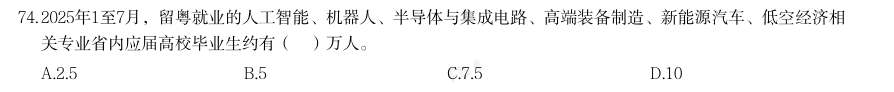

- **A.** 2.5
- **B.** 5
- **C.** 7.5
- **D.** 10

**答案：A**

### 2026 广东·统一卷　第 75 题　（选错误项）

根据资料,以下说法可以判断属实的是( )。

- **A.** 2024年,广东新出生人口超百万
- **B.** 2024年,广东省内应届高校毕业生中,本科生占比超40%
- **C.** 2025年上半年,广东超额完成国家下达的年度就业任务
- **D.** 2025年上半年,广东吸纳超百万应届高校毕业生留粤来粤就业创业

**答案：A**

### 2026 广东·统一卷　第 76 题　（选正确项）
> 材料：(二) 标准物质与尺子、砝码一样,是测量中必不可少的参照工具。它是已提前获得准确测量结果、均匀稳定的 样品,待测样品以其为标准,确保不同时间、人员、实验室的测量结果可比。标准物质研制生产机构在开展具 体品种标准物质的生产供应前,须通过技术审评并取得定级证书,这些取得定级证书的标准物质,统称为“国 家标准物质”。根据计量溯源性、准确度和用途等,国家标准物质目前分为两类,即一级标准物质和二级标准 物质。 国家标准物质数量快速增长的原因有四个方面:一是用途广泛、涉及经济、社会发展的…

· 本试卷由粉笔用户上岸张同学66生成 根据计量溯源性、准确度和用途等,国家标准物质目前分为( )类。

- **A.** 两
- **B.** 三
- **C.** 四
- **D.** 五

**答案：A**

### 2026 广东·统一卷　第 77 题　（选正确项）

根据资料,国家标准物质数量快速增长的原因不包括( )。

- **A.** 用途广泛
- **B.** 需求大幅增加
- **C.** 产业链完整
- **D.** 政策支持

**答案：C**

### 2026 广东·统一卷　第 78 题　（选正确项）

截至2024年末,市场监管总局累计批准建立国家标准物质( )项。

- **A.** 17934
- **B.** 18458
- **C.** 18982
- **D.** 19506

**答案：B**

### 2026 广东·统一卷　第 80 题　（选正确项）

下列选项中,最有可能准确反映2025年上半年我国新建标准物质地域分布情况的是( )。

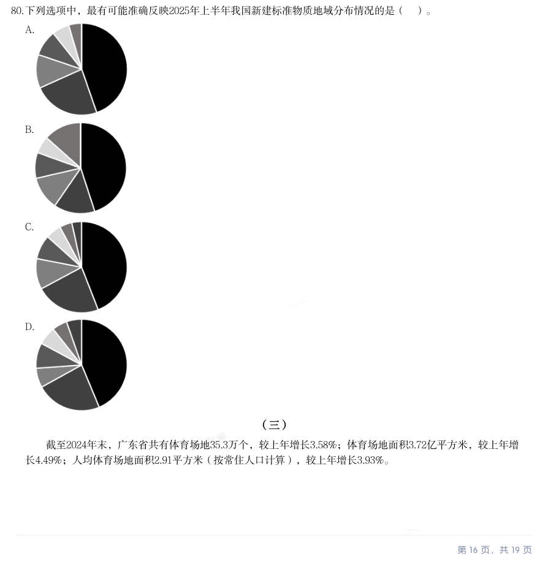

- **A.** 
- **B.** 
- **C.** 
- **D.** 

**答案：A**

### 2026 广东·统一卷　第 81 题　（综合分析（综合））

(三) 截至2024年末,广东省共有体育场地35.3万个,较上年增长3.58%;体育场地面积3.72亿平方米,较上年增 长4.49%;人均体育场地面积2.91平方米(按常住人口计算),较上年增长3.93%。 · 本试卷由粉笔用户上岸张同学66生成 2024年,广东省体育场地数量增加约( )万个。

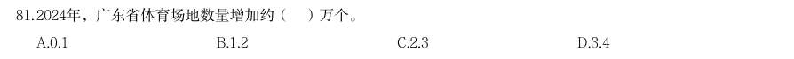

- **A.** 0.1
- **B.** 1.2
- **C.** 2.3
- **D.** 3.4

**答案：暂缺**

### 2026 广东·统一卷　第 83 题　（选正确项）

2024年末,广东省足球、篮球、排球“三大球”场地面积约为( )亿平方米。

- **A.** 0.10
- **B.** 0.11
- **C.** 1.04
- **D.** 1.10

**答案：D**

### 2026 广东·统一卷　第 84 题　（排序与图示判断）

2024年末,广东省下列运动场地单位面积排序正确的是:

- **A.** 冰雪运动场地>田径场地>游泳场地>健身房
- **B.** 田径场地>冰雪运动场地>健身房>游泳场地
- **C.** 田径场地>游泳场地>健身房>冰雪运动场地
- **D.** 田径场地>冰雪运动场地>游泳场地>健身房

**答案：暂缺**

### 2026 广东·统一卷　第 85 题　（选错误项）

根据材料,以下说法不正确的是( )。

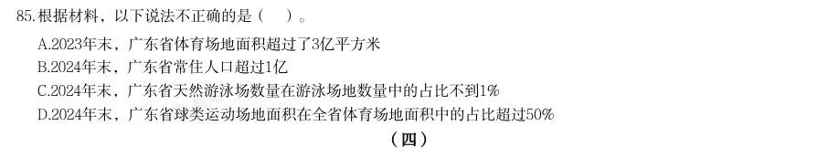

- **A.** 2023年末,广东省体育场地面积超过了3亿平方米
- **B.** 2024年末,广东省常住人口超过1亿
- **C.** 2024年末,广东省天然游泳场数量在游泳场地数量中的占比不到1%
- **D.** 2024年末,广东省球类运动场地面积在全省体育场地面积中的占比超过50%

**答案：暂缺**

### 2026 广东·统一卷　第 86 题　（选正确项）
> 材料：(四) 新中国成立以来,我国的城镇化建设不断推进,城市规模不断扩大,综合实力显著增强,基础设施持续改 善,城市更加宜业宜居。 从城市数量看,1948年末,我国城市共有58个,新中国成立后,大批县城改设为城市。1949年末,全国城 市共有129个,其中,地级以上城市68个,县级市61个,建制镇2000个左右。改革开放前,我国的城镇化经历 了一段比较曲折的发展历程,小城市和小城镇发展缓慢。1978年末,全国城市共有193个,其中,地级以上城 · 本试卷由粉笔用户上岸张同学66生成…

根据材料,下列时间段我国常住人口城镇化率增加最多的是:

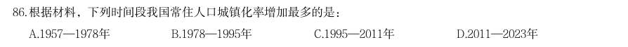

- **A.** 1957—1978年
- **B.** 1978—1995年
- **C.** 1995—2011年
- **D.** 2011—2023年

**答案：C**

### 2026 广东·统一卷　第 89 题　（排序与图示判断）

与1978年末相比,2023年末我国各类型城镇数量增幅排序正确的是( )。

- **A.** 地级以上城市>县级市>建制镇
- **B.** 建制镇>地级以上城市>县级市
- **C.** 地级以上城市>建制镇>县级市
- **D.** 建制镇>县级市>地级以上城市

**答案：D**

### 2026 广东·统一卷　第 90 题　（选错误项）

根据资料,以下说法错误的是( )。

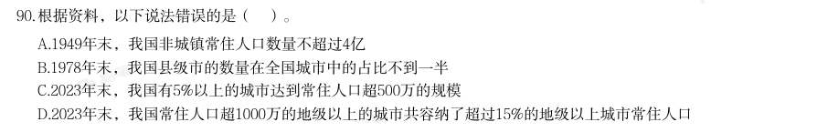

- **A.** 1949年末,我国非城镇常住人口数量不超过4亿
- **B.** 1978年末,我国县级市的数量在全国城市中的占比不到一半
- **C.** 2023年末,我国有5%以上的城市达到常住人口超500万的规模
- **D.** 2023年末,我国常住人口超1000万的地级以上的城市共容纳了超过15%的地级以上城市常住人口

**答案：暂缺**

### 2026 国考·副省级　第 116 题　（选正确项）

信息进行分析、比较、计算和判断处理。 (一) 2025 年一季度全国期货市场成交额约为多少万亿元?

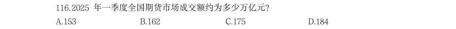

- **A.** 153
- **B.** 162
- **C.** 175
- **D.** 184

**答案：B**

### 2026 国考·副省级　第 118 题　（判断个数）

全国2025 年3 月成交量超过一季度月均成交量的期货交易所有几个?

- **A.** 5
- **B.** 4
- **C.** 3
- **D.** 2

**答案：A**

### 2026 国考·副省级　第 119 题　（综合分析（综合））

2024 年一季度,郑州商品交易所成交量比大连商品交易所:

- **A.** 多不到0.5 亿手
- **B.** 少不到0.5 亿手
- **C.** 多0.5 亿手以上
- **D.** 少0.5 亿手以上

**答案：B**

### 2026 国考·副省级　第 121 题　（选错误项）

2024 年,全国基本医疗保险统筹基金支出金额超过收入金额的月份有几个?

- **A.** 4
- **B.** 5
- **C.** 6
- **D.** 7

**答案：B**

### 2026 国考·副省级　第 122 题　（综合分析（综合））

2024 年,全国基本医疗保险统筹基金累计收入第一次超过1.5 万亿元是在几月?

- **A.** 5 月
- **B.** 6 月
- **C.** 7 月
- **D.** 8 月

**答案：C**

### 2026 国考·副省级　第 123 题　（综合分析（综合））

2024 年,全国城乡居民基本医疗保险统筹基金收入最高的季度是:

- **A.** 一季度
- **B.** 二季度
- **C.** 三季度
- **D.** 四季度

**答案：D**

### 2026 国考·副省级　第 130 题　（综合分析（综合））

能够从上述资料中推出的是:

- **A.** 2019 年,全国绿证核发量多于2018 年
- **B.** 截至2023 年底,全国累计核发绿证中,可交易绿证的占比不到1%
- **C.** 2024 年,全国常规水电核发绿证不到集中式项目核发绿证总数量的三分之一
- **D.** 2024 年,湖北、湖南核发绿证之和占全国比重比广东、广西之和高1 个百分点以上

**答案：D**

### 2026 国考·副省级　第 131 题　（综合分析（综合））
> 材料：2024 年,我国对联合国定义的45 个最不发达国家(以下简称最不发达国家)进出口 14230.2 亿元人民币,占同期我国外贸进出口总值的3.2%。其中出口8664.6 亿元,同比(下同) 增长4.3%;进口5565.5 亿元,增长12.8%。 2024 年,我国对最不发达国家出口机电产品3942.2 亿元,增长13.5%。其中出口船舶690.8 亿元,增长65.9%,主要出口至全球第一大船旗国利比里亚。出口金额654.3 亿元,增长67%; 出口工程机械、火车分别为165.…

12 月,我国自最不发达国家进口512.7 亿元,增长18.1%,其中自刚果民主共和国、几内亚、 老挝、赞比亚分别进口156.3 亿元,54.7 亿元,35.6 亿元,33.9 亿元,分别增长84.6%,40.3%, 25.7%、127.27%。 2024 年,我国外贸进出口总值在以下哪个范围内?

- **A.** 不到44 万亿元
- **B.** 44 万亿元~45 万亿元之间
- **C.** 45 万亿元~46 万亿元之间
- **D.** 超过46 万亿元

**答案：B**

### 2026 国考·副省级　第 134 题　（综合分析（综合））

2023 年1~11 月,我国对最不发达国家月均进口值约为多少亿元?

- **A.** 395
- **B.** 409
- **C.** 468
- **D.** 502

**答案：B**

### 2026 国考·副省级　第 135 题　（综合分析（综合））

关于2024 年我国进出口情况,能根据上述资料推出的是:

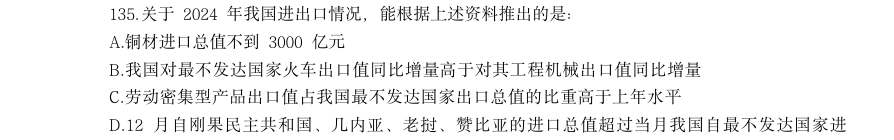

- **A.** 铜材进口总值不到3000 亿元
- **B.** 我国对最不发达国家火车出口值同比增量高于对其工程机械出口值同比增量
- **C.** 劳动密集型产品出口值占我国最不发达国家出口总值的比重高于上年水平
- **D.** 12 月自刚果民主共和国、几内亚、老挝、赞比亚的进口总值超过当月我国自最不发达国家进

**答案：D**

### 2026 国考·地市级　第 114 题　（排序与图示判断）

将2024 年上半年1医用敷料2一次性耗材3保健康复用品4口腔设备与材料进口额同比增 量从高到低排序正确的是:

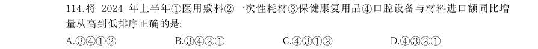

- **A.** 3412
- **B.** 3421
- **C.** 4312
- **D.** 4321

**答案：C**

### 2026 国考·地市级　第 115 题　（排序与图示判断）

以下饼图中,最能准确反映2024 年上半年中国西药类进出口总额中,西药原料(白色)、 西成药(横线)和生化药(黑色)占比关系的是:

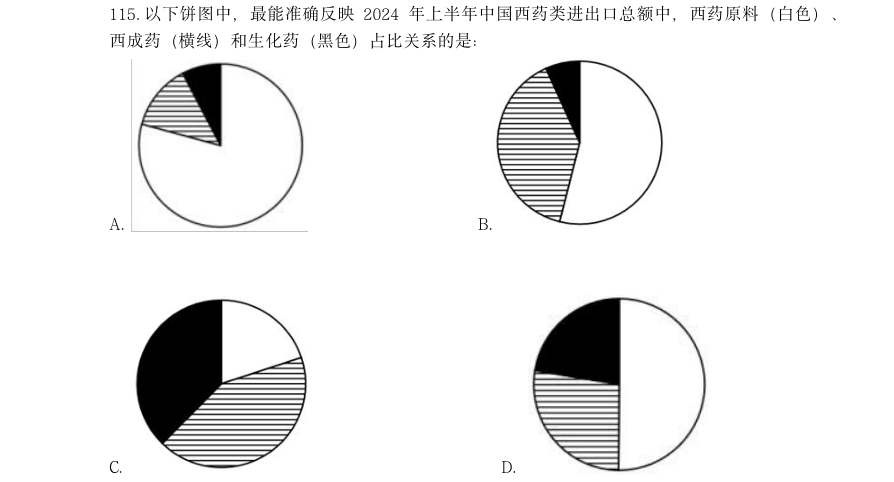

- **A.** 
- **B.** 
- **C.** 
- **D.** 

**答案：D**

### 2026 国考·地市级　第 116 题　（综合分析（综合））
> 材料：绿证是对可再生能源绿色电力颁发的具有独特标识代码的电子证书,1 个绿证单位对应 1000 千瓦时可再生能源电量。2024 年全国核发绿证47.34 亿个,其中可交易绿证31.58 亿个。 截至2024 年12 月底全国累计核发绿证49.55 亿个,其中可交易绿证33.79 亿个。 2024 年,全国集中式项目核发绿证46.77 亿个。…

2024 年,全国核发的不可交易绿证对应约多少万亿千瓦时可再生能源电量?

- **A.** 1.6
- **B.** 3.2
- **C.** 7.9
- **D.** 15.8

**答案：A**

### 2026 国考·地市级　第 120 题　（综合分析（综合））

能够从上述资料中推出的是:

- **A.** 2019 年,全国绿证核发量多于2018 年
- **B.** 截至2023 年底,全国累计核发绿证中,可交易绿证的占比不到1%
- **C.** 2024 年,全国常规水电核发绿证不到集中式项目核发绿证总数量的三分之一
- **D.** 2024 年,湖北、湖南核发绿证之和占全国比重比广东、广西之和高1 个百分点以上

**答案：D**

### 2026 国考·地市级　第 126 题　（综合分析（综合））
> 材料：2024 年,我国对联合国定义的45 个最不发达国家(以下简称最不发达国家)进出口 14230.2 亿元人民币,占同期我国外贸进出口总值的3.2%。其中出口8664.6 亿元,同比(下同) 增长4.3%;进口5565.5 亿元,增长12.8%。 2024 年,我国对最不发达国家出口机电产品3942.2 亿元,增长13.5%。其中出口船舶690.8 亿元,增长65.9%,主要出口至全球第一大船旗国利比里亚。出口金额654.3 亿元,增长67%; 出口工程机械、火车分别为165.…

2024 年,我国外贸进出口总值在以下哪个范围内?

> （本题为图形题，选项为图片，见原卷）

**答案：B**

### 2026 国考·地市级　第 129 题　（综合分析（综合））

2023 年1~11 月,我国对最不发达国家月均进口值约为多少亿元? B.409 C.468 D.502

> （本题为图形题，选项为图片，见原卷）

**答案：B**

### 2026 国考·行政执法　第 117 题　（判断个数）

将我国企业的发明专利、实用新型专利、外观设计专利按产业化率从高到低排序,则 2020~2023 年中次序与2024 年次序一致的年份有几个?

- **A.** 0
- **B.** 1
- **C.** 2
- **D.** 3

**答案：B**

### 2026 国考·行政执法　第 120 题　（判断个数）

在12023 年未来产业领域企业发明专利产业化平均收益、22024 年小微企业发明专利产业化 总体平均收益、32023 年金属制品业大型企业发明专利产业化率3 项指标中,能够从上述资料中 推出的有几项?

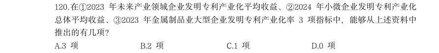

- **A.** 3 项
- **B.** 2 项
- **C.** 1 项
- **D.** 0 项

**答案：D**

### 2026 国考·行政执法　第 128 题　（选正确项）

将Y 省2024 年清明假期、“五一”假期和端午假期日均实现旅游收入从高到低排列,以 下正确的是:

- **A.** “五一”、端午、清明
- **B.** 清明、“五一”、端午
- **C.** “五一”、清明、端午
- **D.** 清明、端午、“五一”

**答案：C**

### 2026 国考·行政执法　第 130 题　（综合分析（综合））

以下柱状图反映了2025 年清明假期、“五一”假期和端午假期,Y 省接待游客哪一指标 的变化情况(横轴位置表示数值为0)?

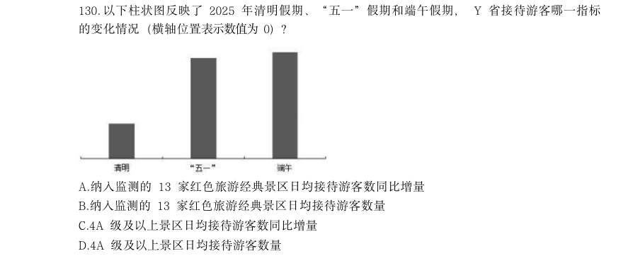

- **A.** 纳入监测的13 家红色旅游经典景区日均接待游客数同比增量
- **B.** 纳入监测的13 家红色旅游经典景区日均接待游客数量
- **C.** 4A 级及以上景区日均接待游客数同比增量
- **D.** 4A 级及以上景区日均接待游客数量

**答案：A**

### 2025 湖北·统一卷　第 104 题　（综合分析（综合））
> 材料：进行分析、比较、计算和判断处理。 2023年,我国数字经济规模持续扩大。数字经济核心产业增加值超过12万亿元,约占GDP的10%。电子信 息制造业增加值同比增长3.4%;电信业务收入1.68万亿元;互联网业务收入1.75万亿元;软件业务收入12.33万 亿元。以云计算、大数据、物联网等为代表的新兴业务中,云计算、大数据业务收入同比增长37.5%,物联网 业务收入同比增长20.3%。高技术制造业、高技术服务业投资分别同比增长9.9%、11.4%。高技术制造业中,计 算机、通信和…

C.每一物种的生产或捕获方法的差异,会给气候变化带来很大不同 D.鼓励以海产的“蓝色”饮食替代其他动物蛋白,或可帮助应对气候变化 某市举办智能数控技能大赛、小周、小吴、小郑、小王、小钱进入了决赛。比赛后,有记者询问他们的感受, 他们回答如下: 小周:小郑整场发挥得都很好,我觉得冠军非他莫属; 小吴:我觉得冠军一定会在我、小周、小钱三人之中产生; 小郑:我自我感觉不好,这次与冠军无缘了; 小钱:我连季军都拿不到; 小王:我不会是亚军。 已知本次比赛产生了冠军、亚军、季军各一人,且在五人中只有一个人的回答与比赛结果相符。那么,获得亚 军的是:

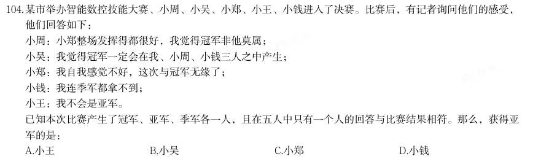

- **A.** 小王
- **B.** 小吴
- **C.** 小郑
- **D.** 小钱

**答案：暂缺**

### 2025 湖北·统一卷　第 106 题　（综合分析（综合））

2022年我国软件业务收入在以下哪个范围:

- **A.** 10.7-10.9万亿元
- **B.** 10.9-11.1万亿元
- **C.** 11.1-11.3万亿元
- **D.** 11.3-11.5万亿元

**答案：暂缺**

### 2025 湖北·统一卷　第 110 题　（综合分析（综合））

能够从上述资料中推出的是:

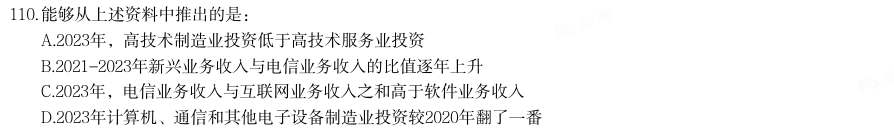

- **A.** 2023年,高技术制造业投资低于高技术服务业投资
- **B.** 2021-2023年新兴业务收入与电信业务收入的比值逐年上升
- **C.** 2023年,电信业务收入与互联网业务收入之和高于软件业务收入
- **D.** 2023年计算机、通信和其他电子设备制造业投资较2020年翻了一番

**答案：暂缺**

### 2025 湖北·统一卷　第 114 题　（综合分析（综合））
> 材料：下列饼状图可以描述表1中2023年上半年各板块新上市公司数量占比情况的是: 2023年,我国制浆造纸及纸制品全行业完成纸浆、纸及纸板和纸制品产量合计29139万吨,同比增长 2.63%。其中纸及纸板产量12965万吨,与2022年的12425万吨相比同比增长4.35%,增速比2022年扩大了1.71个 百分点。 2023年,全国纸及纸板消费量13165万吨,同比增长6.14%,增速比2022年扩大了8.08个百分点;人均年消 费量93.37千克,同比增长6.30%。 2023…

我国有18个省(区、市)纸及纸板产量超过100万吨,产量合计12597万吨,占全国纸及纸板总 产量的97.16%。

- **A.** 
- **B.** 
- **C.** 
- **D.** 

**答案：暂缺**

### 2025 湖北·统一卷　第 115 题　（综合分析（综合））

能够从上述资料中推出的是:

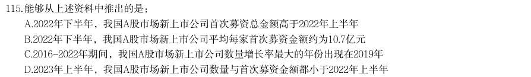

- **A.** 2022年下半年,我国A股市场新上市公司首次募资总金额高于2022年上半年
- **B.** 2022年下半年,我国A股市场新上市公司平均每家首次募资金额约为10.7亿元
- **C.** 2016-2022年期间,我国A股市场新上市公司数量增长率最大的年份出现在2019年
- **D.** 2023年上半年,我国A股市场新上市公司数量与首次募资金额都小于2022年上半年

**答案：暂缺**

### 2025 湖北·统一卷　第 116 题　（综合分析（综合））
> 材料：2023年全国著作权(包括作品著作权、计算机软件著作权、著作权质权)登记总量达8923901件,同比增 长40.46%,增速比上年同期增加39个百分点。根据各省、自治区、直辖市版权局和中国版权保护中心作品登记 信息统计,2023年全国共完成作品著作权登记6428277件,同比增长42.30%,登记量前五位的分别是:北京市 1101072件,同比增加53802件;山东省873826件,同比增加619459件;福建省710648件,同比增加424814件; 中国版权保护中心493…

2021年全国纸及纸板产量约为:

- **A.** 11715万吨
- **B.** 12105万吨
- **C.** 12762万吨
- **D.** 13227万吨

**答案：暂缺**

### 2025 湖北·统一卷　第 118 题　（选正确项）

2023年,造纸及纸板生产企业部分经济指标同比增速按从高到低排列,正确的是( )。

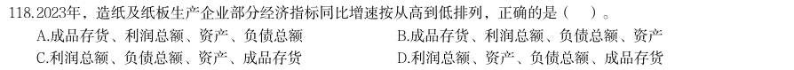

- **A.** 成品存货、利润总额、资产、负债总额
- **B.** 成品存货、利润总额、负债总额、资产
- **C.** 利润总额、负债总额、资产、成品存货
- **D.** 利润总额、资产、负债总额、成品存货

**答案：暂缺**

### 2025 湖北·统一卷　第 120 题　（综合分析（综合））

能够从上述资料中推出的是:

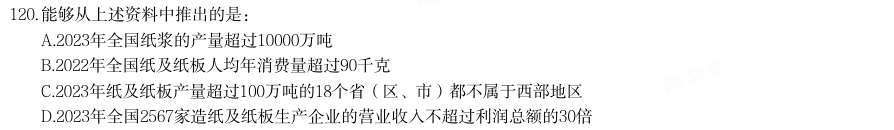

- **A.** 2023年全国纸浆的产量超过10000万吨
- **B.** 2022年全国纸及纸板人均年消费量超过90千克
- **C.** 2023年纸及纸板产量超过100万吨的18个省(区、市)都不属于西部地区
- **D.** 2023年全国2567家造纸及纸板生产企业的营业收入不超过利润总额的30倍

**答案：暂缺**

### 2025 湖北·统一卷　第 121 题　（综合分析（综合））

2021年全国著作权登记总量约为:

- **A.** 626万件
- **B.** 656万件
- **C.** 685万件
- **D.** 728万件

**答案：暂缺**

### 2025 湖北·统一卷　第 123 题　（综合分析（综合））

2022年美术作品、摄影作品、文字作品的著作权登记量共约:

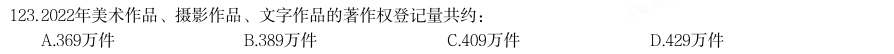

- **A.** 369万件
- **B.** 389万件
- **C.** 409万件
- **D.** 429万件

**答案：暂缺**

### 2025 湖北·统一卷　第 125 题　（综合分析（综合））

不能从上述资料中推出的是:

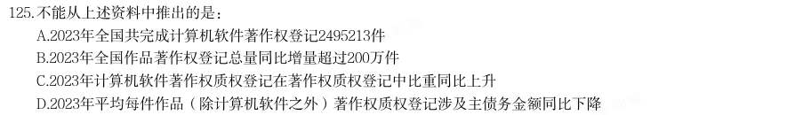

- **A.** 2023年全国共完成计算机软件著作权登记2495213件
- **B.** 2023年全国作品著作权登记总量同比增量超过200万件
- **C.** 2023年计算机软件著作权质权登记在著作权质权登记中比重同比上升
- **D.** 2023年平均每件作品(除计算机软件之外)著作权质权登记涉及主债务金额同比下降

**答案：暂缺**

### 2025 广东·统一卷　第 71 题　（综合分析（综合））
> 材料：【认准淘宝店铺:通关达人资料库】公考,事业编,遴选,考研,一站式备考,持续更新 应根据资料提供的信息进行分析、比较、计算和判断处理。 2013~2023年,中国深入推进能源生产和消费方式变革,能源绿色低碳发展实现历史性突破。2023年,清 洁能源消费占比26.4%,较2013年提高10.9个百分点,煤炭消费比率累计下降12.1个百分点,发电总装机容量达 29.2亿千瓦。其中,清洁能源发电装机容量达17亿千瓦,清洁能源发电约3.8万亿千瓦,占总发电量的39.7%, 比2013年…

2023年1~11月,G省社会消费品零售额约为( )万亿元。

- **A.** 4.34
- **B.** 4.43
- **C.** 4.54
- **D.** 4.63

**答案：暂缺**

### 2025 广东·统一卷　第 75 题　（综合分析（综合））

根据资料,以下说法有误的是( )。

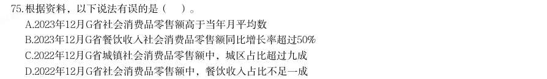

- **A.** 2023年12月G省社会消费品零售额高于当年月平均数
- **B.** 2023年12月G省餐饮收入社会消费品零售额同比增长率超过50%
- **C.** 2022年12月G省城镇社会消费品零售额中,城区占比超过九成
- **D.** 2022年12月G省社会消费品零售额中,餐饮收入占比不足一成

**答案：暂缺**

### 2025 广东·统一卷　第 76 题　（选正确项）
> 材料：【认准淘宝店铺:通关达人资料库】公考,事业编,遴选,考研,一站式备考,持续更新 中国能源转型为全球能源转型作出重要贡献,2023年中国能源转型投资达6760亿美元,是全球能源转型投 资最多的国家。十年来,中国向全球提供优质的清洁能源产品和服务,有力促进全球风电,光伏成本大幅下 降,中国与100多个国家和地区开展绿色能源项目合作,2023年出口风电光伏产品助力其他国家减排二氧化碳 约8.1亿吨。中国新能源产业丰富了全球供给,缓解了全球通胀压力,助力全球应对气候变化和绿色转型。…

以下判断正确的是( )。

- **A.** 我国清洁能源消费比重已经超过煤炭消费比重
- **B.** 我国清洁能源发电装机容量不到发电总装机容量的一半
- **C.** 我国清洁能源发电量占总发电量的比重较10年前翻了一番
- **D.** 我国总发电量超过9万亿千瓦时

**答案：暂缺**

### 2025 广东·统一卷　第 77 题　（综合分析（综合））

根据资料,以下说法有误的是( )。

- **A.** 农村地区户用光伏可为农户增加收入和就业岗位
- **B.** 

**答案：暂缺**

### 2025 广东·统一卷　第 79 题　（综合分析（综合））

中国新能源产业对世界的影响,主要包括( )。 1丰富全球供给 2缓解全球通胀压力 3应对气候变化和绿色转型 4支撑经济社会高质量发展

- **A.** 123
- **B.** 134
- **C.** 234
- **D.** 1234

**答案：暂缺**

### 2025 广东·统一卷　第 80 题　（选错误项）

根据材料,以下说法不正确的是( )。

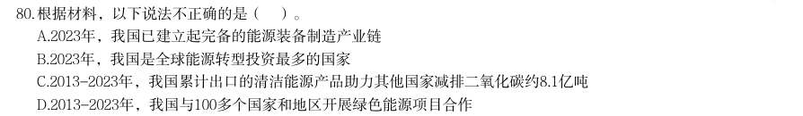

- **A.** 2023年,我国已建立起完备的能源装备制造产业链
- **B.** 2023年,我国是全球能源转型投资最多的国家
- **C.** 2013-2023年,我国累计出口的清洁能源产品助力其他国家减排二氧化碳约8.1亿吨
- **D.** 2013-2023年,我国与100多个国家和地区开展绿色能源项目合作

**答案：暂缺**

### 2025 广东·统一卷　第 85 题　（选正确项）

根据资料,以下说法正确的是( )。

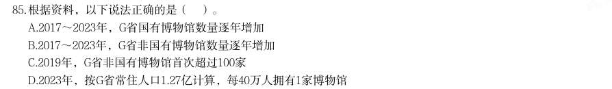

- **A.** 2017~2023年,G省国有博物馆数量逐年增加
- **B.** 2017~2023年,G省非国有博物馆数量逐年增加
- **C.** 2019年,G省非国有博物馆首次超过100家
- **D.** 2023年,按G省常住人口1.27亿计算,每40万人拥有1家博物馆

**答案：暂缺**

### 2025 广东·统一卷　第 90 题　（选错误项）

根据材料,以下说法不正确的是( )。

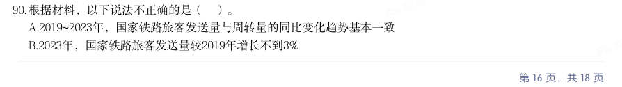

- **A.** 2019~2023年,国家铁路旅客发送量与周转量的同比变化趋势基本一致
- **B.** 2023年,国家铁路旅客发送量较2019年增长不到3%【认准淘宝店铺:通关达人资料库】公考,事业编,遴选,考研,一站式备考,持续更新
- **C.** 2018年~2023年,国家铁路旅客发送量增速高于周转量
- **D.** 2018~2023年,国家铁路旅客年均周转量超过12000亿人公里

**答案：暂缺**

### 2025 国考·副省级　第 116 题　（选正确项）

分析、比较、计算和判断处理。 (一) 截至2023年末,我国集成电路布图设计登记累计申请93147件,发证72378件,2024年1-4月,我国集成电 路布图设计登记申请3503件,发证4189件。 截至2014年末,我国集成电路布图设计登记累计申请量在以下哪个范围内?

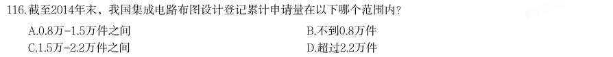

- **A.** 0.8万-1.5万件之间
- **B.** 不到0.8万件
- **C.** 1.5万-2.2万件之间
- **D.** 超过2.2万件

**答案：A**

### 2025 国考·副省级　第 119 题　（判断个数）

2015-2023年,我国集成电路布图设计登记当年发证量与当年申请量比值大于0.9的年份有几个?

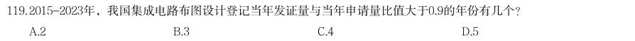

- **A.** 2
- **B.** 3
- **C.** 4
- **D.** 5

**答案：A**

### 2025 国考·副省级　第 121 题　（选正确项）

(二) 2019-2023年我国厨房小家电全品类零售总量在以下哪个范围?

- **A.** 12亿台-13亿台之间
- **B.** 13亿台-14亿台之间
- **C.** 不到12亿台
- **D.** 超过14亿台

**答案：A**

### 2025 国考·副省级　第 123 题　（选正确项）

资料所列厨房小家电品类当中,2023年零售额超过全品类零售总额10%的有几类?

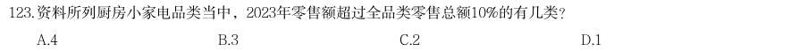

- **A.** 4
- **B.** 3
- **C.** 2
- **D.** 1

**答案：C**

### 2025 国考·副省级　第 133 题　（选正确项）

2022年三季度,人民银行清算总中心系统境内外币支付系统处理业务日均处理金额在以下哪个范围内?

- **A.** 超过80亿美元
- **B.** 70亿-80亿美元之间
- **C.** 60亿-70亿美元之间
- **D.** 不到60亿美元

**答案：B**

### 2025 国考·副省级　第 134 题　（选正确项）

将其他支付系统中1银行行内业务系统、2银联跨行支付系统、3城银清算支付清算系统和4农信银支付清算 系统按2023年三季度平均每笔业务金额同比增速从高到低排列,以下正确的是:

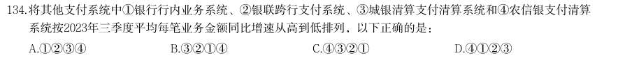

- **A.** 1234
- **B.** 3214
- **C.** 4321
- **D.** 4123

**答案：C**

### 2025 国考·副省级　第 135 题　（选正确项）

关于2023年三季度支付系统运行情况,不能从上述资料中推出的是:

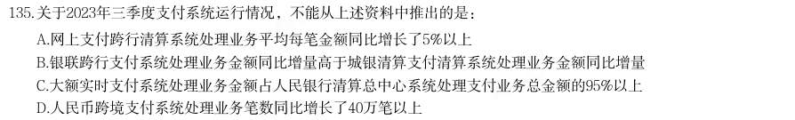

- **A.** 网上支付跨行清算系统处理业务平均每笔金额同比增长了5%以上
- **B.** 银联跨行支付系统处理业务金额同比增量高于城银清算支付清算系统处理业务金额同比增量
- **C.** 大额实时支付系统处理业务金额占人民银行清算总中心系统处理支付业务总金额的95%以上
- **D.** 人民币跨境支付系统处理业务笔数同比增长了40万笔以上

**答案：C**

### 2025 国考·地市级　第 115 题　（选正确项）

以下饼状图中,最能准确反映2019-2023年五批次公示的专精特新“小巨人”上市企业中,第一批次(黑 色)、第二批次(横线)、第三批次(竖线)、第四批次(白色)和第五批次(网格)企业数量比例关系的 是:

- **A.** 
- **B.** 
- **C.** 
- **D.** 

**答案：B**

### 2025 国考·地市级　第 116 题　（选正确项）

(二) 2021-2023年,Z省各年律师人数与律师事务所总数的比值:

- **A.** 先升后降
- **B.** 先降后升
- **C.** 持续下降
- **D.** 持续上升

**答案：D**

### 2025 国考·地市级　第 121 题　（选正确项）

(三) 注:上座率 2023年12月,资料中电影总放映场次最多的三个城市票房之和在以下哪个范围内?

- **A.** 超过5亿元
- **B.** 4.5亿~4.75亿元之间
- **C.** 4.75亿~5亿元之间
- **D.** 不到4.5亿元

**答案：C**

### 2025 国考·地市级　第 125 题　（选错误项）

关于资料中城市2023年12月电影票房状况,能够从上述资料中推出的是:

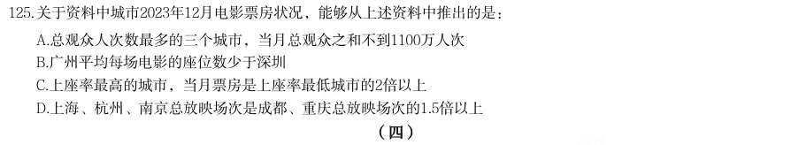

- **A.** 总观众人次数最多的三个城市,当月总观众之和不到1100万人次
- **B.** 广州平均每场电影的座位数少于深圳
- **C.** 上座率最高的城市,当月票房是上座率最低城市的2倍以上
- **D.** 上海、杭州、南京总放映场次是成都、重庆总放映场次的1.5倍以上

**答案：C**

### 2025 国考·地市级　第 127 题　（选正确项）

2023年一季度,东部地区外贸进口额约为多少万亿元?

- **A.** 2.2
- **B.** 2.8
- **C.** 3.4
- **D.** 4.0

**答案：C**

### 2025 国考·地市级　第 130 题　（选正确项）

关于我国外贸进出口状况,能够从上述资料中推出的是:

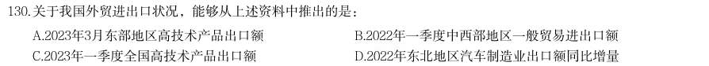

- **A.** 2023年3月东部地区高技术产品出口额
- **B.** 2022年一季度中西部地区一般贸易进出口额
- **C.** 2023年一季度全国高技术产品出口额
- **D.** 2022年东北地区汽车制造业出口额同比增量

**答案：B**

### 2025 国考·行政执法　第 118 题　（选正确项）

2021-2023年,Z省各年律师人数与律师事务所总数的比值:

- **A.** 先升后降
- **B.** 先降后升
- **C.** 持续下降
- **D.** 持续上升

**答案：D**

### 2024 湖北·统一卷　第 106 题　（综合分析（综合））

分析、比较、计算和判断处理。 (一) 2019~2022年全国体育场地面积增长最快的年份是:

- **A.** 2019年
- **B.** 2020年
- **C.** 2021年
- **D.** 2022年

**答案：A**

### 2024 湖北·统一卷　第 109 题　（综合分析（综合））

2022年,按运动项目划分场地数量之和最接近全国体育场地数量25%的是:

- **A.** 游泳场地+全民健身路径
- **B.** 健身步道+全民健身路径
- **C.** 篮球场地+滑雪场地
- **D.** 排球场地+乒乓球场地

**答案：D**

### 2024 湖北·统一卷　第 110 题　（综合分析（综合））

能够从上述资料推出的是:

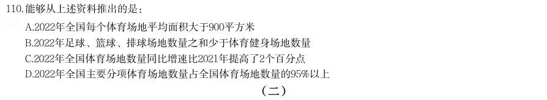

- **A.** 2022年全国每个体育场地平均面积大于900平方米
- **B.** 2022年足球、篮球、排球场地数量之和少于体育健身场地数量
- **C.** 2022年全国体育场地数量同比增速比2021年提高了2个百分点
- **D.** 2022年全国主要分项体育场地数量占全国体育场地数量的95%以上

**答案：D**

### 2024 湖北·统一卷　第 111 题　（综合分析（综合））

(二) 表格所列国家中,相较于2012年,2022年全球创新指数增长最快的国家是:

- **A.** 美国
- **B.** 中国
- **C.** 英国
- **D.** 印度

**答案：B**

### 2024 湖北·统一卷　第 113 题　（选错误项）

2021年,下列国家全球创新指数大小比较,错误的是:

- **A.** 瑞士>瑞典>美国
- **B.** 英国>韩国>荷兰
- **C.** 芬兰>新加坡>丹麦
- **D.** 俄罗斯>巴西>印度

**答案：D**

### 2024 湖北·统一卷　第 115 题　（综合分析（综合））

能够从上述资料推出的是:

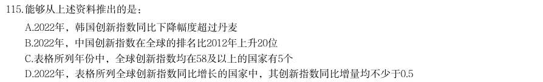

- **A.** 2022年,韩国创新指数同比下降幅度超过丹麦
- **B.** 2022年,中国创新指数在全球的排名比2012年上升20位
- **C.** 表格所列年份中,全球创新指数均在58及以上的国家有5个
- **D.** 2022年,表格所列全球创新指数同比增长的国家中,其创新指数同比增量均不少于0.5

**答案：A**

### 2024 湖北·统一卷　第 117 题　（综合分析（综合））

2021年银行机构存续的理财产品存续规模约为多少万亿元?

- **A.** 5.4
- **B.** 6.7
- **C.** 10.5
- **D.** 11.8

**答案：D**

### 2024 湖北·统一卷　第 120 题　（综合分析（综合））

能够从上述资料中推出的是:

- **A.** 2021年持有理财产品的个人投资者数量占比为98.88%
- **B.** 2022年新发理财产品中平均每只产品募集资金低于2021年
- **C.** 2022年城商行存续产品存续金额在银行机构存续产品中比例为8.85%
- **D.** 2022年持有理财产品的个人投资者中风险偏好为二级的数量约为3393万个

**答案：D**

### 2024 湖北·统一卷　第 124 题　（综合分析（综合））

2022年我国废有色金属中废铅回收重量约为:

- **A.** 261万吨
- **B.** 275万吨
- **C.** 285万吨
- **D.** 291万吨

**答案：C**

### 2024 湖北·统一卷　第 125 题　（综合分析（综合））

能够从上述资料中推出的是:

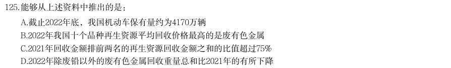

- **A.** 截止2022年底,我国机动车保有量约为4170万辆
- **B.** 2022年我国十个品种再生资源平均回收价格最高的是废有色金属
- **C.** 2021年回收金额排前两名的再生资源回收金额之和的比值超过75%
- **D.** 2022年除废铅以外的废有色金属回收重量总和比2021年的有所下降

**答案：C**

### 2024 广东·统一卷　第 72 题　（综合分析（综合））

2023年,全国技工院校在校生人数( )。

- **A.** 小于400万
- **B.** 在400万到500万之间
- **C.** 在500万到600万之间
- **D.** 大于600万

**答案：A**

### 2024 广东·统一卷　第 73 题　（综合分析（综合））

关于广东技能人才培养,以下表述不准确的是( )。

- **A.** 注重产教融合、校企合作
- **B.** 实现教学与企业岗位无缝对接
- **C.** 精准培养产业急需人才
- **D.** 强调提升全体学生技能竞赛成绩

**答案：C**

### 2024 广东·统一卷　第 74 题　（综合分析（综合））

以下不属于广东建设省级重点专业和特色专业所面向产业的是( )。

- **A.** 传统手工业
- **B.** 先进制造业
- **C.** 战略性新兴产业
- **D.** 现代服务业

**答案：D**

### 2024 广东·统一卷　第 75 题　（综合分析（综合））

关于广东技工,以下说法有误的是( )。

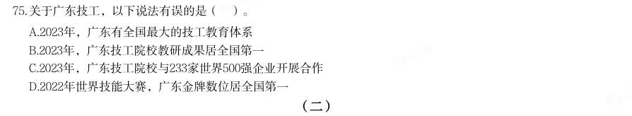

- **A.** 2023年,广东有全国最大的技工教育体系
- **B.** 2023年,广东技工院校教研成果居全国第一
- **C.** 2023年,广东技工院校与233家世界500强企业开展合作
- **D.** 2022年世界技能大赛,广东金牌数位居全国第一

**答案：A**

### 2024 广东·统一卷　第 76 题　（综合分析（综合））
> 材料：(二) 2022年,全球对外直接投资流量1.5万亿美元,比上年下降14%。其中发达经济体对外直接投资1.03万亿美 元,比上年下降17.2%;发展中经济体对外直接投资4589亿美元,比上年下降5.4%。…

2013-2022年,中国对外直接投资流量年均增加约( )亿美元。

- **A.** 55.3
- **B.** 61.4
- **C.** 67.5
- **D.** 73.6

**答案：B**

### 2024 广东·统一卷　第 79 题　（排序与图示判断）

2021年,中国下列行业的对外直接投资流量,从大到小排序正确的是( )。

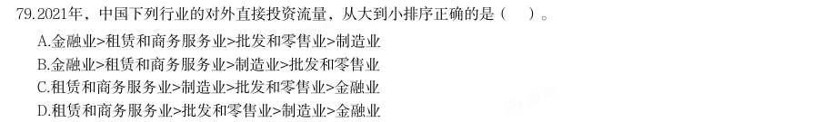

- **A.** 金融业>租赁和商务服务业>批发和零售业>制造业
- **B.** 金融业>租赁和商务服务业>制造业>批发和零售业
- **C.** 租赁和商务服务业>制造业>批发和零售业>金融业
- **D.** 租赁和商务服务业>批发和零售业>制造业>金融业

**答案：C**

### 2024 广东·统一卷　第 80 题　（选正确项）

根据资料,下列说法正确的是( )。

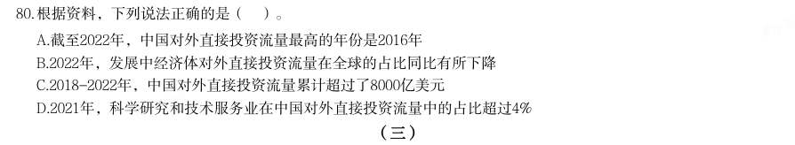

- **A.** 截至2022年,中国对外直接投资流量最高的年份是2016年
- **B.** 2022年,发展中经济体对外直接投资流量在全球的占比同比有所下降
- **C.** 2018-2022年,中国对外直接投资流量累计超过了8000亿美元
- **D.** 2021年,科学研究和技术服务业在中国对外直接投资流量中的占比超过4%

**答案：D**

### 2024 广东·统一卷　第 85 题　（选正确项）

根据资料,下列说法正确的是( )。

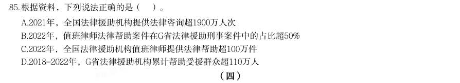

- **A.** 2021年,全国法律援助机构提供法律咨询超1900万人次
- **B.** 2022年,值班律师法律帮助案件在G省法律援助刑事案件中的占比超50%
- **C.** 2022年,全国法律援助机构值班律师提供法律帮助超100万件
- **D.** 2018-2022年,G省法律援助机构累计帮助受援群众超110万人

**答案：D**

### 2024 广东·统一卷　第 87 题　（综合分析（综合））

2020年,全国用于县域农业农村信息化建设的社会资本投入( )(假设2020年县的数量与2021年相同)。

- **A.** 不到800亿元
- **B.** 在800亿元到850亿元之间
- **C.** 在850亿元到900亿元之间
- **D.** 超过900亿元

**答案：暂缺**

### 2024 广东·统一卷　第 90 题　（选正确项）

根据资料,关于县域农业农村信息化建设,以下说法正确的是( )。

- **A.** 2019年,西部地区乡村人均社会资本投入低于中部地区
- **B.** 2020年,东部地区县均社会资本投入同比增量高于中部地区
- **C.** 2019~2021年,东部地区乡村人均社会资本投入年均增长率高于中部和西部地区
- **D.** 2019~2021年,中部地区县均社会资本投入增速高于全国县均社会资本投入增速

**答案：暂缺**

### 2024 国考·副省级　第 116 题　（选正确项）

分析、比较、计算和判断处理。 (一) 2022年,中型灌区改善灌溉面积与新增恢复灌溉面积比值最大的中部省份是:

- **A.** 山西
- **B.** 湖北
- **C.** 河南
- **D.** 江西

**答案：C**

### 2024 国考·副省级　第 121 题　（选正确项）

(二) 2017~2022年我国马铃薯出口量最高的年份,当年出口额在这6年中排名( )。

- **A.** 第一
- **B.** 第二
- **C.** 第三
- **D.** 第四

**答案：C**

### 2024 国考·副省级　第 122 题　（选正确项）

2016~2020年,我国马铃薯总产量在以下哪个范围内?

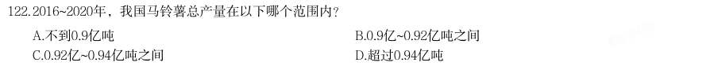

- **A.** 不到0.9亿吨
- **B.** 0.9亿~0.92亿吨之间
- **C.** 0.92亿~0.94亿吨之间
- **D.** 超过0.94亿吨

**答案：A**

### 2024 国考·副省级　第 127 题　（选错误项）

2018-2022年,全国电化学储能电站年末总能量同比增长100%以上的年份有几个?

- **A.** 1
- **B.** 2
- **C.** 3
- **D.** 4

**答案：C**

### 2024 国考·副省级　第 130 题　（选错误项）

关于全国各类电化学储能电站状况,能够从上述资料中推出的是:

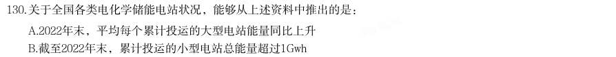

- **A.** 2022年末,平均每个累计投运的大型电站能量同比上升
- **B.** 截至2022年末,累计投运的小型电站总能量超过1Gwh
- **C.** 2022年末,平均每个累计投运的锂离子电池电站能量高于总体平均水平
- **D.** 2022年新增电站中,锂离子、铅酸/铅碳和液流电池以外的类型能量占总能量的比重不到5%

**答案：A**

### 2024 国考·副省级　第 135 题　（判断个数）

在以下信息中,能够从上述资料中推出的有几项? 12013—2022年京津冀第一产业增加值年均增量(以2013年为基期) 22013年天津第一产业、第二产业增加值之和 32013—2022年河北城镇新增就业人员中第三产业就业人员人数

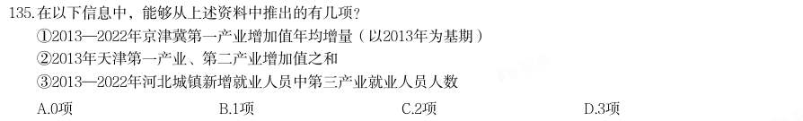

- **A.** 0项
- **B.** 1项
- **C.** 2项
- **D.** 3项

**答案：C**

### 2024 国考·地市级　第 111 题　（排序与图示判断）

将S省各级12315工作机构接收的投诉、举报和咨询三类诉求量按2022年同比增速从高到低排序,以下正确的 是:

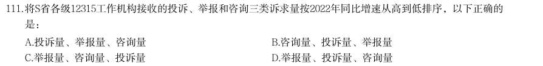

- **A.** 投诉量、举报量、咨询量
- **B.** 咨询量、投诉量、举报量
- **C.** 举报量、咨询量、投诉量
- **D.** 举报量、投诉量、咨询量

**答案：D**

### 2024 国考·地市级　第 114 题　（选正确项）

2022年,S省各级12315工作机构接收诉求量最少的季度是:

- **A.** 第一季度
- **B.** 第二季度
- **C.** 第三季度
- **D.** 第四季度

**答案：A**

### 2024 国考·地市级　第 121 题　（选正确项）

(三) 2016~2020年,我国马铃薯总产量在以下哪个范围内?

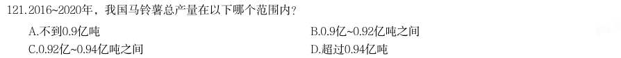

- **A.** 不到0.9亿吨
- **B.** 0.9亿~0.92亿吨之间
- **C.** 0.92亿~0.94亿吨之间
- **D.** 超过0.94亿吨

**答案：A**

### 2024 国考·地市级　第 123 题　（选正确项）

2017~2022年我国马铃薯出口量最高的年份,当年出口额在这6年中排名( )。

- **A.** 第一
- **B.** 第二
- **C.** 第三
- **D.** 第四

**答案：C**

### 2024 国考·地市级　第 126 题　（选正确项）

(四) 2017~2022年,全国移动数据流量业务收入总额在以下哪个范围内?

- **A.** 不到3.4万亿元
- **B.** 超过3.6万亿元
- **C.** 3.4万亿—3.5万亿元之间
- **D.** 3.5万亿—3.6万亿元之间

**答案：B**

### 2024 国考·行政执法　第 118 题　（选正确项）

2022年,中型灌区改善灌溉面积与新增恢复灌溉面积比值最大的中部省份是:

- **A.** 山西
- **B.** 湖北
- **C.** 河南
- **D.** 江西

**答案：C**

### 2024 国考·行政执法　第 128 题　（选正确项）

2022年12月,全国规模以上工业企业的1工业机器人完成产量和2服务机器人完成产量:

- **A.** 均高于1~11月的月均水平
- **B.** 均低于1~11月的月均水平
- **C.** 仅1高于1~11月的月均水平
- **D.** 仅2高于1~11月的月均水平

**答案：C**

### 2024 国考·行政执法　第 130 题　（选错误项）

能够从上述资料中推出的是:

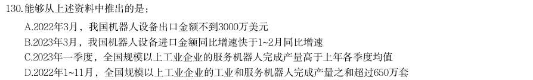

- **A.** 2022年3月,我国机器人设备出口金额不到3000万美元
- **B.** 2023年3月,我国机器人设备进口金额同比增速快于1~2月同比增速
- **C.** 2023年一季度,全国规模以上工业企业的服务机器人完成产量高于上年各季度均值
- **D.** 2022年1~11月,全国规模以上工业企业的工业和服务机器人完成产量之和超过650万套

**答案：B**

### 2023 湖北·统一卷　第 3 题　（选正确项）

党的二十大报告提到,十八大以来“我们深入贯彻以人民为中心的发展思想,在幼有所 育、学有所教、劳有所得、病有所医、老有所养、住有所居、弱有所扶上持续用力,人民生 活全方位改善”。下列有关内容表述正确的是: 1及时调整生育政策 2人均预期寿命增长到八十八点二岁 3城镇新增就业年均一千三百万人以上 4互联网上网人数达十三亿三千万人 5居民人均可支配收入从一万六千五百元增加到三万五千一百元 6基本养老保险覆盖十亿四千万人,基本医疗保险参保率稳定在百分之九十五

- **A.** 1234
- **B.** 1345
- **C.** 2456
- **D.** 1356

**答案：D**

### 2023 广东·乡镇　第 98 题　（选正确项）

2022 年,表中所呈现的农村居民消费支出的类别中,同比增加超过120 元的有( ) 项。

- **A.** 1
- **B.** 2
- **C.** 3
- **D.** 4

**答案：B**

### 2023 广东·县级　第 86 题　（选正确项）

2020 年,广东省省本级财政科学技术支出为( )亿元。

- **A.** 83.96
- **B.** 102.64
- **C.** 122.32
- **D.** 132.67

**答案：A**

### 2023 广东·县级　第 90 题　（选错误项）

根据资料,以下关于广东省财政支出的说法正确的是( )。

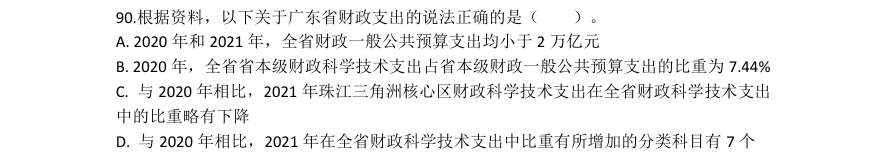

- **A.** 2020 年和2021 年,全省财政一般公共预算支出均小于2 万亿元
- **B.** 2020 年,全省省本级财政科学技术支出占省本级财政一般公共预算支出的比重为7.44%
- **C.** 与2020 年相比,2021 年珠江三角洲核心区财政科学技术支出在全省财政科学技术支出中的比重略有下降
- **D.** 与2020 年相比,2021 年在全省财政科学技术支出中比重有所增加的分类科目有7 个

**答案：C**

### 2023 广东·县级　第 94 题　（选正确项）

2022 年,我国城镇居民与农村居民人数之比最接近( )。

- **A.** 2:3
- **B.** 3:2
- **C.** 3:4
- **D.** 4:3

**答案：D**

### 2023 广东·县级　第 95 题　（选错误项）

根据资料,下列说法正确的是( )。

- **A.** 2022 年,全国居民人均工资性收入增长主要由农村居民贡献
- **B.** 2021 年,与城镇居民相比,农村居民的人均可支配收入中用于消费支出的比例更大
- **C.** 与2021 年相比,2022 年城镇居民在居住上的消费支出增加值最大
- **D.** 2021 年,无论在城镇还是农村,居民消费支出的重点都是食品烟酒和交通通信支出

**答案：B**

### 2023 广东·县级　第 99 题　（选错误项）

根据资料,下列说法正确的是( )。

- **A.** 2018-2022 年间,我国新兴业务收入年均增长超20%
- **B.** 2018-2022 年间,我国电信业务收入同比增长率始终高于1%
- **C.** 2018-2022 年间,我国移动数据流量业务收入年均增加约1000 亿元
- **D.** 与2021 年相比,2022 年我国云计算和大数据业务收入同比增长88.1%

**答案：暂缺**

### 2023 国考·行政执法　第 114 题　（选正确项）

将1甘肃、2广东、3上海和4浙江按2016~2021年集成电路产量年均增速(以2016年为基期计算)从高到低 排列,以下正确的是:

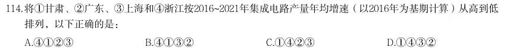

- **A.** 4123
- **B.** 4132
- **C.** 1423
- **D.** 1432

**答案：C**

### 2023 国考·行政执法　第 116 题　（判断个数）

(二) 2021年四季度,Z省有几个市的中心城市道路机动车依法礼让率高于上季度水平?

- **A.** 5
- **B.** 6
- **C.** 7
- **D.** 8

**答案：C**

### 2023 国考·行政执法　第 119 题　（选正确项）

如单纯从统计数据判断,则2021年四季度B市在提升中心城市道路交通守法率方面,工作相比三季度最有成效 的是:

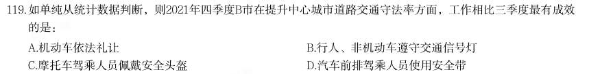

- **A.** 机动车依法礼让
- **B.** 行人、非机动车遵守交通信号灯
- **C.** 摩托车驾乘人员佩戴安全头盔
- **D.** 汽车前排驾乘人员使用安全带

**答案：A**

### 2023 国考·行政执法　第 120 题　（选错误项）

以下条形图反映了2021年四季度Z省哪个城市中心城市道路交通守法率五项指标之间的大小关系?

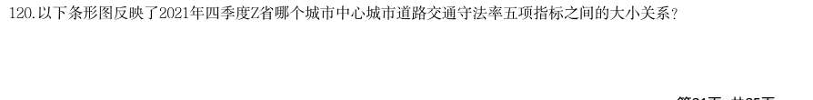

- **A.** E市
- **B.** F市
- **C.** G市
- **D.** H市

**答案：B**

### 2023 国考·行政执法　第 121 题　（选正确项）

(三) 2017-2021年,我国总计进口了约多少亿吨木材?

- **A.** 1.4
- **B.** 1.3
- **C.** 1.2
- **D.** 1.1

**答案：D**

### 2023 国考·行政执法　第 128 题　（选正确项）

将1美国、2东盟十国、3欧盟27国和4日本按2021年自中国进口纺织品服装金额同比增量从高到低排列,以 下正确的是:

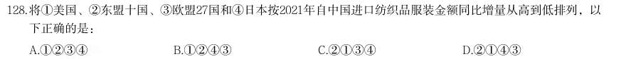

- **A.** 1234
- **B.** 1243
- **C.** 2134
- **D.** 2143

**答案：D**

### 2023 国考·行政执法　第 130 题　（选正确项）

2020年,中国对“一带一路”沿线国家纺织品服装贸易顺差额约为多少亿美元?

- **A.** 1129
- **B.** 1253
- **C.** 808
- **D.** 1006

**答案：C**

### 2022 广东·乡镇　第 86 题　（选正确项）
> 材料：基层群众性自治组织是我国在城市和农村按居民的居住地区建立起来的居民委员会或村民委员会,是城市居 民或农村村民自我管理、自我教育、自我服务的组织。 截止2020 年底,全国基层群众性自治组织共计61.5 万个,同比减少4.35%。…

2020 年,全国基层群众性自治组织较上年减少( )万个。

- **A.** 1.4
- **B.** 2.8
- **C.** 4.2
- **D.** 5.6

**答案：B**

### 2022 广东·乡镇　第 91 题　（选正确项）

“十三五”期间,我国平均每公顷森林蓄积量达到( )立方米。

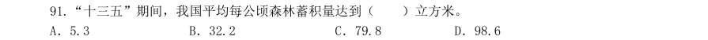

- **A.** 5.3
- **B.** 32.2
- **C.** 79.8
- **D.** 98.6

**答案：C**

### 2022 广东·乡镇　第 95 题　（选正确项）

根据以上资料,下列说法不准确的是:

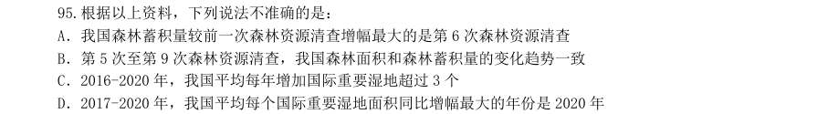

- **A.** 我国森林蓄积量较前一次森林资源清查增幅最大的是第6 次森林资源清查
- **B.** 第5 次至第9 次森林资源清查,我国森林面积和森林蓄积量的变化趋势一致
- **C.** 2016-2020 年,我国平均每年增加国际重要湿地超过3 个
- **D.** 2017-2020 年,我国平均每个国际重要湿地面积同比增幅最大的年份是2020 年

**答案：暂缺**

### 2022 广东·县级　第 89 题　（选错误项）

2020 年,下列指标的同比增长率从高到低排列正确的是:

- **A.** 职工医保基金(含生育保险)收入>职工医保个人账户收入>职工医保统筹基金(含生育保险)收入
- **B.** 职工医保个人账户支出>职工医保个人账户收入>职工医保统筹基金(含生育保险)收入
- **C.** 职工医保个人账户收入>职工医保基金(含生育保险)收入>职工医保基金(含生育保险)支出
- **D.** 职工医保基金(含生育保险)支出>职工医保统筹基金(含生育保险)支出>职工医保基金(含生育保险)

**答案：D**

### 2022 广东·县级　第 90 题　（选错误项）

根据以上资料,下列说法不准确的是:

- **A.** 2020 年,职工医保参保人员人均享受待遇约5 次
- **B.** 2019 年,在职职工住院率约为退休职工住院率的四分之一
- **C.** 2020 年,三类职工医保参保人员中,灵活就业等其他人员参保人数同比增速最快
- **D.** 若职工医保个人账户收入和支出的年同比增幅保持不变,则2021 年个人账户当期结存不足2000 亿元

**答案：D**

### 2022 广东·县级　第 91 题　（选正确项）

“十三五”期间,我国平均每公顷森林蓄积量达到( )立方米。

- **A.** 5.3
- **B.** 32.2
- **C.** 79.8
- **D.** 98.6

**答案：C**

### 2022 广东·县级　第 95 题　（选正确项）

根据以上资料,下列说法不准确的是:

- **A.** 我国森林蓄积量较前一次森林资源清查增幅最大的是第6 次森林资源清查
- **B.** 第5 次至第9 次森林资源清查,我国森林面积和森林蓄积量的变化趋势一致
- **C.** 2016-2020 年,我国平均每年增加国际重要湿地超过3 个
- **D.** 2017-2020 年,我国平均每个国际重要湿地面积同比增幅最大的年份是2020 年

**答案：暂缺**

### 2022 广东·县级　第 100 题　（综合分析（综合））

根据以上资料,下列说法准确的是:

- **A.** 2019 年,国内航线运输飞行时长占全行业运输航空公司运输飞行时长的9 成以上
- **B.** 相比2019 年,2020 年我国国内航线、港澳台航线、国际航线平均每条航线完成旅客运输量均有下降
- **C.** 2016-2020 年,按重复距离计算的总航线里程公里数年均增长不到100 万
- **D.** 2019 年,全行业运输航空公司完成运输起飞不到400 万架次

**答案：暂缺**

### 2022 国考·副省级　第 116 题　（综合分析（综合））

(单选题)2019 年,中国IC 先进封装市场规模约为多少亿元?

- **A.** 296
- **B.** 279
- **C.** 252
- **D.** 235

**答案：A**

### 2022 国考·副省级　第 117 题　（综合分析（综合））

(单选题)“十三五”(2016—2020)年期间,中国IC 封装市场总规模:

- **A.** 不到1.0 万亿元
- **B.** 在1.0—1.1 万亿元之间
- **C.** 在1.1—1.2 万亿元之间
- **D.** 超过1.2 万亿元

**答案：B**

### 2022 国考·副省级　第 121 题　（选正确项）

(单选题)表中所列食品类别中,2021 年第一季度所有抽检样本全部合格的有几类?

- **A.** 2
- **B.** 3
- **C.** 4
- **D.** 5

**答案：B**

### 2022 国考·副省级　第 124 题　（选正确项）

(单选题)将1肉制品、2乳制品和3蛋制品按2021 年第一季度市场监管部门食品安全监督抽检合格率 从高到低排列,以下正确的是:

- **A.** 321
- **B.** 231
- **C.** 123
- **D.** 132

**答案：B**

### 2022 国考·副省级　第 125 题　（选错误项）

(单选题)关于2021 年第一季度市场监管部门食品安全监督情况,以下信息能够从上述资料中推出的有 几项? 1蔬菜、水果制品的总体抽检合格率高于95% 2样品抽检量超过1 万批次的食品类别有12 个 3糕点类食品的抽检合格量是不合格量的50 倍以上

- **A.** 0 项
- **B.** 1 项
- **C.** 2 项
- **D.** 3 项

**答案：A**

### 2022 国考·副省级　第 127 题　（选正确项）

(单选题)将2020 年H 省秋粮机耕、机播、机收、排灌成本按同比增量从高到低的顺序排列,以下正确 的是:

- **A.** 机收、排灌、机耕、机播
- **B.** 机耕、机播、机收、排灌
- **C.** 机耕、机播、排灌、机收
- **D.** 机收、排灌、机播、机耕

**答案：B**

### 2022 国考·副省级　第 131 题　（综合分析（综合））
> 材料：亿立方米,同比增长7.44%;中石化供应2.45 亿立方米,同比增长26.29%。从用气结构看:民用气为3.98 亿立方米,同比增长16.72%;CNG 用气0.64 亿立方米,同比下降7.25%;工业用气5.05 亿立方米,同比增 长10.75%。 2020 年,C 市天然气用量为107.47 亿立方米,同比增长3.83%。其中,中石油供应73.96 亿立方米,同 比增长1.72%;中石化供应33.51 亿立方米,同比增长8.8%。从用气结构看:民用气为33.75 亿立方米…

从用气结构看:民用气为7.78 亿立方 米,同比增长12.75%;CNG 用气1.14 亿立方米,同比增长44.3%;工业用气10.29 亿立方米,同比增长 10.17%。 (单选题)2021 年1 月,C 市天然气用量比上月:

- **A.** 增加了0.2 亿立方米以上
- **B.** 减少了不到0.2 亿立方米
- **C.** 减少了0.2 亿立方米以上
- **D.** 增加了不到0.2 亿立方米

**答案：A**

### 2022 国考·副省级　第 133 题　（综合分析（综合））

(单选题)2019—2020 年,C 市CNG 用气总量约为多少亿立方米?

- **A.** 15
- **B.** 17
- **C.** 11
- **D.** 13

**答案：A**

### 2022 国考·副省级　第 134 题　（排序与图示判断）

(单选题)以下哪个饼图最能准确反映2021 年1—2 月C 市天然气用量中,民用气(白色)、CNG 用气 (黑色)和工业用气(斜线)的占比关系?

- **A.** 如上图所示
- **B.** 如上图所示
- **C.** 如上图所示
- **D.** 如上图所示

**答案：D**

### 2022 国考·副省级　第 135 题　（选正确项）

(单选题)以下柱状图反映了C 市天然气2020 年12 月—2021 年2 月间哪一数值的变化趋势?

- **A.** 中石油供气量
- **B.** 中石化供气量
- **C.** 民用气用量
- **D.** 工业用气用量

**答案：B**

### 2022 国考·地市级　第 112 题　（综合分析（综合））

将2020 年H 省秋粮机耕、机播、机收、排灌成本按同比增量从高到低的顺序排列,以下正 确的是:

- **A.** 机收、排灌、机耕、机播
- **B.** 机耕、机播、机收、排灌
- **C.** 机耕、机播、排灌、机收
- **D.** 机收、排灌、机播、机耕

**答案：B**

### 2022 国考·地市级　第 116 题　（综合分析（综合））

2019 年,中国IC 先进封装市场规模约为多少亿元?

- **A.** 296
- **B.** 279
- **C.** 252
- **D.** 235

**答案：A**

### 2022 国考·地市级　第 117 题　（综合分析（综合））

“十三五”(2016—2020)年期间,中国IC 封装市场总规模:

- **A.** 不到1.0 万亿元
- **B.** 在1.0—1.1 万亿元之间
- **C.** 在1.1—1.2 万亿元之间
- **D.** 超过1.2 万亿元

**答案：B**

### 2022 国考·地市级　第 121 题　（选正确项）

表中所列食品类别中,2021 年第一季度所有抽检样本全部合格的有几类?

- **A.** 2
- **B.** 3
- **C.** 4
- **D.** 5

**答案：B**

### 2022 国考·地市级　第 124 题　（选正确项）

将1肉制品、2乳制品和3蛋制品按2021 年第一季度市场监管部门食品安全监督抽检合格 率从高到低排列,以下正确的是:

- **A.** 321
- **B.** 231
- **C.** 123
- **D.** 132

**答案：B**

### 2022 国考·地市级　第 125 题　（选错误项）

关于2021 年第一季度市场监管部门食品安全监督情况,以下信息能够从上述资料中推出的 有几项? 1蔬菜、水果制品的总体抽检合格率高于95% 2样品抽检量超过1 万批次的食品类别有12 个 3糕点类食品的抽检合格量是不合格量的50 倍以上

- **A.** 0 项
- **B.** 1 项
- **C.** 2 项
- **D.** 3 项

**答案：A**

### 2022 国考·地市级　第 126 题　（综合分析（综合））
> 材料：7.22 亿立方米,同比增长7.44%;中石化供应2.45 亿立方米,同比增长26.29%。从用气结构看:民用 气为3.98 亿立方米,同比增长16.72%;CNG 用气0.64 亿立方米,同比下降7.25%;工业用气5.05 亿立 方米,同比增长10.75%。 2020 年,C 市天然气用量为107.47 亿立方米,同比增长3.83%。其中,中石油供应73.96 亿立方米, 同比增长1.72%;中石化供应33.51 亿立方米,同比增长8.8%。从用气结构看:民用气为33.7…

从用气结构看:民用气为7.78 亿立方米,同比增长12.75%;CNG 用气1.14 亿立方米,同比增长44.3%;工业用气10.29 亿立方米,同 比增长10.17%。 2021 年1 月,C 市天然气用量比上月:

- **A.** 增加了0.2 亿立方米以上
- **B.** 减少了不到0.2 亿立方米
- **C.** 减少了0.2 亿立方米以上
- **D.** 增加了不到0.2 亿立方米

**答案：A**

### 2022 国考·地市级　第 128 题　（综合分析（综合））

2019—2020 年,C 市CNG 用气总量约为多少亿立方米?

- **A.** 15
- **B.** 17
- **C.** 11
- **D.** 13

**答案：A**

### 2022 国考·地市级　第 129 题　（排序与图示判断）

以下哪个饼图最能准确反映2021 年1—2 月C 市天然气用量中,民用气(白色)、CNG 用 气(黑色)和工业用气(斜线)的占比关系?

- **A.** 如上图所示
- **B.** 如上图所示
- **C.** 如上图所示
- **D.** 如上图所示

**答案：D**

### 2022 国考·地市级　第 130 题　（选正确项）

以下柱状图反映了C 市天然气2020 年12 月—2021 年2 月间哪一数值的变化趋势?

- **A.** 中石油供气量
- **B.** 中石化供气量
- **C.** 民用气用量
- **D.** 工业用气用量

**答案：B**

### 2022 国考·行政执法　第 118 题　（判断个数）

(单选题)2020 年下半年,环保举报的受理率超过75%的月份有几个?

- **A.** 3
- **B.** 4
- **C.** 5
- **D.** 6

**答案：C**

### 2022 国考·行政执法　第 119 题　（综合分析（综合））

(单选题)如同一个月内各类举报的受理率彼此相同,则2020 年12 月通过电话的环保举报被受理的件 数在以下哪个范围内?

- **A.** 低于7501 件
- **B.** 7501—8500 件之间
- **C.** 8501—9500 件之间
- **D.** 高于9500 件

**答案：C**

### 2022 国考·行政执法　第 127 题　（综合分析（综合））

(单选题)2021 年4—5 月,全国共立电信网络诈骗案件约多少万起?

- **A.** 12
- **B.** 14
- **C.** 16
- **D.** 18

**答案：D**

### 2022 国考·行政执法　第 130 题　（判断个数）

(单选题)以下信息中,能够从上述资料中推出的有几项? 12020 年1—5 月,全国抓获电信网络诈骗犯罪嫌疑人10 万名以上 22021 年1—5 月,全国公安机关破获被骗百万元以上案件比去年同期多500 件以上 32020 年10 月—2021 年5 月,每打掉1 个“两卡”违法犯罪团伙,平均缴获的电话卡和银行卡总量就 在300 张以上

- **A.** 0 项
- **B.** 1 项
- **C.** 2 项
- **D.** 3 项

**答案：B**

### 2021 广东·乡镇　第 86 题　（综合分析（综合））

2019 年G 省平均每个农业科研和科技开发机构的高级职称人数最接近( )。

- **A.** 18.5
- **B.** 20.5
- **C.** 22.5
- **D.** 24.5

**答案：暂缺**

### 2021 广东·乡镇　第 89 题　（综合分析（综合））

2015-2019 年,G 省农业科研和科技开发机构发表科学论文篇数最多的一年是( )。

- **A.** 2015 年
- **B.** 2016 年
- **C.** 2017 年
- **D.** 2019 年

**答案：暂缺**

### 2021 广东·乡镇　第 90 题　（选正确项）

根据资料,下列关于G 省的说法正确的是( )。

- **A.** 2019 年科普示范社区(村)数是科普示范街道(乡镇)的十倍以上
- **B.** 2015-2019 年农业科研和科技开发机构科技活动课题数逐年增加
- **C.** 2019 年农业科研和科技开发机构国外发表科学论文比2015 年多266 篇
- **D.** 2015-2019 年,农业科研和科技开发机构科技论著每年都超过40 种

**答案：暂缺**

### 2021 广东·乡镇　第 91 题　（排序与图示判断）
> 材料：公考整理。真实性有待核实。 智能机器人产业是G 省战略性新兴产业之一。2020 年前三季度,G 省智能机器人产业纳入规模以上工业统计 的法人单位共140 家,完成总产值306.90 亿元,占全部规模以上工业产值的0.3%,同比增长29.8%,增速高于 全部规模以上工业产值32.8 个百分点;前三季度平均用工人数3.12 万人,同比增长8.6%。 2020 年前三季度,G 省智能机器人产业实现营业收入326.62 亿元,同比增长超40%,四大行业营业收入均 实现正增长,经济效益…

2020 年前三季度,G 省智能机器人产业中,四大行业总产值的同比增量排序正确的是( )。 1工业机器人制造业 2特殊作业工业机器人制造业 3智能无人飞行器制造业 4服务消费机器人制造业

- **A.** 1>3>2>4
- **B.** 4>2>1>3
- **C.** 3>4>2>1
- **D.** 3>1>2>4

**答案：暂缺**

### 2021 广东·乡镇　第 95 题　（选错误项）

根据所给资料,下列说法不正确的是( )。

- **A.** 2020 年前三季度,G 省全部规模以上工业产值同比增长3%
- **B.** 2019 年前三季度,G 省智能机器人产业营业收入超200 亿元
- **C.** 2019 年前三季度,G 省智能机器人产业平均用工人数为2.87 万人
- **D.** 2020 年前三季度,G 省智能机器人产业中利润率最高的行业是特殊作业工业机器人制造业

**答案：暂缺**

### 2021 广东·乡镇　第 98 题　（综合分析（综合））

以下农产品类别中,2019 年上半年我国进出口总额最高的是:

- **A.** 食用蔬菜
- **B.** 禽类产品
- **C.** 饮料、酒及醋
- **D.** 咖啡、茶、马黛茶及调味香料

**答案：暂缺**

### 2021 广东·乡镇　第 100 题　（选错误项）

根据以上材料,关于我国2020 年上半年农产品进出口情况,下列说法错误的是:

- **A.** 畜类产品进口额为谷物进口额的6 倍以上
- **B.** 对亚洲国家或地区的出口额高于其农产品进口额
- **C.** 六大洲中只有南美洲国家或地区的进口额超过160 亿美元
- **D.** 表格给出的农产品出口额合计约占我国农产品出口额的30%

**答案：暂缺**

### 2021 国考·副省级　第 117 题　（综合分析（综合））

表1 中“(?)”处应当填入的数字最可能是:

- **A.** 60
- **B.** 70
- **C.** 80
- **D.** 90

**答案：暂缺**

### 2021 国考·副省级　第 120 题　（综合分析（综合））

关于2019 年直排海污染源状况,不能从上述资料中推出的是:

- **A.** 由综合类排口排放的总磷占所有排口排放总磷的75%以下
- **B.** 平均每吨排往黄海的污水化学需氧量为四大海区中最高
- **C.** 平均每个直排南海的污水排口日均污水排放量在3000-4000 吨之间
- **D.** 通过生活类排口排放的总氮量占所有排口总氮排放量的比重,高于通过生活类排口排的总磷量占所有排口总

**答案：暂缺**

### 2021 国考·副省级　第 125 题　（综合分析（综合））

能够从上述资料中推出的是:

- **A.** 2019 年全国城轨交通运营线路总里程不到6000 公里
- **B.** 2019 年全国地铁运营线路长度相比2016 年增量是2016 年相比2013 年增量的两倍以上
- **C.** 表中2019 年末地铁运营线路长度排名前3 的城市地铁运营线路长度之和占全国总量的50%以上
- **D.** 表中2019 年平均每条运营线路客运量最少的城市,地铁客运量在表中各城市排前10 位

**答案：暂缺**

### 2021 国考·副省级　第 130 题　（综合分析（综合））

能够从上述资料中推出的是:

- **A.** 2019 年全国得到基本康复服务的0—6 岁残疾儿童占得到基本康复服务的残疾儿童及持证残疾人的2%以上
- **B.** 2015 年,全国平均每月新增残疾人康复机构20 家以上
- **C.** 2019 年末,全国残疾人康复机构中,超过25%提供孤独症儿童康复服务
- **D.** 截至2019 年末,全国已竣工的各级残疾人综合服务设施平均每平方米的投资额在3000—4000 元之间

**答案：暂缺**

### 2021 国考·副省级　第 132 题　（综合分析（综合））

2019 年1—2 月,我国对外承包工程月均完成营业额比月均新签合同额:

- **A.** 高不到300 亿元人民币
- **B.** 高300 亿元人民币以上
- **C.** 低不到300 亿元人民币
- **D.** 低300 亿元人民币以上

**答案：暂缺**

### 2021 国考·副省级　第 135 题　（综合分析（综合））

能够从上述资料中推出的是:

- **A.** 2019 年1—2 月,我国境内投资者对境外企业非金融类直接投资额高于对外承包工程完成营业额
- **B.** 2019 年1—2 月,我国对外劳务合作月均派出各类劳务人员不到1 万人
- **C.** 2020 年1—2 月我国企业有新增投资的“一带一路”沿线国家中,我国企业平均对每个国家的新增投资额超过0.6 亿美元
- **D.** 2020 年1—2 月,我国企业在“一带一路”沿线国家新签对外承包工程合同额同比增量超过30 亿美元

**答案：暂缺**

### 2021 国考·地市级　第 115 题　（选错误项）

关于2013—2019 年我国LED 产业,能够从上述资料中推出的是:

- **A.** 2016 年总产值同比增量低于2015 年
- **B.** 2019 年封装产值占行业总产值比重高于5 年前水平
- **C.** 7 年间汽车照明应用累计产值规模超过500 亿元
- **D.** 每年景观照明应用的产值均高于背光应用产值

**答案：D**

### 2021 国考·地市级　第 116 题　（判断个数）

2014—2019 年间,全国地铁运营线路长度同比增长20%以上的年份有几个?

- **A.** 1
- **B.** 2
- **C.** 3
- **D.** 4

**答案：A**

### 2021 国考·地市级　第 120 题　（选错误项）

能够从上述资料中推出的是:

- **A.** 2019 年全国城轨交通运营线路总里程不到6000 公里
- **B.** 2019 年全国地铁运营线路长度相比2016 年增量是2016 年相比2013 年增量的两倍以上
- **C.** 表中2019 年末地铁运营线路长度排名前3 的城市地铁运营线路长度之和占全国总量的50%以上
- **D.** 表中2019 年平均每条运营线路客运量最少的城市,地铁客运量在表中各城市排前10 位

**答案：D**

### 2021 国考·地市级　第 123 题　（选正确项）

如提供视力残疾康复服务的残疾人康复机构中,同时提供听力言语残疾康复服务的机构比不提供该服务的 机构多20%,则2019 年末全国有多少家残疾人康复机构不提供以上两种康复服务中的任意一种?

- **A.** 不到7300 家
- **B.** 7300—7600 家之间
- **C.** 7600—7900 家之间
- **D.** 超过7900 家

**答案：B**

### 2021 国考·地市级　第 125 题　（选错误项）

能够从上述资料中推出的是:

- **A.** 2019 年全国得到基本康复服务的0—6 岁残疾儿童占得到基本康复服务的残疾儿童及持证残疾人的2%以上
- **B.** 2015 年,全国平均每月新增残疾人康复机构20 家以上
- **C.** 2019 年末,全国残疾人康复机构中,超过25%提供孤独症儿童康复服务
- **D.** 截至2019 年末,全国已竣工的各级残疾人综合服务设施平均每平方米的投资额在3000—4000 元之间

**答案：D**

### 2021 国考·地市级　第 126 题　（选正确项）
> 材料：2019 年上半年,我国服务进出口总额达到26124.6 亿元,同比增长2.6%。其中,出口总额9333.7 亿元,同 比增长9.0%;进口总额16790.8 亿元,同比下降0.6%。服务进出口总额占对外贸易总额的比重达到15.1%,比 2018 年全年高出0.5 个百分点。 2019 年全年,我国服务进出口总额54152.9 亿元,同比增长2.8%。其中,出口总额19564.0 亿元,同比增 长8.9%;进口总额34588.9 亿元,同比减少0.4%。 2019 年上半年,…

从具体领域看,个人文化娱乐服务,电信、 计算机和信息服务,金融服务进出口总额分别同比增长19.4%、18.9%、18.7%。 2019 年下半年,我国服务进出口贸易状况为:

- **A.** 顺差5000 亿元以内
- **B.** 顺差5000 亿元以上
- **C.** 逆差5000 亿元以内
- **D.** 逆差5000 亿元以上

**答案：D**

### 2021 国考·地市级　第 128 题　（选正确项）

2018 年,我国对外贸易总额约为多少万亿元?

- **A.** 17
- **B.** 25
- **C.** 36
- **D.** 48

**答案：C**

### 2021 国考·地市级　第 130 题　（选错误项）

能够从上述资料中推出的是:

- **A.** 2019 年下半年,我国服务进口额同比为正增长
- **B.** 2019 年上半年,电信、计算机和信息服务进出口总额占知识密集型服务进出口总额的比重高于上年同期水平
- **C.** 2019 年上半年,非知识密集型服务进出口贸易逆差低于7000 亿元
- **D.** 2019 年下半年,我国知识密集型服务出口额占服务出口额的比重低于知识密集型服务进口额占服务进口额的

**答案：B**

### 2020 湖北·统一卷　第 106 题　（选正确项）

截至2017 年底,中国人工智能市场规模约为:

- **A.** 141.1 亿元
- **B.** 152.1 亿元
- **C.** 156.1 亿元
- **D.** 164.1 亿元

**答案：B**

### 2020 湖北·统一卷　第 110 题　（选正确项）

下列说法正确的是:

- **A.** 截至2018 年底,中国人工智能市场规模每年同比增长率都超过50%
- **B.** 截至2018 年底,中国人工智能企业地城分布情况中,广东企业数量最多
- **C.** 截至2018 年底,中国人工智能企业北京企业数量不超过上海企业数量的50%
- **D.** 截至2018 年底,福建人工智能企业的数量等于河南、天津、广西三省企业数量之和

**答案：暂缺**

### 2020 湖北·统一卷　第 111 题　（排序与图示判断）
> 材料：2019 年5 月,全国12358 价格监管平台受理价格举报、投诉、咨询共计37576 件,同比下降40.70%,环比 下降9.31%。…

其中,价格举报4192 件,环比下降19.06%;价格投诉2059 件,环比下降15.92%;价格咨询31325 件,环比下降7.34%。平台受理量排名前十的省份依次是北京(5786 件)、江苏(3528 件)、上海(2499 件)、 重庆(2486 件)、河南(2469 件)、陕西(2440 件)、浙江(2321 件)、天津(1571 件)、福建(1483 件)、 广西(1309 件)。平台受理量行业分布如下表所示: 2019 年4 月,平台受理的价格咨询比价格举报约多:

- **A.** 26146 件
- **B.** 27133 件
- **C.** 28627 件
- **D.** 29614 件

**答案：暂缺**

### 2020 湖北·统一卷　第 115 题　（综合分析（综合））

能够从上述资料推出的是:

- **A.** 2018 年5 月,平台受理价格举报数量多于价格投诉数量
- **B.** 2019 年5 月,平台受理价格咨询数量环比下降幅度最大
- **C.** 2019 年5 月,平台受理教育行业数量不超过旅游行业的2 倍
- **D.** 2019 年5 月,平台受理量排名前三的省份占总数的比重低于35%

**答案：暂缺**

### 2020 湖北·统一卷　第 118 题　（综合分析（综合））

2016 年,A 市旅游服务价值年值比农林牧渔业总产值年值多:

- **A.** 494.46 亿元
- **B.** 462.79 亿元
- **C.** 441.85 亿元
- **D.** 404.35 亿元

**答案：暂缺**

### 2020 湖北·统一卷　第 120 题　（综合分析（综合））

能够从上述资料中推出的是:

- **A.** 2016 年A 市气候调节价值年值超过700 亿元
- **B.** 2017 年A 市现代农业生态服务价值年值增长率、贴现值增长率最低的是同一个指标
- **C.** 2017 年A 市生态与环境价值贴现值超过直接经济价值贴现值、间接经济价值贴现值之和的5 倍
- **D.** 2017 年A 市气候调节价值与水源涵养价值的年值之和超过生态与环境价值中其余指标的年值之和

**答案：暂缺**

### 2020 湖北·统一卷　第 121 题　（综合分析（综合））
> 材料：2019 年6 月,全国发行地方政府债券8996 亿元,同比增长68.37%,环比增长195.63%。其中,发行一般债 券3178 亿元,同比减少28.33%,环比增长117.08%,发行专项债券5818 亿元,同比增长540.04%,环比增长 268.46%;按用途划分,发行新增债券7170 亿元,同比增长127.11%,环比增长332.71%,发行置换债券和再融 资债券1826 亿元,同比减少16.47%,环比增长31.75%。 2019 年6 月,地方政府债券平均发行期…

2019 年6 月,全国发行的地方政府债券比2018 年6 月多约:

- **A.** 6151 亿元
- **B.** 5953 亿元
- **C.** 3653 亿元
- **D.** 3043 亿元

**答案：暂缺**

### 2020 湖北·统一卷　第 122 题　（综合分析（综合））

2018 年1 至5 月,全国发行地方政府债券约:

- **A.** 23029 亿元
- **B.** 19376 亿元
- **C.** 14109 亿元
- **D.** 8766 亿元

**答案：暂缺**

### 2020 湖北·统一卷　第 123 题　（综合分析（综合））

2018 年6 月,发行置换债券和再融资债券约为:

- **A.** 3157 亿元
- **B.** 2186 亿元
- **C.** 1657 亿元
- **D.** 1386 亿元

**答案：暂缺**

### 2020 湖北·统一卷　第 124 题　（排序与图示判断）

2019 年1 至6 月,全国发行地方政府债券同比增量绝对值排序正确的是:

- **A.** 新增债券>专项债券>置换债券和再融资债券>一般债券
- **B.** 新增债券>置换债券和再融资债券>一般债券>专项债券
- **C.** 专项债券>新增债券>置换债券和再融资债券>一般债券
- **D.** 置换债券和再融资债券>专项债券>一般债券>新增债券

**答案：暂缺**

### 2020 湖北·统一卷　第 125 题　（综合分析（综合））

不能从上述资料推出的是:

- **A.** 截至2019 年6 月末,地方政府一般债务余额和专项债务余额都控制在限额之内
- **B.** 2019 年1 至6 月,地方政府一般债券的平均发行利率高于专项债券0.1 个百分点
- **C.** 2019 年5 月,地方政府新增债券的平均发行期限比置换债券和再融资债券短
- **D.** 2019 年地方一般债务限额比专项债务限额多25404.14 亿元

**答案：暂缺**

### 2020 广东·乡镇　第 89 题　（综合分析（综合））

下列选项中,城镇地区互联网普及率与农村相差最大的是:

- **A.** 2015 年
- **B.** 2016 年
- **C.** 2017 年
- **D.** 2018 年

**答案：暂缺**

### 2020 广东·乡镇　第 90 题　（选正确项）

根据以上资料,下列说法正确的是:

- **A.** 截至2020 年3 月,农村人口约为7 亿
- **B.** 2019 年农村网民规模同比增长率约为13.3%
- **C.** 2013—2018 年,我国城镇地区互联网普及率的增幅逐年提升
- **D.** 2013—2018 年,我国农村网民规模每年均较上一年有所增长

**答案：暂缺**

### 2020 广东·乡镇　第 94 题　（综合分析（综合））

2018 年,我国农民工在各区域的月均收入从高到低是:

- **A.** 西部地区>中部地区>东北地区>东部地区
- **B.** 中部地区>东部地区>东北地区>西部地区
- **C.** 东部地区>西部地区>东北地区>中部地区
- **D.** 东部地区>中部地区>西部地区>东北地区

**答案：暂缺**

### 2020 广东·乡镇　第 95 题　（选错误项）

根据以上资料,下面说法不正确的是:

- **A.** 2018 年农民工月均收入达4100 元
- **B.** 2019 年,不同行业的农民工的年收入差距可能在1.2 万元以上
- **C.** 2019 年,外出农民工月均收入同比增速高于本地农民工
- **D.** 2015—2019 年间,农民工规模同比增速最小的是2018 年

**答案：暂缺**

### 2020 广东·乡镇　第 96 题　（综合分析（综合））
> 材料：2019 年全国农村网络零售额从2014 年的1800 亿元增加至逾1.7 万亿元,占全国网络零售总额的16.1%, 较上年略有提升;同比增长19.1%,高于全国网络零售总额增长率2.6 个百分点。 分地区看,东、中、西部和东北地区农村网络零售额分别占全国农村网络零售额的76.6%、12.0%,9.4%和 2.0%,同比增长分别为19.8%,17.1%,17.6%和10.2%。 2019 年,电子商务进农村综合示范工作聚焦脱贫攻坚和乡村振兴,取得了阶段性成果。…

2014—2019 年间,全国农村网络零售额平均每年增长约( )亿元。

- **A.** 2183.3
- **B.** 2547.1
- **C.** 3056.6
- **D.** 3820.7

**答案：暂缺**

### 2020 广东·乡镇　第 99 题　（综合分析（综合））

2019 年全国各类农产品中,网络零售额排名前三的农产品零售额合计约为( )亿元。

- **A.** 277.1
- **B.** 739.4
- **C.** 1073.3
- **D.** 1935.8

**答案：暂缺**

### 2020 广东·乡镇　第 100 题　（选正确项）

根据以上资料,下列说法正确的是:

- **A.** 2014—2019 年,农村网络零售额增长了10 倍
- **B.** 2019 年,平均每个贫困县网络零售额超2 亿元
- **C.** 2018 年,全国农村网络零售额约占全国网络零售总额的17%
- **D.** 2019 年水产品占全国农产品网络零售额的比重较2018 年有所下降

**答案：暂缺**

### 2020 广东·县级　第 90 题　（选正确项）

如果B 市社保缴费基数,每5 年调整一次,则根据上述资料,以下说法正确的是( )。

- **A.** 1994-2019 年,B 市城镇人员养老保险缴纳基数下限与上年社会平均工资的比值逐渐缩小
- **B.** 1994-2019 年,B 市城镇人员养老保险的企业缴纳比例和个人缴纳比例逐渐降低
- **C.** 2004-2019 年,B 市城镇人员的工伤和医疗生育保险缴纳基数下限始终不低于养老基数下限
- **D.** 2009-2019 年,B 市城镇人员与农业户口人员的各项保险缴纳差距逐渐缩小

**答案：暂缺**

### 2020 广东·县级　第 94 题　（综合分析（综合））

2018 年,我国农民工在各区域的月均收入从高到低是:

- **A.** 西部地区>中部地区>东北地区>东部地区
- **B.** 中部地区>东部地区>东北地区>西部地区
- **C.** 东部地区>西部地区>东北地区>中部地区
- **D.** 东部地区>中部地区>西部地区>东北地区

**答案：暂缺**

### 2020 广东·县级　第 95 题　（选错误项）

根据以上资料,下面说法不正确的是:

- **A.** 2018 年农民工月均收入达4100 元
- **B.** 2019 年,不同行业的农民工的年收入差距可能在1.2 万元以上
- **C.** 2019 年,外出农民工月均收入同比增速高于本地农民工
- **D.** 2015—2019 年间,农民工规模同比增速最小的是2018 年

**答案：暂缺**

### 2020 广东·县级　第 97 题　（综合分析（综合））

与2018 年相比,2019 年广东规模以上工业企业用水量:

- **A.** 减少了约0.8 亿立方米
- **B.** 增加了约1.8 亿立方米
- **C.** 减少了约2.8 亿立方米
- **D.** 增加了约3.8 亿立方米

**答案：暂缺**

### 2020 广东·县级　第 100 题　（选正确项）

根据以上资料,下列有关2019 年广东省规模以上工业企业重复用水情况正确的是:

- **A.** 全省约有规模以上工业企业4.3 万家
- **B.** 有重复用水的企业的平均重复用水量约为41.2 万立方米
- **C.** 重复用水量超过1000 万立方米的企业的平均重复用水量约为1.8 亿立方米
- **D.** 电力行业的重复用水率不可能低于50%

**答案：暂缺**

### 2020 广东·综合行政能力测验　第 86 题　（选正确项）

根据2018 年的增长率预测,2019 年我国电子政务市场的规模约为( )亿元。

- **A.** 3270
- **B.** 3370
- **C.** 3470
- **D.** 3570、

**答案：B**

### 2020 广东·综合行政能力测验　第 90 题　（选错误项）

下列说法错误的是( )。

- **A.** 2015 年,我国电子政务市场首次突破两千亿元大关
- **B.** 从2013 年开始,软件市场的规模始终大于网络设备市场
- **C.** 2008—2018 年,我国电子政务市场的年均复合增长率约为
- **D.** 2008—2018 年,硬件市场与服务市场规模差距最小的一年是2018 年

**答案：A**

### 2020 广东·综合行政能力测验　第 91 题　（选正确项）
> 材料：近年来,我国海洋经济呈现总体平稳的发展态势,总量再上新台阶,产业结构不断优化,新兴产业和 新业态快速成长。 2018 年,我国主要海洋产业保持稳步增长,全年实现产值33609 亿元,比上年增长 。…

2018 年我国海洋生产总值较2015 年增加了约( )。

- **A.** 
- **B.** 
- **C.** 
- **D.** 

**答案：C**

### 2020 广东·综合行政能力测验　第 92 题　（选正确项）

2018 年,我国海洋经济发展支柱产业产值约为( )万亿元。

- **A.** 1.61
- **B.** 2.36
- **C.** 2.74
- **D.** 3.32、

**答案：C**

### 2020 广东·综合行政能力测验　第 93 题　（选正确项）

2017 年,我国海洋船舶工业产值约比海洋化工业产值( )亿元。

- **A.** 少50
- **B.** 少20
- **C.** 多50
- **D.** 多20、

**答案：D**

### 2020 广东·综合行政能力测验　第 95 题　（选错误项）

以下说法正确的是( )。

- **A.** 2017 年,我国主要海洋产业中产值最小的是海洋盐业
- **B.** 2015—2018 年,我国海洋生产总值增量最少的是2016 年
- **C.** 2014—2018 年,我国海洋经济在国民经济中的比重越来越大
- **D.** 2018 年,我国海洋科研教育管理服务业产值比上年增长超过0.2 万亿元

**答案：A**

### 2020 广东·综合行政能力测验　第 96 题　（选正确项）
> 材料：018 年,广东实现地区生产总值97277.77 亿元,按可比价格计算,同比增长 ,人均生产总值为 86412 元,比全国平均水平多21891 元,按年平均汇率折算,达到13058.30 美元。全省经济运行保持在合理 区间。…

2017 年广东规模以上工业增加值约占全国的( )。

- **A.** 
- **B.** 
- **C.** 
- **D.** 

**答案：C**

### 2020 广东·综合行政能力测验　第 98 题　（选正确项）

2018 年全国进出口总额较2017 年增加约( )万亿元。

- **A.** 1.2
- **B.** 2.7
- **C.** 4.2
- **D.** 5.7、

**答案：B**

### 2020 广东·综合行政能力测验　第 99 题　（选正确项）

2016 年广东省三大产业结构约为( )。

- **A.** 4.2:42.6:53.2
- **B.** 4.1:41.6:54.3
- **C.** 3.9:42.2:53.9
- **D.** 无法推测

**答案：A**

### 2020 国考·地市级　第 115 题　（选错误项）

关于我国海洋主题公园状况,能够从上述资料中推出的是:

- **A.** 2013~2017 年间累计游客规模超3 亿人次
- **B.** 2013 年平均每家海洋主题公园的门票收入高于上年水平
- **C.** 2011~2018 年间,年末公园数量同比增量和游客规模同比增量最大的年份不是同一个
- **D.** 2014 年海洋主题公园总收入比上年增长了8 亿多元

**答案：A**

### 2020 国考·地市级　第 117 题　（选正确项）

2012~2015 年,中国集成电路产业累计销售额在以下哪个范围内?

- **A.** 不到1 万亿元
- **B.** 在1~1.1 万亿元之间
- **C.** 在1.1~1.2 万亿元之间
- **D.** 超过1.2 万亿元

**答案：C**

### 2020 国考·地市级　第 120 题　（选错误项）

关于中国集成电路产业销售及进出口状况,能够从上述资料中推出的是:

- **A.** 2016~2017 年,月均进出口总量超过450 亿块
- **B.** 2016 年销售额同比增量低于上年水平
- **C.** 2015~2018 年,进口量和进口额均逐年上升
- **D.** 2014~2018 年,出口总量超过1 万亿块

**答案：A**

### 2020 国考·地市级　第 125 题　（选错误项）

能够从上述资料中推出的是:

- **A.** 2014~2018 年,中国旅游业总收入超过25 万亿元
- **B.** 2014~2016 年,中国旅游业总收入同比增速逐年递增
- **C.** 2016 年中国在线交通预订收入同比增速快于上年水平
- **D.** 如保持2018 年同比增量,中国在线住宿预订收入将在2023 年首超3000 亿元

**答案：A**

### 2020 国考·地市级　第 127 题　（选正确项）

第二段中(X)处应填入的数值最可能是:

- **A.** 15.0
- **B.** 13.7
- **C.** 17.6
- **D.** 16.3

**答案：D**

### 2020 国考·地市级　第 129 题　（选正确项）

2018 年,B 市高新技术示范区规模以上高新技术企业月均收入在以下哪个范围内?

- **A.** 超过5500 亿元
- **B.** 4500~5500 亿元之间
- **C.** 3500~4500 亿元之间
- **D.** 不到3500 亿元

**答案：B**

### 2020 国考·地市级　第 130 题　（选错误项）

能够从上述资料中推出的是:

- **A.** 2018 年B 市地区生产总值超过35000 亿元
- **B.** 2017 年B 市高新技术示范区规模以上高新技术企业非技术收入是技术收入的5 倍多
- **C.** 2018 年B 市战略性新兴产业增加值占新经济增加值的比重高于上年水平
- **D.** 2018 年B 市高技术服务业完成投资比上年增长了100 亿元以上

**答案：A**

### 2020 国考·省级　第 120 题　（选错误项）

能够从上述资料中推出的是:

- **A.** 2014~2018 年,中国旅游业总收入超过25 万亿元
- **B.** 2014~2016 年,中国旅游业总收入同比增速逐年递增
- **C.** 2016 年中国在线交通预订收入同比增速快于上年水平
- **D.** 如保持2018 年同比增量,中国在线住宿预订收入将在2023 年首超3000 亿元

**答案：A**

### 2020 国考·省级　第 124 题　（判断个数）

2018 年茶园面积最大的4 个省份中,茶叶产量也是全国前4 名的省份有几个?

- **A.** 3
- **B.** 4
- **C.** 1
- **D.** 2

**答案：A**

### 2020 国考·省级　第 125 题　（选错误项）

能够从上述资料中推出的是:

- **A.** 2018 年全国茶叶产量比9 年前翻了一番
- **B.** 2018 年全国茶园面积最小的产茶省份,单位面积产量也最低
- **C.** 2008~2010 年,全国茶园面积同比增速逐年持续下降
- **D.** 2018 年湖南、湖北的茶园面积占全国茶园总面积的两成以上

**答案：A**

### 2020 国考·省级　第 134 题　（排序与图示判断）

将2018 年前三季度S 省物流相关行业不同类型的收入按照同比增量从高到低排列,以下正确的是:

- **A.** 运输收入>保管收入>邮政业收入> 配送、加工、包装业收入
- **B.** 运输收入>配送、加工、包装业收入>邮政业收入>保管收入
- **C.** 运输收入>保管收入>配送、加工、包装业收入>邮政业收入
- **D.** 运输收入>邮政业收入>配送、加工、包装业收入>保管收入

**答案：A**

### 2020 国考·省级　第 135 题　（选错误项）

关于2018 年前三季度S 省物流情况,能够从上述资料中推出的是:

- **A.** 农产品物流总额同比增长了100 多亿元
- **B.** 物流运输环节收入同比增量高于该环节费用同比增量
- **C.** 外部流入(含进口)货物物流总额占社会物流总额的一半以上
- **D.** 配送、加工、包装业收入占物流相关行业总收入的比重超过5%

**答案：A**
