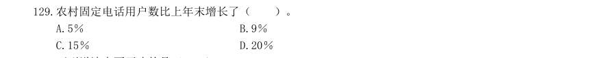
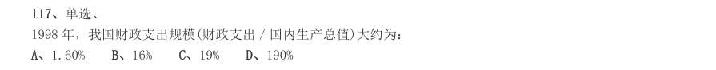
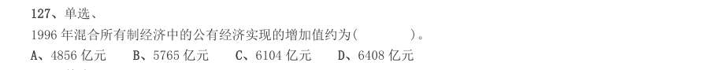

# 资料分析 · 增长量计算 · 2000 年代真题

> 所属考点：[ZL-GROW](../ZL-GROW-增长量计算.md)　｜　本片 8 题

> 本片子考点：增长量计算（综合） 7　增长量比较 1

### 【2006 国考·第 121 题】GK-2006-ty-X121　增长量计算｜增长量计算（综合）

该市2005 年6 月的总保费收入比去年同期约增长了( )。

- **A.** 14.1%
- **B.** 24.1%
- **C.** 34.1%
- **D.** 68.5%

**答案：A**

### 【2006 国考·第 133 题】GK-2006-ty-X133　增长量计算｜增长量比较
> 材料：2003 年国家财政科技拨款额达975.5 亿元,比上年增加159.3 亿元,增长19.5%,占国家财 政支出的比重为4.0%。在国家财政科技拨款中,中央财政科技拨款为639.9 亿元,比上年增长 25.2%,占中央财政支出的比重为8.6%;地方财政科技拨款为335 6 亿元,比上年增长10%, 占地方财政支出的比重为1.9%。…

与2002 年相比,2003 年科技活动经费支出绝对增长量最大的执行部门是( )。

- **A.** 各类企业
- **B.** 国有独立核算的科研院所
- **C.** 高等学校
- **D.** 无法得知

**答案：A**

### 【2005 广东省考·第 93 题】GD-2005-ty-X093　增长量计算｜增长量计算（综合）
> 材料：表 1:2002 年全国与部分省市高技术产业基本情况表 2:2002 年全国与部分省市高技术产业科技活动情况企业数(个)当年家总产主值(亿元)增加值(亿元)销售收入(亿元)利润(亿元)全国广东江苏上海北京天津浙江福建山东…

根据表1,高技术产业的增加值率(增加值/当年价总产值)最高的省(市)是:

- **A.** 广东
- **B.** 天津
- **C.** 上海
- **D.** 山东

**答案：暂缺**

### 【2004 广东省考·第 98 题】GD-2004-ty-X098　增长量计算｜增长量计算（综合）

该地区2003 年的三产收入与2002 年相比,增加值为:

- **A.** 7.05 亿元
- **B.** 10.08 亿元
- **C.** 11.9 亿元
- **D.** 29.32 亿元

**答案：暂缺**

### 【2003 国考（A卷）·第 129 题】GK-2003-a-X129　增长量计算｜增长量计算（综合）
> 材料：某地区劳动力文化程度的资料如下:(单位:万人)分组合计文盲小学初中高中大专本科及以上男性3452711712060912 女性40548228903063 总计75075345210901515(注:学习年限标准:文盲,0 年;小学,6年;初中,9 年;高中,12 年;大专,15 年;本科及以上,16 年)111.该地区每万人劳动力中,大专及以上文化程度的人数是多少?()。 A.350 人/万人B.400 人/万人C.450 人/万人D.500 人/万人112.根据上表所示,…

农村固定电话用户数比上年末增长了( )。

- **A.** 5%
- **B.** 9%
- **C.** 15%
- **D.** 20%

**答案：B**

### 【2002 国考（A卷）·第 117 题】GK-2002-a-X117　增长量计算｜增长量计算（综合）

116:单选、 1998 年我国国内生产总值比1995 年大约增加了:

- **A.** 1.60%
- **B.** 16%
- **C.** 19%
- **D.** 190%

**答案：B**

### 【2002 国考（A卷）·第 127 题】GK-2002-a-X127　增长量计算｜增长量计算（综合）
> 材料：单选、 下列最能描述三年间的全球经济走势的图表是: 据一份研究报告测算,1997 年我国实现国内生产总值74 772.4 亿元,其中公有经济实现56676.2 亿元, 非公有制实现18096.2 亿元,分别占整个国民经济的75.8%和24.2%。在公有经济中,国有经济实现31295.6 亿 元,集体经济实现25380.6 亿元,分别占国民经济的 41.9%和33.9%,在混合所有制经济中,公有制经济实现 增加值6517.1 亿元,占国内生产总值的8.7%,其中国有成分4860…

单选、 1996 年混合所有制经济中的公有经济实现的增加值约为( )。

- **A.** 4856 亿元
- **B.** 5765 亿元
- **C.** 6104 亿元
- **D.** 6408 亿元

**答案：D**

### 【2000 国考·第 87 题】GK-2000-ty-X087　增长量计算｜增长量计算（综合）
> 材料：表一:全面广告费分类细目表(*含包装材料印刷)项目1996 年1999 年电视杂志报纸邮寄广播其他*总计33.72 亿元49.72 亿元表二:1999 年广告支出前五名公司的广告支出费与产品销售额一览表公司广告支出费产品销售额P0.61 亿元10.722 亿元Q0.39 亿元5.960 亿元R0.37 亿元17.514 亿元S0.32 亿元66.311 亿元T0.29 亿元8.303 亿元总计1.98 亿元108.860 亿元…

其他形式的广告花费1999 年比1996 年约增加了多少亿元?( )。

- **A.** 0
- **B.** 3.9
- **C.** 8.2
- **D.** 12

**答案：B**
