# 资料分析 · 增长量计算 · 2010 年代真题

> 所属考点：[ZL-GROW](../ZL-GROW-增长量计算.md)　｜　本片 32 题

> 本片子考点：增长量计算（综合） 21　增长量计算（415 份数法） 8　增长量比较 3

### 2019 广东·乡镇　第 83 题　（增长量计算（综合））
> 材料：过去5 年,我国统筹开展交通扶贫和“四好农村路工作”,农村基础设施更加完善,服务乡村振兴成效显著。…

与2014 年相比,我国农村公路总里程增加了( )万公里。

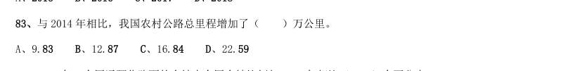

- **A.** 9.83
- **B.** 12.87
- **C.** 16.84
- **D.** 22.59

**答案：暂缺**

### 2019 广东·乡镇　第 91 题　（增长量计算（综合））
> 材料：近年来,B 省营商环境不断优化,市场活力不断增强,新登记市场主体都保持较快增长势头。2018 年,全省 新登记市场主体229.74 万户,日均新登记市场主体6294 户,同比增长 。 全省产业结构也进一步调整优化,新登记市场主体主要集中在第三产业。2018 年,全省三大产业新登记市场 主体分别为第一产业2.02 万户,第二产业24.01 万户,第三产业203.71 万户。截止2018 年12 月末,全省三大产 业的实有各类市场主体户数分别为9.83 万户,157.38 万户,…

2018 年,全省新登记企业最集中的三个行业分别是批发和零售业、租赁和商务服务业、制造业,新登记企业 数分别为36.14 万户、15.19 万户、9.25 万户,分别同比增长 、增长 、下降 。 2015-2018 年,B 省实有各类市场主体数增长了约( )万户。

- **A.** 170
- **B.** 270
- **C.** 370
- **D.** 470

**答案：暂缺**

### 2019 广东·乡镇　第 97 题　（增长量计算（综合））
> 材料：近年来,A 省大力发展绿色无公害农业。2017 年,A 省农药使用总量580 万吨,与2016 年相比减少 ;单 位耕地面积农药使用量为1.47 千克/亩。…

2017 年,A 省农药使用总量比2016 年减少了( )万吨。

- **A.** 0.25
- **B.** 0.3
- **C.** 0.35
- **D.** 0.4

**答案：暂缺**

### 2019 广东·县级　第 86 题　（增长量计算（综合））
> 材料：近年来,A 省新登记市场主体保持较快增长势头。全省实有各类市场主体从2015 年的775.95 万户增长到 2018 年的1146.13 万户。2018 年,全省新登记市场主体229.74 万户,日均新登记市场主体6294 户,同比增长 。…

2018 年,全省新登记企业最集中的三个行业分别是批发和零售业、租赁和商务服务业、制造业,新登记企 业数分别为36.14 万户、15.19 万户、9.25 万户,分别同比增长 、增长 、下降 。 2015—2018,A 省实有各类市场主体数增长了约( )万户。

- **A.** 170.2
- **B.** 270.2
- **C.** 370.2
- **D.** 470.2

**答案：暂缺**

### 2019 广东·选调　第 72 题　（增长量计算（415 份数法））
> 材料：对全国规模以上文化及相关产业5.9 万家企业的调查显示,2018 年上半年,上述企业实现营业收入42227 亿元,比上年同期增长 ,继续保持较快增长。 文化及相关产业9 个行业的营业收入均实现增长。其中,新闻信息服务营业收入3744 亿元,比上年同期增 长 ;创意设计服务5143 亿元,增长 ;内容创作生产8820 亿元,增长 ;文化传播渠道4501 亿 元,增长 ;文化辅助生产和中介服务7783 亿元,增长 ;文化消费终端生产7911 亿元,增长 ; 文化投资运营349 亿…

2018 年上半年,文化传播渠道营业收入比上年同期增加了约( )亿元。

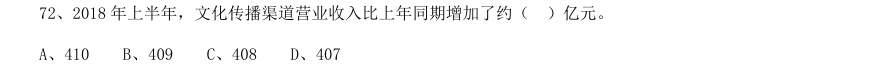

- **A.** 410
- **B.** 409
- **C.** 408
- **D.** 407

**答案：B**

### 2019 国考·地市级　第 116 题　（增长量计算（415 份数法））
> 材料：2017 年全国二手车累计交易量为1240 万辆,同比增长19.3%;二手车交易额为8092.7 亿元,同比增长34%。 2017 年12 月,全国二手车市场交易量为123 万辆,交易量环比上升7.4%,上年同期交易量为108 万辆。…

2011~2017 年,全国二手车交易量同比增量低于80 万辆的年份有几个?

- **A.** 3
- **B.** 4
- **C.** 5
- **D.** 7

**答案：B**

### 2018 湖北·统一卷　第 111 题　（增长量计算（综合））
> 材料：根据以下资料,回答111~115 题。 2017 年第一季度,某省农林牧渔业增加值361.78 亿元元,比上年同期增长5.9%,高于上年同期0.2 个百 分点。具体情况如下: 该省种植业增加值119.21 亿元,比上年同期增长8.2%,其中蔬菜种植面积358.80 万亩,比上年同期增 加18.23 万亩,蔬菜产量471.42 万吨,增长7.5%;茶叶种植面积679.53 万亩,比上年同期增加19.79 万亩, 茶叶产量2.30 万吨,增长19.49%。 该省林业增加值34.8…

该省农林牧渔服务业增加值21.87 亿元,比上年同期增长3.8%。 2015 年第一季度,该省农林牧渔业增加值与下列哪一项最为接近?

- **A.** 320 亿元
- **B.** 340 亿元
- **C.** 360 亿元
- **D.** 380 亿元

**答案：A**

### 2018 国考·副省级　第 121 题　（增长量计算（综合））

2016 年在线旅游市场交易规模约比上年增加了:

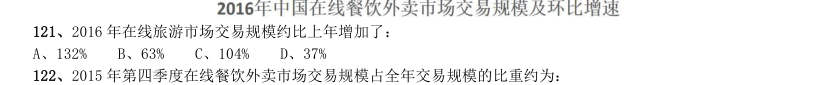

- **A.** 132%
- **B.** 63%
- **C.** 104%
- **D.** 37%

**答案：D**

### 2018 国考·副省级　第 124 题　（增长量比较）

以下哪项最能准确描述2016 年生活服务电商市场中,三个不同细分市场交易规模同比增量的比例关系?

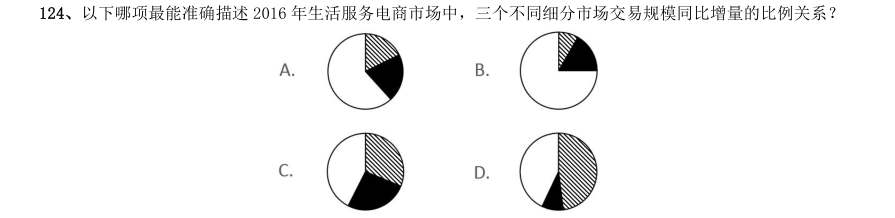

> （本题为图形题，选项为图片，见原卷）

**答案：C**

### 2018 国考·地市级　第 116 题　（增长量计算（综合））

2016 年在线旅游市场交易规模约比上年增加了:

- **A.** 132%
- **B.** 63%
- **C.** 104%
- **D.** 37%

**答案：D**

### 2017 广东·统一卷　第 98 题　（增长量计算（综合））
> 材料：2016 年,某省完成邮政通信业务总量6886.15 亿元,同比增长 ,增幅比上年提高27.4 个百分点。其中, 完成邮政业务总量1879.99 亿元,增长 ,增幅提高11.0 个百分点;完成通信业务总量5006.16 亿元, 增长 ,增幅提高33.2 个百分点。 2016 年,该省完成快递业务量76.72 亿件,同比增长 ,占全国快递业务量的比重达到 ,比排名第 二的Z 省多16.80 亿件。 2016 年,该省电话用户数为1.69 亿,其中固定电话用户数为2609.7 万…

2016 年该省移动电话用户中4G 用户数比2015 年大约增加了多少万?

- **A.** 3154
- **B.** 3483
- **C.** 3844
- **D.** 4239

**答案：暂缺**

### 2017 国考·副省级　第 119 题　（增长量计算（415 份数法））
> 材料：理。 (一) 某市2015 年全年粮食总产量4.16 万吨,同比下降2.3%;甘蔗产量0.57 万吨,下降23.6%;油料产量0.12 万吨,增长32.4%;蔬菜产量15.79 万吨,下降3.4%;水果产量7.84 万吨,增长7.4%。 全年水产品产量29.16 万吨,同比增长3.6%,其中海洋捕捞1.09 万吨,与上年持平;海水养殖6.07 万吨, 增长89.5%;淡水捕捞0.18 万吨,增长1.1%;淡水养殖21.81 万吨,下降7.9%。…

以下哪张折线图能准确反映2011-2015 年间,该市粮食生产同比增量的变化趋势?

> （本题为图形题，选项为图片，见原卷）

**答案：A**

### 2017 国考·地市级　第 114 题　（增长量计算（415 份数法））
> 材料：理。 一、根据以下资料,回答116~120 题。 某市2015 年全年粮食总产量4.16 万吨,同比下降2.3%;甘蔗产量0.57 万吨,下降23.6%;油料产量0.12 万吨,增长32.4%;蔬菜产量15.79 万吨,下降3.4%;水果产量7.84 万吨,增长7.4%。 全年水产品产量29.16 万吨,同比增长3.6%,其中海洋捕捞1.09 万吨,与上年持平;海水养殖6.07 万吨, 增长89.5%;淡水捕捞0.18 万吨,增长1.1%;淡水养殖21.81 万吨,下降7.9…

以下哪张折线图能准确反映2011-2015 年间,该市粮食生产同比增量的变化趋势? A B C D

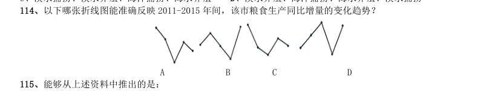

> （本题为图形题，选项为图片，见原卷）

**答案：A**

### 2015 广东·乡镇　第 86 题　（增长量比较）

有多个问题,请你根据资料所提供的信息进行分析、比较、计算和判断处理。 (一) 年,移动电话用户数与上年相比增长量最小的年份是:

- **A.** 2011 年
- **B.** 2012 年
- **C.** 2013 年
- **D.** 2014 年

**答案：暂缺**

### 2015 国考·副省级　第 131 题　（增长量计算（综合））
> 材料：2013 年末全国共有群众文化机构44260 个。比上年末增加384 个,其中乡镇文化站34343 个,增加242 个。 年末群众文化机构从业人员164355 人,比上年末增加8127 人,群众文化机构实际使用房屋建筑面积3389.4 万平方米。比上年末增长6.9%,年末群众文化机构共有馆办文艺团体6022 个,演出15.13 万场,观众6569 万人次。…

2013 年末全国群众文化机构数量同比约增长了:

- **A.** 8%
- **B.** 3%
- **C.** 0.9%
- **D.** 0.4%

**答案：C**

### 2015 国考·地市级　第 126 题　（增长量计算（综合））
> 材料：2013 年末全国共有群众文化机构44260 个。比上年末增加384 个,其中乡镇文化站34343 个,增加242 个。 年末群众文化机构从业人员164355 人,比上年末增加8127 人,群众文化机构实际使用房屋建筑面积3389.4 万平方米。比上年末增长6.9%,年末群众文化机构共有馆办文艺团体6022 个,演出15.13 万场,观众6569 万人次。…

2013 年末全国群众文化机构数量同比约增长了:

- **A.** 8%
- **B.** 3%
- **C.** 0.9%
- **D.** 0.4%

**答案：C**

### 2013 湖北·统一卷　第 146 题　（增长量计算（综合））
> 材料：2011 年上半年,我国软件产业实现软件业务收入8065 亿元,同比增长29.3%,增速比去年同期高0.2 个百 分点;实现利润103 亿元,同比增长3.49%。其中,6 月份完成软件业务收入1828 亿元,同比增长32.9%,增速 比5 月份回升3.6 个百分点。 上半年,信息技术咨询服务、数据处理和营运服务实现收入761 和1073 亿元,同比增长36.5%和34.5,分 别高出全行业7.2 和5.2 个百分点;嵌入式系统软件实现收入1443 亿元,同比增长33.8%,增…

与2011 年一季度相比,二季度软件业务收入增长了约:

- **A.** 30.2%
- **B.** 33.5%
- **C.** 36.7%
- **D.** 39.4%

**答案：B**

### 2013 湖北·统一卷　第 147 题　（增长量计算（415 份数法））
> 材料：2011 年上半年,我国软件产业实现软件业务收入8065 亿元,同比增长29.3%,增速比去年同期高0.2 个百 分点;实现利润103 亿元,同比增长3.49%。其中,6 月份完成软件业务收入1828 亿元,同比增长32.9%,增速 比5 月份回升3.6 个百分点。 上半年,信息技术咨询服务、数据处理和营运服务实现收入761 和1073 亿元,同比增长36.5%和34.5,分 别高出全行业7.2 和5.2 个百分点;嵌入式系统软件实现收入1443 亿元,同比增长33.8%,增…

2011 年上半年嵌入式系统软件收入同比增长了:

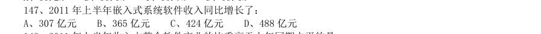

- **A.** 307 亿元
- **B.** 365 亿元
- **C.** 424 亿元
- **D.** 488 亿元

**答案：B**

### 2013 湖北·统一卷　第 150 题　（增长量计算（综合））
> 材料：某市2010 年全年实现农业增加值124.3 亿元,比上年下降1.6%。粮食播种面积22.3 万公顷,比上年减少 0.3 万公顷;粮食产量115.7 万吨,比上年下降7.3%。 全市农业观光园1303 个,比上年增加9 个;观光园总收入17.8 亿元,比上年增长16.7%。民俗旅游实际经 营户7979 户,比上年减少726 户;民俗旅游总收入7.3 亿元,增长20.7%。种业收入14.6 亿元,比上年增长13.5%。…

设施农业总面积18323 公顷,比上年下降2.3%;实现收入40.7 亿元,增长20.1%。 该市2009 年全年实现农业增加值约:

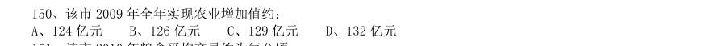

- **A.** 124 亿元
- **B.** 126 亿元
- **C.** 129 亿元
- **D.** 132 亿元

**答案：B**

### 2013 广东·三卷　第 91 题　（增长量计算（综合））
> 材料：城市综合竞争力十年间(2002 年-2011 年)的区域变化(单位:个)城市综合竞争力十年间(2002 年—2011 年)不同规模城市数量变化(单位:个)…

城市综合竞争力十年间(2002 年-2011 年)的区域变化(单位:个) 城市综合竞争力十年间(2002 年—2011 年)不同规模城市数量变化(单位:个) 与2002 年相比,2011 年西北地区进入城市综合竞争力前100 名的城市增加了( ) 个:

- **A.** 1
- **B.** 2
- **C.** 3
- **D.** 4

**答案：暂缺**

### 2013 国考·统一卷　第 117 题　（增长量计算（综合））
> 材料：2011 年前十一个月,某省高新技术产业完成总产值3763.00 亿元,实现增加值896.31 亿元。增加值同比增长30.74%,比规模以上工业增加值高11.64 个百分点,占规模以上工业增加值的比重达到25.32%。高新技术产业各领域的增加值如下图所示:高新技术产业各领域增加值饼形图(单位:亿元)…

2010 年前十一个月,该省规模以上工业增加值约为多少亿元:

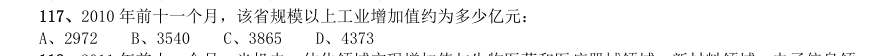

- **A.** 2972
- **B.** 3540
- **C.** 3865
- **D.** 4373

**答案：A**

### 2013 国考·统一卷　第 118 题　（增长量计算（综合））
> 材料：2011 年前十一个月,某省高新技术产业完成总产值3763.00 亿元,实现增加值896.31 亿元。增加值同比增长30.74%,比规模以上工业增加值高11.64 个百分点,占规模以上工业增加值的比重达到25.32%。高新技术产业各领域的增加值如下图所示:高新技术产业各领域增加值饼形图(单位:亿元)…

2011 年前十一个月,光机电一体化领域实现增加值与生物医药和医疗器械领域、新材料领域、电子信息领 域增加值总和的比约为:

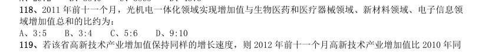

- **A.** 3:5
- **B.** 3:4
- **C.** 5:6
- **D.** 9:10

**答案：C**

### 2013 国考·统一卷　第 121 题　（增长量计算（综合））
> 材料：2011 年发现违法用地行为7.0 万件,涉及土地5.0 万公顷(耕地1.8 万公顷),同比分别上升5.8%、11.0% (耕地下降2.4%)。…

立案查处违法用地案件4.2 万件,涉及土地4.4 万公顷(耕地1.5 万公顷),同比分别上 升2.5%、11.4%(耕地下降5.7%)。依法拆除违法构建物1289.8 万平方米,收回土地3791.2 公顷(耕地1064.7 公顷),罚没款26.5 亿元。 2006~2011 年我国违法用地案件查处情况(一) 2006~2011 年我国违法用地案件查处情况(二) 单位:件,公顷 与2006 年相比,2011 年全国收缴土地面积约减少了:

- **A.** 52%
- **B.** 110%
- **C.** 67%
- **D.** 205%

**答案：C**

### 2012 湖北·统一卷　第 101 题　（增长量计算（综合））

行分析、比较、计算和判断处理。 (一) 某市证券行业主要经济数据 某市保险行业主要经济数据 到2010 年末,股民资金开户数比2005 年末增长了大约:

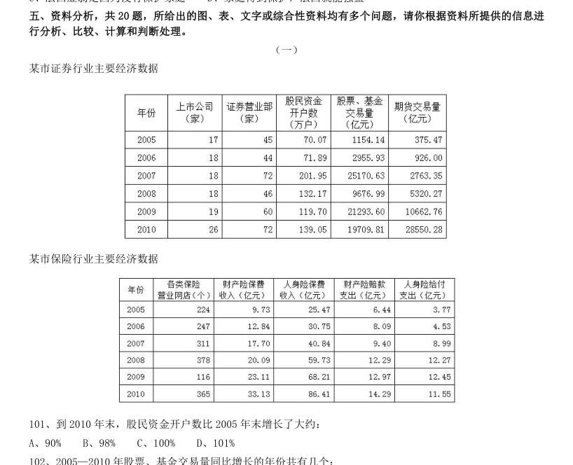

- **A.** 90%
- **B.** 98%
- **C.** 100%
- **D.** 101%

**答案：B**

### 2011 湖北·统一卷　第 106 题　（增长量计算（综合））
> 材料：A、2.64 B、2.84 C、3.56 D、2.44 (二)根据以下资料,完成各题。 2010 年1~3 月,法国货物贸易进出口总额为2734.4 亿美元,同比增长13.4%。其中,出口1264.7 亿美 元,同比增长14.5%;进口1469.7 亿美元,同比增长12.4%;逆差205.0 亿美元,同比增长1.0%。 1~3 月,中法双边贸易额为142.7 亿美元,同比增长22.4%。其中,法国对中国出口32.1 亿美元,同比 增长43.5%;自中国进口110.6 亿美元,…

另外,法国自中国进 口的化工产品的进口额同比增长最快,为38.8%。 2010 年1~3 月,法国货物贸易出口额比上年同期增长了约:

- **A.** 140 亿美元
- **B.** 120 亿美元
- **C.** 160 亿美元
- **D.** 180 亿美元

**答案：C**

### 2011 国考·统一卷　第 127 题　（增长量计算（415 份数法））
> 材料：2010 年上半年,全国原油产量为9848 万吨,同比增长5.3%,上年同期为下降1%。进口原油11797 万吨(海 关统计),增长30.2%。原油加工量20586 万吨,增长17.9%,增速同比加快16.4 个百分点。成品油产量中,汽 油产量增长6%,增速同比减缓7.9 个百分点;柴油产量增长28.1%,增速同比加快15.8 个百分点。 据行业统计,2010 年上半年成品油表观消费量10963 万吨,同比增长12.5%。其中,一、二季度分别增长 16.3%和9.2%。 20…

2010 年上半年,全国成品油表观消费量同比增加了约多少万吨:

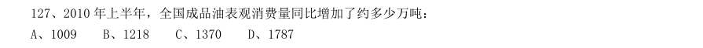

- **A.** 1009
- **B.** 1218
- **C.** 1370
- **D.** 1787

**答案：B**

### 2011 国考·统一卷　第 131 题　（增长量计算（415 份数法））
> 材料：2010 年一季度,我国水产品贸易进出口总量158.7 万吨,进出口总额40.9 亿美元,同比分别增长14.2%和29.0%.其中,出口量67.1 万吨,出口额26.5 亿美元,同比分别增长11.7%和24.9%;进口量91.6 万吨,进口额14.4 亿美元,同比分别增长16.0%和37.5%。…

2010 年一季度,我国水产品出口额比上年同期约增长了多少亿美元:

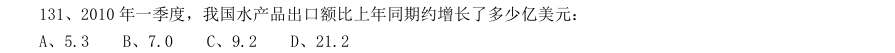

- **A.** 5.3
- **B.** 7.0
- **C.** 9.2
- **D.** 21.2

**答案：A**

### 2010 湖北·统一卷　第 92 题　（增长量计算（综合））
> 材料：理。 (一) 根据以下资料,完成各题。 2009 年,中国农业生产在国家继续加大支农政策力度的作用下,克服不利气候条件的影响,实现了稳步的增长。 据国家统计局公布的统计数据显示,2009 年第一产业增加值35477 亿元(包括农林牧渔服务业),比上年实际增 长4.2%。第一产业增加值占国内生产总值的比重为10.6%,比上年下降0.1 个百分点。在农、林、牧、渔业增 加值中,农业增加值19699 亿元,实际增长3.1%;林业增加值1581 亿元,实际增长6.0%;畜牧业增加值达…

2009 年,在农、林、牧、渔业增加值中,增长最快的是:

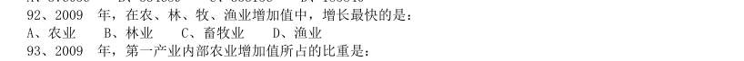

- **A.** 农业
- **B.** 林业
- **C.** 畜牧业
- **D.** 渔业

**答案：B**

### 2010 湖北·统一卷　第 94 题　（增长量计算（综合））
> 材料：理。 (一) 根据以下资料,完成各题。 2009 年,中国农业生产在国家继续加大支农政策力度的作用下,克服不利气候条件的影响,实现了稳步的增长。 据国家统计局公布的统计数据显示,2009 年第一产业增加值35477 亿元(包括农林牧渔服务业),比上年实际增 长4.2%。第一产业增加值占国内生产总值的比重为10.6%,比上年下降0.1 个百分点。在农、林、牧、渔业增 加值中,农业增加值19699 亿元,实际增长3.1%;林业增加值1581 亿元,实际增长6.0%;畜牧业增加值达…

2008 年,第一产业内部畜牧业增加值约是多少亿元?( )

- **A.** 9137
- **B.** 9340
- **C.** 9750
- **D.** 10078

**答案：A**

### 2010 湖北·统一卷　第 98 题　（增长量比较）

“家电下乡”产品销售额增量最多的月份增加了几个亿:

- **A.** 34.3
- **B.** 33.4
- **C.** 37.8
- **D.** 38.7

**答案：D**

### 2010 国考·统一卷　第 98 题　（增长量计算（综合））
> 材料：2008 年,某省农产品进出口贸易总额为7.15 亿美元,比上年增长25.2%。其中,出口额为5.02 亿美元,增 长22.1%;进口额为2.13 亿美元,增长33.2%。农产品进出口贸易额占全省对外贸易总额的4.5%。出口额居前5 位的产品为蔬菜、畜产品、水果、粮食和茶叶,而绿茶出口额占茶叶出口额的四分之三。全省农产品对东欧、非 洲、拉美等国家和地区的市场进一步开拓,出口额比上一年进一步增长。…

2008 年,该省农产品对外贸易顺差比上年增长了:

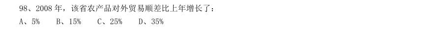

- **A.** 5%
- **B.** 15%
- **C.** 25%
- **D.** 35%

**答案：B**

### 2010 国考·统一卷　第 99 题　（增长量计算（415 份数法））
> 材料：2008 年,某省农产品进出口贸易总额为7.15 亿美元,比上年增长25.2%。其中,出口额为5.02 亿美元,增 长22.1%;进口额为2.13 亿美元,增长33.2%。农产品进出口贸易额占全省对外贸易总额的4.5%。出口额居前5 位的产品为蔬菜、畜产品、水果、粮食和茶叶,而绿茶出口额占茶叶出口额的四分之三。全省农产品对东欧、非 洲、拉美等国家和地区的市场进一步开拓,出口额比上一年进一步增长。…

与2007 年相比,2008 年该省出口韩国的农产品总额约增长了多少万美元:

- **A.** 5100
- **B.** 4500
- **C.** 3200
- **D.** 2100

**答案：D**
