# 资料分析 · 增长量计算 · 2020 年代真题

> 所属考点：[ZL-GROW](../ZL-GROW-增长量计算.md)　｜　本片 22 题

> 本片子考点：增长量计算（415 份数法） 11　增长量比较 7　增长量计算（综合） 4

### 2025 国考·地市级　第 119 题　（增长量计算（415 份数法））

如保持2023年同比增量不变,则到哪一年Z省律师办理法律业务数将首次超过150万件?

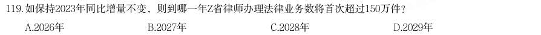

- **A.** 2026年
- **B.** 2027年
- **C.** 2028年
- **D.** 2029年

**答案：C**

### 2025 国考·地市级　第 120 题　（增长量计算（415 份数法））

以下柱状图反映了2021、2022和2023年Z省律师、基层法律服务工作哪一指标的同比增量变化趋势(横轴位置 表示增量为0)?

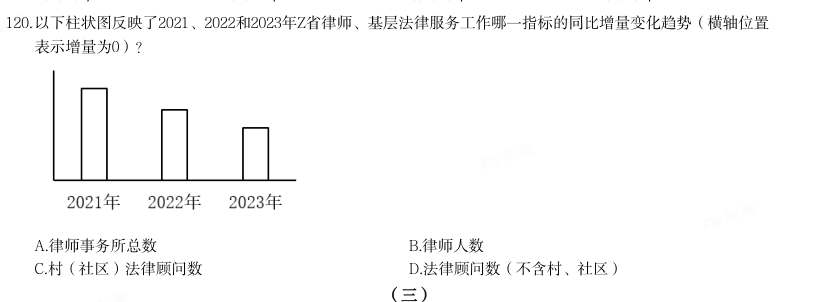

- **A.** 律师事务所总数
- **B.** 律师人数
- **C.** 村(社区)法律顾问数
- **D.** 法律顾问数(不含村、社区)

**答案：D**

### 2024 湖北·统一卷　第 123 题　（增长量比较）

按2022年我国十个品种再生资源回收重量从大到小进行排序,以下哪个折线图能准确反映排名前5位再生资源 同比增量的变化趋势?

- **A.** 
- **B.** 
- **C.** 
- **D.** 

**答案：D**

### 2024 国考·副省级　第 125 题　（增长量计算（415 份数法））

以下折线图反映了2019~2022年我国马铃薯哪一产销数据的同比增量变化趋势?

- **A.** 出口额
- **B.** 出口量
- **C.** 播种面积
- **D.** 产量

**答案：D**

### 2024 国考·地市级　第 113 题　（增长量计算（415 份数法））

以下折线图反映了2022年哪一时间段内S省各级12315工作机构的接收诉求量环比增量的变化趋势?

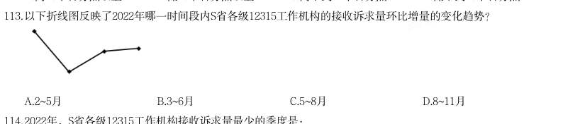

- **A.** 2~5月
- **B.** 3~6月
- **C.** 5~8月
- **D.** 8~11月

**答案：B**

### 2024 国考·地市级　第 130 题　（增长量计算（415 份数法））

以下折线图反映了2019~2022年全国哪一类电信业务收入同比增量的变化趋势?

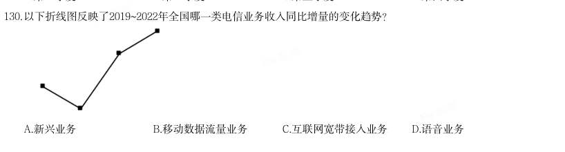

- **A.** 新兴业务
- **B.** 移动数据流量业务
- **C.** 互联网宽带接入业务
- **D.** 语音业务

**答案：D**

### 2023 广东·乡镇　第 94 题　（增长量比较）

2021 年,以下分类科目财政科学技术支出同比增加值最多的是( )。

- **A.** 基础研究
- **B.** 技术研究与开发
- **C.** 科技条件与服务
- **D.** 科技重大项目

**答案：D**

### 2023 国考·行政执法　第 115 题　（增长量计算（415 份数法））

以下折线图中,最能准确反映2017~2021年间北京市集成电路产量同比增量变化趋势的是:

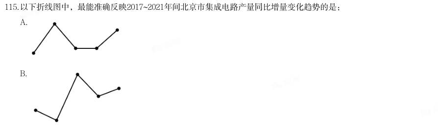

- **A.** 
- **B.** 
- **C.** 
- **D.** 

**答案：A**

### 2023 国考·行政执法　第 117 题　（增长量计算（综合））

2021年三季度Z省中心城市道路非机动车遵守交通信号灯率最低的城市,其四季度中心城市道路非机动车遵守 交通信号灯率比上季度增长了:

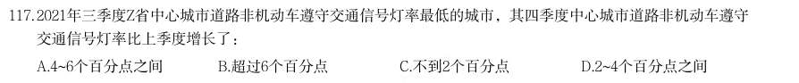

- **A.** 4~6个百分点之间
- **B.** 超过6个百分点
- **C.** 不到2个百分点
- **D.** 2~4个百分点之间

**答案：B**

### 2023 国考·行政执法　第 125 题　（增长量计算（415 份数法））

以下折线图中,最能准确反映2018-2021年我国木材进口额同比增量变化趋势的是:

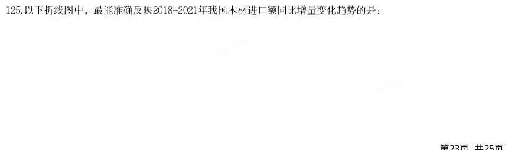

- **A.** 
- **B.** 
- **C.** 
- **D.** 

**答案：C**

### 2022 国考·副省级　第 119 题　（增长量比较）

(单选题)2012—2020 年,中国IC 封装市场规模同比增量最大的年份是:

- **A.** 2019 年
- **B.** 2018 年
- **C.** 2017 年
- **D.** 2016 年

**答案：C**

### 2022 国考·地市级　第 119 题　（增长量比较）

2012—2020 年,中国IC 封装市场规模同比增量最大的年份是:

- **A.** 2019 年
- **B.** 2018 年
- **C.** 2017 年
- **D.** 2016 年

**答案：C**

### 2022 国考·行政执法　第 120 题　（增长量比较）

(单选题)以下折线图反映了2020 年第二季度各月哪类环保举报件数环比增量的变化趋势?

- **A.** 电话举报
- **B.** 微信举报
- **C.** 网上举报
- **D.** 其他渠道举报

**答案：D**

### 2021 国考·地市级　第 114 题　（增长量计算（415 份数法））

以下折线图中,能准确反映2015—2018 年间通用照明类LED 应用市场产值同比增量变化趋势的是:

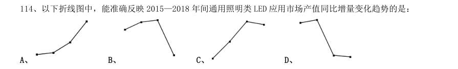

- **A.** 
- **B.** 
- **C.** 
- **D.** 

**答案：B**

### 2021 国考·地市级　第 121 题　（增长量比较）
> 材料：截至2019 年末,全国已有残疾人康复机构9775 个,比2018 年增长739 个。…

2019 年,1043.0 万残疾儿童及 持证残疾人得到基本康复服务,其中包括0—6 岁残疾儿童18.1 万人。 截至2019 年末,全国已竣工的各级残疾人综合服务设施2341 个,总建设规模584.5 万平方米,总投资183.1 亿元;已竣工各级残疾人康复设施1006 个,总建设规模414.2 万平方米,总投资132.2 亿元。 2016—2019 年,全国残疾人康复机构数量同比增量最大的年份是:

- **A.** 2016 年
- **B.** 2017 年
- **C.** 2018 年
- **D.** 2019 年

**答案：A**

### 2020 广东·乡镇　第 87 题　（增长量计算（415 份数法））

如果按照2018 年12 月到2020 年3 月的城镇网民规模月均增长量估算,2020 年12 月,城镇网民规模约为 ( )亿人。

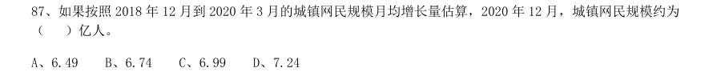

- **A.** 6.49
- **B.** 6.74
- **C.** 6.99
- **D.** 7.24

**答案：暂缺**

### 2020 广东·乡镇　第 88 题　（增长量计算（综合））

与2011 年12 月相比,2020 年3 月农村网民规模增长了约:

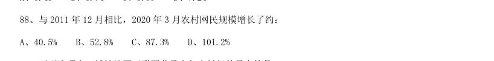

- **A.** 40.5%
- **B.** 52.8%
- **C.** 87.3%
- **D.** 101.2%

**答案：暂缺**

### 2020 广东·乡镇　第 91 题　（增长量计算（综合））
> 材料：2019 年我国农民工规模继续扩大,总量达到29077 万人,同比增长0.8%。其中,本地农民工11652 万人, 比上年增加82 万人;外出农民工17425 万人,比上年增加159 万人。外出农民工中,在省内就业的农民工 9917 万人,比上年增加245 万人;跨省流动农民工7508 万人,比上年减少86 万人。 从收入看,农民工集中就业的六大行业月均收入均稳定增长。2019 年农民工月均收入约4000 元,其中外 出农民工月均收入4427 元,比上年增加320 元;本地农…

分区域看, 在东部地区就业的农民工月均收入4222 元,比上年增长6.8%;在中部地区就业的农民工月均收入3794 元,比 上年增长6.3%;在西部地区就业的农民工月均收入3723 元,比上年增长5.7%;在东北地区就业的农民工月均 收入3469 元,同比增长5.2%。 2014—2019 年,我国农民工规模增加了约:

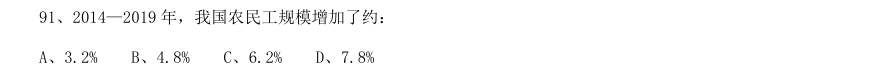

- **A.** 3.2%
- **B.** 4.8%
- **C.** 6.2%
- **D.** 7.8%

**答案：暂缺**

### 2020 国考·地市级　第 124 题　（增长量比较）

以下折线图反映了2014~2018 年间哪项收入同比增量的变化趋势?

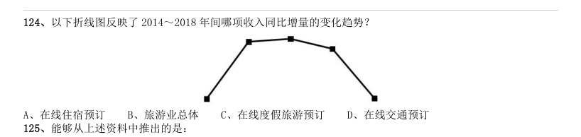

- **A.** 在线住宿预订
- **B.** 旅游业总体
- **C.** 在线度假旅游预订
- **D.** 在线交通预订

**答案：C**

### 2020 国考·地市级　第 128 题　（增长量计算（415 份数法））

2018 年,B 市零售额同比增长了:

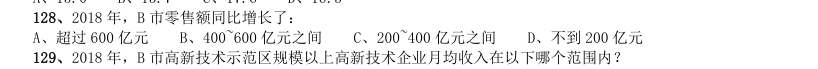

- **A.** 超过600 亿元
- **B.** 400~600 亿元之间
- **C.** 200~400 亿元之间
- **D.** 不到200 亿元

**答案：C**

### 2020 国考·省级　第 121 题　（增长量计算（415 份数法））

2016~2018 年,全国茶叶产量之和比2013~2015 年产量之和增加了:

- **A.** 100~150 万吨之间
- **B.** 不到100 万吨
- **C.** 超过200 万吨
- **D.** 150~200 万吨之间

**答案：A**

### 2020 国考·省级　第 131 题　（增长量计算（综合））
> 材料：中,工业品物流总额16636.15 亿元,同比增长0.2%,增速比上半年放缓2.1 个百分点;外部流入(含进口)货 物物流总额17357.31 亿元,同比增长12.1%,增速比上半年加快0.8 个百分点;农产品物流总额875.06 亿元, 同比增长11.6%,增速比上半年加快0.5 个百分点;单位与居民物品物流总额457.86 亿元,同比增长40.7%,增 速比上半年放缓3 个百分点;再生资源物流总额30.88 亿元,同比下降7.0%,降幅比上半年扩大4.3 个百分点。 20…

2018 年前三季度,S 省社会物流总费用2682.1 亿元,同比增长6.3%,比上半年放缓0.9 个百分点,其中: 物流运输环节总费用1854.6 亿元,同比增长6.3%;保管环节总费用612.4 亿元,同比增长6.4%;管理环节总费 用214.9 亿元,同比增长6.4%。 2018 年前三季度,S 省工业品物流总额同比增量约为同期社会物流总额同比增量的:

- **A.** 超过30%
- **B.** 10%~30%之间
- **C.** 5%~10%之间
- **D.** 不到5%

**答案：D**
