# 资料分析 · 增长率计算与比较 · 2000 年代真题

> 所属考点：[ZL-RATE](../ZL-RATE-增长率计算与比较.md)　｜　本片 54 题

> 本片子考点：增长率计算 21　增长率比较 19　增长率计算（综合） 13　降幅与增速 1

### 2009 湖北·统一卷　第 101 题　（增长率比较）

处理。 一、根据所给图表、文字资料完成各题。 2008 年7 月商品零售价格指数表(上年同月:100) 2008 年7 月城市商品价格较上年同月上涨幅度最大的是:

- **A.** 食品
- **B.** 燃料
- **C.** 日用品
- **D.** 金银珠宝

**答案：暂缺**

### 2009 湖北·统一卷　第 102 题　（增长率比较）

较上年同期,2008 年7 月城市跟农村商品价格涨幅相差最小的商品是:

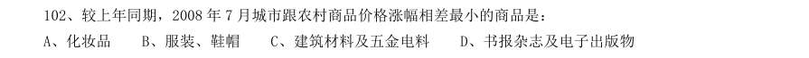

- **A.** 化妆品
- **B.** 服装、鞋帽
- **C.** 建筑材料及五金电料
- **D.** 书报杂志及电子出版物

**答案：暂缺**

### 2009 湖北·统一卷　第 104 题　（增长率比较）

2008 年7 月较上年同月涨幅最大是:

- **A.** 全国燃料
- **B.** 城市食品
- **C.** 农村体育娱乐用品
- **D.** 全国书报杂志及电子出版物

**答案：暂缺**

### 2009 湖北·统一卷　第 107 题　（增长率比较）
> 材料：2007 年前三季度,我国全社会固定资产投资91529 亿元,同比增长25.7%。其中,城镇固定资产投资78 247 亿元,增长26.4%;农村投资13 282 亿元,增长21.2%。在城镇投资中.国有及国有控股完成投资33 951 亿元,增长16.2%∶房地产开发完成投资16 814 亿元,增长30.3%。从项目隶属关系看,中央项目投资7749 亿元,同比增长15.4%;地方项目投资70 497 亿元,增长27.8%。从产业看,第一、二、三产业分别完成投 资938 亿元、3…

下列各项投资中,2007 年前三季度增幅最大的一项是:

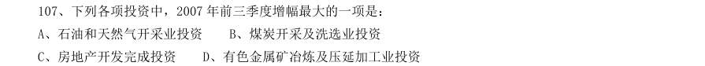

- **A.** 石油和天然气开采业投资
- **B.** 煤炭开采及洗选业投资
- **C.** 房地产开发完成投资
- **D.** 有色金属矿冶炼及压延加工业投资

**答案：暂缺**

### 2009 湖北·统一卷　第 111 题　（增长率比较）

2003~2006 年间、广告类节目较上一年增幅最大的是:

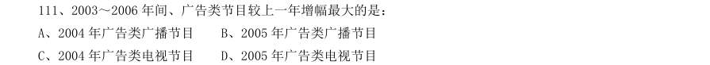

- **A.** 2004 年广告类广播节目
- **B.** 2005 年广告类广播节目
- **C.** 2004 年广告类电视节目
- **D.** 2005 年广告类电视节目

**答案：暂缺**

### 2009 湖北·统一卷　第 112 题　（增长率计算）

2006 年新闻类电视节目时数相对于1995 年的增幅是:

- **A.** 699.9%
- **B.** 718.9%
- **C.** 899%
- **D.** 789%

**答案：暂缺**

### 2009 湖北·统一卷　第 113 题　（增长率计算（综合））

2003 年广告类节目时数中,广播要比电视多出:

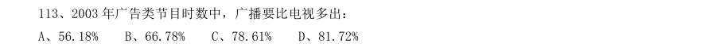

- **A.** 56.18%
- **B.** 66.78%
- **C.** 78.61%
- **D.** 81.72%

**答案：暂缺**

### 2009 湖北·统一卷　第 114 题　（增长率计算）

在2005 年、2006 年中,下列哪些节目时数增幅下降最明显:

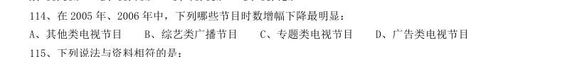

- **A.** 其他类电视节目
- **B.** 综艺类广播节目
- **C.** 专题类电视节目
- **D.** 广告类电视节目

**答案：暂缺**

### 2009 湖北·统一卷　第 117 题　（增长率计算（综合））
> 材料：2007 年末全国就业人员76990 万人,比上年末增加590 万人。其中,第一产业就业人员31444 万人,占全国就业人员的40.8%;第二产业20629 万人,占26.8%;第三产业24917 万人,占32.4%。年末城镇就业人员29350 万人,比上年末净增加1040 万人。其中,城镇单位就业人员12024 万人,比上年末增加311 万人;城镇私营个体就业人员7 891 万人,比上年末增加924 万人。在城镇单位就业人员中,在岗职工11427 万人,比上年末增加266 …

2007 年和2003 年相比,第一产业的就业人数约下降了:

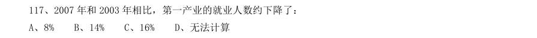

- **A.** 8%
- **B.** 14%
- **C.** 16%
- **D.** 无法计算

**答案：B**

### 2009 广东·统一卷　第 86 题　（增长率比较）
> 材料：有多个问题,请你根据资料所提供的信息进行分析、比较、计算和判断处理。 (一) 根据下列资料,回答问题。 据初步测算,2006 年广东完成生产总值25968.55 亿元,比上年增长14.1%,经济总量继续 列全国第一位置。其中,第一产业增长3.8%,第二产业增长16.9%,第三产业增长12.2%。与此 同时,鲁、苏、浙、沪也稳定协调发展,其中山东、江苏赶超步伐不减,增速分别高广东0.6 个 和0.8 个百分点。山东完成生产总值21846.71 亿元,增长14.7%;江苏完成生产…

上海房地产开发投资1275.59 亿元,增长2.3%。广 东房地产开发投资总量低于江苏,增速较高。 2005 年山东省城镇以上固定资产投资为多少亿元:

- **A.** 2633.79
- **B.** 21846.71
- **C.** 7274.51
- **D.** 6955.35

**答案：暂缺**

### 2009 广东·统一卷　第 87 题　（增长率计算）
> 材料：有多个问题,请你根据资料所提供的信息进行分析、比较、计算和判断处理。 (一) 根据下列资料,回答问题。 据初步测算,2006 年广东完成生产总值25968.55 亿元,比上年增长14.1%,经济总量继续 列全国第一位置。其中,第一产业增长3.8%,第二产业增长16.9%,第三产业增长12.2%。与此 同时,鲁、苏、浙、沪也稳定协调发展,其中山东、江苏赶超步伐不减,增速分别高广东0.6 个 和0.8 个百分点。山东完成生产总值21846.71 亿元,增长14.7%;江苏完成生产…

2006 年广东省工业增速排在第几位:

- **A.** 二
- **B.** 三
- **C.** 四
- **D.** 五

**答案：暂缺**

### 2009 广东·统一卷　第 92 题　（增长率计算）

若按照2005 年的增长率来计算,2009 年的社会投资用于地质勘查投资的资金约是:

- **A.** 675 亿美元
- **B.** 765 亿美元
- **C.** 640 亿美元
- **D.** 456 亿美元

**答案：暂缺**

### 2009 广东·统一卷　第 93 题　（增长率比较）

用于地质勘查投资的资金最多的一年比最小的一年多出:

- **A.** 152%
- **B.** 225%
- **C.** 252%
- **D.** 352%

**答案：暂缺**

### 2009 广东·统一卷　第 99 题　（增长率计算（综合））

与2004 年相比,2008 年货物进出口总额的增长幅度约为:

- **A.** 121.9%
- **B.** 21.9%
- **C.** 221.9%
- **D.** 45%

**答案：暂缺**

### 2009 国考·统一卷　第 133 题　（增长率计算）
> 材料：某港口2007 年生产统计表月份港口货物吞吐量(万吨)港口集装箱吞吐量(万TEU)本月数累计本月数累计本年上年同期比上年同期本年上年同期比上年同期…

2007 年4~12 月间港口集装箱吞吐量同比增长率最高的月份是:

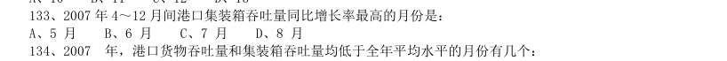

- **A.** 5 月
- **B.** 6 月
- **C.** 7 月
- **D.** 8 月

**答案：A**

### 2008 湖北·统一卷　第 120 题　（增长率计算（综合））
> 材料：共20 题。针对下列文字、表或图回答问题,你应根据资料提供的信息进行分析、比较、计算、处理。 根据以下文字资料,回答116-120 题。 据某市统计,截止到2004 年底,全市16 岁以下的少年儿童总数是2272194 人,其中,学龄前期儿童为 739616 人,占其总数的33.55%。…

该市学龄期儿童的服装消费金额比学龄前儿童高出约( )

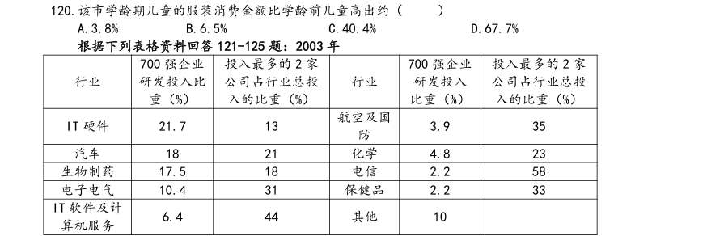

- **A.** 3.8%
- **B.** 6.5%
- **C.** 40.4%
- **D.** 67.7%

**答案：D**

### 2008 湖北·统一卷　第 134 题　（增长率计算（综合））

奥地利的GDP 总量比比利时的GDP 总量少( )。

- **A.** 5%
- **B.** 16.3%
- **C.** 19.4%
- **D.** 22.5%

**答案：B**

### 2008 广东·统一卷　第 97 题　（增长率比较）
> 材料：万户2003年2005年2007年2003年-2007年末电话用户情况示意图固定电话年末用户移动电话年末用户(统计数据来源于《2007 年中国国民经济统计公报》)…

根据上图,年末移动电话用户数增幅最大的年份是那一年?( )

- **A.** 2004 年
- **B.** 2005 年
- **C.** 2006 年
- **D.** 2007 年

**答案：暂缺**

### 2008 广东·统一卷　第 98 题　（增长率计算）
> 材料：万户2003年2005年2007年2003年-2007年末电话用户情况示意图固定电话年末用户移动电话年末用户(统计数据来源于《2007 年中国国民经济统计公报》)…

若按2007 年的固定电话增长率保持不变,预计到2008 年末全国固定电话用户数是多少?

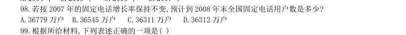

- **A.** 36779 万户
- **B.** 36545 万户
- **C.** 36311 万户
- **D.** 36312 万户

**答案：暂缺**

### 2008 国考·统一卷　第 121 题　（增长率计算）
> 材料：根据所给图表、文字资料完成各题。 以2004 年为例,年印刷量在10 亿对开张以上的企业有30 家,其中印刷量增长的企业占90%,而且全部增 长5%以上,增长率达两位数的企业占66.67%。年印刷量在5 亿至10 亿对开张之间的企业有26 家,其中印刷 量增长的有25 家,增长率达到两位数的有19 家。 到了2005 年,年印刷量在10 亿对开张以上的企业有29 家,其中印刷量增长的有17 家,增长5%以上的有 11 家,而保持两位数增长的有8 家。印刷量减少的企业有11 家…

年印刷量在5 亿至10 亿对开张之间的企业有28 家,其中印刷量增长的有20 家,增长5%以上的有14 家,保持两位数增长的有7 家。印刷量减少的企业有8 家。 2004 年印刷量增长率在5%以上的企业有多少家:

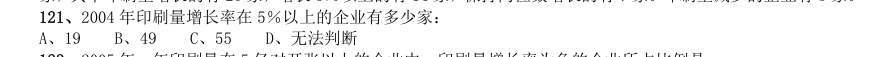

- **A.** 19
- **B.** 49
- **C.** 55
- **D.** 无法判断

**答案：D**

### 2008 国考·统一卷　第 126 题　（增长率计算）
> 材料：以2004 年为例,年印刷量在10 亿对开张以上的企业有30 家,其中印刷量增长的企业占90%,而且全部增长5%以上,增长率达两位数的企业占66.67%。年印刷量在5 亿至10 亿对开张之间的企业有26 家,其中印刷量增长的有25 家,增长率达到两位数的有19 家。 到了2005 年,年印刷量在10 亿对开张以上的企业有29 家,其中印刷量增长的有17 家,增长5%以上的有11 家,而保持两位数增长的有8 家。印刷量减少的企业有11 家。年印刷量在5 亿至10 亿对开张之间的…

根据资料,下列可以解释报纸印刷量增长率变化的事例是:

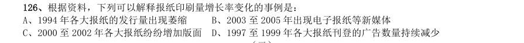

- **A.** 1994 年各大报纸的发行量出现萎缩
- **B.** 2003 至2005 年出现电子报纸等新媒体
- **C.** 2000 至2002 年各大报纸纷纷增加版面
- **D.** 1997 至1999 年各大报纸刊登的广告数量持续减少

**答案：B**

### 2007 广东·统一卷　第 98 题　（增长率比较）

在2000~2005 年,下列统汁指标增速最快的是( )。

- **A.** 装机容量
- **B.** 发电量
- **C.** 用电量
- **D.** 发电量占用电量的比重

**答案：暂缺**

### 2007 广东·统一卷　第 100 题　（增长率计算（综合））

根据上图,下列关于我国农村用电发电情况的表述,错误的一项是( )。

- **A.** 与2004 年相比,2005 年用电量提高了11.26%
- **B.** 我国农村发电量增长速度最慢的年份是2003 年
- **C.** 与2001 年相比,2002 年装机容量下降了l0.4%
- **D.** 2005 年农村发电量占农村用电量的比重是79.6%

**答案：暂缺**

### 2006 广东·统一卷　第 89 题　（增长率比较）
> 材料：86~90 题。 据统计,今年5月份全国基本型乘用车产销21.19万辆和22.13万辆,比去年同期分别增长1.86%和 26.0%;运动型多用途乘用车产销1.43万辆和1.52万辆,降幅不大;交叉型乘用车本月产销6.60万辆和6.85 万辆,分别比上月下降14.2%和2.8%;多功能乘用车产销降幅最大,本月产销1.23万辆1.24万辆。…

与去年同期比较,今年前5个月销量增幅度最大的车型是( )。

- **A.** 基本型乘用车
- **B.** 交叉型乘用车
- **C.** 多功能乘用车
- **D.** 运动型多用途乘用车

**答案：暂缺**

### 2006 国考·统一卷　第 123 题　（增长率比较）

与上一年同期相比增幅最大的是( )。

- **A.** 2004 年6 月财产险保费收入
- **B.** 2004 年6 月人身险保费收入
- **C.** 2005 年6 月财产险保费收入
- **D.** 2005 年6 月人身险保费收入

**答案：A**

### 2006 国考·统一卷　第 126 题　（增长率计算（综合））
> 材料：2004 年广播、电视宣传基本情况表项目节目套数(套)播出时间(小时/日)自办节目时间(小时/日)新闻节目专题节目教育节目文艺节目服务性节目无线广播合计中央台和国际台地方台电视播映合计中央台地方台…

2004 年广播、电视宣传基本情况表 项 目 节 目 套 数 (套) 播出 时间 (小时/日) 自办节目 时 间 (小时/日) 新闻 节目 专题 节目 教育 节目 文艺 节目 服 务 性 节 目 无线广播合计 中央台和国际台 地方台 26489 25960 17986 17457 电视播映合计 中央台 地方台 27499 27219 20455 20175 11618 11530 2004 年,所有无线广播自办节目中,新闻节目和专题节目所占比例分别为( )。

- **A.** 13.36%、21.78%
- **B.** 37.81%、34.59%
- **C.** 37.81%、21.78%
- **D.** 13.36%、34.59%

**答案：A**

### 2005 广东·统一卷　第 87 题　（增长率计算）
> 材料：86—90 题: 2004 年,广东国民经济保持平稳快速的发展势头,尤其是二、三产业的快速发展为广东城镇居民收入增 加奠定了基础。调查资料显示,2004 年广东城镇居民人均可支配收入 13 627.65 元,比上年增长10.1%,人均消费陛支出10694.79 元,增长11.0%。按家庭人口计算,广 东城镇居民人均工薪收入1l 646.42 元,增长11.8%。2004 年广东城镇居民家庭八大类消费支出除了家 庭设备用品及服务支出下降9.9%外,其他七类支出都有不同程度的增长…

2004 年城镇居民八大类消费支出增幅最低的是:

- **A.** 家庭设备用品及服务
- **B.** 医疗保健
- **C.** 居住
- **D.** 文教娱乐服务

**答案：暂缺**

### 2005 广东·统一卷　第 99 题　（增长率计算（综合））

根据图1,2003 年认为读书从来不重要的比率是多少?

- **A.** 1.9%
- **B.** 1.8%
- **C.** 3%
- **D.** 12.3%

**答案：暂缺**

### 2005 国考·统一卷　第 116 题　（增长率计算（综合））
> 材料：2001 年、2002 年全国高等学校各学科学生数(单位:千人)2001 年2002 年毕业生在校生毕业生在校生哲学经济学法学教育学文学历史学理学工学农学医学管理学合计…

2001 年、2002 年全国高等学校各学科学生数(单位:千人) 2001 年 2002 年 毕业生 在校生 毕业生 在校生 哲学 0.9 5.4 1.0 6.6 经济学 57.3 359.9 65.9 466.4 法学 61.5 387.9 80.0 474.8 教育学 52.6 374.5 79.8 470.3 文学 157.8 1059.3 198.5 1368.3 历史学 10.2 53.4 11.7 55.6 理学 115.8 716.3 131.5 852.2 工学 349.1 2491.2 459.8 3085.0 农学 28.5 186.0 36.3 216.0 医学 62.6 529.4 79.5 656.6 管理学 139.9 1027.5 193.2 1381.7 合计 1036.2 7190.8 1337.2 9033.5 2002 年的在校生中,工学学生所占的比例约是( )。

- **A.** 15%
- **B.** 20%
- **C.** 34%
- **D.** 40%

**答案：C**

### 2005 国考·统一卷　第 117 题　（增长率比较）
> 材料：2001 年、2002 年全国高等学校各学科学生数(单位:千人)2001 年2002 年毕业生在校生毕业生在校生哲学经济学法学教育学文学历史学理学工学农学医学管理学合计…

2002 年与2001 年相比,毕业生增长率最大的学科是( )。

- **A.** 教育学
- **B.** 经济学
- **C.** 管理学
- **D.** 医学

**答案：A**

### 2005 国考·统一卷　第 118 题　（增长率计算）
> 材料：2001 年、2002 年全国高等学校各学科学生数(单位:千人)2001 年2002 年毕业生在校生毕业生在校生哲学经济学法学教育学文学历史学理学工学农学医学管理学合计…

2002 年与2001 年相比,在校生增长率超过20%的学科有( )。

- **A.** 3 个
- **B.** 8 个
- **C.** 10 个
- **D.** 11 个

**答案：B**

### 2004 广东·统一卷　第 90 题　（增长率计算）
> 材料：一个图、表或一段文字均有几个问题要你回答。你应根据资料提供的信息进行分析、比 较、计算、 处理。共15 题,每题1 分,共15 分。 [例题]根据下表,回答1~2题 博物馆四个入口处自动计数器的读数 自动计数器在不 时间的读数(人数) 入口(时间) 7:00 8:00 9:00 10:00 11:00 1从早上7:00 到11:00 通过入口1 进入博物馆的参观人数是( )。 A.580 B.94 C.1374 D.1594 2在早上7:00 至8:00 之间,通过人数最多的…

1996 至1998 年,中部地区与西部地区小康实现程度的增幅相差多少?

- **A.** 0.26 个百分点
- **B.** 4.57 个百分点
- **C.** 7.65 个百分点
- **D.** 12.22 个百分点

**答案：暂缺**

### 2004 广东·统一卷　第 93 题　（增长率计算）

2002 年我国大陆对哪个国家出口额的年增长率最接近出口总额的年增长率?

- **A.** 美国
- **B.** 日本
- **C.** 韩国
- **D.** 俄罗斯

**答案：暂缺**

### 2004 广东·统一卷　第 96 题　（增长率比较）

图中各项,同比涨幅最大的一项是:

- **A.** GDP
- **B.** 工业产值
- **C.** 实际利用外资额
- **D.** 出口额

**答案：暂缺**

### 2004 国考·A卷　第 87 题　（增长率计算）

1998~2002 年广东省各类投资增长变化情况表% 从1998 年~2002 年间,投资增速一直呈下降趋势的是( )。

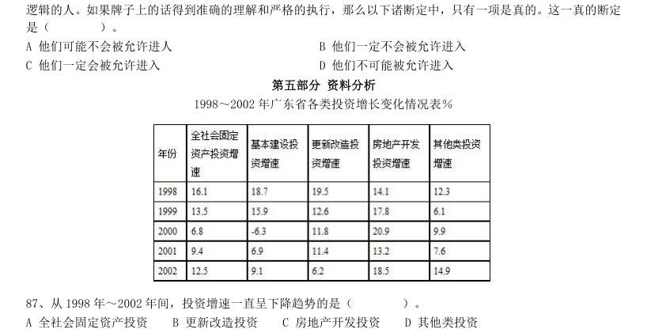

- **A.** 全社会固定资产投资
- **B.** 更新改造投资
- **C.** 房地产开发投资
- **D.** 其他类投资

**答案：B**

### 2004 国考·A卷　第 93 题　（增长率计算）
> 材料：注:增速是指与去年同期相比的增加速度。北京、天津、上海、重庆、广州五市GDP 增速比去年同期的增速分别提高了5.4 个、2.6 个、2.2 个、2 个和2.6 个百分点。…

2003 年第一季度GDP 总量和增速均居同一位的城市有( )。

- **A.** 1 个
- **B.** 2 个
- **C.** 3 个
- **D.** 4 个

**答案：C**

### 2004 国考·A卷　第 94 题　（增长率计算）
> 材料：注:增速是指与去年同期相比的增加速度。北京、天津、上海、重庆、广州五市GDP 增速比去年同期的增速分别提高了5.4 个、2.6 个、2.2 个、2 个和2.6 个百分点。…

下列哪个组合的陈述可能正确?( ) I.2003 年上述五个城市GDP 增速均实现两位数增长 II.2003 年广州经济总量首次超过北京 III.2002 年同期重庆GDP 总量也是第五位

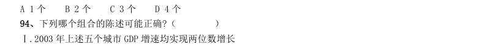

- **A.** I
- **B.** I和III
- **C.** I和II
- **D.** I、II和III

**答案：A**

### 2004 国考·A卷　第 96 题　（增长率计算）
> 材料：注:增速是指与去年同期相比的增加速度。北京、天津、上海、重庆、广州五市GDP 增速比去年同期的增速分别提高了5.4 个、2.6 个、2.2 个、2 个和2.6 个百分点。…

2002 年第一季度GDP 总量及增速均居第四位的城市是( )。

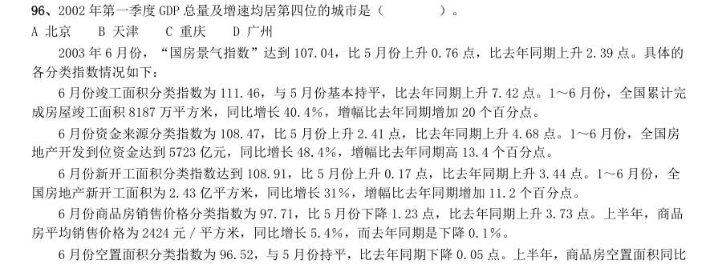

- **A.** 北京
- **B.** 天津
- **C.** 重庆
- **D.** 广州

**答案：C**

### 2004 国考·A卷　第 97 题　（降幅与增速）
> 材料：各分类指数情况如下: 6 月份竣工面积分类指数为111.46,与5 月份基本持平,比去年同期上升7.42 点。1~6 月份,全国累计完 成房屋竣工面积8187 万平方米,同比增长40.4%,增幅比去年同期增加20 个百分点。 6 月份资金来源分类指数为108.47,比5 月份上升2.41 点,比去年同期上升4.68 点。1~6 月份,全国房 地产开发到位资金达到5723 亿元,同比增长48.4%,增幅比去年同期高13.4 个百分点。 6 月份新开工面积分类指数达到108.91…

上半年,完成土 地开发面积7144 万平方米,同比增长40%,增幅比去年同期回落12.7 个百分点。 2002 年的1~6 月份,全国累计完成房屋竣工面积的增幅是( )。

- **A.** 40.40%
- **B.** 38.60%
- **C.** 20.40%
- **D.** 18.60%

**答案：C**

### 2004 国考·A卷　第 98 题　（增长率比较）
> 材料：各分类指数情况如下: 6 月份竣工面积分类指数为111.46,与5 月份基本持平,比去年同期上升7.42 点。1~6 月份,全国累计完 成房屋竣工面积8187 万平方米,同比增长40.4%,增幅比去年同期增加20 个百分点。 6 月份资金来源分类指数为108.47,比5 月份上升2.41 点,比去年同期上升4.68 点。1~6 月份,全国房 地产开发到位资金达到5723 亿元,同比增长48.4%,增幅比去年同期高13.4 个百分点。 6 月份新开工面积分类指数达到108.91…

与去年6 月相比,增幅最大的指数是( )。

- **A.** 竣工面积分类指数
- **B.** 商品房销售价格分类指数
- **C.** 资金来源分类指数
- **D.** 土地开发面积分类指数

**答案：A**

### 2004 国考·A卷　第 100 题　（增长率比较）
> 材料：各分类指数情况如下: 6 月份竣工面积分类指数为111.46,与5 月份基本持平,比去年同期上升7.42 点。1~6 月份,全国累计完 成房屋竣工面积8187 万平方米,同比增长40.4%,增幅比去年同期增加20 个百分点。 6 月份资金来源分类指数为108.47,比5 月份上升2.41 点,比去年同期上升4.68 点。1~6 月份,全国房 地产开发到位资金达到5723 亿元,同比增长48.4%,增幅比去年同期高13.4 个百分点。 6 月份新开工面积分类指数达到108.91…

与上一个月相比,降幅最大的指数是( )。

- **A.** 资金来源分类指数
- **B.** 空置面积分类指数
- **C.** 销售价格分类指数
- **D.** 土地开发面积分类指数

**答案：C**

### 2004 国考·A卷　第 102 题　（增长率计算）

亿元 2002 年北京市社会消费品零售总额相对于2000 年的增幅是( )。

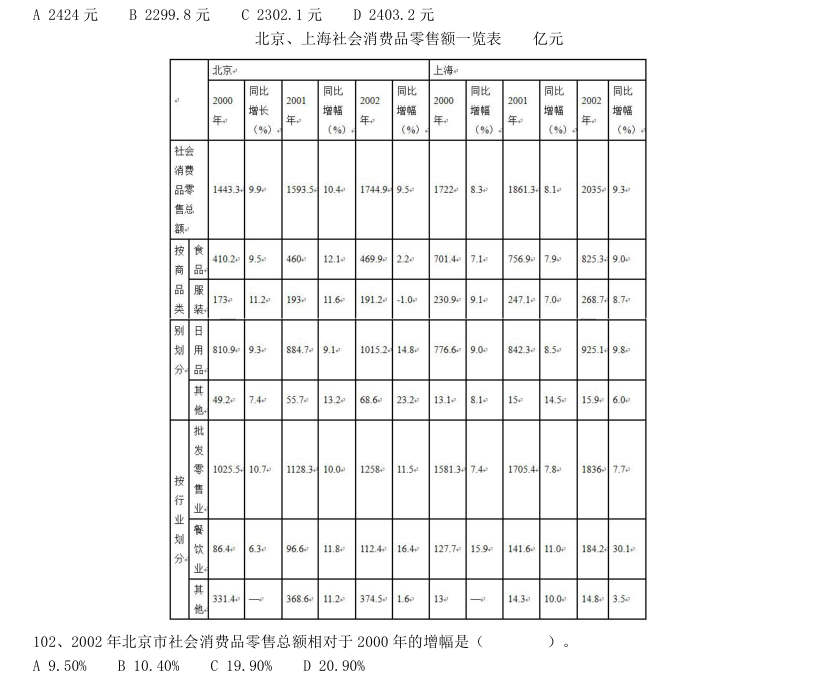

- **A.** 9.50%
- **B.** 10.40%
- **C.** 19.90%
- **D.** 20.90%

**答案：D**

### 2004 国考·A卷　第 103 题　（增长率比较）

与2001 年相比,2002 年北京和上海两市各类零售总额增幅最大的是( )。

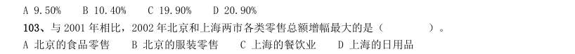

- **A.** 北京的食品零售
- **B.** 北京的服装零售
- **C.** 上海的餐饮业
- **D.** 上海的日用品

**答案：C**

### 2004 国考·A卷　第 105 题　（增长率计算）

2000~2002 年,下列选项中零售额增幅相对最稳定的是( )。

- **A.** 上海的食品
- **B.** 上海的批发零售
- **C.** 北京的食品
- **D.** 北京的批发零售

**答案：B**

### 2004 国考·A卷　第 106 题　（增长率计算（综合））

2002 年上海食品和服装的零售总额高出北京( )。

- **A.** 18.90%
- **B.** 42.50%
- **C.** 65.50%
- **D.** 70.60%

**答案：C**

### 2004 国考·B卷　第 85 题　（增长率比较）

1998~2002 年全国电话用户情况图(单位:万户) 全国移动电话用户增长速度最快的是( )。

- **A.** 1999 年
- **B.** 2000 年
- **C.** 2001 年
- **D.** 2002 年

**答案：B**

### 2004 国考·B卷　第 96 题　（增长率计算）
> 材料：2003 年一季度,京津沪渝穗五市分别实现房地产投资118 亿元、30.5 亿元、139.8 亿元、43.7 亿元和70.7 亿元,同比增长20.2%、50.1%、29.6%、41.3%和8.8%。五市房地产投资占总投资比重分别为54%、24.4%、38.3%、25.4%和47.7%,与去年同期相比,除广州有所下降以外,其余四市比重均有所上升。 2002~2003 年一季度京津沪渝穗五市房地产投资情况对比…

如果按照2003 年一季度的增长速度增长,则2004 年一季度天津的房地产投资绝对量(亿元)是( )。

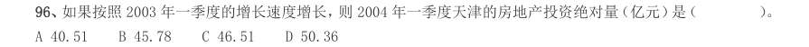

- **A.** 40.51
- **B.** 45.78
- **C.** 46.51
- **D.** 50.36

**答案：B**

### 2004 国考·B卷　第 98 题　（增长率比较）
> 材料：2003 年一季度,京津沪渝穗五市分别实现房地产投资118 亿元、30.5 亿元、139.8 亿元、43.7 亿元和70.7 亿元,同比增长20.2%、50.1%、29.6%、41.3%和8.8%。五市房地产投资占总投资比重分别为54%、24.4%、38.3%、25.4%和47.7%,与去年同期相比,除广州有所下降以外,其余四市比重均有所上升。 2002~2003 年一季度京津沪渝穗五市房地产投资情况对比…

相对于2001 年来说,2002 年一季度房地产投资增速最慢的地区是( )。

- **A.** 天津
- **B.** 北京
- **C.** 广州
- **D.** 上海

**答案：C**

### 2004 国考·B卷　第 104 题　（增长率计算）
> 材料：民生活水平小康实现程度达到94.3%。在12 项小康指标中有10 项达到或者基本达到小康初始水平。但是还有两 项指标,即文化教育娱乐支出比重和人均绿地面积与小康标准有一定差距。…

1996 年至1998 年,中部地区和西部地区小康实现程度的增幅相差多少个百分点?( )

- **A.** 4.57
- **B.** 0.26
- **C.** 7.65
- **D.** 12.22

**答案：B**

### 2003 国考·A卷　第 122 题　（增长率计算（综合））
> 材料：某地区劳动力文化程度的资料如下:(单位:万人)分组合计文盲小学初中高中大专本科及以上男性3452711712060912 女性40548228903063 总计75075345210901515(注:学习年限标准:文盲,0 年;小学,6年;初中,9 年;高中,12 年;大专,15 年;本科及以上,16 年)111.该地区每万人劳动力中,大专及以上文化程度的人数是多少?()。 A.350 人/万人B.400 人/万人C.450 人/万人D.500 人/万人112.根据上表所示,…

男性网民比女性网民约多多少?( )。

- **A.** 60%
- **B.** 70%
- **C.** 90%
- **D.** 130%

**答案：D**

### 2003 国考·A卷　第 127 题　（增长率计算）
> 材料：某地区劳动力文化程度的资料如下:(单位:万人)分组合计文盲小学初中高中大专本科及以上男性3452711712060912 女性40548228903063 总计75075345210901515(注:学习年限标准:文盲,0 年;小学,6年;初中,9 年;高中,12 年;大专,15 年;本科及以上,16 年)111.该地区每万人劳动力中,大专及以上文化程度的人数是多少?()。 A.350 人/万人B.400 人/万人C.450 人/万人D.500 人/万人112.根据上表所示,…

2002 年上半年,国内生产总值的增幅为( )。

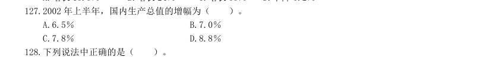

- **A.** 6.5%
- **B.** 7.0%
- **C.** 7.8%
- **D.** 8.8%

**答案：C**

### 2001 国考·统一卷　第 97 题　（增长率计算（综合））
> 材料：某航空公司1990~1991 年收到乘客投诉统计资料(%)分类1990 年1991 年航班误点行李差错服务质量差乘客超载理赔问题票价问题订票与确认问题饮食问题吸烟广告信誉问题特殊乘客其他收到投诉总件数22 988 件13 278 件…

1991 年与1990 年相比,投诉意见下降的百分比约为( )。

- **A.** 42%
- **B.** 58%
- **C.** 75%
- **D.** 94%

**答案：A**

### 2001 国考·统一卷　第 109 题　（增长率比较）

图中哪一年的外贸出口额的增长率最大?( )。

- **A.** 1982 年
- **B.** 1983 年
- **C.** 1985 年
- **D.** 1987 年

**答案：A**

### 2000 国考·统一卷　第 84 题　（增长率计算（综合））
> 材料：处理。 下面的三角形表示甲、乙、丙、丁、戊五个城市的中学生对X、Y、Z 三个电视节目的喜欢情况调查结果。如甲城喜欢X 节目的占30%,喜欢Y 节目的占70%,无人喜欢Z 节目;而丙城20%喜欢X 节目,50%喜欢Y 节目,30%喜欢Z 节目。…

Z 节目在丙城受欢迎的程度要达到X 节目在戊城的水平,需增加的百分比例是( )。

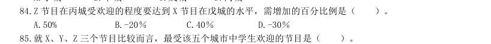

- **A.** 50%
- **B.** -20%
- **C.** 40%
- **D.** -30%

**答案：C**
